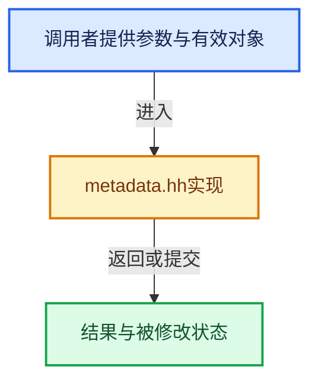

# 实现依赖专题：source/blender/gpu/shader_tool/metadata.hh

[实现依赖导航](../../../README.md) · [符号索引](../../../../00-课程指南/02-源码与提交索引/符号依赖与实现索引.md)

本专题从正文实际调用进入，集中保存共享实现。函数有稳定锚点，可从调用处直接跳到对应完整函数；递归与互相调用通过回链组织。

## 本文件的实现关系





## 相关类型布局与成员入口

<a id="t-06393d8b3356"></a>

### `blender::gpu::shader::metadata::Type`

原始声明：[source/blender/gpu/shader_tool/metadata.hh](../../../../../../../../source/blender/gpu/shader_tool/metadata.hh) · L70—L89。

以下保留类的数据声明与编译条件，成员函数实现通过后面的精确链接阅读。

<!-- annotated:230f70cfc2a7f6 -->

```cpp
enum Type : uint64_t {
  float1 = hash("float"),
  float2 = hash("float2"),
  float3 = hash("float3"),
  float4 = hash("float4"),
  float3x3 = hash("float3x3"),
  float4x4 = hash("float4x4"),
  int1 = hash("int"),
  int2 = hash("int2"),
  int3 = hash("int3"),
  int4 = hash("int4"),
  bool1 = hash("bool"),
  sampler1DArray = hash("sampler1DArray"),
  sampler2DArray = hash("sampler2DArray"),
  sampler2D = hash("sampler2D"),
  sampler3D = hash("sampler3D"),
  Closure = hash("Closure"),
  KernelGlobals = hash("KernelGlobals"),
  ShadingData = hash("ShadingData"),
};
```

<details>
<summary>核对原始源码：source/blender/gpu/shader_tool/metadata.hh · L70—L89</summary>

<!-- original:230f70cfc2a7f6:source/blender/gpu/shader_tool/metadata.hh:70:89 -->

```cpp
enum Type : uint64_t {
  float1 = hash("float"),
  float2 = hash("float2"),
  float3 = hash("float3"),
  float4 = hash("float4"),
  float3x3 = hash("float3x3"),
  float4x4 = hash("float4x4"),
  int1 = hash("int"),
  int2 = hash("int2"),
  int3 = hash("int3"),
  int4 = hash("int4"),
  bool1 = hash("bool"),
  sampler1DArray = hash("sampler1DArray"),
  sampler2DArray = hash("sampler2DArray"),
  sampler2D = hash("sampler2D"),
  sampler3D = hash("sampler3D"),
  Closure = hash("Closure"),
  KernelGlobals = hash("KernelGlobals"),
  ShadingData = hash("ShadingData"),
};
```

</details>


## 完整成员与函数实现
