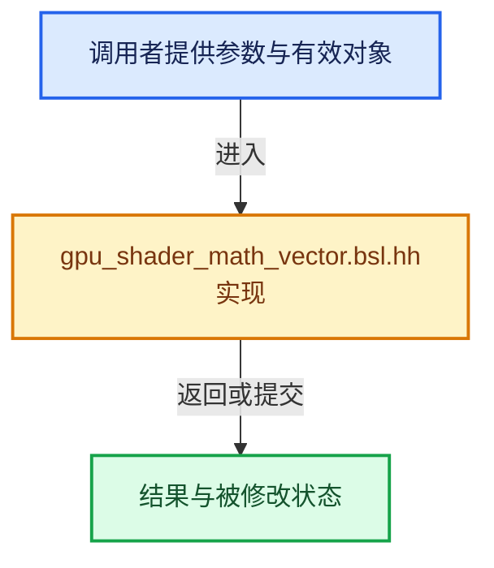

# 实现依赖专题：source/blender/gpu/shaders/common/gpu_shader_math_vector.bsl.hh

[实现依赖导航](../../../../README.md) · [符号索引](../../../../../00-课程指南/02-源码与提交索引/符号依赖与实现索引.md)

本专题从正文实际调用进入，集中保存共享实现。函数有稳定锚点，可从调用处直接跳到对应完整函数；递归与互相调用通过回链组织。

## 本文件的实现关系





## 完整成员与函数实现

<a id="f-1bc529235547f337"></a>

### `length_squared`

实现位置：[source/blender/gpu/shaders/common/gpu_shader_math_vector.bsl.hh](../../../../../../../../../source/blender/gpu/shaders/common/gpu_shader_math_vector.bsl.hh) · L90—L93。

接口参数：

- `VecT a`

**教学注释版**

<!-- annotated:2bd4308d98f4f2 -->

```cpp
template<typename VecT> float length_squared(VecT a)
{
  return dot(a, a);
}
```

<details>
<summary>核对原始源码：source/blender/gpu/shaders/common/gpu_shader_math_vector.bsl.hh · L90—L93</summary>

<!-- original:2bd4308d98f4f2:source/blender/gpu/shaders/common/gpu_shader_math_vector.bsl.hh:90:93 -->

```cpp
template<typename VecT> float length_squared(VecT a)
{
  return dot(a, a);
}
```

</details>

**结果出口**

- `return dot(a, a);`

**继续追踪实现**

- `dot` → [dot · L341](../../../../07-Intern运行时与平台/sky/source/sky_math.h.md#f-1d1835d5ece907c2)；[dot · L371](../../../../07-Intern运行时与平台/sky/source/sky_math.h.md#f-f86883f9f73a3d45)；[dot · L401](../../../../07-Intern运行时与平台/sky/source/sky_math.h.md#f-7ea1a37447b2c515)；[dot · L50](../../../../07-Intern运行时与平台/cycles/util/math_quaternion.h.md#f-e434705e781b49d6)；[dot · L309](../../../../07-Intern运行时与平台/cycles/util/math_float8.h.md#f-c00ff533ac3dcbbb)；[dot · L391](../../../../07-Intern运行时与平台/cycles/util/math_float4.h.md#f-66bab7788a88350d)；[dot · L254](../../../../07-Intern运行时与平台/cycles/util/math_float3.h.md#f-1345479cbb5c64a8)；[dot · L131](../../../../07-Intern运行时与平台/cycles/util/math_float2.h.md#f-c6c5b4937f8c1456)；[dot · L268](../../../../07-Intern运行时与平台/cycles/util/math_dual.h.md#f-e1745c95ae876efd)。同名重载需按实参类型选择。
