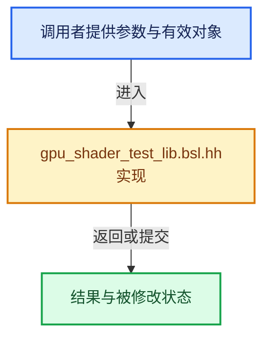

# 实现依赖专题：source/blender/gpu/shaders/common/gpu_shader_test_lib.bsl.hh

[实现依赖导航](../../../../README.md) · [符号索引](../../../../../00-课程指南/02-源码与提交索引/符号依赖与实现索引.md)

本专题从正文实际调用进入，集中保存共享实现。函数有稳定锚点，可从调用处直接跳到对应完整函数；递归与互相调用通过回链组织。

## 本文件的实现关系





<a id="m-b4a6a76e53eb"></a>

## 宏 `EXPECT_EQ`

<!-- annotated:2bee33fd5f04b2 -->

```cpp
#define EXPECT_EQ(result, expect) EXPECT_OP((result) == (expect), result, expect)
#define EXPECT_NE(result, expect) EXPECT_OP((result) != (expect), result, expect)
```

<details>
<summary>核对原始源码：source/blender/gpu/shaders/common/gpu_shader_test_lib.bsl.hh · L191—L192</summary>

<!-- original:2bee33fd5f04b2:source/blender/gpu/shaders/common/gpu_shader_test_lib.bsl.hh:191:192 -->

```cpp
#define EXPECT_EQ(result, expect) EXPECT_OP((result) == (expect), result, expect)
#define EXPECT_NE(result, expect) EXPECT_OP((result) != (expect), result, expect)
```

</details>

宏在预处理阶段展开，参数替换、重复求值和条件编译应直接从该定义检查。与普通函数不同，宏不会自动提供参数类型检查；构建配置选择哪个定义需结合外围条件。

<a id="m-0b52f93417c2"></a>

## 宏 `EXPECT_NE`

<!-- annotated:b5c27c683ad566 -->

```cpp
#define EXPECT_NE(result, expect) EXPECT_OP((result) != (expect), result, expect)
#define EXPECT_LE(result, expect) EXPECT_OP((result) <= (expect), result, expect)
```

<details>
<summary>核对原始源码：source/blender/gpu/shaders/common/gpu_shader_test_lib.bsl.hh · L192—L193</summary>

<!-- original:b5c27c683ad566:source/blender/gpu/shaders/common/gpu_shader_test_lib.bsl.hh:192:193 -->

```cpp
#define EXPECT_NE(result, expect) EXPECT_OP((result) != (expect), result, expect)
#define EXPECT_LE(result, expect) EXPECT_OP((result) <= (expect), result, expect)
```

</details>

宏在预处理阶段展开，参数替换、重复求值和条件编译应直接从该定义检查。与普通函数不同，宏不会自动提供参数类型检查；构建配置选择哪个定义需结合外围条件。

<a id="m-925d9744220f"></a>

## 宏 `EXPECT_LE`

<!-- annotated:755ab36e1eb231 -->

```cpp
#define EXPECT_LE(result, expect) EXPECT_OP((result) <= (expect), result, expect)
#define EXPECT_LT(result, expect) EXPECT_OP((result) < (expect), result, expect)
```

<details>
<summary>核对原始源码：source/blender/gpu/shaders/common/gpu_shader_test_lib.bsl.hh · L193—L194</summary>

<!-- original:755ab36e1eb231:source/blender/gpu/shaders/common/gpu_shader_test_lib.bsl.hh:193:194 -->

```cpp
#define EXPECT_LE(result, expect) EXPECT_OP((result) <= (expect), result, expect)
#define EXPECT_LT(result, expect) EXPECT_OP((result) < (expect), result, expect)
```

</details>

宏在预处理阶段展开，参数替换、重复求值和条件编译应直接从该定义检查。与普通函数不同，宏不会自动提供参数类型检查；构建配置选择哪个定义需结合外围条件。

<a id="m-328a23488cf0"></a>

## 宏 `EXPECT_LT`

<!-- annotated:791515e14a8b55 -->

```cpp
#define EXPECT_LT(result, expect) EXPECT_OP((result) < (expect), result, expect)
#define EXPECT_GE(result, expect) EXPECT_OP((result) >= (expect), result, expect)
```

<details>
<summary>核对原始源码：source/blender/gpu/shaders/common/gpu_shader_test_lib.bsl.hh · L194—L195</summary>

<!-- original:791515e14a8b55:source/blender/gpu/shaders/common/gpu_shader_test_lib.bsl.hh:194:195 -->

```cpp
#define EXPECT_LT(result, expect) EXPECT_OP((result) < (expect), result, expect)
#define EXPECT_GE(result, expect) EXPECT_OP((result) >= (expect), result, expect)
```

</details>

宏在预处理阶段展开，参数替换、重复求值和条件编译应直接从该定义检查。与普通函数不同，宏不会自动提供参数类型检查；构建配置选择哪个定义需结合外围条件。

<a id="m-70f91a02f991"></a>

## 宏 `EXPECT_GE`

<!-- annotated:1b1713a610f86c -->

```cpp
#define EXPECT_GE(result, expect) EXPECT_OP((result) >= (expect), result, expect)
#define EXPECT_GT(result, expect) EXPECT_OP((result) > (expect), result, expect)
```

<details>
<summary>核对原始源码：source/blender/gpu/shaders/common/gpu_shader_test_lib.bsl.hh · L195—L196</summary>

<!-- original:1b1713a610f86c:source/blender/gpu/shaders/common/gpu_shader_test_lib.bsl.hh:195:196 -->

```cpp
#define EXPECT_GE(result, expect) EXPECT_OP((result) >= (expect), result, expect)
#define EXPECT_GT(result, expect) EXPECT_OP((result) > (expect), result, expect)
```

</details>

宏在预处理阶段展开，参数替换、重复求值和条件编译应直接从该定义检查。与普通函数不同，宏不会自动提供参数类型检查；构建配置选择哪个定义需结合外围条件。

<a id="m-f1d61106bf8d"></a>

## 宏 `EXPECT_GT`

<!-- annotated:ebbf1ea388619e -->

```cpp
#define EXPECT_GT(result, expect) EXPECT_OP((result) > (expect), result, expect)

```

<details>
<summary>核对原始源码：source/blender/gpu/shaders/common/gpu_shader_test_lib.bsl.hh · L196—L197</summary>

<!-- original:ebbf1ea388619e:source/blender/gpu/shaders/common/gpu_shader_test_lib.bsl.hh:196:197 -->

```cpp
#define EXPECT_GT(result, expect) EXPECT_OP((result) > (expect), result, expect)

```

</details>

宏在预处理阶段展开，参数替换、重复求值和条件编译应直接从该定义检查。与普通函数不同，宏不会自动提供参数类型检查；构建配置选择哪个定义需结合外围条件。

<a id="m-799c1e4a74c0"></a>

## 宏 `EXPECT_TRUE`

<!-- annotated:f65da94ff445a8 -->

```cpp
#define EXPECT_TRUE(result) EXPECT_OP(result, result, true)
#define EXPECT_FALSE(result) EXPECT_OP(!result, result, false)
```

<details>
<summary>核对原始源码：source/blender/gpu/shaders/common/gpu_shader_test_lib.bsl.hh · L198—L199</summary>

<!-- original:f65da94ff445a8:source/blender/gpu/shaders/common/gpu_shader_test_lib.bsl.hh:198:199 -->

```cpp
#define EXPECT_TRUE(result) EXPECT_OP(result, result, true)
#define EXPECT_FALSE(result) EXPECT_OP(!result, result, false)
```

</details>

宏在预处理阶段展开，参数替换、重复求值和条件编译应直接从该定义检查。与普通函数不同，宏不会自动提供参数类型检查；构建配置选择哪个定义需结合外围条件。

## 完整成员与函数实现
