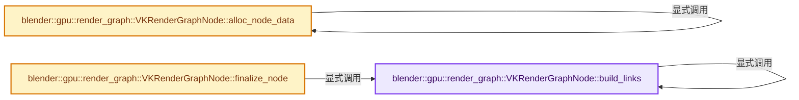
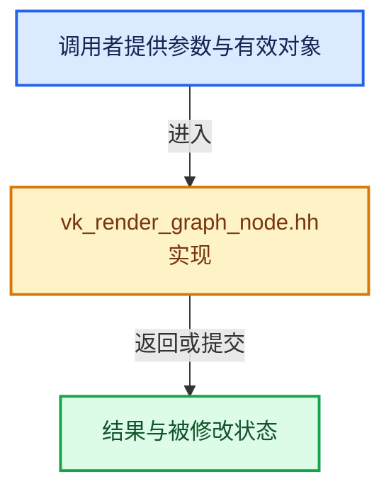

# 实现依赖专题：source/blender/gpu/vulkan/render_graph/vk_render_graph_node.hh

[实现依赖导航](../../../../README.md) · [符号索引](../../../../../00-课程指南/02-源码与提交索引/符号依赖与实现索引.md)

本专题从正文实际调用进入，集中保存共享实现。函数有稳定锚点，可从调用处直接跳到对应完整函数；递归与互相调用通过回链组织。

## 本文件的实现关系






## 完整成员与函数实现

<a id="f-b99c2c6a2844ff11"></a>

### `blender::gpu::render_graph::VKRenderGraphNode::build_links`

实现位置：[source/blender/gpu/vulkan/render_graph/vk_render_graph_node.hh](../../../../../../../../../source/blender/gpu/vulkan/render_graph/vk_render_graph_node.hh) · L187—L200。

接口参数：

- `VKResourceStateTracker &resources`
- `VKRenderGraphLinks &links`
- `const typename NodeInfo::CreateInfo &create_info`

**教学注释版**

<!-- annotated:5fa962ebdf0de6 -->

```cpp
  template<typename NodeInfo>
  void build_links(VKResourceStateTracker &resources,
                   VKRenderGraphLinks &links,
                   const typename NodeInfo::CreateInfo &create_info)
  {
    /* Instance of NodeInfo is needed to call virtual methods. CPP doesn't support overloading of
     * static methods. */
    NodeInfo node_info;
    int64_t buffer_index_start = links.buffers.size();
    int64_t image_index_start = links.images.size();
    node_info.build_links(resources, links, create_info);
    this->links.buffers = IndexRange::from_begin_end(buffer_index_start, links.buffers.size());
    this->links.images = IndexRange::from_begin_end(image_index_start, links.images.size());
  }
```

<details>
<summary>核对原始源码：source/blender/gpu/vulkan/render_graph/vk_render_graph_node.hh · L187—L200</summary>

<!-- original:5fa962ebdf0de6:source/blender/gpu/vulkan/render_graph/vk_render_graph_node.hh:187:200 -->

```cpp
  template<typename NodeInfo>
  void build_links(VKResourceStateTracker &resources,
                   VKRenderGraphLinks &links,
                   const typename NodeInfo::CreateInfo &create_info)
  {
    /* Instance of NodeInfo is needed to call virtual methods. CPP doesn't support overloading of
     * static methods. */
    NodeInfo node_info;
    int64_t buffer_index_start = links.buffers.size();
    int64_t image_index_start = links.images.size();
    node_info.build_links(resources, links, create_info);
    this->links.buffers = IndexRange::from_begin_end(buffer_index_start, links.buffers.size());
    this->links.images = IndexRange::from_begin_end(image_index_start, links.images.size());
  }
```

</details>

**沿实际写入检查状态**

- `this->links.buffers = IndexRange::from_begin_end(buffer_index_start, links.buffers.size());`
- `this->links.images = IndexRange::from_begin_end(image_index_start, links.images.size());`

**继续追踪实现**

- `links.buffers.size` → [调用协议](../../../../../00-课程指南/01-路线与规范/模板宏与动态分派协议.md)：接收对象类型依赖auto、返回值或模板实例；不按同名猜测目标。调用位置L195。
- `links.images.size` → [调用协议](../../../../../00-课程指南/01-路线与规范/模板宏与动态分派协议.md)：接收对象类型依赖auto、返回值或模板实例；不按同名猜测目标。调用位置L196。
- `node_info.build_links` → [blender::gpu::render_graph::VKRenderGraphNode::build_links · L187](vk_render_graph_node.hh.md#f-b99c2c6a2844ff11)。
- `IndexRange::from_begin_end` → [blender::IndexRange::from_begin_end · L78](../../../../../01-基础容器与现代CPP/04-IndexRange连续整数区间.md#f-a523839fb9650253)。

<a id="f-100df13b35dcee09"></a>

### `blender::gpu::render_graph::VKRenderGraphNode::alloc_node_data`

实现位置：[source/blender/gpu/vulkan/render_graph/vk_render_graph_node.hh](../../../../../../../../../source/blender/gpu/vulkan/render_graph/vk_render_graph_node.hh) · L211—L217。

接口参数：

- `VKRenderGraphStorage &storage`

**教学注释版**

<!-- annotated:be98fe8e2ec71d -->

```cpp
  template<typename NodeInfo>
  typename NodeInfo::Data &alloc_node_data(VKRenderGraphStorage &storage)
  {
    BLI_assert(type == VKNodeType::UNUSED);
    type = NodeInfo::node_type;
    return NodeInfo::alloc_node_data(storage, storage_index);
  }
```

<details>
<summary>核对原始源码：source/blender/gpu/vulkan/render_graph/vk_render_graph_node.hh · L211—L217</summary>

<!-- original:be98fe8e2ec71d:source/blender/gpu/vulkan/render_graph/vk_render_graph_node.hh:211:217 -->

```cpp
  template<typename NodeInfo>
  typename NodeInfo::Data &alloc_node_data(VKRenderGraphStorage &storage)
  {
    BLI_assert(type == VKNodeType::UNUSED);
    type = NodeInfo::node_type;
    return NodeInfo::alloc_node_data(storage, storage_index);
  }
```

</details>

**沿实际写入检查状态**

- `type = NodeInfo::node_type;`

**结果出口**

- `return NodeInfo::alloc_node_data(storage, storage_index);`

**继续追踪实现**

- `BLI_assert` → [BLI_assert · L48](../../../../01-BLI基础库/BLI_assert.hh.md#m-57a88495704d)；[BLI_assert · L63](../../../../01-BLI基础库/BLI_assert.hh.md#m-d07050020cb5)。宏定义由构建条件选择。
- `NodeInfo::alloc_node_data` → [blender::gpu::render_graph::VKRenderGraphNode::alloc_node_data · L211](vk_render_graph_node.hh.md#f-100df13b35dcee09)。

<a id="f-7e41904e5efa48c0"></a>

### `blender::gpu::render_graph::VKRenderGraphNode::finalize_node`

实现位置：[source/blender/gpu/vulkan/render_graph/vk_render_graph_node.hh](../../../../../../../../../source/blender/gpu/vulkan/render_graph/vk_render_graph_node.hh) · L225—L238。

接口参数：

- `VKRenderGraphStorage &storage`
- `VKResourceStateTracker &resources`
- `VKRenderGraphLinks &links`
- `const typename NodeInfo::CreateInfo &create_info`

**教学注释版**

<!-- annotated:c6124205004156 -->

```cpp
  template<typename NodeInfo>
  void finalize_node(VKRenderGraphStorage &storage,
                     VKResourceStateTracker &resources,
                     VKRenderGraphLinks &links,
                     const typename NodeInfo::CreateInfo &create_info)
  {
    NodeInfo node_info;
    int64_t buffer_index_start = links.buffers.size();
    int64_t image_index_start = links.images.size();
    node_info.build_links(
        resources, links, create_info, NodeInfo::storage_data(storage, storage_index));
    this->links.buffers = IndexRange::from_begin_end(buffer_index_start, links.buffers.size());
    this->links.images = IndexRange::from_begin_end(image_index_start, links.images.size());
  }
```

<details>
<summary>核对原始源码：source/blender/gpu/vulkan/render_graph/vk_render_graph_node.hh · L225—L238</summary>

<!-- original:c6124205004156:source/blender/gpu/vulkan/render_graph/vk_render_graph_node.hh:225:238 -->

```cpp
  template<typename NodeInfo>
  void finalize_node(VKRenderGraphStorage &storage,
                     VKResourceStateTracker &resources,
                     VKRenderGraphLinks &links,
                     const typename NodeInfo::CreateInfo &create_info)
  {
    NodeInfo node_info;
    int64_t buffer_index_start = links.buffers.size();
    int64_t image_index_start = links.images.size();
    node_info.build_links(
        resources, links, create_info, NodeInfo::storage_data(storage, storage_index));
    this->links.buffers = IndexRange::from_begin_end(buffer_index_start, links.buffers.size());
    this->links.images = IndexRange::from_begin_end(image_index_start, links.images.size());
  }
```

</details>

**沿实际写入检查状态**

- `this->links.buffers = IndexRange::from_begin_end(buffer_index_start, links.buffers.size());`
- `this->links.images = IndexRange::from_begin_end(image_index_start, links.images.size());`

**继续追踪实现**

- `links.buffers.size` → [调用协议](../../../../../00-课程指南/01-路线与规范/模板宏与动态分派协议.md)：接收对象类型依赖auto、返回值或模板实例；不按同名猜测目标。调用位置L232。
- `links.images.size` → [调用协议](../../../../../00-课程指南/01-路线与规范/模板宏与动态分派协议.md)：接收对象类型依赖auto、返回值或模板实例；不按同名猜测目标。调用位置L233。
- `node_info.build_links` → [blender::gpu::render_graph::VKRenderGraphNode::build_links · L187](vk_render_graph_node.hh.md#f-b99c2c6a2844ff11)。
- `NodeInfo::storage_data` → [调用协议](../../../../../00-课程指南/01-路线与规范/模板宏与动态分派协议.md)：函数指针、局部可调用对象或未展开的宏；必须结合调用者环境。调用位置L235。
- `IndexRange::from_begin_end` → [blender::IndexRange::from_begin_end · L78](../../../../../01-基础容器与现代CPP/04-IndexRange连续整数区间.md#f-a523839fb9650253)。
