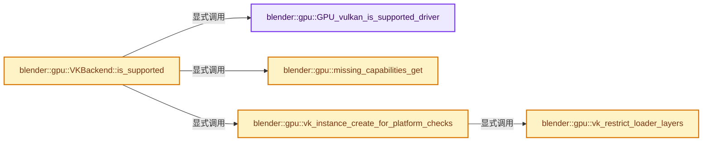
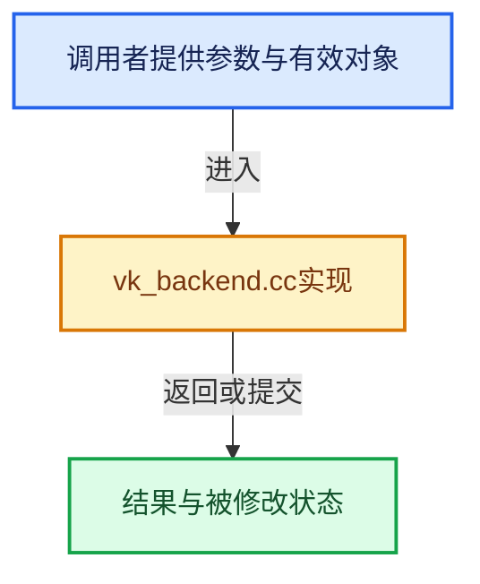

# 实现依赖专题：source/blender/gpu/vulkan/vk_backend.cc

[实现依赖导航](../../../README.md) · [符号索引](../../../../00-课程指南/02-源码与提交索引/符号依赖与实现索引.md)

本专题从正文实际调用进入，集中保存共享实现。函数有稳定锚点，可从调用处直接跳到对应完整函数；递归与互相调用通过回链组织。

## 本文件的实现关系






## 完整成员与函数实现

<a id="f-9e601bf5fcbaf941"></a>

### `blender::gpu::GPU_vulkan_is_supported_driver`

实现位置：[source/blender/gpu/vulkan/vk_backend.cc](../../../../../../../../source/blender/gpu/vulkan/vk_backend.cc) · L55—L142。

接口参数：

- `VkPhysicalDevice vk_physical_device`

**教学注释版**

<!-- annotated:38cf248006eaa4 -->

```cpp
bool GPU_vulkan_is_supported_driver(VkPhysicalDevice vk_physical_device)
{
  /* Check for known faulty drivers. */
  VkPhysicalDeviceProperties2 vk_physical_device_properties = {};
  VkPhysicalDeviceDriverProperties vk_physical_device_driver_properties = {};
  vk_physical_device_properties.sType = VK_STRUCTURE_TYPE_PHYSICAL_DEVICE_PROPERTIES_2;
  vk_physical_device_driver_properties.sType = VK_STRUCTURE_TYPE_PHYSICAL_DEVICE_DRIVER_PROPERTIES;
  vk_physical_device_properties.pNext = &vk_physical_device_driver_properties;
  vkGetPhysicalDeviceProperties2(vk_physical_device, &vk_physical_device_properties);

#ifdef _WIN32
  /* Intel IRIS on 10th gen CPU (and older) crashes with drivers before 101.2140 due to multiple
   * driver issues.
   *
   * 1) Workbench is working, but EEVEE pipelines are failing. Calling vkCreateGraphicsPipelines
   * for certain EEVEE shaders (Shadow, Deferred rendering) would return with VK_SUCCESS, but
   * without a created VkPipeline handle.
   *
   * 2) When vkCmdBeginRendering is called some requirements need to be met, that can only be met
   * when actually calling a vkCmdDraw* command. According to the Vulkan specs the requirements
   * should only be met when calling a vkCmdDraw* command.
   */
  if (vk_physical_device_driver_properties.driverID == VK_DRIVER_ID_INTEL_PROPRIETARY_WINDOWS &&
      vk_physical_device_properties.properties.deviceType ==
          VK_PHYSICAL_DEVICE_TYPE_INTEGRATED_GPU)
  {
    const uint32_t driver_version = vk_physical_device_properties.properties.driverVersion;
    uint32_t driver_version_major = driver_version >> 14u;
    uint32_t driver_version_minor = driver_version & 0x3fffu;
    if (driver_version_major < 101 || (driver_version_major == 101 && driver_version_minor < 2140))
    {
      return false;
    }
  }
#endif

#ifndef _WIN32
  /* NVIDIA drivers below 550 don't work on Linux. When sending command to the GPU there is not
   * always a reply back when they are finished. The issue is reported on the Internet many times,
   * but there is no mention of a solution. This means that on Linux we can only support GTX900 and
   * or use MesaNVK.
   */
  uint32_t conformance_version = VK_MAKE_API_VERSION(
      vk_physical_device_driver_properties.conformanceVersion.major,
      vk_physical_device_driver_properties.conformanceVersion.minor,
      vk_physical_device_driver_properties.conformanceVersion.subminor,
      vk_physical_device_driver_properties.conformanceVersion.patch);
  if (vk_physical_device_driver_properties.driverID == VK_DRIVER_ID_NVIDIA_PROPRIETARY &&
      conformance_version < VK_MAKE_API_VERSION(1, 3, 7, 2))
  {
    return false;
  }

  /* NVIDIA driver 580.76.05 doesn't start using specific Wayland configurations #144625. There are
   * multiple reports also not Blender related and NVIDIA mentions that a new driver will be
   * released. It is unclear if that driver will fix our issue. For now disabling this driver on
   * Linux. This also disables it for configurations that are working as well (including X11). */
  if (vk_physical_device_driver_properties.driverID == VK_DRIVER_ID_NVIDIA_PROPRIETARY &&
      ((StringRefNull(vk_physical_device_driver_properties.driverInfo).find("580.76.5", 0) !=
        StringRef::not_found) ||
       (StringRefNull(vk_physical_device_driver_properties.driverInfo).find("580.76.05", 0) !=
        StringRef::not_found)))
  {
    return false;
  }
#endif

#ifdef _WIN32
  if (vk_physical_device_driver_properties.driverID == VK_DRIVER_ID_QUALCOMM_PROPRIETARY) {
    /* Any Qualcomm driver older than 31.0.112.0 will not be capable of running blender due
     * to an issue in their semaphore timeline implementation. The driver could return
     * timelines that have not been provided by Blender. As Blender uses timelines for resource
     * management this resulted in resources to be destroyed, that are still in use. */

    /* Public version 31.0.112 uses vulkan driver version 512.827.0. */
    const uint32_t driver_version = vk_physical_device_properties.properties.driverVersion;
    constexpr uint32_t version_31_0_112 = VK_MAKE_VERSION(512, 827, 0);
    if (driver_version < version_31_0_112) {
      CLOG_WARN(&LOG,
                "Detected qualcomm driver is not supported. To run the Vulkan backend "
                "driver 31.0.112.0 or later is required. Switching to OpenGL.");
      return false;
    }
  }
#endif

  return true;
}
```

<details>
<summary>核对原始源码：source/blender/gpu/vulkan/vk_backend.cc · L55—L142</summary>

<!-- original:38cf248006eaa4:source/blender/gpu/vulkan/vk_backend.cc:55:142 -->

```cpp
bool GPU_vulkan_is_supported_driver(VkPhysicalDevice vk_physical_device)
{
  /* Check for known faulty drivers. */
  VkPhysicalDeviceProperties2 vk_physical_device_properties = {};
  VkPhysicalDeviceDriverProperties vk_physical_device_driver_properties = {};
  vk_physical_device_properties.sType = VK_STRUCTURE_TYPE_PHYSICAL_DEVICE_PROPERTIES_2;
  vk_physical_device_driver_properties.sType = VK_STRUCTURE_TYPE_PHYSICAL_DEVICE_DRIVER_PROPERTIES;
  vk_physical_device_properties.pNext = &vk_physical_device_driver_properties;
  vkGetPhysicalDeviceProperties2(vk_physical_device, &vk_physical_device_properties);

#ifdef _WIN32
  /* Intel IRIS on 10th gen CPU (and older) crashes with drivers before 101.2140 due to multiple
   * driver issues.
   *
   * 1) Workbench is working, but EEVEE pipelines are failing. Calling vkCreateGraphicsPipelines
   * for certain EEVEE shaders (Shadow, Deferred rendering) would return with VK_SUCCESS, but
   * without a created VkPipeline handle.
   *
   * 2) When vkCmdBeginRendering is called some requirements need to be met, that can only be met
   * when actually calling a vkCmdDraw* command. According to the Vulkan specs the requirements
   * should only be met when calling a vkCmdDraw* command.
   */
  if (vk_physical_device_driver_properties.driverID == VK_DRIVER_ID_INTEL_PROPRIETARY_WINDOWS &&
      vk_physical_device_properties.properties.deviceType ==
          VK_PHYSICAL_DEVICE_TYPE_INTEGRATED_GPU)
  {
    const uint32_t driver_version = vk_physical_device_properties.properties.driverVersion;
    uint32_t driver_version_major = driver_version >> 14u;
    uint32_t driver_version_minor = driver_version & 0x3fffu;
    if (driver_version_major < 101 || (driver_version_major == 101 && driver_version_minor < 2140))
    {
      return false;
    }
  }
#endif

#ifndef _WIN32
  /* NVIDIA drivers below 550 don't work on Linux. When sending command to the GPU there is not
   * always a reply back when they are finished. The issue is reported on the Internet many times,
   * but there is no mention of a solution. This means that on Linux we can only support GTX900 and
   * or use MesaNVK.
   */
  uint32_t conformance_version = VK_MAKE_API_VERSION(
      vk_physical_device_driver_properties.conformanceVersion.major,
      vk_physical_device_driver_properties.conformanceVersion.minor,
      vk_physical_device_driver_properties.conformanceVersion.subminor,
      vk_physical_device_driver_properties.conformanceVersion.patch);
  if (vk_physical_device_driver_properties.driverID == VK_DRIVER_ID_NVIDIA_PROPRIETARY &&
      conformance_version < VK_MAKE_API_VERSION(1, 3, 7, 2))
  {
    return false;
  }

  /* NVIDIA driver 580.76.05 doesn't start using specific Wayland configurations #144625. There are
   * multiple reports also not Blender related and NVIDIA mentions that a new driver will be
   * released. It is unclear if that driver will fix our issue. For now disabling this driver on
   * Linux. This also disables it for configurations that are working as well (including X11). */
  if (vk_physical_device_driver_properties.driverID == VK_DRIVER_ID_NVIDIA_PROPRIETARY &&
      ((StringRefNull(vk_physical_device_driver_properties.driverInfo).find("580.76.5", 0) !=
        StringRef::not_found) ||
       (StringRefNull(vk_physical_device_driver_properties.driverInfo).find("580.76.05", 0) !=
        StringRef::not_found)))
  {
    return false;
  }
#endif

#ifdef _WIN32
  if (vk_physical_device_driver_properties.driverID == VK_DRIVER_ID_QUALCOMM_PROPRIETARY) {
    /* Any Qualcomm driver older than 31.0.112.0 will not be capable of running blender due
     * to an issue in their semaphore timeline implementation. The driver could return
     * timelines that have not been provided by Blender. As Blender uses timelines for resource
     * management this resulted in resources to be destroyed, that are still in use. */

    /* Public version 31.0.112 uses vulkan driver version 512.827.0. */
    const uint32_t driver_version = vk_physical_device_properties.properties.driverVersion;
    constexpr uint32_t version_31_0_112 = VK_MAKE_VERSION(512, 827, 0);
    if (driver_version < version_31_0_112) {
      CLOG_WARN(&LOG,
                "Detected qualcomm driver is not supported. To run the Vulkan backend "
                "driver 31.0.112.0 or later is required. Switching to OpenGL.");
      return false;
    }
  }
#endif

  return true;
}
```

</details>

**沿实际写入检查状态**

- `vk_physical_device_properties.sType = VK_STRUCTURE_TYPE_PHYSICAL_DEVICE_PROPERTIES_2;`
- `vk_physical_device_driver_properties.sType = VK_STRUCTURE_TYPE_PHYSICAL_DEVICE_DRIVER_PROPERTIES;`
- `vk_physical_device_properties.pNext = &vk_physical_device_driver_properties;`

**结果出口**

- `return false;`
- `return true;`

**继续追踪实现**

- `vkGetPhysicalDeviceProperties2` → [调用协议](../../../../00-课程指南/01-路线与规范/模板宏与动态分派协议.md)：函数指针、局部可调用对象或未展开的宏；必须结合调用者环境。调用位置L63。
- `VK_MAKE_API_VERSION` → [调用协议](../../../../00-课程指南/01-路线与规范/模板宏与动态分派协议.md)：函数指针、局部可调用对象或未展开的宏；必须结合调用者环境。调用位置L97。
- `StringRefNull(vk_physical_device_driver_properties.driverInfo).find` → [调用协议](../../../../00-课程指南/01-路线与规范/模板宏与动态分派协议.md)：接收对象类型依赖auto、返回值或模板实例；不按同名猜测目标。调用位置L113。
- `StringRefNull` → [blender::StringRefNull::StringRefNull · L149](../../../../01-基础容器与现代CPP/15-StringRef字符串视图.md#f-ebc6ee5f8fc16390)；[blender::StringRefNull::StringRefNull · L496](../../../../01-基础容器与现代CPP/15-StringRef字符串视图.md#f-936c98fc0d9ae39e)；[blender::StringRefNull::StringRefNull · L502](../../../../01-基础容器与现代CPP/15-StringRef字符串视图.md#f-cf03ac0c28007ee0)；[blender::StringRefNull::StringRefNull · L512](../../../../01-基础容器与现代CPP/15-StringRef字符串视图.md#f-8a14273318bc57e1)；[blender::StringRefNull::StringRefNull · L523](../../../../01-基础容器与现代CPP/15-StringRef字符串视图.md#f-e1cc63a4ff92775b)。同名重载需按实参类型选择。
- `VK_MAKE_VERSION` → [调用协议](../../../../00-课程指南/01-路线与规范/模板宏与动态分派协议.md)：函数指针、局部可调用对象或未展开的宏；必须结合调用者环境。调用位置L131。
- `CLOG_WARN` → [CLOG_WARN · L189](../../../07-Intern运行时与平台/clog/CLG_log.h.md#m-9da21a06cdbe)。宏定义由构建条件选择。

<a id="f-ddc944a36a33569c"></a>

### `blender::gpu::missing_capabilities_get`

实现位置：[source/blender/gpu/vulkan/vk_backend.cc](../../../../../../../../source/blender/gpu/vulkan/vk_backend.cc) · L144—L200。

接口参数：

- `VkPhysicalDevice vk_physical_device`

**教学注释版**

<!-- annotated:90452e434d5fe1 -->

```cpp
static Vector<StringRefNull> missing_capabilities_get(VkPhysicalDevice vk_physical_device)
{
  Vector<StringRefNull> missing_capabilities;

  /* Check device extensions. */
  uint32_t vk_extension_count;
  vkEnumerateDeviceExtensionProperties(vk_physical_device, nullptr, &vk_extension_count, nullptr);

  Array<VkExtensionProperties> vk_extensions(vk_extension_count);
  vkEnumerateDeviceExtensionProperties(
      // [讲解] vk_extensions.data：提供数组的借用访问入口。
      vk_physical_device, nullptr, &vk_extension_count, vk_extensions.data());
  Set<StringRefNull> extensions;
  for (VkExtensionProperties &vk_extension : vk_extensions) {
    // [讲解] extensions.add：按哈希与相等关系加入键或键值。
    extensions.add(vk_extension.extensionName);
  }

  // [讲解] extensions.contains：查询活项数量或键是否存在。
  if (!extensions.contains(VK_KHR_SWAPCHAIN_EXTENSION_NAME)) {
    // [讲解] missing_capabilities.append：在尾部建立新元素，必要时先扩大存储。
    missing_capabilities.append(VK_KHR_SWAPCHAIN_EXTENSION_NAME);
  }
  if (!extensions.contains(VK_KHR_DYNAMIC_RENDERING_EXTENSION_NAME)) {
    missing_capabilities.append(VK_KHR_DYNAMIC_RENDERING_EXTENSION_NAME);
  }
  if (!extensions.contains(VK_KHR_TIMELINE_SEMAPHORE_EXTENSION_NAME)) {
    missing_capabilities.append(VK_KHR_TIMELINE_SEMAPHORE_EXTENSION_NAME);
  }
  if (!extensions.contains(VK_KHR_BUFFER_DEVICE_ADDRESS_EXTENSION_NAME)) {
    missing_capabilities.append(VK_KHR_BUFFER_DEVICE_ADDRESS_EXTENSION_NAME);
  }
  if (!extensions.contains(VK_KHR_SEPARATE_DEPTH_STENCIL_LAYOUTS_EXTENSION_NAME)) {
    missing_capabilities.append(VK_KHR_SEPARATE_DEPTH_STENCIL_LAYOUTS_EXTENSION_NAME);
  }

  /* Check device features. */
  VkPhysicalDeviceFeatures2 features = {VK_STRUCTURE_TYPE_PHYSICAL_DEVICE_FEATURES_2};
  vkGetPhysicalDeviceFeatures2(vk_physical_device, &features);

#ifndef __APPLE__
  /* Features currently not supported by Mesa KosmicKrisp. */
  if (features.features.geometryShader == VK_FALSE) {
    missing_capabilities.append("geometry shaders");
  }
#endif
  if (features.features.fragmentStoresAndAtomics == VK_FALSE) {
    missing_capabilities.append("fragment stores and atomics");
  }
  if (features.features.dualSrcBlend == VK_FALSE) {
    missing_capabilities.append("dual source blending");
  }
  if (features.features.imageCubeArray == VK_FALSE) {
    missing_capabilities.append("image cube array");
  }
  if (features.features.drawIndirectFirstInstance == VK_FALSE) {
    missing_capabilities.append("draw indirect first instance");
  }

  return missing_capabilities;
}
```

<details>
<summary>核对原始源码：source/blender/gpu/vulkan/vk_backend.cc · L144—L200</summary>

<!-- original:90452e434d5fe1:source/blender/gpu/vulkan/vk_backend.cc:144:200 -->

```cpp
static Vector<StringRefNull> missing_capabilities_get(VkPhysicalDevice vk_physical_device)
{
  Vector<StringRefNull> missing_capabilities;

  /* Check device extensions. */
  uint32_t vk_extension_count;
  vkEnumerateDeviceExtensionProperties(vk_physical_device, nullptr, &vk_extension_count, nullptr);

  Array<VkExtensionProperties> vk_extensions(vk_extension_count);
  vkEnumerateDeviceExtensionProperties(
      vk_physical_device, nullptr, &vk_extension_count, vk_extensions.data());
  Set<StringRefNull> extensions;
  for (VkExtensionProperties &vk_extension : vk_extensions) {
    extensions.add(vk_extension.extensionName);
  }

  if (!extensions.contains(VK_KHR_SWAPCHAIN_EXTENSION_NAME)) {
    missing_capabilities.append(VK_KHR_SWAPCHAIN_EXTENSION_NAME);
  }
  if (!extensions.contains(VK_KHR_DYNAMIC_RENDERING_EXTENSION_NAME)) {
    missing_capabilities.append(VK_KHR_DYNAMIC_RENDERING_EXTENSION_NAME);
  }
  if (!extensions.contains(VK_KHR_TIMELINE_SEMAPHORE_EXTENSION_NAME)) {
    missing_capabilities.append(VK_KHR_TIMELINE_SEMAPHORE_EXTENSION_NAME);
  }
  if (!extensions.contains(VK_KHR_BUFFER_DEVICE_ADDRESS_EXTENSION_NAME)) {
    missing_capabilities.append(VK_KHR_BUFFER_DEVICE_ADDRESS_EXTENSION_NAME);
  }
  if (!extensions.contains(VK_KHR_SEPARATE_DEPTH_STENCIL_LAYOUTS_EXTENSION_NAME)) {
    missing_capabilities.append(VK_KHR_SEPARATE_DEPTH_STENCIL_LAYOUTS_EXTENSION_NAME);
  }

  /* Check device features. */
  VkPhysicalDeviceFeatures2 features = {VK_STRUCTURE_TYPE_PHYSICAL_DEVICE_FEATURES_2};
  vkGetPhysicalDeviceFeatures2(vk_physical_device, &features);

#ifndef __APPLE__
  /* Features currently not supported by Mesa KosmicKrisp. */
  if (features.features.geometryShader == VK_FALSE) {
    missing_capabilities.append("geometry shaders");
  }
#endif
  if (features.features.fragmentStoresAndAtomics == VK_FALSE) {
    missing_capabilities.append("fragment stores and atomics");
  }
  if (features.features.dualSrcBlend == VK_FALSE) {
    missing_capabilities.append("dual source blending");
  }
  if (features.features.imageCubeArray == VK_FALSE) {
    missing_capabilities.append("image cube array");
  }
  if (features.features.drawIndirectFirstInstance == VK_FALSE) {
    missing_capabilities.append("draw indirect first instance");
  }

  return missing_capabilities;
}
```

</details>

**结果出口**

- `return missing_capabilities;`

**继续追踪实现**

- `vkEnumerateDeviceExtensionProperties` → [调用协议](../../../../00-课程指南/01-路线与规范/模板宏与动态分派协议.md)：函数指针、局部可调用对象或未展开的宏；必须结合调用者环境。调用位置L150。
- `vk_extensions.data` → [blender::Array::data · L323](../../../../01-基础容器与现代CPP/08-Array复制移动与销毁.md#f-95648c799002f4ba)；[blender::Array::data · L327](../../../../01-基础容器与现代CPP/08-Array复制移动与销毁.md#f-50c18301f8c40f9e)。同名重载需按实参类型选择。
- `extensions.add` → [blender::Set::add · L248](../../../../02-哈希表与关联数据结构/08-Set与集合语义.md#f-c7498809c2327fba)；[blender::Set::add · L252](../../../../02-哈希表与关联数据结构/08-Set与集合语义.md#f-e3ac8d1c52c03c2b)。同名重载需按实参类型选择。
- `extensions.contains` → [blender::Set::contains · L310](../../../../02-哈希表与关联数据结构/08-Set与集合语义.md#f-af7099799494350e)。
- `missing_capabilities.append` → [blender::Vector::append · L498](../../../../01-基础容器与现代CPP/11-Vector插入删除与重排.md#f-5bde268a69e443ec)；[blender::Vector::append · L502](../../../../01-基础容器与现代CPP/11-Vector插入删除与重排.md#f-591e0b15e6308532)。同名重载需按实参类型选择。
- `vkGetPhysicalDeviceFeatures2` → [调用协议](../../../../00-课程指南/01-路线与规范/模板宏与动态分派协议.md)：函数指针、局部可调用对象或未展开的宏；必须结合调用者环境。调用位置L178。

<a id="f-9e317c8421084dc2"></a>

### `blender::gpu::vk_restrict_loader_layers`

实现位置：[source/blender/gpu/vulkan/vk_backend.cc](../../../../../../../../source/blender/gpu/vulkan/vk_backend.cc) · L211—L225。

**教学注释版**

<!-- annotated:30138763cfc3bf -->

```cpp
static void vk_restrict_loader_layers()
{
  std::stringstream allowed_layers;
  allowed_layers << "VK_LAYER_KHRONOS_*";
  allowed_layers << ",VK_LAYER_AMD_*";
  allowed_layers << ",VK_LAYER_INTEL_*";
  allowed_layers << ",VK_LAYER_NV_*";
  allowed_layers << ",VK_LAYER_MESA_*";
  if (bool(G.debug & G_DEBUG_GPU)) {
    allowed_layers << ",VK_LAYER_LUNARG_*";
    allowed_layers << ",VK_LAYER_RENDERDOC_*";
  }
  BLI_setenv("VK_LOADER_LAYERS_DISABLE", "~implicit~");
  BLI_setenv("VK_LOADER_LAYERS_ALLOW", allowed_layers.str().c_str());
}
```

<details>
<summary>核对原始源码：source/blender/gpu/vulkan/vk_backend.cc · L211—L225</summary>

<!-- original:30138763cfc3bf:source/blender/gpu/vulkan/vk_backend.cc:211:225 -->

```cpp
static void vk_restrict_loader_layers()
{
  std::stringstream allowed_layers;
  allowed_layers << "VK_LAYER_KHRONOS_*";
  allowed_layers << ",VK_LAYER_AMD_*";
  allowed_layers << ",VK_LAYER_INTEL_*";
  allowed_layers << ",VK_LAYER_NV_*";
  allowed_layers << ",VK_LAYER_MESA_*";
  if (bool(G.debug & G_DEBUG_GPU)) {
    allowed_layers << ",VK_LAYER_LUNARG_*";
    allowed_layers << ",VK_LAYER_RENDERDOC_*";
  }
  BLI_setenv("VK_LOADER_LAYERS_DISABLE", "~implicit~");
  BLI_setenv("VK_LOADER_LAYERS_ALLOW", allowed_layers.str().c_str());
}
```

</details>

**继续追踪实现**

- `BLI_setenv` → [BLI_setenv · L1412](../../../01-BLI基础库/intern/path_utils.cc.md#f-503a83be7074cbb4)。
- `allowed_layers.str().c_str` → [调用协议](../../../../00-课程指南/01-路线与规范/模板宏与动态分派协议.md)：接收对象类型依赖auto、返回值或模板实例；不按同名猜测目标。调用位置L224。
- `allowed_layers.str` → [外部契约](https://eel.is/c++draft/)：这个边界按实际表达式及所属类型核对参数、返回值、寿命与失败行为。这里提供接口入口，不声称已解释该第三方版本的内部实现。

<a id="f-e90bfdd116f12fab"></a>

### `blender::gpu::vk_instance_create_for_platform_checks`

实现位置：[source/blender/gpu/vulkan/vk_backend.cc](../../../../../../../../source/blender/gpu/vulkan/vk_backend.cc) · L227—L261。

接口参数：

- `VkInstance *r_instance`

**教学注释版**

<!-- annotated:0a8d5580c34b6c -->

```cpp
static bool vk_instance_create_for_platform_checks(VkInstance *r_instance)
{
  vk_restrict_loader_layers();

  VkResult vk_result = volkInitialize();
  if (vk_result != VK_SUCCESS) {
    CLOG_ERROR(&LOG,
               "Error initializing Vulkan loader: VkResult=%d, most likely cannot find the Vulkan "
               "Loader provided by GPU driver/OS.",
               vk_result);
    return false;
  }

  /* Initialize an vulkan 1.1 instance. */
  VkApplicationInfo vk_application_info = {VK_STRUCTURE_TYPE_APPLICATION_INFO};
  vk_application_info.pApplicationName = "Blender";
  vk_application_info.applicationVersion = VK_MAKE_VERSION(1, 0, 0);
  vk_application_info.pEngineName = "Blender";
  vk_application_info.engineVersion = VK_MAKE_VERSION(1, 0, 0);
  vk_application_info.apiVersion = VK_API_VERSION_1_1;

  const char *vk_instance_extensions[] = {
      VK_KHR_SURFACE_EXTENSION_NAME, /* Required dependency for VK_KHR_swapchain. */
  };

  VkInstanceCreateInfo vk_instance_info = {VK_STRUCTURE_TYPE_INSTANCE_CREATE_INFO};
  vk_instance_info.pApplicationInfo = &vk_application_info;
  vk_instance_info.ppEnabledExtensionNames = vk_instance_extensions;
  vk_instance_info.enabledExtensionCount = 1;

  *r_instance = VK_NULL_HANDLE;
  vkCreateInstance(&vk_instance_info, nullptr, r_instance);

  return *r_instance != VK_NULL_HANDLE;
}
```

<details>
<summary>核对原始源码：source/blender/gpu/vulkan/vk_backend.cc · L227—L261</summary>

<!-- original:0a8d5580c34b6c:source/blender/gpu/vulkan/vk_backend.cc:227:261 -->

```cpp
static bool vk_instance_create_for_platform_checks(VkInstance *r_instance)
{
  vk_restrict_loader_layers();

  VkResult vk_result = volkInitialize();
  if (vk_result != VK_SUCCESS) {
    CLOG_ERROR(&LOG,
               "Error initializing Vulkan loader: VkResult=%d, most likely cannot find the Vulkan "
               "Loader provided by GPU driver/OS.",
               vk_result);
    return false;
  }

  /* Initialize an vulkan 1.1 instance. */
  VkApplicationInfo vk_application_info = {VK_STRUCTURE_TYPE_APPLICATION_INFO};
  vk_application_info.pApplicationName = "Blender";
  vk_application_info.applicationVersion = VK_MAKE_VERSION(1, 0, 0);
  vk_application_info.pEngineName = "Blender";
  vk_application_info.engineVersion = VK_MAKE_VERSION(1, 0, 0);
  vk_application_info.apiVersion = VK_API_VERSION_1_1;

  const char *vk_instance_extensions[] = {
      VK_KHR_SURFACE_EXTENSION_NAME, /* Required dependency for VK_KHR_swapchain. */
  };

  VkInstanceCreateInfo vk_instance_info = {VK_STRUCTURE_TYPE_INSTANCE_CREATE_INFO};
  vk_instance_info.pApplicationInfo = &vk_application_info;
  vk_instance_info.ppEnabledExtensionNames = vk_instance_extensions;
  vk_instance_info.enabledExtensionCount = 1;

  *r_instance = VK_NULL_HANDLE;
  vkCreateInstance(&vk_instance_info, nullptr, r_instance);

  return *r_instance != VK_NULL_HANDLE;
}
```

</details>

**沿实际写入检查状态**

- `vk_application_info.pApplicationName = "Blender";`
- `vk_application_info.applicationVersion = VK_MAKE_VERSION(1, 0, 0);`
- `vk_application_info.pEngineName = "Blender";`
- `vk_application_info.engineVersion = VK_MAKE_VERSION(1, 0, 0);`
- `vk_application_info.apiVersion = VK_API_VERSION_1_1;`
- `vk_instance_info.pApplicationInfo = &vk_application_info;`
- `vk_instance_info.ppEnabledExtensionNames = vk_instance_extensions;`
- `vk_instance_info.enabledExtensionCount = 1;`

**结果出口**

- `return false;`
- `return *r_instance != VK_NULL_HANDLE;`

**继续追踪实现**

- `vk_restrict_loader_layers` → [blender::gpu::vk_restrict_loader_layers · L211](vk_backend.cc.md#f-9e317c8421084dc2)。
- `volkInitialize` → [调用协议](../../../../00-课程指南/01-路线与规范/模板宏与动态分派协议.md)：函数指针、局部可调用对象或未展开的宏；必须结合调用者环境。调用位置L231。
- `CLOG_ERROR` → [CLOG_ERROR · L188](../../../07-Intern运行时与平台/clog/CLG_log.h.md#m-081575cdc8d0)。宏定义由构建条件选择。
- `VK_MAKE_VERSION` → [调用协议](../../../../00-课程指南/01-路线与规范/模板宏与动态分派协议.md)：函数指针、局部可调用对象或未展开的宏；必须结合调用者环境。调用位置L243。
- `vkCreateInstance` → [调用协议](../../../../00-课程指南/01-路线与规范/模板宏与动态分派协议.md)：函数指针、局部可调用对象或未展开的宏；必须结合调用者环境。调用位置L258。

<a id="f-3edfee8871dac7be"></a>

### `blender::gpu::VKBackend::is_supported`

实现位置：[source/blender/gpu/vulkan/vk_backend.cc](../../../../../../../../source/blender/gpu/vulkan/vk_backend.cc) · L263—L324。

**教学注释版**

<!-- annotated:7e25c79537d0a4 -->

```cpp
bool VKBackend::is_supported()
{
  CLG_logref_init(&LOG);

  VkInstance vk_instance = VK_NULL_HANDLE;
  if (!vk_instance_create_for_platform_checks(&vk_instance)) {
    CLOG_WARN(&LOG, "Unable to initialize a Vulkan 1.1 instance.");
    return false;
  }
  volkLoadInstanceOnly(vk_instance);

  /* Go over all the devices. */
  uint32_t physical_devices_count = 0;
  vkEnumeratePhysicalDevices(vk_instance, &physical_devices_count, nullptr);
  Array<VkPhysicalDevice> vk_physical_devices(physical_devices_count);
  // [讲解] vk_physical_devices.data：提供数组的借用访问入口。
  vkEnumeratePhysicalDevices(vk_instance, &physical_devices_count, vk_physical_devices.data());

  for (VkPhysicalDevice vk_physical_device : vk_physical_devices) {
    VkPhysicalDeviceProperties vk_properties = {};
    vkGetPhysicalDeviceProperties(vk_physical_device, &vk_properties);

    if (!GPU_vulkan_is_supported_driver(vk_physical_device)) {
      CLOG_WARN(&LOG,
                "Installed driver for device [%s] has known issues and will not be used. Updating "
                "driver might improve compatibility.",
                vk_properties.deviceName);
      continue;
    }
    Vector<StringRefNull> missing_capabilities = missing_capabilities_get(vk_physical_device);

    /* Report result. */
    if (missing_capabilities.is_empty()) {
      /* This device meets minimum requirements. */
      CLOG_DEBUG(
          &LOG,
          "Device [%s] supports minimum requirements. Skip checking other GPUs. Another GPU "
          "can still be selected during auto-detection.",
          vk_properties.deviceName);

      vkDestroyInstance(vk_instance, nullptr);
      return true;
    }

    std::stringstream ss;
    ss << "Device [" << vk_properties.deviceName
       << "] does not meet minimum requirements. Missing features are [";
    for (StringRefNull &feature : missing_capabilities) {
      ss << feature << ", ";
    }
    ss.seekp(-2, std::ios_base::end);
    ss << "]";
    CLOG_WARN(&LOG, "%s", ss.str().c_str());
  }

  /* No device found meeting the minimum requirements. */

  vkDestroyInstance(vk_instance, nullptr);
  CLOG_ERROR(&LOG,
             "No Vulkan device found that meets the minimum requirements. "
             "Updating GPU driver can improve compatibility.");
  return false;
}
```

<details>
<summary>核对原始源码：source/blender/gpu/vulkan/vk_backend.cc · L263—L324</summary>

<!-- original:7e25c79537d0a4:source/blender/gpu/vulkan/vk_backend.cc:263:324 -->

```cpp
bool VKBackend::is_supported()
{
  CLG_logref_init(&LOG);

  VkInstance vk_instance = VK_NULL_HANDLE;
  if (!vk_instance_create_for_platform_checks(&vk_instance)) {
    CLOG_WARN(&LOG, "Unable to initialize a Vulkan 1.1 instance.");
    return false;
  }
  volkLoadInstanceOnly(vk_instance);

  /* Go over all the devices. */
  uint32_t physical_devices_count = 0;
  vkEnumeratePhysicalDevices(vk_instance, &physical_devices_count, nullptr);
  Array<VkPhysicalDevice> vk_physical_devices(physical_devices_count);
  vkEnumeratePhysicalDevices(vk_instance, &physical_devices_count, vk_physical_devices.data());

  for (VkPhysicalDevice vk_physical_device : vk_physical_devices) {
    VkPhysicalDeviceProperties vk_properties = {};
    vkGetPhysicalDeviceProperties(vk_physical_device, &vk_properties);

    if (!GPU_vulkan_is_supported_driver(vk_physical_device)) {
      CLOG_WARN(&LOG,
                "Installed driver for device [%s] has known issues and will not be used. Updating "
                "driver might improve compatibility.",
                vk_properties.deviceName);
      continue;
    }
    Vector<StringRefNull> missing_capabilities = missing_capabilities_get(vk_physical_device);

    /* Report result. */
    if (missing_capabilities.is_empty()) {
      /* This device meets minimum requirements. */
      CLOG_DEBUG(
          &LOG,
          "Device [%s] supports minimum requirements. Skip checking other GPUs. Another GPU "
          "can still be selected during auto-detection.",
          vk_properties.deviceName);

      vkDestroyInstance(vk_instance, nullptr);
      return true;
    }

    std::stringstream ss;
    ss << "Device [" << vk_properties.deviceName
       << "] does not meet minimum requirements. Missing features are [";
    for (StringRefNull &feature : missing_capabilities) {
      ss << feature << ", ";
    }
    ss.seekp(-2, std::ios_base::end);
    ss << "]";
    CLOG_WARN(&LOG, "%s", ss.str().c_str());
  }

  /* No device found meeting the minimum requirements. */

  vkDestroyInstance(vk_instance, nullptr);
  CLOG_ERROR(&LOG,
             "No Vulkan device found that meets the minimum requirements. "
             "Updating GPU driver can improve compatibility.");
  return false;
}
```

</details>

**结果出口**

- `return false;`
- `return true;`

**继续追踪实现**

- `CLG_logref_init` → [CLG_logref_init · L981](../../../07-Intern运行时与平台/clog/clog.cc.md#f-f56fd1f30164e465)。
- `vk_instance_create_for_platform_checks` → [blender::gpu::vk_instance_create_for_platform_checks · L227](vk_backend.cc.md#f-e90bfdd116f12fab)。
- `CLOG_WARN` → [CLOG_WARN · L189](../../../07-Intern运行时与平台/clog/CLG_log.h.md#m-9da21a06cdbe)。宏定义由构建条件选择。
- `volkLoadInstanceOnly` → [调用协议](../../../../00-课程指南/01-路线与规范/模板宏与动态分派协议.md)：函数指针、局部可调用对象或未展开的宏；必须结合调用者环境。调用位置L272。
- `vkEnumeratePhysicalDevices` → [调用协议](../../../../00-课程指南/01-路线与规范/模板宏与动态分派协议.md)：函数指针、局部可调用对象或未展开的宏；必须结合调用者环境。调用位置L276。
- `vk_physical_devices.data` → [blender::Array::data · L323](../../../../01-基础容器与现代CPP/08-Array复制移动与销毁.md#f-95648c799002f4ba)；[blender::Array::data · L327](../../../../01-基础容器与现代CPP/08-Array复制移动与销毁.md#f-50c18301f8c40f9e)。同名重载需按实参类型选择。
- `vkGetPhysicalDeviceProperties` → [调用协议](../../../../00-课程指南/01-路线与规范/模板宏与动态分派协议.md)：函数指针、局部可调用对象或未展开的宏；必须结合调用者环境。调用位置L282。
- `GPU_vulkan_is_supported_driver` → [blender::gpu::GPU_vulkan_is_supported_driver · L55](vk_backend.cc.md#f-9e601bf5fcbaf941)。
- `missing_capabilities_get` → [blender::gpu::missing_capabilities_get · L144](vk_backend.cc.md#f-ddc944a36a33569c)。
- `missing_capabilities.is_empty` → [blender::Vector::is_empty · L792](../../../../01-基础容器与现代CPP/11-Vector插入删除与重排.md#f-937bbd9cb80bdcc8)。
- `CLOG_DEBUG` → [CLOG_DEBUG · L191](../../../07-Intern运行时与平台/clog/CLG_log.h.md#m-e062f5f17675)。宏定义由构建条件选择。
- `vkDestroyInstance` → [调用协议](../../../../00-课程指南/01-路线与规范/模板宏与动态分派协议.md)：函数指针、局部可调用对象或未展开的宏；必须结合调用者环境。调用位置L302。
- `ss.seekp` → [外部契约](https://eel.is/c++draft/)：这个边界按实际表达式及所属类型核对参数、返回值、寿命与失败行为。这里提供接口入口，不声称已解释该第三方版本的内部实现。
- `ss.str().c_str` → [调用协议](../../../../00-课程指南/01-路线与规范/模板宏与动态分派协议.md)：接收对象类型依赖auto、返回值或模板实例；不按同名猜测目标。调用位置L314。
- `ss.str` → [外部契约](https://eel.is/c++draft/)：这个边界按实际表达式及所属类型核对参数、返回值、寿命与失败行为。这里提供接口入口，不声称已解释该第三方版本的内部实现。
- `CLOG_ERROR` → [CLOG_ERROR · L188](../../../07-Intern运行时与平台/clog/CLG_log.h.md#m-081575cdc8d0)。宏定义由构建条件选择。
