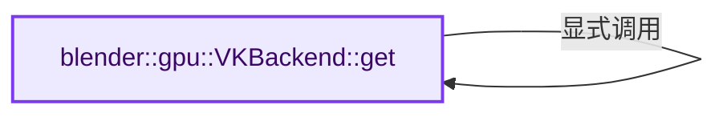
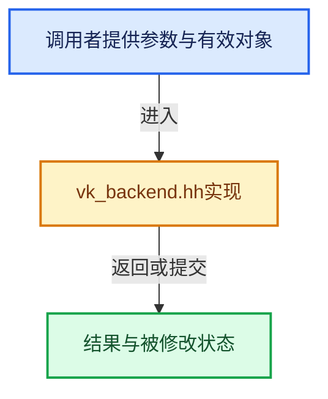

# 实现依赖专题：source/blender/gpu/vulkan/vk_backend.hh

[实现依赖导航](../../../README.md) · [符号索引](../../../../00-课程指南/02-源码与提交索引/符号依赖与实现索引.md)

本专题从正文实际调用进入，集中保存共享实现。函数有稳定锚点，可从调用处直接跳到对应完整函数；递归与互相调用通过回链组织。

## 本文件的实现关系






## 完整成员与函数实现

<a id="f-9b0f846ed492f55f"></a>

### `blender::gpu::VKBackend::get`

实现位置：[source/blender/gpu/vulkan/vk_backend.hh](../../../../../../../../source/blender/gpu/vulkan/vk_backend.hh) · L106—L109。

**教学注释版**

<!-- annotated:bf05ec634e2ea7 -->

```cpp
  static VKBackend &get()
  {
    return *static_cast<VKBackend *>(GPUBackend::get());
  }
```

<details>
<summary>核对原始源码：source/blender/gpu/vulkan/vk_backend.hh · L106—L109</summary>

<!-- original:bf05ec634e2ea7:source/blender/gpu/vulkan/vk_backend.hh:106:109 -->

```cpp
  static VKBackend &get()
  {
    return *static_cast<VKBackend *>(GPUBackend::get());
  }
```

</details>

**结果出口**

- `return *static_cast<VKBackend *>(GPUBackend::get());`

**继续追踪实现**

- `GPUBackend::get` → [blender::gpu::VKBackend::get · L106](vk_backend.hh.md#f-9b0f846ed492f55f)。
