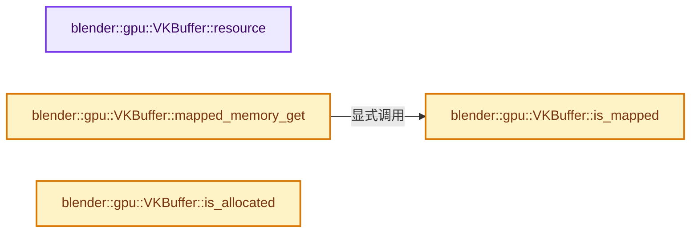
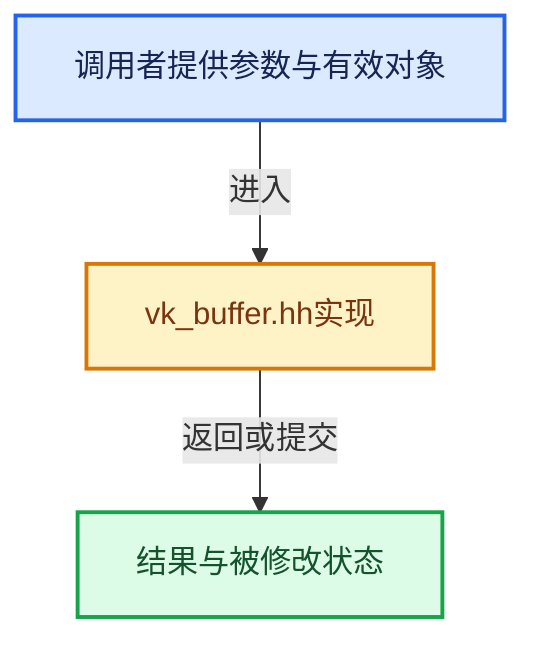

# 实现依赖专题：source/blender/gpu/vulkan/vk_buffer.hh

[实现依赖导航](../../../README.md) · [符号索引](../../../../00-课程指南/02-源码与提交索引/符号依赖与实现索引.md)

本专题从正文实际调用进入，集中保存共享实现。函数有稳定锚点，可从调用处直接跳到对应完整函数；递归与互相调用通过回链组织。

## 本文件的实现关系






## 完整成员与函数实现

<a id="f-af10d02117b21353"></a>

### `blender::gpu::VKBuffer::resource`

实现位置：[source/blender/gpu/vulkan/vk_buffer.hh](../../../../../../../../source/blender/gpu/vulkan/vk_buffer.hh) · L109—L112。

**教学注释版**

<!-- annotated:f0d92e3457ceb4 -->

```cpp
  const VKResourceWithHandle<VkBuffer> &resource() const
  {
    return resource_;
  }
```

<details>
<summary>核对原始源码：source/blender/gpu/vulkan/vk_buffer.hh · L109—L112</summary>

<!-- original:f0d92e3457ceb4:source/blender/gpu/vulkan/vk_buffer.hh:109:112 -->

```cpp
  const VKResourceWithHandle<VkBuffer> &resource() const
  {
    return resource_;
  }
```

</details>

**结果出口**

- `return resource_;`

**继续追踪实现**

本实现没有需要继续展开的显式调用；检查返回表达式、对象转换和调用者前置条件。

<a id="f-38ee8a98c0370614"></a>

### `blender::gpu::VKBuffer::mapped_memory_get`

实现位置：[source/blender/gpu/vulkan/vk_buffer.hh](../../../../../../../../source/blender/gpu/vulkan/vk_buffer.hh) · L163—L167。

**教学注释版**

<!-- annotated:752ae8abe21849 -->

```cpp
inline void *VKBuffer::mapped_memory_get() const
{
  BLI_assert_msg(this->is_mapped(), "Cannot access a non-mapped buffer.");
  return mapped_memory_;
}
```

<details>
<summary>核对原始源码：source/blender/gpu/vulkan/vk_buffer.hh · L163—L167</summary>

<!-- original:752ae8abe21849:source/blender/gpu/vulkan/vk_buffer.hh:163:167 -->

```cpp
inline void *VKBuffer::mapped_memory_get() const
{
  BLI_assert_msg(this->is_mapped(), "Cannot access a non-mapped buffer.");
  return mapped_memory_;
}
```

</details>

**结果出口**

- `return mapped_memory_;`

**继续追踪实现**

- `BLI_assert_msg` → [BLI_assert_msg · L55](../../../01-BLI基础库/BLI_assert.hh.md#m-695eed20dceb)；[BLI_assert_msg · L64](../../../01-BLI基础库/BLI_assert.hh.md#m-7de5563de4db)。宏定义由构建条件选择。
- `this->is_mapped` → [blender::gpu::VKBuffer::is_mapped · L169](vk_buffer.hh.md#f-a3fdae0957cbf874)。

<a id="f-a3fdae0957cbf874"></a>

### `blender::gpu::VKBuffer::is_mapped`

实现位置：[source/blender/gpu/vulkan/vk_buffer.hh](../../../../../../../../source/blender/gpu/vulkan/vk_buffer.hh) · L169—L172。

**教学注释版**

<!-- annotated:626cee5b321a46 -->

```cpp
inline bool VKBuffer::is_mapped() const
{
  return mapped_memory_ != nullptr;
}
```

<details>
<summary>核对原始源码：source/blender/gpu/vulkan/vk_buffer.hh · L169—L172</summary>

<!-- original:626cee5b321a46:source/blender/gpu/vulkan/vk_buffer.hh:169:172 -->

```cpp
inline bool VKBuffer::is_mapped() const
{
  return mapped_memory_ != nullptr;
}
```

</details>

**结果出口**

- `return mapped_memory_ != nullptr;`

**继续追踪实现**

本实现没有需要继续展开的显式调用；检查返回表达式、对象转换和调用者前置条件。

<a id="f-72ed3e4e29c76545"></a>

### `blender::gpu::VKBuffer::is_allocated`

实现位置：[source/blender/gpu/vulkan/vk_buffer.hh](../../../../../../../../source/blender/gpu/vulkan/vk_buffer.hh) · L174—L177。

**教学注释版**

<!-- annotated:d95887d919739d -->

```cpp
inline bool VKBuffer::is_allocated() const
{
  return allocation_ != VK_NULL_HANDLE;
}
```

<details>
<summary>核对原始源码：source/blender/gpu/vulkan/vk_buffer.hh · L174—L177</summary>

<!-- original:d95887d919739d:source/blender/gpu/vulkan/vk_buffer.hh:174:177 -->

```cpp
inline bool VKBuffer::is_allocated() const
{
  return allocation_ != VK_NULL_HANDLE;
}
```

</details>

**结果出口**

- `return allocation_ != VK_NULL_HANDLE;`

**继续追踪实现**

本实现没有需要继续展开的显式调用；检查返回表达式、对象转换和调用者前置条件。
