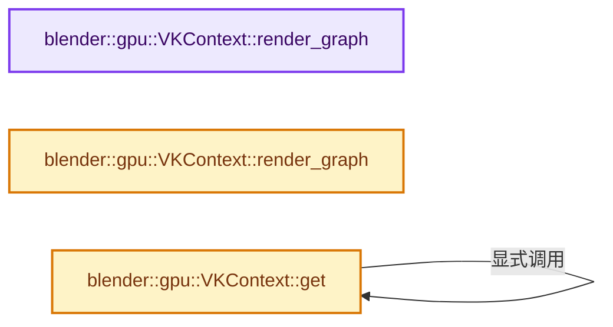
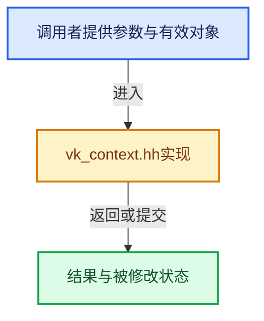

# 实现依赖专题：source/blender/gpu/vulkan/vk_context.hh

[实现依赖导航](../../../README.md) · [符号索引](../../../../00-课程指南/02-源码与提交索引/符号依赖与实现索引.md)

本专题从正文实际调用进入，集中保存共享实现。函数有稳定锚点，可从调用处直接跳到对应完整函数；递归与互相调用通过回链组织。

## 本文件的实现关系






## 完整成员与函数实现

<a id="f-3a4bb825ec5d0a82"></a>

### `blender::gpu::VKContext::render_graph`

实现位置：[source/blender/gpu/vulkan/vk_context.hh](../../../../../../../../source/blender/gpu/vulkan/vk_context.hh) · L81—L84。

**教学注释版**

<!-- annotated:97980dccb6c774 -->

```cpp
  const render_graph::VKRenderGraph &render_graph() const
  {
    return render_graph_.value().get();
  }
```

<details>
<summary>核对原始源码：source/blender/gpu/vulkan/vk_context.hh · L81—L84</summary>

<!-- original:97980dccb6c774:source/blender/gpu/vulkan/vk_context.hh:81:84 -->

```cpp
  const render_graph::VKRenderGraph &render_graph() const
  {
    return render_graph_.value().get();
  }
```

</details>

**结果出口**

- `return render_graph_.value().get();`

**继续追踪实现**

- `render_graph_.value().get` → [调用协议](../../../../00-课程指南/01-路线与规范/模板宏与动态分派协议.md)：接收对象类型依赖auto、返回值或模板实例；不按同名猜测目标。调用位置L83。
- `render_graph_.value` → [外部契约](https://eel.is/c++draft/)：这个边界按实际表达式及所属类型核对参数、返回值、寿命与失败行为。这里提供接口入口，不声称已解释该第三方版本的内部实现。

<a id="f-b3ac6949ba355b17"></a>

### `blender::gpu::VKContext::render_graph`

实现位置：[source/blender/gpu/vulkan/vk_context.hh](../../../../../../../../source/blender/gpu/vulkan/vk_context.hh) · L85—L88。

**教学注释版**

<!-- annotated:9e8ba05a6fd593 -->

```cpp
  render_graph::VKRenderGraph &render_graph()
  {
    return render_graph_.value().get();
  }
```

<details>
<summary>核对原始源码：source/blender/gpu/vulkan/vk_context.hh · L85—L88</summary>

<!-- original:9e8ba05a6fd593:source/blender/gpu/vulkan/vk_context.hh:85:88 -->

```cpp
  render_graph::VKRenderGraph &render_graph()
  {
    return render_graph_.value().get();
  }
```

</details>

**结果出口**

- `return render_graph_.value().get();`

**继续追踪实现**

- `render_graph_.value().get` → [调用协议](../../../../00-课程指南/01-路线与规范/模板宏与动态分派协议.md)：接收对象类型依赖auto、返回值或模板实例；不按同名猜测目标。调用位置L87。
- `render_graph_.value` → [外部契约](https://eel.is/c++draft/)：这个边界按实际表达式及所属类型核对参数、返回值、寿命与失败行为。这里提供接口入口，不声称已解释该第三方版本的内部实现。

<a id="f-378401ce251eda2a"></a>

### `blender::gpu::VKContext::get`

实现位置：[source/blender/gpu/vulkan/vk_context.hh](../../../../../../../../source/blender/gpu/vulkan/vk_context.hh) · L148—L151。

**教学注释版**

<!-- annotated:7faa41336decfa -->

```cpp
  static VKContext *get()
  {
    return static_cast<VKContext *>(Context::get());
  }
```

<details>
<summary>核对原始源码：source/blender/gpu/vulkan/vk_context.hh · L148—L151</summary>

<!-- original:7faa41336decfa:source/blender/gpu/vulkan/vk_context.hh:148:151 -->

```cpp
  static VKContext *get()
  {
    return static_cast<VKContext *>(Context::get());
  }
```

</details>

**结果出口**

- `return static_cast<VKContext *>(Context::get());`

**继续追踪实现**

- `Context::get` → [blender::gpu::VKContext::get · L148](vk_context.hh.md#f-378401ce251eda2a)。
