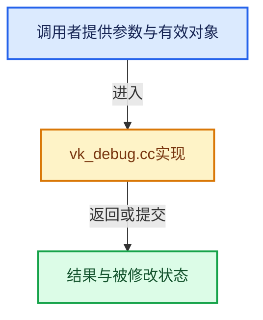

# 实现依赖专题：source/blender/gpu/vulkan/vk_debug.cc

[实现依赖导航](../../../README.md) · [符号索引](../../../../00-课程指南/02-源码与提交索引/符号依赖与实现索引.md)

本专题从正文实际调用进入，集中保存共享实现。函数有稳定锚点，可从调用处直接跳到对应完整函数；递归与互相调用通过回链组织。

## 本文件的实现关系





## 完整成员与函数实现

<a id="f-d9b83515b72f329f"></a>

### `blender::gpu::debug::object_label`

实现位置：[source/blender/gpu/vulkan/vk_debug.cc](../../../../../../../../source/blender/gpu/vulkan/vk_debug.cc) · L173—L184。

接口参数：

- `VkObjectType vk_object_type`
- `uint64_t object_handle`
- `const char *name`

**教学注释版**

<!-- annotated:2acc38511cc28d -->

```cpp
void object_label(VkObjectType vk_object_type, uint64_t object_handle, const char *name)
{
  const VKDevice &device = VKBackend::get().device;
  if (G.debug & G_DEBUG_GPU && volk::vkSetDebugUtilsObjectNameEXT && object_handle != 0) {
    VkDebugUtilsObjectNameInfoEXT info = {};
    info.sType = VK_STRUCTURE_TYPE_DEBUG_UTILS_OBJECT_NAME_INFO_EXT;
    info.objectType = vk_object_type;
    info.objectHandle = object_handle;
    info.pObjectName = name;
    volk::vkSetDebugUtilsObjectNameEXT(device.vk_handle(), &info);
  }
}
```

<details>
<summary>核对原始源码：source/blender/gpu/vulkan/vk_debug.cc · L173—L184</summary>

<!-- original:2acc38511cc28d:source/blender/gpu/vulkan/vk_debug.cc:173:184 -->

```cpp
void object_label(VkObjectType vk_object_type, uint64_t object_handle, const char *name)
{
  const VKDevice &device = VKBackend::get().device;
  if (G.debug & G_DEBUG_GPU && volk::vkSetDebugUtilsObjectNameEXT && object_handle != 0) {
    VkDebugUtilsObjectNameInfoEXT info = {};
    info.sType = VK_STRUCTURE_TYPE_DEBUG_UTILS_OBJECT_NAME_INFO_EXT;
    info.objectType = vk_object_type;
    info.objectHandle = object_handle;
    info.pObjectName = name;
    volk::vkSetDebugUtilsObjectNameEXT(device.vk_handle(), &info);
  }
}
```

</details>

**沿实际写入检查状态**

- `info.sType = VK_STRUCTURE_TYPE_DEBUG_UTILS_OBJECT_NAME_INFO_EXT;`
- `info.objectType = vk_object_type;`
- `info.objectHandle = object_handle;`
- `info.pObjectName = name;`

**继续追踪实现**

- `VKBackend::get` → [blender::gpu::VKBackend::get · L106](vk_backend.hh.md#f-9b0f846ed492f55f)。
- `volk::vkSetDebugUtilsObjectNameEXT` → [调用协议](../../../../00-课程指南/01-路线与规范/模板宏与动态分派协议.md)：函数指针、局部可调用对象或未展开的宏；必须结合调用者环境。调用位置L182。
- `device.vk_handle` → [blender::gpu::VKDevice::vk_handle · L333](vk_device.hh.md#f-72924e77c918cdae)。
