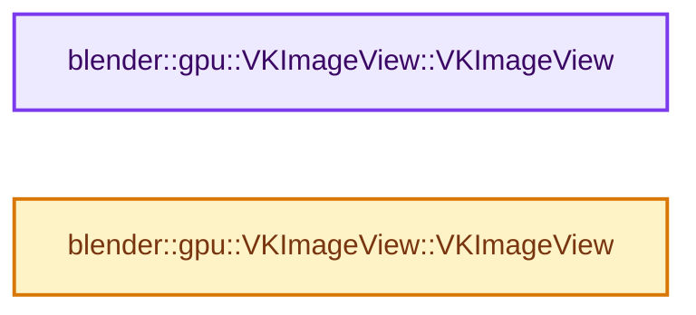
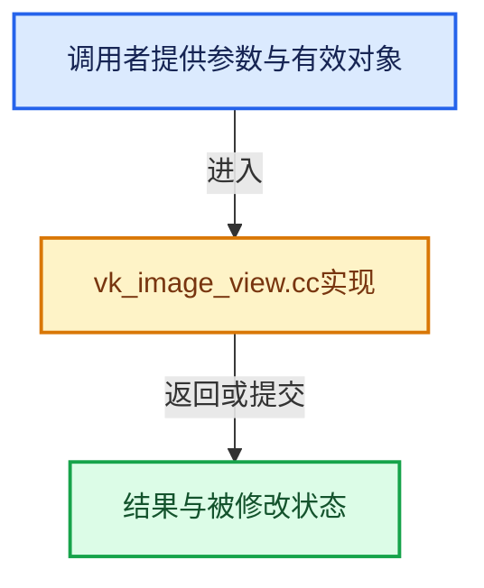

# 实现依赖专题：source/blender/gpu/vulkan/vk_image_view.cc

[实现依赖导航](../../../README.md) · [符号索引](../../../../00-课程指南/02-源码与提交索引/符号依赖与实现索引.md)

本专题从正文实际调用进入，集中保存共享实现。函数有稳定锚点，可从调用处直接跳到对应完整函数；递归与互相调用通过回链组织。

## 本文件的实现关系






## 完整成员与函数实现

<a id="f-8ac80ec98d298101"></a>

### `blender::gpu::VKImageView::VKImageView`

实现位置：[source/blender/gpu/vulkan/vk_image_view.cc](../../../../../../../../source/blender/gpu/vulkan/vk_image_view.cc) · L18—L54。

接口参数：

- `VKTexture &texture`
- `const VKImageViewInfo &info`
- `StringRefNull name`

**教学注释版**

<!-- annotated:3132a299963f44 -->

```cpp
VKImageView::VKImageView(VKTexture &texture, const VKImageViewInfo &info, StringRefNull name)
    : info(info)
{
  VkImageViewCreateInfo image_view_info = {};
  image_view_info.sType = VK_STRUCTURE_TYPE_IMAGE_VIEW_CREATE_INFO;
  image_view_info.image = texture.vk_image_handle();
  image_view_info.viewType = to_vk_image_view_type(texture.type_get(), info.usage, info.arrayed);
  image_view_info.format = info.vk_format;
  image_view_info.components.r = to_vk_component_swizzle(info.swizzle[0]);
  image_view_info.components.g = to_vk_component_swizzle(info.swizzle[1]);
  image_view_info.components.b = to_vk_component_swizzle(info.swizzle[2]);
  image_view_info.components.a = to_vk_component_swizzle(info.swizzle[3]);
  image_view_info.subresourceRange.aspectMask = info.vk_image_aspects;
  image_view_info.subresourceRange.baseMipLevel = info.mip_range.first();
  image_view_info.subresourceRange.levelCount = info.mip_range.size();
  image_view_info.subresourceRange.baseArrayLayer = info.layer_range.first();
  image_view_info.subresourceRange.layerCount = info.layer_range.size();

  /* When extended usage is enabled for storage images, it means the original format
   * is not supported. So we must strip USAGE_STORAGE for the image view that has the
   * same format as the image, and only leave it for the other image view with the
   * format that will be used for storage. */
  VkImageViewUsageCreateInfo view_usage_info = {VK_STRUCTURE_TYPE_IMAGE_VIEW_USAGE_CREATE_INFO};
  if (vk_need_extended_usage_for_storage_image(texture.usage_get(), texture.format_flag_get()) &&
      info.vk_format == to_vk_format(texture.device_format_get()))
  {
    view_usage_info.usage = texture.vk_image_usage_get() & ~VK_IMAGE_USAGE_STORAGE_BIT;
    BLI_assert(view_usage_info.usage != 0);
    view_usage_info.pNext = image_view_info.pNext;
    image_view_info.pNext = &view_usage_info;
  }

  const VKDevice &device = VKBackend::get().device;
  device.functions.vkCreateImageView(
      device.vk_handle(), &image_view_info, nullptr, &vk_image_view_);
  debug::object_label(vk_image_view_, name.c_str());
}
```

<details>
<summary>核对原始源码：source/blender/gpu/vulkan/vk_image_view.cc · L18—L54</summary>

<!-- original:3132a299963f44:source/blender/gpu/vulkan/vk_image_view.cc:18:54 -->

```cpp
VKImageView::VKImageView(VKTexture &texture, const VKImageViewInfo &info, StringRefNull name)
    : info(info)
{
  VkImageViewCreateInfo image_view_info = {};
  image_view_info.sType = VK_STRUCTURE_TYPE_IMAGE_VIEW_CREATE_INFO;
  image_view_info.image = texture.vk_image_handle();
  image_view_info.viewType = to_vk_image_view_type(texture.type_get(), info.usage, info.arrayed);
  image_view_info.format = info.vk_format;
  image_view_info.components.r = to_vk_component_swizzle(info.swizzle[0]);
  image_view_info.components.g = to_vk_component_swizzle(info.swizzle[1]);
  image_view_info.components.b = to_vk_component_swizzle(info.swizzle[2]);
  image_view_info.components.a = to_vk_component_swizzle(info.swizzle[3]);
  image_view_info.subresourceRange.aspectMask = info.vk_image_aspects;
  image_view_info.subresourceRange.baseMipLevel = info.mip_range.first();
  image_view_info.subresourceRange.levelCount = info.mip_range.size();
  image_view_info.subresourceRange.baseArrayLayer = info.layer_range.first();
  image_view_info.subresourceRange.layerCount = info.layer_range.size();

  /* When extended usage is enabled for storage images, it means the original format
   * is not supported. So we must strip USAGE_STORAGE for the image view that has the
   * same format as the image, and only leave it for the other image view with the
   * format that will be used for storage. */
  VkImageViewUsageCreateInfo view_usage_info = {VK_STRUCTURE_TYPE_IMAGE_VIEW_USAGE_CREATE_INFO};
  if (vk_need_extended_usage_for_storage_image(texture.usage_get(), texture.format_flag_get()) &&
      info.vk_format == to_vk_format(texture.device_format_get()))
  {
    view_usage_info.usage = texture.vk_image_usage_get() & ~VK_IMAGE_USAGE_STORAGE_BIT;
    BLI_assert(view_usage_info.usage != 0);
    view_usage_info.pNext = image_view_info.pNext;
    image_view_info.pNext = &view_usage_info;
  }

  const VKDevice &device = VKBackend::get().device;
  device.functions.vkCreateImageView(
      device.vk_handle(), &image_view_info, nullptr, &vk_image_view_);
  debug::object_label(vk_image_view_, name.c_str());
}
```

</details>

**沿实际写入检查状态**

- `image_view_info.sType = VK_STRUCTURE_TYPE_IMAGE_VIEW_CREATE_INFO;`
- `image_view_info.image = texture.vk_image_handle();`
- `image_view_info.viewType = to_vk_image_view_type(texture.type_get(), info.usage, info.arrayed);`
- `image_view_info.format = info.vk_format;`
- `image_view_info.components.r = to_vk_component_swizzle(info.swizzle[0]);`
- `image_view_info.components.g = to_vk_component_swizzle(info.swizzle[1]);`
- `image_view_info.components.b = to_vk_component_swizzle(info.swizzle[2]);`
- `image_view_info.components.a = to_vk_component_swizzle(info.swizzle[3]);`
- `image_view_info.subresourceRange.aspectMask = info.vk_image_aspects;`
- `image_view_info.subresourceRange.baseMipLevel = info.mip_range.first();`
- `image_view_info.subresourceRange.levelCount = info.mip_range.size();`
- `image_view_info.subresourceRange.baseArrayLayer = info.layer_range.first();`
- `image_view_info.subresourceRange.layerCount = info.layer_range.size();`
- `view_usage_info.usage = texture.vk_image_usage_get() & ~VK_IMAGE_USAGE_STORAGE_BIT;`
- `view_usage_info.pNext = image_view_info.pNext;`
- `image_view_info.pNext = &view_usage_info;`

**继续追踪实现**

- `texture.vk_image_handle` → [blender::gpu::VKTexture::vk_image_handle · L124](vk_texture.hh.md#f-e1b6d3a2d30eedaa)。
- `to_vk_image_view_type` → [blender::gpu::to_vk_image_view_type · L525](vk_common.cc.md#f-eab56111add6c104)。
- `texture.type_get` → [调用协议](../../../../00-课程指南/01-路线与规范/模板宏与动态分派协议.md)：由接收对象具体类型或运行时策略提供实现。调用位置L24。
- `to_vk_component_swizzle` → [blender::gpu::to_vk_component_swizzle · L588](vk_common.cc.md#f-084b69dae42e1206)。
- `info.mip_range.first` → [调用协议](../../../../00-课程指南/01-路线与规范/模板宏与动态分派协议.md)：接收对象类型依赖auto、返回值或模板实例；不按同名猜测目标。调用位置L31。
- `info.mip_range.size` → [调用协议](../../../../00-课程指南/01-路线与规范/模板宏与动态分派协议.md)：接收对象类型依赖auto、返回值或模板实例；不按同名猜测目标。调用位置L32。
- `info.layer_range.first` → [调用协议](../../../../00-课程指南/01-路线与规范/模板宏与动态分派协议.md)：接收对象类型依赖auto、返回值或模板实例；不按同名猜测目标。调用位置L33。
- `info.layer_range.size` → [调用协议](../../../../00-课程指南/01-路线与规范/模板宏与动态分派协议.md)：接收对象类型依赖auto、返回值或模板实例；不按同名猜测目标。调用位置L34。
- `vk_need_extended_usage_for_storage_image` → [blender::gpu::vk_need_extended_usage_for_storage_image · L841](vk_common.cc.md#f-c1f0c3c1804baa64)。
- `texture.usage_get` → [blender::gpu::Texture::usage_get · L206](../intern/gpu_texture_private.hh.md#f-33e0781d80810456)。
- `texture.format_flag_get` → [blender::gpu::Texture::format_flag_get · L307](../intern/gpu_texture_private.hh.md#f-4868a0a502f019d6)。
- `to_vk_format` → [blender::gpu::to_vk_format · L95](vk_common.hh.md#f-a3ac0c55c5d75864)；[blender::gpu::to_vk_format · L157](vk_common.cc.md#f-43921693d6c63cf3)；[blender::gpu::to_vk_format · L411](vk_common.cc.md#f-784a5fd71d4f3618)；[blender::gpu::to_vk_format · L430](vk_common.cc.md#f-008fc5a91c53c0b5)。同名重载需按实参类型选择。
- `texture.device_format_get` → [blender::gpu::VKTexture::device_format_get · L136](vk_texture.hh.md#f-1f00dbe38bb3b55c)。
- `texture.vk_image_usage_get` → [blender::gpu::VKTexture::vk_image_usage_get · L142](vk_texture.hh.md#f-5b2a326ec62c74cd)。
- `BLI_assert` → [BLI_assert · L48](../../../01-BLI基础库/BLI_assert.hh.md#m-57a88495704d)；[BLI_assert · L63](../../../01-BLI基础库/BLI_assert.hh.md#m-d07050020cb5)。宏定义由构建条件选择。
- `VKBackend::get` → [blender::gpu::VKBackend::get · L106](vk_backend.hh.md#f-9b0f846ed492f55f)。
- `device.functions.vkCreateImageView` → [调用协议](../../../../00-课程指南/01-路线与规范/模板宏与动态分派协议.md)：接收对象类型依赖auto、返回值或模板实例；不按同名猜测目标。调用位置L51。
- `device.vk_handle` → [blender::gpu::VKDevice::vk_handle · L333](vk_device.hh.md#f-72924e77c918cdae)。
- `debug::object_label` → [blender::gpu::debug::object_label · L37](vk_debug.hh.md#f-213fe73cbed61a8e)；[blender::gpu::debug::object_label · L173](vk_debug.cc.md#f-d9b83515b72f329f)。同名重载需按实参类型选择。
- `name.c_str` → [blender::StringRefNull::c_str · L544](../../../../01-基础容器与现代CPP/15-StringRef字符串视图.md#f-4a8bbfe1e6d00757)。

<a id="f-516ee8590eb33f57"></a>

### `blender::gpu::VKImageView::VKImageView`

实现位置：[source/blender/gpu/vulkan/vk_image_view.cc](../../../../../../../../source/blender/gpu/vulkan/vk_image_view.cc) · L56—L62。

接口参数：

- `VKImageView &&other`

**教学注释版**

<!-- annotated:7a9e853fb41825 -->

```cpp
VKImageView::VKImageView(VKImageView &&other) : info(other.info)
{
  vk_image_view_ = other.vk_image_view_;
  other.vk_image_view_ = VK_NULL_HANDLE;
  vk_format_ = other.vk_format_;
  other.vk_format_ = VK_FORMAT_UNDEFINED;
}
```

<details>
<summary>核对原始源码：source/blender/gpu/vulkan/vk_image_view.cc · L56—L62</summary>

<!-- original:7a9e853fb41825:source/blender/gpu/vulkan/vk_image_view.cc:56:62 -->

```cpp
VKImageView::VKImageView(VKImageView &&other) : info(other.info)
{
  vk_image_view_ = other.vk_image_view_;
  other.vk_image_view_ = VK_NULL_HANDLE;
  vk_format_ = other.vk_format_;
  other.vk_format_ = VK_FORMAT_UNDEFINED;
}
```

</details>

**沿实际写入检查状态**

- `vk_image_view_ = other.vk_image_view_;`
- `other.vk_image_view_ = VK_NULL_HANDLE;`
- `vk_format_ = other.vk_format_;`
- `other.vk_format_ = VK_FORMAT_UNDEFINED;`

**继续追踪实现**

本实现没有需要继续展开的显式调用；检查返回表达式、对象转换和调用者前置条件。
