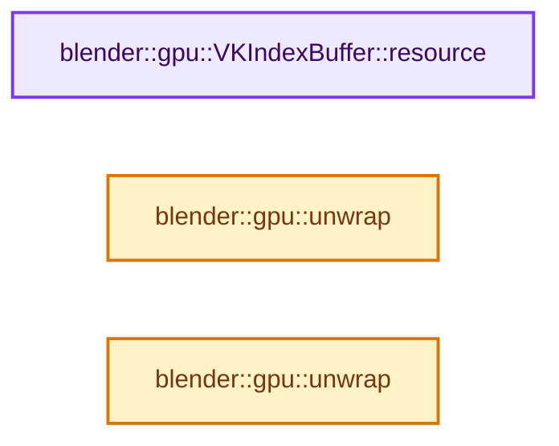
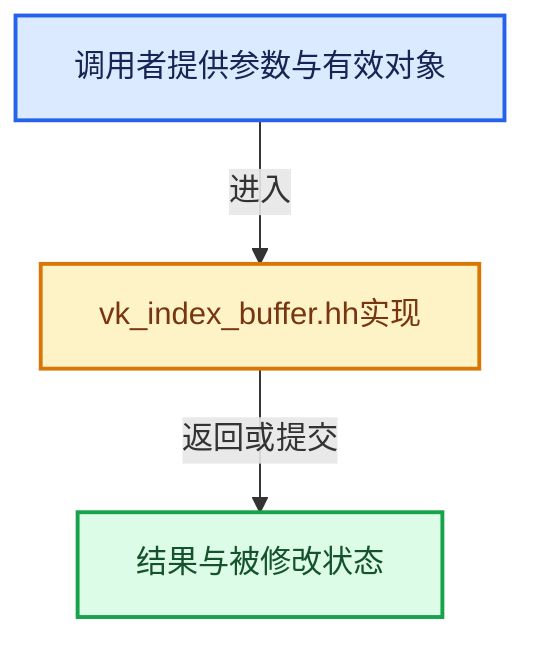

# 实现依赖专题：source/blender/gpu/vulkan/vk_index_buffer.hh

[实现依赖导航](../../../README.md) · [符号索引](../../../../00-课程指南/02-源码与提交索引/符号依赖与实现索引.md)

本专题从正文实际调用进入，集中保存共享实现。函数有稳定锚点，可从调用处直接跳到对应完整函数；递归与互相调用通过回链组织。

## 本文件的实现关系






## 完整成员与函数实现

<a id="f-61717acfdca8d29c"></a>

### `blender::gpu::VKIndexBuffer::resource`

实现位置：[source/blender/gpu/vulkan/vk_index_buffer.hh](../../../../../../../../source/blender/gpu/vulkan/vk_index_buffer.hh) · L39—L42。

**教学注释版**

<!-- annotated:c2ed2d1885994d -->

```cpp
  const VKResourceWithHandle<VkBuffer> &resource() const
  {
    return buffer_get().resource();
  }
```

<details>
<summary>核对原始源码：source/blender/gpu/vulkan/vk_index_buffer.hh · L39—L42</summary>

<!-- original:c2ed2d1885994d:source/blender/gpu/vulkan/vk_index_buffer.hh:39:42 -->

```cpp
  const VKResourceWithHandle<VkBuffer> &resource() const
  {
    return buffer_get().resource();
  }
```

</details>

**结果出口**

- `return buffer_get().resource();`

**继续追踪实现**

- `buffer_get().resource` → [调用协议](../../../../00-课程指南/01-路线与规范/模板宏与动态分派协议.md)：接收对象类型依赖auto、返回值或模板实例；不按同名猜测目标。调用位置L41。
- `buffer_get` → [buffer_get · L86](../shaders/compat/gpu_shader_compat_cxx.hh.md#m-3a13d403b039)。宏定义由构建条件选择。

<a id="f-62f2679fcad8aa93"></a>

### `blender::gpu::unwrap`

实现位置：[source/blender/gpu/vulkan/vk_index_buffer.hh](../../../../../../../../source/blender/gpu/vulkan/vk_index_buffer.hh) · L70—L73。

接口参数：

- `IndexBuf *index_buffer`

**教学注释版**

<!-- annotated:24858eba92dcdc -->

```cpp
static inline VKIndexBuffer *unwrap(IndexBuf *index_buffer)
{
  return static_cast<VKIndexBuffer *>(index_buffer);
}
```

<details>
<summary>核对原始源码：source/blender/gpu/vulkan/vk_index_buffer.hh · L70—L73</summary>

<!-- original:24858eba92dcdc:source/blender/gpu/vulkan/vk_index_buffer.hh:70:73 -->

```cpp
static inline VKIndexBuffer *unwrap(IndexBuf *index_buffer)
{
  return static_cast<VKIndexBuffer *>(index_buffer);
}
```

</details>

**结果出口**

- `return static_cast<VKIndexBuffer *>(index_buffer);`

**继续追踪实现**

本实现没有需要继续展开的显式调用；检查返回表达式、对象转换和调用者前置条件。

<a id="f-fd72b5b309f16c1b"></a>

### `blender::gpu::unwrap`

实现位置：[source/blender/gpu/vulkan/vk_index_buffer.hh](../../../../../../../../source/blender/gpu/vulkan/vk_index_buffer.hh) · L75—L78。

接口参数：

- `IndexBuf &index_buffer`

**教学注释版**

<!-- annotated:99a5b063dbaa0e -->

```cpp
static inline VKIndexBuffer &unwrap(IndexBuf &index_buffer)
{
  return static_cast<VKIndexBuffer &>(index_buffer);
}
```

<details>
<summary>核对原始源码：source/blender/gpu/vulkan/vk_index_buffer.hh · L75—L78</summary>

<!-- original:99a5b063dbaa0e:source/blender/gpu/vulkan/vk_index_buffer.hh:75:78 -->

```cpp
static inline VKIndexBuffer &unwrap(IndexBuf &index_buffer)
{
  return static_cast<VKIndexBuffer &>(index_buffer);
}
```

</details>

**结果出口**

- `return static_cast<VKIndexBuffer &>(index_buffer);`

**继续追踪实现**

本实现没有需要继续展开的显式调用；检查返回表达式、对象转换和调用者前置条件。
