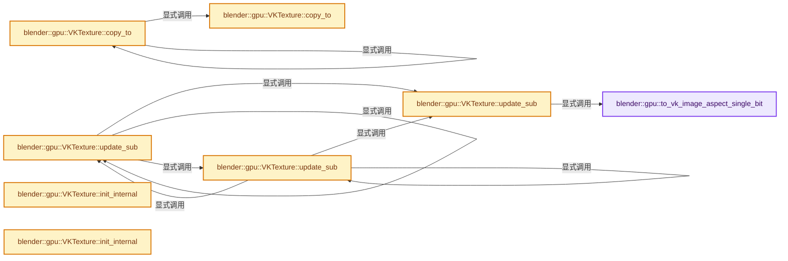
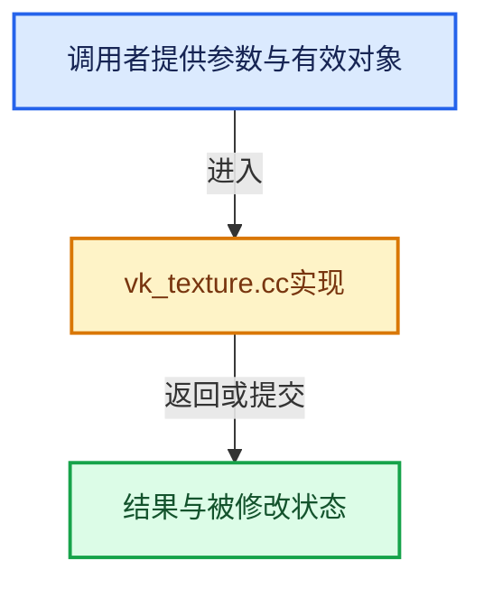

# 实现依赖专题：source/blender/gpu/vulkan/vk_texture.cc

[实现依赖导航](../../../README.md) · [符号索引](../../../../00-课程指南/02-源码与提交索引/符号依赖与实现索引.md)

本专题从正文实际调用进入，集中保存共享实现。函数有稳定锚点，可从调用处直接跳到对应完整函数；递归与互相调用通过回链组织。

## 本文件的实现关系






## 完整成员与函数实现

<a id="f-178ccccb3b9554ba"></a>

### `blender::gpu::to_vk_image_aspect_single_bit`

实现位置：[source/blender/gpu/vulkan/vk_texture.cc](../../../../../../../../source/blender/gpu/vulkan/vk_texture.cc) · L32—L42。

接口参数：

- `const VkImageAspectFlags format`
- `bool stencil`

**教学注释版**

<!-- annotated:8a69de9231eed5 -->

```cpp
static VkImageAspectFlags to_vk_image_aspect_single_bit(const VkImageAspectFlags format,
                                                        bool stencil)
{
  switch (format) {
    case VK_IMAGE_ASPECT_DEPTH_BIT | VK_IMAGE_ASPECT_STENCIL_BIT:
      return (stencil) ? VK_IMAGE_ASPECT_STENCIL_BIT : VK_IMAGE_ASPECT_DEPTH_BIT;
    default:
      break;
  }
  return format;
}
```

<details>
<summary>核对原始源码：source/blender/gpu/vulkan/vk_texture.cc · L32—L42</summary>

<!-- original:8a69de9231eed5:source/blender/gpu/vulkan/vk_texture.cc:32:42 -->

```cpp
static VkImageAspectFlags to_vk_image_aspect_single_bit(const VkImageAspectFlags format,
                                                        bool stencil)
{
  switch (format) {
    case VK_IMAGE_ASPECT_DEPTH_BIT | VK_IMAGE_ASPECT_STENCIL_BIT:
      return (stencil) ? VK_IMAGE_ASPECT_STENCIL_BIT : VK_IMAGE_ASPECT_DEPTH_BIT;
    default:
      break;
  }
  return format;
}
```

</details>

**结果出口**

- `return (stencil) ? VK_IMAGE_ASPECT_STENCIL_BIT : VK_IMAGE_ASPECT_DEPTH_BIT;`
- `return format;`

**继续追踪实现**

本实现没有需要继续展开的显式调用；检查返回表达式、对象转换和调用者前置条件。

<a id="f-7a1fd5b36fda5c04"></a>

### `blender::gpu::VKTexture::copy_to`

实现位置：[source/blender/gpu/vulkan/vk_texture.cc](../../../../../../../../source/blender/gpu/vulkan/vk_texture.cc) · L83—L110。

接口参数：

- `VKTexture &dst_texture`
- `IndexRange mip_levels`
- `VkImageAspectFlags vk_image_aspect`

**教学注释版**

<!-- annotated:35da812ff56283 -->

```cpp
void VKTexture::copy_to(VKTexture &dst_texture,
                        IndexRange mip_levels,
                        VkImageAspectFlags vk_image_aspect)
{
  // [讲解] mip_levels.is_empty：读取连续区间或分组的边界信息。
  if (mip_levels.is_empty()) {
    return;
  }

  render_graph::VKCopyImageNode::CreateInfo copy_image = {};
  // [讲解] mip_levels.size：读取连续区间或分组的边界信息。
  copy_image.node_data.mip_levels = uint32_t(mip_levels.size());
  copy_image.node_data.src_image = vk_image_handle();
  copy_image.node_data.dst_image = dst_texture.vk_image_handle();
  copy_image.node_data.region.srcSubresource.aspectMask = vk_image_aspect;
  // [讲解] mip_levels.first：读取范围两端的有效索引或值。
  copy_image.node_data.region.srcSubresource.mipLevel = mip_levels.first() + mip_min_;
  copy_image.node_data.region.srcSubresource.layerCount = layer_count();
  copy_image.node_data.region.srcSubresource.baseArrayLayer = view_layer_start_;
  copy_image.node_data.region.dstSubresource.aspectMask = vk_image_aspect;
  copy_image.node_data.region.dstSubresource.mipLevel = mip_levels.first() + dst_texture.mip_min_;
  copy_image.node_data.region.dstSubresource.layerCount = dst_texture.layer_count();
  copy_image.node_data.region.dstSubresource.baseArrayLayer = dst_texture.view_layer_start_;
  copy_image.node_data.region.extent = vk_extent_3d(mip_levels.first());
  copy_image.vk_image_aspect = vk_image_aspect;

  VKContext &context = *VKContext::get();
  context.render_graph().add_node(copy_image);

  dst_texture.has_data_ = true;
}
```

<details>
<summary>核对原始源码：source/blender/gpu/vulkan/vk_texture.cc · L83—L110</summary>

<!-- original:35da812ff56283:source/blender/gpu/vulkan/vk_texture.cc:83:110 -->

```cpp
void VKTexture::copy_to(VKTexture &dst_texture,
                        IndexRange mip_levels,
                        VkImageAspectFlags vk_image_aspect)
{
  if (mip_levels.is_empty()) {
    return;
  }

  render_graph::VKCopyImageNode::CreateInfo copy_image = {};
  copy_image.node_data.mip_levels = uint32_t(mip_levels.size());
  copy_image.node_data.src_image = vk_image_handle();
  copy_image.node_data.dst_image = dst_texture.vk_image_handle();
  copy_image.node_data.region.srcSubresource.aspectMask = vk_image_aspect;
  copy_image.node_data.region.srcSubresource.mipLevel = mip_levels.first() + mip_min_;
  copy_image.node_data.region.srcSubresource.layerCount = layer_count();
  copy_image.node_data.region.srcSubresource.baseArrayLayer = view_layer_start_;
  copy_image.node_data.region.dstSubresource.aspectMask = vk_image_aspect;
  copy_image.node_data.region.dstSubresource.mipLevel = mip_levels.first() + dst_texture.mip_min_;
  copy_image.node_data.region.dstSubresource.layerCount = dst_texture.layer_count();
  copy_image.node_data.region.dstSubresource.baseArrayLayer = dst_texture.view_layer_start_;
  copy_image.node_data.region.extent = vk_extent_3d(mip_levels.first());
  copy_image.vk_image_aspect = vk_image_aspect;

  VKContext &context = *VKContext::get();
  context.render_graph().add_node(copy_image);

  dst_texture.has_data_ = true;
}
```

</details>

**沿实际写入检查状态**

- `copy_image.node_data.mip_levels = uint32_t(mip_levels.size());`
- `copy_image.node_data.src_image = vk_image_handle();`
- `copy_image.node_data.dst_image = dst_texture.vk_image_handle();`
- `copy_image.node_data.region.srcSubresource.aspectMask = vk_image_aspect;`
- `copy_image.node_data.region.srcSubresource.mipLevel = mip_levels.first() + mip_min_;`
- `copy_image.node_data.region.srcSubresource.layerCount = layer_count();`
- `copy_image.node_data.region.srcSubresource.baseArrayLayer = view_layer_start_;`
- `copy_image.node_data.region.dstSubresource.aspectMask = vk_image_aspect;`
- `copy_image.node_data.region.dstSubresource.mipLevel = mip_levels.first() + dst_texture.mip_min_;`
- `copy_image.node_data.region.dstSubresource.layerCount = dst_texture.layer_count();`
- `copy_image.node_data.region.dstSubresource.baseArrayLayer = dst_texture.view_layer_start_;`
- `copy_image.node_data.region.extent = vk_extent_3d(mip_levels.first());`
- `copy_image.vk_image_aspect = vk_image_aspect;`
- `dst_texture.has_data_ = true;`

**继续追踪实现**

- `mip_levels.is_empty` → [blender::IndexRange::is_empty · L169](../../../../01-基础容器与现代CPP/04-IndexRange连续整数区间.md#f-9501e070be01ff71)。
- `mip_levels.size` → [blender::IndexRange::size · L156](../../../../01-基础容器与现代CPP/04-IndexRange连续整数区间.md#f-05f66c3ebb2fdfec)。
- `vk_image_handle` → [blender::gpu::VKTexture::vk_image_handle · L124](vk_texture.hh.md#f-e1b6d3a2d30eedaa)。
- `dst_texture.vk_image_handle` → [blender::gpu::VKTexture::vk_image_handle · L124](vk_texture.hh.md#f-e1b6d3a2d30eedaa)。
- `mip_levels.first` → [blender::IndexRange::first · L204](../../../../01-基础容器与现代CPP/04-IndexRange连续整数区间.md#f-ab443c94e531befa)。
- `layer_count` → [blender::gpu::Texture::layer_count · L274](../intern/gpu_texture_private.hh.md#f-ae5bba132ad53865)。
- `dst_texture.layer_count` → [blender::gpu::Texture::layer_count · L274](../intern/gpu_texture_private.hh.md#f-ae5bba132ad53865)。
- `vk_extent_3d` → [blender::gpu::VKTexture::vk_extent_3d · L783](vk_texture.cc.md#f-ec32da08e78d1db1)。
- `VKContext::get` → [blender::gpu::VKContext::get · L148](vk_context.hh.md#f-378401ce251eda2a)。
- `context.render_graph().add_node` → [调用协议](../../../../00-课程指南/01-路线与规范/模板宏与动态分派协议.md)：接收对象类型依赖auto、返回值或模板实例；不按同名猜测目标。调用位置L107。
- `context.render_graph` → [blender::gpu::VKContext::render_graph · L81](vk_context.hh.md#f-3a4bb825ec5d0a82)；[blender::gpu::VKContext::render_graph · L85](vk_context.hh.md#f-b3ac6949ba355b17)。同名重载需按实参类型选择。

<a id="f-e8eb42128f5de1a4"></a>

### `blender::gpu::VKTexture::copy_to`

实现位置：[source/blender/gpu/vulkan/vk_texture.cc](../../../../../../../../source/blender/gpu/vulkan/vk_texture.cc) · L112—L127。

接口参数：

- `Texture *texture`
- `IndexRange mip_levels`

**教学注释版**

<!-- annotated:5f33337c18eb7d -->

```cpp
void VKTexture::copy_to(Texture *texture, IndexRange mip_levels)
{
  VKTexture *dst = unwrap(texture);
  VKTexture *src = this;

  // [讲解] std::max：按比较关系选取较大值。本讲解中的增长公式同时满足最低请求和几何增长；若保存返回引用，还需注意实参寿命。
  BLI_assert(src->w_ == dst->w_ && std::max(src->h_, 1) == std::max(dst->h_, 1) &&
             std::max(src->d_, 1) == std::max(dst->d_, 1));
  BLI_assert((src->format_ == dst->format_) ||
             (src->format_ == TextureFormat::SRGBA_8_8_8_8 &&
              dst->format_ == TextureFormat::UNORM_8_8_8_8) ||
             (src->format_ == TextureFormat::UNORM_8_8_8_8 &&
              dst->format_ == TextureFormat::SRGBA_8_8_8_8));
  BLI_assert((dst->type_ & ~GPU_TEXTURE_ARRAY) & (src->type_ & ~GPU_TEXTURE_ARRAY));

  src->copy_to(*dst, mip_levels, to_vk_image_aspect_flag_bits(device_format_));
}
```

<details>
<summary>核对原始源码：source/blender/gpu/vulkan/vk_texture.cc · L112—L127</summary>

<!-- original:5f33337c18eb7d:source/blender/gpu/vulkan/vk_texture.cc:112:127 -->

```cpp
void VKTexture::copy_to(Texture *texture, IndexRange mip_levels)
{
  VKTexture *dst = unwrap(texture);
  VKTexture *src = this;

  BLI_assert(src->w_ == dst->w_ && std::max(src->h_, 1) == std::max(dst->h_, 1) &&
             std::max(src->d_, 1) == std::max(dst->d_, 1));
  BLI_assert((src->format_ == dst->format_) ||
             (src->format_ == TextureFormat::SRGBA_8_8_8_8 &&
              dst->format_ == TextureFormat::UNORM_8_8_8_8) ||
             (src->format_ == TextureFormat::UNORM_8_8_8_8 &&
              dst->format_ == TextureFormat::SRGBA_8_8_8_8));
  BLI_assert((dst->type_ & ~GPU_TEXTURE_ARRAY) & (src->type_ & ~GPU_TEXTURE_ARRAY));

  src->copy_to(*dst, mip_levels, to_vk_image_aspect_flag_bits(device_format_));
}
```

</details>

**继续追踪实现**

- `unwrap` → [blender::gpu::unwrap · L89](vk_vertex_buffer.hh.md#f-981924b7123a52bf)；[blender::gpu::unwrap · L93](vk_vertex_buffer.hh.md#f-aeaeaa21ca71cf93)；[blender::gpu::unwrap · L179](vk_texture.hh.md#f-ffb30b48418b1000)；[blender::gpu::unwrap · L71](vk_storage_buffer.hh.md#f-5273b40ca5cee3e7)；[blender::gpu::unwrap · L158](vk_shader.hh.md#f-94d260439993a24d)；[blender::gpu::unwrap · L163](vk_shader.hh.md#f-6cafb188fd34255d)；[blender::gpu::unwrap · L102](vk_ray_tracing.hh.md#f-2d7aee58c588d81f)；[blender::gpu::unwrap · L106](vk_ray_tracing.hh.md#f-f7db0fb1b2eac1ea)；[blender::gpu::unwrap · L38](vk_pixel_buffer.hh.md#f-923d55b370d33139)；[blender::gpu::unwrap · L70](vk_index_buffer.hh.md#f-62f2679fcad8aa93)；[blender::gpu::unwrap · L75](vk_index_buffer.hh.md#f-fd72b5b309f16c1b)；[blender::gpu::unwrap · L149](vk_framebuffer.hh.md#f-a0dda2e837c01412)；[blender::gpu::unwrap · L50](vk_batch.hh.md#f-be72573f46a049dd)。同名重载需按实参类型选择。
- `BLI_assert` → [BLI_assert · L48](../../../01-BLI基础库/BLI_assert.hh.md#m-57a88495704d)；[BLI_assert · L63](../../../01-BLI基础库/BLI_assert.hh.md#m-d07050020cb5)。宏定义由构建条件选择。
- `std::max` → [外部契约](https://eel.is/c++draft/alg.min.max)：按比较关系选取较大值。本讲解中的增长公式同时满足最低请求和几何增长；若保存返回引用，还需注意实参寿命。
- `src->copy_to` → [blender::gpu::VKTexture::copy_to · L83](vk_texture.cc.md#f-7a1fd5b36fda5c04)；[blender::gpu::VKTexture::copy_to · L112](vk_texture.cc.md#f-e8eb42128f5de1a4)。同名重载需按实参类型选择。
- `to_vk_image_aspect_flag_bits` → [blender::gpu::to_vk_image_aspect_flag_bits · L16](vk_common.cc.md#f-c1bea0adb03822dd)；[blender::gpu::to_vk_image_aspect_flag_bits · L107](vk_common.cc.md#f-ca44a24b98ba18ad)。同名重载需按实参类型选择。

<a id="f-a3937255a1cc1210"></a>

### `blender::gpu::VKTexture::update_sub`

实现位置：[source/blender/gpu/vulkan/vk_texture.cc](../../../../../../../../source/blender/gpu/vulkan/vk_texture.cc) · L363—L532。

接口参数：

- `int mip`
- `int offset_[3]`
- `int extent_[3]`
- `eGPUDataFormat format`
- `const void *data`
- `VKPixelBuffer *pixel_buffer`
- `const uint unpack_row_length`

**教学注释版**

<!-- annotated:cf7871609d4786 -->

```cpp
void VKTexture::update_sub(int mip,
                           int offset_[3],
                           int extent_[3],
                           eGPUDataFormat format,
                           const void *data,
                           VKPixelBuffer *pixel_buffer,
                           const uint unpack_row_length)
{
  BLI_assert(!is_texture_view());

  const bool is_compressed = (format_flag_ & GPU_FORMAT_COMPRESSED);

  int3 extent = int3(extent_[0], max_ii(extent_[1], 1), max_ii(extent_[2], 1));
  int3 offset = int3(offset_[0], offset_[1], offset_[2]);
  int layers = 1;
  int start_layer = 0;
  if (type_ & GPU_TEXTURE_1D) {
    layers = extent.y;
    start_layer = offset.y;
    extent.y = 1;
    extent.z = 1;
    offset.y = 0;
    offset.z = 0;
  }
  if (type_ & (GPU_TEXTURE_2D | GPU_TEXTURE_CUBE)) {
    layers = extent.z;
    start_layer = offset.z;
    extent.z = 1;
    offset.z = 0;
  }
  BLI_assert(offset.x + extent.x <= width_get());
  BLI_assert(offset.y + extent.y <= max_ii(height_get(), 1));
  BLI_assert(offset.z + extent.z <= max_ii(depth_get(), 1));

  /* Vulkan images cannot be directly mapped to host memory and requires a staging buffer. */
  VKContext &context = *VKContext::get();
  size_t sample_len = size_t(extent.x) * extent.y * extent.z * layers;
  size_t device_memory_size = sample_len * to_bytesize(device_format_);

  if (is_compressed) {
    BLI_assert_msg(extent.z == 1, "Compressed 3D textures are not supported");
    size_t block_size = to_block_size(device_format_);
    size_t blocks_x = divide_ceil_u(extent.x, 4);
    size_t blocks_y = divide_ceil_u(extent.y, 4);
    device_memory_size = blocks_x * blocks_y * block_size;
    /* `convert_buffer` later on will use `sample_len * to_bytesize(device_format_)`
     * as total memory size calculation. Make that work for compressed case. */
    sample_len = device_memory_size / to_bytesize(device_format_);
  }

  VKDevice &device = VKBackend::get().device;

  const bool is_sequential_packed = ELEM(unpack_row_length, 0u, uint(extent.x));
  /* Do conversion on CPU side. Allocating a staging buffer for these cases is less effective as
   * it has overhead of the render graph, pipeline barriers and layout transitions.  Staging
   * buffers are optimized for sequential access which adds overhead when using multi-threading. */
  const bool needs_data_conversion = needs_conversion(format, format_, device_format_);
  Vector<uint8_t> device_compatible_data;
  if (needs_data_conversion && is_sequential_packed) {
    // [讲解] device_compatible_data.resize：把有效元素数调整为new_size。增长路径构造新元素，缩小路径销毁尾部对象，最后才提交新的end_。
    device_compatible_data.resize(device_memory_size);
    convert_host_to_device(
        // [讲解] device_compatible_data.data：提供当前存储或有效范围的地址。
        device_compatible_data.data(), data, sample_len, format, format_, device_format_);
    data = device_compatible_data.data();
  }

  const bool use_host_image_copy = !has_data_ && data != nullptr && allow_host_image_copy_;
  if (use_host_image_copy) {
    VkImageAspectFlags vk_image_aspects = to_vk_image_aspect_single_bit(
        to_vk_image_aspect_flag_bits(device_format_), false);
    VkHostImageLayoutTransitionInfoEXT image_layout_transition = {
        VK_STRUCTURE_TYPE_HOST_IMAGE_LAYOUT_TRANSITION_INFO_EXT,
        nullptr,
        vk_image_handle(),
        VK_IMAGE_LAYOUT_UNDEFINED,
        VK_IMAGE_LAYOUT_SHADER_READ_ONLY_OPTIMAL,
        {vk_image_aspects, 0, VK_REMAINING_MIP_LEVELS, 0, VK_REMAINING_ARRAY_LAYERS},
    };
    device.functions.vkTransitionImageLayout(device.vk_handle(), 1, &image_layout_transition);
    device.resources.update_image_layout(vk_image_handle(),
                                         VK_IMAGE_LAYOUT_SHADER_READ_ONLY_OPTIMAL);
    /* TODO: Add support for VK_HOST_IMAGE_COPY_MEMCPY_EXT flag. It would theoretically allow
     * faster uploading, but requires sub resource to match our CPU layout. */
    VkMemoryToImageCopyEXT vk_memory_to_image_copy = {
        VK_STRUCTURE_TYPE_MEMORY_TO_IMAGE_COPY_EXT,
        nullptr,
        data,
        unpack_row_length,
        0,
        {vk_image_aspects, uint32_t(mip), uint32_t(start_layer), uint32_t(layers)},
        {offset.x, offset.y, offset.z},
        {uint32_t(extent.x), uint32_t(extent.y), uint32_t(extent.z)}};

    VkCopyMemoryToImageInfoEXT vk_copy_memory_to_image = {
        VK_STRUCTURE_TYPE_COPY_MEMORY_TO_IMAGE_INFO_EXT,
        nullptr,
        VkHostImageCopyFlagsEXT(0),
        vk_image_handle(),
        VK_IMAGE_LAYOUT_SHADER_READ_ONLY_OPTIMAL,
        1,
        &vk_memory_to_image_copy};
    device.functions.vkCopyMemoryToImage(device.vk_handle(), &vk_copy_memory_to_image);

    has_data_ = true;
    return;
  }

  VKBuffer staging_buffer;
  VKResourceWithHandle<VkBuffer> buffer = {};
  if (data) {
    staging_buffer.create(device_memory_size,
                          VK_BUFFER_USAGE_TRANSFER_SRC_BIT,
                          VMA_MEMORY_USAGE_AUTO_PREFER_HOST,
                          VMA_ALLOCATION_CREATE_MAPPED_BIT |
                              VMA_ALLOCATION_CREATE_HOST_ACCESS_SEQUENTIAL_WRITE_BIT,
                          0.4f,
                          false,
                          "VKTexture::update_sub");
    buffer = staging_buffer.resource();
    /* Rows are sequentially stored, when unpack row length is 0, or equal to the extent width. In
     * other cases we unpack the rows to reduce the size of the staging buffer and data transfer.
     */
    if (is_sequential_packed) {
      /* Data has already been converted, only need to copy.
       * NOTE: Don't use multi-threaded copy as staging buffer is optimized for sequential access.
       */
      // [讲解] memcpy：复制字节，源与目标不应重叠。类型生命周期、对齐和可复制表示须由调用者证明，不是任意对象的复制构造。
      memcpy(staging_buffer.mapped_memory_get(), data, device_memory_size);
    }
    else {
      BLI_assert_msg(!is_compressed,
                     "Compressed data with unpack_row_length != 0 is not supported.");
      BLI_assert_msg(extent[2] <= 1,
                     "3D texture data with unpack_row_length != 0 is not supported.");
      size_t dst_row_stride = extent.x * to_bytesize(device_format_);
      size_t src_row_stride = unpack_row_length * to_bytesize(format_, format);
      uint8_t *dst_ptr = static_cast<uint8_t *>(staging_buffer.mapped_memory_get());
      const uint8_t *src_ptr = static_cast<const uint8_t *>(data);
      for (int y = 0; y < extent.y; y++) {
        convert_host_to_device(dst_ptr, src_ptr, extent.x, format, format_, device_format_);
        src_ptr += src_row_stride;
        dst_ptr += dst_row_stride;
      }
    }
    staging_buffer.flush_mapped_memory();
  }
  else {
    BLI_assert(pixel_buffer);
    buffer = pixel_buffer->buffer_get().resource();
  }

  render_graph::VKCopyBufferToImageNode::CreateInfo copy_buffer_to_image = {};
  render_graph::VKCopyBufferToImageNode::Data &node_data = copy_buffer_to_image.node_data;
  node_data.src_buffer = buffer;
  node_data.dst_image = vk_image_handle();
  node_data.region.imageExtent.width = extent.x;
  node_data.region.imageExtent.height = extent.y;
  node_data.region.imageExtent.depth = extent.z;
  node_data.region.imageOffset.x = offset.x;
  node_data.region.imageOffset.y = offset.y;
  node_data.region.imageOffset.z = offset.z;
  VkImageAspectFlags vk_image_aspects = to_vk_image_aspect_flag_bits(device_format_);
  copy_buffer_to_image.vk_image_aspects = vk_image_aspects;
  node_data.region.imageSubresource.aspectMask = to_vk_image_aspect_single_bit(vk_image_aspects,
                                                                               false);
  node_data.region.imageSubresource.mipLevel = mip + mip_min_;
  node_data.region.imageSubresource.baseArrayLayer = start_layer + view_layer_start_;
  node_data.region.imageSubresource.layerCount = layers;

  context.render_graph().add_node(copy_buffer_to_image);
  has_data_ = true;
}
```

<details>
<summary>核对原始源码：source/blender/gpu/vulkan/vk_texture.cc · L363—L532</summary>

<!-- original:cf7871609d4786:source/blender/gpu/vulkan/vk_texture.cc:363:532 -->

```cpp
void VKTexture::update_sub(int mip,
                           int offset_[3],
                           int extent_[3],
                           eGPUDataFormat format,
                           const void *data,
                           VKPixelBuffer *pixel_buffer,
                           const uint unpack_row_length)
{
  BLI_assert(!is_texture_view());

  const bool is_compressed = (format_flag_ & GPU_FORMAT_COMPRESSED);

  int3 extent = int3(extent_[0], max_ii(extent_[1], 1), max_ii(extent_[2], 1));
  int3 offset = int3(offset_[0], offset_[1], offset_[2]);
  int layers = 1;
  int start_layer = 0;
  if (type_ & GPU_TEXTURE_1D) {
    layers = extent.y;
    start_layer = offset.y;
    extent.y = 1;
    extent.z = 1;
    offset.y = 0;
    offset.z = 0;
  }
  if (type_ & (GPU_TEXTURE_2D | GPU_TEXTURE_CUBE)) {
    layers = extent.z;
    start_layer = offset.z;
    extent.z = 1;
    offset.z = 0;
  }
  BLI_assert(offset.x + extent.x <= width_get());
  BLI_assert(offset.y + extent.y <= max_ii(height_get(), 1));
  BLI_assert(offset.z + extent.z <= max_ii(depth_get(), 1));

  /* Vulkan images cannot be directly mapped to host memory and requires a staging buffer. */
  VKContext &context = *VKContext::get();
  size_t sample_len = size_t(extent.x) * extent.y * extent.z * layers;
  size_t device_memory_size = sample_len * to_bytesize(device_format_);

  if (is_compressed) {
    BLI_assert_msg(extent.z == 1, "Compressed 3D textures are not supported");
    size_t block_size = to_block_size(device_format_);
    size_t blocks_x = divide_ceil_u(extent.x, 4);
    size_t blocks_y = divide_ceil_u(extent.y, 4);
    device_memory_size = blocks_x * blocks_y * block_size;
    /* `convert_buffer` later on will use `sample_len * to_bytesize(device_format_)`
     * as total memory size calculation. Make that work for compressed case. */
    sample_len = device_memory_size / to_bytesize(device_format_);
  }

  VKDevice &device = VKBackend::get().device;

  const bool is_sequential_packed = ELEM(unpack_row_length, 0u, uint(extent.x));
  /* Do conversion on CPU side. Allocating a staging buffer for these cases is less effective as
   * it has overhead of the render graph, pipeline barriers and layout transitions.  Staging
   * buffers are optimized for sequential access which adds overhead when using multi-threading. */
  const bool needs_data_conversion = needs_conversion(format, format_, device_format_);
  Vector<uint8_t> device_compatible_data;
  if (needs_data_conversion && is_sequential_packed) {
    device_compatible_data.resize(device_memory_size);
    convert_host_to_device(
        device_compatible_data.data(), data, sample_len, format, format_, device_format_);
    data = device_compatible_data.data();
  }

  const bool use_host_image_copy = !has_data_ && data != nullptr && allow_host_image_copy_;
  if (use_host_image_copy) {
    VkImageAspectFlags vk_image_aspects = to_vk_image_aspect_single_bit(
        to_vk_image_aspect_flag_bits(device_format_), false);
    VkHostImageLayoutTransitionInfoEXT image_layout_transition = {
        VK_STRUCTURE_TYPE_HOST_IMAGE_LAYOUT_TRANSITION_INFO_EXT,
        nullptr,
        vk_image_handle(),
        VK_IMAGE_LAYOUT_UNDEFINED,
        VK_IMAGE_LAYOUT_SHADER_READ_ONLY_OPTIMAL,
        {vk_image_aspects, 0, VK_REMAINING_MIP_LEVELS, 0, VK_REMAINING_ARRAY_LAYERS},
    };
    device.functions.vkTransitionImageLayout(device.vk_handle(), 1, &image_layout_transition);
    device.resources.update_image_layout(vk_image_handle(),
                                         VK_IMAGE_LAYOUT_SHADER_READ_ONLY_OPTIMAL);
    /* TODO: Add support for VK_HOST_IMAGE_COPY_MEMCPY_EXT flag. It would theoretically allow
     * faster uploading, but requires sub resource to match our CPU layout. */
    VkMemoryToImageCopyEXT vk_memory_to_image_copy = {
        VK_STRUCTURE_TYPE_MEMORY_TO_IMAGE_COPY_EXT,
        nullptr,
        data,
        unpack_row_length,
        0,
        {vk_image_aspects, uint32_t(mip), uint32_t(start_layer), uint32_t(layers)},
        {offset.x, offset.y, offset.z},
        {uint32_t(extent.x), uint32_t(extent.y), uint32_t(extent.z)}};

    VkCopyMemoryToImageInfoEXT vk_copy_memory_to_image = {
        VK_STRUCTURE_TYPE_COPY_MEMORY_TO_IMAGE_INFO_EXT,
        nullptr,
        VkHostImageCopyFlagsEXT(0),
        vk_image_handle(),
        VK_IMAGE_LAYOUT_SHADER_READ_ONLY_OPTIMAL,
        1,
        &vk_memory_to_image_copy};
    device.functions.vkCopyMemoryToImage(device.vk_handle(), &vk_copy_memory_to_image);

    has_data_ = true;
    return;
  }

  VKBuffer staging_buffer;
  VKResourceWithHandle<VkBuffer> buffer = {};
  if (data) {
    staging_buffer.create(device_memory_size,
                          VK_BUFFER_USAGE_TRANSFER_SRC_BIT,
                          VMA_MEMORY_USAGE_AUTO_PREFER_HOST,
                          VMA_ALLOCATION_CREATE_MAPPED_BIT |
                              VMA_ALLOCATION_CREATE_HOST_ACCESS_SEQUENTIAL_WRITE_BIT,
                          0.4f,
                          false,
                          "VKTexture::update_sub");
    buffer = staging_buffer.resource();
    /* Rows are sequentially stored, when unpack row length is 0, or equal to the extent width. In
     * other cases we unpack the rows to reduce the size of the staging buffer and data transfer.
     */
    if (is_sequential_packed) {
      /* Data has already been converted, only need to copy.
       * NOTE: Don't use multi-threaded copy as staging buffer is optimized for sequential access.
       */
      memcpy(staging_buffer.mapped_memory_get(), data, device_memory_size);
    }
    else {
      BLI_assert_msg(!is_compressed,
                     "Compressed data with unpack_row_length != 0 is not supported.");
      BLI_assert_msg(extent[2] <= 1,
                     "3D texture data with unpack_row_length != 0 is not supported.");
      size_t dst_row_stride = extent.x * to_bytesize(device_format_);
      size_t src_row_stride = unpack_row_length * to_bytesize(format_, format);
      uint8_t *dst_ptr = static_cast<uint8_t *>(staging_buffer.mapped_memory_get());
      const uint8_t *src_ptr = static_cast<const uint8_t *>(data);
      for (int y = 0; y < extent.y; y++) {
        convert_host_to_device(dst_ptr, src_ptr, extent.x, format, format_, device_format_);
        src_ptr += src_row_stride;
        dst_ptr += dst_row_stride;
      }
    }
    staging_buffer.flush_mapped_memory();
  }
  else {
    BLI_assert(pixel_buffer);
    buffer = pixel_buffer->buffer_get().resource();
  }

  render_graph::VKCopyBufferToImageNode::CreateInfo copy_buffer_to_image = {};
  render_graph::VKCopyBufferToImageNode::Data &node_data = copy_buffer_to_image.node_data;
  node_data.src_buffer = buffer;
  node_data.dst_image = vk_image_handle();
  node_data.region.imageExtent.width = extent.x;
  node_data.region.imageExtent.height = extent.y;
  node_data.region.imageExtent.depth = extent.z;
  node_data.region.imageOffset.x = offset.x;
  node_data.region.imageOffset.y = offset.y;
  node_data.region.imageOffset.z = offset.z;
  VkImageAspectFlags vk_image_aspects = to_vk_image_aspect_flag_bits(device_format_);
  copy_buffer_to_image.vk_image_aspects = vk_image_aspects;
  node_data.region.imageSubresource.aspectMask = to_vk_image_aspect_single_bit(vk_image_aspects,
                                                                               false);
  node_data.region.imageSubresource.mipLevel = mip + mip_min_;
  node_data.region.imageSubresource.baseArrayLayer = start_layer + view_layer_start_;
  node_data.region.imageSubresource.layerCount = layers;

  context.render_graph().add_node(copy_buffer_to_image);
  has_data_ = true;
}
```

</details>

**沿实际写入检查状态**

- `layers = extent.y;`
- `start_layer = offset.y;`
- `extent.y = 1;`
- `extent.z = 1;`
- `offset.y = 0;`
- `offset.z = 0;`
- `layers = extent.z;`
- `start_layer = offset.z;`
- `device_memory_size = blocks_x * blocks_y * block_size;`
- `sample_len = device_memory_size / to_bytesize(device_format_);`
- `data = device_compatible_data.data();`
- `has_data_ = true;`
- `buffer = staging_buffer.resource();`
- `src_ptr += src_row_stride;`
- `dst_ptr += dst_row_stride;`
- `buffer = pixel_buffer->buffer_get().resource();`
- `node_data.src_buffer = buffer;`
- `node_data.dst_image = vk_image_handle();`
- `node_data.region.imageExtent.width = extent.x;`
- `node_data.region.imageExtent.height = extent.y;`
- `node_data.region.imageExtent.depth = extent.z;`
- `node_data.region.imageOffset.x = offset.x;`
- `node_data.region.imageOffset.y = offset.y;`
- `node_data.region.imageOffset.z = offset.z;`
- `copy_buffer_to_image.vk_image_aspects = vk_image_aspects;`
- `node_data.region.imageSubresource.aspectMask = to_vk_image_aspect_single_bit(vk_image_aspects,`
- `node_data.region.imageSubresource.mipLevel = mip + mip_min_;`
- `node_data.region.imageSubresource.baseArrayLayer = start_layer + view_layer_start_;`
- `node_data.region.imageSubresource.layerCount = layers;`

**继续追踪实现**

- `BLI_assert` → [BLI_assert · L48](../../../01-BLI基础库/BLI_assert.hh.md#m-57a88495704d)；[BLI_assert · L63](../../../01-BLI基础库/BLI_assert.hh.md#m-d07050020cb5)。宏定义由构建条件选择。
- `is_texture_view` → [blender::gpu::Texture::is_texture_view · L210](../intern/gpu_texture_private.hh.md#f-788d968482534be1)。
- `int3` → [int3 · L644](../../compositor/algorithms/intern/smaa.cc.md#m-1865e8d83631)。宏定义由构建条件选择。
- `max_ii` → [blender::max_ii · L368](../../../01-BLI基础库/intern/math_base_inline.cc.md#f-c45aa7b373adb94c)。
- `width_get` → [blender::gpu::Texture::width_get · L194](../intern/gpu_texture_private.hh.md#f-138c9c9a887b36d2)。
- `height_get` → [blender::gpu::Texture::height_get · L198](../intern/gpu_texture_private.hh.md#f-c5700348f3e3d710)。
- `depth_get` → [blender::gpu::Texture::depth_get · L202](../intern/gpu_texture_private.hh.md#f-a42dbab00d73db40)。
- `VKContext::get` → [blender::gpu::VKContext::get · L148](vk_context.hh.md#f-378401ce251eda2a)。
- `to_bytesize` → [blender::gpu::to_bytesize · L31](../GPU_index_buffer.hh.md#f-efdc25ce42dc43f3)；[blender::gpu::to_bytesize · L231](../GPU_format.hh.md#f-e6ecc4e3bd53a46f)；[blender::gpu::to_bytesize · L395](../intern/gpu_texture_private.hh.md#f-a10860ed9785f89d)；[blender::gpu::to_bytesize · L559](../intern/gpu_texture_private.hh.md#f-7e05648123684a02)；[blender::gpu::to_bytesize · L579](../intern/gpu_texture_private.hh.md#f-8ad1c9330f26cf28)。同名重载需按实参类型选择。
- `BLI_assert_msg` → [BLI_assert_msg · L55](../../../01-BLI基础库/BLI_assert.hh.md#m-695eed20dceb)；[BLI_assert_msg · L64](../../../01-BLI基础库/BLI_assert.hh.md#m-7de5563de4db)。宏定义由构建条件选择。
- `to_block_size` → [blender::gpu::to_block_size · L400](../intern/gpu_texture_private.hh.md#f-807ba29337528ecf)。
- `divide_ceil_u` → [blender::divide_ceil_u · L235](../../../01-BLI基础库/intern/math_base_inline.cc.md#f-9bfe95d830410fdd)。
- `VKBackend::get` → [blender::gpu::VKBackend::get · L106](vk_backend.hh.md#f-9b0f846ed492f55f)。
- `ELEM` → [ELEM · L88](../../../07-Intern运行时与平台/ghost/intern/GHOST_utildefines.hh.md#m-d28724a15928)；[ELEM · L135](../../../01-BLI基础库/BLI_utildefines.hh.md#m-d6572de7cae0)。宏定义由构建条件选择。
- `needs_conversion` → [blender::gpu::needs_conversion · L1180](vk_data_conversion.cc.md#f-e417a517ae7ba021)。
- `device_compatible_data.resize` → [blender::Vector::resize · L418](../../../../01-基础容器与现代CPP/10-Vector扩容与增长.md#f-059312cabb8abe3a)；[blender::Vector::resize · L439](../../../../01-基础容器与现代CPP/10-Vector扩容与增长.md#f-ab8f94924ebe2d12)。同名重载需按实参类型选择。
- `convert_host_to_device` → [blender::gpu::convert_host_to_device · L1188](vk_data_conversion.cc.md#f-883dbbb3013c3814)。
- `device_compatible_data.data` → [blender::Vector::data · L954](../../../../01-基础容器与现代CPP/12-Vector异常安全与边界.md#f-6e441591404715bc)；[blender::Vector::data · L962](../../../../01-基础容器与现代CPP/12-Vector异常安全与边界.md#f-4bc78d4954c1021a)。同名重载需按实参类型选择。
- `to_vk_image_aspect_single_bit` → [blender::gpu::to_vk_image_aspect_single_bit · L32](vk_texture.cc.md#f-178ccccb3b9554ba)。
- `to_vk_image_aspect_flag_bits` → [blender::gpu::to_vk_image_aspect_flag_bits · L16](vk_common.cc.md#f-c1bea0adb03822dd)；[blender::gpu::to_vk_image_aspect_flag_bits · L107](vk_common.cc.md#f-ca44a24b98ba18ad)。同名重载需按实参类型选择。
- `vk_image_handle` → [blender::gpu::VKTexture::vk_image_handle · L124](vk_texture.hh.md#f-e1b6d3a2d30eedaa)。
- `device.functions.vkTransitionImageLayout` → [调用协议](../../../../00-课程指南/01-路线与规范/模板宏与动态分派协议.md)：接收对象类型依赖auto、返回值或模板实例；不按同名猜测目标。调用位置L440。
- `device.vk_handle` → [blender::gpu::VKDevice::vk_handle · L333](vk_device.hh.md#f-72924e77c918cdae)。
- `device.resources.update_image_layout` → [调用协议](../../../../00-课程指南/01-路线与规范/模板宏与动态分派协议.md)：接收对象类型依赖auto、返回值或模板实例；不按同名猜测目标。调用位置L441。
- `VkHostImageCopyFlagsEXT` → [调用协议](../../../../00-课程指南/01-路线与规范/模板宏与动态分派协议.md)：函数指针、局部可调用对象或未展开的宏；必须结合调用者环境。调用位置L458。
- `device.functions.vkCopyMemoryToImage` → [调用协议](../../../../00-课程指南/01-路线与规范/模板宏与动态分派协议.md)：接收对象类型依赖auto、返回值或模板实例；不按同名猜测目标。调用位置L463。
- `staging_buffer.create` → [blender::gpu::VKBuffer::create · L29](vk_buffer.cc.md#f-92e2d8f1ee95d335)。
- `staging_buffer.resource` → [blender::gpu::VKBuffer::resource · L109](vk_buffer.hh.md#f-af10d02117b21353)。
- `memcpy` → [外部契约](https://eel.is/c++draft/cstring.syn)：复制字节，源与目标不应重叠。类型生命周期、对齐和可复制表示须由调用者证明，不是任意对象的复制构造。
- `staging_buffer.mapped_memory_get` → [blender::gpu::VKBuffer::mapped_memory_get · L163](vk_buffer.hh.md#f-38ee8a98c0370614)。
- `staging_buffer.flush_mapped_memory` → [blender::gpu::VKBuffer::flush_mapped_memory · L251](vk_buffer.cc.md#f-ef311b63953c45a0)。
- `pixel_buffer->buffer_get().resource` → [调用协议](../../../../00-课程指南/01-路线与规范/模板宏与动态分派协议.md)：接收对象类型依赖auto、返回值或模板实例；不按同名猜测目标。调用位置L509。
- `pixel_buffer->buffer_get` → [blender::gpu::VKPixelBuffer::buffer_get · L29](vk_pixel_buffer.hh.md#f-6b4b91f22c5fcd4f)。
- `context.render_graph().add_node` → [调用协议](../../../../00-课程指南/01-路线与规范/模板宏与动态分派协议.md)：接收对象类型依赖auto、返回值或模板实例；不按同名猜测目标。调用位置L530。
- `context.render_graph` → [blender::gpu::VKContext::render_graph · L81](vk_context.hh.md#f-3a4bb825ec5d0a82)；[blender::gpu::VKContext::render_graph · L85](vk_context.hh.md#f-b3ac6949ba355b17)。同名重载需按实参类型选择。

<a id="f-050f779cae17fb46"></a>

### `blender::gpu::VKTexture::update_sub`

实现位置：[source/blender/gpu/vulkan/vk_texture.cc](../../../../../../../../source/blender/gpu/vulkan/vk_texture.cc) · L534—L542。

接口参数：

- `int mip`
- `int offset[3]`
- `int extent[3]`
- `eGPUDataFormat format`
- `const void *data`
- `const uint unpack_row_length`

**教学注释版**

<!-- annotated:ca0452c3beadf1 -->

```cpp
void VKTexture::update_sub(int mip,
                           int offset[3],
                           int extent[3],
                           eGPUDataFormat format,
                           const void *data,
                           const uint unpack_row_length)
{
  update_sub(mip, offset, extent, format, data, nullptr, unpack_row_length);
}
```

<details>
<summary>核对原始源码：source/blender/gpu/vulkan/vk_texture.cc · L534—L542</summary>

<!-- original:ca0452c3beadf1:source/blender/gpu/vulkan/vk_texture.cc:534:542 -->

```cpp
void VKTexture::update_sub(int mip,
                           int offset[3],
                           int extent[3],
                           eGPUDataFormat format,
                           const void *data,
                           const uint unpack_row_length)
{
  update_sub(mip, offset, extent, format, data, nullptr, unpack_row_length);
}
```

</details>

**继续追踪实现**

- `update_sub` → [blender::gpu::VKTexture::update_sub · L363](vk_texture.cc.md#f-a3937255a1cc1210)；[blender::gpu::VKTexture::update_sub · L534](vk_texture.cc.md#f-050f779cae17fb46)；[blender::gpu::VKTexture::update_sub · L544](vk_texture.cc.md#f-cb14dbccaebbb3db)。同名重载需按实参类型选择。

<a id="f-cb14dbccaebbb3db"></a>

### `blender::gpu::VKTexture::update_sub`

实现位置：[source/blender/gpu/vulkan/vk_texture.cc](../../../../../../../../source/blender/gpu/vulkan/vk_texture.cc) · L544—L551。

接口参数：

- `int offset[3]`
- `int extent[3]`
- `eGPUDataFormat format`
- `GPUPixelBuffer *pixbuf`

**教学注释版**

<!-- annotated:991dd32f86cff9 -->

```cpp
void VKTexture::update_sub(int offset[3],
                           int extent[3],
                           eGPUDataFormat format,
                           GPUPixelBuffer *pixbuf)
{
  VKPixelBuffer &pixel_buffer = *unwrap(unwrap(pixbuf));
  update_sub(0, offset, extent, format, nullptr, &pixel_buffer);
}
```

<details>
<summary>核对原始源码：source/blender/gpu/vulkan/vk_texture.cc · L544—L551</summary>

<!-- original:991dd32f86cff9:source/blender/gpu/vulkan/vk_texture.cc:544:551 -->

```cpp
void VKTexture::update_sub(int offset[3],
                           int extent[3],
                           eGPUDataFormat format,
                           GPUPixelBuffer *pixbuf)
{
  VKPixelBuffer &pixel_buffer = *unwrap(unwrap(pixbuf));
  update_sub(0, offset, extent, format, nullptr, &pixel_buffer);
}
```

</details>

**继续追踪实现**

- `unwrap` → [blender::gpu::unwrap · L89](vk_vertex_buffer.hh.md#f-981924b7123a52bf)；[blender::gpu::unwrap · L93](vk_vertex_buffer.hh.md#f-aeaeaa21ca71cf93)；[blender::gpu::unwrap · L179](vk_texture.hh.md#f-ffb30b48418b1000)；[blender::gpu::unwrap · L71](vk_storage_buffer.hh.md#f-5273b40ca5cee3e7)；[blender::gpu::unwrap · L158](vk_shader.hh.md#f-94d260439993a24d)；[blender::gpu::unwrap · L163](vk_shader.hh.md#f-6cafb188fd34255d)；[blender::gpu::unwrap · L102](vk_ray_tracing.hh.md#f-2d7aee58c588d81f)；[blender::gpu::unwrap · L106](vk_ray_tracing.hh.md#f-f7db0fb1b2eac1ea)；[blender::gpu::unwrap · L38](vk_pixel_buffer.hh.md#f-923d55b370d33139)；[blender::gpu::unwrap · L70](vk_index_buffer.hh.md#f-62f2679fcad8aa93)；[blender::gpu::unwrap · L75](vk_index_buffer.hh.md#f-fd72b5b309f16c1b)；[blender::gpu::unwrap · L149](vk_framebuffer.hh.md#f-a0dda2e837c01412)；[blender::gpu::unwrap · L50](vk_batch.hh.md#f-be72573f46a049dd)。同名重载需按实参类型选择。
- `update_sub` → [blender::gpu::VKTexture::update_sub · L363](vk_texture.cc.md#f-a3937255a1cc1210)；[blender::gpu::VKTexture::update_sub · L534](vk_texture.cc.md#f-050f779cae17fb46)；[blender::gpu::VKTexture::update_sub · L544](vk_texture.cc.md#f-cb14dbccaebbb3db)。同名重载需按实参类型选择。

<a id="f-aecef3f9f84e6934"></a>

### `blender::gpu::VKTexture::init_internal`

实现位置：[source/blender/gpu/vulkan/vk_texture.cc](../../../../../../../../source/blender/gpu/vulkan/vk_texture.cc) · L590—L641。

**教学注释版**

<!-- annotated:c9695ce4960574 -->

```cpp
bool VKTexture::init_internal()
{
  device_format_ = format_;
  /* R16G16F16 formats are typically not supported (<1%). */
  if (device_format_ == TextureFormat::SFLOAT_16_16_16) {
    device_format_ = TextureFormat::SFLOAT_16_16_16_16;
  }
  if (device_format_ == TextureFormat::SFLOAT_32_32_32) {
    device_format_ = TextureFormat::SFLOAT_32_32_32_32;
  }

  /* Identify if we can use VK_EXT_host_image_copy */
  const VKDevice &device = VKBackend::get().device;
  const VKExtensions &extensions = device.extensions_get();

  if (extensions.host_image_copy) {
    VkFormat vk_format = to_vk_format(device_format_);
    VkFormatProperties3 vk_format_properties3 = {VK_STRUCTURE_TYPE_FORMAT_PROPERTIES_3};
    VkFormatProperties2 vk_format_properties2 = {VK_STRUCTURE_TYPE_FORMAT_PROPERTIES_2,
                                                 &vk_format_properties3};
    vkGetPhysicalDeviceFormatProperties2(
        device.physical_device_get(), vk_format, &vk_format_properties2);
    if (bool(vk_format_properties3.optimalTilingFeatures &
             VK_FORMAT_FEATURE_2_HOST_IMAGE_TRANSFER_BIT_EXT))
    {
      VkImageType vk_image_type = to_vk_image_type(type_);
      VkImageUsageFlags vk_image_usage_flags = to_vk_image_usage(
          gpu_image_usage_flags_, format_flag_, true);
      VkImageCreateFlags vk_image_create_flags = to_vk_image_create(
          type_, format_flag_, usage_get());

      VkImageFormatProperties image_format = {};
      VkResult result = vkGetPhysicalDeviceImageFormatProperties(device.physical_device_get(),
                                                                 vk_format,
                                                                 vk_image_type,
                                                                 VK_IMAGE_TILING_OPTIMAL,
                                                                 vk_image_usage_flags,
                                                                 vk_image_create_flags,
                                                                 &image_format);
      allow_host_image_copy_ = result == VK_SUCCESS;
    }
  }

  if (!allocate()) {
    return false;
  }

  mip_min_ = 0;
  mip_max_ = mipmaps_ - 1;

  return true;
}
```

<details>
<summary>核对原始源码：source/blender/gpu/vulkan/vk_texture.cc · L590—L641</summary>

<!-- original:c9695ce4960574:source/blender/gpu/vulkan/vk_texture.cc:590:641 -->

```cpp
bool VKTexture::init_internal()
{
  device_format_ = format_;
  /* R16G16F16 formats are typically not supported (<1%). */
  if (device_format_ == TextureFormat::SFLOAT_16_16_16) {
    device_format_ = TextureFormat::SFLOAT_16_16_16_16;
  }
  if (device_format_ == TextureFormat::SFLOAT_32_32_32) {
    device_format_ = TextureFormat::SFLOAT_32_32_32_32;
  }

  /* Identify if we can use VK_EXT_host_image_copy */
  const VKDevice &device = VKBackend::get().device;
  const VKExtensions &extensions = device.extensions_get();

  if (extensions.host_image_copy) {
    VkFormat vk_format = to_vk_format(device_format_);
    VkFormatProperties3 vk_format_properties3 = {VK_STRUCTURE_TYPE_FORMAT_PROPERTIES_3};
    VkFormatProperties2 vk_format_properties2 = {VK_STRUCTURE_TYPE_FORMAT_PROPERTIES_2,
                                                 &vk_format_properties3};
    vkGetPhysicalDeviceFormatProperties2(
        device.physical_device_get(), vk_format, &vk_format_properties2);
    if (bool(vk_format_properties3.optimalTilingFeatures &
             VK_FORMAT_FEATURE_2_HOST_IMAGE_TRANSFER_BIT_EXT))
    {
      VkImageType vk_image_type = to_vk_image_type(type_);
      VkImageUsageFlags vk_image_usage_flags = to_vk_image_usage(
          gpu_image_usage_flags_, format_flag_, true);
      VkImageCreateFlags vk_image_create_flags = to_vk_image_create(
          type_, format_flag_, usage_get());

      VkImageFormatProperties image_format = {};
      VkResult result = vkGetPhysicalDeviceImageFormatProperties(device.physical_device_get(),
                                                                 vk_format,
                                                                 vk_image_type,
                                                                 VK_IMAGE_TILING_OPTIMAL,
                                                                 vk_image_usage_flags,
                                                                 vk_image_create_flags,
                                                                 &image_format);
      allow_host_image_copy_ = result == VK_SUCCESS;
    }
  }

  if (!allocate()) {
    return false;
  }

  mip_min_ = 0;
  mip_max_ = mipmaps_ - 1;

  return true;
}
```

</details>

**沿实际写入检查状态**

- `device_format_ = format_;`
- `device_format_ = TextureFormat::SFLOAT_16_16_16_16;`
- `device_format_ = TextureFormat::SFLOAT_32_32_32_32;`
- `allow_host_image_copy_ = result == VK_SUCCESS;`
- `mip_min_ = 0;`
- `mip_max_ = mipmaps_ - 1;`

**结果出口**

- `return false;`
- `return true;`

**继续追踪实现**

- `VKBackend::get` → [blender::gpu::VKBackend::get · L106](vk_backend.hh.md#f-9b0f846ed492f55f)。
- `device.extensions_get` → [blender::gpu::VKDevice::extensions_get · L393](vk_device.hh.md#f-b9006d1d05b9eba2)。
- `to_vk_format` → [blender::gpu::to_vk_format · L95](vk_common.hh.md#f-a3ac0c55c5d75864)；[blender::gpu::to_vk_format · L157](vk_common.cc.md#f-43921693d6c63cf3)；[blender::gpu::to_vk_format · L411](vk_common.cc.md#f-784a5fd71d4f3618)；[blender::gpu::to_vk_format · L430](vk_common.cc.md#f-008fc5a91c53c0b5)。同名重载需按实参类型选择。
- `vkGetPhysicalDeviceFormatProperties2` → [调用协议](../../../../00-课程指南/01-路线与规范/模板宏与动态分派协议.md)：函数指针、局部可调用对象或未展开的宏；必须结合调用者环境。调用位置L610。
- `device.physical_device_get` → [blender::gpu::VKDevice::physical_device_get · L284](vk_device.hh.md#f-8da951274d96f8a7)。
- `to_vk_image_type` → [blender::gpu::to_vk_image_type · L496](vk_common.cc.md#f-b9d1ab6bd443fe6a)。
- `to_vk_image_usage` → [blender::gpu::to_vk_image_usage · L893](vk_common.cc.md#f-bfde58514bd89325)。
- `to_vk_image_create` → [blender::gpu::to_vk_image_create · L864](vk_common.cc.md#f-eaaa261f60d3a853)。
- `usage_get` → [blender::gpu::Texture::usage_get · L206](../intern/gpu_texture_private.hh.md#f-33e0781d80810456)。
- `vkGetPhysicalDeviceImageFormatProperties` → [调用协议](../../../../00-课程指南/01-路线与规范/模板宏与动态分派协议.md)：函数指针、局部可调用对象或未展开的宏；必须结合调用者环境。调用位置L622。
- `allocate` → [blender::gpu::VKTexture::allocate · L684](vk_texture.cc.md#f-a106b46e9089ccbe)。

<a id="f-5bb52087dfa263f8"></a>

### `blender::gpu::VKTexture::init_internal`

实现位置：[source/blender/gpu/vulkan/vk_texture.cc](../../../../../../../../source/blender/gpu/vulkan/vk_texture.cc) · L643—L651。

接口参数：

- `VertBuf *vbo`

**教学注释版**

<!-- annotated:acd0acd197e16f -->

```cpp
bool VKTexture::init_internal(VertBuf *vbo)
{
  BLI_assert(source_buffer_ == nullptr);
  device_format_ = format_;
  source_buffer_ = unwrap(vbo);
  has_data_ = true;
  allow_host_image_copy_ = false;
  return true;
}
```

<details>
<summary>核对原始源码：source/blender/gpu/vulkan/vk_texture.cc · L643—L651</summary>

<!-- original:acd0acd197e16f:source/blender/gpu/vulkan/vk_texture.cc:643:651 -->

```cpp
bool VKTexture::init_internal(VertBuf *vbo)
{
  BLI_assert(source_buffer_ == nullptr);
  device_format_ = format_;
  source_buffer_ = unwrap(vbo);
  has_data_ = true;
  allow_host_image_copy_ = false;
  return true;
}
```

</details>

**沿实际写入检查状态**

- `device_format_ = format_;`
- `source_buffer_ = unwrap(vbo);`
- `has_data_ = true;`
- `allow_host_image_copy_ = false;`

**结果出口**

- `return true;`

**继续追踪实现**

- `BLI_assert` → [BLI_assert · L48](../../../01-BLI基础库/BLI_assert.hh.md#m-57a88495704d)；[BLI_assert · L63](../../../01-BLI基础库/BLI_assert.hh.md#m-d07050020cb5)。宏定义由构建条件选择。
- `unwrap` → [blender::gpu::unwrap · L89](vk_vertex_buffer.hh.md#f-981924b7123a52bf)；[blender::gpu::unwrap · L93](vk_vertex_buffer.hh.md#f-aeaeaa21ca71cf93)；[blender::gpu::unwrap · L179](vk_texture.hh.md#f-ffb30b48418b1000)；[blender::gpu::unwrap · L71](vk_storage_buffer.hh.md#f-5273b40ca5cee3e7)；[blender::gpu::unwrap · L158](vk_shader.hh.md#f-94d260439993a24d)；[blender::gpu::unwrap · L163](vk_shader.hh.md#f-6cafb188fd34255d)；[blender::gpu::unwrap · L102](vk_ray_tracing.hh.md#f-2d7aee58c588d81f)；[blender::gpu::unwrap · L106](vk_ray_tracing.hh.md#f-f7db0fb1b2eac1ea)；[blender::gpu::unwrap · L38](vk_pixel_buffer.hh.md#f-923d55b370d33139)；[blender::gpu::unwrap · L70](vk_index_buffer.hh.md#f-62f2679fcad8aa93)；[blender::gpu::unwrap · L75](vk_index_buffer.hh.md#f-fd72b5b309f16c1b)；[blender::gpu::unwrap · L149](vk_framebuffer.hh.md#f-a0dda2e837c01412)；[blender::gpu::unwrap · L50](vk_batch.hh.md#f-be72573f46a049dd)。同名重载需按实参类型选择。

<a id="f-2e66d07100277290"></a>

### `blender::gpu::VKTexture::init_internal`

实现位置：[source/blender/gpu/vulkan/vk_texture.cc](../../../../../../../../source/blender/gpu/vulkan/vk_texture.cc) · L653—L662。

接口参数：

- `gpu::Texture *src`
- `bool use_stencil`

**教学注释版**

<!-- annotated:72e17295a9cafc -->

```cpp
bool VKTexture::init_internal(gpu::Texture *src, bool use_stencil)
{
  VKTexture *texture = unwrap(unwrap(src));
  device_format_ = texture->device_format_;
  use_stencil_ = use_stencil;
  has_data_ = true;
  allow_host_image_copy_ = false;

  return true;
}
```

<details>
<summary>核对原始源码：source/blender/gpu/vulkan/vk_texture.cc · L653—L662</summary>

<!-- original:72e17295a9cafc:source/blender/gpu/vulkan/vk_texture.cc:653:662 -->

```cpp
bool VKTexture::init_internal(gpu::Texture *src, bool use_stencil)
{
  VKTexture *texture = unwrap(unwrap(src));
  device_format_ = texture->device_format_;
  use_stencil_ = use_stencil;
  has_data_ = true;
  allow_host_image_copy_ = false;

  return true;
}
```

</details>

**沿实际写入检查状态**

- `device_format_ = texture->device_format_;`
- `use_stencil_ = use_stencil;`
- `has_data_ = true;`
- `allow_host_image_copy_ = false;`

**结果出口**

- `return true;`

**继续追踪实现**

- `unwrap` → [blender::gpu::unwrap · L89](vk_vertex_buffer.hh.md#f-981924b7123a52bf)；[blender::gpu::unwrap · L93](vk_vertex_buffer.hh.md#f-aeaeaa21ca71cf93)；[blender::gpu::unwrap · L179](vk_texture.hh.md#f-ffb30b48418b1000)；[blender::gpu::unwrap · L71](vk_storage_buffer.hh.md#f-5273b40ca5cee3e7)；[blender::gpu::unwrap · L158](vk_shader.hh.md#f-94d260439993a24d)；[blender::gpu::unwrap · L163](vk_shader.hh.md#f-6cafb188fd34255d)；[blender::gpu::unwrap · L102](vk_ray_tracing.hh.md#f-2d7aee58c588d81f)；[blender::gpu::unwrap · L106](vk_ray_tracing.hh.md#f-f7db0fb1b2eac1ea)；[blender::gpu::unwrap · L38](vk_pixel_buffer.hh.md#f-923d55b370d33139)；[blender::gpu::unwrap · L70](vk_index_buffer.hh.md#f-62f2679fcad8aa93)；[blender::gpu::unwrap · L75](vk_index_buffer.hh.md#f-fd72b5b309f16c1b)；[blender::gpu::unwrap · L149](vk_framebuffer.hh.md#f-a0dda2e837c01412)；[blender::gpu::unwrap · L50](vk_batch.hh.md#f-be72573f46a049dd)。同名重载需按实参类型选择。

<a id="f-7f6e81265fcae9d4"></a>

### `blender::gpu::memory_priority`

实现位置：[source/blender/gpu/vulkan/vk_texture.cc](../../../../../../../../source/blender/gpu/vulkan/vk_texture.cc) · L673—L682。

接口参数：

- `const eGPUTextureUsage texture_usage`

**教学注释版**

<!-- annotated:d3d8b9cf252469 -->

```cpp
static float memory_priority(const eGPUTextureUsage texture_usage)
{
  if (bool(texture_usage & GPU_TEXTURE_USAGE_MEMORY_EXPORT)) {
    return 0.8f;
  }
  if (bool(texture_usage & GPU_TEXTURE_USAGE_ATTACHMENT)) {
    return 1.0f;
  }
  return 0.5f;
}
```

<details>
<summary>核对原始源码：source/blender/gpu/vulkan/vk_texture.cc · L673—L682</summary>

<!-- original:d3d8b9cf252469:source/blender/gpu/vulkan/vk_texture.cc:673:682 -->

```cpp
static float memory_priority(const eGPUTextureUsage texture_usage)
{
  if (bool(texture_usage & GPU_TEXTURE_USAGE_MEMORY_EXPORT)) {
    return 0.8f;
  }
  if (bool(texture_usage & GPU_TEXTURE_USAGE_ATTACHMENT)) {
    return 1.0f;
  }
  return 0.5f;
}
```

</details>

**结果出口**

- `return 0.8f;`
- `return 1.0f;`
- `return 0.5f;`

**继续追踪实现**

本实现没有需要继续展开的显式调用；检查返回表达式、对象转换和调用者前置条件。

<a id="f-a106b46e9089ccbe"></a>

### `blender::gpu::VKTexture::allocate`

实现位置：[source/blender/gpu/vulkan/vk_texture.cc](../../../../../../../../source/blender/gpu/vulkan/vk_texture.cc) · L684—L781。

**教学注释版**

<!-- annotated:1b7b12f6479973 -->

```cpp
bool VKTexture::allocate()
{
  BLI_assert(vk_image_ == VK_NULL_HANDLE);
  BLI_assert(!is_texture_view());

  VkExtent3D vk_extent = vk_extent_3d(0);
  const uint32_t limit = (type_ == GPU_TEXTURE_3D) ? GPU_max_texture_3d_size() :
                                                     GPU_max_texture_size();
  if (vk_extent.depth > limit || vk_extent.height > limit || vk_extent.depth > limit) {
    return false;
  }

  const eGPUTextureUsage texture_usage = usage_get();

  VKDevice &device = VKBackend::get().device;
  VkImageCreateInfo image_info = {};
  image_info.sType = VK_STRUCTURE_TYPE_IMAGE_CREATE_INFO;
  image_info.flags = to_vk_image_create(type_, format_flag_, texture_usage);
  image_info.imageType = to_vk_image_type(type_);
  image_info.extent = vk_extent;
  image_info.mipLevels = max_ii(mipmaps_, 1);
  image_info.arrayLayers = layer_count();
  image_info.format = to_vk_format(device_format_);
  /* Some platforms (NVIDIA) requires that attached textures are always tiled optimal.
   *
   * As image data are always accessed via an staging buffer we can enable optimal tiling for all
   * texture. Tilings based on actual usages should be done in `VKFramebuffer`.
   */
  image_info.tiling = VK_IMAGE_TILING_OPTIMAL;
  image_info.initialLayout = VK_IMAGE_LAYOUT_UNDEFINED;
  image_info.usage = to_vk_image_usage(
      gpu_image_usage_flags_, format_flag_, allow_host_image_copy_);
  vk_image_usage_ = image_info.usage;
  image_info.samples = VK_SAMPLE_COUNT_1_BIT;

  /* When this texture will be used with multiple formats, we need to provide them up front. */
  VkFormat view_formats[2];
  VkImageFormatListCreateInfo format_list_info = {VK_STRUCTURE_TYPE_IMAGE_FORMAT_LIST_CREATE_INFO};
  if (vk_need_extended_usage_for_storage_image(texture_usage, format_flag_)) {
    view_formats[0] = image_info.format;
    view_formats[1] = vk_extended_usage_storage_image_format(image_info.format);
    format_list_info.viewFormatCount = 2;
    format_list_info.pViewFormats = view_formats;
    format_list_info.pNext = image_info.pNext;
    image_info.pNext = &format_list_info;
  }

  VkResult result;
  if (G.debug & G_DEBUG_GPU) {
    VkImageFormatProperties image_format = {};
    result = vkGetPhysicalDeviceImageFormatProperties(device.physical_device_get(),
                                                      image_info.format,
                                                      image_info.imageType,
                                                      image_info.tiling,
                                                      image_info.usage,
                                                      image_info.flags,
                                                      &image_format);
    if (result != VK_SUCCESS) {
      printf("Image type not supported on device.\n");
      return false;
    }
  }

  VkExternalMemoryImageCreateInfo external_memory_create_info = {
      VK_STRUCTURE_TYPE_EXTERNAL_MEMORY_IMAGE_CREATE_INFO, nullptr, 0};

  VmaAllocationCreateInfo allocCreateInfo = {};
  allocCreateInfo.usage = VMA_MEMORY_USAGE_AUTO_PREFER_DEVICE;
  allocCreateInfo.priority = memory_priority(texture_usage);

  if (bool(texture_usage & GPU_TEXTURE_USAGE_MEMORY_EXPORT)) {
    external_memory_create_info.pNext = image_info.pNext;
    image_info.pNext = &external_memory_create_info;
    external_memory_create_info.handleTypes = vk_external_memory_handle_type();
    allocCreateInfo.pool = device.vma_pools.external_memory_image.pool;
  }

  if (G.debug & G_DEBUG_GPU) {
    allocCreateInfo.flags |= VMA_ALLOCATION_CREATE_USER_DATA_COPY_STRING_BIT;
    allocCreateInfo.pUserData = (void *)name_.c_str();
  }

  result = vmaCreateImage(device.mem_allocator_get(),
                          &image_info,
                          &allocCreateInfo,
                          &vk_image_,
                          &allocation_,
                          &allocation_info_);
  if (result != VK_SUCCESS) {
    return false;
  }
  debug::object_label(vk_image_, name_.c_str());

  const bool use_subresource_tracking = image_info.arrayLayers > 1 || image_info.mipLevels > 1;
  device.resources.add_image(vk_image_, use_subresource_tracking, name_.c_str());

  return result == VK_SUCCESS;
}
```

<details>
<summary>核对原始源码：source/blender/gpu/vulkan/vk_texture.cc · L684—L781</summary>

<!-- original:1b7b12f6479973:source/blender/gpu/vulkan/vk_texture.cc:684:781 -->

```cpp
bool VKTexture::allocate()
{
  BLI_assert(vk_image_ == VK_NULL_HANDLE);
  BLI_assert(!is_texture_view());

  VkExtent3D vk_extent = vk_extent_3d(0);
  const uint32_t limit = (type_ == GPU_TEXTURE_3D) ? GPU_max_texture_3d_size() :
                                                     GPU_max_texture_size();
  if (vk_extent.depth > limit || vk_extent.height > limit || vk_extent.depth > limit) {
    return false;
  }

  const eGPUTextureUsage texture_usage = usage_get();

  VKDevice &device = VKBackend::get().device;
  VkImageCreateInfo image_info = {};
  image_info.sType = VK_STRUCTURE_TYPE_IMAGE_CREATE_INFO;
  image_info.flags = to_vk_image_create(type_, format_flag_, texture_usage);
  image_info.imageType = to_vk_image_type(type_);
  image_info.extent = vk_extent;
  image_info.mipLevels = max_ii(mipmaps_, 1);
  image_info.arrayLayers = layer_count();
  image_info.format = to_vk_format(device_format_);
  /* Some platforms (NVIDIA) requires that attached textures are always tiled optimal.
   *
   * As image data are always accessed via an staging buffer we can enable optimal tiling for all
   * texture. Tilings based on actual usages should be done in `VKFramebuffer`.
   */
  image_info.tiling = VK_IMAGE_TILING_OPTIMAL;
  image_info.initialLayout = VK_IMAGE_LAYOUT_UNDEFINED;
  image_info.usage = to_vk_image_usage(
      gpu_image_usage_flags_, format_flag_, allow_host_image_copy_);
  vk_image_usage_ = image_info.usage;
  image_info.samples = VK_SAMPLE_COUNT_1_BIT;

  /* When this texture will be used with multiple formats, we need to provide them up front. */
  VkFormat view_formats[2];
  VkImageFormatListCreateInfo format_list_info = {VK_STRUCTURE_TYPE_IMAGE_FORMAT_LIST_CREATE_INFO};
  if (vk_need_extended_usage_for_storage_image(texture_usage, format_flag_)) {
    view_formats[0] = image_info.format;
    view_formats[1] = vk_extended_usage_storage_image_format(image_info.format);
    format_list_info.viewFormatCount = 2;
    format_list_info.pViewFormats = view_formats;
    format_list_info.pNext = image_info.pNext;
    image_info.pNext = &format_list_info;
  }

  VkResult result;
  if (G.debug & G_DEBUG_GPU) {
    VkImageFormatProperties image_format = {};
    result = vkGetPhysicalDeviceImageFormatProperties(device.physical_device_get(),
                                                      image_info.format,
                                                      image_info.imageType,
                                                      image_info.tiling,
                                                      image_info.usage,
                                                      image_info.flags,
                                                      &image_format);
    if (result != VK_SUCCESS) {
      printf("Image type not supported on device.\n");
      return false;
    }
  }

  VkExternalMemoryImageCreateInfo external_memory_create_info = {
      VK_STRUCTURE_TYPE_EXTERNAL_MEMORY_IMAGE_CREATE_INFO, nullptr, 0};

  VmaAllocationCreateInfo allocCreateInfo = {};
  allocCreateInfo.usage = VMA_MEMORY_USAGE_AUTO_PREFER_DEVICE;
  allocCreateInfo.priority = memory_priority(texture_usage);

  if (bool(texture_usage & GPU_TEXTURE_USAGE_MEMORY_EXPORT)) {
    external_memory_create_info.pNext = image_info.pNext;
    image_info.pNext = &external_memory_create_info;
    external_memory_create_info.handleTypes = vk_external_memory_handle_type();
    allocCreateInfo.pool = device.vma_pools.external_memory_image.pool;
  }

  if (G.debug & G_DEBUG_GPU) {
    allocCreateInfo.flags |= VMA_ALLOCATION_CREATE_USER_DATA_COPY_STRING_BIT;
    allocCreateInfo.pUserData = (void *)name_.c_str();
  }

  result = vmaCreateImage(device.mem_allocator_get(),
                          &image_info,
                          &allocCreateInfo,
                          &vk_image_,
                          &allocation_,
                          &allocation_info_);
  if (result != VK_SUCCESS) {
    return false;
  }
  debug::object_label(vk_image_, name_.c_str());

  const bool use_subresource_tracking = image_info.arrayLayers > 1 || image_info.mipLevels > 1;
  device.resources.add_image(vk_image_, use_subresource_tracking, name_.c_str());

  return result == VK_SUCCESS;
}
```

</details>

**沿实际写入检查状态**

- `image_info.sType = VK_STRUCTURE_TYPE_IMAGE_CREATE_INFO;`
- `image_info.flags = to_vk_image_create(type_, format_flag_, texture_usage);`
- `image_info.imageType = to_vk_image_type(type_);`
- `image_info.extent = vk_extent;`
- `image_info.mipLevels = max_ii(mipmaps_, 1);`
- `image_info.arrayLayers = layer_count();`
- `image_info.format = to_vk_format(device_format_);`
- `image_info.tiling = VK_IMAGE_TILING_OPTIMAL;`
- `image_info.initialLayout = VK_IMAGE_LAYOUT_UNDEFINED;`
- `image_info.usage = to_vk_image_usage(`
- `vk_image_usage_ = image_info.usage;`
- `image_info.samples = VK_SAMPLE_COUNT_1_BIT;`
- `view_formats[0] = image_info.format;`
- `view_formats[1] = vk_extended_usage_storage_image_format(image_info.format);`
- `format_list_info.viewFormatCount = 2;`
- `format_list_info.pViewFormats = view_formats;`
- `format_list_info.pNext = image_info.pNext;`
- `image_info.pNext = &format_list_info;`
- `result = vkGetPhysicalDeviceImageFormatProperties(device.physical_device_get(),`
- `allocCreateInfo.usage = VMA_MEMORY_USAGE_AUTO_PREFER_DEVICE;`
- `allocCreateInfo.priority = memory_priority(texture_usage);`
- `external_memory_create_info.pNext = image_info.pNext;`
- `image_info.pNext = &external_memory_create_info;`
- `external_memory_create_info.handleTypes = vk_external_memory_handle_type();`
- `allocCreateInfo.pool = device.vma_pools.external_memory_image.pool;`
- `allocCreateInfo.flags |= VMA_ALLOCATION_CREATE_USER_DATA_COPY_STRING_BIT;`
- `allocCreateInfo.pUserData = (void *)name_.c_str();`
- `result = vmaCreateImage(device.mem_allocator_get(),`

**结果出口**

- `return false;`
- `return result == VK_SUCCESS;`

**继续追踪实现**

- `BLI_assert` → [BLI_assert · L48](../../../01-BLI基础库/BLI_assert.hh.md#m-57a88495704d)；[BLI_assert · L63](../../../01-BLI基础库/BLI_assert.hh.md#m-d07050020cb5)。宏定义由构建条件选择。
- `is_texture_view` → [blender::gpu::Texture::is_texture_view · L210](../intern/gpu_texture_private.hh.md#f-788d968482534be1)。
- `vk_extent_3d` → [blender::gpu::VKTexture::vk_extent_3d · L783](vk_texture.cc.md#f-ec32da08e78d1db1)。
- `GPU_max_texture_3d_size` → [blender::GPU_max_texture_3d_size · L39](../intern/gpu_capabilities.cc.md#f-442fe9ee18ec7ca1)。
- `GPU_max_texture_size` → [blender::GPU_max_texture_size · L34](../intern/gpu_capabilities.cc.md#f-7f18d601f37c1adc)。
- `usage_get` → [blender::gpu::Texture::usage_get · L206](../intern/gpu_texture_private.hh.md#f-33e0781d80810456)。
- `VKBackend::get` → [blender::gpu::VKBackend::get · L106](vk_backend.hh.md#f-9b0f846ed492f55f)。
- `to_vk_image_create` → [blender::gpu::to_vk_image_create · L864](vk_common.cc.md#f-eaaa261f60d3a853)。
- `to_vk_image_type` → [blender::gpu::to_vk_image_type · L496](vk_common.cc.md#f-b9d1ab6bd443fe6a)。
- `max_ii` → [blender::max_ii · L368](../../../01-BLI基础库/intern/math_base_inline.cc.md#f-c45aa7b373adb94c)。
- `layer_count` → [blender::gpu::Texture::layer_count · L274](../intern/gpu_texture_private.hh.md#f-ae5bba132ad53865)。
- `to_vk_format` → [blender::gpu::to_vk_format · L95](vk_common.hh.md#f-a3ac0c55c5d75864)；[blender::gpu::to_vk_format · L157](vk_common.cc.md#f-43921693d6c63cf3)；[blender::gpu::to_vk_format · L411](vk_common.cc.md#f-784a5fd71d4f3618)；[blender::gpu::to_vk_format · L430](vk_common.cc.md#f-008fc5a91c53c0b5)。同名重载需按实参类型选择。
- `to_vk_image_usage` → [blender::gpu::to_vk_image_usage · L893](vk_common.cc.md#f-bfde58514bd89325)。
- `vk_need_extended_usage_for_storage_image` → [blender::gpu::vk_need_extended_usage_for_storage_image · L841](vk_common.cc.md#f-c1f0c3c1804baa64)。
- `vk_extended_usage_storage_image_format` → [blender::gpu::vk_extended_usage_storage_image_format · L850](vk_common.cc.md#f-407cb6fd9914b78b)。
- `vkGetPhysicalDeviceImageFormatProperties` → [调用协议](../../../../00-课程指南/01-路线与规范/模板宏与动态分派协议.md)：函数指针、局部可调用对象或未展开的宏；必须结合调用者环境。调用位置L734。
- `device.physical_device_get` → [blender::gpu::VKDevice::physical_device_get · L284](vk_device.hh.md#f-8da951274d96f8a7)。
- `printf` → [外部契约](https://eel.is/c++draft/)：这个边界按实际表达式及所属类型核对参数、返回值、寿命与失败行为。这里提供接口入口，不声称已解释该第三方版本的内部实现。
- `memory_priority` → [blender::gpu::memory_priority · L673](vk_texture.cc.md#f-7f6e81265fcae9d4)。
- `vk_external_memory_handle_type` → [blender::gpu::vk_external_memory_handle_type · L16](vk_memory_pool.hh.md#f-784b17870962d6c3)。
- `name_.c_str` → [调用协议](../../../../00-课程指南/01-路线与规范/模板宏与动态分派协议.md)：接收对象类型依赖auto、返回值或模板实例；不按同名猜测目标。调用位置L763。
- `vmaCreateImage` → [调用协议](../../../../00-课程指南/01-路线与规范/模板宏与动态分派协议.md)：函数指针、局部可调用对象或未展开的宏；必须结合调用者环境。调用位置L766。
- `device.mem_allocator_get` → [blender::gpu::VKDevice::mem_allocator_get · L343](vk_device.hh.md#f-102d8b8844725694)。
- `debug::object_label` → [blender::gpu::debug::object_label · L37](vk_debug.hh.md#f-213fe73cbed61a8e)；[blender::gpu::debug::object_label · L173](vk_debug.cc.md#f-d9b83515b72f329f)。同名重载需按实参类型选择。
- `device.resources.add_image` → [调用协议](../../../../00-课程指南/01-路线与规范/模板宏与动态分派协议.md)：接收对象类型依赖auto、返回值或模板实例；不按同名猜测目标。调用位置L778。

<a id="f-ec32da08e78d1db1"></a>

### `blender::gpu::VKTexture::vk_extent_3d`

实现位置：[source/blender/gpu/vulkan/vk_texture.cc](../../../../../../../../source/blender/gpu/vulkan/vk_texture.cc) · L783—L794。

接口参数：

- `int mip_level`

**教学注释版**

<!-- annotated:9ace33a2cda506 -->

```cpp
VkExtent3D VKTexture::vk_extent_3d(int mip_level) const
{
  uint3 extent = uint3(mip_size_get(mip_level));
  if (ELEM(type_, GPU_TEXTURE_CUBE, GPU_TEXTURE_CUBE_ARRAY, GPU_TEXTURE_2D_ARRAY)) {
    extent[2] = 1;
  }
  if (ELEM(type_, GPU_TEXTURE_1D_ARRAY)) {
    extent[1] = 1;
    extent[2] = 1;
  }
  return VkExtent3D{UNPACK3(extent)};
}
```

<details>
<summary>核对原始源码：source/blender/gpu/vulkan/vk_texture.cc · L783—L794</summary>

<!-- original:9ace33a2cda506:source/blender/gpu/vulkan/vk_texture.cc:783:794 -->

```cpp
VkExtent3D VKTexture::vk_extent_3d(int mip_level) const
{
  uint3 extent = uint3(mip_size_get(mip_level));
  if (ELEM(type_, GPU_TEXTURE_CUBE, GPU_TEXTURE_CUBE_ARRAY, GPU_TEXTURE_2D_ARRAY)) {
    extent[2] = 1;
  }
  if (ELEM(type_, GPU_TEXTURE_1D_ARRAY)) {
    extent[1] = 1;
    extent[2] = 1;
  }
  return VkExtent3D{UNPACK3(extent)};
}
```

</details>

**沿实际写入检查状态**

- `extent[2] = 1;`
- `extent[1] = 1;`

**结果出口**

- `return VkExtent3D{UNPACK3(extent)};`

**继续追踪实现**

- `uint3` → [packed_uint3::uint3 · L54](../../../07-Intern运行时与平台/cycles/util/types_uint3.h.md#f-54e21cc96f356e94)。
- `mip_size_get` → [blender::gpu::Texture::mip_size_get · L217](../intern/gpu_texture_private.hh.md#f-47b3751ad4374e58)；[blender::gpu::Texture::mip_size_get · L237](../intern/gpu_texture_private.hh.md#f-a6329b73c65c6b0e)。同名重载需按实参类型选择。
- `ELEM` → [ELEM · L88](../../../07-Intern运行时与平台/ghost/intern/GHOST_utildefines.hh.md#m-d28724a15928)；[ELEM · L135](../../../01-BLI基础库/BLI_utildefines.hh.md#m-d6572de7cae0)。宏定义由构建条件选择。
- `UNPACK3` → [UNPACK3 · L23](../../../07-Intern运行时与平台/ghost/intern/GHOST_utildefines.hh.md#m-f882324eb80a)；[UNPACK3 · L235](../../../01-BLI基础库/BLI_utildefines.hh.md#m-bbbbdcf09d3b)；[UNPACK3 · L14](../shaders/common/gpu_shader_utildefines.bsl.hh.md#m-b4e3357a0310)。宏定义由构建条件选择。

<a id="f-a97fb83dee4e9213"></a>

### `blender::gpu::VKTexture::image_view_get`

实现位置：[source/blender/gpu/vulkan/vk_texture.cc](../../../../../../../../source/blender/gpu/vulkan/vk_texture.cc) · L796—L811。

接口参数：

- `const VKImageViewInfo &info`

**教学注释版**

<!-- annotated:55835a2fefc68d -->

```cpp
const VKImageView &VKTexture::image_view_get(const VKImageViewInfo &info)
{
  if (is_texture_view()) {
    /* TODO: API should be improved as we don't support image view specialization.
     * In the current API this is still possible to setup when using attachments. */
    return image_view_get(info.arrayed, VKImageViewFlags::DEFAULT);
  }
  for (const VKImageView &image_view : image_views_) {
    if (image_view.info == info) {
      return image_view;
    }
  }

  image_views_.append(VKImageView(*this, info, name_));
  return image_views_.last();
}
```

<details>
<summary>核对原始源码：source/blender/gpu/vulkan/vk_texture.cc · L796—L811</summary>

<!-- original:55835a2fefc68d:source/blender/gpu/vulkan/vk_texture.cc:796:811 -->

```cpp
const VKImageView &VKTexture::image_view_get(const VKImageViewInfo &info)
{
  if (is_texture_view()) {
    /* TODO: API should be improved as we don't support image view specialization.
     * In the current API this is still possible to setup when using attachments. */
    return image_view_get(info.arrayed, VKImageViewFlags::DEFAULT);
  }
  for (const VKImageView &image_view : image_views_) {
    if (image_view.info == info) {
      return image_view;
    }
  }

  image_views_.append(VKImageView(*this, info, name_));
  return image_views_.last();
}
```

</details>

**结果出口**

- `return image_view_get(info.arrayed, VKImageViewFlags::DEFAULT);`
- `return image_view;`
- `return image_views_.last();`

**继续追踪实现**

- `is_texture_view` → [blender::gpu::Texture::is_texture_view · L210](../intern/gpu_texture_private.hh.md#f-788d968482534be1)。
- `image_view_get` → [blender::gpu::VKTexture::image_view_get · L796](vk_texture.cc.md#f-a97fb83dee4e9213)；[blender::gpu::VKTexture::image_view_get · L813](vk_texture.cc.md#f-fe9c3dbb8c7d8a31)。同名重载需按实参类型选择。
- `image_views_.append` → [调用协议](../../../../00-课程指南/01-路线与规范/模板宏与动态分派协议.md)：接收对象类型依赖auto、返回值或模板实例；不按同名猜测目标。调用位置L809。
- `VKImageView` → [blender::gpu::VKImageView::VKImageView · L18](vk_image_view.cc.md#f-8ac80ec98d298101)；[blender::gpu::VKImageView::VKImageView · L56](vk_image_view.cc.md#f-516ee8590eb33f57)。同名重载需按实参类型选择。
- `image_views_.last` → [调用协议](../../../../00-课程指南/01-路线与规范/模板宏与动态分派协议.md)：接收对象类型依赖auto、返回值或模板实例；不按同名猜测目标。调用位置L810。

<a id="f-fe9c3dbb8c7d8a31"></a>

### `blender::gpu::VKTexture::image_view_get`

实现位置：[source/blender/gpu/vulkan/vk_texture.cc](../../../../../../../../source/blender/gpu/vulkan/vk_texture.cc) · L813—L854。

接口参数：

- `VKImageViewArrayed arrayed`
- `VKImageViewFlags flags`

**教学注释版**

<!-- annotated:1efd9c12400edc -->

```cpp
const VKImageView &VKTexture::image_view_get(VKImageViewArrayed arrayed, VKImageViewFlags flags)
{
  const VkImageAspectFlags allowed_bits = VK_IMAGE_ASPECT_COLOR_BIT |
                                          (use_stencil_ ? VK_IMAGE_ASPECT_STENCIL_BIT :
                                                          VK_IMAGE_ASPECT_DEPTH_BIT);
  VkFormat vk_format = to_vk_format(device_format_);
  if (is_texture_view() && source_texture_->usage_get() & GPU_TEXTURE_USAGE_FORMAT_VIEW &&
      format_ != static_cast<VKTexture *>(source_texture_)->format_)
  {
    vk_format = to_vk_format(format_);
  }

  /* For binding as a storage image, we may need to switch to another format. */
  if (flag_is_set(flags, VKImageViewFlags::FOR_STORAGE_IMAGE)) {
    vk_format = vk_extended_usage_storage_image_format(vk_format);
  }

  VKImageViewInfo image_view_info = {eImageViewUsage::ShaderBinding,
                                     layer_range(),
                                     mip_map_range(),
                                     {{'r', 'g', 'b', 'a'}},
                                     arrayed,
                                     vk_format,
                                     to_vk_image_aspect_flag_bits(format_) & allowed_bits};

  if (arrayed == VKImageViewArrayed::NOT_ARRAYED) {
    image_view_info.layer_range = image_view_info.layer_range.slice(
        0, ELEM(type_, GPU_TEXTURE_CUBE, GPU_TEXTURE_CUBE_ARRAY) ? 6 : 1);
  }

  if (!flag_is_set(flags, VKImageViewFlags::NO_SWIZZLING)) {
    image_view_info.swizzle[0] = swizzle_[0];
    image_view_info.swizzle[1] = swizzle_[1];
    image_view_info.swizzle[2] = swizzle_[2];
    image_view_info.swizzle[3] = swizzle_[3];
  }

  if (is_texture_view()) {
    return static_cast<VKTexture *>(source_texture_)->image_view_get(image_view_info);
  }
  return image_view_get(image_view_info);
}
```

<details>
<summary>核对原始源码：source/blender/gpu/vulkan/vk_texture.cc · L813—L854</summary>

<!-- original:1efd9c12400edc:source/blender/gpu/vulkan/vk_texture.cc:813:854 -->

```cpp
const VKImageView &VKTexture::image_view_get(VKImageViewArrayed arrayed, VKImageViewFlags flags)
{
  const VkImageAspectFlags allowed_bits = VK_IMAGE_ASPECT_COLOR_BIT |
                                          (use_stencil_ ? VK_IMAGE_ASPECT_STENCIL_BIT :
                                                          VK_IMAGE_ASPECT_DEPTH_BIT);
  VkFormat vk_format = to_vk_format(device_format_);
  if (is_texture_view() && source_texture_->usage_get() & GPU_TEXTURE_USAGE_FORMAT_VIEW &&
      format_ != static_cast<VKTexture *>(source_texture_)->format_)
  {
    vk_format = to_vk_format(format_);
  }

  /* For binding as a storage image, we may need to switch to another format. */
  if (flag_is_set(flags, VKImageViewFlags::FOR_STORAGE_IMAGE)) {
    vk_format = vk_extended_usage_storage_image_format(vk_format);
  }

  VKImageViewInfo image_view_info = {eImageViewUsage::ShaderBinding,
                                     layer_range(),
                                     mip_map_range(),
                                     {{'r', 'g', 'b', 'a'}},
                                     arrayed,
                                     vk_format,
                                     to_vk_image_aspect_flag_bits(format_) & allowed_bits};

  if (arrayed == VKImageViewArrayed::NOT_ARRAYED) {
    image_view_info.layer_range = image_view_info.layer_range.slice(
        0, ELEM(type_, GPU_TEXTURE_CUBE, GPU_TEXTURE_CUBE_ARRAY) ? 6 : 1);
  }

  if (!flag_is_set(flags, VKImageViewFlags::NO_SWIZZLING)) {
    image_view_info.swizzle[0] = swizzle_[0];
    image_view_info.swizzle[1] = swizzle_[1];
    image_view_info.swizzle[2] = swizzle_[2];
    image_view_info.swizzle[3] = swizzle_[3];
  }

  if (is_texture_view()) {
    return static_cast<VKTexture *>(source_texture_)->image_view_get(image_view_info);
  }
  return image_view_get(image_view_info);
}
```

</details>

**沿实际写入检查状态**

- `vk_format = to_vk_format(format_);`
- `vk_format = vk_extended_usage_storage_image_format(vk_format);`
- `image_view_info.layer_range = image_view_info.layer_range.slice(`
- `image_view_info.swizzle[0] = swizzle_[0];`
- `image_view_info.swizzle[1] = swizzle_[1];`
- `image_view_info.swizzle[2] = swizzle_[2];`
- `image_view_info.swizzle[3] = swizzle_[3];`

**结果出口**

- `return static_cast<VKTexture *>(source_texture_)->image_view_get(image_view_info);`
- `return image_view_get(image_view_info);`

**继续追踪实现**

- `to_vk_format` → [blender::gpu::to_vk_format · L95](vk_common.hh.md#f-a3ac0c55c5d75864)；[blender::gpu::to_vk_format · L157](vk_common.cc.md#f-43921693d6c63cf3)；[blender::gpu::to_vk_format · L411](vk_common.cc.md#f-784a5fd71d4f3618)；[blender::gpu::to_vk_format · L430](vk_common.cc.md#f-008fc5a91c53c0b5)。同名重载需按实参类型选择。
- `is_texture_view` → [blender::gpu::Texture::is_texture_view · L210](../intern/gpu_texture_private.hh.md#f-788d968482534be1)。
- `source_texture_->usage_get` → [调用协议](../../../../00-课程指南/01-路线与规范/模板宏与动态分派协议.md)：接收对象类型依赖auto、返回值或模板实例；不按同名猜测目标。调用位置L819。
- `flag_is_set` → [调用协议](../../../../00-课程指南/01-路线与规范/模板宏与动态分派协议.md)：函数指针、局部可调用对象或未展开的宏；必须结合调用者环境。调用位置L826。
- `vk_extended_usage_storage_image_format` → [blender::gpu::vk_extended_usage_storage_image_format · L850](vk_common.cc.md#f-407cb6fd9914b78b)。
- `layer_range` → [blender::gpu::Texture::layer_range · L298](../intern/gpu_texture_private.hh.md#f-e5bb6e7b882d8a9f)。
- `mip_map_range` → [blender::gpu::Texture::mip_map_range · L293](../intern/gpu_texture_private.hh.md#f-1f3e3bd8552609cd)。
- `to_vk_image_aspect_flag_bits` → [blender::gpu::to_vk_image_aspect_flag_bits · L16](vk_common.cc.md#f-c1bea0adb03822dd)；[blender::gpu::to_vk_image_aspect_flag_bits · L107](vk_common.cc.md#f-ca44a24b98ba18ad)。同名重载需按实参类型选择。
- `image_view_info.layer_range.slice` → [调用协议](../../../../00-课程指南/01-路线与规范/模板宏与动态分派协议.md)：接收对象类型依赖auto、返回值或模板实例；不按同名猜测目标。调用位置L839。
- `ELEM` → [ELEM · L88](../../../07-Intern运行时与平台/ghost/intern/GHOST_utildefines.hh.md#m-d28724a15928)；[ELEM · L135](../../../01-BLI基础库/BLI_utildefines.hh.md#m-d6572de7cae0)。宏定义由构建条件选择。
- `static_cast<VKTexture *>(source_texture_)->image_view_get` → [调用协议](../../../../00-课程指南/01-路线与规范/模板宏与动态分派协议.md)：接收对象类型依赖auto、返回值或模板实例；不按同名猜测目标。调用位置L851。
- `image_view_get` → [blender::gpu::VKTexture::image_view_get · L796](vk_texture.cc.md#f-a97fb83dee4e9213)；[blender::gpu::VKTexture::image_view_get · L813](vk_texture.cc.md#f-fe9c3dbb8c7d8a31)。同名重载需按实参类型选择。
