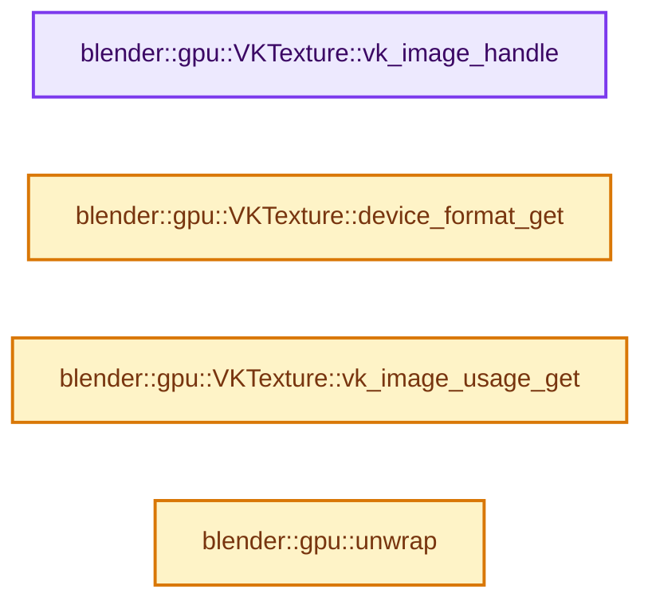
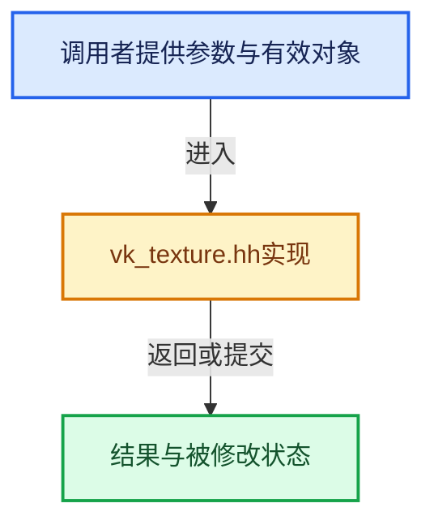

# 实现依赖专题：source/blender/gpu/vulkan/vk_texture.hh

[实现依赖导航](../../../README.md) · [符号索引](../../../../00-课程指南/02-源码与提交索引/符号依赖与实现索引.md)

本专题从正文实际调用进入，集中保存共享实现。函数有稳定锚点，可从调用处直接跳到对应完整函数；递归与互相调用通过回链组织。

## 本文件的实现关系






## 完整成员与函数实现

<a id="f-e1b6d3a2d30eedaa"></a>

### `blender::gpu::VKTexture::vk_image_handle`

实现位置：[source/blender/gpu/vulkan/vk_texture.hh](../../../../../../../../source/blender/gpu/vulkan/vk_texture.hh) · L124—L131。

**教学注释版**

<!-- annotated:8456bb628de373 -->

```cpp
  VkImage vk_image_handle() const
  {
    if (is_texture_view()) {
      return static_cast<VKTexture *>(source_texture_)->vk_image_handle();
    }
    BLI_assert(vk_image_ != VK_NULL_HANDLE);
    return vk_image_;
  }
```

<details>
<summary>核对原始源码：source/blender/gpu/vulkan/vk_texture.hh · L124—L131</summary>

<!-- original:8456bb628de373:source/blender/gpu/vulkan/vk_texture.hh:124:131 -->

```cpp
  VkImage vk_image_handle() const
  {
    if (is_texture_view()) {
      return static_cast<VKTexture *>(source_texture_)->vk_image_handle();
    }
    BLI_assert(vk_image_ != VK_NULL_HANDLE);
    return vk_image_;
  }
```

</details>

**结果出口**

- `return static_cast<VKTexture *>(source_texture_)->vk_image_handle();`
- `return vk_image_;`

**继续追踪实现**

- `is_texture_view` → [blender::gpu::Texture::is_texture_view · L210](../intern/gpu_texture_private.hh.md#f-788d968482534be1)。
- `static_cast<VKTexture *>(source_texture_)->vk_image_handle` → [调用协议](../../../../00-课程指南/01-路线与规范/模板宏与动态分派协议.md)：接收对象类型依赖auto、返回值或模板实例；不按同名猜测目标。调用位置L127。
- `BLI_assert` → [BLI_assert · L48](../../../01-BLI基础库/BLI_assert.hh.md#m-57a88495704d)；[BLI_assert · L63](../../../01-BLI基础库/BLI_assert.hh.md#m-d07050020cb5)。宏定义由构建条件选择。

<a id="f-1f00dbe38bb3b55c"></a>

### `blender::gpu::VKTexture::device_format_get`

实现位置：[source/blender/gpu/vulkan/vk_texture.hh](../../../../../../../../source/blender/gpu/vulkan/vk_texture.hh) · L136—L139。

**教学注释版**

<!-- annotated:449b9a473a9b80 -->

```cpp
  TextureFormat device_format_get() const
  {
    return device_format_;
  }
```

<details>
<summary>核对原始源码：source/blender/gpu/vulkan/vk_texture.hh · L136—L139</summary>

<!-- original:449b9a473a9b80:source/blender/gpu/vulkan/vk_texture.hh:136:139 -->

```cpp
  TextureFormat device_format_get() const
  {
    return device_format_;
  }
```

</details>

**结果出口**

- `return device_format_;`

**继续追踪实现**

本实现没有需要继续展开的显式调用；检查返回表达式、对象转换和调用者前置条件。

<a id="f-5b2a326ec62c74cd"></a>

### `blender::gpu::VKTexture::vk_image_usage_get`

实现位置：[source/blender/gpu/vulkan/vk_texture.hh](../../../../../../../../source/blender/gpu/vulkan/vk_texture.hh) · L142—L146。

**教学注释版**

<!-- annotated:99f7f6c924fd9a -->

```cpp
  VkImageUsageFlags vk_image_usage_get() const
  {
    return is_texture_view() ? static_cast<VKTexture *>(source_texture_)->vk_image_usage_get() :
                               vk_image_usage_;
  }
```

<details>
<summary>核对原始源码：source/blender/gpu/vulkan/vk_texture.hh · L142—L146</summary>

<!-- original:99f7f6c924fd9a:source/blender/gpu/vulkan/vk_texture.hh:142:146 -->

```cpp
  VkImageUsageFlags vk_image_usage_get() const
  {
    return is_texture_view() ? static_cast<VKTexture *>(source_texture_)->vk_image_usage_get() :
                               vk_image_usage_;
  }
```

</details>

**结果出口**

- `return is_texture_view() ? static_cast<VKTexture *>(source_texture_)->vk_image_usage_get() :`

**继续追踪实现**

- `is_texture_view` → [blender::gpu::Texture::is_texture_view · L210](../intern/gpu_texture_private.hh.md#f-788d968482534be1)。
- `static_cast<VKTexture *>(source_texture_)->vk_image_usage_get` → [调用协议](../../../../00-课程指南/01-路线与规范/模板宏与动态分派协议.md)：接收对象类型依赖auto、返回值或模板实例；不按同名猜测目标。调用位置L144。

<a id="f-ffb30b48418b1000"></a>

### `blender::gpu::unwrap`

实现位置：[source/blender/gpu/vulkan/vk_texture.hh](../../../../../../../../source/blender/gpu/vulkan/vk_texture.hh) · L179—L182。

接口参数：

- `Texture *texture`

**教学注释版**

<!-- annotated:8cef464f7d47be -->

```cpp
BLI_INLINE VKTexture *unwrap(Texture *texture)
{
  return static_cast<VKTexture *>(texture);
}
```

<details>
<summary>核对原始源码：source/blender/gpu/vulkan/vk_texture.hh · L179—L182</summary>

<!-- original:8cef464f7d47be:source/blender/gpu/vulkan/vk_texture.hh:179:182 -->

```cpp
BLI_INLINE VKTexture *unwrap(Texture *texture)
{
  return static_cast<VKTexture *>(texture);
}
```

</details>

**结果出口**

- `return static_cast<VKTexture *>(texture);`

**继续追踪实现**

本实现没有需要继续展开的显式调用；检查返回表达式、对象转换和调用者前置条件。
