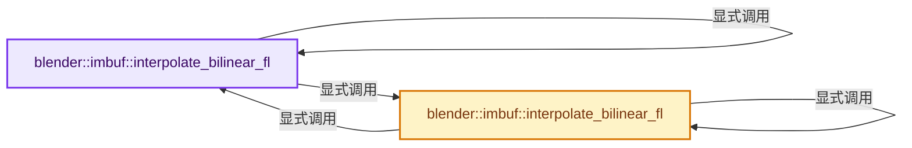
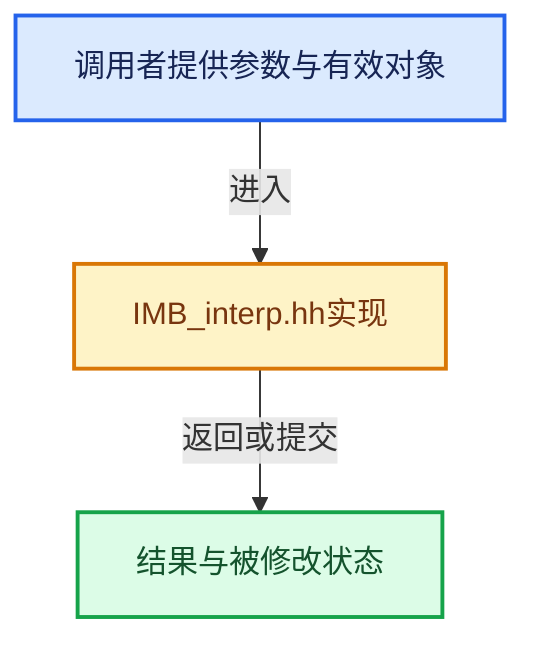

# 实现依赖专题：source/blender/imbuf/IMB_interp.hh

[实现依赖导航](../../README.md) · [符号索引](../../../00-课程指南/02-源码与提交索引/符号依赖与实现索引.md)

本专题从正文实际调用进入，集中保存共享实现。函数有稳定锚点，可从调用处直接跳到对应完整函数；递归与互相调用通过回链组织。

## 本文件的实现关系






## 完整成员与函数实现

<a id="f-f1a4e816ba8d5adc"></a>

### `blender::imbuf::interpolate_bilinear_fl`

实现位置：[source/blender/imbuf/IMB_interp.hh](../../../../../../../source/blender/imbuf/IMB_interp.hh) · L59—L62。

接口参数：

- `const ImBuf *in`
- `float u`
- `float v`

**教学注释版**

<!-- annotated:615267b1289176 -->

```cpp
[[nodiscard]] inline float4 interpolate_bilinear_fl(const ImBuf *in, float u, float v)
{
  return math::interpolate_bilinear_fl(in->float_data(), in->x, in->y, u, v);
}
```

<details>
<summary>核对原始源码：source/blender/imbuf/IMB_interp.hh · L59—L62</summary>

<!-- original:615267b1289176:source/blender/imbuf/IMB_interp.hh:59:62 -->

```cpp
[[nodiscard]] inline float4 interpolate_bilinear_fl(const ImBuf *in, float u, float v)
{
  return math::interpolate_bilinear_fl(in->float_data(), in->x, in->y, u, v);
}
```

</details>

**结果出口**

- `return math::interpolate_bilinear_fl(in->float_data(), in->x, in->y, u, v);`

**继续追踪实现**

- `math::interpolate_bilinear_fl` → [blender::imbuf::interpolate_bilinear_fl · L59](IMB_interp.hh.md#f-f1a4e816ba8d5adc)；[blender::imbuf::interpolate_bilinear_fl · L68](IMB_interp.hh.md#f-f0734811fe8dbb7f)。同名重载需按实参类型选择。
- `in->float_data` → [blender::ImBuf::float_data · L358](IMB_imbuf_types.hh.md#f-2e52aa77544ffaee)。

<a id="f-f0734811fe8dbb7f"></a>

### `blender::imbuf::interpolate_bilinear_fl`

实现位置：[source/blender/imbuf/IMB_interp.hh](../../../../../../../source/blender/imbuf/IMB_interp.hh) · L68—L72。

接口参数：

- `const ImBuf *in`
- `float output[4]`
- `float u`
- `float v`

**教学注释版**

<!-- annotated:3e7bc574518273 -->

```cpp
inline void interpolate_bilinear_fl(const ImBuf *in, float output[4], float u, float v)
{
  float4 col = math::interpolate_bilinear_fl(in->float_data(), in->x, in->y, u, v);
  // [讲解] memcpy：复制字节，源与目标不应重叠。类型生命周期、对齐和可复制表示须由调用者证明，不是任意对象的复制构造。
  memcpy(output, &col, sizeof(col));
}
```

<details>
<summary>核对原始源码：source/blender/imbuf/IMB_interp.hh · L68—L72</summary>

<!-- original:3e7bc574518273:source/blender/imbuf/IMB_interp.hh:68:72 -->

```cpp
inline void interpolate_bilinear_fl(const ImBuf *in, float output[4], float u, float v)
{
  float4 col = math::interpolate_bilinear_fl(in->float_data(), in->x, in->y, u, v);
  memcpy(output, &col, sizeof(col));
}
```

</details>

**继续追踪实现**

- `math::interpolate_bilinear_fl` → [blender::imbuf::interpolate_bilinear_fl · L59](IMB_interp.hh.md#f-f1a4e816ba8d5adc)；[blender::imbuf::interpolate_bilinear_fl · L68](IMB_interp.hh.md#f-f0734811fe8dbb7f)。同名重载需按实参类型选择。
- `in->float_data` → [blender::ImBuf::float_data · L358](IMB_imbuf_types.hh.md#f-2e52aa77544ffaee)。
- `memcpy` → [外部契约](https://eel.is/c++draft/cstring.syn)：复制字节，源与目标不应重叠。类型生命周期、对齐和可复制表示须由调用者证明，不是任意对象的复制构造。
