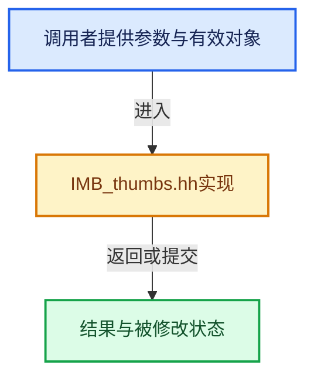

# 实现依赖专题：source/blender/imbuf/IMB_thumbs.hh

[实现依赖导航](../../README.md) · [符号索引](../../../00-课程指南/02-源码与提交索引/符号依赖与实现索引.md)

本专题从正文实际调用进入，集中保存共享实现。函数有稳定锚点，可从调用处直接跳到对应完整函数；递归与互相调用通过回链组织。

## 本文件的实现关系





## 相关类型布局与成员入口

<a id="t-3f87810766fa"></a>

### `blender::ThumbSource`

原始声明：[source/blender/imbuf/IMB_thumbs.hh](../../../../../../../source/blender/imbuf/IMB_thumbs.hh) · L32—L48。

以下保留类的数据声明与编译条件，成员函数实现通过后面的精确链接阅读。

<!-- annotated:716033dc2ffd0e -->

```cpp
enum ThumbSource : int8_t {
  THB_SOURCE_IMAGE,
  THB_SOURCE_MOVIE,
  THB_SOURCE_BLEND,
  THB_SOURCE_FONT,
  THB_SOURCE_OBJECT_IO,
  /**
   * The thumbnail is not created from some other file, but the given file path refers to the
   * thumbnail itself directly.
   *
   * Can be useful to directly load an image from disk that can be displayed as a thumbnail,
   * without requiring the caller to handle these cases specially.
   *
   * Does _not_ use the thumbnail standard.
   */
  THB_SOURCE_DIRECT,
};
```

<details>
<summary>核对原始源码：source/blender/imbuf/IMB_thumbs.hh · L32—L48</summary>

<!-- original:716033dc2ffd0e:source/blender/imbuf/IMB_thumbs.hh:32:48 -->

```cpp
enum ThumbSource : int8_t {
  THB_SOURCE_IMAGE,
  THB_SOURCE_MOVIE,
  THB_SOURCE_BLEND,
  THB_SOURCE_FONT,
  THB_SOURCE_OBJECT_IO,
  /**
   * The thumbnail is not created from some other file, but the given file path refers to the
   * thumbnail itself directly.
   *
   * Can be useful to directly load an image from disk that can be displayed as a thumbnail,
   * without requiring the caller to handle these cases specially.
   *
   * Does _not_ use the thumbnail standard.
   */
  THB_SOURCE_DIRECT,
};
```

</details>


## 完整成员与函数实现

<a id="f-b7b44093da1fb7bc"></a>

### `blender::ThumbCancellationToken::is_cancelled`

实现位置：[source/blender/imbuf/IMB_thumbs.hh](../../../../../../../source/blender/imbuf/IMB_thumbs.hh) · L65—L68。

**教学注释版**

<!-- annotated:8dcf91179df047 -->

```cpp
  bool is_cancelled() const
  {
    return is_cancelled_.load(std::memory_order_acquire);
  }
```

<details>
<summary>核对原始源码：source/blender/imbuf/IMB_thumbs.hh · L65—L68</summary>

<!-- original:8dcf91179df047:source/blender/imbuf/IMB_thumbs.hh:65:68 -->

```cpp
  bool is_cancelled() const
  {
    return is_cancelled_.load(std::memory_order_acquire);
  }
```

</details>

**结果出口**

- `return is_cancelled_.load(std::memory_order_acquire);`

**继续追踪实现**

- `is_cancelled_.load` → [外部契约](https://eel.is/c++draft/)：这个边界按实际表达式及所属类型核对参数、返回值、寿命与失败行为。这里提供接口入口，不声称已解释该第三方版本的内部实现。
