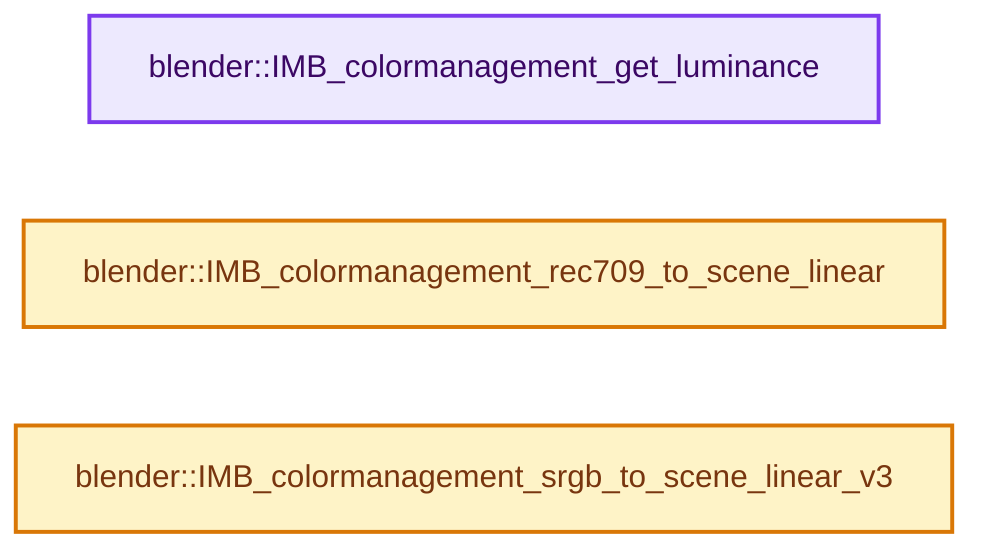

# 实现依赖专题：source/blender/imbuf/intern/colormanagement_inline.h

[实现依赖导航](../../../README.md) · [符号索引](../../../../00-课程指南/02-源码与提交索引/符号依赖与实现索引.md)

本专题从正文实际调用进入，集中保存共享实现。函数有稳定锚点，可从调用处直接跳到对应完整函数；递归与互相调用通过回链组织。

## 本文件的实现关系




## 完整成员与函数实现

<a id="f-78b5e1ba25ca496b"></a>

### `blender::IMB_colormanagement_get_luminance`

实现位置：[source/blender/imbuf/intern/colormanagement_inline.h](../../../../../../../../source/blender/imbuf/intern/colormanagement_inline.h) · L24—L27。

接口参数：

- `const float rgb[3]`

**教学注释版**

<!-- annotated:54ef0d7e925ae0 -->

```cpp
float IMB_colormanagement_get_luminance(const float rgb[3])
{
  return dot_v3v3(colorspace::luma_coefficients, rgb);
}
```

<details>
<summary>核对原始源码：source/blender/imbuf/intern/colormanagement_inline.h · L24—L27</summary>

<!-- original:54ef0d7e925ae0:source/blender/imbuf/intern/colormanagement_inline.h:24:27 -->

```cpp
float IMB_colormanagement_get_luminance(const float rgb[3])
{
  return dot_v3v3(colorspace::luma_coefficients, rgb);
}
```

</details>

**结果出口**

- `return dot_v3v3(colorspace::luma_coefficients, rgb);`

**继续追踪实现**

- `dot_v3v3` → [blender::dot_v3v3 · L646](../../../01-BLI基础库/intern/math_vector_inline.cc.md#f-c88befa67d07591a)。

<a id="f-065c5dfb0d51c512"></a>

### `blender::IMB_colormanagement_rec709_to_scene_linear`

实现位置：[source/blender/imbuf/intern/colormanagement_inline.h](../../../../../../../../source/blender/imbuf/intern/colormanagement_inline.h) · L50—L58。

接口参数：

- `float scene_linear[3]`
- `const float rec709[3]`

**教学注释版**

<!-- annotated:90cbbbdc6c962e -->

```cpp
void IMB_colormanagement_rec709_to_scene_linear(float scene_linear[3], const float rec709[3])
{
  if (colorspace::scene_linear_is_rec709) {
    copy_v3_v3(scene_linear, rec709);
  }
  else {
    mul_v3_m3v3(scene_linear, colorspace::rec709_to_scene_linear.ptr(), rec709);
  }
}
```

<details>
<summary>核对原始源码：source/blender/imbuf/intern/colormanagement_inline.h · L50—L58</summary>

<!-- original:90cbbbdc6c962e:source/blender/imbuf/intern/colormanagement_inline.h:50:58 -->

```cpp
void IMB_colormanagement_rec709_to_scene_linear(float scene_linear[3], const float rec709[3])
{
  if (colorspace::scene_linear_is_rec709) {
    copy_v3_v3(scene_linear, rec709);
  }
  else {
    mul_v3_m3v3(scene_linear, colorspace::rec709_to_scene_linear.ptr(), rec709);
  }
}
```

</details>

**继续追踪实现**

- `copy_v3_v3` → [blender::copy_v3_v3 · L47](../../../01-BLI基础库/intern/math_vector_inline.cc.md#f-037a0d5fa5060bd6)。
- `mul_v3_m3v3` → [blender::mul_v3_m3v3 · L824](../../../01-BLI基础库/intern/math_matrix_c.cc.md#f-4cc9cde9f14287de)。
- `colorspace::rec709_to_scene_linear.ptr` → [调用协议](../../../../00-课程指南/01-路线与规范/模板宏与动态分派协议.md)：接收对象类型依赖auto、返回值或模板实例；不按同名猜测目标。调用位置L56。

<a id="f-9b87d146aec4cd28"></a>

### `blender::IMB_colormanagement_srgb_to_scene_linear_v3`

实现位置：[source/blender/imbuf/intern/colormanagement_inline.h](../../../../../../../../source/blender/imbuf/intern/colormanagement_inline.h) · L81—L87。

接口参数：

- `float scene_linear[3]`
- `const float srgb[3]`

**教学注释版**

<!-- annotated:a0548608f72911 -->

```cpp
void IMB_colormanagement_srgb_to_scene_linear_v3(float scene_linear[3], const float srgb[3])
{
  srgb_to_linearrgb_v3_v3(scene_linear, srgb);
  if (!colorspace::scene_linear_is_rec709) {
    mul_m3_v3(colorspace::rec709_to_scene_linear.ptr(), scene_linear);
  }
}
```

<details>
<summary>核对原始源码：source/blender/imbuf/intern/colormanagement_inline.h · L81—L87</summary>

<!-- original:a0548608f72911:source/blender/imbuf/intern/colormanagement_inline.h:81:87 -->

```cpp
void IMB_colormanagement_srgb_to_scene_linear_v3(float scene_linear[3], const float srgb[3])
{
  srgb_to_linearrgb_v3_v3(scene_linear, srgb);
  if (!colorspace::scene_linear_is_rec709) {
    mul_m3_v3(colorspace::rec709_to_scene_linear.ptr(), scene_linear);
  }
}
```

</details>

**继续追踪实现**

- `srgb_to_linearrgb_v3_v3` → [blender::srgb_to_linearrgb_v3_v3 · L634](../../../01-BLI基础库/intern/math_color.cc.md#f-726cc9f39ac13d69)；[blender::srgb_to_linearrgb_v3_v3 · L785](../../../01-BLI基础库/intern/math_color.cc.md#f-6e6e32feab47a3b3)。同名重载需按实参类型选择。
- `mul_m3_v3` → [blender::mul_m3_v3 · L853](../../../01-BLI基础库/intern/math_matrix_c.cc.md#f-8dbb02b9a9a2d195)。
- `colorspace::rec709_to_scene_linear.ptr` → [调用协议](../../../../00-课程指南/01-路线与规范/模板宏与动态分派协议.md)：接收对象类型依赖auto、返回值或模板实例；不按同名猜测目标。调用位置L85。
