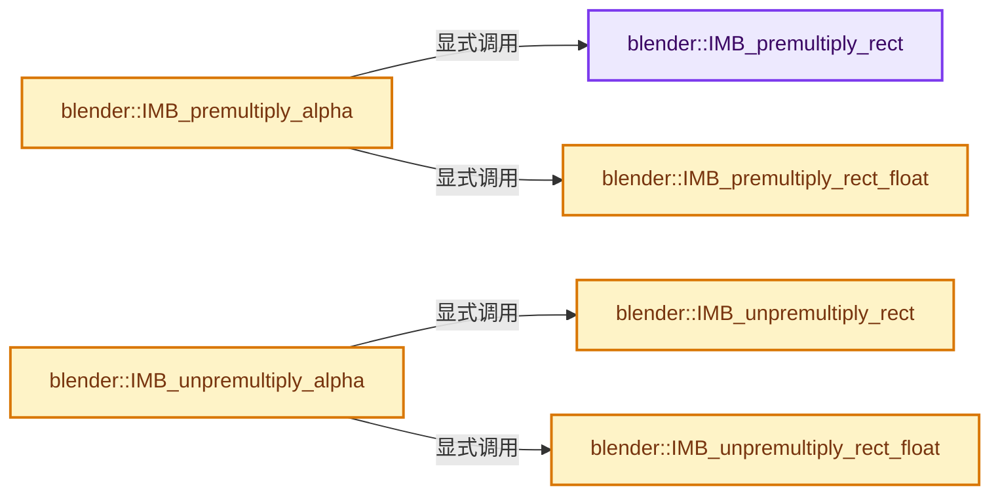
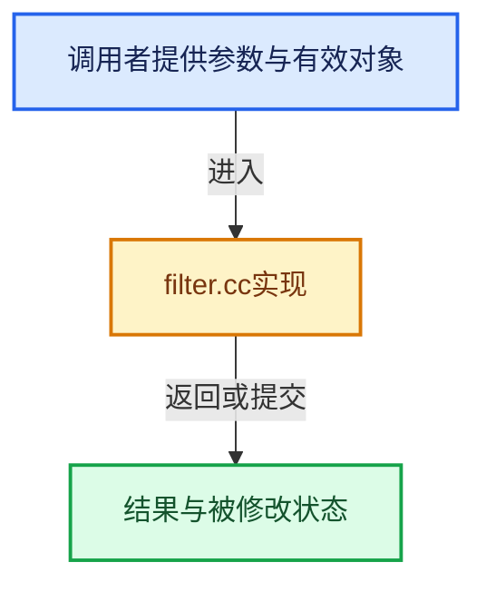

# 实现依赖专题：source/blender/imbuf/intern/filter.cc

[实现依赖导航](../../../README.md) · [符号索引](../../../../00-课程指南/02-源码与提交索引/符号依赖与实现索引.md)

本专题从正文实际调用进入，集中保存共享实现。函数有稳定锚点，可从调用处直接跳到对应完整函数；递归与互相调用通过回链组织。

## 本文件的实现关系






## 完整成员与函数实现

<a id="f-5acc923538124e95"></a>

### `blender::IMB_premultiply_rect`

实现位置：[source/blender/imbuf/intern/filter.cc](../../../../../../../../source/blender/imbuf/intern/filter.cc) · L336—L362。

接口参数：

- `uint8_t *rect`
- `ImColorMode color_mode`
- `int w`
- `int h`

**教学注释版**

<!-- annotated:5ae4df524a6270 -->

```cpp
void IMB_premultiply_rect(uint8_t *rect, ImColorMode color_mode, int w, int h)
{
  uint8_t *cp;
  int x, y, val;

  if (color_mode == ImColorMode::RGB) { /* put alpha at 255 */
    cp = rect;

    for (y = 0; y < h; y++) {
      for (x = 0; x < w; x++, cp += 4) {
        cp[3] = 255;
      }
    }
  }
  else {
    cp = rect;

    for (y = 0; y < h; y++) {
      for (x = 0; x < w; x++, cp += 4) {
        val = cp[3];
        cp[0] = (cp[0] * val) >> 8;
        cp[1] = (cp[1] * val) >> 8;
        cp[2] = (cp[2] * val) >> 8;
      }
    }
  }
}
```

<details>
<summary>核对原始源码：source/blender/imbuf/intern/filter.cc · L336—L362</summary>

<!-- original:5ae4df524a6270:source/blender/imbuf/intern/filter.cc:336:362 -->

```cpp
void IMB_premultiply_rect(uint8_t *rect, ImColorMode color_mode, int w, int h)
{
  uint8_t *cp;
  int x, y, val;

  if (color_mode == ImColorMode::RGB) { /* put alpha at 255 */
    cp = rect;

    for (y = 0; y < h; y++) {
      for (x = 0; x < w; x++, cp += 4) {
        cp[3] = 255;
      }
    }
  }
  else {
    cp = rect;

    for (y = 0; y < h; y++) {
      for (x = 0; x < w; x++, cp += 4) {
        val = cp[3];
        cp[0] = (cp[0] * val) >> 8;
        cp[1] = (cp[1] * val) >> 8;
        cp[2] = (cp[2] * val) >> 8;
      }
    }
  }
}
```

</details>

**沿实际写入检查状态**

- `cp = rect;`
- `cp[3] = 255;`
- `val = cp[3];`
- `cp[0] = (cp[0] * val) >> 8;`
- `cp[1] = (cp[1] * val) >> 8;`
- `cp[2] = (cp[2] * val) >> 8;`

**继续追踪实现**

本实现没有需要继续展开的显式调用；检查返回表达式、对象转换和调用者前置条件。

<a id="f-0bdda2e7671ac790"></a>

### `blender::IMB_premultiply_rect_float`

实现位置：[source/blender/imbuf/intern/filter.cc](../../../../../../../../source/blender/imbuf/intern/filter.cc) · L364—L380。

接口参数：

- `float *rect_float`
- `int channels`
- `int w`
- `int h`

**教学注释版**

<!-- annotated:7ae278801abc66 -->

```cpp
void IMB_premultiply_rect_float(float *rect_float, int channels, int w, int h)
{
  float val, *cp;
  int x, y;

  if (channels == 4) {
    cp = rect_float;
    for (y = 0; y < h; y++) {
      for (x = 0; x < w; x++, cp += 4) {
        val = cp[3];
        cp[0] = cp[0] * val;
        cp[1] = cp[1] * val;
        cp[2] = cp[2] * val;
      }
    }
  }
}
```

<details>
<summary>核对原始源码：source/blender/imbuf/intern/filter.cc · L364—L380</summary>

<!-- original:7ae278801abc66:source/blender/imbuf/intern/filter.cc:364:380 -->

```cpp
void IMB_premultiply_rect_float(float *rect_float, int channels, int w, int h)
{
  float val, *cp;
  int x, y;

  if (channels == 4) {
    cp = rect_float;
    for (y = 0; y < h; y++) {
      for (x = 0; x < w; x++, cp += 4) {
        val = cp[3];
        cp[0] = cp[0] * val;
        cp[1] = cp[1] * val;
        cp[2] = cp[2] * val;
      }
    }
  }
}
```

</details>

**沿实际写入检查状态**

- `cp = rect_float;`
- `val = cp[3];`
- `cp[0] = cp[0] * val;`
- `cp[1] = cp[1] * val;`
- `cp[2] = cp[2] * val;`

**继续追踪实现**

本实现没有需要继续展开的显式调用；检查返回表达式、对象转换和调用者前置条件。

<a id="f-40614b7498f007be"></a>

### `blender::IMB_premultiply_alpha`

实现位置：[source/blender/imbuf/intern/filter.cc](../../../../../../../../source/blender/imbuf/intern/filter.cc) · L382—L395。

接口参数：

- `ImBuf *ibuf`

**教学注释版**

<!-- annotated:f44a7b59cef9e3 -->

```cpp
void IMB_premultiply_alpha(ImBuf *ibuf)
{
  if (ibuf == nullptr) {
    return;
  }

  if (uchar *byte_data = ibuf->byte_data_for_write()) {
    IMB_premultiply_rect(byte_data, ibuf->color_mode, ibuf->x, ibuf->y);
  }

  if (float *float_data = ibuf->float_data_for_write()) {
    IMB_premultiply_rect_float(float_data, ibuf->channels, ibuf->x, ibuf->y);
  }
}
```

<details>
<summary>核对原始源码：source/blender/imbuf/intern/filter.cc · L382—L395</summary>

<!-- original:f44a7b59cef9e3:source/blender/imbuf/intern/filter.cc:382:395 -->

```cpp
void IMB_premultiply_alpha(ImBuf *ibuf)
{
  if (ibuf == nullptr) {
    return;
  }

  if (uchar *byte_data = ibuf->byte_data_for_write()) {
    IMB_premultiply_rect(byte_data, ibuf->color_mode, ibuf->x, ibuf->y);
  }

  if (float *float_data = ibuf->float_data_for_write()) {
    IMB_premultiply_rect_float(float_data, ibuf->channels, ibuf->x, ibuf->y);
  }
}
```

</details>

**继续追踪实现**

- `ibuf->byte_data_for_write` → [blender::ImBuf::byte_data_for_write · L60](allocimbuf.cc.md#f-9ae201bd1c52aa87)。
- `IMB_premultiply_rect` → [blender::IMB_premultiply_rect · L336](filter.cc.md#f-5acc923538124e95)。
- `ibuf->float_data_for_write` → [blender::ImBuf::float_data_for_write · L79](allocimbuf.cc.md#f-1956ac4db88ed3eb)。
- `IMB_premultiply_rect_float` → [blender::IMB_premultiply_rect_float · L364](filter.cc.md#f-0bdda2e7671ac790)。

<a id="f-64cc174133e9fc0a"></a>

### `blender::IMB_unpremultiply_rect`

实现位置：[source/blender/imbuf/intern/filter.cc](../../../../../../../../source/blender/imbuf/intern/filter.cc) · L397—L424。

接口参数：

- `uint8_t *rect`
- `ImColorMode color_mode`
- `int w`
- `int h`

**教学注释版**

<!-- annotated:37b7c8bde0a021 -->

```cpp
void IMB_unpremultiply_rect(uint8_t *rect, ImColorMode color_mode, int w, int h)
{
  uchar *cp;
  int x, y;
  float val;

  if (color_mode == ImColorMode::RGB) { /* put alpha at 255 */
    cp = rect;

    for (y = 0; y < h; y++) {
      for (x = 0; x < w; x++, cp += 4) {
        cp[3] = 255;
      }
    }
  }
  else {
    cp = rect;

    for (y = 0; y < h; y++) {
      for (x = 0; x < w; x++, cp += 4) {
        val = cp[3] != 0 ? 1.0f / float(cp[3]) : 1.0f;
        cp[0] = unit_float_to_uchar_clamp(cp[0] * val);
        cp[1] = unit_float_to_uchar_clamp(cp[1] * val);
        cp[2] = unit_float_to_uchar_clamp(cp[2] * val);
      }
    }
  }
}
```

<details>
<summary>核对原始源码：source/blender/imbuf/intern/filter.cc · L397—L424</summary>

<!-- original:37b7c8bde0a021:source/blender/imbuf/intern/filter.cc:397:424 -->

```cpp
void IMB_unpremultiply_rect(uint8_t *rect, ImColorMode color_mode, int w, int h)
{
  uchar *cp;
  int x, y;
  float val;

  if (color_mode == ImColorMode::RGB) { /* put alpha at 255 */
    cp = rect;

    for (y = 0; y < h; y++) {
      for (x = 0; x < w; x++, cp += 4) {
        cp[3] = 255;
      }
    }
  }
  else {
    cp = rect;

    for (y = 0; y < h; y++) {
      for (x = 0; x < w; x++, cp += 4) {
        val = cp[3] != 0 ? 1.0f / float(cp[3]) : 1.0f;
        cp[0] = unit_float_to_uchar_clamp(cp[0] * val);
        cp[1] = unit_float_to_uchar_clamp(cp[1] * val);
        cp[2] = unit_float_to_uchar_clamp(cp[2] * val);
      }
    }
  }
}
```

</details>

**沿实际写入检查状态**

- `cp = rect;`
- `cp[3] = 255;`
- `val = cp[3] != 0 ? 1.0f / float(cp[3]) : 1.0f;`
- `cp[0] = unit_float_to_uchar_clamp(cp[0] * val);`
- `cp[1] = unit_float_to_uchar_clamp(cp[1] * val);`
- `cp[2] = unit_float_to_uchar_clamp(cp[2] * val);`

**继续追踪实现**

- `unit_float_to_uchar_clamp` → [blender::unit_float_to_uchar_clamp · L579](../../../01-BLI基础库/intern/math_base_inline.cc.md#f-078b5581dbbfbc81)。

<a id="f-d0dea23f6a73f956"></a>

### `blender::IMB_unpremultiply_rect_float`

实现位置：[source/blender/imbuf/intern/filter.cc](../../../../../../../../source/blender/imbuf/intern/filter.cc) · L426—L442。

接口参数：

- `float *rect_float`
- `int channels`
- `int w`
- `int h`

**教学注释版**

<!-- annotated:56c60fdbdcb5bb -->

```cpp
void IMB_unpremultiply_rect_float(float *rect_float, int channels, int w, int h)
{
  float val, *fp;
  int x, y;

  if (channels == 4) {
    fp = rect_float;
    for (y = 0; y < h; y++) {
      for (x = 0; x < w; x++, fp += 4) {
        val = fp[3] != 0.0f ? 1.0f / fp[3] : 1.0f;
        fp[0] = fp[0] * val;
        fp[1] = fp[1] * val;
        fp[2] = fp[2] * val;
      }
    }
  }
}
```

<details>
<summary>核对原始源码：source/blender/imbuf/intern/filter.cc · L426—L442</summary>

<!-- original:56c60fdbdcb5bb:source/blender/imbuf/intern/filter.cc:426:442 -->

```cpp
void IMB_unpremultiply_rect_float(float *rect_float, int channels, int w, int h)
{
  float val, *fp;
  int x, y;

  if (channels == 4) {
    fp = rect_float;
    for (y = 0; y < h; y++) {
      for (x = 0; x < w; x++, fp += 4) {
        val = fp[3] != 0.0f ? 1.0f / fp[3] : 1.0f;
        fp[0] = fp[0] * val;
        fp[1] = fp[1] * val;
        fp[2] = fp[2] * val;
      }
    }
  }
}
```

</details>

**沿实际写入检查状态**

- `fp = rect_float;`
- `val = fp[3] != 0.0f ? 1.0f / fp[3] : 1.0f;`
- `fp[0] = fp[0] * val;`
- `fp[1] = fp[1] * val;`
- `fp[2] = fp[2] * val;`

**继续追踪实现**

本实现没有需要继续展开的显式调用；检查返回表达式、对象转换和调用者前置条件。

<a id="f-98e8d8f8f185b563"></a>

### `blender::IMB_unpremultiply_alpha`

实现位置：[source/blender/imbuf/intern/filter.cc](../../../../../../../../source/blender/imbuf/intern/filter.cc) · L444—L457。

接口参数：

- `ImBuf *ibuf`

**教学注释版**

<!-- annotated:556fcd66d14d12 -->

```cpp
void IMB_unpremultiply_alpha(ImBuf *ibuf)
{
  if (ibuf == nullptr) {
    return;
  }

  if (uchar *byte_data = ibuf->byte_data_for_write()) {
    IMB_unpremultiply_rect(byte_data, ibuf->color_mode, ibuf->x, ibuf->y);
  }

  if (float *float_data = ibuf->float_data_for_write()) {
    IMB_unpremultiply_rect_float(float_data, ibuf->channels, ibuf->x, ibuf->y);
  }
}
```

<details>
<summary>核对原始源码：source/blender/imbuf/intern/filter.cc · L444—L457</summary>

<!-- original:556fcd66d14d12:source/blender/imbuf/intern/filter.cc:444:457 -->

```cpp
void IMB_unpremultiply_alpha(ImBuf *ibuf)
{
  if (ibuf == nullptr) {
    return;
  }

  if (uchar *byte_data = ibuf->byte_data_for_write()) {
    IMB_unpremultiply_rect(byte_data, ibuf->color_mode, ibuf->x, ibuf->y);
  }

  if (float *float_data = ibuf->float_data_for_write()) {
    IMB_unpremultiply_rect_float(float_data, ibuf->channels, ibuf->x, ibuf->y);
  }
}
```

</details>

**继续追踪实现**

- `ibuf->byte_data_for_write` → [blender::ImBuf::byte_data_for_write · L60](allocimbuf.cc.md#f-9ae201bd1c52aa87)。
- `IMB_unpremultiply_rect` → [blender::IMB_unpremultiply_rect · L397](filter.cc.md#f-64cc174133e9fc0a)。
- `ibuf->float_data_for_write` → [blender::ImBuf::float_data_for_write · L79](allocimbuf.cc.md#f-1956ac4db88ed3eb)。
- `IMB_unpremultiply_rect_float` → [blender::IMB_unpremultiply_rect_float · L426](filter.cc.md#f-d0dea23f6a73f956)。
