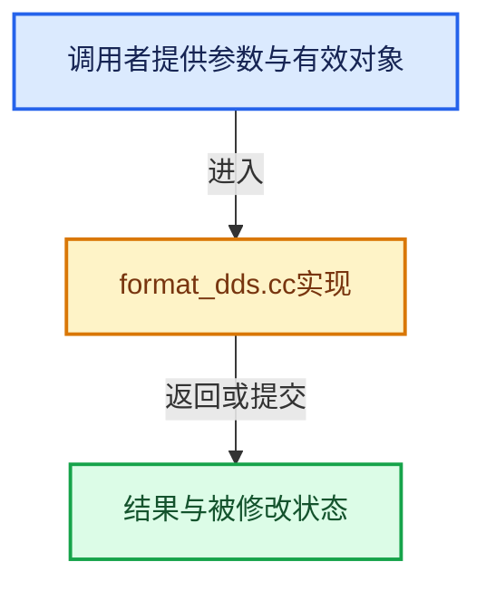

# 实现依赖专题：source/blender/imbuf/intern/format_dds.cc

[实现依赖导航](../../../README.md) · [符号索引](../../../../00-课程指南/02-源码与提交索引/符号依赖与实现索引.md)

本专题从正文实际调用进入，集中保存共享实现。函数有稳定锚点，可从调用处直接跳到对应完整函数；递归与互相调用通过回链组织。

## 本文件的实现关系





## 完整成员与函数实现

<a id="f-1e6bb1ce2abab8ba"></a>

### `blender::flip_dxtc_image`

实现位置：[source/blender/imbuf/intern/format_dds.cc](../../../../../../../../source/blender/imbuf/intern/format_dds.cc) · L216—L313。

接口参数：

- `uint8_t *data`
- `size_t data_size`
- `int width`
- `int height`
- `int levels`
- `uint32_t fourcc`

**教学注释版**

<!-- annotated:048b3c83001f03 -->

```cpp
static int flip_dxtc_image(
    uint8_t *data, size_t data_size, int width, int height, int levels, uint32_t fourcc)
{
  /* Must have valid dimensions. */
  if (width == 0 || height == 0) {
    return 0;
  }

  /* Height must be a power-of-two: not because something within DXT/S3TC
   * needs it. Only because we want to flip the image upside down, by
   * swapping and flipping block rows, and that in general case (with mipmaps)
   * is only possible for POT height. */
  if (!is_power_of_2_i(height)) {
    return 0;
  }

  FlipBlockFunction full_block_function;
  FlipBlockFunction half_block_function;
  size_t block_bytes = 0;

  switch (fourcc) {
    case fourcc_dxt1:
      full_block_function = FlipDXT1BlockFull;
      half_block_function = FlipDXT1BlockHalf;
      block_bytes = 8;
      break;
    case fourcc_dxt3:
      full_block_function = FlipDXT3BlockFull;
      half_block_function = FlipDXT3BlockHalf;
      block_bytes = 16;
      break;
    case fourcc_dxt5:
      full_block_function = FlipDXT5BlockFull;
      half_block_function = FlipDXT5BlockHalf;
      block_bytes = 16;
      break;
    default:
      return 0;
  }

  int mip_width = width;
  int mip_height = height;

  const uint8_t *data_end = data + data_size;

  for (int level = 0; level < levels; level++) {
    int blocks_per_row = (mip_width + 3) / 4;
    int blocks_per_col = (mip_height + 3) / 4;
    int blocks = blocks_per_row * blocks_per_col;

    if (data + block_bytes * blocks > data_end) {
      /* Stop flipping when running out of data to be modified, avoiding possible buffer overrun
       * on a malformed files. */
      return level;
    }

    if (mip_height == 1) {
      /* no flip to do, and we're done. */
      break;
    }
    if (mip_height == 2) {
      /* flip the first 2 lines in each block. */
      for (int i = 0; i < blocks_per_row; i++) {
        half_block_function(data + i * block_bytes);
      }
    }
    else {
      /* flip each block. */
      for (int i = 0; i < blocks; i++) {
        full_block_function(data + i * block_bytes);
      }

      /* Swap each block line in the first half of the image with the
       * corresponding one in the second half.
       * note that this is a no-op if mip height is 4. */
      size_t row_bytes = block_bytes * blocks_per_row;
      uint8_t *temp_line = new uint8_t[row_bytes];

      for (int y = 0; y < blocks_per_col / 2; y++) {
        uint8_t *line1 = data + y * row_bytes;
        uint8_t *line2 = data + (blocks_per_col - y - 1) * row_bytes;

        // [讲解] memcpy：复制字节，源与目标不应重叠。类型生命周期、对齐和可复制表示须由调用者证明，不是任意对象的复制构造。
        memcpy(temp_line, line1, row_bytes);
        memcpy(line1, line2, row_bytes);
        memcpy(line2, temp_line, row_bytes);
      }

      delete[] temp_line;
    }

    /* Advance to next mip level. */
    data += block_bytes * blocks;
    // [讲解] std::max：按比较关系选取较大值。本讲解中的增长公式同时满足最低请求和几何增长；若保存返回引用，还需注意实参寿命。
    mip_width = std::max(1, mip_width >> 1);
    mip_height = std::max(1, mip_height >> 1);
  }

  return levels;
}
```

<details>
<summary>核对原始源码：source/blender/imbuf/intern/format_dds.cc · L216—L313</summary>

<!-- original:048b3c83001f03:source/blender/imbuf/intern/format_dds.cc:216:313 -->

```cpp
static int flip_dxtc_image(
    uint8_t *data, size_t data_size, int width, int height, int levels, uint32_t fourcc)
{
  /* Must have valid dimensions. */
  if (width == 0 || height == 0) {
    return 0;
  }

  /* Height must be a power-of-two: not because something within DXT/S3TC
   * needs it. Only because we want to flip the image upside down, by
   * swapping and flipping block rows, and that in general case (with mipmaps)
   * is only possible for POT height. */
  if (!is_power_of_2_i(height)) {
    return 0;
  }

  FlipBlockFunction full_block_function;
  FlipBlockFunction half_block_function;
  size_t block_bytes = 0;

  switch (fourcc) {
    case fourcc_dxt1:
      full_block_function = FlipDXT1BlockFull;
      half_block_function = FlipDXT1BlockHalf;
      block_bytes = 8;
      break;
    case fourcc_dxt3:
      full_block_function = FlipDXT3BlockFull;
      half_block_function = FlipDXT3BlockHalf;
      block_bytes = 16;
      break;
    case fourcc_dxt5:
      full_block_function = FlipDXT5BlockFull;
      half_block_function = FlipDXT5BlockHalf;
      block_bytes = 16;
      break;
    default:
      return 0;
  }

  int mip_width = width;
  int mip_height = height;

  const uint8_t *data_end = data + data_size;

  for (int level = 0; level < levels; level++) {
    int blocks_per_row = (mip_width + 3) / 4;
    int blocks_per_col = (mip_height + 3) / 4;
    int blocks = blocks_per_row * blocks_per_col;

    if (data + block_bytes * blocks > data_end) {
      /* Stop flipping when running out of data to be modified, avoiding possible buffer overrun
       * on a malformed files. */
      return level;
    }

    if (mip_height == 1) {
      /* no flip to do, and we're done. */
      break;
    }
    if (mip_height == 2) {
      /* flip the first 2 lines in each block. */
      for (int i = 0; i < blocks_per_row; i++) {
        half_block_function(data + i * block_bytes);
      }
    }
    else {
      /* flip each block. */
      for (int i = 0; i < blocks; i++) {
        full_block_function(data + i * block_bytes);
      }

      /* Swap each block line in the first half of the image with the
       * corresponding one in the second half.
       * note that this is a no-op if mip height is 4. */
      size_t row_bytes = block_bytes * blocks_per_row;
      uint8_t *temp_line = new uint8_t[row_bytes];

      for (int y = 0; y < blocks_per_col / 2; y++) {
        uint8_t *line1 = data + y * row_bytes;
        uint8_t *line2 = data + (blocks_per_col - y - 1) * row_bytes;

        memcpy(temp_line, line1, row_bytes);
        memcpy(line1, line2, row_bytes);
        memcpy(line2, temp_line, row_bytes);
      }

      delete[] temp_line;
    }

    /* Advance to next mip level. */
    data += block_bytes * blocks;
    mip_width = std::max(1, mip_width >> 1);
    mip_height = std::max(1, mip_height >> 1);
  }

  return levels;
}
```

</details>

**沿实际写入检查状态**

- `full_block_function = FlipDXT1BlockFull;`
- `half_block_function = FlipDXT1BlockHalf;`
- `block_bytes = 8;`
- `full_block_function = FlipDXT3BlockFull;`
- `half_block_function = FlipDXT3BlockHalf;`
- `block_bytes = 16;`
- `full_block_function = FlipDXT5BlockFull;`
- `half_block_function = FlipDXT5BlockHalf;`
- `data += block_bytes * blocks;`
- `mip_width = std::max(1, mip_width >> 1);`
- `mip_height = std::max(1, mip_height >> 1);`

**结果出口**

- `return 0;`
- `return level;`
- `return levels;`

**继续追踪实现**

- `is_power_of_2_i` → [blender::is_power_of_2_i · L105](../../../01-BLI基础库/intern/math_base_inline.cc.md#f-122f291f1e7250f2)。
- `half_block_function` → [调用协议](../../../../00-课程指南/01-路线与规范/模板宏与动态分派协议.md)：局部可调用对象，须结合其初始化与捕获环境。调用位置L279。
- `full_block_function` → [调用协议](../../../../00-课程指南/01-路线与规范/模板宏与动态分派协议.md)：局部可调用对象，须结合其初始化与捕获环境。调用位置L285。
- `memcpy` → [外部契约](https://eel.is/c++draft/cstring.syn)：复制字节，源与目标不应重叠。类型生命周期、对齐和可复制表示须由调用者证明，不是任意对象的复制构造。
- `std::max` → [外部契约](https://eel.is/c++draft/alg.min.max)：按比较关系选取较大值。本讲解中的增长公式同时满足最低请求和几何增长；若保存返回引用，还需注意实参寿命。

<a id="f-f8b344d550326355"></a>

### `blender::imb_load_dds_compressed_data`

实现位置：[source/blender/imbuf/intern/format_dds.cc](../../../../../../../../source/blender/imbuf/intern/format_dds.cc) · L315—L372。

接口参数：

- `const char *filepath`
- `int width`
- `int height`
- `int &r_mipcount`

**教学注释版**

<!-- annotated:a4eb933dd4e854 -->

```cpp
uint8_t *imb_load_dds_compressed_data(const char *filepath, int width, int height, int &r_mipcount)
{
  r_mipcount = 0;

  /* Due to upside down flipping, we only support compressed DDS files with power of two heights.
   */
  if (!is_power_of_2_i(height)) {
    return nullptr;
  }

  const int file = BLI_open(filepath, O_BINARY | O_RDONLY, 0);
  if (file == -1) {
    return nullptr;
  }
  BLI_mmap_file *mmap_file = BLI_mmap_open(file);
  close(file);
  if (mmap_file == nullptr) {
    return nullptr;
  }

  uint8_t *result = nullptr;

  const uchar *file_data = static_cast<const uchar *>(BLI_mmap_get_pointer(mmap_file));
  const size_t file_size = BLI_mmap_get_length(mmap_file);

  constexpr size_t dds_header_size = 128;
  if (file_size < dds_header_size) {
    BLI_mmap_free(mmap_file);
    return nullptr;
  }

  /* Pull out pixel format and mipmap count flags from DDS header. */
  uint32_t flags = 0, mipcount = 0, fourcc = 0;
  // [讲解] memcpy：复制字节，源与目标不应重叠。类型生命周期、对齐和可复制表示须由调用者证明，不是任意对象的复制构造。
  memcpy(&flags, file_data + 8, 4);
  memcpy(&mipcount, file_data + 28, 4);
  memcpy(&fourcc, file_data + 84, 4);

  /* Due to upside down flipping, we only support DXT1/DXT3/DXT5. Newer formats like BC7 can't
   * be flipped upside down due to non-symmetrical partition shapes. */
  if (ELEM(fourcc, fourcc_dxt1, fourcc_dxt3, fourcc_dxt5)) {

    constexpr uint32_t DDSD_MIPMAPCOUNT = 0x00020000U;
    if ((flags & DDSD_MIPMAPCOUNT) == 0) {
      mipcount = 1;
    }

    size_t pixel_data_size = file_size - dds_header_size;

    result = MEM_new_array_uninitialized<uint8_t>(pixel_data_size, "DDS compressed data");
    memcpy(result, file_data + dds_header_size, pixel_data_size);

    r_mipcount = flip_dxtc_image(result, pixel_data_size, width, height, mipcount, fourcc);
  }

  BLI_mmap_free(mmap_file);

  return result;
}
```

<details>
<summary>核对原始源码：source/blender/imbuf/intern/format_dds.cc · L315—L372</summary>

<!-- original:a4eb933dd4e854:source/blender/imbuf/intern/format_dds.cc:315:372 -->

```cpp
uint8_t *imb_load_dds_compressed_data(const char *filepath, int width, int height, int &r_mipcount)
{
  r_mipcount = 0;

  /* Due to upside down flipping, we only support compressed DDS files with power of two heights.
   */
  if (!is_power_of_2_i(height)) {
    return nullptr;
  }

  const int file = BLI_open(filepath, O_BINARY | O_RDONLY, 0);
  if (file == -1) {
    return nullptr;
  }
  BLI_mmap_file *mmap_file = BLI_mmap_open(file);
  close(file);
  if (mmap_file == nullptr) {
    return nullptr;
  }

  uint8_t *result = nullptr;

  const uchar *file_data = static_cast<const uchar *>(BLI_mmap_get_pointer(mmap_file));
  const size_t file_size = BLI_mmap_get_length(mmap_file);

  constexpr size_t dds_header_size = 128;
  if (file_size < dds_header_size) {
    BLI_mmap_free(mmap_file);
    return nullptr;
  }

  /* Pull out pixel format and mipmap count flags from DDS header. */
  uint32_t flags = 0, mipcount = 0, fourcc = 0;
  memcpy(&flags, file_data + 8, 4);
  memcpy(&mipcount, file_data + 28, 4);
  memcpy(&fourcc, file_data + 84, 4);

  /* Due to upside down flipping, we only support DXT1/DXT3/DXT5. Newer formats like BC7 can't
   * be flipped upside down due to non-symmetrical partition shapes. */
  if (ELEM(fourcc, fourcc_dxt1, fourcc_dxt3, fourcc_dxt5)) {

    constexpr uint32_t DDSD_MIPMAPCOUNT = 0x00020000U;
    if ((flags & DDSD_MIPMAPCOUNT) == 0) {
      mipcount = 1;
    }

    size_t pixel_data_size = file_size - dds_header_size;

    result = MEM_new_array_uninitialized<uint8_t>(pixel_data_size, "DDS compressed data");
    memcpy(result, file_data + dds_header_size, pixel_data_size);

    r_mipcount = flip_dxtc_image(result, pixel_data_size, width, height, mipcount, fourcc);
  }

  BLI_mmap_free(mmap_file);

  return result;
}
```

</details>

**沿实际写入检查状态**

- `r_mipcount = 0;`
- `mipcount = 1;`
- `result = MEM_new_array_uninitialized<uint8_t>(pixel_data_size, "DDS compressed data");`
- `r_mipcount = flip_dxtc_image(result, pixel_data_size, width, height, mipcount, fourcc);`

**结果出口**

- `return nullptr;`
- `return result;`

**继续追踪实现**

- `is_power_of_2_i` → [blender::is_power_of_2_i · L105](../../../01-BLI基础库/intern/math_base_inline.cc.md#f-122f291f1e7250f2)。
- `BLI_open` → [blender::BLI_open · L615](../../../01-BLI基础库/intern/fileops_c.cc.md#f-5889504ee4df97d2)；[blender::BLI_open · L1199](../../../01-BLI基础库/intern/fileops_c.cc.md#f-6144d5d080b79e94)。同名重载需按实参类型选择。
- `BLI_mmap_open` → [blender::BLI_mmap_open · L369](../../../01-BLI基础库/intern/BLI_mmap.cc.md#f-a87ee2ea19b3fd5a)。
- `close` → [blender::RawWriteWrap::close · L214](../../blenloader/intern/writefile.cc.md#f-919e29e563ebcf8c)；[blender::ZstdWriteWrap::close · L404](../../blenloader/intern/writefile.cc.md#f-78aad228a13e69b9)。同名重载需按实参类型选择。
- `BLI_mmap_get_pointer` → [blender::BLI_mmap_get_pointer · L479](../../../01-BLI基础库/intern/BLI_mmap.cc.md#f-0660ed870ae43bb2)。
- `BLI_mmap_get_length` → [blender::BLI_mmap_get_length · L484](../../../01-BLI基础库/intern/BLI_mmap.cc.md#f-8c3e5c335f2b2102)。
- `BLI_mmap_free` → [blender::BLI_mmap_free · L494](../../../01-BLI基础库/intern/BLI_mmap.cc.md#f-a394ff7f3e78ea68)。
- `memcpy` → [外部契约](https://eel.is/c++draft/cstring.syn)：复制字节，源与目标不应重叠。类型生命周期、对齐和可复制表示须由调用者证明，不是任意对象的复制构造。
- `ELEM` → [ELEM · L88](../../../07-Intern运行时与平台/ghost/intern/GHOST_utildefines.hh.md#m-d28724a15928)；[ELEM · L135](../../../01-BLI基础库/BLI_utildefines.hh.md#m-d6572de7cae0)。宏定义由构建条件选择。
- `MEM_new_array_uninitialized<uint8_t>` → [MEM_new_array_uninitialized · L608](../../../07-Intern运行时与平台/guardedalloc/MEM_guardedalloc.h.md#f-b7103eae8eb57b05)；[MEM_new_array_uninitialized · L129](../../../07-Intern运行时与平台/guardedalloc/intern/mallocn.cc.md#f-bf6ef4ddcfb6e5df)。同名重载需按实参类型选择。
- `flip_dxtc_image` → [blender::flip_dxtc_image · L216](format_dds.cc.md#f-1e6bb1ce2abab8ba)。
