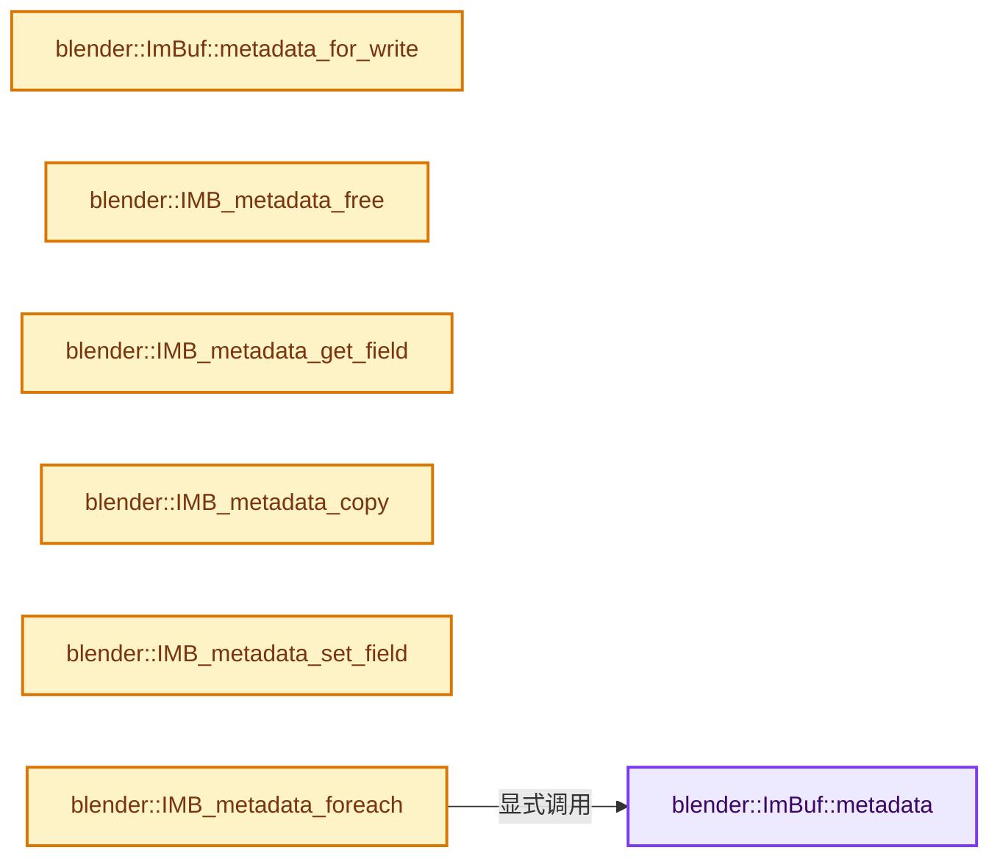
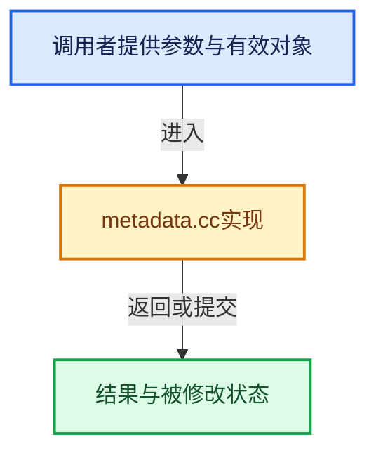

# 实现依赖专题：source/blender/imbuf/intern/metadata.cc

[实现依赖导航](../../../README.md) · [符号索引](../../../../00-课程指南/02-源码与提交索引/符号依赖与实现索引.md)

本专题从正文实际调用进入，集中保存共享实现。函数有稳定锚点，可从调用处直接跳到对应完整函数；递归与互相调用通过回链组织。

## 本文件的实现关系






## 完整成员与函数实现

<a id="f-4b8eb502a291f97d"></a>

### `blender::ImBuf::metadata`

实现位置：[source/blender/imbuf/intern/metadata.cc](../../../../../../../../source/blender/imbuf/intern/metadata.cc) · L55—L58。

**教学注释版**

<!-- annotated:138d35e16f8f75 -->

```cpp
const IDProperty *ImBuf::metadata() const
{
  return this->metadata_ptr;
}
```

<details>
<summary>核对原始源码：source/blender/imbuf/intern/metadata.cc · L55—L58</summary>

<!-- original:138d35e16f8f75:source/blender/imbuf/intern/metadata.cc:55:58 -->

```cpp
const IDProperty *ImBuf::metadata() const
{
  return this->metadata_ptr;
}
```

</details>

**结果出口**

- `return this->metadata_ptr;`

**继续追踪实现**

本实现没有需要继续展开的显式调用；检查返回表达式、对象转换和调用者前置条件。

<a id="f-c64bcd78e22f8888"></a>

### `blender::ImBuf::metadata_for_write`

实现位置：[source/blender/imbuf/intern/metadata.cc](../../../../../../../../source/blender/imbuf/intern/metadata.cc) · L60—L78。

**教学注释版**

<!-- annotated:2f8c04c277bd71 -->

```cpp
IDProperty *ImBuf::metadata_for_write()
{
  BLI_assert((this->metadata_ptr == nullptr) == (this->metadata_sharing_info == nullptr));

  if (this->metadata_ptr == nullptr) {
    /* Allocate on demand. */
    this->metadata_ptr = bke::idprop::create_group("metadata").release();
    this->metadata_sharing_info = ImplicitSharingPtr<>(
        MEM_new<MetaDataImplicitSharing>(__func__, this->metadata_ptr));
  }
  else if (!this->metadata_sharing_info->is_mutable()) {
    /* Copy on write. */
    this->metadata_ptr = IDP_CopyProperty(this->metadata_ptr);
    this->metadata_sharing_info = ImplicitSharingPtr<>(
        MEM_new<MetaDataImplicitSharing>(__func__, this->metadata_ptr));
  }

  return this->metadata_ptr;
}
```

<details>
<summary>核对原始源码：source/blender/imbuf/intern/metadata.cc · L60—L78</summary>

<!-- original:2f8c04c277bd71:source/blender/imbuf/intern/metadata.cc:60:78 -->

```cpp
IDProperty *ImBuf::metadata_for_write()
{
  BLI_assert((this->metadata_ptr == nullptr) == (this->metadata_sharing_info == nullptr));

  if (this->metadata_ptr == nullptr) {
    /* Allocate on demand. */
    this->metadata_ptr = bke::idprop::create_group("metadata").release();
    this->metadata_sharing_info = ImplicitSharingPtr<>(
        MEM_new<MetaDataImplicitSharing>(__func__, this->metadata_ptr));
  }
  else if (!this->metadata_sharing_info->is_mutable()) {
    /* Copy on write. */
    this->metadata_ptr = IDP_CopyProperty(this->metadata_ptr);
    this->metadata_sharing_info = ImplicitSharingPtr<>(
        MEM_new<MetaDataImplicitSharing>(__func__, this->metadata_ptr));
  }

  return this->metadata_ptr;
}
```

</details>

**沿实际写入检查状态**

- `this->metadata_ptr = bke::idprop::create_group("metadata").release();`
- `this->metadata_sharing_info = ImplicitSharingPtr<>(`
- `this->metadata_ptr = IDP_CopyProperty(this->metadata_ptr);`

**结果出口**

- `return this->metadata_ptr;`

**继续追踪实现**

- `BLI_assert` → [BLI_assert · L48](../../../01-BLI基础库/BLI_assert.hh.md#m-57a88495704d)；[BLI_assert · L63](../../../01-BLI基础库/BLI_assert.hh.md#m-d07050020cb5)。宏定义由构建条件选择。
- `bke::idprop::create_group("metadata").release` → [调用协议](../../../../00-课程指南/01-路线与规范/模板宏与动态分派协议.md)：接收对象类型依赖auto、返回值或模板实例；不按同名猜测目标。调用位置L66。
- `bke::idprop::create_group` → [blender::bke::idprop::create_group · L155](../../../02-BKE几何与数据/intern/idprop_create.cc.md#f-b1e2d8bfd5654bc2)。
- `ImplicitSharingPtr<>` → [blender::ImplicitSharingPtr::ImplicitSharingPtr · L32](../../../../06-隐式共享与缓存系统/03-Mixin与共享指针封装.md#f-d28a43dbb5ed8c05)；[blender::ImplicitSharingPtr::ImplicitSharingPtr · L34](../../../../06-隐式共享与缓存系统/03-Mixin与共享指针封装.md#f-d27d5ebf676e244a)；[blender::ImplicitSharingPtr::ImplicitSharingPtr · L37](../../../../06-隐式共享与缓存系统/03-Mixin与共享指针封装.md#f-17d0c5fe2b03a664)；[blender::ImplicitSharingPtr::ImplicitSharingPtr · L39](../../../../06-隐式共享与缓存系统/03-Mixin与共享指针封装.md#f-1c8729ae57532370)；[blender::ImplicitSharingPtr::ImplicitSharingPtr · L44](../../../../06-隐式共享与缓存系统/03-Mixin与共享指针封装.md#f-0b6be0142b98009e)；[blender::ImplicitSharingPtr::ImplicitSharingPtr · L49](../../../../06-隐式共享与缓存系统/03-Mixin与共享指针封装.md#f-90c601ed9ed99045)；[blender::ImplicitSharingPtr::ImplicitSharingPtr · L57](../../../../06-隐式共享与缓存系统/03-Mixin与共享指针封装.md#f-1625179ceae7a66d)。同名重载需按实参类型选择。
- `MEM_new<MetaDataImplicitSharing>` → [MEM_new · L351](../../../07-Intern运行时与平台/guardedalloc/MEM_guardedalloc.h.md#f-115f9b6784f89912)。
- `this->metadata_sharing_info->is_mutable` → [调用协议](../../../../00-课程指南/01-路线与规范/模板宏与动态分派协议.md)：接收对象类型依赖auto、返回值或模板实例；不按同名猜测目标。调用位置L70。
- `IDP_CopyProperty` → [blender::IDP_CopyProperty · L986](../../../02-BKE几何与数据/intern/idprop.cc.md#f-e78bbf56cd2a07bd)。

<a id="f-e318fa37c302cbb8"></a>

### `blender::IMB_metadata_free`

实现位置：[source/blender/imbuf/intern/metadata.cc](../../../../../../../../source/blender/imbuf/intern/metadata.cc) · L89—L96。

接口参数：

- `IDProperty *metadata`

**教学注释版**

<!-- annotated:865be36dddc918 -->

```cpp
void IMB_metadata_free(IDProperty *metadata)
{
  if (metadata == nullptr) {
    return;
  }

  IDP_FreeProperty(metadata);
}
```

<details>
<summary>核对原始源码：source/blender/imbuf/intern/metadata.cc · L89—L96</summary>

<!-- original:865be36dddc918:source/blender/imbuf/intern/metadata.cc:89:96 -->

```cpp
void IMB_metadata_free(IDProperty *metadata)
{
  if (metadata == nullptr) {
    return;
  }

  IDP_FreeProperty(metadata);
}
```

</details>

**继续追踪实现**

- `IDP_FreeProperty` → [blender::IDP_FreeProperty · L1403](../../../02-BKE几何与数据/intern/idprop.cc.md#f-389134a630df1bed)。

<a id="f-22d1411c44f6ec8d"></a>

### `blender::IMB_metadata_get_field`

实现位置：[source/blender/imbuf/intern/metadata.cc](../../../../../../../../source/blender/imbuf/intern/metadata.cc) · L98—L114。

接口参数：

- `const IDProperty *metadata`
- `const char *key`
- `char *value`
- `const size_t value_maxncpy`

**教学注释版**

<!-- annotated:15c60f7a32d527 -->

```cpp
bool IMB_metadata_get_field(const IDProperty *metadata,
                            const char *key,
                            char *value,
                            const size_t value_maxncpy)
{
  if (metadata == nullptr) {
    return false;
  }

  IDProperty *prop = IDP_GetPropertyFromGroup(metadata, key);

  if (prop && prop->type == IDP_STRING) {
    BLI_strncpy(value, IDP_string_get(prop), value_maxncpy);
    return true;
  }
  return false;
}
```

<details>
<summary>核对原始源码：source/blender/imbuf/intern/metadata.cc · L98—L114</summary>

<!-- original:15c60f7a32d527:source/blender/imbuf/intern/metadata.cc:98:114 -->

```cpp
bool IMB_metadata_get_field(const IDProperty *metadata,
                            const char *key,
                            char *value,
                            const size_t value_maxncpy)
{
  if (metadata == nullptr) {
    return false;
  }

  IDProperty *prop = IDP_GetPropertyFromGroup(metadata, key);

  if (prop && prop->type == IDP_STRING) {
    BLI_strncpy(value, IDP_string_get(prop), value_maxncpy);
    return true;
  }
  return false;
}
```

</details>

**结果出口**

- `return false;`
- `return true;`

**继续追踪实现**

- `IDP_GetPropertyFromGroup` → [blender::IDP_GetPropertyFromGroup · L818](../../../02-BKE几何与数据/intern/idprop.cc.md#f-a8d678499d89359e)。
- `BLI_strncpy` → [blender::BLI_strncpy · L70](../../../01-BLI基础库/intern/string.cc.md#f-6324147b0d116da1)。
- `IDP_string_get` → [IDP_string_get · L375](../../../02-BKE几何与数据/BKE_idprop.hh.md#m-bedef49dcb76)。宏定义由构建条件选择。

<a id="f-030c92a45e783af4"></a>

### `blender::IMB_metadata_copy`

实现位置：[source/blender/imbuf/intern/metadata.cc](../../../../../../../../source/blender/imbuf/intern/metadata.cc) · L116—L121。

接口参数：

- `ImBuf *ibuf_dst`
- `const ImBuf *ibuf_src`

**教学注释版**

<!-- annotated:bcea39e60d19ac -->

```cpp
void IMB_metadata_copy(ImBuf *ibuf_dst, const ImBuf *ibuf_src)
{
  BLI_assert(ibuf_dst != ibuf_src);
  ibuf_dst->metadata_ptr = ibuf_src->metadata_ptr;
  ibuf_dst->metadata_sharing_info = ibuf_src->metadata_sharing_info;
}
```

<details>
<summary>核对原始源码：source/blender/imbuf/intern/metadata.cc · L116—L121</summary>

<!-- original:bcea39e60d19ac:source/blender/imbuf/intern/metadata.cc:116:121 -->

```cpp
void IMB_metadata_copy(ImBuf *ibuf_dst, const ImBuf *ibuf_src)
{
  BLI_assert(ibuf_dst != ibuf_src);
  ibuf_dst->metadata_ptr = ibuf_src->metadata_ptr;
  ibuf_dst->metadata_sharing_info = ibuf_src->metadata_sharing_info;
}
```

</details>

**沿实际写入检查状态**

- `ibuf_dst->metadata_ptr = ibuf_src->metadata_ptr;`
- `ibuf_dst->metadata_sharing_info = ibuf_src->metadata_sharing_info;`

**继续追踪实现**

- `BLI_assert` → [BLI_assert · L48](../../../01-BLI基础库/BLI_assert.hh.md#m-57a88495704d)；[BLI_assert · L63](../../../01-BLI基础库/BLI_assert.hh.md#m-d07050020cb5)。宏定义由构建条件选择。

<a id="f-19c789763e994212"></a>

### `blender::IMB_metadata_set_field`

实现位置：[source/blender/imbuf/intern/metadata.cc](../../../../../../../../source/blender/imbuf/intern/metadata.cc) · L123—L140。

接口参数：

- `IDProperty *metadata`
- `const char *key`
- `const char *value`

**教学注释版**

<!-- annotated:3f48cff6810b8f -->

```cpp
void IMB_metadata_set_field(IDProperty *metadata, const char *key, const char *value)
{
  BLI_assert(metadata);
  IDProperty *prop = IDP_GetPropertyFromGroup(metadata, key);

  if (prop != nullptr && prop->type != IDP_STRING) {
    IDP_FreeFromGroup(metadata, prop);
    prop = nullptr;
  }

  if (prop) {
    IDP_AssignString(prop, value);
  }
  else {
    prop = bke::idprop::create(key, value).release();
    IDP_AddToGroup(metadata, prop);
  }
}
```

<details>
<summary>核对原始源码：source/blender/imbuf/intern/metadata.cc · L123—L140</summary>

<!-- original:3f48cff6810b8f:source/blender/imbuf/intern/metadata.cc:123:140 -->

```cpp
void IMB_metadata_set_field(IDProperty *metadata, const char *key, const char *value)
{
  BLI_assert(metadata);
  IDProperty *prop = IDP_GetPropertyFromGroup(metadata, key);

  if (prop != nullptr && prop->type != IDP_STRING) {
    IDP_FreeFromGroup(metadata, prop);
    prop = nullptr;
  }

  if (prop) {
    IDP_AssignString(prop, value);
  }
  else {
    prop = bke::idprop::create(key, value).release();
    IDP_AddToGroup(metadata, prop);
  }
}
```

</details>

**沿实际写入检查状态**

- `prop = nullptr;`
- `prop = bke::idprop::create(key, value).release();`

**继续追踪实现**

- `BLI_assert` → [BLI_assert · L48](../../../01-BLI基础库/BLI_assert.hh.md#m-57a88495704d)；[BLI_assert · L63](../../../01-BLI基础库/BLI_assert.hh.md#m-d07050020cb5)。宏定义由构建条件选择。
- `IDP_GetPropertyFromGroup` → [blender::IDP_GetPropertyFromGroup · L818](../../../02-BKE几何与数据/intern/idprop.cc.md#f-a8d678499d89359e)。
- `IDP_FreeFromGroup` → [blender::IDP_FreeFromGroup · L812](../../../02-BKE几何与数据/intern/idprop.cc.md#f-9d2ebd4c4f38d2fd)。
- `IDP_AssignString` → [blender::IDP_AssignString · L505](../../../02-BKE几何与数据/intern/idprop.cc.md#f-2b677c94264b662d)。
- `bke::idprop::create(key, value).release` → [调用协议](../../../../00-课程指南/01-路线与规范/模板宏与动态分派协议.md)：接收对象类型依赖auto、返回值或模板实例；不按同名猜测目标。调用位置L137。
- `bke::idprop::create` → [blender::bke::idprop::create · L21](../../../02-BKE几何与数据/intern/idprop_create.cc.md#f-9f46f3367aea5850)；[blender::bke::idprop::create · L41](../../../02-BKE几何与数据/intern/idprop_create.cc.md#f-fb8f0fd79ae0a7b2)；[blender::bke::idprop::create · L51](../../../02-BKE几何与数据/intern/idprop_create.cc.md#f-3c724b83c1b70000)；[blender::bke::idprop::create · L61](../../../02-BKE几何与数据/intern/idprop_create.cc.md#f-3e8bfbe29fbc5b06)；[blender::bke::idprop::create · L69](../../../02-BKE几何与数据/intern/idprop_create.cc.md#f-da73ef629d404b53)；[blender::bke::idprop::create · L134](../../../02-BKE几何与数据/intern/idprop_create.cc.md#f-db9e605ad4939d5d)；[blender::bke::idprop::create · L141](../../../02-BKE几何与数据/intern/idprop_create.cc.md#f-1198c99845e5eb1f)；[blender::bke::idprop::create · L148](../../../02-BKE几何与数据/intern/idprop_create.cc.md#f-d9cb1affee65ed50)。同名重载需按实参类型选择。
- `IDP_AddToGroup` → [blender::IDP_AddToGroup · L788](../../../02-BKE几何与数据/intern/idprop.cc.md#f-35f2075430483def)。

<a id="f-419e710b774ca435"></a>

### `blender::IMB_metadata_foreach`

实现位置：[source/blender/imbuf/intern/metadata.cc](../../../../../../../../source/blender/imbuf/intern/metadata.cc) · L142—L151。

接口参数：

- `const ImBuf *ibuf`
- `IMBMetadataForeachCb callback`
- `void *userdata`

**教学注释版**

<!-- annotated:0b766af2c66a5d -->

```cpp
void IMB_metadata_foreach(const ImBuf *ibuf, IMBMetadataForeachCb callback, void *userdata)
{
  const IDProperty *metadata = ibuf->metadata();
  if (metadata == nullptr) {
    return;
  }
  for (const IDProperty &prop : metadata->data.group) {
    callback(prop.name, IDP_string_get(&prop), userdata);
  }
}
```

<details>
<summary>核对原始源码：source/blender/imbuf/intern/metadata.cc · L142—L151</summary>

<!-- original:0b766af2c66a5d:source/blender/imbuf/intern/metadata.cc:142:151 -->

```cpp
void IMB_metadata_foreach(const ImBuf *ibuf, IMBMetadataForeachCb callback, void *userdata)
{
  const IDProperty *metadata = ibuf->metadata();
  if (metadata == nullptr) {
    return;
  }
  for (const IDProperty &prop : metadata->data.group) {
    callback(prop.name, IDP_string_get(&prop), userdata);
  }
}
```

</details>

**继续追踪实现**

- `ibuf->metadata` → [blender::ImBuf::metadata · L55](metadata.cc.md#f-4b8eb502a291f97d)。
- `callback` → [调用协议](../../../../00-课程指南/01-路线与规范/模板宏与动态分派协议.md)：局部可调用对象，须结合其初始化与捕获环境。调用位置L149。
- `IDP_string_get` → [IDP_string_get · L375](../../../02-BKE几何与数据/BKE_idprop.hh.md#m-bedef49dcb76)。宏定义由构建条件选择。
