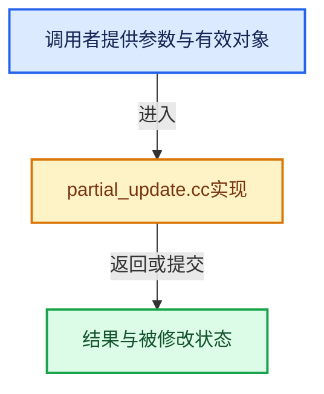

# 实现依赖专题：source/blender/imbuf/intern/partial_update.cc

[实现依赖导航](../../../README.md) · [符号索引](../../../../00-课程指南/02-源码与提交索引/符号依赖与实现索引.md)

本专题从正文实际调用进入，集中保存共享实现。函数有稳定锚点，可从调用处直接跳到对应完整函数；递归与互相调用通过回链组织。

## 本文件的实现关系

```mermaid
flowchart LR
  F0["blender::imbuf::partial_update::Changeset::clear"]:::abstraction
  F1["blender::imbuf::partial_update::Changeset::update_resolution"]:::compute
  F2["blender::imbuf::partial_update::Changeset::has_modified_chunks"]:::compute
  F3["blender::imbuf::partial_update::Changeset::init_chunks"]:::compute
  F4["blender::imbuf::partial_update::Tracker::update_resolution"]:::compute
  F5["blender::imbuf::partial_update::Tracker::mark_full_update"]:::compute
  F6["blender::imbuf::partial_update::Tracker::ensure_empty_changeset"]:::compute
  F7["blender::imbuf::partial_update::Tracker::commit_current_changeset"]:::compute
  F0 -->|"显式调用"| F3
  F1 -->|"显式调用"| F3
  F3 -->|"显式调用"| F2
  F4 -->|"显式调用"| F1
  F4 -->|"显式调用"| F5
  F5 -->|"显式调用"| F0
  F6 -->|"显式调用"| F2
  F6 -->|"显式调用"| F7
  classDef input fill:#DBEAFE,stroke:#2563EB,color:#172554,stroke-width:2px;
  classDef data fill:#CFFAFE,stroke:#0891B2,color:#164E63,stroke-width:2px;
  classDef abstraction fill:#EDE9FE,stroke:#7C3AED,color:#3B0764,stroke-width:2px;
  classDef compute fill:#FEF3C7,stroke:#D97706,color:#78350F,stroke-width:2px;
  classDef result fill:#DCFCE7,stroke:#16A34A,color:#14532D,stroke-width:2px;
  classDef error fill:#FEE2E2,stroke:#DC2626,color:#7F1D1D,stroke-width:2px;
```






## 相关类型布局与成员入口

<a id="t-616b14c5691b"></a>

### `blender::imbuf::partial_update::Changeset`

原始声明：[source/blender/imbuf/intern/partial_update.cc](../../../../../../../../source/blender/imbuf/intern/partial_update.cc) · L52—L179。

成员布局：

- `BitVector<> chunk_modified_flags_`
- `bool has_modified_chunks_`
- `ChangesetID changeset_id`
- `int buffer_width`
- `int buffer_height`
- `int chunk_x_len`
- `int chunk_y_len`

以下保留类的数据声明与编译条件，成员函数实现通过后面的精确链接阅读。

<!-- annotated:ce53233599218e -->

```cpp
struct Changeset {
 private:
  /** Dirty flag for each chunk. */
  BitVector<> chunk_modified_flags_;
  /** True if any chunk is modified. */
  bool has_modified_chunks_ = false;

 public:
  /** Global changeset ID for these changes. */
  ChangesetID changeset_id = 0;
  /** Width of the buffer in pixels. */
  int buffer_width = 0;
  /** Height of the buffer in pixels. */
  int buffer_height = 0;
  /** Number of chunks along the x-axis. */
  int chunk_x_len = 0;
  /** Number of chunks along the y-axis. */
  int chunk_y_len = 0;

```

<details>
<summary>核对原始源码：source/blender/imbuf/intern/partial_update.cc · L52—L70</summary>

<!-- original:ce53233599218e:source/blender/imbuf/intern/partial_update.cc:52:70 -->

```cpp
struct Changeset {
 private:
  /** Dirty flag for each chunk. */
  BitVector<> chunk_modified_flags_;
  /** True if any chunk is modified. */
  bool has_modified_chunks_ = false;

 public:
  /** Global changeset ID for these changes. */
  ChangesetID changeset_id = 0;
  /** Width of the buffer in pixels. */
  int buffer_width = 0;
  /** Height of the buffer in pixels. */
  int buffer_height = 0;
  /** Number of chunks along the x-axis. */
  int chunk_x_len = 0;
  /** Number of chunks along the y-axis. */
  int chunk_y_len = 0;

```

</details>

<!-- annotated:8bac173b3ed260 -->

```cpp

  /**
   * Update the chunk grid to match the buffer resolution.
   *
   * \returns true: resolution has been updated.
   *          false: resolution was unchanged.
   */
```

<details>
<summary>核对原始源码：source/blender/imbuf/intern/partial_update.cc · L75—L81</summary>

<!-- original:8bac173b3ed260:source/blender/imbuf/intern/partial_update.cc:75:81 -->

```cpp

  /**
   * Update the chunk grid to match the buffer resolution.
   *
   * \returns true: resolution has been updated.
   *          false: resolution was unchanged.
   */
```

</details>

<!-- annotated:040709ee216352 -->

```cpp

```

<details>
<summary>核对原始源码：source/blender/imbuf/intern/partial_update.cc · L96—L96</summary>

<!-- original:040709ee216352:source/blender/imbuf/intern/partial_update.cc:96:96 -->

```cpp

```

</details>

<!-- annotated:ab6b8c54c68ee5 -->

```cpp

```

<details>
<summary>核对原始源码：source/blender/imbuf/intern/partial_update.cc · L119—L119</summary>

<!-- original:ab6b8c54c68ee5:source/blender/imbuf/intern/partial_update.cc:119:119 -->

```cpp

```

</details>

<!-- annotated:88a0d3175de039 -->

```cpp

```

<details>
<summary>核对原始源码：source/blender/imbuf/intern/partial_update.cc · L130—L130</summary>

<!-- original:88a0d3175de039:source/blender/imbuf/intern/partial_update.cc:130:130 -->

```cpp

```

</details>

<!-- annotated:d814bb31f20050 -->

```cpp

```

<details>
<summary>核对原始源码：source/blender/imbuf/intern/partial_update.cc · L135—L135</summary>

<!-- original:d814bb31f20050:source/blender/imbuf/intern/partial_update.cc:135:135 -->

```cpp

```

</details>

<!-- annotated:017e74cd991154 -->

```cpp

  /** Merge the given changeset into the receiver. */
```

<details>
<summary>核对原始源码：source/blender/imbuf/intern/partial_update.cc · L153—L154</summary>

<!-- original:017e74cd991154:source/blender/imbuf/intern/partial_update.cc:153:154 -->

```cpp

  /** Merge the given changeset into the receiver. */
```

</details>

<!-- annotated:72f45a8a7f1f5e -->

```cpp

  /** Has the given chunk changed inside this changeset. */
```

<details>
<summary>核对原始源码：source/blender/imbuf/intern/partial_update.cc · L167—L168</summary>

<!-- original:72f45a8a7f1f5e:source/blender/imbuf/intern/partial_update.cc:167:168 -->

```cpp

  /** Has the given chunk changed inside this changeset. */
```

</details>

<!-- annotated:47e20ed868e066 -->

```cpp

```

<details>
<summary>核对原始源码：source/blender/imbuf/intern/partial_update.cc · L174—L174</summary>

<!-- original:47e20ed868e066:source/blender/imbuf/intern/partial_update.cc:174:174 -->

```cpp

```

</details>

<!-- annotated:e4635f82100ff7 -->

```cpp
};
```

<details>
<summary>核对原始源码：source/blender/imbuf/intern/partial_update.cc · L179—L179</summary>

<!-- original:e4635f82100ff7:source/blender/imbuf/intern/partial_update.cc:179:179 -->

```cpp
};
```

</details>

- [clear](partial_update.cc.md#f-2f851b464be1097f)
- [update_resolution](partial_update.cc.md#f-4922149b1af07710)
- [has_modified_chunks](partial_update.cc.md#f-94bb73aef7ff8c0e)
- [init_chunks](partial_update.cc.md#f-15adf279ef1238e6)

## 完整成员与函数实现

<a id="f-2f851b464be1097f"></a>

### `blender::imbuf::partial_update::Changeset::clear`

实现位置：[source/blender/imbuf/intern/partial_update.cc](../../../../../../../../source/blender/imbuf/intern/partial_update.cc) · L71—L74。

**教学注释版**

<!-- annotated:58fa078a3d9223 -->

```cpp
  void clear()
  {
    init_chunks(chunk_x_len, chunk_y_len);
  }
```

<details>
<summary>核对原始源码：source/blender/imbuf/intern/partial_update.cc · L71—L74</summary>

<!-- original:58fa078a3d9223:source/blender/imbuf/intern/partial_update.cc:71:74 -->

```cpp
  void clear()
  {
    init_chunks(chunk_x_len, chunk_y_len);
  }
```

</details>

**继续追踪实现**

- `init_chunks` → [blender::imbuf::partial_update::Changeset::init_chunks · L136](partial_update.cc.md#f-15adf279ef1238e6)。

<a id="f-4922149b1af07710"></a>

### `blender::imbuf::partial_update::Changeset::update_resolution`

实现位置：[source/blender/imbuf/intern/partial_update.cc](../../../../../../../../source/blender/imbuf/intern/partial_update.cc) · L82—L95。

接口参数：

- `const ImBuf *image_buffer`

**教学注释版**

<!-- annotated:dc1bf7e1fd61f8 -->

```cpp
  bool update_resolution(const ImBuf *image_buffer)
  {
    if (buffer_width == image_buffer->x && buffer_height == image_buffer->y) {
      return false;
    }

    buffer_width = image_buffer->x;
    buffer_height = image_buffer->y;

    const int new_chunk_x_len = divide_ceil_u(buffer_width, CHUNK_SIZE);
    const int new_chunk_y_len = divide_ceil_u(buffer_height, CHUNK_SIZE);
    init_chunks(new_chunk_x_len, new_chunk_y_len);
    return true;
  }
```

<details>
<summary>核对原始源码：source/blender/imbuf/intern/partial_update.cc · L82—L95</summary>

<!-- original:dc1bf7e1fd61f8:source/blender/imbuf/intern/partial_update.cc:82:95 -->

```cpp
  bool update_resolution(const ImBuf *image_buffer)
  {
    if (buffer_width == image_buffer->x && buffer_height == image_buffer->y) {
      return false;
    }

    buffer_width = image_buffer->x;
    buffer_height = image_buffer->y;

    const int new_chunk_x_len = divide_ceil_u(buffer_width, CHUNK_SIZE);
    const int new_chunk_y_len = divide_ceil_u(buffer_height, CHUNK_SIZE);
    init_chunks(new_chunk_x_len, new_chunk_y_len);
    return true;
  }
```

</details>

**沿实际写入检查状态**

- `buffer_width = image_buffer->x;`
- `buffer_height = image_buffer->y;`

**结果出口**

- `return false;`
- `return true;`

**继续追踪实现**

- `divide_ceil_u` → [blender::divide_ceil_u · L235](../../../01-BLI基础库/intern/math_base_inline.cc.md#f-9bfe95d830410fdd)。
- `init_chunks` → [blender::imbuf::partial_update::Changeset::init_chunks · L136](partial_update.cc.md#f-15adf279ef1238e6)。

<a id="f-94bb73aef7ff8c0e"></a>

### `blender::imbuf::partial_update::Changeset::has_modified_chunks`

实现位置：[source/blender/imbuf/intern/partial_update.cc](../../../../../../../../source/blender/imbuf/intern/partial_update.cc) · L131—L134。

**教学注释版**

<!-- annotated:16dd1982cd191c -->

```cpp
  bool has_modified_chunks() const
  {
    return has_modified_chunks_;
  }
```

<details>
<summary>核对原始源码：source/blender/imbuf/intern/partial_update.cc · L131—L134</summary>

<!-- original:16dd1982cd191c:source/blender/imbuf/intern/partial_update.cc:131:134 -->

```cpp
  bool has_modified_chunks() const
  {
    return has_modified_chunks_;
  }
```

</details>

**结果出口**

- `return has_modified_chunks_;`

**继续追踪实现**

本实现没有需要继续展开的显式调用；检查返回表达式、对象转换和调用者前置条件。

<a id="f-15adf279ef1238e6"></a>

### `blender::imbuf::partial_update::Changeset::init_chunks`

实现位置：[source/blender/imbuf/intern/partial_update.cc](../../../../../../../../source/blender/imbuf/intern/partial_update.cc) · L136—L152。

接口参数：

- `int chunk_x_len_`
- `int chunk_y_len_`

**教学注释版**

<!-- annotated:eec04cbb4af721 -->

```cpp
  void init_chunks(int chunk_x_len_, int chunk_y_len_)
  {
    chunk_x_len = chunk_x_len_;
    chunk_y_len = chunk_y_len_;
    const int chunk_len = chunk_x_len * chunk_y_len;
    const int previous_chunk_len = chunk_modified_flags_.size();

    chunk_modified_flags_.resize(chunk_len);
    /* Fast exit: when the changeset was already empty there is nothing to reset. */
    if (!has_modified_chunks()) {
      return;
    }
    for (int index = 0; index < min_ii(chunk_len, previous_chunk_len); index++) {
      chunk_modified_flags_[index].reset();
    }
    has_modified_chunks_ = false;
  }
```

<details>
<summary>核对原始源码：source/blender/imbuf/intern/partial_update.cc · L136—L152</summary>

<!-- original:eec04cbb4af721:source/blender/imbuf/intern/partial_update.cc:136:152 -->

```cpp
  void init_chunks(int chunk_x_len_, int chunk_y_len_)
  {
    chunk_x_len = chunk_x_len_;
    chunk_y_len = chunk_y_len_;
    const int chunk_len = chunk_x_len * chunk_y_len;
    const int previous_chunk_len = chunk_modified_flags_.size();

    chunk_modified_flags_.resize(chunk_len);
    /* Fast exit: when the changeset was already empty there is nothing to reset. */
    if (!has_modified_chunks()) {
      return;
    }
    for (int index = 0; index < min_ii(chunk_len, previous_chunk_len); index++) {
      chunk_modified_flags_[index].reset();
    }
    has_modified_chunks_ = false;
  }
```

</details>

**沿实际写入检查状态**

- `chunk_x_len = chunk_x_len_;`
- `chunk_y_len = chunk_y_len_;`
- `has_modified_chunks_ = false;`

**继续追踪实现**

- `chunk_modified_flags_.size` → [blender::bits::BitVector::size · L198](../../../../01-基础容器与现代CPP/19-BitSpan与BitVector.md#f-a7b6c5beecee4b89)。
- `chunk_modified_flags_.resize` → [blender::bits::BitVector::resize · L286](../../../../01-基础容器与现代CPP/19-BitSpan与BitVector.md#f-eeab855041750a13)。
- `has_modified_chunks` → [blender::imbuf::partial_update::Changeset::has_modified_chunks · L131](partial_update.cc.md#f-94bb73aef7ff8c0e)。
- `min_ii` → [blender::min_ii · L364](../../../01-BLI基础库/intern/math_base_inline.cc.md#f-30336db35b2810b8)。
- `chunk_modified_flags_[index].reset` → [调用协议](../../../../00-课程指南/01-路线与规范/模板宏与动态分派协议.md)：接收对象类型依赖auto、返回值或模板实例；不按同名猜测目标。调用位置L149。

<a id="f-a89d1e82345945ab"></a>

### `blender::imbuf::partial_update::Tracker::update_resolution`

实现位置：[source/blender/imbuf/intern/partial_update.cc](../../../../../../../../source/blender/imbuf/intern/partial_update.cc) · L211—L227。

接口参数：

- `const ImBuf *image_buffer`

**教学注释版**

<!-- annotated:a03f75e03ba5e3 -->

```cpp
  void update_resolution(const ImBuf *image_buffer)
  {
    current_changeset.update_resolution(image_buffer);

    if (buffer_width == image_buffer->x && buffer_height == image_buffer->y) {
      return;
    }

    const bool had_resolution = buffer_width != 0 || buffer_height != 0;
    buffer_width = image_buffer->x;
    buffer_height = image_buffer->y;

    if (had_resolution) {
      mark_full_update();
      last_resize_changeset_id = last_changeset_id;
    }
  }
```

<details>
<summary>核对原始源码：source/blender/imbuf/intern/partial_update.cc · L211—L227</summary>

<!-- original:a03f75e03ba5e3:source/blender/imbuf/intern/partial_update.cc:211:227 -->

```cpp
  void update_resolution(const ImBuf *image_buffer)
  {
    current_changeset.update_resolution(image_buffer);

    if (buffer_width == image_buffer->x && buffer_height == image_buffer->y) {
      return;
    }

    const bool had_resolution = buffer_width != 0 || buffer_height != 0;
    buffer_width = image_buffer->x;
    buffer_height = image_buffer->y;

    if (had_resolution) {
      mark_full_update();
      last_resize_changeset_id = last_changeset_id;
    }
  }
```

</details>

**沿实际写入检查状态**

- `buffer_width = image_buffer->x;`
- `buffer_height = image_buffer->y;`
- `last_resize_changeset_id = last_changeset_id;`

**继续追踪实现**

- `current_changeset.update_resolution` → [blender::imbuf::partial_update::Changeset::update_resolution · L82](partial_update.cc.md#f-4922149b1af07710)。
- `mark_full_update` → [blender::imbuf::partial_update::Tracker::mark_full_update · L229](partial_update.cc.md#f-ec8dccd263a9c701)。

<a id="f-ec8dccd263a9c701"></a>

### `blender::imbuf::partial_update::Tracker::mark_full_update`

实现位置：[source/blender/imbuf/intern/partial_update.cc](../../../../../../../../source/blender/imbuf/intern/partial_update.cc) · L229—L235。

**教学注释版**

<!-- annotated:14741e31336bc7 -->

```cpp
  void mark_full_update()
  {
    // [讲解] history.clear：销毁所有有效元素，把size变为0，但保留原分配或内嵌容量。
    history.clear();
    current_changeset.clear();
    last_changeset_id = IMB_partial_update_changeset_id_next();
    first_changeset_id = last_changeset_id;
  }
```

<details>
<summary>核对原始源码：source/blender/imbuf/intern/partial_update.cc · L229—L235</summary>

<!-- original:14741e31336bc7:source/blender/imbuf/intern/partial_update.cc:229:235 -->

```cpp
  void mark_full_update()
  {
    history.clear();
    current_changeset.clear();
    last_changeset_id = IMB_partial_update_changeset_id_next();
    first_changeset_id = last_changeset_id;
  }
```

</details>

**沿实际写入检查状态**

- `last_changeset_id = IMB_partial_update_changeset_id_next();`
- `first_changeset_id = last_changeset_id;`

**继续追踪实现**

- `history.clear` → [blender::Vector::clear · L468](../../../../01-基础容器与现代CPP/10-Vector扩容与增长.md#f-d051bebff5275a43)。
- `current_changeset.clear` → [blender::imbuf::partial_update::Changeset::clear · L71](partial_update.cc.md#f-2f851b464be1097f)。
- `IMB_partial_update_changeset_id_next` → [blender::IMB_partial_update_changeset_id_next · L389](partial_update.cc.md#f-1f9e3a36dc181abc)。

<a id="f-429dfba05a221b30"></a>

### `blender::imbuf::partial_update::Tracker::ensure_empty_changeset`

实现位置：[source/blender/imbuf/intern/partial_update.cc](../../../../../../../../source/blender/imbuf/intern/partial_update.cc) · L242—L251。

**教学注释版**

<!-- annotated:6891e8f562e0ff -->

```cpp
  void ensure_empty_changeset()
  {
    if (!current_changeset.has_modified_chunks()) {
      /* No need to create a new changeset when previous changeset does not contain any
       * modified chunks. */
      return;
    }
    commit_current_changeset();
    limit_history();
  }
```

<details>
<summary>核对原始源码：source/blender/imbuf/intern/partial_update.cc · L242—L251</summary>

<!-- original:6891e8f562e0ff:source/blender/imbuf/intern/partial_update.cc:242:251 -->

```cpp
  void ensure_empty_changeset()
  {
    if (!current_changeset.has_modified_chunks()) {
      /* No need to create a new changeset when previous changeset does not contain any
       * modified chunks. */
      return;
    }
    commit_current_changeset();
    limit_history();
  }
```

</details>

**继续追踪实现**

- `current_changeset.has_modified_chunks` → [blender::imbuf::partial_update::Changeset::has_modified_chunks · L131](partial_update.cc.md#f-94bb73aef7ff8c0e)。
- `commit_current_changeset` → [blender::imbuf::partial_update::Tracker::commit_current_changeset · L254](partial_update.cc.md#f-4c8768b43dde0fd4)。
- `limit_history` → [blender::imbuf::partial_update::Tracker::limit_history · L263](partial_update.cc.md#f-1c1dec0fbc321023)。

<a id="f-4c8768b43dde0fd4"></a>

### `blender::imbuf::partial_update::Tracker::commit_current_changeset`

实现位置：[source/blender/imbuf/intern/partial_update.cc](../../../../../../../../source/blender/imbuf/intern/partial_update.cc) · L254—L260。

**教学注释版**

<!-- annotated:b87b042d99ebf5 -->

```cpp
  void commit_current_changeset()
  {
    last_changeset_id = IMB_partial_update_changeset_id_next();
    current_changeset.changeset_id = last_changeset_id;
    // [讲解] history.append_as：在尾部建立新元素，必要时先扩大存储。
    history.append_as(std::move(current_changeset));
    current_changeset = Changeset();
  }
```

<details>
<summary>核对原始源码：source/blender/imbuf/intern/partial_update.cc · L254—L260</summary>

<!-- original:b87b042d99ebf5:source/blender/imbuf/intern/partial_update.cc:254:260 -->

```cpp
  void commit_current_changeset()
  {
    last_changeset_id = IMB_partial_update_changeset_id_next();
    current_changeset.changeset_id = last_changeset_id;
    history.append_as(std::move(current_changeset));
    current_changeset = Changeset();
  }
```

</details>

**沿实际写入检查状态**

- `last_changeset_id = IMB_partial_update_changeset_id_next();`
- `current_changeset.changeset_id = last_changeset_id;`
- `current_changeset = Changeset();`

**继续追踪实现**

- `IMB_partial_update_changeset_id_next` → [blender::IMB_partial_update_changeset_id_next · L389](partial_update.cc.md#f-1f9e3a36dc181abc)。
- `history.append_as` → [blender::Vector::append_as · L507](../../../../01-基础容器与现代CPP/11-Vector插入删除与重排.md#f-44d7aa103502cef2)。
- `std::move` → [外部契约](https://eel.is/c++draft/utility.forward)：把表达式转换成可供移动重载选择的值类别；不保证真的移动，不结束源对象寿命，对const值可能选择复制。
- `Changeset` → [blender::imbuf::partial_update::Changeset](partial_update.cc.md#t-616b14c5691b)。

<a id="f-1c1dec0fbc321023"></a>

### `blender::imbuf::partial_update::Tracker::limit_history`

实现位置：[source/blender/imbuf/intern/partial_update.cc](../../../../../../../../source/blender/imbuf/intern/partial_update.cc) · L263—L272。

**教学注释版**

<!-- annotated:59301362836247 -->

```cpp
  void limit_history()
  {
    // [讲解] history.size：用end_减begin_得到活元素数量。
    const int num_items_to_remove = max_ii(history.size() - MAX_HISTORY_LEN, 0);
    if (num_items_to_remove == 0) {
      return;
    }
    /* Changes up to and including the last removed changeset can no longer be reconstructed. */
    first_changeset_id = history[num_items_to_remove - 1].changeset_id;
    // [讲解] history.remove：结束被移除元素寿命，并维护剩余有效区间。
    history.remove(0, num_items_to_remove);
  }
```

<details>
<summary>核对原始源码：source/blender/imbuf/intern/partial_update.cc · L263—L272</summary>

<!-- original:59301362836247:source/blender/imbuf/intern/partial_update.cc:263:272 -->

```cpp
  void limit_history()
  {
    const int num_items_to_remove = max_ii(history.size() - MAX_HISTORY_LEN, 0);
    if (num_items_to_remove == 0) {
      return;
    }
    /* Changes up to and including the last removed changeset can no longer be reconstructed. */
    first_changeset_id = history[num_items_to_remove - 1].changeset_id;
    history.remove(0, num_items_to_remove);
  }
```

</details>

**沿实际写入检查状态**

- `first_changeset_id = history[num_items_to_remove - 1].changeset_id;`

**继续追踪实现**

- `max_ii` → [blender::max_ii · L368](../../../01-BLI基础库/intern/math_base_inline.cc.md#f-c45aa7b373adb94c)。
- `history.size` → [blender::Vector::size · L780](../../../../01-基础容器与现代CPP/11-Vector插入删除与重排.md#f-714773731767349c)。
- `history.remove` → [blender::Vector::remove · L860](../../../../01-基础容器与现代CPP/11-Vector插入删除与重排.md#f-d289325ebb7646a6)；[blender::Vector::remove · L879](../../../../01-基础容器与现代CPP/11-Vector插入删除与重排.md#f-25b0f2d5f71c417f)。同名重载需按实参类型选择。

<a id="f-03eda559df4e16a4"></a>

### `blender::imbuf::partial_update::Tracker::changed_chunks_since`

实现位置：[source/blender/imbuf/intern/partial_update.cc](../../../../../../../../source/blender/imbuf/intern/partial_update.cc) · L277—L291。

接口参数：

- `const ChangesetID from_changeset`

**教学注释版**

<!-- annotated:4b438de9b3b685 -->

```cpp
  std::optional<Changeset> changed_chunks_since(const ChangesetID from_changeset)
  {
    std::optional<Changeset> changed_chunks = std::nullopt;
    for (const Changeset &changeset : history) {
      if (changeset.changeset_id <= from_changeset || !changeset.has_modified_chunks()) {
        continue;
      }
      if (!changed_chunks.has_value()) {
        changed_chunks = std::make_optional<Changeset>();
        changed_chunks->init_chunks(changeset.chunk_x_len, changeset.chunk_y_len);
      }
      changed_chunks->merge(changeset);
    }
    return changed_chunks;
  }
```

<details>
<summary>核对原始源码：source/blender/imbuf/intern/partial_update.cc · L277—L291</summary>

<!-- original:4b438de9b3b685:source/blender/imbuf/intern/partial_update.cc:277:291 -->

```cpp
  std::optional<Changeset> changed_chunks_since(const ChangesetID from_changeset)
  {
    std::optional<Changeset> changed_chunks = std::nullopt;
    for (const Changeset &changeset : history) {
      if (changeset.changeset_id <= from_changeset || !changeset.has_modified_chunks()) {
        continue;
      }
      if (!changed_chunks.has_value()) {
        changed_chunks = std::make_optional<Changeset>();
        changed_chunks->init_chunks(changeset.chunk_x_len, changeset.chunk_y_len);
      }
      changed_chunks->merge(changeset);
    }
    return changed_chunks;
  }
```

</details>

**沿实际写入检查状态**

- `changed_chunks = std::make_optional<Changeset>();`

**结果出口**

- `return changed_chunks;`

**继续追踪实现**

- `changeset.has_modified_chunks` → [调用协议](../../../../00-课程指南/01-路线与规范/模板宏与动态分派协议.md)：接收对象类型依赖auto、返回值或模板实例；不按同名猜测目标。调用位置L281。
- `changed_chunks.has_value` → [外部契约](https://eel.is/c++draft/)：这个边界按实际表达式及所属类型核对参数、返回值、寿命与失败行为。这里提供接口入口，不声称已解释该第三方版本的内部实现。
- `std::make_optional<Changeset>` → [外部契约](https://eel.is/c++draft/)：这个边界按实际表达式及所属类型核对参数、返回值、寿命与失败行为。这里提供接口入口，不声称已解释该第三方版本的内部实现。
- `changed_chunks->init_chunks` → [外部契约](https://eel.is/c++draft/)：这个边界按实际表达式及所属类型核对参数、返回值、寿命与失败行为。这里提供接口入口，不声称已解释该第三方版本的内部实现。
- `changed_chunks->merge` → [外部契约](https://eel.is/c++draft/)：这个边界按实际表达式及所属类型核对参数、返回值、寿命与失败行为。这里提供接口入口，不声称已解释该第三方版本的内部实现。

<a id="f-4d6bf0e3f661eb91"></a>

### `blender::imbuf::partial_update::Changes::set_all_chunks_modified`

实现位置：[source/blender/imbuf/intern/partial_update.cc](../../../../../../../../source/blender/imbuf/intern/partial_update.cc) · L294—L300。

**教学注释版**

<!-- annotated:5e7d5c996e06be -->

```cpp
void Changes::set_all_chunks_modified()
{
  chunk_x_len = divide_ceil_u(buffer_width, CHUNK_SIZE);
  chunk_y_len = divide_ceil_u(buffer_height, CHUNK_SIZE);
  modified_chunks.resize(int64_t(chunk_x_len) * chunk_y_len);
  modified_chunks.fill(true);
}
```

<details>
<summary>核对原始源码：source/blender/imbuf/intern/partial_update.cc · L294—L300</summary>

<!-- original:5e7d5c996e06be:source/blender/imbuf/intern/partial_update.cc:294:300 -->

```cpp
void Changes::set_all_chunks_modified()
{
  chunk_x_len = divide_ceil_u(buffer_width, CHUNK_SIZE);
  chunk_y_len = divide_ceil_u(buffer_height, CHUNK_SIZE);
  modified_chunks.resize(int64_t(chunk_x_len) * chunk_y_len);
  modified_chunks.fill(true);
}
```

</details>

**沿实际写入检查状态**

- `chunk_x_len = divide_ceil_u(buffer_width, CHUNK_SIZE);`
- `chunk_y_len = divide_ceil_u(buffer_height, CHUNK_SIZE);`

**继续追踪实现**

- `divide_ceil_u` → [blender::divide_ceil_u · L235](../../../01-BLI基础库/intern/math_base_inline.cc.md#f-9bfe95d830410fdd)。
- `modified_chunks.resize` → [调用协议](../../../../00-课程指南/01-路线与规范/模板宏与动态分派协议.md)：接收对象类型依赖auto、返回值或模板实例；不按同名猜测目标。调用位置L298。
- `modified_chunks.fill` → [调用协议](../../../../00-课程指南/01-路线与规范/模板宏与动态分派协议.md)：接收对象类型依赖auto、返回值或模板实例；不按同名猜测目标。调用位置L299。

<a id="f-71ca5ba129f2a216"></a>

### `blender::imbuf::partial_update::Changes::modified_regions`

实现位置：[source/blender/imbuf/intern/partial_update.cc](../../../../../../../../source/blender/imbuf/intern/partial_update.cc) · L302—L357。

**教学注释版**

<!-- annotated:14321f3b369374 -->

```cpp
Vector<rcti> Changes::modified_regions() const
{
  BLI_assert(modified_chunks.size() == int64_t(chunk_x_len) * chunk_y_len);

  Vector<rcti> regions;
  BitVector<> remaining = modified_chunks;

  for (int start_y = 0; start_y < chunk_y_len; start_y++) {
    for (int start_x = 0; start_x < chunk_x_len;) {
      if (!remaining[start_y * chunk_x_len + start_x]) {
        start_x++;
        continue;
      }

      /* Extend right. */
      int end_x = start_x;
      while (end_x < chunk_x_len && remaining[start_y * chunk_x_len + end_x]) {
        end_x++;
      }

      /* Extend up. */
      int end_y = start_y + 1;
      while (end_y < chunk_y_len) {
        bool row_matches = true;
        for (int x = start_x; x < end_x; x++) {
          if (!remaining[end_y * chunk_x_len + x]) {
            row_matches = false;
            break;
          }
        }
        if (!row_matches) {
          break;
        }
        end_y++;
      }

      /* Consume all chunks covered by the region. */
      for (int y = start_y; y < end_y; y++) {
        for (int x = start_x; x < end_x; x++) {
          remaining[y * chunk_x_len + x].reset();
        }
      }

      rcti region;
      BLI_rcti_init(&region,
                    start_x * CHUNK_SIZE,
                    min_ii(end_x * CHUNK_SIZE, buffer_width),
                    start_y * CHUNK_SIZE,
                    min_ii(end_y * CHUNK_SIZE, buffer_height));
      // [讲解] regions.append：在尾部建立新元素，必要时先扩大存储。
      regions.append(region);

      start_x = end_x;
    }
  }
  return regions;
}
```

<details>
<summary>核对原始源码：source/blender/imbuf/intern/partial_update.cc · L302—L357</summary>

<!-- original:14321f3b369374:source/blender/imbuf/intern/partial_update.cc:302:357 -->

```cpp
Vector<rcti> Changes::modified_regions() const
{
  BLI_assert(modified_chunks.size() == int64_t(chunk_x_len) * chunk_y_len);

  Vector<rcti> regions;
  BitVector<> remaining = modified_chunks;

  for (int start_y = 0; start_y < chunk_y_len; start_y++) {
    for (int start_x = 0; start_x < chunk_x_len;) {
      if (!remaining[start_y * chunk_x_len + start_x]) {
        start_x++;
        continue;
      }

      /* Extend right. */
      int end_x = start_x;
      while (end_x < chunk_x_len && remaining[start_y * chunk_x_len + end_x]) {
        end_x++;
      }

      /* Extend up. */
      int end_y = start_y + 1;
      while (end_y < chunk_y_len) {
        bool row_matches = true;
        for (int x = start_x; x < end_x; x++) {
          if (!remaining[end_y * chunk_x_len + x]) {
            row_matches = false;
            break;
          }
        }
        if (!row_matches) {
          break;
        }
        end_y++;
      }

      /* Consume all chunks covered by the region. */
      for (int y = start_y; y < end_y; y++) {
        for (int x = start_x; x < end_x; x++) {
          remaining[y * chunk_x_len + x].reset();
        }
      }

      rcti region;
      BLI_rcti_init(&region,
                    start_x * CHUNK_SIZE,
                    min_ii(end_x * CHUNK_SIZE, buffer_width),
                    start_y * CHUNK_SIZE,
                    min_ii(end_y * CHUNK_SIZE, buffer_height));
      regions.append(region);

      start_x = end_x;
    }
  }
  return regions;
}
```

</details>

**沿实际写入检查状态**

- `row_matches = false;`
- `start_x = end_x;`

**结果出口**

- `return regions;`

**继续追踪实现**

- `BLI_assert` → [BLI_assert · L48](../../../01-BLI基础库/BLI_assert.hh.md#m-57a88495704d)；[BLI_assert · L63](../../../01-BLI基础库/BLI_assert.hh.md#m-d07050020cb5)。宏定义由构建条件选择。
- `modified_chunks.size` → [调用协议](../../../../00-课程指南/01-路线与规范/模板宏与动态分派协议.md)：接收对象类型依赖auto、返回值或模板实例；不按同名猜测目标。调用位置L304。
- `remaining[y * chunk_x_len + x].reset` → [调用协议](../../../../00-课程指南/01-路线与规范/模板宏与动态分派协议.md)：接收对象类型依赖auto、返回值或模板实例；不按同名猜测目标。调用位置L341。
- `BLI_rcti_init` → [blender::BLI_rcti_init · L428](../../../01-BLI基础库/intern/rct.cc.md#f-c75659264970b4d1)。
- `min_ii` → [blender::min_ii · L364](../../../01-BLI基础库/intern/math_base_inline.cc.md#f-30336db35b2810b8)。
- `regions.append` → [blender::Vector::append · L498](../../../../01-基础容器与现代CPP/11-Vector插入删除与重排.md#f-5bde268a69e443ec)；[blender::Vector::append · L502](../../../../01-基础容器与现代CPP/11-Vector插入删除与重排.md#f-591e0b15e6308532)。同名重载需按实参类型选择。

<a id="f-1555ec1f7ea703ba"></a>

### `blender::imbuf::partial_update::tracker_ensure`

实现位置：[source/blender/imbuf/intern/partial_update.cc](../../../../../../../../source/blender/imbuf/intern/partial_update.cc) · L359—L374。

接口参数：

- `ImBuf *ibuf`

**教学注释版**

<!-- annotated:6b0ce4eec8ea08 -->

```cpp
static Tracker &tracker_ensure(ImBuf *ibuf)
{
  if (ibuf->partial_update == nullptr) {
    /* Allocate new changeset ID for new tracker, needed to disambiguate two ImBufs that happened
     * to be allocated at the same memory address.
     *
     * The GPU changeset ID is used if there is already a GPU texture, so GPU texture consumers
     * do not get unnecessarily updated. */
    const ChangesetID gpu_changeset_id = ibuf->gpu.partial_update_changeset_id;
    const ChangesetID changeset_id = gpu_changeset_id >= 0 ?
                                         gpu_changeset_id :
                                         IMB_partial_update_changeset_id_next();
    ibuf->partial_update = MEM_new<Tracker>(__func__, changeset_id);
  }
  return *ibuf->partial_update;
}
```

<details>
<summary>核对原始源码：source/blender/imbuf/intern/partial_update.cc · L359—L374</summary>

<!-- original:6b0ce4eec8ea08:source/blender/imbuf/intern/partial_update.cc:359:374 -->

```cpp
static Tracker &tracker_ensure(ImBuf *ibuf)
{
  if (ibuf->partial_update == nullptr) {
    /* Allocate new changeset ID for new tracker, needed to disambiguate two ImBufs that happened
     * to be allocated at the same memory address.
     *
     * The GPU changeset ID is used if there is already a GPU texture, so GPU texture consumers
     * do not get unnecessarily updated. */
    const ChangesetID gpu_changeset_id = ibuf->gpu.partial_update_changeset_id;
    const ChangesetID changeset_id = gpu_changeset_id >= 0 ?
                                         gpu_changeset_id :
                                         IMB_partial_update_changeset_id_next();
    ibuf->partial_update = MEM_new<Tracker>(__func__, changeset_id);
  }
  return *ibuf->partial_update;
}
```

</details>

**沿实际写入检查状态**

- `ibuf->partial_update = MEM_new<Tracker>(__func__, changeset_id);`

**结果出口**

- `return *ibuf->partial_update;`

**继续追踪实现**

- `IMB_partial_update_changeset_id_next` → [blender::IMB_partial_update_changeset_id_next · L389](partial_update.cc.md#f-1f9e3a36dc181abc)。
- `MEM_new<Tracker>` → [MEM_new · L351](../../../07-Intern运行时与平台/guardedalloc/MEM_guardedalloc.h.md#f-115f9b6784f89912)。

<a id="f-eeb150621adf5235"></a>

### `blender::imb_track_updates`

实现位置：[source/blender/imbuf/intern/partial_update.cc](../../../../../../../../source/blender/imbuf/intern/partial_update.cc) · L384—L387。

接口参数：

- `const ImBuf *ibuf`

**教学注释版**

<!-- annotated:d886452a311c82 -->

```cpp
static bool imb_track_updates(const ImBuf *ibuf)
{
  return ibuf->partial_update != nullptr || ibuf->gpu.texture != nullptr;
}
```

<details>
<summary>核对原始源码：source/blender/imbuf/intern/partial_update.cc · L384—L387</summary>

<!-- original:d886452a311c82:source/blender/imbuf/intern/partial_update.cc:384:387 -->

```cpp
static bool imb_track_updates(const ImBuf *ibuf)
{
  return ibuf->partial_update != nullptr || ibuf->gpu.texture != nullptr;
}
```

</details>

**结果出口**

- `return ibuf->partial_update != nullptr || ibuf->gpu.texture != nullptr;`

**继续追踪实现**

本实现没有需要继续展开的显式调用；检查返回表达式、对象转换和调用者前置条件。

<a id="f-1f9e3a36dc181abc"></a>

### `blender::IMB_partial_update_changeset_id_next`

实现位置：[source/blender/imbuf/intern/partial_update.cc](../../../../../../../../source/blender/imbuf/intern/partial_update.cc) · L389—L392。

**教学注释版**

<!-- annotated:fe1b4fe4987d9c -->

```cpp
imbuf::ChangesetID IMB_partial_update_changeset_id_next()
{
  return imbuf::ChangesetID(atomic_add_and_fetch_uint64(&g_change_id_counter, 1));
}
```

<details>
<summary>核对原始源码：source/blender/imbuf/intern/partial_update.cc · L389—L392</summary>

<!-- original:fe1b4fe4987d9c:source/blender/imbuf/intern/partial_update.cc:389:392 -->

```cpp
imbuf::ChangesetID IMB_partial_update_changeset_id_next()
{
  return imbuf::ChangesetID(atomic_add_and_fetch_uint64(&g_change_id_counter, 1));
}
```

</details>

**结果出口**

- `return imbuf::ChangesetID(atomic_add_and_fetch_uint64(&g_change_id_counter, 1));`

**继续追踪实现**

- `imbuf::ChangesetID` → [调用协议](../../../../00-课程指南/01-路线与规范/模板宏与动态分派协议.md)：函数指针、局部可调用对象或未展开的宏；必须结合调用者环境。调用位置L391。
- `atomic_add_and_fetch_uint64` → [atomic_add_and_fetch_uint64 · L201](../../../07-Intern运行时与平台/atomic/intern/atomic_ops_unix.h.md#f-0e7c802ba1d56748)；[atomic_add_and_fetch_uint64 · L293](../../../07-Intern运行时与平台/atomic/intern/atomic_ops_unix.h.md#f-0ebba2fb24e8e989)；[atomic_add_and_fetch_uint64 · L63](../../../07-Intern运行时与平台/atomic/intern/atomic_ops_msvc.h.md#f-ee2943926eb39bf4)。同名重载需按实参类型选择。

<a id="f-32ca5c51f0a3b9a9"></a>

### `blender::IMB_partial_update_changeset_id_current`

实现位置：[source/blender/imbuf/intern/partial_update.cc](../../../../../../../../source/blender/imbuf/intern/partial_update.cc) · L394—L397。

**教学注释版**

<!-- annotated:9c5ec204a9e9ad -->

```cpp
imbuf::ChangesetID IMB_partial_update_changeset_id_current()
{
  return imbuf::ChangesetID(atomic_load_uint64(&g_change_id_counter));
}
```

<details>
<summary>核对原始源码：source/blender/imbuf/intern/partial_update.cc · L394—L397</summary>

<!-- original:9c5ec204a9e9ad:source/blender/imbuf/intern/partial_update.cc:394:397 -->

```cpp
imbuf::ChangesetID IMB_partial_update_changeset_id_current()
{
  return imbuf::ChangesetID(atomic_load_uint64(&g_change_id_counter));
}
```

</details>

**结果出口**

- `return imbuf::ChangesetID(atomic_load_uint64(&g_change_id_counter));`

**继续追踪实现**

- `imbuf::ChangesetID` → [调用协议](../../../../00-课程指南/01-路线与规范/模板宏与动态分派协议.md)：函数指针、局部可调用对象或未展开的宏；必须结合调用者环境。调用位置L396。
- `atomic_load_uint64` → [atomic_load_uint64 · L226](../../../07-Intern运行时与平台/atomic/intern/atomic_ops_unix.h.md#f-818cc9a31a1d79dd)；[atomic_load_uint64 · L310](../../../07-Intern运行时与平台/atomic/intern/atomic_ops_unix.h.md#f-660b0179a93afb17)；[atomic_load_uint64 · L78](../../../07-Intern运行时与平台/atomic/intern/atomic_ops_msvc.h.md#f-b8df0cc91e7c983d)。同名重载需按实参类型选择。

<a id="f-7ee797d1ebd80468"></a>

### `blender::IMB_partial_update_mark_full`

实现位置：[source/blender/imbuf/intern/partial_update.cc](../../../../../../../../source/blender/imbuf/intern/partial_update.cc) · L410—L420。

接口参数：

- `ImBuf *ibuf`

**教学注释版**

<!-- annotated:eb496955986b85 -->

```cpp
void IMB_partial_update_mark_full(ImBuf *ibuf)
{
  ibuf->full_update_changeset_id = IMB_partial_update_changeset_id_next();

  if (!imb_track_updates(ibuf)) {
    return;
  }
  std::scoped_lock lock(ibuf->partial_update_mutex);
  Tracker &tracker = tracker_ensure(ibuf);
  tracker.mark_full_update();
}
```

<details>
<summary>核对原始源码：source/blender/imbuf/intern/partial_update.cc · L410—L420</summary>

<!-- original:eb496955986b85:source/blender/imbuf/intern/partial_update.cc:410:420 -->

```cpp
void IMB_partial_update_mark_full(ImBuf *ibuf)
{
  ibuf->full_update_changeset_id = IMB_partial_update_changeset_id_next();

  if (!imb_track_updates(ibuf)) {
    return;
  }
  std::scoped_lock lock(ibuf->partial_update_mutex);
  Tracker &tracker = tracker_ensure(ibuf);
  tracker.mark_full_update();
}
```

</details>

**沿实际写入检查状态**

- `ibuf->full_update_changeset_id = IMB_partial_update_changeset_id_next();`

**继续追踪实现**

- `IMB_partial_update_changeset_id_next` → [blender::IMB_partial_update_changeset_id_next · L389](partial_update.cc.md#f-1f9e3a36dc181abc)。
- `imb_track_updates` → [blender::imb_track_updates · L384](partial_update.cc.md#f-eeb150621adf5235)。
- `tracker_ensure` → [blender::imbuf::partial_update::tracker_ensure · L359](partial_update.cc.md#f-1555ec1f7ea703ba)。
- `tracker.mark_full_update` → [blender::imbuf::partial_update::Tracker::mark_full_update · L229](partial_update.cc.md#f-ec8dccd263a9c701)。

<a id="f-7ec396de81936e9c"></a>

### `blender::IMB_partial_update_flush`

实现位置：[source/blender/imbuf/intern/partial_update.cc](../../../../../../../../source/blender/imbuf/intern/partial_update.cc) · L427—L433。

接口参数：

- `ImBuf *ibuf`

**教学注释版**

<!-- annotated:856fde3baba7d7 -->

```cpp
void IMB_partial_update_flush(ImBuf *ibuf)
{
  std::scoped_lock lock(ibuf->partial_update_mutex);
  Tracker &tracker = tracker_ensure(ibuf);
  tracker.update_resolution(ibuf);
  tracker.ensure_empty_changeset();
}
```

<details>
<summary>核对原始源码：source/blender/imbuf/intern/partial_update.cc · L427—L433</summary>

<!-- original:856fde3baba7d7:source/blender/imbuf/intern/partial_update.cc:427:433 -->

```cpp
void IMB_partial_update_flush(ImBuf *ibuf)
{
  std::scoped_lock lock(ibuf->partial_update_mutex);
  Tracker &tracker = tracker_ensure(ibuf);
  tracker.update_resolution(ibuf);
  tracker.ensure_empty_changeset();
}
```

</details>

**继续追踪实现**

- `tracker_ensure` → [blender::imbuf::partial_update::tracker_ensure · L359](partial_update.cc.md#f-1555ec1f7ea703ba)。
- `tracker.update_resolution` → [blender::imbuf::partial_update::Tracker::update_resolution · L211](partial_update.cc.md#f-a89d1e82345945ab)。
- `tracker.ensure_empty_changeset` → [blender::imbuf::partial_update::Tracker::ensure_empty_changeset · L242](partial_update.cc.md#f-429dfba05a221b30)。

<a id="f-111282be35bea150"></a>

### `blender::IMB_partial_update_collect`

实现位置：[source/blender/imbuf/intern/partial_update.cc](../../../../../../../../source/blender/imbuf/intern/partial_update.cc) · L435—L467。

接口参数：

- `ImBuf *ibuf`
- `const imbuf::ChangesetID last_changeset_id`

**教学注释版**

<!-- annotated:a9466a50892f6a -->

```cpp
Changes IMB_partial_update_collect(ImBuf *ibuf, const imbuf::ChangesetID last_changeset_id)
{
  std::scoped_lock lock(ibuf->partial_update_mutex);
  Tracker &tracker = tracker_ensure(ibuf);

  Changes changes;
  changes.buffer_width = ibuf->x;
  changes.buffer_height = ibuf->y;

  if (last_changeset_id < tracker.first_changeset_id) {
    const bool resized = tracker.last_resize_changeset_id != 0 &&
                         last_changeset_id < tracker.last_resize_changeset_id;
    changes.kind = resized ? Changes::Kind::Resized : Changes::Kind::Full;
    return changes;
  }

  if (last_changeset_id >= tracker.last_changeset_id) {
    changes.kind = Changes::Kind::None;
    return changes;
  }

  std::optional<Changeset> changed = tracker.changed_chunks_since(last_changeset_id);
  if (!changed.has_value() || !changed->has_modified_chunks()) {
    changes.kind = Changes::Kind::None;
    return changes;
  }

  changes.kind = Changes::Kind::Partial;
  changes.chunk_x_len = changed->chunk_x_len;
  changes.chunk_y_len = changed->chunk_y_len;
  changes.modified_chunks = changed->extract_modified_flags();
  return changes;
}
```

<details>
<summary>核对原始源码：source/blender/imbuf/intern/partial_update.cc · L435—L467</summary>

<!-- original:a9466a50892f6a:source/blender/imbuf/intern/partial_update.cc:435:467 -->

```cpp
Changes IMB_partial_update_collect(ImBuf *ibuf, const imbuf::ChangesetID last_changeset_id)
{
  std::scoped_lock lock(ibuf->partial_update_mutex);
  Tracker &tracker = tracker_ensure(ibuf);

  Changes changes;
  changes.buffer_width = ibuf->x;
  changes.buffer_height = ibuf->y;

  if (last_changeset_id < tracker.first_changeset_id) {
    const bool resized = tracker.last_resize_changeset_id != 0 &&
                         last_changeset_id < tracker.last_resize_changeset_id;
    changes.kind = resized ? Changes::Kind::Resized : Changes::Kind::Full;
    return changes;
  }

  if (last_changeset_id >= tracker.last_changeset_id) {
    changes.kind = Changes::Kind::None;
    return changes;
  }

  std::optional<Changeset> changed = tracker.changed_chunks_since(last_changeset_id);
  if (!changed.has_value() || !changed->has_modified_chunks()) {
    changes.kind = Changes::Kind::None;
    return changes;
  }

  changes.kind = Changes::Kind::Partial;
  changes.chunk_x_len = changed->chunk_x_len;
  changes.chunk_y_len = changed->chunk_y_len;
  changes.modified_chunks = changed->extract_modified_flags();
  return changes;
}
```

</details>

**沿实际写入检查状态**

- `changes.buffer_width = ibuf->x;`
- `changes.buffer_height = ibuf->y;`
- `changes.kind = resized ? Changes::Kind::Resized : Changes::Kind::Full;`
- `changes.kind = Changes::Kind::None;`
- `changes.kind = Changes::Kind::Partial;`
- `changes.chunk_x_len = changed->chunk_x_len;`
- `changes.chunk_y_len = changed->chunk_y_len;`
- `changes.modified_chunks = changed->extract_modified_flags();`

**结果出口**

- `return changes;`

**继续追踪实现**

- `tracker_ensure` → [blender::imbuf::partial_update::tracker_ensure · L359](partial_update.cc.md#f-1555ec1f7ea703ba)。
- `tracker.changed_chunks_since` → [blender::imbuf::partial_update::Tracker::changed_chunks_since · L277](partial_update.cc.md#f-03eda559df4e16a4)。
- `changed.has_value` → [外部契约](https://eel.is/c++draft/)：这个边界按实际表达式及所属类型核对参数、返回值、寿命与失败行为。这里提供接口入口，不声称已解释该第三方版本的内部实现。
- `changed->has_modified_chunks` → [外部契约](https://eel.is/c++draft/)：这个边界按实际表达式及所属类型核对参数、返回值、寿命与失败行为。这里提供接口入口，不声称已解释该第三方版本的内部实现。
- `changed->extract_modified_flags` → [外部契约](https://eel.is/c++draft/)：这个边界按实际表达式及所属类型核对参数、返回值、寿命与失败行为。这里提供接口入口，不声称已解释该第三方版本的内部实现。

<a id="f-8712bd5f6541389a"></a>

### `blender::IMB_partial_update_free`

实现位置：[source/blender/imbuf/intern/partial_update.cc](../../../../../../../../source/blender/imbuf/intern/partial_update.cc) · L469—L475。

接口参数：

- `ImBuf *ibuf`

**教学注释版**

<!-- annotated:1393d96ea0a974 -->

```cpp
void IMB_partial_update_free(ImBuf *ibuf)
{
  if (ibuf->partial_update != nullptr) {
    MEM_delete(ibuf->partial_update);
    ibuf->partial_update = nullptr;
  }
}
```

<details>
<summary>核对原始源码：source/blender/imbuf/intern/partial_update.cc · L469—L475</summary>

<!-- original:1393d96ea0a974:source/blender/imbuf/intern/partial_update.cc:469:475 -->

```cpp
void IMB_partial_update_free(ImBuf *ibuf)
{
  if (ibuf->partial_update != nullptr) {
    MEM_delete(ibuf->partial_update);
    ibuf->partial_update = nullptr;
  }
}
```

</details>

**沿实际写入检查状态**

- `ibuf->partial_update = nullptr;`

**继续追踪实现**

- `MEM_delete` → [MEM_delete · L400](../../../07-Intern运行时与平台/guardedalloc/MEM_guardedalloc.h.md#f-9049ffdd1682887c)。
