# 实现依赖专题：source/blender/imbuf/intern/readimage.cc

[实现依赖导航](../../../README.md) · [符号索引](../../../../00-课程指南/02-源码与提交索引/符号依赖与实现索引.md)

本专题从正文实际调用进入，集中保存共享实现。函数有稳定锚点，可从调用处直接跳到对应完整函数；递归与互相调用通过回链组织。

## 本文件的实现关系

```mermaid
flowchart LR
  F0["blender::imb_handle_colorspace_and_alpha"]:::abstraction
  F1["blender::IMB_load_image_from_memory"]:::compute
  F2["blender::IMB_load_image_from_file_descriptor"]:::compute
  F3["blender::IMB_load_image_from_filepath"]:::compute
  F4["blender::IMB_thumb_load_image"]:::compute
  F1 -->|"显式调用"| F0
  F2 -->|"显式调用"| F1
  F3 -->|"显式调用"| F2
  F4 -->|"显式调用"| F0
  F4 -->|"显式调用"| F3
  classDef input fill:#DBEAFE,stroke:#2563EB,color:#172554,stroke-width:2px;
  classDef data fill:#CFFAFE,stroke:#0891B2,color:#164E63,stroke-width:2px;
  classDef abstraction fill:#EDE9FE,stroke:#7C3AED,color:#3B0764,stroke-width:2px;
  classDef compute fill:#FEF3C7,stroke:#D97706,color:#78350F,stroke-width:2px;
  classDef result fill:#DCFCE7,stroke:#16A34A,color:#14532D,stroke-width:2px;
  classDef error fill:#FEE2E2,stroke:#DC2626,color:#7F1D1D,stroke-width:2px;
```




## 完整成员与函数实现

<a id="f-3f68815bdfb3ceb6"></a>

### `blender::imb_handle_colorspace_and_alpha`

实现位置：[source/blender/imbuf/intern/readimage.cc](../../../../../../../../source/blender/imbuf/intern/readimage.cc) · L41—L130。

接口参数：

- `ImBuf *ibuf`
- `const ImBufFlags flags`
- `const char *filepath`
- `const ImFileColorSpace &file_colorspace`
- `ColorManagedColorspaceSettings *colorspace_settings`

**教学注释版**

<!-- annotated:b15ffeff2ce83b -->

```cpp
static void imb_handle_colorspace_and_alpha(ImBuf *ibuf,
                                            const ImBufFlags flags,
                                            const char *filepath,
                                            const ImFileColorSpace &file_colorspace,
                                            ColorManagedColorspaceSettings *colorspace_settings)
{
  /* Determine file colorspace. */
  char new_colorspace[IM_MAX_SPACE];

  if (colorspace_settings && colorspace_settings->name[0]) {
    /* Existing configured colorspace has priority. */
    STRNCPY_UTF8(new_colorspace, colorspace_settings->name);
  }
  else if (file_colorspace.metadata_colorspace[0] &&
           colormanage_colorspace_get_named(file_colorspace.metadata_colorspace))
  {
    /* Use colorspace from file metadata if provided. */
    STRNCPY_UTF8(new_colorspace, file_colorspace.metadata_colorspace);
  }
  else {
    /* The color-space from the file-path (not a file-path). */
    const char *filepath_colorspace = (filepath) ?
                                          IMB_colormanagement_space_from_filepath_rules(filepath) :
                                          nullptr;
    if (filepath_colorspace) {
      /* Use colorspace from OpenColorIO file rules. */
      STRNCPY_UTF8(new_colorspace, filepath_colorspace);
    }
    else {
      /* Use float colorspace if the image may contain HDR colors, byte otherwise. */
      const char *role_colorspace = IMB_colormanagement_role_colorspace_name_get(
          file_colorspace.is_hdr_float ? COLOR_ROLE_DEFAULT_FLOAT : COLOR_ROLE_DEFAULT_BYTE);
      STRNCPY_UTF8(new_colorspace, role_colorspace);
    }
  }

  if (colorspace_settings) {
    /* Only set when empty, to keep the interop ID of an existing color space. */
    if (colorspace_settings->name[0] == '\0') {
      IMB_colormanagement_colorspace_settings_set(colorspace_settings, new_colorspace);
    }

    if (ibuf->byte_data() != nullptr && ibuf->float_data() == nullptr) {
      /* byte buffer is never internally converted to some standard space,
       * store pointer to its color space descriptor instead
       */
      ibuf->byte_buffer.colorspace = colormanage_colorspace_get_named(new_colorspace);
    }
  }

  bool is_data = (colorspace_settings && IMB_colormanagement_space_name_is_data(new_colorspace));
  ImBufFlags alpha_flags = flag_is_set(flags, ImBufFlags::AlphaDetect) ? ibuf->flags : flags;

  if (is_data || flag_is_set(flags, ImBufFlags::AlphaChannelPacked)) {
    /* Don't touch alpha. */
    ibuf->flags |= ImBufFlags::AlphaChannelPacked;
  }
  else if (flag_is_set(flags, ImBufFlags::AlphaIgnore)) {
    /* Make opaque. */
    IMB_rectfill_alpha(ibuf, 1.0f);
    ibuf->flags |= ImBufFlags::AlphaIgnore;
  }
  else {
    if (flag_is_set(alpha_flags, ImBufFlags::AlphaPremul)) {
      if (ibuf->byte_data()) {
        IMB_unpremultiply_alpha(ibuf);
      }
      else {
        /* pass, floats are expected to be premul */
      }
    }
    else {
      if (ibuf->float_data()) {
        IMB_premultiply_alpha(ibuf);
      }
      else {
        /* pass, bytes are expected to be straight */
      }
    }
  }

  if (flag_is_set(flags, ImBufFlags::NoColorspaceConvert)) {
    if (ibuf->float_data() != nullptr) {
      ibuf->float_buffer.colorspace = colormanage_colorspace_get_named(new_colorspace);
    }
  }
  else {
    colormanage_imbuf_make_linear(ibuf, new_colorspace, ColorManagedFileOutput::Image);
  }
}
```

<details>
<summary>核对原始源码：source/blender/imbuf/intern/readimage.cc · L41—L130</summary>

<!-- original:b15ffeff2ce83b:source/blender/imbuf/intern/readimage.cc:41:130 -->

```cpp
static void imb_handle_colorspace_and_alpha(ImBuf *ibuf,
                                            const ImBufFlags flags,
                                            const char *filepath,
                                            const ImFileColorSpace &file_colorspace,
                                            ColorManagedColorspaceSettings *colorspace_settings)
{
  /* Determine file colorspace. */
  char new_colorspace[IM_MAX_SPACE];

  if (colorspace_settings && colorspace_settings->name[0]) {
    /* Existing configured colorspace has priority. */
    STRNCPY_UTF8(new_colorspace, colorspace_settings->name);
  }
  else if (file_colorspace.metadata_colorspace[0] &&
           colormanage_colorspace_get_named(file_colorspace.metadata_colorspace))
  {
    /* Use colorspace from file metadata if provided. */
    STRNCPY_UTF8(new_colorspace, file_colorspace.metadata_colorspace);
  }
  else {
    /* The color-space from the file-path (not a file-path). */
    const char *filepath_colorspace = (filepath) ?
                                          IMB_colormanagement_space_from_filepath_rules(filepath) :
                                          nullptr;
    if (filepath_colorspace) {
      /* Use colorspace from OpenColorIO file rules. */
      STRNCPY_UTF8(new_colorspace, filepath_colorspace);
    }
    else {
      /* Use float colorspace if the image may contain HDR colors, byte otherwise. */
      const char *role_colorspace = IMB_colormanagement_role_colorspace_name_get(
          file_colorspace.is_hdr_float ? COLOR_ROLE_DEFAULT_FLOAT : COLOR_ROLE_DEFAULT_BYTE);
      STRNCPY_UTF8(new_colorspace, role_colorspace);
    }
  }

  if (colorspace_settings) {
    /* Only set when empty, to keep the interop ID of an existing color space. */
    if (colorspace_settings->name[0] == '\0') {
      IMB_colormanagement_colorspace_settings_set(colorspace_settings, new_colorspace);
    }

    if (ibuf->byte_data() != nullptr && ibuf->float_data() == nullptr) {
      /* byte buffer is never internally converted to some standard space,
       * store pointer to its color space descriptor instead
       */
      ibuf->byte_buffer.colorspace = colormanage_colorspace_get_named(new_colorspace);
    }
  }

  bool is_data = (colorspace_settings && IMB_colormanagement_space_name_is_data(new_colorspace));
  ImBufFlags alpha_flags = flag_is_set(flags, ImBufFlags::AlphaDetect) ? ibuf->flags : flags;

  if (is_data || flag_is_set(flags, ImBufFlags::AlphaChannelPacked)) {
    /* Don't touch alpha. */
    ibuf->flags |= ImBufFlags::AlphaChannelPacked;
  }
  else if (flag_is_set(flags, ImBufFlags::AlphaIgnore)) {
    /* Make opaque. */
    IMB_rectfill_alpha(ibuf, 1.0f);
    ibuf->flags |= ImBufFlags::AlphaIgnore;
  }
  else {
    if (flag_is_set(alpha_flags, ImBufFlags::AlphaPremul)) {
      if (ibuf->byte_data()) {
        IMB_unpremultiply_alpha(ibuf);
      }
      else {
        /* pass, floats are expected to be premul */
      }
    }
    else {
      if (ibuf->float_data()) {
        IMB_premultiply_alpha(ibuf);
      }
      else {
        /* pass, bytes are expected to be straight */
      }
    }
  }

  if (flag_is_set(flags, ImBufFlags::NoColorspaceConvert)) {
    if (ibuf->float_data() != nullptr) {
      ibuf->float_buffer.colorspace = colormanage_colorspace_get_named(new_colorspace);
    }
  }
  else {
    colormanage_imbuf_make_linear(ibuf, new_colorspace, ColorManagedFileOutput::Image);
  }
}
```

</details>

**沿实际写入检查状态**

- `ibuf->byte_buffer.colorspace = colormanage_colorspace_get_named(new_colorspace);`
- `ibuf->flags |= ImBufFlags::AlphaChannelPacked;`
- `ibuf->flags |= ImBufFlags::AlphaIgnore;`
- `ibuf->float_buffer.colorspace = colormanage_colorspace_get_named(new_colorspace);`

**继续追踪实现**

- `STRNCPY_UTF8` → [STRNCPY_UTF8 · L335](../../../01-BLI基础库/BLI_string_utf8.hh.md#m-222967f0ab6a)。宏定义由构建条件选择。
- `colormanage_colorspace_get_named` → [blender::colormanage_colorspace_get_named · L3111](colormanagement.cc.md#f-7e856bef05e86104)。
- `IMB_colormanagement_space_from_filepath_rules` → [blender::IMB_colormanagement_space_from_filepath_rules · L1314](colormanagement.cc.md#f-46dc72f0961e1c59)。
- `IMB_colormanagement_role_colorspace_name_get` → [blender::IMB_colormanagement_role_colorspace_name_get · L1247](colormanagement.cc.md#f-f2cf0e85682f0fd8)。
- `IMB_colormanagement_colorspace_settings_set` → [blender::IMB_colormanagement_colorspace_settings_set · L3164](colormanagement.cc.md#f-85d2536cb6c79b87)。
- `ibuf->byte_data` → [blender::ImBuf::byte_data · L353](../IMB_imbuf_types.hh.md#f-2cdfc552156643fa)。
- `ibuf->float_data` → [blender::ImBuf::float_data · L358](../IMB_imbuf_types.hh.md#f-2e52aa77544ffaee)。
- `IMB_colormanagement_space_name_is_data` → [blender::IMB_colormanagement_space_name_is_data · L1348](colormanagement.cc.md#f-581447ed34f42264)。
- `flag_is_set` → [调用协议](../../../../00-课程指南/01-路线与规范/模板宏与动态分派协议.md)：函数指针、局部可调用对象或未展开的宏；必须结合调用者环境。调用位置L92。
- `IMB_rectfill_alpha` → [blender::IMB_rectfill_alpha · L1309](rectop.cc.md#f-141465f1b5e2365f)。
- `IMB_unpremultiply_alpha` → [blender::IMB_unpremultiply_alpha · L444](filter.cc.md#f-98e8d8f8f185b563)。
- `IMB_premultiply_alpha` → [blender::IMB_premultiply_alpha · L382](filter.cc.md#f-40614b7498f007be)。
- `colormanage_imbuf_make_linear` → [blender::colormanage_imbuf_make_linear · L820](colormanagement.cc.md#f-c375acbb9d468a48)。

<a id="f-6a35e368595167b0"></a>

### `blender::IMB_load_image_from_memory`

实现位置：[source/blender/imbuf/intern/readimage.cc](../../../../../../../../source/blender/imbuf/intern/readimage.cc) · L132—L165。

接口参数：

- `const uchar *mem`
- `const size_t size`
- `const ImBufFlags flags`
- `const char *descr`
- `const char *filepath`
- `ColorManagedColorspaceSettings *colorspace_settings`

**教学注释版**

<!-- annotated:34ecca06514283 -->

```cpp
ImBuf *IMB_load_image_from_memory(const uchar *mem,
                                  const size_t size,
                                  const ImBufFlags flags,
                                  const char *descr,
                                  const char *filepath,
                                  ColorManagedColorspaceSettings *colorspace_settings)
{
  ImBuf *ibuf;
  const ImFileType *type;

  if (mem == nullptr) {
    CLOG_ERROR(&LOG, "%s: nullptr pointer", __func__);
    return nullptr;
  }

  ImFileColorSpace file_colorspace;

  for (type = IMB_FILE_TYPES; type < IMB_FILE_TYPES_LAST; type++) {
    if (type->load) {
      ibuf = type->load(mem, size, flags, file_colorspace);
      if (ibuf) {
        imb_handle_colorspace_and_alpha(
            ibuf, flags, filepath, file_colorspace, colorspace_settings);
        return ibuf;
      }
    }
  }

  if (!flag_is_set(flags, ImBufFlags::Test)) {
    CLOG_ERROR(&LOG, "%s: unknown file-format (%s)", __func__, descr);
  }

  return nullptr;
}
```

<details>
<summary>核对原始源码：source/blender/imbuf/intern/readimage.cc · L132—L165</summary>

<!-- original:34ecca06514283:source/blender/imbuf/intern/readimage.cc:132:165 -->

```cpp
ImBuf *IMB_load_image_from_memory(const uchar *mem,
                                  const size_t size,
                                  const ImBufFlags flags,
                                  const char *descr,
                                  const char *filepath,
                                  ColorManagedColorspaceSettings *colorspace_settings)
{
  ImBuf *ibuf;
  const ImFileType *type;

  if (mem == nullptr) {
    CLOG_ERROR(&LOG, "%s: nullptr pointer", __func__);
    return nullptr;
  }

  ImFileColorSpace file_colorspace;

  for (type = IMB_FILE_TYPES; type < IMB_FILE_TYPES_LAST; type++) {
    if (type->load) {
      ibuf = type->load(mem, size, flags, file_colorspace);
      if (ibuf) {
        imb_handle_colorspace_and_alpha(
            ibuf, flags, filepath, file_colorspace, colorspace_settings);
        return ibuf;
      }
    }
  }

  if (!flag_is_set(flags, ImBufFlags::Test)) {
    CLOG_ERROR(&LOG, "%s: unknown file-format (%s)", __func__, descr);
  }

  return nullptr;
}
```

</details>

**沿实际写入检查状态**

- `ibuf = type->load(mem, size, flags, file_colorspace);`

**结果出口**

- `return nullptr;`
- `return ibuf;`

**继续追踪实现**

- `CLOG_ERROR` → [CLOG_ERROR · L188](../../../07-Intern运行时与平台/clog/CLG_log.h.md#m-081575cdc8d0)。宏定义由构建条件选择。
- `type->load` → [调用协议](../../../../00-课程指南/01-路线与规范/模板宏与动态分派协议.md)：由接收对象具体类型或运行时策略提供实现。调用位置L151。
- `imb_handle_colorspace_and_alpha` → [blender::imb_handle_colorspace_and_alpha · L41](readimage.cc.md#f-3f68815bdfb3ceb6)。
- `flag_is_set` → [调用协议](../../../../00-课程指南/01-路线与规范/模板宏与动态分派协议.md)：函数指针、局部可调用对象或未展开的宏；必须结合调用者环境。调用位置L160。

<a id="f-482450bc0474d1ec"></a>

### `blender::IMB_load_image_from_file_descriptor`

实现位置：[source/blender/imbuf/intern/readimage.cc](../../../../../../../../source/blender/imbuf/intern/readimage.cc) · L167—L199。

接口参数：

- `const int file`
- `const ImBufFlags flags`
- `const char *filepath`
- `ColorManagedColorspaceSettings *colorspace_settings`

**教学注释版**

<!-- annotated:37be54768f6ce3 -->

```cpp
ImBuf *IMB_load_image_from_file_descriptor(const int file,
                                           const ImBufFlags flags,
                                           const char *filepath,
                                           ColorManagedColorspaceSettings *colorspace_settings)
{
  ImBuf *ibuf = nullptr;

  if (file == -1) {
    return nullptr;
  }

  BLI_mmap_file *mmap_file = BLI_mmap_open(file);
  if (mmap_file == nullptr) {
    CLOG_ERROR(&LOG, "%s: couldn't get mapping for \"%s\"", __func__, filepath);
    return nullptr;
  }

  const uchar *mem = static_cast<const uchar *>(BLI_mmap_get_pointer(mmap_file));
  const size_t size = BLI_mmap_get_length(mmap_file);

  ibuf = IMB_load_image_from_memory(mem, size, flags, filepath, filepath, colorspace_settings);

  /* If we got an image but mmap encountered an error,
   * free the image and return nullptr as it could be corrupted. */
  if (ibuf != nullptr && BLI_mmap_any_io_error(mmap_file)) {
    IMB_freeImBuf(ibuf);
    ibuf = nullptr;
  }

  BLI_mmap_free(mmap_file);

  return ibuf;
}
```

<details>
<summary>核对原始源码：source/blender/imbuf/intern/readimage.cc · L167—L199</summary>

<!-- original:37be54768f6ce3:source/blender/imbuf/intern/readimage.cc:167:199 -->

```cpp
ImBuf *IMB_load_image_from_file_descriptor(const int file,
                                           const ImBufFlags flags,
                                           const char *filepath,
                                           ColorManagedColorspaceSettings *colorspace_settings)
{
  ImBuf *ibuf = nullptr;

  if (file == -1) {
    return nullptr;
  }

  BLI_mmap_file *mmap_file = BLI_mmap_open(file);
  if (mmap_file == nullptr) {
    CLOG_ERROR(&LOG, "%s: couldn't get mapping for \"%s\"", __func__, filepath);
    return nullptr;
  }

  const uchar *mem = static_cast<const uchar *>(BLI_mmap_get_pointer(mmap_file));
  const size_t size = BLI_mmap_get_length(mmap_file);

  ibuf = IMB_load_image_from_memory(mem, size, flags, filepath, filepath, colorspace_settings);

  /* If we got an image but mmap encountered an error,
   * free the image and return nullptr as it could be corrupted. */
  if (ibuf != nullptr && BLI_mmap_any_io_error(mmap_file)) {
    IMB_freeImBuf(ibuf);
    ibuf = nullptr;
  }

  BLI_mmap_free(mmap_file);

  return ibuf;
}
```

</details>

**沿实际写入检查状态**

- `ibuf = IMB_load_image_from_memory(mem, size, flags, filepath, filepath, colorspace_settings);`
- `ibuf = nullptr;`

**结果出口**

- `return nullptr;`
- `return ibuf;`

**继续追踪实现**

- `BLI_mmap_open` → [blender::BLI_mmap_open · L369](../../../01-BLI基础库/intern/BLI_mmap.cc.md#f-a87ee2ea19b3fd5a)。
- `CLOG_ERROR` → [CLOG_ERROR · L188](../../../07-Intern运行时与平台/clog/CLG_log.h.md#m-081575cdc8d0)。宏定义由构建条件选择。
- `BLI_mmap_get_pointer` → [blender::BLI_mmap_get_pointer · L479](../../../01-BLI基础库/intern/BLI_mmap.cc.md#f-0660ed870ae43bb2)。
- `BLI_mmap_get_length` → [blender::BLI_mmap_get_length · L484](../../../01-BLI基础库/intern/BLI_mmap.cc.md#f-8c3e5c335f2b2102)。
- `IMB_load_image_from_memory` → [blender::IMB_load_image_from_memory · L132](readimage.cc.md#f-6a35e368595167b0)。
- `BLI_mmap_any_io_error` → [blender::BLI_mmap_any_io_error · L489](../../../01-BLI基础库/intern/BLI_mmap.cc.md#f-2d30c37c2350fd61)。
- `IMB_freeImBuf` → [blender::IMB_freeImBuf · L144](allocimbuf.cc.md#f-c830f56ede6f345b)。
- `BLI_mmap_free` → [blender::BLI_mmap_free · L494](../../../01-BLI基础库/intern/BLI_mmap.cc.md#f-a394ff7f3e78ea68)。

<a id="f-945c051623bb8454"></a>

### `blender::IMB_load_image_from_filepath`

实现位置：[source/blender/imbuf/intern/readimage.cc](../../../../../../../../source/blender/imbuf/intern/readimage.cc) · L201—L224。

接口参数：

- `const char *filepath`
- `const ImBufFlags flags`
- `ColorManagedColorspaceSettings *colorspace_settings`

**教学注释版**

<!-- annotated:62e19cf7137685 -->

```cpp
ImBuf *IMB_load_image_from_filepath(const char *filepath,
                                    const ImBufFlags flags,
                                    ColorManagedColorspaceSettings *colorspace_settings)
{
  ImBuf *ibuf;
  int file;

  BLI_assert(!BLI_path_is_rel(filepath));

  file = BLI_open(filepath, O_BINARY | O_RDONLY, 0);
  if (file == -1) {
    return nullptr;
  }

  ibuf = IMB_load_image_from_file_descriptor(file, flags, filepath, colorspace_settings);

  if (ibuf) {
    ibuf->filepath = filepath;
  }

  close(file);

  return ibuf;
}
```

<details>
<summary>核对原始源码：source/blender/imbuf/intern/readimage.cc · L201—L224</summary>

<!-- original:62e19cf7137685:source/blender/imbuf/intern/readimage.cc:201:224 -->

```cpp
ImBuf *IMB_load_image_from_filepath(const char *filepath,
                                    const ImBufFlags flags,
                                    ColorManagedColorspaceSettings *colorspace_settings)
{
  ImBuf *ibuf;
  int file;

  BLI_assert(!BLI_path_is_rel(filepath));

  file = BLI_open(filepath, O_BINARY | O_RDONLY, 0);
  if (file == -1) {
    return nullptr;
  }

  ibuf = IMB_load_image_from_file_descriptor(file, flags, filepath, colorspace_settings);

  if (ibuf) {
    ibuf->filepath = filepath;
  }

  close(file);

  return ibuf;
}
```

</details>

**沿实际写入检查状态**

- `file = BLI_open(filepath, O_BINARY | O_RDONLY, 0);`
- `ibuf = IMB_load_image_from_file_descriptor(file, flags, filepath, colorspace_settings);`
- `ibuf->filepath = filepath;`

**结果出口**

- `return nullptr;`
- `return ibuf;`

**继续追踪实现**

- `BLI_assert` → [BLI_assert · L48](../../../01-BLI基础库/BLI_assert.hh.md#m-57a88495704d)；[BLI_assert · L63](../../../01-BLI基础库/BLI_assert.hh.md#m-d07050020cb5)。宏定义由构建条件选择。
- `BLI_path_is_rel` → [BLI_path_is_rel · L536](../../../01-BLI基础库/intern/path_utils.cc.md#f-d938443d331ba72c)。
- `BLI_open` → [blender::BLI_open · L615](../../../01-BLI基础库/intern/fileops_c.cc.md#f-5889504ee4df97d2)；[blender::BLI_open · L1199](../../../01-BLI基础库/intern/fileops_c.cc.md#f-6144d5d080b79e94)。同名重载需按实参类型选择。
- `IMB_load_image_from_file_descriptor` → [blender::IMB_load_image_from_file_descriptor · L167](readimage.cc.md#f-482450bc0474d1ec)。
- `close` → [blender::RawWriteWrap::close · L214](../../blenloader/intern/writefile.cc.md#f-919e29e563ebcf8c)；[blender::ZstdWriteWrap::close · L404](../../blenloader/intern/writefile.cc.md#f-78aad228a13e69b9)。同名重载需按实参类型选择。

<a id="f-1152c8e4d065f4df"></a>

### `blender::IMB_thumb_load_image`

实现位置：[source/blender/imbuf/intern/readimage.cc](../../../../../../../../source/blender/imbuf/intern/readimage.cc) · L226—L279。

接口参数：

- `const char *filepath`
- `const size_t max_thumb_size`
- `ColorManagedColorspaceSettings *colorspace_settings`
- `const IMBThumbLoadFlags load_flags`

**教学注释版**

<!-- annotated:e8c47fc4f40961 -->

```cpp
ImBuf *IMB_thumb_load_image(const char *filepath,
                            const size_t max_thumb_size,
                            ColorManagedColorspaceSettings *colorspace_settings,
                            const IMBThumbLoadFlags load_flags)
{
  const ImFileType *type = IMB_file_type_from_ftype(IMB_test_image_type(filepath));
  if (type == nullptr) {
    return nullptr;
  }

  ImBuf *ibuf = nullptr;
  ImBufFlags flags = ImBufFlags::ByteData | ImBufFlags::Metadata;
  /* Size of the original image. */
  size_t width = 0;
  size_t height = 0;

  if (type->load_filepath_thumbnail) {
    ImFileColorSpace file_colorspace;
    ibuf = type->load_filepath_thumbnail(
        filepath, flags, max_thumb_size, file_colorspace, &width, &height);
    if (ibuf) {
      imb_handle_colorspace_and_alpha(ibuf, flags, filepath, file_colorspace, colorspace_settings);
    }
  }
  else {
    /* Skip images of other types if over 100MB. */
    if (!flag_is_set(load_flags, IMBThumbLoadFlags::LoadLargeFiles)) {
      const size_t file_size = BLI_file_size(filepath);
      if (file_size != size_t(-1) && file_size > THUMB_SIZE_MAX) {
        return nullptr;
      }
    }
    ibuf = IMB_load_image_from_filepath(filepath, flags, colorspace_settings);
    if (ibuf) {
      width = ibuf->x;
      height = ibuf->y;
    }
  }

  if (ibuf) {
    if (width > 0 && height > 0) {
      /* Save dimensions of original image into the thumbnail metadata. */
      char cwidth[40];
      char cheight[40];
      SNPRINTF_UTF8(cwidth, "%zu", width);
      SNPRINTF_UTF8(cheight, "%zu", height);
      IDProperty *metadata = ibuf->metadata_for_write();
      IMB_metadata_set_field(metadata, "Thumb::Image::Width", cwidth);
      IMB_metadata_set_field(metadata, "Thumb::Image::Height", cheight);
    }
  }

  return ibuf;
}
```

<details>
<summary>核对原始源码：source/blender/imbuf/intern/readimage.cc · L226—L279</summary>

<!-- original:e8c47fc4f40961:source/blender/imbuf/intern/readimage.cc:226:279 -->

```cpp
ImBuf *IMB_thumb_load_image(const char *filepath,
                            const size_t max_thumb_size,
                            ColorManagedColorspaceSettings *colorspace_settings,
                            const IMBThumbLoadFlags load_flags)
{
  const ImFileType *type = IMB_file_type_from_ftype(IMB_test_image_type(filepath));
  if (type == nullptr) {
    return nullptr;
  }

  ImBuf *ibuf = nullptr;
  ImBufFlags flags = ImBufFlags::ByteData | ImBufFlags::Metadata;
  /* Size of the original image. */
  size_t width = 0;
  size_t height = 0;

  if (type->load_filepath_thumbnail) {
    ImFileColorSpace file_colorspace;
    ibuf = type->load_filepath_thumbnail(
        filepath, flags, max_thumb_size, file_colorspace, &width, &height);
    if (ibuf) {
      imb_handle_colorspace_and_alpha(ibuf, flags, filepath, file_colorspace, colorspace_settings);
    }
  }
  else {
    /* Skip images of other types if over 100MB. */
    if (!flag_is_set(load_flags, IMBThumbLoadFlags::LoadLargeFiles)) {
      const size_t file_size = BLI_file_size(filepath);
      if (file_size != size_t(-1) && file_size > THUMB_SIZE_MAX) {
        return nullptr;
      }
    }
    ibuf = IMB_load_image_from_filepath(filepath, flags, colorspace_settings);
    if (ibuf) {
      width = ibuf->x;
      height = ibuf->y;
    }
  }

  if (ibuf) {
    if (width > 0 && height > 0) {
      /* Save dimensions of original image into the thumbnail metadata. */
      char cwidth[40];
      char cheight[40];
      SNPRINTF_UTF8(cwidth, "%zu", width);
      SNPRINTF_UTF8(cheight, "%zu", height);
      IDProperty *metadata = ibuf->metadata_for_write();
      IMB_metadata_set_field(metadata, "Thumb::Image::Width", cwidth);
      IMB_metadata_set_field(metadata, "Thumb::Image::Height", cheight);
    }
  }

  return ibuf;
}
```

</details>

**沿实际写入检查状态**

- `ibuf = type->load_filepath_thumbnail(`
- `ibuf = IMB_load_image_from_filepath(filepath, flags, colorspace_settings);`
- `width = ibuf->x;`
- `height = ibuf->y;`

**结果出口**

- `return nullptr;`
- `return ibuf;`

**继续追踪实现**

- `IMB_file_type_from_ftype` → [blender::IMB_file_type_from_ftype · L328](filetype.cc.md#f-b40d122196ad491a)。
- `IMB_test_image_type` → [blender::IMB_test_image_type · L153](util.cc.md#f-49f34f21e9d74c39)。
- `type->load_filepath_thumbnail` → [调用协议](../../../../00-课程指南/01-路线与规范/模板宏与动态分派协议.md)：由接收对象具体类型或运行时策略提供实现。调用位置L244。
- `imb_handle_colorspace_and_alpha` → [blender::imb_handle_colorspace_and_alpha · L41](readimage.cc.md#f-3f68815bdfb3ceb6)。
- `flag_is_set` → [调用协议](../../../../00-课程指南/01-路线与规范/模板宏与动态分派协议.md)：函数指针、局部可调用对象或未展开的宏；必须结合调用者环境。调用位置L252。
- `BLI_file_size` → [blender::BLI_file_size · L228](../../../01-BLI基础库/intern/storage.cc.md#f-146df239545e9b10)。
- `IMB_load_image_from_filepath` → [blender::IMB_load_image_from_filepath · L201](readimage.cc.md#f-945c051623bb8454)。
- `SNPRINTF_UTF8` → [SNPRINTF_UTF8 · L340](../../../01-BLI基础库/BLI_string_utf8.hh.md#m-5e57d7a30c64)。宏定义由构建条件选择。
- `ibuf->metadata_for_write` → [blender::ImBuf::metadata_for_write · L60](metadata.cc.md#f-c64bcd78e22f8888)。
- `IMB_metadata_set_field` → [blender::IMB_metadata_set_field · L123](metadata.cc.md#f-19c789763e994212)。
