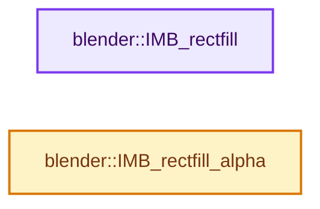
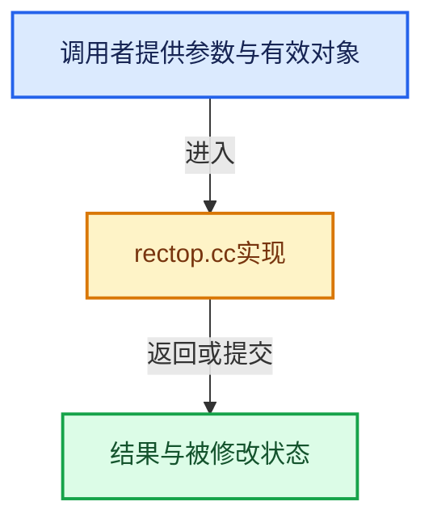

# 实现依赖专题：source/blender/imbuf/intern/rectop.cc

[实现依赖导航](../../../README.md) · [符号索引](../../../../00-课程指南/02-源码与提交索引/符号依赖与实现索引.md)

本专题从正文实际调用进入，集中保存共享实现。函数有稳定锚点，可从调用处直接跳到对应完整函数；递归与互相调用通过回链组织。

## 本文件的实现关系






## 完整成员与函数实现

<a id="f-ddc808c2ef224637"></a>

### `blender::IMB_rectfill`

实现位置：[source/blender/imbuf/intern/rectop.cc](../../../../../../../../source/blender/imbuf/intern/rectop.cc) · L1165—L1192。

接口参数：

- `ImBuf *drect`
- `const float col[4]`

**教学注释版**

<!-- annotated:e5cb6a65d00b8c -->

```cpp
void IMB_rectfill(ImBuf *drect, const float col[4])
{
  size_t num;

  if (drect->byte_data()) {
    uint *rrect = reinterpret_cast<uint *>(drect->byte_data_for_write());

    char ccol[4];
    unit_float_to_uchar_clamp_v4(ccol, col);

    num = IMB_get_pixel_count(drect);
    for (; num > 0; num--) {
      *rrect++ = *(reinterpret_cast<uint *>(ccol));
    }
  }

  if (drect->float_data()) {
    float *rrectf = drect->float_data_for_write();

    num = IMB_get_pixel_count(drect);
    for (; num > 0; num--) {
      *rrectf++ = col[0];
      *rrectf++ = col[1];
      *rrectf++ = col[2];
      *rrectf++ = col[3];
    }
  }
}
```

<details>
<summary>核对原始源码：source/blender/imbuf/intern/rectop.cc · L1165—L1192</summary>

<!-- original:e5cb6a65d00b8c:source/blender/imbuf/intern/rectop.cc:1165:1192 -->

```cpp
void IMB_rectfill(ImBuf *drect, const float col[4])
{
  size_t num;

  if (drect->byte_data()) {
    uint *rrect = reinterpret_cast<uint *>(drect->byte_data_for_write());

    char ccol[4];
    unit_float_to_uchar_clamp_v4(ccol, col);

    num = IMB_get_pixel_count(drect);
    for (; num > 0; num--) {
      *rrect++ = *(reinterpret_cast<uint *>(ccol));
    }
  }

  if (drect->float_data()) {
    float *rrectf = drect->float_data_for_write();

    num = IMB_get_pixel_count(drect);
    for (; num > 0; num--) {
      *rrectf++ = col[0];
      *rrectf++ = col[1];
      *rrectf++ = col[2];
      *rrectf++ = col[3];
    }
  }
}
```

</details>

**沿实际写入检查状态**

- `num = IMB_get_pixel_count(drect);`

**继续追踪实现**

- `drect->byte_data` → [blender::ImBuf::byte_data · L353](../IMB_imbuf_types.hh.md#f-2cdfc552156643fa)。
- `drect->byte_data_for_write` → [blender::ImBuf::byte_data_for_write · L60](allocimbuf.cc.md#f-9ae201bd1c52aa87)。
- `unit_float_to_uchar_clamp_v4` → [unit_float_to_uchar_clamp_v4 · L604](../../../01-BLI基础库/intern/math_base_inline.cc.md#m-544b775b5cdf)。宏定义由构建条件选择。
- `IMB_get_pixel_count` → [blender::IMB_get_pixel_count · L458](allocimbuf.cc.md#f-edc523058327479e)。
- `drect->float_data` → [blender::ImBuf::float_data · L358](../IMB_imbuf_types.hh.md#f-2e52aa77544ffaee)。
- `drect->float_data_for_write` → [blender::ImBuf::float_data_for_write · L79](allocimbuf.cc.md#f-1956ac4db88ed3eb)。

<a id="f-141465f1b5e2365f"></a>

### `blender::IMB_rectfill_alpha`

实现位置：[source/blender/imbuf/intern/rectop.cc](../../../../../../../../source/blender/imbuf/intern/rectop.cc) · L1309—L1327。

接口参数：

- `ImBuf *ibuf`
- `const float value`

**教学注释版**

<!-- annotated:1bd64cecb2ab9a -->

```cpp
void IMB_rectfill_alpha(ImBuf *ibuf, const float value)
{
  size_t i;

  if (ibuf->float_data() && (ibuf->channels == 4)) {
    float *fbuf = ibuf->float_data_for_write() + 3;
    for (i = IMB_get_pixel_count(ibuf); i > 0; i--, fbuf += 4) {
      *fbuf = value;
    }
  }

  if (uchar *byte_data = ibuf->byte_data_for_write()) {
    const uchar cvalue = value * 255;
    uchar *cbuf = byte_data + 3;
    for (i = IMB_get_pixel_count(ibuf); i > 0; i--, cbuf += 4) {
      *cbuf = cvalue;
    }
  }
}
```

<details>
<summary>核对原始源码：source/blender/imbuf/intern/rectop.cc · L1309—L1327</summary>

<!-- original:1bd64cecb2ab9a:source/blender/imbuf/intern/rectop.cc:1309:1327 -->

```cpp
void IMB_rectfill_alpha(ImBuf *ibuf, const float value)
{
  size_t i;

  if (ibuf->float_data() && (ibuf->channels == 4)) {
    float *fbuf = ibuf->float_data_for_write() + 3;
    for (i = IMB_get_pixel_count(ibuf); i > 0; i--, fbuf += 4) {
      *fbuf = value;
    }
  }

  if (uchar *byte_data = ibuf->byte_data_for_write()) {
    const uchar cvalue = value * 255;
    uchar *cbuf = byte_data + 3;
    for (i = IMB_get_pixel_count(ibuf); i > 0; i--, cbuf += 4) {
      *cbuf = cvalue;
    }
  }
}
```

</details>

**继续追踪实现**

- `ibuf->float_data` → [blender::ImBuf::float_data · L358](../IMB_imbuf_types.hh.md#f-2e52aa77544ffaee)。
- `ibuf->float_data_for_write` → [blender::ImBuf::float_data_for_write · L79](allocimbuf.cc.md#f-1956ac4db88ed3eb)。
- `IMB_get_pixel_count` → [blender::IMB_get_pixel_count · L458](allocimbuf.cc.md#f-edc523058327479e)。
- `ibuf->byte_data_for_write` → [blender::ImBuf::byte_data_for_write · L60](allocimbuf.cc.md#f-9ae201bd1c52aa87)。
