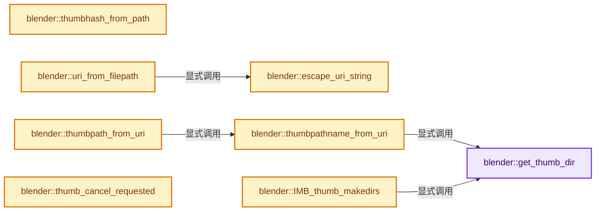
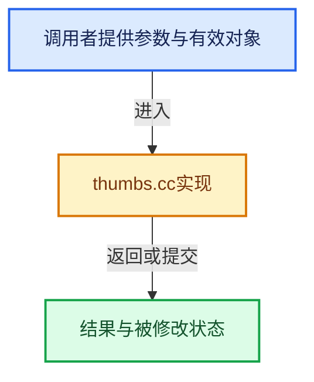

# 实现依赖专题：source/blender/imbuf/intern/thumbs.cc

[实现依赖导航](../../../README.md) · [符号索引](../../../../00-课程指南/02-源码与提交索引/符号依赖与实现索引.md)

本专题从正文实际调用进入，集中保存共享实现。函数有稳定锚点，可从调用处直接跳到对应完整函数；递归与互相调用通过回链组织。

## 本文件的实现关系






## 完整成员与函数实现

<a id="f-5d28e26e923b42d4"></a>

### `blender::get_thumb_dir`

实现位置：[source/blender/imbuf/intern/thumbs.cc](../../../../../../../../source/blender/imbuf/intern/thumbs.cc) · L76—L122。

接口参数：

- `char *dir`
- `ThumbSize size`

**教学注释版**

<!-- annotated:054dedecb1e46f -->

```cpp
static bool get_thumb_dir(char *dir, ThumbSize size)
{
  char *s = dir;
  const char *subdir;
#ifdef WIN32
  wchar_t dir_16[MAX_PATH];
  /* Yes, applications shouldn't store data there, but so does GIMP :). */
  SHGetSpecialFolderPathW(0, dir_16, CSIDL_PROFILE, 0);
  conv_utf_16_to_8(dir_16, dir, FILE_MAX);
  s += strlen(dir);
#else
#  if defined(USE_FREEDESKTOP)
  const char *home_cache = BLI_getenv("XDG_CACHE_HOME");
  const char *home = home_cache ? home_cache : BLI_dir_home();
#  else
  const char *home = BLI_dir_home();
#  endif
  if (!home) {
    return false;
  }
  s += BLI_strncpy_rlen(s, home, FILE_MAX);

#  ifdef USE_FREEDESKTOP
  if (!home_cache) {
    s += BLI_strncpy_rlen(s, "/.cache", FILE_MAX - (s - dir));
  }
#  endif
#endif
  switch (size) {
    case THB_NORMAL:
      subdir = SEP_STR THUMBNAILS SEP_STR "normal" SEP_STR;
      break;
    case THB_LARGE:
      subdir = SEP_STR THUMBNAILS SEP_STR "large" SEP_STR;
      break;
    case THB_FAIL:
      subdir = SEP_STR THUMBNAILS SEP_STR "fail" SEP_STR "blender" SEP_STR;
      break;
    default:
      return false; /* unknown size */
  }

  s += BLI_strncpy_rlen(s, subdir, FILE_MAX - (s - dir));
  (void)s;

  return true;
}
```

<details>
<summary>核对原始源码：source/blender/imbuf/intern/thumbs.cc · L76—L122</summary>

<!-- original:054dedecb1e46f:source/blender/imbuf/intern/thumbs.cc:76:122 -->

```cpp
static bool get_thumb_dir(char *dir, ThumbSize size)
{
  char *s = dir;
  const char *subdir;
#ifdef WIN32
  wchar_t dir_16[MAX_PATH];
  /* Yes, applications shouldn't store data there, but so does GIMP :). */
  SHGetSpecialFolderPathW(0, dir_16, CSIDL_PROFILE, 0);
  conv_utf_16_to_8(dir_16, dir, FILE_MAX);
  s += strlen(dir);
#else
#  if defined(USE_FREEDESKTOP)
  const char *home_cache = BLI_getenv("XDG_CACHE_HOME");
  const char *home = home_cache ? home_cache : BLI_dir_home();
#  else
  const char *home = BLI_dir_home();
#  endif
  if (!home) {
    return false;
  }
  s += BLI_strncpy_rlen(s, home, FILE_MAX);

#  ifdef USE_FREEDESKTOP
  if (!home_cache) {
    s += BLI_strncpy_rlen(s, "/.cache", FILE_MAX - (s - dir));
  }
#  endif
#endif
  switch (size) {
    case THB_NORMAL:
      subdir = SEP_STR THUMBNAILS SEP_STR "normal" SEP_STR;
      break;
    case THB_LARGE:
      subdir = SEP_STR THUMBNAILS SEP_STR "large" SEP_STR;
      break;
    case THB_FAIL:
      subdir = SEP_STR THUMBNAILS SEP_STR "fail" SEP_STR "blender" SEP_STR;
      break;
    default:
      return false; /* unknown size */
  }

  s += BLI_strncpy_rlen(s, subdir, FILE_MAX - (s - dir));
  (void)s;

  return true;
}
```

</details>

**沿实际写入检查状态**

- `s += strlen(dir);`
- `s += BLI_strncpy_rlen(s, home, FILE_MAX);`
- `s += BLI_strncpy_rlen(s, "/.cache", FILE_MAX - (s - dir));`
- `subdir = SEP_STR THUMBNAILS SEP_STR "normal" SEP_STR;`
- `subdir = SEP_STR THUMBNAILS SEP_STR "large" SEP_STR;`
- `subdir = SEP_STR THUMBNAILS SEP_STR "fail" SEP_STR "blender" SEP_STR;`
- `s += BLI_strncpy_rlen(s, subdir, FILE_MAX - (s - dir));`

**结果出口**

- `return false;`
- `return false; /* unknown size */`
- `return true;`

**继续追踪实现**

- `SHGetSpecialFolderPathW` → [调用协议](../../../../00-课程指南/01-路线与规范/模板宏与动态分派协议.md)：函数指针、局部可调用对象或未展开的宏；必须结合调用者环境。调用位置L83。
- `conv_utf_16_to_8` → [conv_utf_16_to_8 · L116](../../../07-Intern运行时与平台/utfconv/utfconv.cc.md#f-a9a82cceffb55796)。
- `strlen` → [外部契约](https://eel.is/c++draft/)：这个边界按实际表达式及所属类型核对参数、返回值、寿命与失败行为。这里提供接口入口，不声称已解释该第三方版本的内部实现。
- `BLI_getenv` → [BLI_getenv · L1435](../../../01-BLI基础库/intern/path_utils.cc.md#f-c6a0b8b917e9ef4c)。
- `BLI_dir_home` → [blender::BLI_dir_home · L99](../../../01-BLI基础库/intern/storage.cc.md#f-ecbf67fd9338348e)。
- `BLI_strncpy_rlen` → [blender::BLI_strncpy_rlen · L121](../../../01-BLI基础库/intern/string.cc.md#f-41d02d7e241b0968)。

<a id="f-246121b29dcc0c87"></a>

### `blender::escape_uri_string`

实现位置：[source/blender/imbuf/intern/thumbs.cc](../../../../../../../../source/blender/imbuf/intern/thumbs.cc) · L168—L203。

接口参数：

- `const char *string`
- `char *escaped_string`
- `const int escaped_string_size`
- `const eUnsafeCharacterSet mask`

**教学注释版**

<!-- annotated:a11e948c08515d -->

```cpp
static void escape_uri_string(const char *string,
                              char *escaped_string,
                              const int escaped_string_size,
                              const eUnsafeCharacterSet mask)
{
#define ACCEPTABLE(a) ((a) >= 32 && (a) < 128 && (acceptable[(a) - 32] & mask))

  BLI_assert(escaped_string_size > 0);
  /* Remove space for \0. */
  int escaped_string_len = escaped_string_size - 1;

  const char *p;
  char *q;
  int c;

  for (q = escaped_string, p = string; (*p != '\0') && escaped_string_len; p++) {
    c = uchar(*p);

    if (!ACCEPTABLE(c)) {
      if (escaped_string_len < 3) {
        break;
      }

      *q++ = '%'; /* means hex coming */
      *q++ = hex[c >> 4];
      *q++ = hex[c & 15];
      escaped_string_len -= 3;
    }
    else {
      *q++ = *p;
      escaped_string_len -= 1;
    }
  }

  *q = '\0';
}
```

<details>
<summary>核对原始源码：source/blender/imbuf/intern/thumbs.cc · L168—L203</summary>

<!-- original:a11e948c08515d:source/blender/imbuf/intern/thumbs.cc:168:203 -->

```cpp
static void escape_uri_string(const char *string,
                              char *escaped_string,
                              const int escaped_string_size,
                              const eUnsafeCharacterSet mask)
{
#define ACCEPTABLE(a) ((a) >= 32 && (a) < 128 && (acceptable[(a) - 32] & mask))

  BLI_assert(escaped_string_size > 0);
  /* Remove space for \0. */
  int escaped_string_len = escaped_string_size - 1;

  const char *p;
  char *q;
  int c;

  for (q = escaped_string, p = string; (*p != '\0') && escaped_string_len; p++) {
    c = uchar(*p);

    if (!ACCEPTABLE(c)) {
      if (escaped_string_len < 3) {
        break;
      }

      *q++ = '%'; /* means hex coming */
      *q++ = hex[c >> 4];
      *q++ = hex[c & 15];
      escaped_string_len -= 3;
    }
    else {
      *q++ = *p;
      escaped_string_len -= 1;
    }
  }

  *q = '\0';
}
```

</details>

**沿实际写入检查状态**

- `c = uchar(*p);`
- `escaped_string_len -= 3;`
- `escaped_string_len -= 1;`

**继续追踪实现**

- `BLI_assert` → [BLI_assert · L48](../../../01-BLI基础库/BLI_assert.hh.md#m-57a88495704d)；[BLI_assert · L63](../../../01-BLI基础库/BLI_assert.hh.md#m-d07050020cb5)。宏定义由构建条件选择。
- `uchar` → [调用协议](../../../../00-课程指南/01-路线与规范/模板宏与动态分派协议.md)：函数指针、局部可调用对象或未展开的宏；必须结合调用者环境。调用位置L184。
- `ACCEPTABLE` → [调用协议](../../../../00-课程指南/01-路线与规范/模板宏与动态分派协议.md)：函数指针、局部可调用对象或未展开的宏；必须结合调用者环境。调用位置L186。

<a id="f-1e0490cc06c89ebe"></a>

### `blender::thumbhash_from_path`

实现位置：[source/blender/imbuf/intern/thumbs.cc](../../../../../../../../source/blender/imbuf/intern/thumbs.cc) · L209—L218。

接口参数：

- `const char *`
- `ThumbSource source`
- `char *r_hash`

**教学注释版**

<!-- annotated:b2e25ccf78f0b6 -->

```cpp
static bool thumbhash_from_path(const char * /*path*/, ThumbSource source, char *r_hash)
{
  switch (source) {
    case THB_SOURCE_FONT:
      return IMB_thumb_load_font_get_hash(r_hash);
    default:
      r_hash[0] = '\0';
      return false;
  }
}
```

<details>
<summary>核对原始源码：source/blender/imbuf/intern/thumbs.cc · L209—L218</summary>

<!-- original:b2e25ccf78f0b6:source/blender/imbuf/intern/thumbs.cc:209:218 -->

```cpp
static bool thumbhash_from_path(const char * /*path*/, ThumbSource source, char *r_hash)
{
  switch (source) {
    case THB_SOURCE_FONT:
      return IMB_thumb_load_font_get_hash(r_hash);
    default:
      r_hash[0] = '\0';
      return false;
  }
}
```

</details>

**沿实际写入检查状态**

- `r_hash[0] = '\0';`

**结果出口**

- `return IMB_thumb_load_font_get_hash(r_hash);`
- `return false;`

**继续追踪实现**

- `IMB_thumb_load_font_get_hash` → [blender::IMB_thumb_load_font_get_hash · L41](thumbs_font.cc.md#f-841929fa327aff4b)。

<a id="f-47ea82f69a038c35"></a>

### `blender::uri_from_filepath`

实现位置：[source/blender/imbuf/intern/thumbs.cc](../../../../../../../../source/blender/imbuf/intern/thumbs.cc) · L220—L256。

接口参数：

- `const char *path`
- `char *uri`

**教学注释版**

<!-- annotated:5715dcd96cca7a -->

```cpp
static bool uri_from_filepath(const char *path, char *uri)
{
  char orig_uri[URI_MAX];

#ifdef WIN32
  bool path_is_unc = BLI_path_is_unc(path);
  char path_unc_normalized[FILE_MAX];
  if (path_is_unc) {
    STRNCPY(path_unc_normalized, path);
    BLI_path_normalize_unc(path_unc_normalized, sizeof(path_unc_normalized));
    path = path_unc_normalized;
    /* Assign again because a normalized UNC path may resolve to a drive letter. */
    path_is_unc = BLI_path_is_unc(path);
  }

  if (path_is_unc) {
    /* Skip over the `\\` prefix, it's not needed for a URI. */
    SNPRINTF(orig_uri, "file://%s", BLI_path_slash_skip(path));
  }
  else if (BLI_path_is_win32_drive(path)) {
    SNPRINTF(orig_uri, "file:///%s", path);
    /* Always use an uppercase drive/volume letter in the URI. */
    orig_uri[8] = char(toupper(orig_uri[8]));
  }
  else {
    /* Not a correct absolute path with a drive letter or UNC prefix. */
    return false;
  }
  BLI_string_replace_char(orig_uri, '\\', '/');
#else
  SNPRINTF(orig_uri, "file://%s", path);
#endif

  escape_uri_string(orig_uri, uri, URI_MAX, UNSAFE_PATH);

  return true;
}
```

<details>
<summary>核对原始源码：source/blender/imbuf/intern/thumbs.cc · L220—L256</summary>

<!-- original:5715dcd96cca7a:source/blender/imbuf/intern/thumbs.cc:220:256 -->

```cpp
static bool uri_from_filepath(const char *path, char *uri)
{
  char orig_uri[URI_MAX];

#ifdef WIN32
  bool path_is_unc = BLI_path_is_unc(path);
  char path_unc_normalized[FILE_MAX];
  if (path_is_unc) {
    STRNCPY(path_unc_normalized, path);
    BLI_path_normalize_unc(path_unc_normalized, sizeof(path_unc_normalized));
    path = path_unc_normalized;
    /* Assign again because a normalized UNC path may resolve to a drive letter. */
    path_is_unc = BLI_path_is_unc(path);
  }

  if (path_is_unc) {
    /* Skip over the `\\` prefix, it's not needed for a URI. */
    SNPRINTF(orig_uri, "file://%s", BLI_path_slash_skip(path));
  }
  else if (BLI_path_is_win32_drive(path)) {
    SNPRINTF(orig_uri, "file:///%s", path);
    /* Always use an uppercase drive/volume letter in the URI. */
    orig_uri[8] = char(toupper(orig_uri[8]));
  }
  else {
    /* Not a correct absolute path with a drive letter or UNC prefix. */
    return false;
  }
  BLI_string_replace_char(orig_uri, '\\', '/');
#else
  SNPRINTF(orig_uri, "file://%s", path);
#endif

  escape_uri_string(orig_uri, uri, URI_MAX, UNSAFE_PATH);

  return true;
}
```

</details>

**沿实际写入检查状态**

- `path = path_unc_normalized;`
- `path_is_unc = BLI_path_is_unc(path);`
- `orig_uri[8] = char(toupper(orig_uri[8]));`

**结果出口**

- `return false;`
- `return true;`

**继续追踪实现**

- `BLI_path_is_unc` → [BLI_path_is_unc · L541](../../../01-BLI基础库/intern/path_utils.cc.md#f-46098bb47609c0b1)。
- `STRNCPY` → [blender::STRNCPY · L690](../../../01-BLI基础库/BLI_string.hh.md#f-6b2d861724026be6)。
- `BLI_path_normalize_unc` → [BLI_path_normalize_unc · L658](../../../01-BLI基础库/intern/path_utils.cc.md#f-589499a96ae446db)。
- `SNPRINTF` → [SNPRINTF · L601](../../../01-BLI基础库/BLI_string.hh.md#m-6193d55b5ab8)。宏定义由构建条件选择。
- `BLI_path_slash_skip` → [BLI_path_slash_skip · L2040](../../../01-BLI基础库/intern/path_utils.cc.md#f-8c7b87c95685cb12)。
- `BLI_path_is_win32_drive` → [BLI_path_is_win32_drive · L576](../../../01-BLI基础库/intern/path_utils.cc.md#f-48d89d39b0d5c4e2)。
- `toupper` → [调用协议](../../../../00-课程指南/01-路线与规范/模板宏与动态分派协议.md)：函数指针、局部可调用对象或未展开的宏；必须结合调用者环境。调用位置L242。
- `BLI_string_replace_char` → [blender::BLI_string_replace_char · L113](../../../01-BLI基础库/intern/string_utils.cc.md#f-3e3aac364a1bfdfa)。
- `escape_uri_string` → [blender::escape_uri_string · L168](thumbs.cc.md#f-246121b29dcc0c87)。

<a id="f-8a04604a399f0067"></a>

### `blender::thumbpathname_from_uri`

实现位置：[source/blender/imbuf/intern/thumbs.cc](../../../../../../../../source/blender/imbuf/intern/thumbs.cc) · L258—L291。

接口参数：

- `const char *uri`
- `char *r_path`
- `const int path_maxncpy`
- `char *r_name`
- `int name_maxncpy`
- `ThumbSize size`

**教学注释版**

<!-- annotated:42a430888e35a8 -->

```cpp
static bool thumbpathname_from_uri(const char *uri,
                                   char *r_path,
                                   const int path_maxncpy,
                                   char *r_name,
                                   int name_maxncpy,
                                   ThumbSize size)
{
  char name_buff[40];

  if (r_path && !r_name) {
    r_name = name_buff;
    name_maxncpy = sizeof(name_buff);
  }

  if (r_name) {
    char hexdigest[33];
    uchar digest[16];
    BLI_hash_md5_buffer(uri, strlen(uri), digest);
    hexdigest[0] = '\0';
    BLI_snprintf(r_name, name_maxncpy, "%s.png", BLI_hash_md5_to_hexdigest(digest, hexdigest));
    //      printf("%s: '%s' --> '%s'\n", __func__, uri, r_name);
  }

  if (r_path) {
    char tmppath[FILE_MAX];

    if (get_thumb_dir(tmppath, size)) {
      BLI_snprintf(r_path, path_maxncpy, "%s%s", tmppath, r_name);
      //          printf("%s: '%s' --> '%s'\n", __func__, uri, r_path);
      return true;
    }
  }
  return false;
}
```

<details>
<summary>核对原始源码：source/blender/imbuf/intern/thumbs.cc · L258—L291</summary>

<!-- original:42a430888e35a8:source/blender/imbuf/intern/thumbs.cc:258:291 -->

```cpp
static bool thumbpathname_from_uri(const char *uri,
                                   char *r_path,
                                   const int path_maxncpy,
                                   char *r_name,
                                   int name_maxncpy,
                                   ThumbSize size)
{
  char name_buff[40];

  if (r_path && !r_name) {
    r_name = name_buff;
    name_maxncpy = sizeof(name_buff);
  }

  if (r_name) {
    char hexdigest[33];
    uchar digest[16];
    BLI_hash_md5_buffer(uri, strlen(uri), digest);
    hexdigest[0] = '\0';
    BLI_snprintf(r_name, name_maxncpy, "%s.png", BLI_hash_md5_to_hexdigest(digest, hexdigest));
    //      printf("%s: '%s' --> '%s'\n", __func__, uri, r_name);
  }

  if (r_path) {
    char tmppath[FILE_MAX];

    if (get_thumb_dir(tmppath, size)) {
      BLI_snprintf(r_path, path_maxncpy, "%s%s", tmppath, r_name);
      //          printf("%s: '%s' --> '%s'\n", __func__, uri, r_path);
      return true;
    }
  }
  return false;
}
```

</details>

**沿实际写入检查状态**

- `r_name = name_buff;`
- `name_maxncpy = sizeof(name_buff);`
- `hexdigest[0] = '\0';`

**结果出口**

- `return true;`
- `return false;`

**继续追踪实现**

- `BLI_hash_md5_buffer` → [blender::BLI_hash_md5_buffer · L345](../../../01-BLI基础库/intern/hash_md5.cc.md#f-8d7841e60ae0e060)。
- `strlen` → [外部契约](https://eel.is/c++draft/)：这个边界按实际表达式及所属类型核对参数、返回值、寿命与失败行为。这里提供接口入口，不声称已解释该第三方版本的内部实现。
- `BLI_snprintf` → [blender::BLI_snprintf · L201](../../../01-BLI基础库/intern/string.cc.md#f-c4de2f0e81459332)。
- `BLI_hash_md5_to_hexdigest` → [blender::BLI_hash_md5_to_hexdigest · L381](../../../01-BLI基础库/intern/hash_md5.cc.md#f-f58bf9ed51cfe1c7)。
- `get_thumb_dir` → [blender::get_thumb_dir · L76](thumbs.cc.md#f-5d28e26e923b42d4)。

<a id="f-817866855b8164f0"></a>

### `blender::thumbpath_from_uri`

实现位置：[source/blender/imbuf/intern/thumbs.cc](../../../../../../../../source/blender/imbuf/intern/thumbs.cc) · L298—L301。

接口参数：

- `const char *uri`
- `char *path`
- `const int path_maxncpy`
- `ThumbSize size`

**教学注释版**

<!-- annotated:9e872b51461f19 -->

```cpp
static bool thumbpath_from_uri(const char *uri, char *path, const int path_maxncpy, ThumbSize size)
{
  return thumbpathname_from_uri(uri, path, path_maxncpy, nullptr, 0, size);
}
```

<details>
<summary>核对原始源码：source/blender/imbuf/intern/thumbs.cc · L298—L301</summary>

<!-- original:9e872b51461f19:source/blender/imbuf/intern/thumbs.cc:298:301 -->

```cpp
static bool thumbpath_from_uri(const char *uri, char *path, const int path_maxncpy, ThumbSize size)
{
  return thumbpathname_from_uri(uri, path, path_maxncpy, nullptr, 0, size);
}
```

</details>

**结果出口**

- `return thumbpathname_from_uri(uri, path, path_maxncpy, nullptr, 0, size);`

**继续追踪实现**

- `thumbpathname_from_uri` → [blender::thumbpathname_from_uri · L258](thumbs.cc.md#f-8a04604a399f0067)。

<a id="f-99f19e339b142d6c"></a>

### `blender::IMB_thumb_makedirs`

实现位置：[source/blender/imbuf/intern/thumbs.cc](../../../../../../../../source/blender/imbuf/intern/thumbs.cc) · L303—L317。

**教学注释版**

<!-- annotated:878fdecdd483a4 -->

```cpp
void IMB_thumb_makedirs()
{
  char tpath[FILE_MAX];
#if 0 /* UNUSED */
  if (get_thumb_dir(tpath, THB_NORMAL)) {
    BLI_dir_create_recursive(tpath);
  }
#endif
  if (get_thumb_dir(tpath, THB_LARGE)) {
    BLI_dir_create_recursive(tpath);
  }
  if (get_thumb_dir(tpath, THB_FAIL)) {
    BLI_dir_create_recursive(tpath);
  }
}
```

<details>
<summary>核对原始源码：source/blender/imbuf/intern/thumbs.cc · L303—L317</summary>

<!-- original:878fdecdd483a4:source/blender/imbuf/intern/thumbs.cc:303:317 -->

```cpp
void IMB_thumb_makedirs()
{
  char tpath[FILE_MAX];
#if 0 /* UNUSED */
  if (get_thumb_dir(tpath, THB_NORMAL)) {
    BLI_dir_create_recursive(tpath);
  }
#endif
  if (get_thumb_dir(tpath, THB_LARGE)) {
    BLI_dir_create_recursive(tpath);
  }
  if (get_thumb_dir(tpath, THB_FAIL)) {
    BLI_dir_create_recursive(tpath);
  }
}
```

</details>

**继续追踪实现**

- `get_thumb_dir` → [blender::get_thumb_dir · L76](thumbs.cc.md#f-5d28e26e923b42d4)。
- `BLI_dir_create_recursive` → [blender::BLI_dir_create_recursive · L416](../../../01-BLI基础库/intern/fileops_c.cc.md#f-27fbfd7ad143739e)。

<a id="f-017c8588cdb4ac0c"></a>

### `blender::thumb_cancel_requested`

实现位置：[source/blender/imbuf/intern/thumbs.cc](../../../../../../../../source/blender/imbuf/intern/thumbs.cc) · L319—L322。

接口参数：

- `const ThumbCancellationToken *cancel_token`

**教学注释版**

<!-- annotated:5369bea800ecb0 -->

```cpp
static bool thumb_cancel_requested(const ThumbCancellationToken *cancel_token)
{
  return cancel_token && cancel_token->is_cancelled();
}
```

<details>
<summary>核对原始源码：source/blender/imbuf/intern/thumbs.cc · L319—L322</summary>

<!-- original:5369bea800ecb0:source/blender/imbuf/intern/thumbs.cc:319:322 -->

```cpp
static bool thumb_cancel_requested(const ThumbCancellationToken *cancel_token)
{
  return cancel_token && cancel_token->is_cancelled();
}
```

</details>

**结果出口**

- `return cancel_token && cancel_token->is_cancelled();`

**继续追踪实现**

- `cancel_token->is_cancelled` → [blender::ThumbCancellationToken::is_cancelled · L65](../IMB_thumbs.hh.md#f-b7b44093da1fb7bc)。

<a id="f-ee56d63b8a79824d"></a>

### `blender::thumb_create_ex`

实现位置：[source/blender/imbuf/intern/thumbs.cc](../../../../../../../../source/blender/imbuf/intern/thumbs.cc) · L325—L488。

接口参数：

- `const char *file_path`
- `const char *uri`
- `const char *thumb`
- `const bool use_hash`
- `const char *hash`
- `const char *blen_group`
- `const char *blen_id`
- `ThumbSize size`
- `ThumbSource source`
- `ImBuf *img`
- `const ThumbCancellationToken *cancel_token = nullptr`

**教学注释版**

<!-- annotated:23b78927c3fe08 -->

```cpp
static ImBuf *thumb_create_ex(const char *file_path,
                              const char *uri,
                              const char *thumb,
                              const bool use_hash,
                              const char *hash,
                              const char *blen_group,
                              const char *blen_id,
                              ThumbSize size,
                              ThumbSource source,
                              ImBuf *img,
                              const ThumbCancellationToken *cancel_token = nullptr)
{
  if (thumb_cancel_requested(cancel_token)) {
    return nullptr;
  }

  /* Just in case these folders got deleted somehow. */
  IMB_thumb_makedirs();

  char desc[URI_MAX + 22];
  char tpath[FILE_MAX];
  char tdir[FILE_MAX];
  char temp[FILE_MAX];
  char mtime[40] = "0"; /* in case we can't stat the file */
  short tsize = 128;
  BLI_stat_t info;

  switch (size) {
    case THB_NORMAL:
      tsize = PREVIEW_RENDER_DEFAULT_HEIGHT;
      break;
    case THB_LARGE:
      tsize = PREVIEW_RENDER_LARGE_HEIGHT;
      break;
    case THB_FAIL:
      tsize = 1;
      break;
    default:
      return nullptr; /* unknown size */
  }

  if (get_thumb_dir(tdir, size)) {
    SNPRINTF(tpath, "%s%s", tdir, thumb);
    // thumb[8] = '\0'; /* shorten for `temp` name, not needed anymore */
    SNPRINTF(temp, "%sblender_%d_%s.png", tdir, abs(getpid()), thumb);
    if (BLI_path_ncmp(file_path, tdir, sizeof(tdir)) == 0) {
      return nullptr;
    }
    if (size == THB_FAIL) {
      img = IMB_allocImBuf(1, 1, ImBufFlags::ByteData | ImBufFlags::Metadata);
      if (!img) {
        return nullptr;
      }
    }
    else {
      if (ELEM(source, THB_SOURCE_IMAGE, THB_SOURCE_BLEND, THB_SOURCE_FONT, THB_SOURCE_OBJECT_IO))
      {
        /* only load if we didn't give an image */
        if (img == nullptr) {
          switch (source) {
            case THB_SOURCE_IMAGE:
              img = IMB_thumb_load_image(file_path, tsize, nullptr);
              break;
            case THB_SOURCE_BLEND:
              img = IMB_thumb_load_blend(file_path, blen_group, blen_id);
              break;
            case THB_SOURCE_FONT:
              img = IMB_thumb_load_font(file_path, tsize, tsize);
              break;
            case THB_SOURCE_OBJECT_IO: {
              if (BLI_path_extension_check(file_path, ".svg")) {
                img = IMB_thumb_load_image(file_path, tsize, nullptr);
              }
              break;
            }
            default:
              BLI_assert_unreachable(); /* This should never happen */
          }
        }

        if (img != nullptr) {
          if (BLI_stat(file_path, &info) != -1) {
            SNPRINTF_UTF8(mtime, "%ld", (long int)info.st_mtime);
          }
        }
      }
      else if (THB_SOURCE_MOVIE == source) {
        MovieReader *anim = nullptr;
        /* Image buffer is converted from float to byte and only the latter one is used, and the
         * conversion process is aware of the float color-space. So it is possible to save some
         * compute time by keeping the original color-space for movies. */
        anim = MOV_open_file(file_path, ImBufFlags::Zero, 0, true, nullptr);
        if (anim != nullptr) {
          img = MOV_decode_frame(anim, 0, IMB_PROXY_NONE);
          if (img == nullptr) {
            // printf("not an anim; %s\n", file_path);
          }
          else {
            IMB_freeImBuf(img);
            img = MOV_decode_preview_frame(anim);
          }
          MOV_close(anim);
        }
        if (BLI_stat(file_path, &info) != -1) {
          SNPRINTF_UTF8(mtime, "%ld", (long int)info.st_mtime);
        }
      }
      if (!img) {
        return nullptr;
      }

      if (thumb_cancel_requested(cancel_token)) {
        IMB_freeImBuf(img);
        return nullptr;
      }

      if (img->x > tsize || img->y > tsize) {
        // [讲解] std::min：按比较关系选取较小值；截断范围时还需先满足非负和可表示范围，min本身不会证明边界安全。
        float scale = std::min(float(tsize) / float(img->x), float(tsize) / float(img->y));
        /* Scaling down must never assign zero width/height, see: #89868. */
        // [讲解] std::max：按比较关系选取较大值。本讲解中的增长公式同时满足最低请求和几何增长；若保存返回引用，还需注意实参寿命。
        short ex = std::max(short(1), short(img->x * scale));
        short ey = std::max(short(1), short(img->y * scale));
        /* Save some time by only scaling byte buffer. */
        if (img->float_data()) {
          if (img->byte_data() == nullptr) {
            IMB_byte_from_float(img);
          }
          IMB_free_float_pixels(img);
        }
        IMB_scale(img, ex, ey, IMBScaleFilter::Box, false);
      }
    }

    if (thumb_cancel_requested(cancel_token)) {
      IMB_freeImBuf(img);
      return nullptr;
    }

    SNPRINTF_UTF8(desc, "Thumbnail for %s", uri);
    IDProperty *metadata = img->metadata_for_write();
    IMB_metadata_set_field(metadata, "Software", "Blender");
    IMB_metadata_set_field(metadata, "Thumb::URI", uri);
    IMB_metadata_set_field(metadata, "Description", desc);
    IMB_metadata_set_field(metadata, "Thumb::MTime", mtime);
    if (use_hash) {
      IMB_metadata_set_field(metadata, "X-Blender::Hash", hash);
    }
    img->ftype = IMB_FTYPE_PNG;
    img->color_mode = ImColorMode::RGBA;

    /* If we generated from a 16bit PNG e.g., we have a float rect, not a byte one - fix this. */
    IMB_byte_from_float(img);
    IMB_free_float_pixels(img);

    if (IMB_save_image(img, temp, ImBufFlags::ByteData | ImBufFlags::Metadata)) {
#ifndef WIN32
      chmod(temp, S_IRUSR | S_IWUSR);
#endif
      // printf("%s saving thumb: '%s'\n", __func__, tpath);

      BLI_rename_overwrite(temp, tpath);
    }
  }
  return img;
}
```

<details>
<summary>核对原始源码：source/blender/imbuf/intern/thumbs.cc · L325—L488</summary>

<!-- original:23b78927c3fe08:source/blender/imbuf/intern/thumbs.cc:325:488 -->

```cpp
static ImBuf *thumb_create_ex(const char *file_path,
                              const char *uri,
                              const char *thumb,
                              const bool use_hash,
                              const char *hash,
                              const char *blen_group,
                              const char *blen_id,
                              ThumbSize size,
                              ThumbSource source,
                              ImBuf *img,
                              const ThumbCancellationToken *cancel_token = nullptr)
{
  if (thumb_cancel_requested(cancel_token)) {
    return nullptr;
  }

  /* Just in case these folders got deleted somehow. */
  IMB_thumb_makedirs();

  char desc[URI_MAX + 22];
  char tpath[FILE_MAX];
  char tdir[FILE_MAX];
  char temp[FILE_MAX];
  char mtime[40] = "0"; /* in case we can't stat the file */
  short tsize = 128;
  BLI_stat_t info;

  switch (size) {
    case THB_NORMAL:
      tsize = PREVIEW_RENDER_DEFAULT_HEIGHT;
      break;
    case THB_LARGE:
      tsize = PREVIEW_RENDER_LARGE_HEIGHT;
      break;
    case THB_FAIL:
      tsize = 1;
      break;
    default:
      return nullptr; /* unknown size */
  }

  if (get_thumb_dir(tdir, size)) {
    SNPRINTF(tpath, "%s%s", tdir, thumb);
    // thumb[8] = '\0'; /* shorten for `temp` name, not needed anymore */
    SNPRINTF(temp, "%sblender_%d_%s.png", tdir, abs(getpid()), thumb);
    if (BLI_path_ncmp(file_path, tdir, sizeof(tdir)) == 0) {
      return nullptr;
    }
    if (size == THB_FAIL) {
      img = IMB_allocImBuf(1, 1, ImBufFlags::ByteData | ImBufFlags::Metadata);
      if (!img) {
        return nullptr;
      }
    }
    else {
      if (ELEM(source, THB_SOURCE_IMAGE, THB_SOURCE_BLEND, THB_SOURCE_FONT, THB_SOURCE_OBJECT_IO))
      {
        /* only load if we didn't give an image */
        if (img == nullptr) {
          switch (source) {
            case THB_SOURCE_IMAGE:
              img = IMB_thumb_load_image(file_path, tsize, nullptr);
              break;
            case THB_SOURCE_BLEND:
              img = IMB_thumb_load_blend(file_path, blen_group, blen_id);
              break;
            case THB_SOURCE_FONT:
              img = IMB_thumb_load_font(file_path, tsize, tsize);
              break;
            case THB_SOURCE_OBJECT_IO: {
              if (BLI_path_extension_check(file_path, ".svg")) {
                img = IMB_thumb_load_image(file_path, tsize, nullptr);
              }
              break;
            }
            default:
              BLI_assert_unreachable(); /* This should never happen */
          }
        }

        if (img != nullptr) {
          if (BLI_stat(file_path, &info) != -1) {
            SNPRINTF_UTF8(mtime, "%ld", (long int)info.st_mtime);
          }
        }
      }
      else if (THB_SOURCE_MOVIE == source) {
        MovieReader *anim = nullptr;
        /* Image buffer is converted from float to byte and only the latter one is used, and the
         * conversion process is aware of the float color-space. So it is possible to save some
         * compute time by keeping the original color-space for movies. */
        anim = MOV_open_file(file_path, ImBufFlags::Zero, 0, true, nullptr);
        if (anim != nullptr) {
          img = MOV_decode_frame(anim, 0, IMB_PROXY_NONE);
          if (img == nullptr) {
            // printf("not an anim; %s\n", file_path);
          }
          else {
            IMB_freeImBuf(img);
            img = MOV_decode_preview_frame(anim);
          }
          MOV_close(anim);
        }
        if (BLI_stat(file_path, &info) != -1) {
          SNPRINTF_UTF8(mtime, "%ld", (long int)info.st_mtime);
        }
      }
      if (!img) {
        return nullptr;
      }

      if (thumb_cancel_requested(cancel_token)) {
        IMB_freeImBuf(img);
        return nullptr;
      }

      if (img->x > tsize || img->y > tsize) {
        float scale = std::min(float(tsize) / float(img->x), float(tsize) / float(img->y));
        /* Scaling down must never assign zero width/height, see: #89868. */
        short ex = std::max(short(1), short(img->x * scale));
        short ey = std::max(short(1), short(img->y * scale));
        /* Save some time by only scaling byte buffer. */
        if (img->float_data()) {
          if (img->byte_data() == nullptr) {
            IMB_byte_from_float(img);
          }
          IMB_free_float_pixels(img);
        }
        IMB_scale(img, ex, ey, IMBScaleFilter::Box, false);
      }
    }

    if (thumb_cancel_requested(cancel_token)) {
      IMB_freeImBuf(img);
      return nullptr;
    }

    SNPRINTF_UTF8(desc, "Thumbnail for %s", uri);
    IDProperty *metadata = img->metadata_for_write();
    IMB_metadata_set_field(metadata, "Software", "Blender");
    IMB_metadata_set_field(metadata, "Thumb::URI", uri);
    IMB_metadata_set_field(metadata, "Description", desc);
    IMB_metadata_set_field(metadata, "Thumb::MTime", mtime);
    if (use_hash) {
      IMB_metadata_set_field(metadata, "X-Blender::Hash", hash);
    }
    img->ftype = IMB_FTYPE_PNG;
    img->color_mode = ImColorMode::RGBA;

    /* If we generated from a 16bit PNG e.g., we have a float rect, not a byte one - fix this. */
    IMB_byte_from_float(img);
    IMB_free_float_pixels(img);

    if (IMB_save_image(img, temp, ImBufFlags::ByteData | ImBufFlags::Metadata)) {
#ifndef WIN32
      chmod(temp, S_IRUSR | S_IWUSR);
#endif
      // printf("%s saving thumb: '%s'\n", __func__, tpath);

      BLI_rename_overwrite(temp, tpath);
    }
  }
  return img;
}
```

</details>

**沿实际写入检查状态**

- `tsize = PREVIEW_RENDER_DEFAULT_HEIGHT;`
- `tsize = PREVIEW_RENDER_LARGE_HEIGHT;`
- `tsize = 1;`
- `img = IMB_allocImBuf(1, 1, ImBufFlags::ByteData | ImBufFlags::Metadata);`
- `img = IMB_thumb_load_image(file_path, tsize, nullptr);`
- `img = IMB_thumb_load_blend(file_path, blen_group, blen_id);`
- `img = IMB_thumb_load_font(file_path, tsize, tsize);`
- `anim = MOV_open_file(file_path, ImBufFlags::Zero, 0, true, nullptr);`
- `img = MOV_decode_frame(anim, 0, IMB_PROXY_NONE);`
- `img = MOV_decode_preview_frame(anim);`
- `img->ftype = IMB_FTYPE_PNG;`
- `img->color_mode = ImColorMode::RGBA;`

**结果出口**

- `return nullptr;`
- `return nullptr; /* unknown size */`
- `return img;`

**继续追踪实现**

- `thumb_cancel_requested` → [blender::thumb_cancel_requested · L319](thumbs.cc.md#f-017c8588cdb4ac0c)。
- `IMB_thumb_makedirs` → [blender::IMB_thumb_makedirs · L303](thumbs.cc.md#f-99f19e339b142d6c)。
- `get_thumb_dir` → [blender::get_thumb_dir · L76](thumbs.cc.md#f-5d28e26e923b42d4)。
- `SNPRINTF` → [SNPRINTF · L601](../../../01-BLI基础库/BLI_string.hh.md#m-6193d55b5ab8)。宏定义由构建条件选择。
- `abs` → [abs · L104](../../gpu/shaders/compat/gpu_shader_cxx_builtin.hh.md#m-14b5712612c4)。宏定义由构建条件选择。
- `getpid` → [调用协议](../../../../00-课程指南/01-路线与规范/模板宏与动态分派协议.md)：函数指针、局部可调用对象或未展开的宏；必须结合调用者环境。调用位置L369。
- `BLI_path_ncmp` → [BLI_path_ncmp · L543](../../../01-BLI基础库/BLI_path_utils.hh.md#m-8a291d4d2a80)；[BLI_path_ncmp · L546](../../../01-BLI基础库/BLI_path_utils.hh.md#m-ec093dfacbd2)。宏定义由构建条件选择。
- `IMB_allocImBuf` → [blender::IMB_allocImBuf · L367](allocimbuf.cc.md#f-971d0005c46aad53)。
- `ELEM` → [ELEM · L88](../../../07-Intern运行时与平台/ghost/intern/GHOST_utildefines.hh.md#m-d28724a15928)；[ELEM · L135](../../../01-BLI基础库/BLI_utildefines.hh.md#m-d6572de7cae0)。宏定义由构建条件选择。
- `IMB_thumb_load_image` → [blender::IMB_thumb_load_image · L226](readimage.cc.md#f-1152c8e4d065f4df)。
- `IMB_thumb_load_blend` → [blender::IMB_thumb_load_blend · L63](thumbs_blend.cc.md#f-2ddeadf4e830bf6a)。
- `IMB_thumb_load_font` → [blender::IMB_thumb_load_font · L24](thumbs_font.cc.md#f-13562e95a0abab93)。
- `BLI_path_extension_check` → [BLI_path_extension_check · L1478](../../../01-BLI基础库/intern/path_utils.cc.md#f-592869c7e73e0de7)。
- `BLI_assert_unreachable` → [BLI_assert_unreachable · L77](../../../01-BLI基础库/BLI_assert.hh.md#m-7a2d91a67d8e)。宏定义由构建条件选择。
- `BLI_stat` → [blender::BLI_stat · L426](../../../01-BLI基础库/intern/storage.cc.md#f-5b88a35ccd1bc680)；[blender::BLI_stat · L451](../../../01-BLI基础库/intern/storage.cc.md#f-50297595484d5bcc)。同名重载需按实参类型选择。
- `SNPRINTF_UTF8` → [SNPRINTF_UTF8 · L340](../../../01-BLI基础库/BLI_string_utf8.hh.md#m-5e57d7a30c64)。宏定义由构建条件选择。
- `MOV_open_file` → [MOV_open_file · L145](../movie/intern/movie_read.cc.md#f-1582d0c5cead9266)。
- `MOV_decode_frame` → [调用协议](../../../../00-课程指南/01-路线与规范/模板宏与动态分派协议.md)：函数指针、局部可调用对象或未展开的宏；必须结合调用者环境。调用位置L418。
- `IMB_freeImBuf` → [blender::IMB_freeImBuf · L144](allocimbuf.cc.md#f-c830f56ede6f345b)。
- `MOV_decode_preview_frame` → [调用协议](../../../../00-课程指南/01-路线与规范/模板宏与动态分派协议.md)：函数指针、局部可调用对象或未展开的宏；必须结合调用者环境。调用位置L424。
- `MOV_close` → [MOV_close · L70](../movie/intern/movie_read.cc.md#f-3180d117d9011594)。
- `std::min` → [外部契约](https://eel.is/c++draft/alg.min.max)：按比较关系选取较小值；截断范围时还需先满足非负和可表示范围，min本身不会证明边界安全。
- `std::max` → [外部契约](https://eel.is/c++draft/alg.min.max)：按比较关系选取较大值。本讲解中的增长公式同时满足最低请求和几何增长；若保存返回引用，还需注意实参寿命。
- `img->float_data` → [blender::ImBuf::float_data · L358](../IMB_imbuf_types.hh.md#f-2e52aa77544ffaee)。
- `img->byte_data` → [blender::ImBuf::byte_data · L353](../IMB_imbuf_types.hh.md#f-2cdfc552156643fa)。
- `IMB_byte_from_float` → [blender::IMB_byte_from_float · L264](conversion.cc.md#f-04cbc854f1a01b97)。
- `IMB_free_float_pixels` → [blender::IMB_free_float_pixels · L118](allocimbuf.cc.md#f-1eb98e8195599862)。
- `IMB_scale` → [blender::IMB_scale · L467](scaling.cc.md#f-61fcfc7ba7a3284f)。
- `img->metadata_for_write` → [blender::ImBuf::metadata_for_write · L60](metadata.cc.md#f-c64bcd78e22f8888)。
- `IMB_metadata_set_field` → [blender::IMB_metadata_set_field · L123](metadata.cc.md#f-19c789763e994212)。
- `IMB_save_image` → [blender::IMB_save_image · L40](writeimage.cc.md#f-899a107657b49d38)。
- `chmod` → [调用协议](../../../../00-课程指南/01-路线与规范/模板宏与动态分派协议.md)：函数指针、局部可调用对象或未展开的宏；必须结合调用者环境。调用位置L480。
- `BLI_rename_overwrite` → [blender::BLI_rename_overwrite · L530](../../../01-BLI基础库/intern/fileops_c.cc.md#f-16e0fa382642af67)。

<a id="f-1d81ade55e80a786"></a>

### `blender::thumb_create_or_fail`

实现位置：[source/blender/imbuf/intern/thumbs.cc](../../../../../../../../source/blender/imbuf/intern/thumbs.cc) · L490—L525。

接口参数：

- `const char *file_path`
- `const char *uri`
- `const char *thumb`
- `const bool use_hash`
- `const char *hash`
- `const char *blen_group`
- `const char *blen_id`
- `ThumbSize size`
- `ThumbSource source`
- `const ThumbCancellationToken *cancel_token`

**教学注释版**

<!-- annotated:bd1277712ca791 -->

```cpp
static ImBuf *thumb_create_or_fail(const char *file_path,
                                   const char *uri,
                                   const char *thumb,
                                   const bool use_hash,
                                   const char *hash,
                                   const char *blen_group,
                                   const char *blen_id,
                                   ThumbSize size,
                                   ThumbSource source,
                                   const ThumbCancellationToken *cancel_token)
{
  ImBuf *img = thumb_create_ex(file_path,
                               uri,
                               thumb,
                               use_hash,
                               hash,
                               blen_group,
                               blen_id,
                               size,
                               source,
                               nullptr,
                               cancel_token);

  if (!img && !thumb_cancel_requested(cancel_token)) {
    /* thumb creation failed, write fail thumb */
    img = thumb_create_ex(
        file_path, uri, thumb, use_hash, hash, blen_group, blen_id, THB_FAIL, source, nullptr);
    if (img) {
      /* we don't need failed thumb anymore */
      IMB_freeImBuf(img);
      img = nullptr;
    }
  }

  return img;
}
```

<details>
<summary>核对原始源码：source/blender/imbuf/intern/thumbs.cc · L490—L525</summary>

<!-- original:bd1277712ca791:source/blender/imbuf/intern/thumbs.cc:490:525 -->

```cpp
static ImBuf *thumb_create_or_fail(const char *file_path,
                                   const char *uri,
                                   const char *thumb,
                                   const bool use_hash,
                                   const char *hash,
                                   const char *blen_group,
                                   const char *blen_id,
                                   ThumbSize size,
                                   ThumbSource source,
                                   const ThumbCancellationToken *cancel_token)
{
  ImBuf *img = thumb_create_ex(file_path,
                               uri,
                               thumb,
                               use_hash,
                               hash,
                               blen_group,
                               blen_id,
                               size,
                               source,
                               nullptr,
                               cancel_token);

  if (!img && !thumb_cancel_requested(cancel_token)) {
    /* thumb creation failed, write fail thumb */
    img = thumb_create_ex(
        file_path, uri, thumb, use_hash, hash, blen_group, blen_id, THB_FAIL, source, nullptr);
    if (img) {
      /* we don't need failed thumb anymore */
      IMB_freeImBuf(img);
      img = nullptr;
    }
  }

  return img;
}
```

</details>

**沿实际写入检查状态**

- `img = thumb_create_ex(`
- `img = nullptr;`

**结果出口**

- `return img;`

**继续追踪实现**

- `thumb_create_ex` → [blender::thumb_create_ex · L325](thumbs.cc.md#f-ee56d63b8a79824d)。
- `thumb_cancel_requested` → [blender::thumb_cancel_requested · L319](thumbs.cc.md#f-017c8588cdb4ac0c)。
- `IMB_freeImBuf` → [blender::IMB_freeImBuf · L144](allocimbuf.cc.md#f-c830f56ede6f345b)。

<a id="f-b1110960ec19419e"></a>

### `blender::skip_thumbnails_for_filepath`

实现位置：[source/blender/imbuf/intern/thumbs.cc](../../../../../../../../source/blender/imbuf/intern/thumbs.cc) · L531—L539。

接口参数：

- `const char *filepath`

**教学注释版**

<!-- annotated:eab9b22b4178da -->

```cpp
static bool skip_thumbnails_for_filepath(const char *filepath)
{
  if (!BLI_path_extension_check(filepath, ".blend")) {
    return false;
  }
  char temp_dir[FILE_MAX];
  BLI_temp_directory_path_get(temp_dir, sizeof(temp_dir));
  return BLI_path_contains(temp_dir, filepath);
}
```

<details>
<summary>核对原始源码：source/blender/imbuf/intern/thumbs.cc · L531—L539</summary>

<!-- original:eab9b22b4178da:source/blender/imbuf/intern/thumbs.cc:531:539 -->

```cpp
static bool skip_thumbnails_for_filepath(const char *filepath)
{
  if (!BLI_path_extension_check(filepath, ".blend")) {
    return false;
  }
  char temp_dir[FILE_MAX];
  BLI_temp_directory_path_get(temp_dir, sizeof(temp_dir));
  return BLI_path_contains(temp_dir, filepath);
}
```

</details>

**结果出口**

- `return false;`
- `return BLI_path_contains(temp_dir, filepath);`

**继续追踪实现**

- `BLI_path_extension_check` → [BLI_path_extension_check · L1478](../../../01-BLI基础库/intern/path_utils.cc.md#f-592869c7e73e0de7)。
- `BLI_temp_directory_path_get` → [blender::BLI_temp_directory_path_get · L59](../../../01-BLI基础库/intern/tempfile.cc.md#f-2011e9c2efdc344d)。
- `BLI_path_contains` → [BLI_path_contains · L1931](../../../01-BLI基础库/intern/path_utils.cc.md#f-7aee9b5c30526e8c)。

<a id="f-26de31f3edcf0eff"></a>

### `blender::IMB_thumb_delete`

实现位置：[source/blender/imbuf/intern/thumbs.cc](../../../../../../../../source/blender/imbuf/intern/thumbs.cc) · L583—L599。

接口参数：

- `const char *file_or_lib_path`
- `ThumbSize size`

**教学注释版**

<!-- annotated:5d9677e1350b2d -->

```cpp
void IMB_thumb_delete(const char *file_or_lib_path, ThumbSize size)
{
  char thumb[FILE_MAX];
  char uri[URI_MAX];

  if (!uri_from_filepath(file_or_lib_path, uri)) {
    return;
  }
  if (thumbpath_from_uri(uri, thumb, sizeof(thumb), size)) {
    if (BLI_path_ncmp(file_or_lib_path, thumb, sizeof(thumb)) == 0) {
      return;
    }
    if (BLI_exists(thumb)) {
      BLI_delete(thumb, false, false);
    }
  }
}
```

<details>
<summary>核对原始源码：source/blender/imbuf/intern/thumbs.cc · L583—L599</summary>

<!-- original:5d9677e1350b2d:source/blender/imbuf/intern/thumbs.cc:583:599 -->

```cpp
void IMB_thumb_delete(const char *file_or_lib_path, ThumbSize size)
{
  char thumb[FILE_MAX];
  char uri[URI_MAX];

  if (!uri_from_filepath(file_or_lib_path, uri)) {
    return;
  }
  if (thumbpath_from_uri(uri, thumb, sizeof(thumb), size)) {
    if (BLI_path_ncmp(file_or_lib_path, thumb, sizeof(thumb)) == 0) {
      return;
    }
    if (BLI_exists(thumb)) {
      BLI_delete(thumb, false, false);
    }
  }
}
```

</details>

**继续追踪实现**

- `uri_from_filepath` → [blender::uri_from_filepath · L220](thumbs.cc.md#f-47ea82f69a038c35)。
- `thumbpath_from_uri` → [blender::thumbpath_from_uri · L298](thumbs.cc.md#f-817866855b8164f0)。
- `BLI_path_ncmp` → [BLI_path_ncmp · L543](../../../01-BLI基础库/BLI_path_utils.hh.md#m-8a291d4d2a80)；[BLI_path_ncmp · L546](../../../01-BLI基础库/BLI_path_utils.hh.md#m-ec093dfacbd2)。宏定义由构建条件选择。
- `BLI_exists` → [blender::BLI_exists · L404](../../../01-BLI基础库/intern/storage.cc.md#f-a84afb14d0277334)。
- `BLI_delete` → [blender::BLI_delete · L755](../../../01-BLI基础库/intern/fileops_c.cc.md#f-52bb2cf47a5d315b)；[blender::BLI_delete · L1213](../../../01-BLI基础库/intern/fileops_c.cc.md#f-53fbcac7274c6ffe)。同名重载需按实参类型选择。

<a id="f-3487eb42fd4462f6"></a>

### `blender::IMB_thumb_manage`

实现位置：[source/blender/imbuf/intern/thumbs.cc](../../../../../../../../source/blender/imbuf/intern/thumbs.cc) · L601—L773。

接口参数：

- `const char *file_or_lib_path`
- `ThumbSize size`
- `ThumbSource source`
- `const ThumbCancellationToken *cancel_token`

**教学注释版**

<!-- annotated:f96e7b8ec4699a -->

```cpp
ImBuf *IMB_thumb_manage(const char *file_or_lib_path,
                        ThumbSize size,
                        ThumbSource source,
                        const ThumbCancellationToken *cancel_token)
{
  if (thumb_cancel_requested(cancel_token)) {
    return nullptr;
  }

  if (source == THB_SOURCE_DIRECT) {
    const eFileAttributes file_attributes = BLI_file_attributes(file_or_lib_path);
    /* Don't trigger download files from online drives. Maybe less of a problem for
     * #THE_SOURCE_DIRECT, since what we request is the actual image itself. For other sources this
     * may download a bunch of large files like videos or blends, just to extract a thumbnail. But
     * for now, keep the API consistent and do not trigger download of such files. */
    if (file_attributes & FILE_ATTR_OFFLINE) {
      return nullptr;
    }

    ImBuf *thumb = IMB_load_image_from_filepath(file_or_lib_path,
                                                ImBufFlags::ByteData | ImBufFlags::Metadata);
    if (!thumb) {
      return nullptr;
    }

    IMB_byte_from_float(thumb);
    IMB_free_float_pixels(thumb);
    return thumb;
  }

  if (skip_thumbnails_for_filepath(file_or_lib_path)) {
    return nullptr;
  }

  char path_buff[FILE_MAX_LIBEXTRA];
  char *blen_group = nullptr, *blen_id = nullptr;

  /* Will be the actual path to the file, i.e. the same as #file_or_lib_path, or if that points
   * into a .blend, the path of the .blend. */
  const char *file_path = file_or_lib_path;
  if (source == THB_SOURCE_BLEND) {
    if (BKE_blendfile_library_path_explode(file_or_lib_path, path_buff, &blen_group, &blen_id)) {
      if (blen_group) {
        if (!blen_id) {
          /* No preview for blen groups */
          return nullptr;
        }
        file_path = path_buff; /* path needs to be a valid file! */
      }
    }
  }

  BLI_stat_t st;
  if (BLI_stat(file_path, &st) == -1) {
    return nullptr;
  }
  char uri[URI_MAX];
  if (!uri_from_filepath(file_or_lib_path, uri)) {
    return nullptr;
  }

  /* Don't access offline files, only use already existing thumbnails (don't recreate). */
  const eFileAttributes file_attributes = BLI_file_attributes(file_path);
  if (file_attributes & FILE_ATTR_OFFLINE) {
    char thumb_path[FILE_MAX];
    if (thumbpath_from_uri(uri, thumb_path, sizeof(thumb_path), size)) {
      return IMB_load_image_from_filepath(thumb_path, ImBufFlags::ByteData | ImBufFlags::Metadata);
    }
    return nullptr;
  }

  char thumb_path[FILE_MAX];
  if (thumbpath_from_uri(uri, thumb_path, sizeof(thumb_path), THB_FAIL)) {
    /* failure thumb exists, don't try recreating */
    if (BLI_exists(thumb_path)) {
      /* clear out of date fail case (note for blen IDs we use blender file itself here) */
      if (BLI_file_older(thumb_path, file_path)) {
        BLI_delete(thumb_path, false, false);
      }
      else {
        return nullptr;
      }
    }
  }

  ImBuf *img = nullptr;
  char thumb_name[40];
  if (thumbpathname_from_uri(
          uri, thumb_path, sizeof(thumb_path), thumb_name, sizeof(thumb_name), size))
  {
    /* The requested path points to a generated thumbnail already (path into the thumbnail cache
     * directory). Attempt to load that, there's nothing we can recreate. */
    if (BLI_path_ncmp(file_or_lib_path, thumb_path, sizeof(thumb_path)) == 0) {
      img = IMB_load_image_from_filepath(file_or_lib_path, ImBufFlags::ByteData);
    }
    else {
      img = IMB_load_image_from_filepath(thumb_path, ImBufFlags::ByteData | ImBufFlags::Metadata);
      if (img) {
        bool regenerate = false;

        char mtime[40];
        char thumb_hash[33];
        char thumb_hash_curr[33];

        const bool use_hash = thumbhash_from_path(file_path, source, thumb_hash);

        if (IMB_metadata_get_field(img->metadata(), "Thumb::MTime", mtime, sizeof(mtime))) {
          regenerate = (st.st_mtime != atol(mtime));
        }
        else {
          /* illegal thumb, regenerate it! */
          regenerate = true;
        }

        if (use_hash && !regenerate) {
          if (IMB_metadata_get_field(
                  img->metadata(), "X-Blender::Hash", thumb_hash_curr, sizeof(thumb_hash_curr)))
          {
            regenerate = !STREQ(thumb_hash, thumb_hash_curr);
          }
          else {
            regenerate = true;
          }
        }

        if (regenerate) {
          /* recreate all thumbs */
          IMB_freeImBuf(img);
          img = nullptr;
          IMB_thumb_delete(file_or_lib_path, THB_NORMAL);
          IMB_thumb_delete(file_or_lib_path, THB_LARGE);
          IMB_thumb_delete(file_or_lib_path, THB_FAIL);
          img = thumb_create_or_fail(file_path,
                                     uri,
                                     thumb_name,
                                     use_hash,
                                     thumb_hash,
                                     blen_group,
                                     blen_id,
                                     size,
                                     source,
                                     cancel_token);
        }
      }
      else {
        char thumb_hash[33];
        const bool use_hash = thumbhash_from_path(file_path, source, thumb_hash);

        img = thumb_create_or_fail(file_path,
                                   uri,
                                   thumb_name,
                                   use_hash,
                                   thumb_hash,
                                   blen_group,
                                   blen_id,
                                   size,
                                   source,
                                   cancel_token);
      }
    }
  }

  /* Our imbuf **must** have a valid rect (i.e. 8-bits/channels)
   * data, we rely on this in draw code.
   * However, in some cases we may end loading 16bits PNGs, which generated float buffers.
   * This should be taken care of in generation step, but add also a safeguard here! */
  if (img) {
    IMB_byte_from_float(img);
    IMB_free_float_pixels(img);
  }

  return img;
}
```

<details>
<summary>核对原始源码：source/blender/imbuf/intern/thumbs.cc · L601—L773</summary>

<!-- original:f96e7b8ec4699a:source/blender/imbuf/intern/thumbs.cc:601:773 -->

```cpp
ImBuf *IMB_thumb_manage(const char *file_or_lib_path,
                        ThumbSize size,
                        ThumbSource source,
                        const ThumbCancellationToken *cancel_token)
{
  if (thumb_cancel_requested(cancel_token)) {
    return nullptr;
  }

  if (source == THB_SOURCE_DIRECT) {
    const eFileAttributes file_attributes = BLI_file_attributes(file_or_lib_path);
    /* Don't trigger download files from online drives. Maybe less of a problem for
     * #THE_SOURCE_DIRECT, since what we request is the actual image itself. For other sources this
     * may download a bunch of large files like videos or blends, just to extract a thumbnail. But
     * for now, keep the API consistent and do not trigger download of such files. */
    if (file_attributes & FILE_ATTR_OFFLINE) {
      return nullptr;
    }

    ImBuf *thumb = IMB_load_image_from_filepath(file_or_lib_path,
                                                ImBufFlags::ByteData | ImBufFlags::Metadata);
    if (!thumb) {
      return nullptr;
    }

    IMB_byte_from_float(thumb);
    IMB_free_float_pixels(thumb);
    return thumb;
  }

  if (skip_thumbnails_for_filepath(file_or_lib_path)) {
    return nullptr;
  }

  char path_buff[FILE_MAX_LIBEXTRA];
  char *blen_group = nullptr, *blen_id = nullptr;

  /* Will be the actual path to the file, i.e. the same as #file_or_lib_path, or if that points
   * into a .blend, the path of the .blend. */
  const char *file_path = file_or_lib_path;
  if (source == THB_SOURCE_BLEND) {
    if (BKE_blendfile_library_path_explode(file_or_lib_path, path_buff, &blen_group, &blen_id)) {
      if (blen_group) {
        if (!blen_id) {
          /* No preview for blen groups */
          return nullptr;
        }
        file_path = path_buff; /* path needs to be a valid file! */
      }
    }
  }

  BLI_stat_t st;
  if (BLI_stat(file_path, &st) == -1) {
    return nullptr;
  }
  char uri[URI_MAX];
  if (!uri_from_filepath(file_or_lib_path, uri)) {
    return nullptr;
  }

  /* Don't access offline files, only use already existing thumbnails (don't recreate). */
  const eFileAttributes file_attributes = BLI_file_attributes(file_path);
  if (file_attributes & FILE_ATTR_OFFLINE) {
    char thumb_path[FILE_MAX];
    if (thumbpath_from_uri(uri, thumb_path, sizeof(thumb_path), size)) {
      return IMB_load_image_from_filepath(thumb_path, ImBufFlags::ByteData | ImBufFlags::Metadata);
    }
    return nullptr;
  }

  char thumb_path[FILE_MAX];
  if (thumbpath_from_uri(uri, thumb_path, sizeof(thumb_path), THB_FAIL)) {
    /* failure thumb exists, don't try recreating */
    if (BLI_exists(thumb_path)) {
      /* clear out of date fail case (note for blen IDs we use blender file itself here) */
      if (BLI_file_older(thumb_path, file_path)) {
        BLI_delete(thumb_path, false, false);
      }
      else {
        return nullptr;
      }
    }
  }

  ImBuf *img = nullptr;
  char thumb_name[40];
  if (thumbpathname_from_uri(
          uri, thumb_path, sizeof(thumb_path), thumb_name, sizeof(thumb_name), size))
  {
    /* The requested path points to a generated thumbnail already (path into the thumbnail cache
     * directory). Attempt to load that, there's nothing we can recreate. */
    if (BLI_path_ncmp(file_or_lib_path, thumb_path, sizeof(thumb_path)) == 0) {
      img = IMB_load_image_from_filepath(file_or_lib_path, ImBufFlags::ByteData);
    }
    else {
      img = IMB_load_image_from_filepath(thumb_path, ImBufFlags::ByteData | ImBufFlags::Metadata);
      if (img) {
        bool regenerate = false;

        char mtime[40];
        char thumb_hash[33];
        char thumb_hash_curr[33];

        const bool use_hash = thumbhash_from_path(file_path, source, thumb_hash);

        if (IMB_metadata_get_field(img->metadata(), "Thumb::MTime", mtime, sizeof(mtime))) {
          regenerate = (st.st_mtime != atol(mtime));
        }
        else {
          /* illegal thumb, regenerate it! */
          regenerate = true;
        }

        if (use_hash && !regenerate) {
          if (IMB_metadata_get_field(
                  img->metadata(), "X-Blender::Hash", thumb_hash_curr, sizeof(thumb_hash_curr)))
          {
            regenerate = !STREQ(thumb_hash, thumb_hash_curr);
          }
          else {
            regenerate = true;
          }
        }

        if (regenerate) {
          /* recreate all thumbs */
          IMB_freeImBuf(img);
          img = nullptr;
          IMB_thumb_delete(file_or_lib_path, THB_NORMAL);
          IMB_thumb_delete(file_or_lib_path, THB_LARGE);
          IMB_thumb_delete(file_or_lib_path, THB_FAIL);
          img = thumb_create_or_fail(file_path,
                                     uri,
                                     thumb_name,
                                     use_hash,
                                     thumb_hash,
                                     blen_group,
                                     blen_id,
                                     size,
                                     source,
                                     cancel_token);
        }
      }
      else {
        char thumb_hash[33];
        const bool use_hash = thumbhash_from_path(file_path, source, thumb_hash);

        img = thumb_create_or_fail(file_path,
                                   uri,
                                   thumb_name,
                                   use_hash,
                                   thumb_hash,
                                   blen_group,
                                   blen_id,
                                   size,
                                   source,
                                   cancel_token);
      }
    }
  }

  /* Our imbuf **must** have a valid rect (i.e. 8-bits/channels)
   * data, we rely on this in draw code.
   * However, in some cases we may end loading 16bits PNGs, which generated float buffers.
   * This should be taken care of in generation step, but add also a safeguard here! */
  if (img) {
    IMB_byte_from_float(img);
    IMB_free_float_pixels(img);
  }

  return img;
}
```

</details>

**沿实际写入检查状态**

- `file_path = path_buff; /* path needs to be a valid file! */`
- `img = IMB_load_image_from_filepath(file_or_lib_path, ImBufFlags::ByteData);`
- `img = IMB_load_image_from_filepath(thumb_path, ImBufFlags::ByteData | ImBufFlags::Metadata);`
- `regenerate = (st.st_mtime != atol(mtime));`
- `regenerate = true;`
- `regenerate = !STREQ(thumb_hash, thumb_hash_curr);`
- `img = nullptr;`
- `img = thumb_create_or_fail(file_path,`

**结果出口**

- `return nullptr;`
- `return thumb;`
- `return IMB_load_image_from_filepath(thumb_path, ImBufFlags::ByteData | ImBufFlags::Metadata);`
- `return img;`

**继续追踪实现**

- `thumb_cancel_requested` → [blender::thumb_cancel_requested · L319](thumbs.cc.md#f-017c8588cdb4ac0c)。
- `BLI_file_attributes` → [blender::BLI_file_attributes · L239](../../../01-BLI基础库/intern/storage.cc.md#f-da8c29da07c40711)。
- `IMB_load_image_from_filepath` → [blender::IMB_load_image_from_filepath · L201](readimage.cc.md#f-945c051623bb8454)。
- `IMB_byte_from_float` → [blender::IMB_byte_from_float · L264](conversion.cc.md#f-04cbc854f1a01b97)。
- `IMB_free_float_pixels` → [blender::IMB_free_float_pixels · L118](allocimbuf.cc.md#f-1eb98e8195599862)。
- `skip_thumbnails_for_filepath` → [blender::skip_thumbnails_for_filepath · L531](thumbs.cc.md#f-b1110960ec19419e)。
- `BKE_blendfile_library_path_explode` → [blender::BKE_blendfile_library_path_explode · L94](../../../02-BKE几何与数据/intern/blendfile.cc.md#f-51da01625288f1a6)。
- `BLI_stat` → [blender::BLI_stat · L426](../../../01-BLI基础库/intern/storage.cc.md#f-5b88a35ccd1bc680)；[blender::BLI_stat · L451](../../../01-BLI基础库/intern/storage.cc.md#f-50297595484d5bcc)。同名重载需按实参类型选择。
- `uri_from_filepath` → [blender::uri_from_filepath · L220](thumbs.cc.md#f-47ea82f69a038c35)。
- `thumbpath_from_uri` → [blender::thumbpath_from_uri · L298](thumbs.cc.md#f-817866855b8164f0)。
- `BLI_exists` → [blender::BLI_exists · L404](../../../01-BLI基础库/intern/storage.cc.md#f-a84afb14d0277334)。
- `BLI_file_older` → [blender::BLI_file_older · L642](../../../01-BLI基础库/intern/storage.cc.md#f-56ec67c60a630401)。
- `BLI_delete` → [blender::BLI_delete · L755](../../../01-BLI基础库/intern/fileops_c.cc.md#f-52bb2cf47a5d315b)；[blender::BLI_delete · L1213](../../../01-BLI基础库/intern/fileops_c.cc.md#f-53fbcac7274c6ffe)。同名重载需按实参类型选择。
- `thumbpathname_from_uri` → [blender::thumbpathname_from_uri · L258](thumbs.cc.md#f-8a04604a399f0067)。
- `BLI_path_ncmp` → [BLI_path_ncmp · L543](../../../01-BLI基础库/BLI_path_utils.hh.md#m-8a291d4d2a80)；[BLI_path_ncmp · L546](../../../01-BLI基础库/BLI_path_utils.hh.md#m-ec093dfacbd2)。宏定义由构建条件选择。
- `thumbhash_from_path` → [blender::thumbhash_from_path · L209](thumbs.cc.md#f-1e0490cc06c89ebe)。
- `IMB_metadata_get_field` → [blender::IMB_metadata_get_field · L98](metadata.cc.md#f-22d1411c44f6ec8d)。
- `img->metadata` → [blender::ImBuf::metadata · L55](metadata.cc.md#f-4b8eb502a291f97d)。
- `atol` → [调用协议](../../../../00-课程指南/01-路线与规范/模板宏与动态分派协议.md)：函数指针、局部可调用对象或未展开的宏；必须结合调用者环境。调用位置L708。
- `STREQ` → [STREQ · L112](../../../07-Intern运行时与平台/ghost/intern/GHOST_utildefines.hh.md#m-9549fb6aafd2)；[STREQ · L451](../../../01-BLI基础库/BLI_utildefines.hh.md#m-c7b745bcfad2)；[STREQ · L55](../../../07-Intern运行时与平台/clog/clog.cc.md#m-96e78f386894)。宏定义由构建条件选择。
- `IMB_freeImBuf` → [blender::IMB_freeImBuf · L144](allocimbuf.cc.md#f-c830f56ede6f345b)。
- `IMB_thumb_delete` → [blender::IMB_thumb_delete · L583](thumbs.cc.md#f-26de31f3edcf0eff)。
- `thumb_create_or_fail` → [blender::thumb_create_or_fail · L490](thumbs.cc.md#f-1d81ade55e80a786)。

<a id="f-5884c54ba8cf3d06"></a>

### `blender::get_thumb_locks`

实现位置：[source/blender/imbuf/intern/thumbs.cc](../../../../../../../../source/blender/imbuf/intern/thumbs.cc) · L787—L791。

**教学注释版**

<!-- annotated:60b9c89669aa60 -->

```cpp
static IMBThumbLocks &get_thumb_locks()
{
  static IMBThumbLocks thumb_locks{};
  return thumb_locks;
}
```

<details>
<summary>核对原始源码：source/blender/imbuf/intern/thumbs.cc · L787—L791</summary>

<!-- original:60b9c89669aa60:source/blender/imbuf/intern/thumbs.cc:787:791 -->

```cpp
static IMBThumbLocks &get_thumb_locks()
{
  static IMBThumbLocks thumb_locks{};
  return thumb_locks;
}
```

</details>

**结果出口**

- `return thumb_locks;`

**继续追踪实现**

本实现没有需要继续展开的显式调用；检查返回表达式、对象转换和调用者前置条件。

<a id="f-2c3908c2570f3a28"></a>

### `blender::IMB_thumb_locks_acquire`

实现位置：[source/blender/imbuf/intern/thumbs.cc](../../../../../../../../source/blender/imbuf/intern/thumbs.cc) · L793—L805。

**教学注释版**

<!-- annotated:0379817f704a4d -->

```cpp
void IMB_thumb_locks_acquire()
{
  BLI_thread_lock(LOCK_IMAGE);

  IMBThumbLocks &thumb_locks = get_thumb_locks();
  if (thumb_locks.lock_counter == 0) {
    BLI_condition_init(&thumb_locks.cond);
  }
  thumb_locks.lock_counter++;

  BLI_assert(thumb_locks.lock_counter > 0);
  BLI_thread_unlock(LOCK_IMAGE);
}
```

<details>
<summary>核对原始源码：source/blender/imbuf/intern/thumbs.cc · L793—L805</summary>

<!-- original:0379817f704a4d:source/blender/imbuf/intern/thumbs.cc:793:805 -->

```cpp
void IMB_thumb_locks_acquire()
{
  BLI_thread_lock(LOCK_IMAGE);

  IMBThumbLocks &thumb_locks = get_thumb_locks();
  if (thumb_locks.lock_counter == 0) {
    BLI_condition_init(&thumb_locks.cond);
  }
  thumb_locks.lock_counter++;

  BLI_assert(thumb_locks.lock_counter > 0);
  BLI_thread_unlock(LOCK_IMAGE);
}
```

</details>

**继续追踪实现**

- `BLI_thread_lock` → [BLI_thread_lock · L331](../../../01-BLI基础库/intern/threads.cc.md#f-a612114dd9e0cb82)。
- `get_thumb_locks` → [blender::get_thumb_locks · L787](thumbs.cc.md#f-5884c54ba8cf3d06)。
- `BLI_condition_init` → [BLI_condition_init · L578](../../../01-BLI基础库/intern/threads.cc.md#f-ffe6a8907735c65f)。
- `BLI_assert` → [BLI_assert · L48](../../../01-BLI基础库/BLI_assert.hh.md#m-57a88495704d)；[BLI_assert · L63](../../../01-BLI基础库/BLI_assert.hh.md#m-d07050020cb5)。宏定义由构建条件选择。
- `BLI_thread_unlock` → [BLI_thread_unlock · L336](../../../01-BLI基础库/intern/threads.cc.md#f-d747c2de72664b3f)。

<a id="f-96af48f2dc769268"></a>

### `blender::IMB_thumb_locks_release`

实现位置：[source/blender/imbuf/intern/thumbs.cc](../../../../../../../../source/blender/imbuf/intern/thumbs.cc) · L807—L820。

**教学注释版**

<!-- annotated:a0a2244df9a072 -->

```cpp
void IMB_thumb_locks_release()
{
  IMBThumbLocks &thumb_locks = get_thumb_locks();
  BLI_thread_lock(LOCK_IMAGE);
  BLI_assert(thumb_locks.lock_counter > 0);

  thumb_locks.lock_counter--;
  if (thumb_locks.lock_counter == 0) {
    thumb_locks.locked_paths.clear();
    BLI_condition_end(&thumb_locks.cond);
  }

  BLI_thread_unlock(LOCK_IMAGE);
}
```

<details>
<summary>核对原始源码：source/blender/imbuf/intern/thumbs.cc · L807—L820</summary>

<!-- original:a0a2244df9a072:source/blender/imbuf/intern/thumbs.cc:807:820 -->

```cpp
void IMB_thumb_locks_release()
{
  IMBThumbLocks &thumb_locks = get_thumb_locks();
  BLI_thread_lock(LOCK_IMAGE);
  BLI_assert(thumb_locks.lock_counter > 0);

  thumb_locks.lock_counter--;
  if (thumb_locks.lock_counter == 0) {
    thumb_locks.locked_paths.clear();
    BLI_condition_end(&thumb_locks.cond);
  }

  BLI_thread_unlock(LOCK_IMAGE);
}
```

</details>

**继续追踪实现**

- `get_thumb_locks` → [blender::get_thumb_locks · L787](thumbs.cc.md#f-5884c54ba8cf3d06)。
- `BLI_thread_lock` → [BLI_thread_lock · L331](../../../01-BLI基础库/intern/threads.cc.md#f-a612114dd9e0cb82)。
- `BLI_assert` → [BLI_assert · L48](../../../01-BLI基础库/BLI_assert.hh.md#m-57a88495704d)；[BLI_assert · L63](../../../01-BLI基础库/BLI_assert.hh.md#m-d07050020cb5)。宏定义由构建条件选择。
- `thumb_locks.locked_paths.clear` → [调用协议](../../../../00-课程指南/01-路线与规范/模板宏与动态分派协议.md)：接收对象类型依赖auto、返回值或模板实例；不按同名猜测目标。调用位置L815。
- `BLI_condition_end` → [BLI_condition_end · L603](../../../01-BLI基础库/intern/threads.cc.md#f-2f1ccde4ad01672e)。
- `BLI_thread_unlock` → [BLI_thread_unlock · L336](../../../01-BLI基础库/intern/threads.cc.md#f-d747c2de72664b3f)。

<a id="f-880f704b5bd47404"></a>

### `blender::IMB_thumb_path_lock`

实现位置：[source/blender/imbuf/intern/thumbs.cc](../../../../../../../../source/blender/imbuf/intern/thumbs.cc) · L822—L834。

接口参数：

- `const char *path`

**教学注释版**

<!-- annotated:c0e7fea4bbb379 -->

```cpp
void IMB_thumb_path_lock(const char *path)
{
  IMBThumbLocks &thumb_locks = get_thumb_locks();

  BLI_thread_lock(LOCK_IMAGE);
  BLI_assert(thumb_locks.lock_counter > 0);

  while (!thumb_locks.locked_paths.add(path)) {
    BLI_condition_wait_global_mutex(&thumb_locks.cond, LOCK_IMAGE);
  }

  BLI_thread_unlock(LOCK_IMAGE);
}
```

<details>
<summary>核对原始源码：source/blender/imbuf/intern/thumbs.cc · L822—L834</summary>

<!-- original:c0e7fea4bbb379:source/blender/imbuf/intern/thumbs.cc:822:834 -->

```cpp
void IMB_thumb_path_lock(const char *path)
{
  IMBThumbLocks &thumb_locks = get_thumb_locks();

  BLI_thread_lock(LOCK_IMAGE);
  BLI_assert(thumb_locks.lock_counter > 0);

  while (!thumb_locks.locked_paths.add(path)) {
    BLI_condition_wait_global_mutex(&thumb_locks.cond, LOCK_IMAGE);
  }

  BLI_thread_unlock(LOCK_IMAGE);
}
```

</details>

**继续追踪实现**

- `get_thumb_locks` → [blender::get_thumb_locks · L787](thumbs.cc.md#f-5884c54ba8cf3d06)。
- `BLI_thread_lock` → [BLI_thread_lock · L331](../../../01-BLI基础库/intern/threads.cc.md#f-a612114dd9e0cb82)。
- `BLI_assert` → [BLI_assert · L48](../../../01-BLI基础库/BLI_assert.hh.md#m-57a88495704d)；[BLI_assert · L63](../../../01-BLI基础库/BLI_assert.hh.md#m-d07050020cb5)。宏定义由构建条件选择。
- `thumb_locks.locked_paths.add` → [调用协议](../../../../00-课程指南/01-路线与规范/模板宏与动态分派协议.md)：接收对象类型依赖auto、返回值或模板实例；不按同名猜测目标。调用位置L829。
- `BLI_condition_wait_global_mutex` → [BLI_condition_wait_global_mutex · L588](../../../01-BLI基础库/intern/threads.cc.md#f-8764b981d6e8f714)。
- `BLI_thread_unlock` → [BLI_thread_unlock · L336](../../../01-BLI基础库/intern/threads.cc.md#f-d747c2de72664b3f)。

<a id="f-6a8f89c0362468f4"></a>

### `blender::IMB_thumb_path_unlock`

实现位置：[source/blender/imbuf/intern/thumbs.cc](../../../../../../../../source/blender/imbuf/intern/thumbs.cc) · L836—L849。

接口参数：

- `const char *path`

**教学注释版**

<!-- annotated:43c8dddc5884c6 -->

```cpp
void IMB_thumb_path_unlock(const char *path)
{
  IMBThumbLocks &thumb_locks = get_thumb_locks();

  BLI_thread_lock(LOCK_IMAGE);
  BLI_assert(thumb_locks.lock_counter > 0);

  if (!thumb_locks.locked_paths.remove(path)) {
    BLI_assert_unreachable();
  }
  BLI_condition_notify_all(&thumb_locks.cond);

  BLI_thread_unlock(LOCK_IMAGE);
}
```

<details>
<summary>核对原始源码：source/blender/imbuf/intern/thumbs.cc · L836—L849</summary>

<!-- original:43c8dddc5884c6:source/blender/imbuf/intern/thumbs.cc:836:849 -->

```cpp
void IMB_thumb_path_unlock(const char *path)
{
  IMBThumbLocks &thumb_locks = get_thumb_locks();

  BLI_thread_lock(LOCK_IMAGE);
  BLI_assert(thumb_locks.lock_counter > 0);

  if (!thumb_locks.locked_paths.remove(path)) {
    BLI_assert_unreachable();
  }
  BLI_condition_notify_all(&thumb_locks.cond);

  BLI_thread_unlock(LOCK_IMAGE);
}
```

</details>

**继续追踪实现**

- `get_thumb_locks` → [blender::get_thumb_locks · L787](thumbs.cc.md#f-5884c54ba8cf3d06)。
- `BLI_thread_lock` → [BLI_thread_lock · L331](../../../01-BLI基础库/intern/threads.cc.md#f-a612114dd9e0cb82)。
- `BLI_assert` → [BLI_assert · L48](../../../01-BLI基础库/BLI_assert.hh.md#m-57a88495704d)；[BLI_assert · L63](../../../01-BLI基础库/BLI_assert.hh.md#m-d07050020cb5)。宏定义由构建条件选择。
- `thumb_locks.locked_paths.remove` → [调用协议](../../../../00-课程指南/01-路线与规范/模板宏与动态分派协议.md)：接收对象类型依赖auto、返回值或模板实例；不按同名猜测目标。调用位置L843。
- `BLI_assert_unreachable` → [BLI_assert_unreachable · L77](../../../01-BLI基础库/BLI_assert.hh.md#m-7a2d91a67d8e)。宏定义由构建条件选择。
- `BLI_condition_notify_all` → [BLI_condition_notify_all · L598](../../../01-BLI基础库/intern/threads.cc.md#f-a97daa12aca80165)。
- `BLI_thread_unlock` → [BLI_thread_unlock · L336](../../../01-BLI基础库/intern/threads.cc.md#f-d747c2de72664b3f)。
