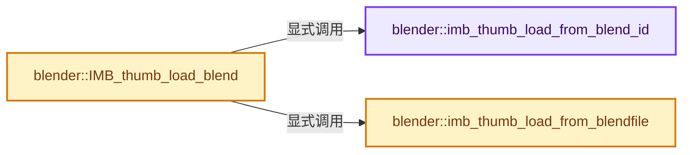
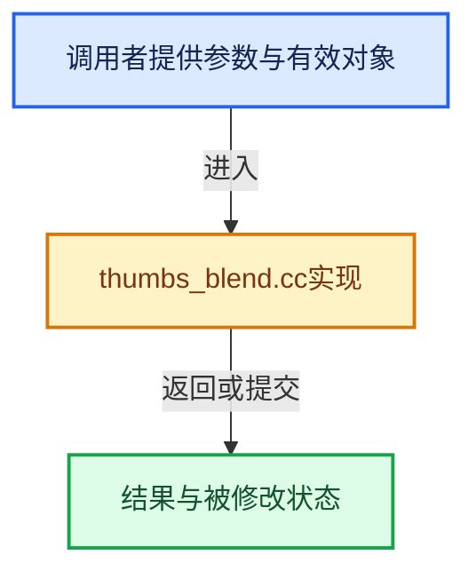

# 实现依赖专题：source/blender/imbuf/intern/thumbs_blend.cc

[实现依赖导航](../../../README.md) · [符号索引](../../../../00-课程指南/02-源码与提交索引/符号依赖与实现索引.md)

本专题从正文实际调用进入，集中保存共享实现。函数有稳定锚点，可从调用处直接跳到对应完整函数；递归与互相调用通过回链组织。

## 本文件的实现关系






## 完整成员与函数实现

<a id="f-c73bb3728df761bc"></a>

### `blender::imb_thumb_load_from_blend_id`

实现位置：[source/blender/imbuf/intern/thumbs_blend.cc](../../../../../../../../source/blender/imbuf/intern/thumbs_blend.cc) · L28—L50。

接口参数：

- `const char *blen_path`
- `const char *blen_group`
- `const char *blen_id`

**教学注释版**

<!-- annotated:e6665a2ae8bfe7 -->

```cpp
static ImBuf *imb_thumb_load_from_blend_id(const char *blen_path,
                                           const char *blen_group,
                                           const char *blen_id)
{
  ImBuf *ima = nullptr;
  BlendFileReadReport bf_reports = {};
  bf_reports.reports = nullptr;

  BlendHandle *libfiledata = BLO_blendhandle_from_file(blen_path, &bf_reports);
  if (libfiledata == nullptr) {
    return nullptr;
  }

  int idcode = BKE_idtype_idcode_from_name(blen_group);
  PreviewImage *preview = BLO_blendhandle_get_preview_for_id(libfiledata, idcode, blen_id);
  BLO_blendhandle_close(libfiledata);

  if (preview) {
    ima = BKE_previewimg_to_imbuf(preview, ICON_SIZE_PREVIEW);
    BKE_previewimg_free(&preview);
  }
  return ima;
}
```

<details>
<summary>核对原始源码：source/blender/imbuf/intern/thumbs_blend.cc · L28—L50</summary>

<!-- original:e6665a2ae8bfe7:source/blender/imbuf/intern/thumbs_blend.cc:28:50 -->

```cpp
static ImBuf *imb_thumb_load_from_blend_id(const char *blen_path,
                                           const char *blen_group,
                                           const char *blen_id)
{
  ImBuf *ima = nullptr;
  BlendFileReadReport bf_reports = {};
  bf_reports.reports = nullptr;

  BlendHandle *libfiledata = BLO_blendhandle_from_file(blen_path, &bf_reports);
  if (libfiledata == nullptr) {
    return nullptr;
  }

  int idcode = BKE_idtype_idcode_from_name(blen_group);
  PreviewImage *preview = BLO_blendhandle_get_preview_for_id(libfiledata, idcode, blen_id);
  BLO_blendhandle_close(libfiledata);

  if (preview) {
    ima = BKE_previewimg_to_imbuf(preview, ICON_SIZE_PREVIEW);
    BKE_previewimg_free(&preview);
  }
  return ima;
}
```

</details>

**沿实际写入检查状态**

- `bf_reports.reports = nullptr;`
- `ima = BKE_previewimg_to_imbuf(preview, ICON_SIZE_PREVIEW);`

**结果出口**

- `return nullptr;`
- `return ima;`

**继续追踪实现**

- `BLO_blendhandle_from_file` → [blender::BLO_blendhandle_from_file · L61](../../blenloader/intern/readblenentry.cc.md#f-829b88c9d3187dde)。
- `BKE_idtype_idcode_from_name` → [blender::BKE_idtype_idcode_from_name · L282](../../../02-BKE几何与数据/intern/idtype.cc.md#f-d24bc65992c49d98)。
- `BLO_blendhandle_get_preview_for_id` → [blender::BLO_blendhandle_get_preview_for_id · L273](../../blenloader/intern/readblenentry.cc.md#f-45f38e7678117279)。
- `BLO_blendhandle_close` → [blender::BLO_blendhandle_close · L339](../../blenloader/intern/readblenentry.cc.md#f-033840da4970db23)。
- `BKE_previewimg_to_imbuf` → [blender::BKE_previewimg_to_imbuf · L477](../../../02-BKE几何与数据/intern/preview_image.cc.md#f-26704433d845b626)。
- `BKE_previewimg_free` → [blender::BKE_previewimg_free · L133](../../../02-BKE几何与数据/intern/preview_image.cc.md#f-195b2b3fa13fc292)。

<a id="f-b99978e6915dc77a"></a>

### `blender::imb_thumb_load_from_blendfile`

实现位置：[source/blender/imbuf/intern/thumbs_blend.cc](../../../../../../../../source/blender/imbuf/intern/thumbs_blend.cc) · L52—L61。

接口参数：

- `const char *blen_path`

**教学注释版**

<!-- annotated:5f1eb3aeb29c86 -->

```cpp
static ImBuf *imb_thumb_load_from_blendfile(const char *blen_path)
{
  BlendThumbnail *data = BLO_thumbnail_from_file(blen_path);
  ImBuf *ima = BKE_main_thumbnail_to_imbuf(nullptr, data);

  if (data) {
    MEM_delete(data);
  }
  return ima;
}
```

<details>
<summary>核对原始源码：source/blender/imbuf/intern/thumbs_blend.cc · L52—L61</summary>

<!-- original:5f1eb3aeb29c86:source/blender/imbuf/intern/thumbs_blend.cc:52:61 -->

```cpp
static ImBuf *imb_thumb_load_from_blendfile(const char *blen_path)
{
  BlendThumbnail *data = BLO_thumbnail_from_file(blen_path);
  ImBuf *ima = BKE_main_thumbnail_to_imbuf(nullptr, data);

  if (data) {
    MEM_delete(data);
  }
  return ima;
}
```

</details>

**结果出口**

- `return ima;`

**继续追踪实现**

- `BLO_thumbnail_from_file` → [BLO_thumbnail_from_file · L1436](../../blenloader/intern/readfile.cc.md#f-f5990ae4922a1776)。
- `BKE_main_thumbnail_to_imbuf` → [blender::BKE_main_thumbnail_to_imbuf · L1029](../../../02-BKE几何与数据/intern/main.cc.md#f-2082d097c6c1e5c0)。
- `MEM_delete` → [MEM_delete · L400](../../../07-Intern运行时与平台/guardedalloc/MEM_guardedalloc.h.md#f-9049ffdd1682887c)。

<a id="f-2ddeadf4e830bf6a"></a>

### `blender::IMB_thumb_load_blend`

实现位置：[source/blender/imbuf/intern/thumbs_blend.cc](../../../../../../../../source/blender/imbuf/intern/thumbs_blend.cc) · L63—L69。

接口参数：

- `const char *blen_path`
- `const char *blen_group`
- `const char *blen_id`

**教学注释版**

<!-- annotated:a97bb05e00f3b1 -->

```cpp
ImBuf *IMB_thumb_load_blend(const char *blen_path, const char *blen_group, const char *blen_id)
{
  if (blen_group && blen_id) {
    return imb_thumb_load_from_blend_id(blen_path, blen_group, blen_id);
  }
  return imb_thumb_load_from_blendfile(blen_path);
}
```

<details>
<summary>核对原始源码：source/blender/imbuf/intern/thumbs_blend.cc · L63—L69</summary>

<!-- original:a97bb05e00f3b1:source/blender/imbuf/intern/thumbs_blend.cc:63:69 -->

```cpp
ImBuf *IMB_thumb_load_blend(const char *blen_path, const char *blen_group, const char *blen_id)
{
  if (blen_group && blen_id) {
    return imb_thumb_load_from_blend_id(blen_path, blen_group, blen_id);
  }
  return imb_thumb_load_from_blendfile(blen_path);
}
```

</details>

**结果出口**

- `return imb_thumb_load_from_blend_id(blen_path, blen_group, blen_id);`
- `return imb_thumb_load_from_blendfile(blen_path);`

**继续追踪实现**

- `imb_thumb_load_from_blend_id` → [blender::imb_thumb_load_from_blend_id · L28](thumbs_blend.cc.md#f-c73bb3728df761bc)。
- `imb_thumb_load_from_blendfile` → [blender::imb_thumb_load_from_blendfile · L52](thumbs_blend.cc.md#f-b99978e6915dc77a)。
