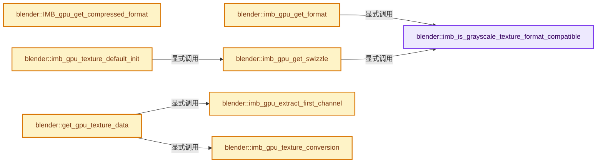
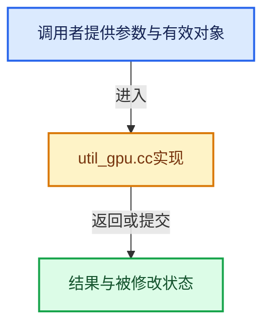

# 实现依赖专题：source/blender/imbuf/intern/util_gpu.cc

[实现依赖导航](../../../README.md) · [符号索引](../../../../00-课程指南/02-源码与提交索引/符号依赖与实现索引.md)

本专题从正文实际调用进入，集中保存共享实现。函数有稳定锚点，可从调用处直接跳到对应完整函数；递归与互相调用通过回链组织。

## 本文件的实现关系






## 完整成员与函数实现

<a id="f-a9e1d2e7d49ddbcf"></a>

### `blender::imb_is_grayscale_texture_format_compatible`

实现位置：[source/blender/imbuf/intern/util_gpu.cc](../../../../../../../../source/blender/imbuf/intern/util_gpu.cc) · L40—L69。

接口参数：

- `const ImBuf *ibuf`

**教学注释版**

<!-- annotated:fb4d11e0b75e6c -->

```cpp
static bool imb_is_grayscale_texture_format_compatible(const ImBuf *ibuf)
{
  if (ibuf->color_mode != ImColorMode::BW) {
    return false;
  }

  if (ibuf->byte_data() && !ibuf->float_data()) {

    if (IMB_colormanagement_space_is_scene_linear_srgb(ibuf->byte_buffer.colorspace) ||
        IMB_colormanagement_space_is_scene_linear(ibuf->byte_buffer.colorspace))
    {
      /* Grey-scale byte buffers with these color transforms utilize float buffers under the hood
       * and can therefore be optimized. */
      return true;
    }
    /* TODO: Support gray-scale byte buffers.
     * The challenge is that Blender always stores byte images as RGBA. */
    return false;
  }

  /* Only #IMBuf's with color-space that do not modify the chrominance of the texture data relative
   * to the scene color space can be uploaded as single channel textures. */
  if (IMB_colormanagement_space_is_data(ibuf->float_buffer.colorspace) ||
      IMB_colormanagement_space_is_scene_linear_srgb(ibuf->float_buffer.colorspace) ||
      IMB_colormanagement_space_is_scene_linear(ibuf->float_buffer.colorspace))
  {
    return true;
  }
  return false;
}
```

<details>
<summary>核对原始源码：source/blender/imbuf/intern/util_gpu.cc · L40—L69</summary>

<!-- original:fb4d11e0b75e6c:source/blender/imbuf/intern/util_gpu.cc:40:69 -->

```cpp
static bool imb_is_grayscale_texture_format_compatible(const ImBuf *ibuf)
{
  if (ibuf->color_mode != ImColorMode::BW) {
    return false;
  }

  if (ibuf->byte_data() && !ibuf->float_data()) {

    if (IMB_colormanagement_space_is_scene_linear_srgb(ibuf->byte_buffer.colorspace) ||
        IMB_colormanagement_space_is_scene_linear(ibuf->byte_buffer.colorspace))
    {
      /* Grey-scale byte buffers with these color transforms utilize float buffers under the hood
       * and can therefore be optimized. */
      return true;
    }
    /* TODO: Support gray-scale byte buffers.
     * The challenge is that Blender always stores byte images as RGBA. */
    return false;
  }

  /* Only #IMBuf's with color-space that do not modify the chrominance of the texture data relative
   * to the scene color space can be uploaded as single channel textures. */
  if (IMB_colormanagement_space_is_data(ibuf->float_buffer.colorspace) ||
      IMB_colormanagement_space_is_scene_linear_srgb(ibuf->float_buffer.colorspace) ||
      IMB_colormanagement_space_is_scene_linear(ibuf->float_buffer.colorspace))
  {
    return true;
  }
  return false;
}
```

</details>

**结果出口**

- `return false;`
- `return true;`

**继续追踪实现**

- `ibuf->byte_data` → [blender::ImBuf::byte_data · L353](../IMB_imbuf_types.hh.md#f-2cdfc552156643fa)。
- `ibuf->float_data` → [blender::ImBuf::float_data · L358](../IMB_imbuf_types.hh.md#f-2e52aa77544ffaee)。
- `IMB_colormanagement_space_is_scene_linear_srgb` → [blender::IMB_colormanagement_space_is_scene_linear_srgb · L1343](colormanagement.cc.md#f-6b106b73199e6986)。
- `IMB_colormanagement_space_is_scene_linear` → [blender::IMB_colormanagement_space_is_scene_linear · L1333](colormanagement.cc.md#f-363e8d1117e4dab8)。
- `IMB_colormanagement_space_is_data` → [blender::IMB_colormanagement_space_is_data · L1328](colormanagement.cc.md#f-25b377cc8f03ab18)。

<a id="f-893aece6303ba9f3"></a>

### `blender::imb_gpu_get_format`

实现位置：[source/blender/imbuf/intern/util_gpu.cc](../../../../../../../../source/blender/imbuf/intern/util_gpu.cc) · L71—L107。

接口参数：

- `const ImBuf *ibuf`
- `bool high_bitdepth`
- `bool use_grayscale`
- `gpu::TextureFormat *r_texture_format`

**教学注释版**

<!-- annotated:50b07804c01ed7 -->

```cpp
static void imb_gpu_get_format(const ImBuf *ibuf,
                               bool high_bitdepth,
                               bool use_grayscale,
                               gpu::TextureFormat *r_texture_format)
{
  const bool float_rect = (ibuf->float_data() != nullptr);
  const bool is_grayscale = use_grayscale && imb_is_grayscale_texture_format_compatible(ibuf);

  if (float_rect) {
    /* Float. */
    const bool use_high_bitdepth = (!(ibuf->foptions.flag & OPENEXR_HALF) && high_bitdepth);
    *r_texture_format = is_grayscale ?
                            (use_high_bitdepth ? gpu::TextureFormat::SFLOAT_32 :
                                                 gpu::TextureFormat::SFLOAT_16) :
                            (use_high_bitdepth ? gpu::TextureFormat::SFLOAT_32_32_32_32 :
                                                 gpu::TextureFormat::SFLOAT_16_16_16_16);
  }
  else {
    if (IMB_colormanagement_space_is_data(ibuf->byte_buffer.colorspace) ||
        IMB_colormanagement_space_is_scene_linear(ibuf->byte_buffer.colorspace))
    {
      /* Non-color data or scene linear, just store buffer as is. */
      *r_texture_format = (is_grayscale) ? gpu::TextureFormat::UNORM_8 :
                                           gpu::TextureFormat::UNORM_8_8_8_8;
    }
    else if (IMB_colormanagement_space_is_scene_linear_srgb(ibuf->byte_buffer.colorspace)) {
      /* scene linear + sRGB, store as byte texture that the GPU can decode directly. */
      *r_texture_format = (is_grayscale) ? gpu::TextureFormat::SFLOAT_16 :
                                           gpu::TextureFormat::SRGBA_8_8_8_8;
    }
    else {
      /* Other colorspace, store as half float texture to avoid precision loss. */
      *r_texture_format = (is_grayscale) ? gpu::TextureFormat::SFLOAT_16 :
                                           gpu::TextureFormat::SFLOAT_16_16_16_16;
    }
  }
}
```

<details>
<summary>核对原始源码：source/blender/imbuf/intern/util_gpu.cc · L71—L107</summary>

<!-- original:50b07804c01ed7:source/blender/imbuf/intern/util_gpu.cc:71:107 -->

```cpp
static void imb_gpu_get_format(const ImBuf *ibuf,
                               bool high_bitdepth,
                               bool use_grayscale,
                               gpu::TextureFormat *r_texture_format)
{
  const bool float_rect = (ibuf->float_data() != nullptr);
  const bool is_grayscale = use_grayscale && imb_is_grayscale_texture_format_compatible(ibuf);

  if (float_rect) {
    /* Float. */
    const bool use_high_bitdepth = (!(ibuf->foptions.flag & OPENEXR_HALF) && high_bitdepth);
    *r_texture_format = is_grayscale ?
                            (use_high_bitdepth ? gpu::TextureFormat::SFLOAT_32 :
                                                 gpu::TextureFormat::SFLOAT_16) :
                            (use_high_bitdepth ? gpu::TextureFormat::SFLOAT_32_32_32_32 :
                                                 gpu::TextureFormat::SFLOAT_16_16_16_16);
  }
  else {
    if (IMB_colormanagement_space_is_data(ibuf->byte_buffer.colorspace) ||
        IMB_colormanagement_space_is_scene_linear(ibuf->byte_buffer.colorspace))
    {
      /* Non-color data or scene linear, just store buffer as is. */
      *r_texture_format = (is_grayscale) ? gpu::TextureFormat::UNORM_8 :
                                           gpu::TextureFormat::UNORM_8_8_8_8;
    }
    else if (IMB_colormanagement_space_is_scene_linear_srgb(ibuf->byte_buffer.colorspace)) {
      /* scene linear + sRGB, store as byte texture that the GPU can decode directly. */
      *r_texture_format = (is_grayscale) ? gpu::TextureFormat::SFLOAT_16 :
                                           gpu::TextureFormat::SRGBA_8_8_8_8;
    }
    else {
      /* Other colorspace, store as half float texture to avoid precision loss. */
      *r_texture_format = (is_grayscale) ? gpu::TextureFormat::SFLOAT_16 :
                                           gpu::TextureFormat::SFLOAT_16_16_16_16;
    }
  }
}
```

</details>

**继续追踪实现**

- `ibuf->float_data` → [blender::ImBuf::float_data · L358](../IMB_imbuf_types.hh.md#f-2e52aa77544ffaee)。
- `imb_is_grayscale_texture_format_compatible` → [blender::imb_is_grayscale_texture_format_compatible · L40](util_gpu.cc.md#f-a9e1d2e7d49ddbcf)。
- `IMB_colormanagement_space_is_data` → [blender::IMB_colormanagement_space_is_data · L1328](colormanagement.cc.md#f-25b377cc8f03ab18)。
- `IMB_colormanagement_space_is_scene_linear` → [blender::IMB_colormanagement_space_is_scene_linear · L1333](colormanagement.cc.md#f-363e8d1117e4dab8)。
- `IMB_colormanagement_space_is_scene_linear_srgb` → [blender::IMB_colormanagement_space_is_scene_linear_srgb · L1343](colormanagement.cc.md#f-6b106b73199e6986)。

<a id="f-f04e3b3e06fc021f"></a>

### `blender::imb_gpu_get_swizzle`

实现位置：[source/blender/imbuf/intern/util_gpu.cc](../../../../../../../../source/blender/imbuf/intern/util_gpu.cc) · L109—L112。

接口参数：

- `const ImBuf *ibuf`

**教学注释版**

<!-- annotated:5ad131ff15e840 -->

```cpp
static const char *imb_gpu_get_swizzle(const ImBuf *ibuf)
{
  return imb_is_grayscale_texture_format_compatible(ibuf) ? "rrra" : "rgba";
}
```

<details>
<summary>核对原始源码：source/blender/imbuf/intern/util_gpu.cc · L109—L112</summary>

<!-- original:5ad131ff15e840:source/blender/imbuf/intern/util_gpu.cc:109:112 -->

```cpp
static const char *imb_gpu_get_swizzle(const ImBuf *ibuf)
{
  return imb_is_grayscale_texture_format_compatible(ibuf) ? "rrra" : "rgba";
}
```

</details>

**结果出口**

- `return imb_is_grayscale_texture_format_compatible(ibuf) ? "rrra" : "rgba";`

**继续追踪实现**

- `imb_is_grayscale_texture_format_compatible` → [blender::imb_is_grayscale_texture_format_compatible · L40](util_gpu.cc.md#f-a9e1d2e7d49ddbcf)。

<a id="f-570c5adc63f6b44a"></a>

### `blender::IMB_gpu_get_compressed_format`

实现位置：[source/blender/imbuf/intern/util_gpu.cc](../../../../../../../../source/blender/imbuf/intern/util_gpu.cc) · L115—L137。

接口参数：

- `const ImBuf *ibuf`
- `gpu::TextureFormat *r_texture_format`

**教学注释版**

<!-- annotated:1a1ca4136d681d -->

```cpp
bool IMB_gpu_get_compressed_format(const ImBuf *ibuf, gpu::TextureFormat *r_texture_format)
{
  if (ibuf->ftype != IMB_FTYPE_DDS) {
    return false;
  }

  /* Compressed DDS files can really only express sRGB or data/linear. */
  const bool use_srgb = (!IMB_colormanagement_space_is_data(ibuf->byte_buffer.colorspace) &&
                         !IMB_colormanagement_space_is_scene_linear(ibuf->byte_buffer.colorspace));
  if (ibuf->foptions.flag & DDS_COMPRESSED_DXT1) {
    *r_texture_format = use_srgb ? gpu::TextureFormat::SRGB_DXT1 : gpu::TextureFormat::SNORM_DXT1;
    return true;
  }
  if (ibuf->foptions.flag & DDS_COMPRESSED_DXT3) {
    *r_texture_format = use_srgb ? gpu::TextureFormat::SRGB_DXT3 : gpu::TextureFormat::SNORM_DXT3;
    return true;
  }
  if (ibuf->foptions.flag & DDS_COMPRESSED_DXT5) {
    *r_texture_format = use_srgb ? gpu::TextureFormat::SRGB_DXT5 : gpu::TextureFormat::SNORM_DXT5;
    return true;
  }
  return false;
}
```

<details>
<summary>核对原始源码：source/blender/imbuf/intern/util_gpu.cc · L115—L137</summary>

<!-- original:1a1ca4136d681d:source/blender/imbuf/intern/util_gpu.cc:115:137 -->

```cpp
bool IMB_gpu_get_compressed_format(const ImBuf *ibuf, gpu::TextureFormat *r_texture_format)
{
  if (ibuf->ftype != IMB_FTYPE_DDS) {
    return false;
  }

  /* Compressed DDS files can really only express sRGB or data/linear. */
  const bool use_srgb = (!IMB_colormanagement_space_is_data(ibuf->byte_buffer.colorspace) &&
                         !IMB_colormanagement_space_is_scene_linear(ibuf->byte_buffer.colorspace));
  if (ibuf->foptions.flag & DDS_COMPRESSED_DXT1) {
    *r_texture_format = use_srgb ? gpu::TextureFormat::SRGB_DXT1 : gpu::TextureFormat::SNORM_DXT1;
    return true;
  }
  if (ibuf->foptions.flag & DDS_COMPRESSED_DXT3) {
    *r_texture_format = use_srgb ? gpu::TextureFormat::SRGB_DXT3 : gpu::TextureFormat::SNORM_DXT3;
    return true;
  }
  if (ibuf->foptions.flag & DDS_COMPRESSED_DXT5) {
    *r_texture_format = use_srgb ? gpu::TextureFormat::SRGB_DXT5 : gpu::TextureFormat::SNORM_DXT5;
    return true;
  }
  return false;
}
```

</details>

**结果出口**

- `return false;`
- `return true;`

**继续追踪实现**

- `IMB_colormanagement_space_is_data` → [blender::IMB_colormanagement_space_is_data · L1328](colormanagement.cc.md#f-25b377cc8f03ab18)。
- `IMB_colormanagement_space_is_scene_linear` → [blender::IMB_colormanagement_space_is_scene_linear · L1333](colormanagement.cc.md#f-363e8d1117e4dab8)。

<a id="f-1063b3f191b38fb0"></a>

### `blender::imb_gpu_extract_first_channel`

实现位置：[source/blender/imbuf/intern/util_gpu.cc](../../../../../../../../source/blender/imbuf/intern/util_gpu.cc) · L140—L149。

接口参数：

- `const T *src`
- `const int channels`
- `const int stride`
- `const int w`
- `const int h`
- `T *r_gray`

**教学注释版**

<!-- annotated:717712f4a9a716 -->

```cpp
template<typename T>
static void imb_gpu_extract_first_channel(
    const T *src, const int channels, const int stride, const int w, const int h, T *r_gray)
{
  for (int row = 0; row < h; row++) {
    for (int col = 0; col < w; col++) {
      r_gray[size_t(row) * w + col] = src[(size_t(row) * stride + col) * channels];
    }
  }
}
```

<details>
<summary>核对原始源码：source/blender/imbuf/intern/util_gpu.cc · L140—L149</summary>

<!-- original:717712f4a9a716:source/blender/imbuf/intern/util_gpu.cc:140:149 -->

```cpp
template<typename T>
static void imb_gpu_extract_first_channel(
    const T *src, const int channels, const int stride, const int w, const int h, T *r_gray)
{
  for (int row = 0; row < h; row++) {
    for (int col = 0; col < w; col++) {
      r_gray[size_t(row) * w + col] = src[(size_t(row) * stride + col) * channels];
    }
  }
}
```

</details>

**继续追踪实现**

本实现没有需要继续展开的显式调用；检查返回表达式、对象转换和调用者前置条件。

<a id="f-f0d6ee2dd07de7a2"></a>

### `blender::imb_gpu_texture_conversion`

实现位置：[source/blender/imbuf/intern/util_gpu.cc](../../../../../../../../source/blender/imbuf/intern/util_gpu.cc) · L154—L199。

接口参数：

- `const ImBuf *ibuf`
- `const bool is_grayscale`
- `const bool store_premultiplied`

**教学注释版**

<!-- annotated:97ac6bb950a6e0 -->

```cpp
static GPUTextureConversion imb_gpu_texture_conversion(const ImBuf *ibuf,
                                                       const bool is_grayscale,
                                                       const bool store_premultiplied)
{
  if (ibuf->float_data()) {
    /* Float images are already in scene linear color space or contain non-color data with
     * premultiplied alpha by convention, so no color space conversion is needed. But we need to
     * convert to RGBA and unpremultiply alpha if needed. */
    return (ibuf->channels != 4 || !store_premultiplied) ? GPUTextureConversion::Float :
                                                           GPUTextureConversion::None;
  }

  /* Byte images are in original color space from the file with straight alpha, so we need to
   * convert to scene linear color space and premultiply alpha if needed. An exception is images
   * in sRGB color space, see the relevant case below for more information.  */
  const ColorSpace *colorspace = ibuf->byte_buffer.colorspace;
  if (IMB_colormanagement_space_is_data(colorspace)) {
    /* Non-color data, used as is. */
    return GPUTextureConversion::None;
  }
  if (IMB_colormanagement_space_is_scene_linear(colorspace)) {
    /* Color space is already linear, we just need to premultiply the alpha if needed. */
    const bool premultiply = !is_grayscale && store_premultiplied && IMB_alpha_affects_rgb(ibuf);
    return premultiply ? GPUTextureConversion::Byte : GPUTextureConversion::None;
  }
  if (IMB_colormanagement_space_is_scene_linear_srgb(colorspace)) {
    /* Images in scene linear + sRGB color space are a special case since they can be stored in
     * sRGB textures on GPU, where scene linear space conversion will happen during sampling in
     * the shader, however, this is not possible for grayscale images, so we need to do the
     * conversion here, converting to a float image to prevent precision loss.
     *
     * It should be noted that for other color spaces, color space conversion happen before alpha
     * premultiplication, while for sRGB, premultiplication will happen first since color space
     * conversion happen in the shader as mentioned above. This will manifest as differences near
     * alpha edges. But we generally accept this due to the advantages of sRGB textures. If this
     * is problematic, the source image buffer should be linearised first. */
    if (is_grayscale) {
      return GPUTextureConversion::Float;
    }
    const bool premultiply = store_premultiplied && IMB_alpha_affects_rgb(ibuf);
    return premultiply ? GPUTextureConversion::Byte : GPUTextureConversion::None;
  }
  /* Other color-space, convert to linear color space and premultiply alpha if needed.
   * Conversion happen as a float to avoid precision loss. */
  return GPUTextureConversion::Float;
}
```

<details>
<summary>核对原始源码：source/blender/imbuf/intern/util_gpu.cc · L154—L199</summary>

<!-- original:97ac6bb950a6e0:source/blender/imbuf/intern/util_gpu.cc:154:199 -->

```cpp
static GPUTextureConversion imb_gpu_texture_conversion(const ImBuf *ibuf,
                                                       const bool is_grayscale,
                                                       const bool store_premultiplied)
{
  if (ibuf->float_data()) {
    /* Float images are already in scene linear color space or contain non-color data with
     * premultiplied alpha by convention, so no color space conversion is needed. But we need to
     * convert to RGBA and unpremultiply alpha if needed. */
    return (ibuf->channels != 4 || !store_premultiplied) ? GPUTextureConversion::Float :
                                                           GPUTextureConversion::None;
  }

  /* Byte images are in original color space from the file with straight alpha, so we need to
   * convert to scene linear color space and premultiply alpha if needed. An exception is images
   * in sRGB color space, see the relevant case below for more information.  */
  const ColorSpace *colorspace = ibuf->byte_buffer.colorspace;
  if (IMB_colormanagement_space_is_data(colorspace)) {
    /* Non-color data, used as is. */
    return GPUTextureConversion::None;
  }
  if (IMB_colormanagement_space_is_scene_linear(colorspace)) {
    /* Color space is already linear, we just need to premultiply the alpha if needed. */
    const bool premultiply = !is_grayscale && store_premultiplied && IMB_alpha_affects_rgb(ibuf);
    return premultiply ? GPUTextureConversion::Byte : GPUTextureConversion::None;
  }
  if (IMB_colormanagement_space_is_scene_linear_srgb(colorspace)) {
    /* Images in scene linear + sRGB color space are a special case since they can be stored in
     * sRGB textures on GPU, where scene linear space conversion will happen during sampling in
     * the shader, however, this is not possible for grayscale images, so we need to do the
     * conversion here, converting to a float image to prevent precision loss.
     *
     * It should be noted that for other color spaces, color space conversion happen before alpha
     * premultiplication, while for sRGB, premultiplication will happen first since color space
     * conversion happen in the shader as mentioned above. This will manifest as differences near
     * alpha edges. But we generally accept this due to the advantages of sRGB textures. If this
     * is problematic, the source image buffer should be linearised first. */
    if (is_grayscale) {
      return GPUTextureConversion::Float;
    }
    const bool premultiply = store_premultiplied && IMB_alpha_affects_rgb(ibuf);
    return premultiply ? GPUTextureConversion::Byte : GPUTextureConversion::None;
  }
  /* Other color-space, convert to linear color space and premultiply alpha if needed.
   * Conversion happen as a float to avoid precision loss. */
  return GPUTextureConversion::Float;
}
```

</details>

**结果出口**

- `return (ibuf->channels != 4 || !store_premultiplied) ? GPUTextureConversion::Float :`
- `return GPUTextureConversion::None;`
- `return premultiply ? GPUTextureConversion::Byte : GPUTextureConversion::None;`
- `return GPUTextureConversion::Float;`

**继续追踪实现**

- `ibuf->float_data` → [blender::ImBuf::float_data · L358](../IMB_imbuf_types.hh.md#f-2e52aa77544ffaee)。
- `IMB_colormanagement_space_is_data` → [blender::IMB_colormanagement_space_is_data · L1328](colormanagement.cc.md#f-25b377cc8f03ab18)。
- `IMB_colormanagement_space_is_scene_linear` → [blender::IMB_colormanagement_space_is_scene_linear · L1333](colormanagement.cc.md#f-363e8d1117e4dab8)。
- `IMB_alpha_affects_rgb` → [blender::IMB_alpha_affects_rgb · L45](conversion.cc.md#f-00ee0dd9db7e6963)。
- `IMB_colormanagement_space_is_scene_linear_srgb` → [blender::IMB_colormanagement_space_is_scene_linear_srgb · L1343](colormanagement.cc.md#f-6b106b73199e6986)。

<a id="f-e1df30d1dbaf5c6e"></a>

### `blender::get_gpu_texture_data`

实现位置：[source/blender/imbuf/intern/util_gpu.cc](../../../../../../../../source/blender/imbuf/intern/util_gpu.cc) · L225—L378。

接口参数：

- `ImBuf *source_buffer`
- `const int2 src_offset`
- `const int2 src_size`
- `const std::optional<int2> scaled_size`
- `const bool premultiplied_alpha`
- `const bool is_grayscale`
- `GPUTextureUpload &r_upload`

**教学注释版**

<!-- annotated:a55f8b77ccd471 -->

```cpp
static void get_gpu_texture_data(ImBuf *source_buffer,
                                 const int2 src_offset,
                                 const int2 src_size,
                                 const std::optional<int2> scaled_size,
                                 const bool premultiplied_alpha,
                                 const bool is_grayscale,
                                 GPUTextureUpload &r_upload)
{
  const GPUTextureConversion conversion = imb_gpu_texture_conversion(
      source_buffer, is_grayscale, premultiplied_alpha);

  int channels;

  if (conversion == GPUTextureConversion::Byte) {
    /* Convert to byte buffer. */
    r_upload.tmp_ibuf = IMB_allocImBuf(
        src_size.x, src_size.y, ImBufFlags::ByteData | ImBufFlags::UninitializedPixels);
    if (r_upload.tmp_ibuf == nullptr) {
      return;
    }
    IMB_colormanagement_imbuf_to_byte_texture(r_upload.tmp_ibuf->byte_data_for_write(),
                                              src_offset.x,
                                              src_offset.y,
                                              src_size.x,
                                              src_size.y,
                                              source_buffer,
                                              premultiplied_alpha);
    r_upload.data = r_upload.tmp_ibuf->byte_data();
    r_upload.format = GPU_DATA_UBYTE;
    r_upload.stride = src_size.x;
    channels = 4;
  }
  else if (conversion == GPUTextureConversion::Float) {
    /* Convert to float buffer. */
    r_upload.tmp_ibuf = IMB_allocImBuf(
        src_size.x, src_size.y, ImBufFlags::FloatData | ImBufFlags::UninitializedPixels);
    if (r_upload.tmp_ibuf == nullptr) {
      return;
    }
    IMB_colormanagement_imbuf_to_float_texture(r_upload.tmp_ibuf->float_data_for_write(),
                                               src_offset.x,
                                               src_offset.y,
                                               src_size.x,
                                               src_size.y,
                                               source_buffer,
                                               premultiplied_alpha);
    r_upload.data = r_upload.tmp_ibuf->float_data();
    r_upload.format = GPU_DATA_FLOAT;
    r_upload.stride = src_size.x;
    channels = 4;
  }
  else {
    /* No conversion needed, point directly into the source buffer. */
    channels = source_buffer->float_data() ? source_buffer->channels : 4;
    const int64_t offset = int64_t(channels) *
                           (int64_t(src_offset.y) * source_buffer->x + src_offset.x);
    if (source_buffer->float_data()) {
      r_upload.data = source_buffer->float_data() + offset;
      r_upload.format = GPU_DATA_FLOAT;
    }
    else {
      r_upload.data = source_buffer->byte_data() + offset;
      r_upload.format = GPU_DATA_UBYTE;
    }
    r_upload.stride = source_buffer->x;
  }

  int2 size = src_size;

  /* Rescale. */
  if (scaled_size.has_value()) {
    const bool is_float = (r_upload.format == GPU_DATA_FLOAT);
    ImBuf *buffer = IMB_allocImBuf(scaled_size->x,
                                   scaled_size->y,
                                   (is_float ? ImBufFlags::FloatData : ImBufFlags::ByteData) |
                                       ImBufFlags::UninitializedPixels);

    if (buffer == nullptr) {
      r_upload.data = nullptr;
      return;
    }

    /* Avoid excessive overhead with small updates. */
    const bool threaded = int64_t(size.x) * size.y >= 512 * 512;

    if (is_float) {
      IMB_scale_box(static_cast<const float *>(r_upload.data),
                    size,
                    channels,
                    buffer->float_data_for_write(),
                    *scaled_size,
                    threaded,
                    r_upload.stride);
    }
    else {
      IMB_scale_box(static_cast<const uchar *>(r_upload.data),
                    size,
                    channels,
                    buffer->byte_data_for_write(),
                    *scaled_size,
                    threaded,
                    r_upload.stride);
    }
    if (r_upload.tmp_ibuf) {
      IMB_freeImBuf(r_upload.tmp_ibuf);
    }
    r_upload.tmp_ibuf = buffer;
    r_upload.data = is_float ? static_cast<const void *>(buffer->float_data()) :
                               static_cast<const void *>(buffer->byte_data());
    r_upload.stride = scaled_size->x;
    size = *scaled_size;
  }

  /* Convert to grayscale. */
  if (is_grayscale) {
    ImBuf *buffer = IMB_allocImBuf(size.x, size.y, ImBufFlags::Zero);

    if (buffer == nullptr) {
      r_upload.data = nullptr;
      return;
    }

    if (r_upload.format == GPU_DATA_FLOAT) {
      IMB_alloc_float_pixels(buffer, 1);
      imb_gpu_extract_first_channel(static_cast<const float *>(r_upload.data),
                                    channels,
                                    r_upload.stride,
                                    size.x,
                                    size.y,
                                    buffer->float_data_for_write());
    }
    else {
      buffer->color_mode = ImColorMode::BW;
      buffer->assign_byte_data(
          MEM_new_array_uninitialized<uint8_t>(size_t(size.x) * size.y, __func__));
      imb_gpu_extract_first_channel(static_cast<const uchar *>(r_upload.data),
                                    channels,
                                    r_upload.stride,
                                    size.x,
                                    size.y,
                                    buffer->byte_data_for_write());
    }
    if (r_upload.tmp_ibuf) {
      IMB_freeImBuf(r_upload.tmp_ibuf);
    }
    r_upload.tmp_ibuf = buffer;
    r_upload.data = (r_upload.format == GPU_DATA_FLOAT) ?
                        static_cast<const void *>(buffer->float_data()) :
                        static_cast<const void *>(buffer->byte_data());
    r_upload.stride = size.x;
  }

  r_upload.size = size;
}
```

<details>
<summary>核对原始源码：source/blender/imbuf/intern/util_gpu.cc · L225—L378</summary>

<!-- original:a55f8b77ccd471:source/blender/imbuf/intern/util_gpu.cc:225:378 -->

```cpp
static void get_gpu_texture_data(ImBuf *source_buffer,
                                 const int2 src_offset,
                                 const int2 src_size,
                                 const std::optional<int2> scaled_size,
                                 const bool premultiplied_alpha,
                                 const bool is_grayscale,
                                 GPUTextureUpload &r_upload)
{
  const GPUTextureConversion conversion = imb_gpu_texture_conversion(
      source_buffer, is_grayscale, premultiplied_alpha);

  int channels;

  if (conversion == GPUTextureConversion::Byte) {
    /* Convert to byte buffer. */
    r_upload.tmp_ibuf = IMB_allocImBuf(
        src_size.x, src_size.y, ImBufFlags::ByteData | ImBufFlags::UninitializedPixels);
    if (r_upload.tmp_ibuf == nullptr) {
      return;
    }
    IMB_colormanagement_imbuf_to_byte_texture(r_upload.tmp_ibuf->byte_data_for_write(),
                                              src_offset.x,
                                              src_offset.y,
                                              src_size.x,
                                              src_size.y,
                                              source_buffer,
                                              premultiplied_alpha);
    r_upload.data = r_upload.tmp_ibuf->byte_data();
    r_upload.format = GPU_DATA_UBYTE;
    r_upload.stride = src_size.x;
    channels = 4;
  }
  else if (conversion == GPUTextureConversion::Float) {
    /* Convert to float buffer. */
    r_upload.tmp_ibuf = IMB_allocImBuf(
        src_size.x, src_size.y, ImBufFlags::FloatData | ImBufFlags::UninitializedPixels);
    if (r_upload.tmp_ibuf == nullptr) {
      return;
    }
    IMB_colormanagement_imbuf_to_float_texture(r_upload.tmp_ibuf->float_data_for_write(),
                                               src_offset.x,
                                               src_offset.y,
                                               src_size.x,
                                               src_size.y,
                                               source_buffer,
                                               premultiplied_alpha);
    r_upload.data = r_upload.tmp_ibuf->float_data();
    r_upload.format = GPU_DATA_FLOAT;
    r_upload.stride = src_size.x;
    channels = 4;
  }
  else {
    /* No conversion needed, point directly into the source buffer. */
    channels = source_buffer->float_data() ? source_buffer->channels : 4;
    const int64_t offset = int64_t(channels) *
                           (int64_t(src_offset.y) * source_buffer->x + src_offset.x);
    if (source_buffer->float_data()) {
      r_upload.data = source_buffer->float_data() + offset;
      r_upload.format = GPU_DATA_FLOAT;
    }
    else {
      r_upload.data = source_buffer->byte_data() + offset;
      r_upload.format = GPU_DATA_UBYTE;
    }
    r_upload.stride = source_buffer->x;
  }

  int2 size = src_size;

  /* Rescale. */
  if (scaled_size.has_value()) {
    const bool is_float = (r_upload.format == GPU_DATA_FLOAT);
    ImBuf *buffer = IMB_allocImBuf(scaled_size->x,
                                   scaled_size->y,
                                   (is_float ? ImBufFlags::FloatData : ImBufFlags::ByteData) |
                                       ImBufFlags::UninitializedPixels);

    if (buffer == nullptr) {
      r_upload.data = nullptr;
      return;
    }

    /* Avoid excessive overhead with small updates. */
    const bool threaded = int64_t(size.x) * size.y >= 512 * 512;

    if (is_float) {
      IMB_scale_box(static_cast<const float *>(r_upload.data),
                    size,
                    channels,
                    buffer->float_data_for_write(),
                    *scaled_size,
                    threaded,
                    r_upload.stride);
    }
    else {
      IMB_scale_box(static_cast<const uchar *>(r_upload.data),
                    size,
                    channels,
                    buffer->byte_data_for_write(),
                    *scaled_size,
                    threaded,
                    r_upload.stride);
    }
    if (r_upload.tmp_ibuf) {
      IMB_freeImBuf(r_upload.tmp_ibuf);
    }
    r_upload.tmp_ibuf = buffer;
    r_upload.data = is_float ? static_cast<const void *>(buffer->float_data()) :
                               static_cast<const void *>(buffer->byte_data());
    r_upload.stride = scaled_size->x;
    size = *scaled_size;
  }

  /* Convert to grayscale. */
  if (is_grayscale) {
    ImBuf *buffer = IMB_allocImBuf(size.x, size.y, ImBufFlags::Zero);

    if (buffer == nullptr) {
      r_upload.data = nullptr;
      return;
    }

    if (r_upload.format == GPU_DATA_FLOAT) {
      IMB_alloc_float_pixels(buffer, 1);
      imb_gpu_extract_first_channel(static_cast<const float *>(r_upload.data),
                                    channels,
                                    r_upload.stride,
                                    size.x,
                                    size.y,
                                    buffer->float_data_for_write());
    }
    else {
      buffer->color_mode = ImColorMode::BW;
      buffer->assign_byte_data(
          MEM_new_array_uninitialized<uint8_t>(size_t(size.x) * size.y, __func__));
      imb_gpu_extract_first_channel(static_cast<const uchar *>(r_upload.data),
                                    channels,
                                    r_upload.stride,
                                    size.x,
                                    size.y,
                                    buffer->byte_data_for_write());
    }
    if (r_upload.tmp_ibuf) {
      IMB_freeImBuf(r_upload.tmp_ibuf);
    }
    r_upload.tmp_ibuf = buffer;
    r_upload.data = (r_upload.format == GPU_DATA_FLOAT) ?
                        static_cast<const void *>(buffer->float_data()) :
                        static_cast<const void *>(buffer->byte_data());
    r_upload.stride = size.x;
  }

  r_upload.size = size;
}
```

</details>

**沿实际写入检查状态**

- `r_upload.tmp_ibuf = IMB_allocImBuf(`
- `r_upload.data = r_upload.tmp_ibuf->byte_data();`
- `r_upload.format = GPU_DATA_UBYTE;`
- `r_upload.stride = src_size.x;`
- `channels = 4;`
- `r_upload.data = r_upload.tmp_ibuf->float_data();`
- `r_upload.format = GPU_DATA_FLOAT;`
- `channels = source_buffer->float_data() ? source_buffer->channels : 4;`
- `r_upload.data = source_buffer->float_data() + offset;`
- `r_upload.data = source_buffer->byte_data() + offset;`
- `r_upload.stride = source_buffer->x;`
- `r_upload.data = nullptr;`
- `r_upload.tmp_ibuf = buffer;`
- `r_upload.data = is_float ? static_cast<const void *>(buffer->float_data()) :`
- `r_upload.stride = scaled_size->x;`
- `size = *scaled_size;`
- `buffer->color_mode = ImColorMode::BW;`
- `r_upload.data = (r_upload.format == GPU_DATA_FLOAT) ?`
- `r_upload.stride = size.x;`
- `r_upload.size = size;`

**继续追踪实现**

- `imb_gpu_texture_conversion` → [blender::imb_gpu_texture_conversion · L154](util_gpu.cc.md#f-f0d6ee2dd07de7a2)。
- `IMB_allocImBuf` → [blender::IMB_allocImBuf · L367](allocimbuf.cc.md#f-971d0005c46aad53)。
- `IMB_colormanagement_imbuf_to_byte_texture` → [blender::IMB_colormanagement_imbuf_to_byte_texture · L2476](colormanagement.cc.md#f-691c2a51be9f2099)。
- `r_upload.tmp_ibuf->byte_data_for_write` → [调用协议](../../../../00-课程指南/01-路线与规范/模板宏与动态分派协议.md)：接收对象类型依赖auto、返回值或模板实例；不按同名猜测目标。调用位置L245。
- `r_upload.tmp_ibuf->byte_data` → [调用协议](../../../../00-课程指南/01-路线与规范/模板宏与动态分派协议.md)：接收对象类型依赖auto、返回值或模板实例；不按同名猜测目标。调用位置L252。
- `IMB_colormanagement_imbuf_to_float_texture` → [blender::IMB_colormanagement_imbuf_to_float_texture · L2522](colormanagement.cc.md#f-aa01b46d79f9d9bc)。
- `r_upload.tmp_ibuf->float_data_for_write` → [调用协议](../../../../00-课程指南/01-路线与规范/模板宏与动态分派协议.md)：接收对象类型依赖auto、返回值或模板实例；不按同名猜测目标。调用位置L264。
- `r_upload.tmp_ibuf->float_data` → [调用协议](../../../../00-课程指南/01-路线与规范/模板宏与动态分派协议.md)：接收对象类型依赖auto、返回值或模板实例；不按同名猜测目标。调用位置L271。
- `source_buffer->float_data` → [blender::ImBuf::float_data · L358](../IMB_imbuf_types.hh.md#f-2e52aa77544ffaee)。
- `source_buffer->byte_data` → [blender::ImBuf::byte_data · L353](../IMB_imbuf_types.hh.md#f-2cdfc552156643fa)。
- `scaled_size.has_value` → [外部契约](https://eel.is/c++draft/)：这个边界按实际表达式及所属类型核对参数、返回值、寿命与失败行为。这里提供接口入口，不声称已解释该第三方版本的内部实现。
- `IMB_scale_box` → [blender::IMB_scale_box · L351](scaling.cc.md#f-7b5d37a123f61215)；[blender::IMB_scale_box · L362](scaling.cc.md#f-ddddaa997eef7d69)。同名重载需按实参类型选择。
- `buffer->float_data_for_write` → [blender::ImBuf::float_data_for_write · L79](allocimbuf.cc.md#f-1956ac4db88ed3eb)。
- `buffer->byte_data_for_write` → [blender::ImBuf::byte_data_for_write · L60](allocimbuf.cc.md#f-9ae201bd1c52aa87)。
- `IMB_freeImBuf` → [blender::IMB_freeImBuf · L144](allocimbuf.cc.md#f-c830f56ede6f345b)。
- `buffer->float_data` → [blender::ImBuf::float_data · L358](../IMB_imbuf_types.hh.md#f-2e52aa77544ffaee)。
- `buffer->byte_data` → [blender::ImBuf::byte_data · L353](../IMB_imbuf_types.hh.md#f-2cdfc552156643fa)。
- `IMB_alloc_float_pixels` → [blender::IMB_alloc_float_pixels · L200](allocimbuf.cc.md#f-ffd386ee67c57b36)。
- `imb_gpu_extract_first_channel` → [blender::imb_gpu_extract_first_channel · L140](util_gpu.cc.md#f-1063b3f191b38fb0)。
- `buffer->assign_byte_data` → [blender::ImBuf::assign_byte_data · L238](allocimbuf.cc.md#f-a823c2f5cced8911)；[blender::ImBuf::assign_byte_data · L266](allocimbuf.cc.md#f-9c4495abf72f01a5)。同名重载需按实参类型选择。
- `MEM_new_array_uninitialized<uint8_t>` → [MEM_new_array_uninitialized · L608](../../../07-Intern运行时与平台/guardedalloc/MEM_guardedalloc.h.md#f-b7103eae8eb57b05)；[MEM_new_array_uninitialized · L129](../../../07-Intern运行时与平台/guardedalloc/intern/mallocn.cc.md#f-bf6ef4ddcfb6e5df)。同名重载需按实参类型选择。

<a id="f-ea59203a3e60ec0e"></a>

### `blender::imb_gpu_texture_default_init`

实现位置：[source/blender/imbuf/intern/util_gpu.cc](../../../../../../../../source/blender/imbuf/intern/util_gpu.cc) · L380—L384。

接口参数：

- `gpu::Texture *tex`
- `const ImBuf *ibuf`

**教学注释版**

<!-- annotated:8a921c711534fb -->

```cpp
static void imb_gpu_texture_default_init(gpu::Texture *tex, const ImBuf *ibuf)
{
  GPU_texture_swizzle_set(tex, imb_gpu_get_swizzle(ibuf));
  GPU_texture_anisotropic_filter(tex, true);
}
```

<details>
<summary>核对原始源码：source/blender/imbuf/intern/util_gpu.cc · L380—L384</summary>

<!-- original:8a921c711534fb:source/blender/imbuf/intern/util_gpu.cc:380:384 -->

```cpp
static void imb_gpu_texture_default_init(gpu::Texture *tex, const ImBuf *ibuf)
{
  GPU_texture_swizzle_set(tex, imb_gpu_get_swizzle(ibuf));
  GPU_texture_anisotropic_filter(tex, true);
}
```

</details>

**继续追踪实现**

- `GPU_texture_swizzle_set` → [blender::GPU_texture_swizzle_set · L730](../../gpu/intern/gpu_texture.cc.md#f-26ec36521469d5ba)。
- `imb_gpu_get_swizzle` → [blender::imb_gpu_get_swizzle · L109](util_gpu.cc.md#f-f04e3b3e06fc021f)。
- `GPU_texture_anisotropic_filter` → [blender::GPU_texture_anisotropic_filter · L702](../../gpu/intern/gpu_texture.cc.md#f-3d594236493db899)。

<a id="f-5abcb3c3b144770e"></a>

### `blender::imb_gpu_texture_default_init_mipmap`

实现位置：[source/blender/imbuf/intern/util_gpu.cc](../../../../../../../../source/blender/imbuf/intern/util_gpu.cc) · L386—L390。

接口参数：

- `gpu::Texture *tex`

**教学注释版**

<!-- annotated:4b1f50bc403fc6 -->

```cpp
static void imb_gpu_texture_default_init_mipmap(gpu::Texture *tex)
{
  GPU_texture_extend_mode(tex, GPU_SAMPLER_EXTEND_MODE_REPEAT);
  GPU_texture_mipmap_mode(tex, true, true);
}
```

<details>
<summary>核对原始源码：source/blender/imbuf/intern/util_gpu.cc · L386—L390</summary>

<!-- original:4b1f50bc403fc6:source/blender/imbuf/intern/util_gpu.cc:386:390 -->

```cpp
static void imb_gpu_texture_default_init_mipmap(gpu::Texture *tex)
{
  GPU_texture_extend_mode(tex, GPU_SAMPLER_EXTEND_MODE_REPEAT);
  GPU_texture_mipmap_mode(tex, true, true);
}
```

</details>

**继续追踪实现**

- `GPU_texture_extend_mode` → [blender::GPU_texture_extend_mode · L724](../../gpu/intern/gpu_texture.cc.md#f-1ef72047fd6052e5)。
- `GPU_texture_mipmap_mode` → [blender::GPU_texture_mipmap_mode · L692](../../gpu/intern/gpu_texture.cc.md#f-8170dabb7d89f6dd)。

<a id="f-794a3c7209d3cc07"></a>

### `blender::imb_gpu_texture_default_init_array`

实现位置：[source/blender/imbuf/intern/util_gpu.cc](../../../../../../../../source/blender/imbuf/intern/util_gpu.cc) · L392—L400。

接口参数：

- `gpu::Texture *tex`

**教学注释版**

<!-- annotated:a3621e703914a3 -->

```cpp
static void imb_gpu_texture_default_init_array(gpu::Texture *tex)
{
  const char *swizzle = (GPU_texture_component_len(GPU_texture_format(tex)) == 1) ? "rrra" :
                                                                                    "rgba";
  GPU_texture_swizzle_set(tex, swizzle);
  GPU_texture_anisotropic_filter(tex, true);
  GPU_texture_extend_mode(tex, GPU_SAMPLER_EXTEND_MODE_CLAMP_TO_BORDER);
  GPU_texture_mipmap_mode(tex, true, true);
}
```

<details>
<summary>核对原始源码：source/blender/imbuf/intern/util_gpu.cc · L392—L400</summary>

<!-- original:a3621e703914a3:source/blender/imbuf/intern/util_gpu.cc:392:400 -->

```cpp
static void imb_gpu_texture_default_init_array(gpu::Texture *tex)
{
  const char *swizzle = (GPU_texture_component_len(GPU_texture_format(tex)) == 1) ? "rrra" :
                                                                                    "rgba";
  GPU_texture_swizzle_set(tex, swizzle);
  GPU_texture_anisotropic_filter(tex, true);
  GPU_texture_extend_mode(tex, GPU_SAMPLER_EXTEND_MODE_CLAMP_TO_BORDER);
  GPU_texture_mipmap_mode(tex, true, true);
}
```

</details>

**继续追踪实现**

- `GPU_texture_component_len` → [blender::GPU_texture_component_len · L1083](../../gpu/intern/gpu_texture.cc.md#f-493e34213ba69f98)。
- `GPU_texture_format` → [blender::GPU_texture_format · L814](../../gpu/intern/gpu_texture.cc.md#f-842c3f6555a1c248)。
- `GPU_texture_swizzle_set` → [blender::GPU_texture_swizzle_set · L730](../../gpu/intern/gpu_texture.cc.md#f-26ec36521469d5ba)。
- `GPU_texture_anisotropic_filter` → [blender::GPU_texture_anisotropic_filter · L702](../../gpu/intern/gpu_texture.cc.md#f-3d594236493db899)。
- `GPU_texture_extend_mode` → [blender::GPU_texture_extend_mode · L724](../../gpu/intern/gpu_texture.cc.md#f-1ef72047fd6052e5)。
- `GPU_texture_mipmap_mode` → [blender::GPU_texture_mipmap_mode · L692](../../gpu/intern/gpu_texture.cc.md#f-8170dabb7d89f6dd)。

<a id="f-9eae6038c9a4edbb"></a>

### `blender::IMB_touch_gpu_texture`

实现位置：[source/blender/imbuf/intern/util_gpu.cc](../../../../../../../../source/blender/imbuf/intern/util_gpu.cc) · L402—L426。

接口参数：

- `const char *name`
- `ImBuf *ibuf`
- `int w`
- `int h`
- `int layers`
- `bool use_high_bitdepth`
- `bool use_grayscale`

**教学注释版**

<!-- annotated:af2de710b10a99 -->

```cpp
gpu::Texture *IMB_touch_gpu_texture(const char *name,
                                    ImBuf *ibuf,
                                    int w,
                                    int h,
                                    int layers,
                                    bool use_high_bitdepth,
                                    bool use_grayscale)
{
  gpu::TextureFormat tex_format;
  imb_gpu_get_format(ibuf, use_high_bitdepth, use_grayscale, &tex_format);

  const eGPUTextureUsage usage = GPU_TEXTURE_USAGE_SHADER_READ |
                                 GPU_texture_mipmap_usage(tex_format);

  gpu::Texture *tex;
  if (layers > 0) {
    tex = GPU_texture_create_2d_array(name, w, h, layers, 9999, tex_format, usage, nullptr);
    imb_gpu_texture_default_init_array(tex);
  }
  else {
    tex = GPU_texture_create_2d(name, w, h, 9999, tex_format, usage, nullptr);
    imb_gpu_texture_default_init(tex, ibuf);
  }
  return tex;
}
```

<details>
<summary>核对原始源码：source/blender/imbuf/intern/util_gpu.cc · L402—L426</summary>

<!-- original:af2de710b10a99:source/blender/imbuf/intern/util_gpu.cc:402:426 -->

```cpp
gpu::Texture *IMB_touch_gpu_texture(const char *name,
                                    ImBuf *ibuf,
                                    int w,
                                    int h,
                                    int layers,
                                    bool use_high_bitdepth,
                                    bool use_grayscale)
{
  gpu::TextureFormat tex_format;
  imb_gpu_get_format(ibuf, use_high_bitdepth, use_grayscale, &tex_format);

  const eGPUTextureUsage usage = GPU_TEXTURE_USAGE_SHADER_READ |
                                 GPU_texture_mipmap_usage(tex_format);

  gpu::Texture *tex;
  if (layers > 0) {
    tex = GPU_texture_create_2d_array(name, w, h, layers, 9999, tex_format, usage, nullptr);
    imb_gpu_texture_default_init_array(tex);
  }
  else {
    tex = GPU_texture_create_2d(name, w, h, 9999, tex_format, usage, nullptr);
    imb_gpu_texture_default_init(tex, ibuf);
  }
  return tex;
}
```

</details>

**沿实际写入检查状态**

- `tex = GPU_texture_create_2d_array(name, w, h, layers, 9999, tex_format, usage, nullptr);`
- `tex = GPU_texture_create_2d(name, w, h, 9999, tex_format, usage, nullptr);`

**结果出口**

- `return tex;`

**继续追踪实现**

- `imb_gpu_get_format` → [blender::imb_gpu_get_format · L71](util_gpu.cc.md#f-893aece6303ba9f3)。
- `GPU_texture_mipmap_usage` → [blender::GPU_texture_mipmap_usage · L312](../../gpu/intern/gpu_texture_mipmap.cc.md#f-cb07a5fe02450835)。
- `GPU_texture_create_2d_array` → [blender::GPU_texture_create_2d_array · L319](../../gpu/intern/gpu_texture.cc.md#f-c56ab2472a370c27)。
- `imb_gpu_texture_default_init_array` → [blender::imb_gpu_texture_default_init_array · L392](util_gpu.cc.md#f-794a3c7209d3cc07)。
- `GPU_texture_create_2d` → [blender::GPU_texture_create_2d · L308](../../gpu/intern/gpu_texture.cc.md#f-5aa2a42234aebbda)。
- `imb_gpu_texture_default_init` → [blender::imb_gpu_texture_default_init · L380](util_gpu.cc.md#f-ea59203a3e60ec0e)。

<a id="f-da7b1dc4c325cde0"></a>

### `blender::IMB_update_gpu_texture_sub`

实现位置：[source/blender/imbuf/intern/util_gpu.cc](../../../../../../../../source/blender/imbuf/intern/util_gpu.cc) · L428—L450。

接口参数：

- `gpu::Texture *tex`
- `ImBuf *ibuf`
- `int x`
- `int y`
- `int z`
- `int w`
- `int h`
- `bool use_grayscale`
- `bool use_premult`

**教学注释版**

<!-- annotated:4345ee538691a9 -->

```cpp
void IMB_update_gpu_texture_sub(gpu::Texture *tex,
                                ImBuf *ibuf,
                                int x,
                                int y,
                                int z,
                                int w,
                                int h,
                                bool use_grayscale,
                                bool use_premult)
{
  const std::optional<int2> scaled_size = (ibuf->x != w || ibuf->y != h) ?
                                              std::optional<int2>(int2(w, h)) :
                                              std::nullopt;
  const bool is_grayscale = use_grayscale && imb_is_grayscale_texture_format_compatible(ibuf);
  GPUTextureUpload upload;
  get_gpu_texture_data(
      ibuf, int2(0), int2(ibuf->x, ibuf->y), scaled_size, use_premult, is_grayscale, upload);

  if (upload.data) {
    GPU_texture_update_sub(
        tex, upload.format, upload.data, x, y, z, upload.size.x, upload.size.y, 1, upload.stride);
  }
}
```

<details>
<summary>核对原始源码：source/blender/imbuf/intern/util_gpu.cc · L428—L450</summary>

<!-- original:4345ee538691a9:source/blender/imbuf/intern/util_gpu.cc:428:450 -->

```cpp
void IMB_update_gpu_texture_sub(gpu::Texture *tex,
                                ImBuf *ibuf,
                                int x,
                                int y,
                                int z,
                                int w,
                                int h,
                                bool use_grayscale,
                                bool use_premult)
{
  const std::optional<int2> scaled_size = (ibuf->x != w || ibuf->y != h) ?
                                              std::optional<int2>(int2(w, h)) :
                                              std::nullopt;
  const bool is_grayscale = use_grayscale && imb_is_grayscale_texture_format_compatible(ibuf);
  GPUTextureUpload upload;
  get_gpu_texture_data(
      ibuf, int2(0), int2(ibuf->x, ibuf->y), scaled_size, use_premult, is_grayscale, upload);

  if (upload.data) {
    GPU_texture_update_sub(
        tex, upload.format, upload.data, x, y, z, upload.size.x, upload.size.y, 1, upload.stride);
  }
}
```

</details>

**继续追踪实现**

- `std::optional<int2>` → [外部契约](https://eel.is/c++draft/)：这个边界按实际表达式及所属类型核对参数、返回值、寿命与失败行为。这里提供接口入口，不声称已解释该第三方版本的内部实现。
- `int2` → [int2 · L643](../../compositor/algorithms/intern/smaa.cc.md#m-8960c8e6139d)。宏定义由构建条件选择。
- `imb_is_grayscale_texture_format_compatible` → [blender::imb_is_grayscale_texture_format_compatible · L40](util_gpu.cc.md#f-a9e1d2e7d49ddbcf)。
- `get_gpu_texture_data` → [blender::get_gpu_texture_data · L225](util_gpu.cc.md#f-e1df30d1dbaf5c6e)。
- `GPU_texture_update_sub` → [blender::GPU_texture_update_sub · L507](../../gpu/intern/gpu_texture.cc.md#f-2c901e7b4602b08e)。

<a id="f-21bcad36ac31f79e"></a>

### `blender::IMB_create_gpu_texture`

实现位置：[source/blender/imbuf/intern/util_gpu.cc](../../../../../../../../source/blender/imbuf/intern/util_gpu.cc) · L452—L567。

接口参数：

- `const char *name`
- `ImBuf *ibuf`
- `const GPUTextureCreateFlags flags`

**教学注释版**

<!-- annotated:72173e875aceb9 -->

```cpp
gpu::Texture *IMB_create_gpu_texture(const char *name,
                                     ImBuf *ibuf,
                                     const GPUTextureCreateFlags flags)
{
  ibuf->gpu.lastused = BLI_time_now_seconds_i();

  const bool use_mipmap = flag_is_set(flags, GPUTextureCreateFlags::EnableMipmaps);

  gpu::Texture *tex = nullptr;
  int size[2] = {ibuf->x, ibuf->y};
  if (flag_is_set(flags, GPUTextureCreateFlags::LimitSize)) {
    size[0] = GPU_texture_size_with_limit(ibuf->x);
    size[1] = GPU_texture_size_with_limit(ibuf->y);
  }
  bool do_rescale = (ibuf->x != size[0]) || (ibuf->y != size[1]);

  /* Correct the smaller size to maintain the original aspect ratio of the image. */
  if (do_rescale && ibuf->x != ibuf->y) {
    if (ibuf->x > ibuf->y) {
      size[1] = math::max(1, int(ibuf->y * (float(size[0]) / ibuf->x)));
    }
    else {
      size[0] = math::max(1, int(ibuf->x * (float(size[1]) / ibuf->y)));
    }
  }

  /* Compressed textures can't be written to, so upload uncompressed when modified. */
  if (ibuf->ftype == IMB_FTYPE_DDS && (ibuf->userflags & IB_BITMAPDIRTY) == 0) {
    gpu::TextureFormat compressed_format;
    if (!IMB_gpu_get_compressed_format(ibuf, &compressed_format)) {
      CLOG_WARN(&LOG,
                "DDS image '%s' is not in a supported GPU compression format",
                ibuf->filepath.c_str());
    }
    else if (do_rescale) {
      CLOG_WARN(
          &LOG, "DDS image '%s' can't use compressed due to size limit", ibuf->filepath.c_str());
    }
    else if (!is_power_of_2_i(ibuf->x) || !is_power_of_2_i(ibuf->y)) {
      /* We require POT DXT/S3TC texture sizes not because something in there
       * intrinsically needs it, but because we flip them upside down at
       * load time, and that (when mipmaps are involved) is only possible
       * with POT height. */
      CLOG_WARN(&LOG,
                "DDS image '%s' can't use compressed due to non power of two size",
                ibuf->filepath.c_str());
    }
    else {

      int mip_count = 0;
      uint8_t *compressed_data = imb_load_dds_compressed_data(
          ibuf->filepath.c_str(), ibuf->x, ibuf->y, mip_count);
      if (compressed_data != nullptr) {
        tex = GPU_texture_create_compressed_2d(name,
                                               ibuf->x,
                                               ibuf->y,
                                               use_mipmap ? mip_count : 1,
                                               compressed_format,
                                               GPU_TEXTURE_USAGE_GENERAL,
                                               compressed_data);
        MEM_delete(compressed_data);
        if (tex != nullptr) {
          return tex;
        }
        CLOG_WARN(&LOG,
                  "DDS image '%s' failed to create compressed GPU texture",
                  ibuf->filepath.c_str());
      }
      else {
        CLOG_WARN(&LOG, "DDS image '%s' failed to load data from file", ibuf->filepath.c_str());
      }
    }
    /* Fallback to uncompressed texture. */
    CLOG_WARN(&LOG, "DDS image '%s' falling back to uncompressed", ibuf->filepath.c_str());
  }

  gpu::TextureFormat tex_format;
  imb_gpu_get_format(
      ibuf, flag_is_set(flags, GPUTextureCreateFlags::HighBitDepth), true, &tex_format);

  /* Create Texture. Specify read usage to allow both shader and host reads, the latter is needed
   * by the GPU compositor. Mipmaps need additional usage flags. */
  eGPUTextureUsage usage = GPU_TEXTURE_USAGE_SHADER_READ | GPU_TEXTURE_USAGE_HOST_READ;
  if (use_mipmap) {
    usage |= GPU_texture_mipmap_usage(tex_format);
  }
  tex = GPU_texture_create_2d(
      name, UNPACK2(size), use_mipmap ? 9999 : 1, tex_format, usage, nullptr);
  if (tex == nullptr) {
    size[0] = max_ii(1, size[0] / 2);
    size[1] = max_ii(1, size[1] / 2);
    tex = GPU_texture_create_2d(
        name, UNPACK2(size), use_mipmap ? 9999 : 1, tex_format, usage, nullptr);
    do_rescale = true;
  }
  BLI_assert(tex != nullptr);
  const std::optional<int2> scaled_size = do_rescale ? std::optional<int2>(int2(size)) :
                                                       std::nullopt;
  const bool is_grayscale = imb_is_grayscale_texture_format_compatible(ibuf);
  GPUTextureUpload upload;
  get_gpu_texture_data(ibuf,
                       int2(0),
                       int2(ibuf->x, ibuf->y),
                       scaled_size,
                       flag_is_set(flags, GPUTextureCreateFlags::Premultiplied),
                       is_grayscale,
                       upload);

  if (upload.data) {
    GPU_texture_update(tex, upload.format, upload.data);
  }

  imb_gpu_texture_default_init(tex, ibuf);

  return tex;
}
```

<details>
<summary>核对原始源码：source/blender/imbuf/intern/util_gpu.cc · L452—L567</summary>

<!-- original:72173e875aceb9:source/blender/imbuf/intern/util_gpu.cc:452:567 -->

```cpp
gpu::Texture *IMB_create_gpu_texture(const char *name,
                                     ImBuf *ibuf,
                                     const GPUTextureCreateFlags flags)
{
  ibuf->gpu.lastused = BLI_time_now_seconds_i();

  const bool use_mipmap = flag_is_set(flags, GPUTextureCreateFlags::EnableMipmaps);

  gpu::Texture *tex = nullptr;
  int size[2] = {ibuf->x, ibuf->y};
  if (flag_is_set(flags, GPUTextureCreateFlags::LimitSize)) {
    size[0] = GPU_texture_size_with_limit(ibuf->x);
    size[1] = GPU_texture_size_with_limit(ibuf->y);
  }
  bool do_rescale = (ibuf->x != size[0]) || (ibuf->y != size[1]);

  /* Correct the smaller size to maintain the original aspect ratio of the image. */
  if (do_rescale && ibuf->x != ibuf->y) {
    if (ibuf->x > ibuf->y) {
      size[1] = math::max(1, int(ibuf->y * (float(size[0]) / ibuf->x)));
    }
    else {
      size[0] = math::max(1, int(ibuf->x * (float(size[1]) / ibuf->y)));
    }
  }

  /* Compressed textures can't be written to, so upload uncompressed when modified. */
  if (ibuf->ftype == IMB_FTYPE_DDS && (ibuf->userflags & IB_BITMAPDIRTY) == 0) {
    gpu::TextureFormat compressed_format;
    if (!IMB_gpu_get_compressed_format(ibuf, &compressed_format)) {
      CLOG_WARN(&LOG,
                "DDS image '%s' is not in a supported GPU compression format",
                ibuf->filepath.c_str());
    }
    else if (do_rescale) {
      CLOG_WARN(
          &LOG, "DDS image '%s' can't use compressed due to size limit", ibuf->filepath.c_str());
    }
    else if (!is_power_of_2_i(ibuf->x) || !is_power_of_2_i(ibuf->y)) {
      /* We require POT DXT/S3TC texture sizes not because something in there
       * intrinsically needs it, but because we flip them upside down at
       * load time, and that (when mipmaps are involved) is only possible
       * with POT height. */
      CLOG_WARN(&LOG,
                "DDS image '%s' can't use compressed due to non power of two size",
                ibuf->filepath.c_str());
    }
    else {

      int mip_count = 0;
      uint8_t *compressed_data = imb_load_dds_compressed_data(
          ibuf->filepath.c_str(), ibuf->x, ibuf->y, mip_count);
      if (compressed_data != nullptr) {
        tex = GPU_texture_create_compressed_2d(name,
                                               ibuf->x,
                                               ibuf->y,
                                               use_mipmap ? mip_count : 1,
                                               compressed_format,
                                               GPU_TEXTURE_USAGE_GENERAL,
                                               compressed_data);
        MEM_delete(compressed_data);
        if (tex != nullptr) {
          return tex;
        }
        CLOG_WARN(&LOG,
                  "DDS image '%s' failed to create compressed GPU texture",
                  ibuf->filepath.c_str());
      }
      else {
        CLOG_WARN(&LOG, "DDS image '%s' failed to load data from file", ibuf->filepath.c_str());
      }
    }
    /* Fallback to uncompressed texture. */
    CLOG_WARN(&LOG, "DDS image '%s' falling back to uncompressed", ibuf->filepath.c_str());
  }

  gpu::TextureFormat tex_format;
  imb_gpu_get_format(
      ibuf, flag_is_set(flags, GPUTextureCreateFlags::HighBitDepth), true, &tex_format);

  /* Create Texture. Specify read usage to allow both shader and host reads, the latter is needed
   * by the GPU compositor. Mipmaps need additional usage flags. */
  eGPUTextureUsage usage = GPU_TEXTURE_USAGE_SHADER_READ | GPU_TEXTURE_USAGE_HOST_READ;
  if (use_mipmap) {
    usage |= GPU_texture_mipmap_usage(tex_format);
  }
  tex = GPU_texture_create_2d(
      name, UNPACK2(size), use_mipmap ? 9999 : 1, tex_format, usage, nullptr);
  if (tex == nullptr) {
    size[0] = max_ii(1, size[0] / 2);
    size[1] = max_ii(1, size[1] / 2);
    tex = GPU_texture_create_2d(
        name, UNPACK2(size), use_mipmap ? 9999 : 1, tex_format, usage, nullptr);
    do_rescale = true;
  }
  BLI_assert(tex != nullptr);
  const std::optional<int2> scaled_size = do_rescale ? std::optional<int2>(int2(size)) :
                                                       std::nullopt;
  const bool is_grayscale = imb_is_grayscale_texture_format_compatible(ibuf);
  GPUTextureUpload upload;
  get_gpu_texture_data(ibuf,
                       int2(0),
                       int2(ibuf->x, ibuf->y),
                       scaled_size,
                       flag_is_set(flags, GPUTextureCreateFlags::Premultiplied),
                       is_grayscale,
                       upload);

  if (upload.data) {
    GPU_texture_update(tex, upload.format, upload.data);
  }

  imb_gpu_texture_default_init(tex, ibuf);

  return tex;
}
```

</details>

**沿实际写入检查状态**

- `ibuf->gpu.lastused = BLI_time_now_seconds_i();`
- `size[0] = GPU_texture_size_with_limit(ibuf->x);`
- `size[1] = GPU_texture_size_with_limit(ibuf->y);`
- `size[1] = math::max(1, int(ibuf->y * (float(size[0]) / ibuf->x)));`
- `size[0] = math::max(1, int(ibuf->x * (float(size[1]) / ibuf->y)));`
- `tex = GPU_texture_create_compressed_2d(name,`
- `usage |= GPU_texture_mipmap_usage(tex_format);`
- `tex = GPU_texture_create_2d(`
- `size[0] = max_ii(1, size[0] / 2);`
- `size[1] = max_ii(1, size[1] / 2);`
- `do_rescale = true;`

**结果出口**

- `return tex;`

**继续追踪实现**

- `BLI_time_now_seconds_i` → [blender::BLI_time_now_seconds_i · L36](../../../01-BLI基础库/intern/time.cc.md#f-38db665188e3ded7)。
- `flag_is_set` → [调用协议](../../../../00-课程指南/01-路线与规范/模板宏与动态分派协议.md)：函数指针、局部可调用对象或未展开的宏；必须结合调用者环境。调用位置L458。
- `GPU_texture_size_with_limit` → [blender::GPU_texture_size_with_limit · L49](../../gpu/intern/gpu_capabilities.cc.md#f-646196408c861985)。
- `math::max` → [blender::math::max · L87](../../../01-BLI基础库/BLI_math_vector.hh.md#f-9be564a293777d6b)；[blender::math::max · L96](../../../01-BLI基础库/BLI_math_vector.hh.md#f-ce32dff37d0af3bc)；[blender::math::max · L112](../../../01-BLI基础库/BLI_math_vector.hh.md#f-668eb1fcf1fa8292)；[blender::math::max · L49](../../../01-BLI基础库/BLI_math_base.hh.md#f-a6991ca3d12937e1)。同名重载需按实参类型选择。
- `IMB_gpu_get_compressed_format` → [blender::IMB_gpu_get_compressed_format · L115](util_gpu.cc.md#f-570c5adc63f6b44a)。
- `CLOG_WARN` → [CLOG_WARN · L189](../../../07-Intern运行时与平台/clog/CLG_log.h.md#m-9da21a06cdbe)。宏定义由构建条件选择。
- `ibuf->filepath.c_str` → [调用协议](../../../../00-课程指南/01-路线与规范/模板宏与动态分派协议.md)：接收对象类型依赖auto、返回值或模板实例；不按同名猜测目标。调用位置L484。
- `is_power_of_2_i` → [blender::is_power_of_2_i · L105](../../../01-BLI基础库/intern/math_base_inline.cc.md#f-122f291f1e7250f2)。
- `imb_load_dds_compressed_data` → [blender::imb_load_dds_compressed_data · L315](format_dds.cc.md#f-f8b344d550326355)。
- `GPU_texture_create_compressed_2d` → [blender::GPU_texture_create_compressed_2d · L367](../../gpu/intern/gpu_texture.cc.md#f-3bb579d016d6f5be)。
- `MEM_delete` → [MEM_delete · L400](../../../07-Intern运行时与平台/guardedalloc/MEM_guardedalloc.h.md#f-9049ffdd1682887c)。
- `imb_gpu_get_format` → [blender::imb_gpu_get_format · L71](util_gpu.cc.md#f-893aece6303ba9f3)。
- `GPU_texture_mipmap_usage` → [blender::GPU_texture_mipmap_usage · L312](../../gpu/intern/gpu_texture_mipmap.cc.md#f-cb07a5fe02450835)。
- `GPU_texture_create_2d` → [blender::GPU_texture_create_2d · L308](../../gpu/intern/gpu_texture.cc.md#f-5aa2a42234aebbda)。
- `UNPACK2` → [UNPACK2 · L22](../../../07-Intern运行时与平台/ghost/intern/GHOST_utildefines.hh.md#m-00ad768fe1c1)；[UNPACK2 · L234](../../../01-BLI基础库/BLI_utildefines.hh.md#m-96ff8266d239)；[UNPACK2 · L13](../../gpu/shaders/common/gpu_shader_utildefines.bsl.hh.md#m-8316603fb9a6)。宏定义由构建条件选择。
- `max_ii` → [blender::max_ii · L368](../../../01-BLI基础库/intern/math_base_inline.cc.md#f-c45aa7b373adb94c)。
- `BLI_assert` → [BLI_assert · L48](../../../01-BLI基础库/BLI_assert.hh.md#m-57a88495704d)；[BLI_assert · L63](../../../01-BLI基础库/BLI_assert.hh.md#m-d07050020cb5)。宏定义由构建条件选择。
- `std::optional<int2>` → [外部契约](https://eel.is/c++draft/)：这个边界按实际表达式及所属类型核对参数、返回值、寿命与失败行为。这里提供接口入口，不声称已解释该第三方版本的内部实现。
- `int2` → [int2 · L643](../../compositor/algorithms/intern/smaa.cc.md#m-8960c8e6139d)。宏定义由构建条件选择。
- `imb_is_grayscale_texture_format_compatible` → [blender::imb_is_grayscale_texture_format_compatible · L40](util_gpu.cc.md#f-a9e1d2e7d49ddbcf)。
- `get_gpu_texture_data` → [blender::get_gpu_texture_data · L225](util_gpu.cc.md#f-e1df30d1dbaf5c6e)。
- `GPU_texture_update` → [blender::GPU_texture_update · L619](../../gpu/intern/gpu_texture.cc.md#f-4a6c14a1d8e5e73e)。
- `imb_gpu_texture_default_init` → [blender::imb_gpu_texture_default_init · L380](util_gpu.cc.md#f-ea59203a3e60ec0e)。

<a id="f-fdac3348d3965b84"></a>

### `blender::imb_gpu_mipmap_modified_chunks_size`

实现位置：[source/blender/imbuf/intern/util_gpu.cc](../../../../../../../../source/blender/imbuf/intern/util_gpu.cc) · L570—L574。

接口参数：

- `gpu::Texture *tex`

**教学注释版**

<!-- annotated:d180cb67a07b98 -->

```cpp
static int2 imb_gpu_mipmap_modified_chunks_size(gpu::Texture *tex)
{
  return int2(divide_ceil_u(GPU_texture_width(tex), GPU_TEXTURE_MIPMAP_UPDATE_CHUNK_SIZE),
              divide_ceil_u(GPU_texture_height(tex), GPU_TEXTURE_MIPMAP_UPDATE_CHUNK_SIZE));
}
```

<details>
<summary>核对原始源码：source/blender/imbuf/intern/util_gpu.cc · L570—L574</summary>

<!-- original:d180cb67a07b98:source/blender/imbuf/intern/util_gpu.cc:570:574 -->

```cpp
static int2 imb_gpu_mipmap_modified_chunks_size(gpu::Texture *tex)
{
  return int2(divide_ceil_u(GPU_texture_width(tex), GPU_TEXTURE_MIPMAP_UPDATE_CHUNK_SIZE),
              divide_ceil_u(GPU_texture_height(tex), GPU_TEXTURE_MIPMAP_UPDATE_CHUNK_SIZE));
}
```

</details>

**结果出口**

- `return int2(divide_ceil_u(GPU_texture_width(tex), GPU_TEXTURE_MIPMAP_UPDATE_CHUNK_SIZE),`

**继续追踪实现**

- `int2` → [int2 · L643](../../compositor/algorithms/intern/smaa.cc.md#m-8960c8e6139d)。宏定义由构建条件选择。
- `divide_ceil_u` → [blender::divide_ceil_u · L235](../../../01-BLI基础库/intern/math_base_inline.cc.md#f-9bfe95d830410fdd)。
- `GPU_texture_width` → [blender::GPU_texture_width · L773](../../gpu/intern/gpu_texture.cc.md#f-0f5cbfbefa217516)。
- `GPU_texture_height` → [blender::GPU_texture_height · L778](../../gpu/intern/gpu_texture.cc.md#f-aabd7afc7f83d281)。

<a id="f-1c13a0bf9614e2e1"></a>

### `blender::imb_gpu_mipmap_modified_chunks_mark`

实现位置：[source/blender/imbuf/intern/util_gpu.cc](../../../../../../../../source/blender/imbuf/intern/util_gpu.cc) · L577—L594。

接口参数：

- `MutableBitSpan modified_chunks`
- `const int2 size`
- `const rcti &bounds`

**教学注释版**

<!-- annotated:9b4864380120bd -->

```cpp
static void imb_gpu_mipmap_modified_chunks_mark(MutableBitSpan modified_chunks,
                                                const int2 size,
                                                const rcti &bounds)
{
  constexpr int chunk_size = GPU_TEXTURE_MIPMAP_UPDATE_CHUNK_SIZE;
  if (BLI_rcti_is_empty(&bounds)) {
    return;
  }
  // [讲解] std::max：按比较关系选取较大值。本讲解中的增长公式同时满足最低请求和几何增长；若保存返回引用，还需注意实参寿命。
  const int tx_begin = std::max(bounds.xmin, 0) / chunk_size;
  const int ty_begin = std::max(bounds.ymin, 0) / chunk_size;
  // [讲解] std::min：按比较关系选取较小值；截断范围时还需先满足非负和可表示范围，min本身不会证明边界安全。
  const int tx_end = std::min((bounds.xmax - 1) / chunk_size, size.x - 1);
  const int ty_end = std::min((bounds.ymax - 1) / chunk_size, size.y - 1);
  for (int ty = ty_begin; ty <= ty_end; ty++) {
    for (int tx = tx_begin; tx <= tx_end; tx++) {
      modified_chunks[int64_t(ty) * size.x + tx].set();
    }
  }
}
```

<details>
<summary>核对原始源码：source/blender/imbuf/intern/util_gpu.cc · L577—L594</summary>

<!-- original:9b4864380120bd:source/blender/imbuf/intern/util_gpu.cc:577:594 -->

```cpp
static void imb_gpu_mipmap_modified_chunks_mark(MutableBitSpan modified_chunks,
                                                const int2 size,
                                                const rcti &bounds)
{
  constexpr int chunk_size = GPU_TEXTURE_MIPMAP_UPDATE_CHUNK_SIZE;
  if (BLI_rcti_is_empty(&bounds)) {
    return;
  }
  const int tx_begin = std::max(bounds.xmin, 0) / chunk_size;
  const int ty_begin = std::max(bounds.ymin, 0) / chunk_size;
  const int tx_end = std::min((bounds.xmax - 1) / chunk_size, size.x - 1);
  const int ty_end = std::min((bounds.ymax - 1) / chunk_size, size.y - 1);
  for (int ty = ty_begin; ty <= ty_end; ty++) {
    for (int tx = tx_begin; tx <= tx_end; tx++) {
      modified_chunks[int64_t(ty) * size.x + tx].set();
    }
  }
}
```

</details>

**继续追踪实现**

- `BLI_rcti_is_empty` → [blender::BLI_rcti_is_empty · L29](../../../01-BLI基础库/intern/rct.cc.md#f-c3e23a3e0854d170)。
- `std::max` → [外部契约](https://eel.is/c++draft/alg.min.max)：按比较关系选取较大值。本讲解中的增长公式同时满足最低请求和几何增长；若保存返回引用，还需注意实参寿命。
- `std::min` → [外部契约](https://eel.is/c++draft/alg.min.max)：按比较关系选取较小值；截断范围时还需先满足非负和可表示范围，min本身不会证明边界安全。
- `modified_chunks[int64_t(ty) * size.x + tx].set` → [调用协议](../../../../00-课程指南/01-路线与规范/模板宏与动态分派协议.md)：接收对象类型依赖auto、返回值或模板实例；不按同名猜测目标。调用位置L591。

<a id="f-b0776f60c1d2230c"></a>

### `blender::imb_gpu_texture_update_offset_size`

实现位置：[source/blender/imbuf/intern/util_gpu.cc](../../../../../../../../source/blender/imbuf/intern/util_gpu.cc) · L597—L620。

接口参数：

- `int2 &offset`
- `const int2 size`
- `const int2 limit`
- `const int2 full`

**教学注释版**

<!-- annotated:aed275e8d740c7 -->

```cpp
static int2 imb_gpu_texture_update_offset_size(int2 &offset,
                                               const int2 size,
                                               const int2 limit,
                                               const int2 full)
{
  const float xratio = limit.x / float(full.x);
  const float yratio = limit.y / float(full.y);

  /* Find sub coordinates in scaled image. Take ceiling because we will be
   * losing 1 pixel due to rounding errors in x,y. */
  offset.x = int(offset.x * xratio);
  offset.y = int(offset.y * yratio);
  int2 scaled_size = int2(int(ceil(xratio * size.x)), int(ceil(yratio * size.y)));

  /* ...but take back if we are over the limit! */
  if (offset.x + scaled_size.x > limit.x) {
    scaled_size.x--;
  }
  if (offset.y + scaled_size.y > limit.y) {
    scaled_size.y--;
  }

  return scaled_size;
}
```

<details>
<summary>核对原始源码：source/blender/imbuf/intern/util_gpu.cc · L597—L620</summary>

<!-- original:aed275e8d740c7:source/blender/imbuf/intern/util_gpu.cc:597:620 -->

```cpp
static int2 imb_gpu_texture_update_offset_size(int2 &offset,
                                               const int2 size,
                                               const int2 limit,
                                               const int2 full)
{
  const float xratio = limit.x / float(full.x);
  const float yratio = limit.y / float(full.y);

  /* Find sub coordinates in scaled image. Take ceiling because we will be
   * losing 1 pixel due to rounding errors in x,y. */
  offset.x = int(offset.x * xratio);
  offset.y = int(offset.y * yratio);
  int2 scaled_size = int2(int(ceil(xratio * size.x)), int(ceil(yratio * size.y)));

  /* ...but take back if we are over the limit! */
  if (offset.x + scaled_size.x > limit.x) {
    scaled_size.x--;
  }
  if (offset.y + scaled_size.y > limit.y) {
    scaled_size.y--;
  }

  return scaled_size;
}
```

</details>

**沿实际写入检查状态**

- `offset.x = int(offset.x * xratio);`
- `offset.y = int(offset.y * yratio);`

**结果出口**

- `return scaled_size;`

**继续追踪实现**

- `int2` → [int2 · L643](../../compositor/algorithms/intern/smaa.cc.md#m-8960c8e6139d)。宏定义由构建条件选择。
- `ceil` → [外部契约](https://eel.is/c++draft/)：这个边界按实际表达式及所属类型核对参数、返回值、寿命与失败行为。这里提供接口入口，不声称已解释该第三方版本的内部实现。

<a id="f-cbaccf6c89c86179"></a>

### `blender::imb_gpu_texture_update_region`

实现位置：[source/blender/imbuf/intern/util_gpu.cc](../../../../../../../../source/blender/imbuf/intern/util_gpu.cc) · L622—L684。

接口参数：

- `gpu::Texture *tex`
- `ImBuf *ibuf`
- `const bool store_premultiplied`
- `int x`
- `int y`
- `int w`
- `int h`
- `const int layer`
- `const int2 tile_offset`
- `const int2 tile_size`
- `rcti &r_bounds`

**教学注释版**

<!-- annotated:b496fe2cc3347c -->

```cpp
static void imb_gpu_texture_update_region(gpu::Texture *tex,
                                          ImBuf *ibuf,
                                          const bool store_premultiplied,
                                          int x,
                                          int y,
                                          int w,
                                          int h,
                                          const int layer,
                                          const int2 tile_offset,
                                          const int2 tile_size,
                                          rcti &r_bounds)
{
  /* The texture may be smaller than the image when its size was limited. */
  const int limit_w = (layer >= 0) ? tile_size.x : GPU_texture_width(tex);
  const int limit_h = (layer >= 0) ? tile_size.y : GPU_texture_height(tex);
  const bool scaled = (ibuf->x != limit_w) || (ibuf->y != limit_h);

  if (scaled) {
    /* Extra padding to account for bleed from neighboring pixels. */
    const int padding = 4;
    const int xmax = min_ii(x + w + padding, ibuf->x);
    const int ymax = min_ii(y + h + padding, ibuf->y);
    x = max_ii(x - padding, 0);
    y = max_ii(y - padding, 0);
    w = xmax - x;
    h = ymax - y;
  }

  const bool use_grayscale = GPU_texture_component_len(GPU_texture_format(tex)) == 1;

  int2 offset = int2(x, y);
  std::optional<int2> scaled_size;
  if (scaled) {
    scaled_size = imb_gpu_texture_update_offset_size(
        offset, int2(w, h), int2(limit_w, limit_h), int2(ibuf->x, ibuf->y));
  }

  if (layer >= 0) {
    offset += tile_offset;
  }

  GPUTextureUpload upload;
  get_gpu_texture_data(
      ibuf, int2(x, y), int2(w, h), scaled_size, store_premultiplied, use_grayscale, upload);

  BLI_rcti_init_minmax(&r_bounds);

  if (upload.data) {
    GPU_texture_update_sub(tex,
                           upload.format,
                           upload.data,
                           offset.x,
                           offset.y,
                           math::max(layer, 0),
                           upload.size.x,
                           upload.size.y,
                           1,
                           upload.stride);

    BLI_rcti_init(
        &r_bounds, offset.x, offset.x + upload.size.x, offset.y, offset.y + upload.size.y);
  }
}
```

<details>
<summary>核对原始源码：source/blender/imbuf/intern/util_gpu.cc · L622—L684</summary>

<!-- original:b496fe2cc3347c:source/blender/imbuf/intern/util_gpu.cc:622:684 -->

```cpp
static void imb_gpu_texture_update_region(gpu::Texture *tex,
                                          ImBuf *ibuf,
                                          const bool store_premultiplied,
                                          int x,
                                          int y,
                                          int w,
                                          int h,
                                          const int layer,
                                          const int2 tile_offset,
                                          const int2 tile_size,
                                          rcti &r_bounds)
{
  /* The texture may be smaller than the image when its size was limited. */
  const int limit_w = (layer >= 0) ? tile_size.x : GPU_texture_width(tex);
  const int limit_h = (layer >= 0) ? tile_size.y : GPU_texture_height(tex);
  const bool scaled = (ibuf->x != limit_w) || (ibuf->y != limit_h);

  if (scaled) {
    /* Extra padding to account for bleed from neighboring pixels. */
    const int padding = 4;
    const int xmax = min_ii(x + w + padding, ibuf->x);
    const int ymax = min_ii(y + h + padding, ibuf->y);
    x = max_ii(x - padding, 0);
    y = max_ii(y - padding, 0);
    w = xmax - x;
    h = ymax - y;
  }

  const bool use_grayscale = GPU_texture_component_len(GPU_texture_format(tex)) == 1;

  int2 offset = int2(x, y);
  std::optional<int2> scaled_size;
  if (scaled) {
    scaled_size = imb_gpu_texture_update_offset_size(
        offset, int2(w, h), int2(limit_w, limit_h), int2(ibuf->x, ibuf->y));
  }

  if (layer >= 0) {
    offset += tile_offset;
  }

  GPUTextureUpload upload;
  get_gpu_texture_data(
      ibuf, int2(x, y), int2(w, h), scaled_size, store_premultiplied, use_grayscale, upload);

  BLI_rcti_init_minmax(&r_bounds);

  if (upload.data) {
    GPU_texture_update_sub(tex,
                           upload.format,
                           upload.data,
                           offset.x,
                           offset.y,
                           math::max(layer, 0),
                           upload.size.x,
                           upload.size.y,
                           1,
                           upload.stride);

    BLI_rcti_init(
        &r_bounds, offset.x, offset.x + upload.size.x, offset.y, offset.y + upload.size.y);
  }
}
```

</details>

**沿实际写入检查状态**

- `x = max_ii(x - padding, 0);`
- `y = max_ii(y - padding, 0);`
- `w = xmax - x;`
- `h = ymax - y;`
- `scaled_size = imb_gpu_texture_update_offset_size(`
- `offset += tile_offset;`

**继续追踪实现**

- `GPU_texture_width` → [blender::GPU_texture_width · L773](../../gpu/intern/gpu_texture.cc.md#f-0f5cbfbefa217516)。
- `GPU_texture_height` → [blender::GPU_texture_height · L778](../../gpu/intern/gpu_texture.cc.md#f-aabd7afc7f83d281)。
- `min_ii` → [blender::min_ii · L364](../../../01-BLI基础库/intern/math_base_inline.cc.md#f-30336db35b2810b8)。
- `max_ii` → [blender::max_ii · L368](../../../01-BLI基础库/intern/math_base_inline.cc.md#f-c45aa7b373adb94c)。
- `GPU_texture_component_len` → [blender::GPU_texture_component_len · L1083](../../gpu/intern/gpu_texture.cc.md#f-493e34213ba69f98)。
- `GPU_texture_format` → [blender::GPU_texture_format · L814](../../gpu/intern/gpu_texture.cc.md#f-842c3f6555a1c248)。
- `int2` → [int2 · L643](../../compositor/algorithms/intern/smaa.cc.md#m-8960c8e6139d)。宏定义由构建条件选择。
- `imb_gpu_texture_update_offset_size` → [blender::imb_gpu_texture_update_offset_size · L597](util_gpu.cc.md#f-b0776f60c1d2230c)。
- `get_gpu_texture_data` → [blender::get_gpu_texture_data · L225](util_gpu.cc.md#f-e1df30d1dbaf5c6e)。
- `BLI_rcti_init_minmax` → [blender::BLI_rcti_init_minmax · L488](../../../01-BLI基础库/intern/rct.cc.md#f-081cdb72e525536c)。
- `GPU_texture_update_sub` → [blender::GPU_texture_update_sub · L507](../../gpu/intern/gpu_texture.cc.md#f-2c901e7b4602b08e)。
- `math::max` → [blender::math::max · L87](../../../01-BLI基础库/BLI_math_vector.hh.md#f-9be564a293777d6b)；[blender::math::max · L96](../../../01-BLI基础库/BLI_math_vector.hh.md#f-ce32dff37d0af3bc)；[blender::math::max · L112](../../../01-BLI基础库/BLI_math_vector.hh.md#f-668eb1fcf1fa8292)；[blender::math::max · L49](../../../01-BLI基础库/BLI_math_base.hh.md#f-a6991ca3d12937e1)。同名重载需按实参类型选择。
- `BLI_rcti_init` → [blender::BLI_rcti_init · L428](../../../01-BLI基础库/intern/rct.cc.md#f-c75659264970b4d1)。

<a id="f-2bc38b12cd1a4b29"></a>

### `blender::IMB_gpu_texture_apply_partial_update`

实现位置：[source/blender/imbuf/intern/util_gpu.cc](../../../../../../../../source/blender/imbuf/intern/util_gpu.cc) · L686—L741。

接口参数：

- `gpu::Texture *tex`
- `ImBuf *ibuf`
- `const bool store_premultiplied`
- `const imbuf::partial_update::Changes &changes`
- `const int layer`
- `const int2 tile_offset`
- `const int2 tile_size`

**教学注释版**

<!-- annotated:a40e1766a34428 -->

```cpp
void IMB_gpu_texture_apply_partial_update(gpu::Texture *tex,
                                          ImBuf *ibuf,
                                          const bool store_premultiplied,
                                          const imbuf::partial_update::Changes &changes,
                                          const int layer,
                                          const int2 tile_offset,
                                          const int2 tile_size)
{
  /* For simplicity we require partial update and mipmap chunk sizes to match. */
  static_assert(imbuf::partial_update::CHUNK_SIZE == GPU_TEXTURE_MIPMAP_UPDATE_CHUNK_SIZE);

  /* For scaled images and UDIM atlases, we need to recompute the chunks rather than
   * getting them directly from the changes. */
  const bool compute_chunks = (GPU_texture_width(tex) != ibuf->x) ||
                              (GPU_texture_height(tex) != ibuf->y) ||
                              (layer >= 0 &&
                               (tile_offset != int2(0, 0) || tile_size != int2(ibuf->x, ibuf->y)));
  BitVector<> modified_chunks;
  int2 modified_chunks_size;
  if (compute_chunks) {
    modified_chunks_size = imb_gpu_mipmap_modified_chunks_size(tex);
    modified_chunks.resize(int64_t(modified_chunks_size.x) * modified_chunks_size.y, false);
  }

  /* Update modified regions and gather modified chunks for mipmap update. */
  rcti buffer_rect;
  BLI_rcti_init(&buffer_rect, 0, ibuf->x, 0, ibuf->y);
  for (const rcti &region : changes.modified_regions()) {
    rcti clipped;
    if (!BLI_rcti_isect(&buffer_rect, &region, &clipped)) {
      continue;
    }
    rcti bounds;
    imb_gpu_texture_update_region(tex,
                                  ibuf,
                                  store_premultiplied,
                                  clipped.xmin,
                                  clipped.ymin,
                                  BLI_rcti_size_x(&clipped),
                                  BLI_rcti_size_y(&clipped),
                                  layer,
                                  tile_offset,
                                  tile_size,
                                  bounds);
    if (compute_chunks) {
      imb_gpu_mipmap_modified_chunks_mark(modified_chunks, modified_chunks_size, bounds);
    }
  }

  /* Partial mipmap update. */
  GPU_texture_update_mipmap_chain_partial(tex,
                                          math::max(layer, 0),
                                          compute_chunks ? BitSpan(modified_chunks) :
                                                           BitSpan(changes.modified_chunks));
  GPU_texture_unbind(tex);
}
```

<details>
<summary>核对原始源码：source/blender/imbuf/intern/util_gpu.cc · L686—L741</summary>

<!-- original:a40e1766a34428:source/blender/imbuf/intern/util_gpu.cc:686:741 -->

```cpp
void IMB_gpu_texture_apply_partial_update(gpu::Texture *tex,
                                          ImBuf *ibuf,
                                          const bool store_premultiplied,
                                          const imbuf::partial_update::Changes &changes,
                                          const int layer,
                                          const int2 tile_offset,
                                          const int2 tile_size)
{
  /* For simplicity we require partial update and mipmap chunk sizes to match. */
  static_assert(imbuf::partial_update::CHUNK_SIZE == GPU_TEXTURE_MIPMAP_UPDATE_CHUNK_SIZE);

  /* For scaled images and UDIM atlases, we need to recompute the chunks rather than
   * getting them directly from the changes. */
  const bool compute_chunks = (GPU_texture_width(tex) != ibuf->x) ||
                              (GPU_texture_height(tex) != ibuf->y) ||
                              (layer >= 0 &&
                               (tile_offset != int2(0, 0) || tile_size != int2(ibuf->x, ibuf->y)));
  BitVector<> modified_chunks;
  int2 modified_chunks_size;
  if (compute_chunks) {
    modified_chunks_size = imb_gpu_mipmap_modified_chunks_size(tex);
    modified_chunks.resize(int64_t(modified_chunks_size.x) * modified_chunks_size.y, false);
  }

  /* Update modified regions and gather modified chunks for mipmap update. */
  rcti buffer_rect;
  BLI_rcti_init(&buffer_rect, 0, ibuf->x, 0, ibuf->y);
  for (const rcti &region : changes.modified_regions()) {
    rcti clipped;
    if (!BLI_rcti_isect(&buffer_rect, &region, &clipped)) {
      continue;
    }
    rcti bounds;
    imb_gpu_texture_update_region(tex,
                                  ibuf,
                                  store_premultiplied,
                                  clipped.xmin,
                                  clipped.ymin,
                                  BLI_rcti_size_x(&clipped),
                                  BLI_rcti_size_y(&clipped),
                                  layer,
                                  tile_offset,
                                  tile_size,
                                  bounds);
    if (compute_chunks) {
      imb_gpu_mipmap_modified_chunks_mark(modified_chunks, modified_chunks_size, bounds);
    }
  }

  /* Partial mipmap update. */
  GPU_texture_update_mipmap_chain_partial(tex,
                                          math::max(layer, 0),
                                          compute_chunks ? BitSpan(modified_chunks) :
                                                           BitSpan(changes.modified_chunks));
  GPU_texture_unbind(tex);
}
```

</details>

**沿实际写入检查状态**

- `modified_chunks_size = imb_gpu_mipmap_modified_chunks_size(tex);`

**继续追踪实现**

- `GPU_texture_width` → [blender::GPU_texture_width · L773](../../gpu/intern/gpu_texture.cc.md#f-0f5cbfbefa217516)。
- `GPU_texture_height` → [blender::GPU_texture_height · L778](../../gpu/intern/gpu_texture.cc.md#f-aabd7afc7f83d281)。
- `int2` → [int2 · L643](../../compositor/algorithms/intern/smaa.cc.md#m-8960c8e6139d)。宏定义由构建条件选择。
- `imb_gpu_mipmap_modified_chunks_size` → [blender::imb_gpu_mipmap_modified_chunks_size · L570](util_gpu.cc.md#f-fdac3348d3965b84)。
- `modified_chunks.resize` → [blender::bits::BitVector::resize · L286](../../../../01-基础容器与现代CPP/19-BitSpan与BitVector.md#f-eeab855041750a13)。
- `BLI_rcti_init` → [blender::BLI_rcti_init · L428](../../../01-BLI基础库/intern/rct.cc.md#f-c75659264970b4d1)。
- `changes.modified_regions` → [blender::imbuf::partial_update::Changes::modified_regions · L302](partial_update.cc.md#f-71ca5ba129f2a216)。
- `BLI_rcti_isect` → [blender::BLI_rcti_isect · L941](../../../01-BLI基础库/intern/rct.cc.md#f-a238c14d2934c44e)。
- `imb_gpu_texture_update_region` → [blender::imb_gpu_texture_update_region · L622](util_gpu.cc.md#f-cbaccf6c89c86179)。
- `BLI_rcti_size_x` → [blender::BLI_rcti_size_x · L203](../../../01-BLI基础库/BLI_rect.hh.md#f-7a8fb2c54a829be6)。
- `BLI_rcti_size_y` → [blender::BLI_rcti_size_y · L207](../../../01-BLI基础库/BLI_rect.hh.md#f-ac87d6c708d502ad)。
- `imb_gpu_mipmap_modified_chunks_mark` → [blender::imb_gpu_mipmap_modified_chunks_mark · L577](util_gpu.cc.md#f-1c13a0bf9614e2e1)。
- `GPU_texture_update_mipmap_chain_partial` → [blender::GPU_texture_update_mipmap_chain_partial · L384](../../gpu/intern/gpu_texture_mipmap.cc.md#f-8c0e68a02199620b)。
- `math::max` → [blender::math::max · L87](../../../01-BLI基础库/BLI_math_vector.hh.md#f-9be564a293777d6b)；[blender::math::max · L96](../../../01-BLI基础库/BLI_math_vector.hh.md#f-ce32dff37d0af3bc)；[blender::math::max · L112](../../../01-BLI基础库/BLI_math_vector.hh.md#f-668eb1fcf1fa8292)；[blender::math::max · L49](../../../01-BLI基础库/BLI_math_base.hh.md#f-a6991ca3d12937e1)。同名重载需按实参类型选择。
- `BitSpan` → [blender::bits::BitSpan::BitSpan · L142](../../../../01-基础容器与现代CPP/19-BitSpan与BitVector.md#f-910f6695cf3e6c50)；[blender::bits::BitSpan::BitSpan · L144](../../../../01-基础容器与现代CPP/19-BitSpan与BitVector.md#f-01ead3d0eaf1cbb8)；[blender::bits::BitSpan::BitSpan · L148](../../../../01-基础容器与现代CPP/19-BitSpan与BitVector.md#f-424d11167d1bc782)。同名重载需按实参类型选择。
- `GPU_texture_unbind` → [blender::GPU_texture_unbind · L639](../../gpu/intern/gpu_texture.cc.md#f-4bd2dd4244c18f3f)。

<a id="f-3b91b911d9056454"></a>

### `blender::imb_gpu_texture_apply_partial_updates`

实现位置：[source/blender/imbuf/intern/util_gpu.cc](../../../../../../../../source/blender/imbuf/intern/util_gpu.cc) · L743—L776。

接口参数：

- `ImBuf *ibuf`
- `const bool use_premult`

**教学注释版**

<!-- annotated:5586dd7a052343 -->

```cpp
static void imb_gpu_texture_apply_partial_updates(ImBuf *ibuf, const bool use_premult)
{
  if (ibuf->byte_data() == nullptr && ibuf->float_data() == nullptr) {
    return;
  }

  using imbuf::partial_update::Changes;
  IMB_partial_update_flush(ibuf);
  const imbuf::ChangesetID new_changeset_id = IMB_partial_update_changeset_id_current();
  const Changes changes = IMB_partial_update_collect(ibuf, ibuf->gpu.partial_update_changeset_id);
  switch (changes.kind) {
    case Changes::Kind::Full:
    case Changes::Kind::Resized:
      GPU_texture_free(ibuf->gpu.texture);
      ibuf->gpu.texture = nullptr;
      ibuf->gpu.flag &= ~IMB_GPU_LOAD_FAILED;
      break;
    case Changes::Kind::Partial:
      /* A compressed texture can't be updated in place, need to recreate. */
      if (GPU_texture_has_compressed_format(ibuf->gpu.texture)) {
        GPU_texture_free(ibuf->gpu.texture);
        ibuf->gpu.texture = nullptr;
        ibuf->gpu.flag &= ~IMB_GPU_LOAD_FAILED;
        break;
      }
      IMB_gpu_texture_apply_partial_update(
          ibuf->gpu.texture, ibuf, use_premult, changes, -1, int2(0), int2(0));
      ibuf->gpu.partial_update_changeset_id = new_changeset_id;
      break;
    case Changes::Kind::None:
      ibuf->gpu.partial_update_changeset_id = new_changeset_id;
      break;
  }
}
```

<details>
<summary>核对原始源码：source/blender/imbuf/intern/util_gpu.cc · L743—L776</summary>

<!-- original:5586dd7a052343:source/blender/imbuf/intern/util_gpu.cc:743:776 -->

```cpp
static void imb_gpu_texture_apply_partial_updates(ImBuf *ibuf, const bool use_premult)
{
  if (ibuf->byte_data() == nullptr && ibuf->float_data() == nullptr) {
    return;
  }

  using imbuf::partial_update::Changes;
  IMB_partial_update_flush(ibuf);
  const imbuf::ChangesetID new_changeset_id = IMB_partial_update_changeset_id_current();
  const Changes changes = IMB_partial_update_collect(ibuf, ibuf->gpu.partial_update_changeset_id);
  switch (changes.kind) {
    case Changes::Kind::Full:
    case Changes::Kind::Resized:
      GPU_texture_free(ibuf->gpu.texture);
      ibuf->gpu.texture = nullptr;
      ibuf->gpu.flag &= ~IMB_GPU_LOAD_FAILED;
      break;
    case Changes::Kind::Partial:
      /* A compressed texture can't be updated in place, need to recreate. */
      if (GPU_texture_has_compressed_format(ibuf->gpu.texture)) {
        GPU_texture_free(ibuf->gpu.texture);
        ibuf->gpu.texture = nullptr;
        ibuf->gpu.flag &= ~IMB_GPU_LOAD_FAILED;
        break;
      }
      IMB_gpu_texture_apply_partial_update(
          ibuf->gpu.texture, ibuf, use_premult, changes, -1, int2(0), int2(0));
      ibuf->gpu.partial_update_changeset_id = new_changeset_id;
      break;
    case Changes::Kind::None:
      ibuf->gpu.partial_update_changeset_id = new_changeset_id;
      break;
  }
}
```

</details>

**沿实际写入检查状态**

- `ibuf->gpu.texture = nullptr;`
- `ibuf->gpu.flag &= ~IMB_GPU_LOAD_FAILED;`
- `ibuf->gpu.partial_update_changeset_id = new_changeset_id;`

**继续追踪实现**

- `ibuf->byte_data` → [blender::ImBuf::byte_data · L353](../IMB_imbuf_types.hh.md#f-2cdfc552156643fa)。
- `ibuf->float_data` → [blender::ImBuf::float_data · L358](../IMB_imbuf_types.hh.md#f-2e52aa77544ffaee)。
- `IMB_partial_update_flush` → [blender::IMB_partial_update_flush · L427](partial_update.cc.md#f-7ec396de81936e9c)。
- `IMB_partial_update_changeset_id_current` → [blender::IMB_partial_update_changeset_id_current · L394](partial_update.cc.md#f-32ca5c51f0a3b9a9)。
- `IMB_partial_update_collect` → [blender::IMB_partial_update_collect · L435](partial_update.cc.md#f-111282be35bea150)。
- `GPU_texture_free` → [blender::GPU_texture_free · L735](../../gpu/intern/gpu_texture.cc.md#f-3f23c7904f8ea87f)。
- `GPU_texture_has_compressed_format` → [blender::GPU_texture_has_compressed_format · L992](../../gpu/intern/gpu_texture.cc.md#f-e06dc73f9b30be4e)。
- `IMB_gpu_texture_apply_partial_update` → [blender::IMB_gpu_texture_apply_partial_update · L686](util_gpu.cc.md#f-2bc38b12cd1a4b29)。
- `int2` → [int2 · L643](../../compositor/algorithms/intern/smaa.cc.md#m-8960c8e6139d)。宏定义由构建条件选择。

<a id="f-051a40c11e4924cd"></a>

### `blender::IMB_acquire_gpu_texture`

实现位置：[source/blender/imbuf/intern/util_gpu.cc](../../../../../../../../source/blender/imbuf/intern/util_gpu.cc) · L778—L821。

接口参数：

- `const char *name`
- `ImBuf *ibuf`
- `const GPUTextureCreateFlags texture_create_flags`
- `bool try_only`

**教学注释版**

<!-- annotated:e7540c2ec16ac4 -->

```cpp
gpu::Texture *IMB_acquire_gpu_texture(const char *name,
                                      ImBuf *ibuf,
                                      const GPUTextureCreateFlags texture_create_flags,
                                      bool try_only)
{
  if (ibuf == nullptr || (ibuf->byte_data() == nullptr && ibuf->float_data() == nullptr &&
                          ibuf->gpu.texture == nullptr))
  {
    return nullptr;
  }

  std::scoped_lock lock(ibuf->gpu.mutex);
  if (ibuf->gpu.texture != nullptr) {
    imb_gpu_texture_apply_partial_updates(
        ibuf, flag_is_set(texture_create_flags, GPUTextureCreateFlags::Premultiplied));
    if (ibuf->gpu.texture != nullptr) {
      ibuf->gpu.lastused = BLI_time_now_seconds_i();
      GPU_texture_ref(ibuf->gpu.texture);
      return ibuf->gpu.texture;
    }
  }
  if (try_only) {
    return nullptr;
  }

  const imbuf::ChangesetID changeset_id = IMB_partial_update_changeset_id_next();

  gpu::Texture *tex = IMB_create_gpu_texture(name, ibuf, texture_create_flags);
  if (tex == nullptr) {
    ibuf->gpu.flag |= IMB_GPU_LOAD_FAILED;
    ibuf->gpu.lastused = BLI_time_now_seconds_i();
    return nullptr;
  }
  ibuf->gpu.flag &= ~IMB_GPU_LOAD_FAILED;

  GPU_texture_update_mipmap_chain(tex);
  imb_gpu_texture_default_init_mipmap(tex);

  ibuf->gpu.partial_update_changeset_id = changeset_id;
  ibuf->gpu.texture = tex;
  ibuf->gpu.lastused = BLI_time_now_seconds_i();
  GPU_texture_ref(tex);
  return tex;
}
```

<details>
<summary>核对原始源码：source/blender/imbuf/intern/util_gpu.cc · L778—L821</summary>

<!-- original:e7540c2ec16ac4:source/blender/imbuf/intern/util_gpu.cc:778:821 -->

```cpp
gpu::Texture *IMB_acquire_gpu_texture(const char *name,
                                      ImBuf *ibuf,
                                      const GPUTextureCreateFlags texture_create_flags,
                                      bool try_only)
{
  if (ibuf == nullptr || (ibuf->byte_data() == nullptr && ibuf->float_data() == nullptr &&
                          ibuf->gpu.texture == nullptr))
  {
    return nullptr;
  }

  std::scoped_lock lock(ibuf->gpu.mutex);
  if (ibuf->gpu.texture != nullptr) {
    imb_gpu_texture_apply_partial_updates(
        ibuf, flag_is_set(texture_create_flags, GPUTextureCreateFlags::Premultiplied));
    if (ibuf->gpu.texture != nullptr) {
      ibuf->gpu.lastused = BLI_time_now_seconds_i();
      GPU_texture_ref(ibuf->gpu.texture);
      return ibuf->gpu.texture;
    }
  }
  if (try_only) {
    return nullptr;
  }

  const imbuf::ChangesetID changeset_id = IMB_partial_update_changeset_id_next();

  gpu::Texture *tex = IMB_create_gpu_texture(name, ibuf, texture_create_flags);
  if (tex == nullptr) {
    ibuf->gpu.flag |= IMB_GPU_LOAD_FAILED;
    ibuf->gpu.lastused = BLI_time_now_seconds_i();
    return nullptr;
  }
  ibuf->gpu.flag &= ~IMB_GPU_LOAD_FAILED;

  GPU_texture_update_mipmap_chain(tex);
  imb_gpu_texture_default_init_mipmap(tex);

  ibuf->gpu.partial_update_changeset_id = changeset_id;
  ibuf->gpu.texture = tex;
  ibuf->gpu.lastused = BLI_time_now_seconds_i();
  GPU_texture_ref(tex);
  return tex;
}
```

</details>

**沿实际写入检查状态**

- `ibuf->gpu.lastused = BLI_time_now_seconds_i();`
- `ibuf->gpu.flag |= IMB_GPU_LOAD_FAILED;`
- `ibuf->gpu.flag &= ~IMB_GPU_LOAD_FAILED;`
- `ibuf->gpu.partial_update_changeset_id = changeset_id;`
- `ibuf->gpu.texture = tex;`

**结果出口**

- `return nullptr;`
- `return ibuf->gpu.texture;`
- `return tex;`

**继续追踪实现**

- `ibuf->byte_data` → [blender::ImBuf::byte_data · L353](../IMB_imbuf_types.hh.md#f-2cdfc552156643fa)。
- `ibuf->float_data` → [blender::ImBuf::float_data · L358](../IMB_imbuf_types.hh.md#f-2e52aa77544ffaee)。
- `imb_gpu_texture_apply_partial_updates` → [blender::imb_gpu_texture_apply_partial_updates · L743](util_gpu.cc.md#f-3b91b911d9056454)。
- `flag_is_set` → [调用协议](../../../../00-课程指南/01-路线与规范/模板宏与动态分派协议.md)：函数指针、局部可调用对象或未展开的宏；必须结合调用者环境。调用位置L792。
- `BLI_time_now_seconds_i` → [blender::BLI_time_now_seconds_i · L36](../../../01-BLI基础库/intern/time.cc.md#f-38db665188e3ded7)。
- `GPU_texture_ref` → [blender::GPU_texture_ref · L749](../../gpu/intern/gpu_texture.cc.md#f-aa21c72162afc43f)。
- `IMB_partial_update_changeset_id_next` → [blender::IMB_partial_update_changeset_id_next · L389](partial_update.cc.md#f-1f9e3a36dc181abc)。
- `IMB_create_gpu_texture` → [blender::IMB_create_gpu_texture · L452](util_gpu.cc.md#f-21bcad36ac31f79e)。
- `GPU_texture_update_mipmap_chain` → [blender::GPU_texture_update_mipmap_chain · L379](../../gpu/intern/gpu_texture_mipmap.cc.md#f-ae3d338615e86225)。
- `imb_gpu_texture_default_init_mipmap` → [blender::imb_gpu_texture_default_init_mipmap · L386](util_gpu.cc.md#f-5abcb3c3b144770e)。

<a id="f-02a98a3c353d41c4"></a>

### `blender::IMB_free_gpu_textures`

实现位置：[source/blender/imbuf/intern/util_gpu.cc](../../../../../../../../source/blender/imbuf/intern/util_gpu.cc) · L832—L845。

接口参数：

- `ImBuf *ibuf`

**教学注释版**

<!-- annotated:62017e3674dc1f -->

```cpp
void IMB_free_gpu_textures(ImBuf *ibuf)
{
  if (!ibuf) {
    return;
  }

  std::scoped_lock lock(ibuf->gpu.mutex);
  if (ibuf->gpu.texture) {
    GPU_texture_free(ibuf->gpu.texture);
    ibuf->gpu.texture = nullptr;
  }
  ibuf->gpu.flag &= ~IMB_GPU_LOAD_FAILED;
  ibuf->gpu.partial_update_changeset_id = -1;
}
```

<details>
<summary>核对原始源码：source/blender/imbuf/intern/util_gpu.cc · L832—L845</summary>

<!-- original:62017e3674dc1f:source/blender/imbuf/intern/util_gpu.cc:832:845 -->

```cpp
void IMB_free_gpu_textures(ImBuf *ibuf)
{
  if (!ibuf) {
    return;
  }

  std::scoped_lock lock(ibuf->gpu.mutex);
  if (ibuf->gpu.texture) {
    GPU_texture_free(ibuf->gpu.texture);
    ibuf->gpu.texture = nullptr;
  }
  ibuf->gpu.flag &= ~IMB_GPU_LOAD_FAILED;
  ibuf->gpu.partial_update_changeset_id = -1;
}
```

</details>

**沿实际写入检查状态**

- `ibuf->gpu.texture = nullptr;`
- `ibuf->gpu.flag &= ~IMB_GPU_LOAD_FAILED;`
- `ibuf->gpu.partial_update_changeset_id = -1;`

**继续追踪实现**

- `GPU_texture_free` → [blender::GPU_texture_free · L735](../../gpu/intern/gpu_texture.cc.md#f-3f23c7904f8ea87f)。

<a id="f-f858bbff6b998edf"></a>

### `blender::IMB_assign_gpu_texture`

实现位置：[source/blender/imbuf/intern/util_gpu.cc](../../../../../../../../source/blender/imbuf/intern/util_gpu.cc) · L847—L861。

接口参数：

- `ImBuf *ibuf`
- `gpu::Texture *texture`

**教学注释版**

<!-- annotated:4f3a880e7fd9b3 -->

```cpp
void IMB_assign_gpu_texture(ImBuf *ibuf, gpu::Texture *texture)
{
  if (!ibuf) {
    return;
  }

  std::scoped_lock lock(ibuf->gpu.mutex);
  if (ibuf->gpu.texture) {
    GPU_texture_free(ibuf->gpu.texture);
    ibuf->gpu.texture = nullptr;
  }
  ibuf->gpu.flag &= ~IMB_GPU_LOAD_FAILED;
  ibuf->gpu.partial_update_changeset_id = texture ? IMB_partial_update_changeset_id_next() : -1;
  ibuf->gpu.texture = texture;
}
```

<details>
<summary>核对原始源码：source/blender/imbuf/intern/util_gpu.cc · L847—L861</summary>

<!-- original:4f3a880e7fd9b3:source/blender/imbuf/intern/util_gpu.cc:847:861 -->

```cpp
void IMB_assign_gpu_texture(ImBuf *ibuf, gpu::Texture *texture)
{
  if (!ibuf) {
    return;
  }

  std::scoped_lock lock(ibuf->gpu.mutex);
  if (ibuf->gpu.texture) {
    GPU_texture_free(ibuf->gpu.texture);
    ibuf->gpu.texture = nullptr;
  }
  ibuf->gpu.flag &= ~IMB_GPU_LOAD_FAILED;
  ibuf->gpu.partial_update_changeset_id = texture ? IMB_partial_update_changeset_id_next() : -1;
  ibuf->gpu.texture = texture;
}
```

</details>

**沿实际写入检查状态**

- `ibuf->gpu.texture = nullptr;`
- `ibuf->gpu.flag &= ~IMB_GPU_LOAD_FAILED;`
- `ibuf->gpu.partial_update_changeset_id = texture ? IMB_partial_update_changeset_id_next() : -1;`
- `ibuf->gpu.texture = texture;`

**继续追踪实现**

- `GPU_texture_free` → [blender::GPU_texture_free · L735](../../gpu/intern/gpu_texture.cc.md#f-3f23c7904f8ea87f)。
- `IMB_partial_update_changeset_id_next` → [blender::IMB_partial_update_changeset_id_next · L389](partial_update.cc.md#f-1f9e3a36dc181abc)。
