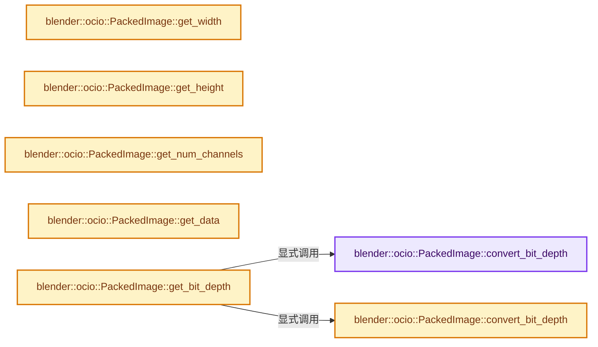
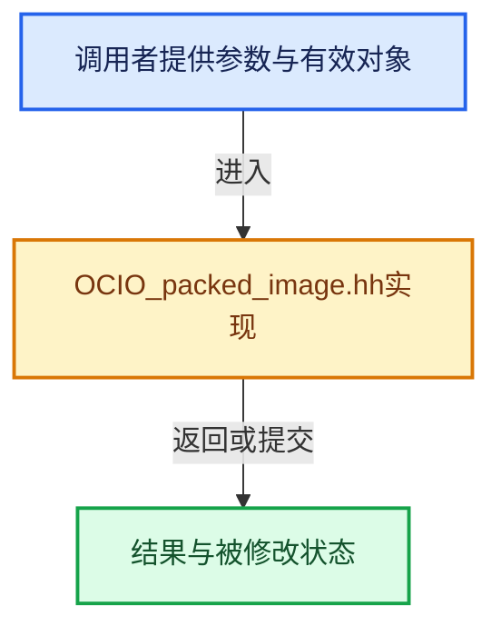

# 实现依赖专题：source/blender/imbuf/opencolorio/OCIO_packed_image.hh

[实现依赖导航](../../../README.md) · [符号索引](../../../../00-课程指南/02-源码与提交索引/符号依赖与实现索引.md)

本专题从正文实际调用进入，集中保存共享实现。函数有稳定锚点，可从调用处直接跳到对应完整函数；递归与互相调用通过回链组织。

## 本文件的实现关系






## 完整成员与函数实现

<a id="f-3c40a8573315a4d4"></a>

### `blender::ocio::PackedImage::convert_bit_depth`

实现位置：[source/blender/imbuf/opencolorio/OCIO_packed_image.hh](../../../../../../../../source/blender/imbuf/opencolorio/OCIO_packed_image.hh) · L23—L33。

接口参数：

- `const BitDepth bit_depth`

**教学注释版**

<!-- annotated:f0dd18d670099d -->

```cpp
  static OCIO_NAMESPACE::BitDepth convert_bit_depth(const BitDepth bit_depth)
  {
    switch (bit_depth) {
      case BitDepth::BIT_DEPTH_UNKNOWN:
        return OCIO_NAMESPACE::BIT_DEPTH_UNKNOWN;
      case BitDepth::BIT_DEPTH_F32:
        return OCIO_NAMESPACE::BIT_DEPTH_F32;
    }
    BLI_assert_unreachable();
    return OCIO_NAMESPACE::BIT_DEPTH_UNKNOWN;
  }
```

<details>
<summary>核对原始源码：source/blender/imbuf/opencolorio/OCIO_packed_image.hh · L23—L33</summary>

<!-- original:f0dd18d670099d:source/blender/imbuf/opencolorio/OCIO_packed_image.hh:23:33 -->

```cpp
  static OCIO_NAMESPACE::BitDepth convert_bit_depth(const BitDepth bit_depth)
  {
    switch (bit_depth) {
      case BitDepth::BIT_DEPTH_UNKNOWN:
        return OCIO_NAMESPACE::BIT_DEPTH_UNKNOWN;
      case BitDepth::BIT_DEPTH_F32:
        return OCIO_NAMESPACE::BIT_DEPTH_F32;
    }
    BLI_assert_unreachable();
    return OCIO_NAMESPACE::BIT_DEPTH_UNKNOWN;
  }
```

</details>

**结果出口**

- `return OCIO_NAMESPACE::BIT_DEPTH_UNKNOWN;`
- `return OCIO_NAMESPACE::BIT_DEPTH_F32;`

**继续追踪实现**

- `BLI_assert_unreachable` → [BLI_assert_unreachable · L77](../../../01-BLI基础库/BLI_assert.hh.md#m-7a2d91a67d8e)。宏定义由构建条件选择。

<a id="f-982612712df70b7a"></a>

### `blender::ocio::PackedImage::convert_bit_depth`

实现位置：[source/blender/imbuf/opencolorio/OCIO_packed_image.hh](../../../../../../../../source/blender/imbuf/opencolorio/OCIO_packed_image.hh) · L35—L46。

接口参数：

- `const OCIO_NAMESPACE::BitDepth bit_depth`

**教学注释版**

<!-- annotated:85d61ba27ad91f -->

```cpp
  static BitDepth convert_bit_depth(const OCIO_NAMESPACE::BitDepth bit_depth)
  {
    switch (bit_depth) {
      case OCIO_NAMESPACE::BIT_DEPTH_UNKNOWN:
        return BitDepth::BIT_DEPTH_UNKNOWN;
      case OCIO_NAMESPACE::BIT_DEPTH_F32:
        return BitDepth::BIT_DEPTH_F32;
      default:
        /* Other bit depths are currently not supported. */
        return BitDepth::BIT_DEPTH_UNKNOWN;
    }
  }
```

<details>
<summary>核对原始源码：source/blender/imbuf/opencolorio/OCIO_packed_image.hh · L35—L46</summary>

<!-- original:85d61ba27ad91f:source/blender/imbuf/opencolorio/OCIO_packed_image.hh:35:46 -->

```cpp
  static BitDepth convert_bit_depth(const OCIO_NAMESPACE::BitDepth bit_depth)
  {
    switch (bit_depth) {
      case OCIO_NAMESPACE::BIT_DEPTH_UNKNOWN:
        return BitDepth::BIT_DEPTH_UNKNOWN;
      case OCIO_NAMESPACE::BIT_DEPTH_F32:
        return BitDepth::BIT_DEPTH_F32;
      default:
        /* Other bit depths are currently not supported. */
        return BitDepth::BIT_DEPTH_UNKNOWN;
    }
  }
```

</details>

**结果出口**

- `return BitDepth::BIT_DEPTH_UNKNOWN;`
- `return BitDepth::BIT_DEPTH_F32;`

**继续追踪实现**

本实现没有需要继续展开的显式调用；检查返回表达式、对象转换和调用者前置条件。

<a id="f-6ff788ef0db79461"></a>

### `blender::ocio::PackedImage::get_width`

实现位置：[source/blender/imbuf/opencolorio/OCIO_packed_image.hh](../../../../../../../../source/blender/imbuf/opencolorio/OCIO_packed_image.hh) · L68—L71。

**教学注释版**

<!-- annotated:fbcb1bc2a22ca3 -->

```cpp
  size_t get_width() const
  {
    return image_desc_.getWidth();
  }
```

<details>
<summary>核对原始源码：source/blender/imbuf/opencolorio/OCIO_packed_image.hh · L68—L71</summary>

<!-- original:fbcb1bc2a22ca3:source/blender/imbuf/opencolorio/OCIO_packed_image.hh:68:71 -->

```cpp
  size_t get_width() const
  {
    return image_desc_.getWidth();
  }
```

</details>

**结果出口**

- `return image_desc_.getWidth();`

**继续追踪实现**

- `image_desc_.getWidth` → [GHOST_Rect::getWidth · L165](../../../07-Intern运行时与平台/ghost/GHOST_Rect.hh.md#f-c701c8575a8fa812)。

<a id="f-0001b795ee8b1caa"></a>

### `blender::ocio::PackedImage::get_height`

实现位置：[source/blender/imbuf/opencolorio/OCIO_packed_image.hh](../../../../../../../../source/blender/imbuf/opencolorio/OCIO_packed_image.hh) · L72—L75。

**教学注释版**

<!-- annotated:06cbcbf0242b50 -->

```cpp
  size_t get_height() const
  {
    return image_desc_.getHeight();
  }
```

<details>
<summary>核对原始源码：source/blender/imbuf/opencolorio/OCIO_packed_image.hh · L72—L75</summary>

<!-- original:06cbcbf0242b50:source/blender/imbuf/opencolorio/OCIO_packed_image.hh:72:75 -->

```cpp
  size_t get_height() const
  {
    return image_desc_.getHeight();
  }
```

</details>

**结果出口**

- `return image_desc_.getHeight();`

**继续追踪实现**

- `image_desc_.getHeight` → [GHOST_Rect::getHeight · L170](../../../07-Intern运行时与平台/ghost/GHOST_Rect.hh.md#f-b9fc111c3f521df7)。

<a id="f-816ef5699d1f5109"></a>

### `blender::ocio::PackedImage::get_num_channels`

实现位置：[source/blender/imbuf/opencolorio/OCIO_packed_image.hh](../../../../../../../../source/blender/imbuf/opencolorio/OCIO_packed_image.hh) · L77—L80。

**教学注释版**

<!-- annotated:7f9bbe0d58f96d -->

```cpp
  size_t get_num_channels() const
  {
    return image_desc_.getNumChannels();
  }
```

<details>
<summary>核对原始源码：source/blender/imbuf/opencolorio/OCIO_packed_image.hh · L77—L80</summary>

<!-- original:7f9bbe0d58f96d:source/blender/imbuf/opencolorio/OCIO_packed_image.hh:77:80 -->

```cpp
  size_t get_num_channels() const
  {
    return image_desc_.getNumChannels();
  }
```

</details>

**结果出口**

- `return image_desc_.getNumChannels();`

**继续追踪实现**

- `image_desc_.getNumChannels` → [调用协议](../../../../00-课程指南/01-路线与规范/模板宏与动态分派协议.md)：由接收对象具体类型或运行时策略提供实现。调用位置L79。

<a id="f-f4e8d7ef800db7bb"></a>

### `blender::ocio::PackedImage::get_data`

实现位置：[source/blender/imbuf/opencolorio/OCIO_packed_image.hh](../../../../../../../../source/blender/imbuf/opencolorio/OCIO_packed_image.hh) · L82—L85。

**教学注释版**

<!-- annotated:23a2ff87fa475f -->

```cpp
  void *get_data() const
  {
    return image_desc_.getData();
  }
```

<details>
<summary>核对原始源码：source/blender/imbuf/opencolorio/OCIO_packed_image.hh · L82—L85</summary>

<!-- original:23a2ff87fa475f:source/blender/imbuf/opencolorio/OCIO_packed_image.hh:82:85 -->

```cpp
  void *get_data() const
  {
    return image_desc_.getData();
  }
```

</details>

**结果出口**

- `return image_desc_.getData();`

**继续追踪实现**

- `image_desc_.getData` → [调用协议](../../../../00-课程指南/01-路线与规范/模板宏与动态分派协议.md)：由接收对象具体类型或运行时策略提供实现。调用位置L84。

<a id="f-95a81168210b1ee2"></a>

### `blender::ocio::PackedImage::get_bit_depth`

实现位置：[source/blender/imbuf/opencolorio/OCIO_packed_image.hh](../../../../../../../../source/blender/imbuf/opencolorio/OCIO_packed_image.hh) · L87—L90。

**教学注释版**

<!-- annotated:cff8c204a373cb -->

```cpp
  BitDepth get_bit_depth() const
  {
    return convert_bit_depth(image_desc_.getBitDepth());
  }
```

<details>
<summary>核对原始源码：source/blender/imbuf/opencolorio/OCIO_packed_image.hh · L87—L90</summary>

<!-- original:cff8c204a373cb:source/blender/imbuf/opencolorio/OCIO_packed_image.hh:87:90 -->

```cpp
  BitDepth get_bit_depth() const
  {
    return convert_bit_depth(image_desc_.getBitDepth());
  }
```

</details>

**结果出口**

- `return convert_bit_depth(image_desc_.getBitDepth());`

**继续追踪实现**

- `convert_bit_depth` → [blender::ocio::PackedImage::convert_bit_depth · L23](OCIO_packed_image.hh.md#f-3c40a8573315a4d4)；[blender::ocio::PackedImage::convert_bit_depth · L35](OCIO_packed_image.hh.md#f-982612712df70b7a)。同名重载需按实参类型选择。
- `image_desc_.getBitDepth` → [调用协议](../../../../00-课程指南/01-路线与规范/模板宏与动态分派协议.md)：由接收对象具体类型或运行时策略提供实现。调用位置L89。
