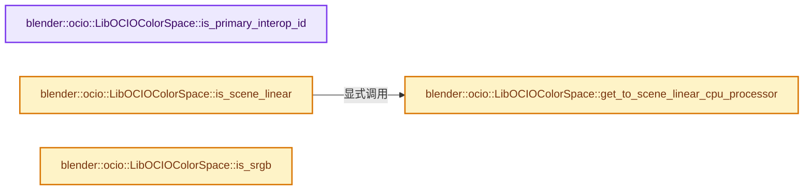

# 实现依赖专题：source/blender/imbuf/opencolorio/intern/libocio/libocio_colorspace.cc

[实现依赖导航](../../../../../README.md) · [符号索引](../../../../../../00-课程指南/02-源码与提交索引/符号依赖与实现索引.md)

本专题从正文实际调用进入，集中保存共享实现。函数有稳定锚点，可从调用处直接跳到对应完整函数；递归与互相调用通过回链组织。

## 本文件的实现关系




## 完整成员与函数实现

<a id="f-1482edf0c671bb81"></a>

### `blender::ocio::LibOCIOColorSpace::is_primary_interop_id`

实现位置：[source/blender/imbuf/opencolorio/intern/libocio/libocio_colorspace.cc](../../../../../../../../../../source/blender/imbuf/opencolorio/intern/libocio/libocio_colorspace.cc) · L125—L128。

**教学注释版**

<!-- annotated:4d0c3860dc9865 -->

```cpp
bool LibOCIOColorSpace::is_primary_interop_id() const
{
  return is_primary_interop_id_;
}
```

<details>
<summary>核对原始源码：source/blender/imbuf/opencolorio/intern/libocio/libocio_colorspace.cc · L125—L128</summary>

<!-- original:4d0c3860dc9865:source/blender/imbuf/opencolorio/intern/libocio/libocio_colorspace.cc:125:128 -->

```cpp
bool LibOCIOColorSpace::is_primary_interop_id() const
{
  return is_primary_interop_id_;
}
```

</details>

**结果出口**

- `return is_primary_interop_id_;`

**继续追踪实现**

本实现没有需要继续展开的显式调用；检查返回表达式、对象转换和调用者前置条件。

<a id="f-a51a69568ffac009"></a>

### `blender::ocio::LibOCIOColorSpace::is_scene_linear`

实现位置：[source/blender/imbuf/opencolorio/intern/libocio/libocio_colorspace.cc](../../../../../../../../../../source/blender/imbuf/opencolorio/intern/libocio/libocio_colorspace.cc) · L176—L181。

**教学注释版**

<!-- annotated:e95580cb86914b -->

```cpp
bool LibOCIOColorSpace::is_scene_linear() const
{
  /* The color space is the scene linear working space when the conversion is a no-op. */
  const CPUProcessor *cpu_processor = get_to_scene_linear_cpu_processor();
  return cpu_processor && cpu_processor->is_noop();
}
```

<details>
<summary>核对原始源码：source/blender/imbuf/opencolorio/intern/libocio/libocio_colorspace.cc · L176—L181</summary>

<!-- original:e95580cb86914b:source/blender/imbuf/opencolorio/intern/libocio/libocio_colorspace.cc:176:181 -->

```cpp
bool LibOCIOColorSpace::is_scene_linear() const
{
  /* The color space is the scene linear working space when the conversion is a no-op. */
  const CPUProcessor *cpu_processor = get_to_scene_linear_cpu_processor();
  return cpu_processor && cpu_processor->is_noop();
}
```

</details>

**结果出口**

- `return cpu_processor && cpu_processor->is_noop();`

**继续追踪实现**

- `get_to_scene_linear_cpu_processor` → [blender::ocio::LibOCIOColorSpace::get_to_scene_linear_cpu_processor · L190](libocio_colorspace.cc.md#f-e2a914c3b083544c)。
- `cpu_processor->is_noop` → [调用协议](../../../../../../00-课程指南/01-路线与规范/模板宏与动态分派协议.md)：由接收对象具体类型或运行时策略提供实现。调用位置L180。

<a id="f-6daa5b420e3c1838"></a>

### `blender::ocio::LibOCIOColorSpace::is_srgb`

实现位置：[source/blender/imbuf/opencolorio/intern/libocio/libocio_colorspace.cc](../../../../../../../../../../source/blender/imbuf/opencolorio/intern/libocio/libocio_colorspace.cc) · L183—L188。

**教学注释版**

<!-- annotated:d967c134164fdd -->

```cpp
bool LibOCIOColorSpace::is_srgb() const
{
  /* Detected from the primary interop ID. For additional interop IDs it's not necessarily
   * sRGB, but rather a color space that can be saved as sRGB. */
  return is_primary_interop_id_ && ELEM(interop_id_, "srgb_rec709_scene", "srgb_rec709_display");
}
```

<details>
<summary>核对原始源码：source/blender/imbuf/opencolorio/intern/libocio/libocio_colorspace.cc · L183—L188</summary>

<!-- original:d967c134164fdd:source/blender/imbuf/opencolorio/intern/libocio/libocio_colorspace.cc:183:188 -->

```cpp
bool LibOCIOColorSpace::is_srgb() const
{
  /* Detected from the primary interop ID. For additional interop IDs it's not necessarily
   * sRGB, but rather a color space that can be saved as sRGB. */
  return is_primary_interop_id_ && ELEM(interop_id_, "srgb_rec709_scene", "srgb_rec709_display");
}
```

</details>

**结果出口**

- `return is_primary_interop_id_ && ELEM(interop_id_, "srgb_rec709_scene", "srgb_rec709_display");`

**继续追踪实现**

- `ELEM` → [ELEM · L88](../../../../../07-Intern运行时与平台/ghost/intern/GHOST_utildefines.hh.md#m-d28724a15928)；[ELEM · L135](../../../../../01-BLI基础库/BLI_utildefines.hh.md#m-d6572de7cae0)。宏定义由构建条件选择。

<a id="f-e2a914c3b083544c"></a>

### `blender::ocio::LibOCIOColorSpace::get_to_scene_linear_cpu_processor`

实现位置：[source/blender/imbuf/opencolorio/intern/libocio/libocio_colorspace.cc](../../../../../../../../../../source/blender/imbuf/opencolorio/intern/libocio/libocio_colorspace.cc) · L190—L209。

**教学注释版**

<!-- annotated:e5982208bd20a6 -->

```cpp
const CPUProcessor *LibOCIOColorSpace::get_to_scene_linear_cpu_processor() const
{
  return to_scene_linear_cpu_processor_.get([&]() -> std::unique_ptr<CPUProcessor> {
    OCIO_NAMESPACE::ConstProcessorRcPtr ocio_processor;
    if (scene_linear_config_ != ocio_config_) {
      ocio_processor = create_ocio_processor_between_configs(ocio_config_,
                                                             ocio_color_space_->getName(),
                                                             scene_linear_config_,
                                                             OCIO_NAMESPACE::ROLE_SCENE_LINEAR);
    }
    if (!ocio_processor) {
      ocio_processor = create_ocio_processor(
          ocio_config_, ocio_color_space_->getName(), OCIO_NAMESPACE::ROLE_SCENE_LINEAR);
    }
    if (!ocio_processor) {
      return nullptr;
    }
    // [讲解] std::make_unique<LibOCIOCPUProcessor>：创建独占拥有的对象，拥有关系可移动，get返回的借用指针不自动延长寿命。
    return std::make_unique<LibOCIOCPUProcessor>(ocio_processor->getDefaultCPUProcessor());
  });
}
```

<details>
<summary>核对原始源码：source/blender/imbuf/opencolorio/intern/libocio/libocio_colorspace.cc · L190—L209</summary>

<!-- original:e5982208bd20a6:source/blender/imbuf/opencolorio/intern/libocio/libocio_colorspace.cc:190:209 -->

```cpp
const CPUProcessor *LibOCIOColorSpace::get_to_scene_linear_cpu_processor() const
{
  return to_scene_linear_cpu_processor_.get([&]() -> std::unique_ptr<CPUProcessor> {
    OCIO_NAMESPACE::ConstProcessorRcPtr ocio_processor;
    if (scene_linear_config_ != ocio_config_) {
      ocio_processor = create_ocio_processor_between_configs(ocio_config_,
                                                             ocio_color_space_->getName(),
                                                             scene_linear_config_,
                                                             OCIO_NAMESPACE::ROLE_SCENE_LINEAR);
    }
    if (!ocio_processor) {
      ocio_processor = create_ocio_processor(
          ocio_config_, ocio_color_space_->getName(), OCIO_NAMESPACE::ROLE_SCENE_LINEAR);
    }
    if (!ocio_processor) {
      return nullptr;
    }
    return std::make_unique<LibOCIOCPUProcessor>(ocio_processor->getDefaultCPUProcessor());
  });
}
```

</details>

**沿实际写入检查状态**

- `ocio_processor = create_ocio_processor_between_configs(ocio_config_,`
- `ocio_processor = create_ocio_processor(`

**结果出口**

- `return to_scene_linear_cpu_processor_.get([&]() -> std::unique_ptr<CPUProcessor> {`
- `return nullptr;`
- `return std::make_unique<LibOCIOCPUProcessor>(ocio_processor->getDefaultCPUProcessor());`

**继续追踪实现**

- `to_scene_linear_cpu_processor_.get` → [调用协议](../../../../../../00-课程指南/01-路线与规范/模板宏与动态分派协议.md)：接收对象类型依赖auto、返回值或模板实例；不按同名猜测目标。调用位置L192。
- `create_ocio_processor_between_configs` → [blender::ocio::create_ocio_processor_between_configs · L43](libocio_processor.cc.md#f-bbe2fb588d721094)。
- `ocio_color_space_->getName` → [调用协议](../../../../../../00-课程指南/01-路线与规范/模板宏与动态分派协议.md)：接收对象类型依赖auto、返回值或模板实例；不按同名猜测目标。调用位置L196。
- `create_ocio_processor` → [blender::ocio::create_ocio_processor · L11](libocio_processor.cc.md#f-ec7c1135d4076657)。
- `std::make_unique<LibOCIOCPUProcessor>` → [外部契约](https://eel.is/c++draft/unique.ptr.create)：创建独占拥有的对象，拥有关系可移动，get返回的借用指针不自动延长寿命。
- `ocio_processor->getDefaultCPUProcessor` → [调用协议](../../../../../../00-课程指南/01-路线与规范/模板宏与动态分派协议.md)：由接收对象具体类型或运行时策略提供实现。调用位置L207。
