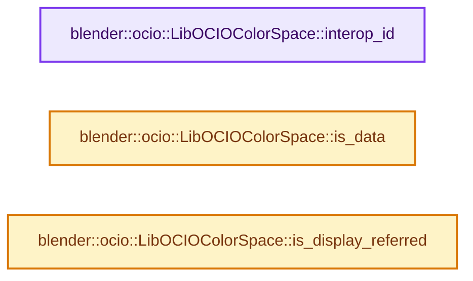
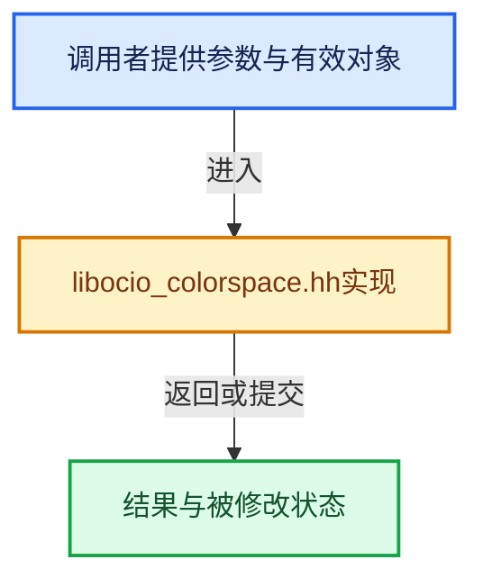

# 实现依赖专题：source/blender/imbuf/opencolorio/intern/libocio/libocio_colorspace.hh

[实现依赖导航](../../../../../README.md) · [符号索引](../../../../../../00-课程指南/02-源码与提交索引/符号依赖与实现索引.md)

本专题从正文实际调用进入，集中保存共享实现。函数有稳定锚点，可从调用处直接跳到对应完整函数；递归与互相调用通过回链组织。

## 本文件的实现关系






## 完整成员与函数实现

<a id="f-451484b1dbf39fa5"></a>

### `blender::ocio::LibOCIOColorSpace::interop_id`

实现位置：[source/blender/imbuf/opencolorio/intern/libocio/libocio_colorspace.hh](../../../../../../../../../../source/blender/imbuf/opencolorio/intern/libocio/libocio_colorspace.hh) · L60—L63。

**教学注释版**

<!-- annotated:f634e5487fe16b -->

```cpp
  StringRefNull interop_id() const override
  {
    return interop_id_;
  }
```

<details>
<summary>核对原始源码：source/blender/imbuf/opencolorio/intern/libocio/libocio_colorspace.hh · L60—L63</summary>

<!-- original:f634e5487fe16b:source/blender/imbuf/opencolorio/intern/libocio/libocio_colorspace.hh:60:63 -->

```cpp
  StringRefNull interop_id() const override
  {
    return interop_id_;
  }
```

</details>

**结果出口**

- `return interop_id_;`

**继续追踪实现**

本实现没有需要继续展开的显式调用；检查返回表达式、对象转换和调用者前置条件。

<a id="f-17f8a4f0b6e70d0e"></a>

### `blender::ocio::LibOCIOColorSpace::is_data`

实现位置：[source/blender/imbuf/opencolorio/intern/libocio/libocio_colorspace.hh](../../../../../../../../../../source/blender/imbuf/opencolorio/intern/libocio/libocio_colorspace.hh) · L75—L78。

**教学注释版**

<!-- annotated:af6fa2b4ccb8a0 -->

```cpp
  bool is_data() const override
  {
    return ocio_color_space_->isData();
  }
```

<details>
<summary>核对原始源码：source/blender/imbuf/opencolorio/intern/libocio/libocio_colorspace.hh · L75—L78</summary>

<!-- original:af6fa2b4ccb8a0:source/blender/imbuf/opencolorio/intern/libocio/libocio_colorspace.hh:75:78 -->

```cpp
  bool is_data() const override
  {
    return ocio_color_space_->isData();
  }
```

</details>

**结果出口**

- `return ocio_color_space_->isData();`

**继续追踪实现**

- `ocio_color_space_->isData` → [调用协议](../../../../../../00-课程指南/01-路线与规范/模板宏与动态分派协议.md)：由接收对象具体类型或运行时策略提供实现。调用位置L77。

<a id="f-f7ed030e3188905e"></a>

### `blender::ocio::LibOCIOColorSpace::is_display_referred`

实现位置：[source/blender/imbuf/opencolorio/intern/libocio/libocio_colorspace.hh](../../../../../../../../../../source/blender/imbuf/opencolorio/intern/libocio/libocio_colorspace.hh) · L80—L83。

**教学注释版**

<!-- annotated:a55b132ecde4b0 -->

```cpp
  bool is_display_referred() const override
  {
    return ocio_color_space_->getReferenceSpaceType() == OCIO_NAMESPACE::REFERENCE_SPACE_DISPLAY;
  }
```

<details>
<summary>核对原始源码：source/blender/imbuf/opencolorio/intern/libocio/libocio_colorspace.hh · L80—L83</summary>

<!-- original:a55b132ecde4b0:source/blender/imbuf/opencolorio/intern/libocio/libocio_colorspace.hh:80:83 -->

```cpp
  bool is_display_referred() const override
  {
    return ocio_color_space_->getReferenceSpaceType() == OCIO_NAMESPACE::REFERENCE_SPACE_DISPLAY;
  }
```

</details>

**结果出口**

- `return ocio_color_space_->getReferenceSpaceType() == OCIO_NAMESPACE::REFERENCE_SPACE_DISPLAY;`

**继续追踪实现**

- `ocio_color_space_->getReferenceSpaceType` → [调用协议](../../../../../../00-课程指南/01-路线与规范/模板宏与动态分派协议.md)：由接收对象具体类型或运行时策略提供实现。调用位置L82。
