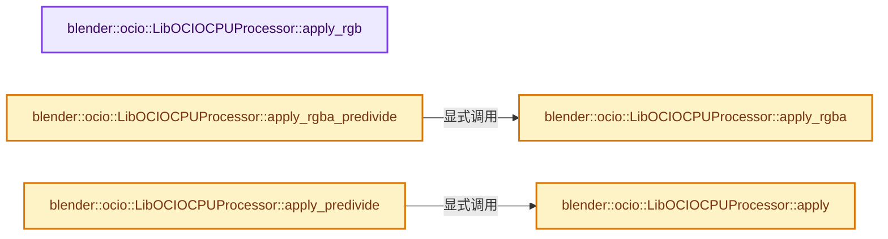
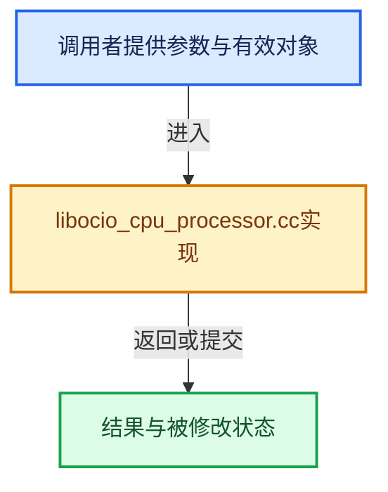

# 实现依赖专题：source/blender/imbuf/opencolorio/intern/libocio/libocio_cpu_processor.cc

[实现依赖导航](../../../../../README.md) · [符号索引](../../../../../../00-课程指南/02-源码与提交索引/符号依赖与实现索引.md)

本专题从正文实际调用进入，集中保存共享实现。函数有稳定锚点，可从调用处直接跳到对应完整函数；递归与互相调用通过回链组织。

## 本文件的实现关系






## 完整成员与函数实现

<a id="f-914d5abe54b8d157"></a>

### `blender::ocio::LibOCIOCPUProcessor::apply_rgb`

实现位置：[source/blender/imbuf/opencolorio/intern/libocio/libocio_cpu_processor.cc](../../../../../../../../../../source/blender/imbuf/opencolorio/intern/libocio/libocio_cpu_processor.cc) · L22—L25。

接口参数：

- `float rgb[3]`

**教学注释版**

<!-- annotated:cbeae8f0d9e582 -->

```cpp
void LibOCIOCPUProcessor::apply_rgb(float rgb[3]) const
{
  ocio_cpu_processor_->applyRGB(rgb);
}
```

<details>
<summary>核对原始源码：source/blender/imbuf/opencolorio/intern/libocio/libocio_cpu_processor.cc · L22—L25</summary>

<!-- original:cbeae8f0d9e582:source/blender/imbuf/opencolorio/intern/libocio/libocio_cpu_processor.cc:22:25 -->

```cpp
void LibOCIOCPUProcessor::apply_rgb(float rgb[3]) const
{
  ocio_cpu_processor_->applyRGB(rgb);
}
```

</details>

**继续追踪实现**

- `ocio_cpu_processor_->applyRGB` → [调用协议](../../../../../../00-课程指南/01-路线与规范/模板宏与动态分派协议.md)：接收对象类型依赖auto、返回值或模板实例；不按同名猜测目标。调用位置L24。

<a id="f-59f3be5877f4ee6e"></a>

### `blender::ocio::LibOCIOCPUProcessor::apply_rgba`

实现位置：[source/blender/imbuf/opencolorio/intern/libocio/libocio_cpu_processor.cc](../../../../../../../../../../source/blender/imbuf/opencolorio/intern/libocio/libocio_cpu_processor.cc) · L27—L30。

接口参数：

- `float rgba[4]`

**教学注释版**

<!-- annotated:e155a8d885a201 -->

```cpp
void LibOCIOCPUProcessor::apply_rgba(float rgba[4]) const
{
  ocio_cpu_processor_->applyRGBA(rgba);
}
```

<details>
<summary>核对原始源码：source/blender/imbuf/opencolorio/intern/libocio/libocio_cpu_processor.cc · L27—L30</summary>

<!-- original:e155a8d885a201:source/blender/imbuf/opencolorio/intern/libocio/libocio_cpu_processor.cc:27:30 -->

```cpp
void LibOCIOCPUProcessor::apply_rgba(float rgba[4]) const
{
  ocio_cpu_processor_->applyRGBA(rgba);
}
```

</details>

**继续追踪实现**

- `ocio_cpu_processor_->applyRGBA` → [调用协议](../../../../../../00-课程指南/01-路线与规范/模板宏与动态分派协议.md)：接收对象类型依赖auto、返回值或模板实例；不按同名猜测目标。调用位置L29。

<a id="f-4aaacb1b62b3d60f"></a>

### `blender::ocio::LibOCIOCPUProcessor::apply_rgba_predivide`

实现位置：[source/blender/imbuf/opencolorio/intern/libocio/libocio_cpu_processor.cc](../../../../../../../../../../source/blender/imbuf/opencolorio/intern/libocio/libocio_cpu_processor.cc) · L32—L51。

接口参数：

- `float rgba[4]`

**教学注释版**

<!-- annotated:93b4f8b5fb63da -->

```cpp
void LibOCIOCPUProcessor::apply_rgba_predivide(float rgba[4]) const
{
  if (ELEM(rgba[3], 1.0f, 0.0f)) {
    apply_rgba(rgba);
    return;
  }

  const float alpha = rgba[3];
  const float inv_alpha = 1.0f / alpha;

  rgba[0] *= inv_alpha;
  rgba[1] *= inv_alpha;
  rgba[2] *= inv_alpha;

  apply_rgba(rgba);

  rgba[0] *= alpha;
  rgba[1] *= alpha;
  rgba[2] *= alpha;
}
```

<details>
<summary>核对原始源码：source/blender/imbuf/opencolorio/intern/libocio/libocio_cpu_processor.cc · L32—L51</summary>

<!-- original:93b4f8b5fb63da:source/blender/imbuf/opencolorio/intern/libocio/libocio_cpu_processor.cc:32:51 -->

```cpp
void LibOCIOCPUProcessor::apply_rgba_predivide(float rgba[4]) const
{
  if (ELEM(rgba[3], 1.0f, 0.0f)) {
    apply_rgba(rgba);
    return;
  }

  const float alpha = rgba[3];
  const float inv_alpha = 1.0f / alpha;

  rgba[0] *= inv_alpha;
  rgba[1] *= inv_alpha;
  rgba[2] *= inv_alpha;

  apply_rgba(rgba);

  rgba[0] *= alpha;
  rgba[1] *= alpha;
  rgba[2] *= alpha;
}
```

</details>

**沿实际写入检查状态**

- `rgba[0] *= inv_alpha;`
- `rgba[1] *= inv_alpha;`
- `rgba[2] *= inv_alpha;`
- `rgba[0] *= alpha;`
- `rgba[1] *= alpha;`
- `rgba[2] *= alpha;`

**继续追踪实现**

- `ELEM` → [ELEM · L88](../../../../../07-Intern运行时与平台/ghost/intern/GHOST_utildefines.hh.md#m-d28724a15928)；[ELEM · L135](../../../../../01-BLI基础库/BLI_utildefines.hh.md#m-d6572de7cae0)。宏定义由构建条件选择。
- `apply_rgba` → [blender::ocio::LibOCIOCPUProcessor::apply_rgba · L27](libocio_cpu_processor.cc.md#f-59f3be5877f4ee6e)。

<a id="f-1521a087556cb9b9"></a>

### `blender::ocio::LibOCIOCPUProcessor::apply`

实现位置：[source/blender/imbuf/opencolorio/intern/libocio/libocio_cpu_processor.cc](../../../../../../../../../../source/blender/imbuf/opencolorio/intern/libocio/libocio_cpu_processor.cc) · L53—L66。

接口参数：

- `const PackedImage &image`

**教学注释版**

<!-- annotated:bc0b0112ee96da -->

```cpp
void LibOCIOCPUProcessor::apply(const PackedImage &image) const
{
  /* TODO(sergey): Support other bit depths. */
  if (image.get_bit_depth() != BitDepth::BIT_DEPTH_F32) {
    return;
  }

  try {
    ocio_cpu_processor_->apply(image);
  }
  catch (OCIO_NAMESPACE::Exception &exception) {
    report_exception(exception);
  }
}
```

<details>
<summary>核对原始源码：source/blender/imbuf/opencolorio/intern/libocio/libocio_cpu_processor.cc · L53—L66</summary>

<!-- original:bc0b0112ee96da:source/blender/imbuf/opencolorio/intern/libocio/libocio_cpu_processor.cc:53:66 -->

```cpp
void LibOCIOCPUProcessor::apply(const PackedImage &image) const
{
  /* TODO(sergey): Support other bit depths. */
  if (image.get_bit_depth() != BitDepth::BIT_DEPTH_F32) {
    return;
  }

  try {
    ocio_cpu_processor_->apply(image);
  }
  catch (OCIO_NAMESPACE::Exception &exception) {
    report_exception(exception);
  }
}
```

</details>

**继续追踪实现**

- `image.get_bit_depth` → [blender::ocio::PackedImage::get_bit_depth · L87](../../OCIO_packed_image.hh.md#f-95a81168210b1ee2)。
- `ocio_cpu_processor_->apply` → [调用协议](../../../../../../00-课程指南/01-路线与规范/模板宏与动态分派协议.md)：接收对象类型依赖auto、返回值或模板实例；不按同名猜测目标。调用位置L61。
- `report_exception` → [blender::ocio::report_exception · L15](error_handling.cc.md#f-ee55c3aa111fb1c4)。

<a id="f-8d2d8d45dd65ed6f"></a>

### `blender::ocio::LibOCIOCPUProcessor::apply_predivide`

实现位置：[source/blender/imbuf/opencolorio/intern/libocio/libocio_cpu_processor.cc](../../../../../../../../../../source/blender/imbuf/opencolorio/intern/libocio/libocio_cpu_processor.cc) · L68—L105。

接口参数：

- `const PackedImage &image`

**教学注释版**

<!-- annotated:3b5d8fe095d047 -->

```cpp
void LibOCIOCPUProcessor::apply_predivide(const PackedImage &image) const
{
  /* TODO(sergey): Support other bit depths. */
  if (image.get_bit_depth() != BitDepth::BIT_DEPTH_F32) {
    return;
  }

  if (image.get_num_channels() == 4) {
    /* Convert from premultiplied alpha to straight alpha. */
    float *pixel = reinterpret_cast<float *>(image.get_data());
    const size_t pixel_count = image.get_width() * image.get_height();
    for (size_t i = 0; i < pixel_count; i++, pixel += 4) {
      const float alpha = pixel[3];
      if (!ELEM(alpha, 0.0f, 1.0f)) {
        const float inv_alpha = 1.0f / alpha;
        pixel[0] *= inv_alpha;
        pixel[1] *= inv_alpha;
        pixel[2] *= inv_alpha;
      }
    }
  }

  apply(image);

  if (image.get_num_channels() == 4) {
    /* Back to premultiplied alpha. */
    float *pixel = reinterpret_cast<float *>(image.get_data());
    const size_t pixel_count = image.get_width() * image.get_height();
    for (size_t i = 0; i < pixel_count; i++, pixel += 4) {
      const float alpha = pixel[3];
      if (!ELEM(alpha, 0.0f, 1.0f)) {
        pixel[0] *= alpha;
        pixel[1] *= alpha;
        pixel[2] *= alpha;
      }
    }
  }
}
```

<details>
<summary>核对原始源码：source/blender/imbuf/opencolorio/intern/libocio/libocio_cpu_processor.cc · L68—L105</summary>

<!-- original:3b5d8fe095d047:source/blender/imbuf/opencolorio/intern/libocio/libocio_cpu_processor.cc:68:105 -->

```cpp
void LibOCIOCPUProcessor::apply_predivide(const PackedImage &image) const
{
  /* TODO(sergey): Support other bit depths. */
  if (image.get_bit_depth() != BitDepth::BIT_DEPTH_F32) {
    return;
  }

  if (image.get_num_channels() == 4) {
    /* Convert from premultiplied alpha to straight alpha. */
    float *pixel = reinterpret_cast<float *>(image.get_data());
    const size_t pixel_count = image.get_width() * image.get_height();
    for (size_t i = 0; i < pixel_count; i++, pixel += 4) {
      const float alpha = pixel[3];
      if (!ELEM(alpha, 0.0f, 1.0f)) {
        const float inv_alpha = 1.0f / alpha;
        pixel[0] *= inv_alpha;
        pixel[1] *= inv_alpha;
        pixel[2] *= inv_alpha;
      }
    }
  }

  apply(image);

  if (image.get_num_channels() == 4) {
    /* Back to premultiplied alpha. */
    float *pixel = reinterpret_cast<float *>(image.get_data());
    const size_t pixel_count = image.get_width() * image.get_height();
    for (size_t i = 0; i < pixel_count; i++, pixel += 4) {
      const float alpha = pixel[3];
      if (!ELEM(alpha, 0.0f, 1.0f)) {
        pixel[0] *= alpha;
        pixel[1] *= alpha;
        pixel[2] *= alpha;
      }
    }
  }
}
```

</details>

**沿实际写入检查状态**

- `pixel[0] *= inv_alpha;`
- `pixel[1] *= inv_alpha;`
- `pixel[2] *= inv_alpha;`
- `pixel[0] *= alpha;`
- `pixel[1] *= alpha;`
- `pixel[2] *= alpha;`

**继续追踪实现**

- `image.get_bit_depth` → [blender::ocio::PackedImage::get_bit_depth · L87](../../OCIO_packed_image.hh.md#f-95a81168210b1ee2)。
- `image.get_num_channels` → [blender::ocio::PackedImage::get_num_channels · L77](../../OCIO_packed_image.hh.md#f-816ef5699d1f5109)。
- `image.get_data` → [blender::ocio::PackedImage::get_data · L82](../../OCIO_packed_image.hh.md#f-f4e8d7ef800db7bb)。
- `image.get_width` → [blender::ocio::PackedImage::get_width · L68](../../OCIO_packed_image.hh.md#f-6ff788ef0db79461)。
- `image.get_height` → [blender::ocio::PackedImage::get_height · L72](../../OCIO_packed_image.hh.md#f-0001b795ee8b1caa)。
- `ELEM` → [ELEM · L88](../../../../../07-Intern运行时与平台/ghost/intern/GHOST_utildefines.hh.md#m-d28724a15928)；[ELEM · L135](../../../../../01-BLI基础库/BLI_utildefines.hh.md#m-d6572de7cae0)。宏定义由构建条件选择。
- `apply` → [blender::ocio::LibOCIOCPUProcessor::apply · L53](libocio_cpu_processor.cc.md#f-1521a087556cb9b9)。
