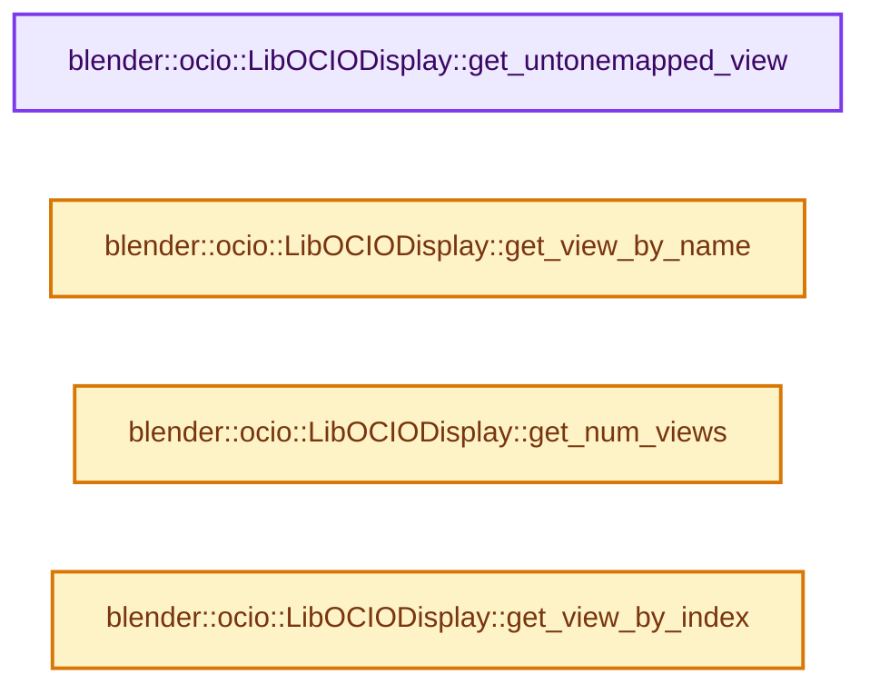
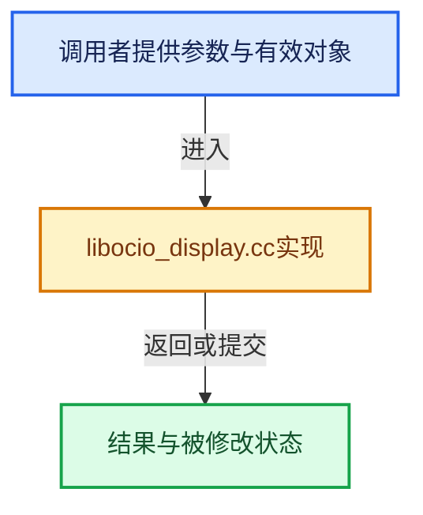

# 实现依赖专题：source/blender/imbuf/opencolorio/intern/libocio/libocio_display.cc

[实现依赖导航](../../../../../README.md) · [符号索引](../../../../../../00-课程指南/02-源码与提交索引/符号依赖与实现索引.md)

本专题从正文实际调用进入，集中保存共享实现。函数有稳定锚点，可从调用处直接跳到对应完整函数；递归与互相调用通过回链组织。

## 本文件的实现关系






## 完整成员与函数实现

<a id="f-170ce166195bd785"></a>

### `blender::ocio::LibOCIODisplay::get_untonemapped_view`

实现位置：[source/blender/imbuf/opencolorio/intern/libocio/libocio_display.cc](../../../../../../../../../../source/blender/imbuf/opencolorio/intern/libocio/libocio_display.cc) · L228—L231。

**教学注释版**

<!-- annotated:e70062685540d7 -->

```cpp
const View *LibOCIODisplay::get_untonemapped_view() const
{
  return untonemapped_view_;
}
```

<details>
<summary>核对原始源码：source/blender/imbuf/opencolorio/intern/libocio/libocio_display.cc · L228—L231</summary>

<!-- original:e70062685540d7:source/blender/imbuf/opencolorio/intern/libocio/libocio_display.cc:228:231 -->

```cpp
const View *LibOCIODisplay::get_untonemapped_view() const
{
  return untonemapped_view_;
}
```

</details>

**结果出口**

- `return untonemapped_view_;`

**继续追踪实现**

本实现没有需要继续展开的显式调用；检查返回表达式、对象转换和调用者前置条件。

<a id="f-1b5c840fee9fbd77"></a>

### `blender::ocio::LibOCIODisplay::get_view_by_name`

实现位置：[source/blender/imbuf/opencolorio/intern/libocio/libocio_display.cc](../../../../../../../../../../source/blender/imbuf/opencolorio/intern/libocio/libocio_display.cc) · L233—L242。

接口参数：

- `const StringRefNull name`

**教学注释版**

<!-- annotated:5eb30b6ebbd6b8 -->

```cpp
const View *LibOCIODisplay::get_view_by_name(const StringRefNull name) const
{
  /* TODO(sergey): Is there faster way to lookup Blender-side view? */
  for (const LibOCIOView &view : views_) {
    if (view.name() == name) {
      return &view;
    }
  }
  return nullptr;
}
```

<details>
<summary>核对原始源码：source/blender/imbuf/opencolorio/intern/libocio/libocio_display.cc · L233—L242</summary>

<!-- original:5eb30b6ebbd6b8:source/blender/imbuf/opencolorio/intern/libocio/libocio_display.cc:233:242 -->

```cpp
const View *LibOCIODisplay::get_view_by_name(const StringRefNull name) const
{
  /* TODO(sergey): Is there faster way to lookup Blender-side view? */
  for (const LibOCIOView &view : views_) {
    if (view.name() == name) {
      return &view;
    }
  }
  return nullptr;
}
```

</details>

**结果出口**

- `return &view;`
- `return nullptr;`

**继续追踪实现**

- `view.name` → [调用协议](../../../../../../00-课程指南/01-路线与规范/模板宏与动态分派协议.md)：接收对象类型依赖auto、返回值或模板实例；不按同名猜测目标。调用位置L237。

<a id="f-47509fde6efb11fd"></a>

### `blender::ocio::LibOCIODisplay::get_num_views`

实现位置：[source/blender/imbuf/opencolorio/intern/libocio/libocio_display.cc](../../../../../../../../../../source/blender/imbuf/opencolorio/intern/libocio/libocio_display.cc) · L244—L247。

**教学注释版**

<!-- annotated:bab5b13f258667 -->

```cpp
int LibOCIODisplay::get_num_views() const
{
  return views_.size();
}
```

<details>
<summary>核对原始源码：source/blender/imbuf/opencolorio/intern/libocio/libocio_display.cc · L244—L247</summary>

<!-- original:bab5b13f258667:source/blender/imbuf/opencolorio/intern/libocio/libocio_display.cc:244:247 -->

```cpp
int LibOCIODisplay::get_num_views() const
{
  return views_.size();
}
```

</details>

**结果出口**

- `return views_.size();`

**继续追踪实现**

- `views_.size` → [调用协议](../../../../../../00-课程指南/01-路线与规范/模板宏与动态分派协议.md)：接收对象类型依赖auto、返回值或模板实例；不按同名猜测目标。调用位置L246。

<a id="f-6cea779e04c0d089"></a>

### `blender::ocio::LibOCIODisplay::get_view_by_index`

实现位置：[source/blender/imbuf/opencolorio/intern/libocio/libocio_display.cc](../../../../../../../../../../source/blender/imbuf/opencolorio/intern/libocio/libocio_display.cc) · L249—L255。

接口参数：

- `const int index`

**教学注释版**

<!-- annotated:c75c9dcbc6a458 -->

```cpp
const View *LibOCIODisplay::get_view_by_index(const int index) const
{
  if (index < 0 || index >= views_.size()) {
    return nullptr;
  }
  return &views_[index];
}
```

<details>
<summary>核对原始源码：source/blender/imbuf/opencolorio/intern/libocio/libocio_display.cc · L249—L255</summary>

<!-- original:c75c9dcbc6a458:source/blender/imbuf/opencolorio/intern/libocio/libocio_display.cc:249:255 -->

```cpp
const View *LibOCIODisplay::get_view_by_index(const int index) const
{
  if (index < 0 || index >= views_.size()) {
    return nullptr;
  }
  return &views_[index];
}
```

</details>

**结果出口**

- `return nullptr;`
- `return &views_[index];`

**继续追踪实现**

- `views_.size` → [调用协议](../../../../../../00-课程指南/01-路线与规范/模板宏与动态分派协议.md)：接收对象类型依赖auto、返回值或模板实例；不按同名猜测目标。调用位置L251。
