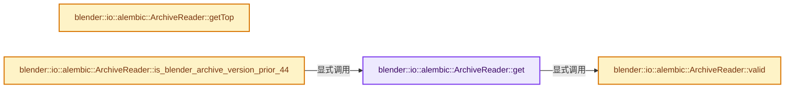

# 实现依赖专题：source/blender/io/alembic/intern/abc_reader_archive.cc

[实现依赖导航](../../../../README.md) · [符号索引](../../../../../00-课程指南/02-源码与提交索引/符号依赖与实现索引.md)

本专题从正文实际调用进入，集中保存共享实现。函数有稳定锚点，可从调用处直接跳到对应完整函数；递归与互相调用通过回链组织。

## 本文件的实现关系




## 完整成员与函数实现

<a id="f-db5f48970b0c7afe"></a>

### `blender::io::alembic::ArchiveReader::get`

实现位置：[source/blender/io/alembic/intern/abc_reader_archive.cc](../../../../../../../../../source/blender/io/alembic/intern/abc_reader_archive.cc) · L74—L98。

接口参数：

- `const Main *bmain`
- `const std::vector<const char *> &filenames`

**教学注释版**

<!-- annotated:405aefeea4d40e -->

```cpp
ArchiveReader *ArchiveReader::get(const Main *bmain, const std::vector<const char *> &filenames)
{
  std::vector<ArchiveReader *> readers;

  for (const char *filename : filenames) {
    ArchiveReader *reader = new ArchiveReader(bmain, filename);

    if (!reader->valid()) {
      delete reader;
      continue;
    }

    readers.push_back(reader);
  }

  if (readers.empty()) {
    return nullptr;
  }

  if (readers.size() == 1) {
    return readers[0];
  }

  return new ArchiveReader(readers);
}
```

<details>
<summary>核对原始源码：source/blender/io/alembic/intern/abc_reader_archive.cc · L74—L98</summary>

<!-- original:405aefeea4d40e:source/blender/io/alembic/intern/abc_reader_archive.cc:74:98 -->

```cpp
ArchiveReader *ArchiveReader::get(const Main *bmain, const std::vector<const char *> &filenames)
{
  std::vector<ArchiveReader *> readers;

  for (const char *filename : filenames) {
    ArchiveReader *reader = new ArchiveReader(bmain, filename);

    if (!reader->valid()) {
      delete reader;
      continue;
    }

    readers.push_back(reader);
  }

  if (readers.empty()) {
    return nullptr;
  }

  if (readers.size() == 1) {
    return readers[0];
  }

  return new ArchiveReader(readers);
}
```

</details>

**结果出口**

- `return nullptr;`
- `return readers[0];`
- `return new ArchiveReader(readers);`

**继续追踪实现**

- `reader->valid` → [blender::io::alembic::ArchiveReader::valid · L141](abc_reader_archive.cc.md#f-ddd763b3a0b67620)。
- `readers.push_back` → [外部契约](https://eel.is/c++draft/)：这个边界按实际表达式及所属类型核对参数、返回值、寿命与失败行为。这里提供接口入口，不声称已解释该第三方版本的内部实现。
- `readers.empty` → [外部契约](https://eel.is/c++draft/)：这个边界按实际表达式及所属类型核对参数、返回值、寿命与失败行为。这里提供接口入口，不声称已解释该第三方版本的内部实现。
- `readers.size` → [外部契约](https://eel.is/c++draft/)：这个边界按实际表达式及所属类型核对参数、返回值、寿命与失败行为。这里提供接口入口，不声称已解释该第三方版本的内部实现。

<a id="f-ddd763b3a0b67620"></a>

### `blender::io::alembic::ArchiveReader::valid`

实现位置：[source/blender/io/alembic/intern/abc_reader_archive.cc](../../../../../../../../../source/blender/io/alembic/intern/abc_reader_archive.cc) · L141—L144。

**教学注释版**

<!-- annotated:df5189e274509e -->

```cpp
bool ArchiveReader::valid() const
{
  return m_archive.valid();
}
```

<details>
<summary>核对原始源码：source/blender/io/alembic/intern/abc_reader_archive.cc · L141—L144</summary>

<!-- original:df5189e274509e:source/blender/io/alembic/intern/abc_reader_archive.cc:141:144 -->

```cpp
bool ArchiveReader::valid() const
{
  return m_archive.valid();
}
```

</details>

**结果出口**

- `return m_archive.valid();`

**继续追踪实现**

- `m_archive.valid` → [调用协议](../../../../../00-课程指南/01-路线与规范/模板宏与动态分派协议.md)：接收对象类型依赖auto、返回值或模板实例；不按同名猜测目标。调用位置L143。

<a id="f-a68504152555f570"></a>

### `blender::io::alembic::ArchiveReader::getTop`

实现位置：[source/blender/io/alembic/intern/abc_reader_archive.cc](../../../../../../../../../source/blender/io/alembic/intern/abc_reader_archive.cc) · L146—L149。

**教学注释版**

<!-- annotated:9395a92ff825eb -->

```cpp
Alembic::Abc::IObject ArchiveReader::getTop()
{
  return m_archive.getTop();
}
```

<details>
<summary>核对原始源码：source/blender/io/alembic/intern/abc_reader_archive.cc · L146—L149</summary>

<!-- original:9395a92ff825eb:source/blender/io/alembic/intern/abc_reader_archive.cc:146:149 -->

```cpp
Alembic::Abc::IObject ArchiveReader::getTop()
{
  return m_archive.getTop();
}
```

</details>

**结果出口**

- `return m_archive.getTop();`

**继续追踪实现**

- `m_archive.getTop` → [调用协议](../../../../../00-课程指南/01-路线与规范/模板宏与动态分派协议.md)：接收对象类型依赖auto、返回值或模板实例；不按同名猜测目标。调用位置L148。

<a id="f-5ff98800fe13f146"></a>

### `blender::io::alembic::ArchiveReader::is_blender_archive_version_prior_44`

实现位置：[source/blender/io/alembic/intern/abc_reader_archive.cc](../../../../../../../../../source/blender/io/alembic/intern/abc_reader_archive.cc) · L151—L161。

**教学注释版**

<!-- annotated:190226f48dc4e3 -->

```cpp
bool ArchiveReader::is_blender_archive_version_prior_44()
{
  const MetaData &abc_metadata = m_archive.getPtr()->getMetaData();

  /* Was the incoming Archive written by Blender? If so, make the version check. */
  if (abc_metadata.get(Alembic::Abc::kApplicationNameKey) == "Blender") {
    return abc_metadata.get("blender_version") < "v4.4";
  }

  return false;
}
```

<details>
<summary>核对原始源码：source/blender/io/alembic/intern/abc_reader_archive.cc · L151—L161</summary>

<!-- original:190226f48dc4e3:source/blender/io/alembic/intern/abc_reader_archive.cc:151:161 -->

```cpp
bool ArchiveReader::is_blender_archive_version_prior_44()
{
  const MetaData &abc_metadata = m_archive.getPtr()->getMetaData();

  /* Was the incoming Archive written by Blender? If so, make the version check. */
  if (abc_metadata.get(Alembic::Abc::kApplicationNameKey) == "Blender") {
    return abc_metadata.get("blender_version") < "v4.4";
  }

  return false;
}
```

</details>

**结果出口**

- `return abc_metadata.get("blender_version") < "v4.4";`
- `return false;`

**继续追踪实现**

- `m_archive.getPtr()->getMetaData` → [调用协议](../../../../../00-课程指南/01-路线与规范/模板宏与动态分派协议.md)：接收对象类型依赖auto、返回值或模板实例；不按同名猜测目标。调用位置L153。
- `m_archive.getPtr` → [调用协议](../../../../../00-课程指南/01-路线与规范/模板宏与动态分派协议.md)：接收对象类型依赖auto、返回值或模板实例；不按同名猜测目标。调用位置L153。
- `abc_metadata.get` → [blender::io::alembic::ArchiveReader::get · L74](abc_reader_archive.cc.md#f-db5f48970b0c7afe)。
