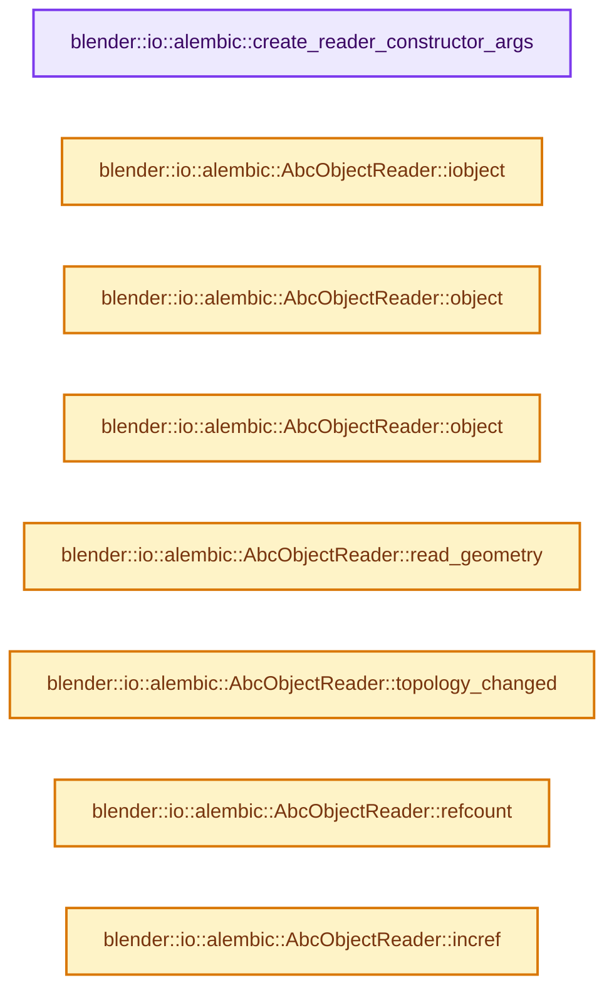

# 实现依赖专题：source/blender/io/alembic/intern/abc_reader_object.cc

[实现依赖导航](../../../../README.md) · [符号索引](../../../../../00-课程指南/02-源码与提交索引/符号依赖与实现索引.md)

本专题从正文实际调用进入，集中保存共享实现。函数有稳定锚点，可从调用处直接跳到对应完整函数；递归与互相调用通过回链组织。

## 本文件的实现关系




## 完整成员与函数实现

<a id="f-2b39cd0e493023d7"></a>

### `blender::io::alembic::create_reader_constructor_args`

实现位置：[source/blender/io/alembic/intern/abc_reader_object.cc](../../../../../../../../../source/blender/io/alembic/intern/abc_reader_object.cc) · L49—L53。

接口参数：

- `const IObject &object`
- `ImportSettings &settings`

**教学注释版**

<!-- annotated:706ff52b3c8b04 -->

```cpp
AbcReaderConstructorArgs create_reader_constructor_args(const IObject &object,
                                                        ImportSettings &settings)
{
  return AbcReaderConstructorArgs{.object = object, .settings = settings};
}
```

<details>
<summary>核对原始源码：source/blender/io/alembic/intern/abc_reader_object.cc · L49—L53</summary>

<!-- original:706ff52b3c8b04:source/blender/io/alembic/intern/abc_reader_object.cc:49:53 -->

```cpp
AbcReaderConstructorArgs create_reader_constructor_args(const IObject &object,
                                                        ImportSettings &settings)
{
  return AbcReaderConstructorArgs{.object = object, .settings = settings};
}
```

</details>

**结果出口**

- `return AbcReaderConstructorArgs{.object = object, .settings = settings};`

**继续追踪实现**

本实现没有需要继续展开的显式调用；检查返回表达式、对象转换和调用者前置条件。

<a id="f-c4d7d7a714ce137e"></a>

### `blender::io::alembic::AbcObjectReader::iobject`

实现位置：[source/blender/io/alembic/intern/abc_reader_object.cc](../../../../../../../../../source/blender/io/alembic/intern/abc_reader_object.cc) · L107—L110。

**教学注释版**

<!-- annotated:b490cbcbd6e1e3 -->

```cpp
const IObject &AbcObjectReader::iobject() const
{
  return m_iobject;
}
```

<details>
<summary>核对原始源码：source/blender/io/alembic/intern/abc_reader_object.cc · L107—L110</summary>

<!-- original:b490cbcbd6e1e3:source/blender/io/alembic/intern/abc_reader_object.cc:107:110 -->

```cpp
const IObject &AbcObjectReader::iobject() const
{
  return m_iobject;
}
```

</details>

**结果出口**

- `return m_iobject;`

**继续追踪实现**

本实现没有需要继续展开的显式调用；检查返回表达式、对象转换和调用者前置条件。

<a id="f-f6e8ca0ffc33fc5d"></a>

### `blender::io::alembic::AbcObjectReader::object`

实现位置：[source/blender/io/alembic/intern/abc_reader_object.cc](../../../../../../../../../source/blender/io/alembic/intern/abc_reader_object.cc) · L112—L115。

**教学注释版**

<!-- annotated:833405eb14d400 -->

```cpp
Object *AbcObjectReader::object() const
{
  return m_object;
}
```

<details>
<summary>核对原始源码：source/blender/io/alembic/intern/abc_reader_object.cc · L112—L115</summary>

<!-- original:833405eb14d400:source/blender/io/alembic/intern/abc_reader_object.cc:112:115 -->

```cpp
Object *AbcObjectReader::object() const
{
  return m_object;
}
```

</details>

**结果出口**

- `return m_object;`

**继续追踪实现**

本实现没有需要继续展开的显式调用；检查返回表达式、对象转换和调用者前置条件。

<a id="f-cefc55154fd29bcf"></a>

### `blender::io::alembic::AbcObjectReader::object`

实现位置：[source/blender/io/alembic/intern/abc_reader_object.cc](../../../../../../../../../source/blender/io/alembic/intern/abc_reader_object.cc) · L117—L120。

接口参数：

- `Object *ob`

**教学注释版**

<!-- annotated:2a142a04377bdb -->

```cpp
void AbcObjectReader::object(Object *ob)
{
  m_object = ob;
}
```

<details>
<summary>核对原始源码：source/blender/io/alembic/intern/abc_reader_object.cc · L117—L120</summary>

<!-- original:2a142a04377bdb:source/blender/io/alembic/intern/abc_reader_object.cc:117:120 -->

```cpp
void AbcObjectReader::object(Object *ob)
{
  m_object = ob;
}
```

</details>

**沿实际写入检查状态**

- `m_object = ob;`

**继续追踪实现**

本实现没有需要继续展开的显式调用；检查返回表达式、对象转换和调用者前置条件。

<a id="f-c155c5a744c6d019"></a>

### `blender::io::alembic::AbcObjectReader::read_geometry`

实现位置：[source/blender/io/alembic/intern/abc_reader_object.cc](../../../../../../../../../source/blender/io/alembic/intern/abc_reader_object.cc) · L160—L165。

接口参数：

- `bke::GeometrySet &`
- `const Alembic::Abc::ISampleSelector &`
- `const AbcReadGeometryParams &`
- `const char **`

**教学注释版**

<!-- annotated:8e8292cba545b6 -->

```cpp
void AbcObjectReader::read_geometry(bke::GeometrySet & /*geometry_set*/,
                                    const Alembic::Abc::ISampleSelector & /*sample_sel*/,
                                    const AbcReadGeometryParams & /*read_params*/,
                                    const char ** /*r_err_str*/)
{
}
```

<details>
<summary>核对原始源码：source/blender/io/alembic/intern/abc_reader_object.cc · L160—L165</summary>

<!-- original:8e8292cba545b6:source/blender/io/alembic/intern/abc_reader_object.cc:160:165 -->

```cpp
void AbcObjectReader::read_geometry(bke::GeometrySet & /*geometry_set*/,
                                    const Alembic::Abc::ISampleSelector & /*sample_sel*/,
                                    const AbcReadGeometryParams & /*read_params*/,
                                    const char ** /*r_err_str*/)
{
}
```

</details>

**继续追踪实现**

本实现没有需要继续展开的显式调用；检查返回表达式、对象转换和调用者前置条件。

<a id="f-70497921d3e21802"></a>

### `blender::io::alembic::AbcObjectReader::topology_changed`

实现位置：[source/blender/io/alembic/intern/abc_reader_object.cc](../../../../../../../../../source/blender/io/alembic/intern/abc_reader_object.cc) · L167—L173。

接口参数：

- `const Mesh *`
- `const Alembic::Abc::ISampleSelector &`

**教学注释版**

<!-- annotated:38dd1012aaf6ed -->

```cpp
bool AbcObjectReader::topology_changed(const Mesh * /*existing_mesh*/,
                                       const Alembic::Abc::ISampleSelector & /*sample_sel*/)
{
  /* The default implementation of read_mesh() just returns the original mesh, so never changes the
   * topology. */
  return false;
}
```

<details>
<summary>核对原始源码：source/blender/io/alembic/intern/abc_reader_object.cc · L167—L173</summary>

<!-- original:38dd1012aaf6ed:source/blender/io/alembic/intern/abc_reader_object.cc:167:173 -->

```cpp
bool AbcObjectReader::topology_changed(const Mesh * /*existing_mesh*/,
                                       const Alembic::Abc::ISampleSelector & /*sample_sel*/)
{
  /* The default implementation of read_mesh() just returns the original mesh, so never changes the
   * topology. */
  return false;
}
```

</details>

**结果出口**

- `return false;`

**继续追踪实现**

本实现没有需要继续展开的显式调用；检查返回表达式、对象转换和调用者前置条件。

<a id="f-684c4788979f3c0c"></a>

### `blender::io::alembic::AbcObjectReader::refcount`

实现位置：[source/blender/io/alembic/intern/abc_reader_object.cc](../../../../../../../../../source/blender/io/alembic/intern/abc_reader_object.cc) · L408—L411。

**教学注释版**

<!-- annotated:5a17854872b6d1 -->

```cpp
int AbcObjectReader::refcount() const
{
  return m_refcount;
}
```

<details>
<summary>核对原始源码：source/blender/io/alembic/intern/abc_reader_object.cc · L408—L411</summary>

<!-- original:5a17854872b6d1:source/blender/io/alembic/intern/abc_reader_object.cc:408:411 -->

```cpp
int AbcObjectReader::refcount() const
{
  return m_refcount;
}
```

</details>

**结果出口**

- `return m_refcount;`

**继续追踪实现**

本实现没有需要继续展开的显式调用；检查返回表达式、对象转换和调用者前置条件。

<a id="f-47bc3e229ff0b03e"></a>

### `blender::io::alembic::AbcObjectReader::incref`

实现位置：[source/blender/io/alembic/intern/abc_reader_object.cc](../../../../../../../../../source/blender/io/alembic/intern/abc_reader_object.cc) · L413—L416。

**教学注释版**

<!-- annotated:826439def20d48 -->

```cpp
void AbcObjectReader::incref()
{
  m_refcount++;
}
```

<details>
<summary>核对原始源码：source/blender/io/alembic/intern/abc_reader_object.cc · L413—L416</summary>

<!-- original:826439def20d48:source/blender/io/alembic/intern/abc_reader_object.cc:413:416 -->

```cpp
void AbcObjectReader::incref()
{
  m_refcount++;
}
```

</details>

**继续追踪实现**

本实现没有需要继续展开的显式调用；检查返回表达式、对象转换和调用者前置条件。

<a id="f-d7c5cbbce32de3cb"></a>

### `blender::io::alembic::AbcObjectReader::decref`

实现位置：[source/blender/io/alembic/intern/abc_reader_object.cc](../../../../../../../../../source/blender/io/alembic/intern/abc_reader_object.cc) · L418—L422。

**教学注释版**

<!-- annotated:89ca98eef7e2b8 -->

```cpp
void AbcObjectReader::decref()
{
  m_refcount--;
  BLI_assert(m_refcount >= 0);
}
```

<details>
<summary>核对原始源码：source/blender/io/alembic/intern/abc_reader_object.cc · L418—L422</summary>

<!-- original:89ca98eef7e2b8:source/blender/io/alembic/intern/abc_reader_object.cc:418:422 -->

```cpp
void AbcObjectReader::decref()
{
  m_refcount--;
  BLI_assert(m_refcount >= 0);
}
```

</details>

**继续追踪实现**

- `BLI_assert` → [BLI_assert · L48](../../../../01-BLI基础库/BLI_assert.hh.md#m-57a88495704d)；[BLI_assert · L63](../../../../01-BLI基础库/BLI_assert.hh.md#m-d07050020cb5)。宏定义由构建条件选择。
