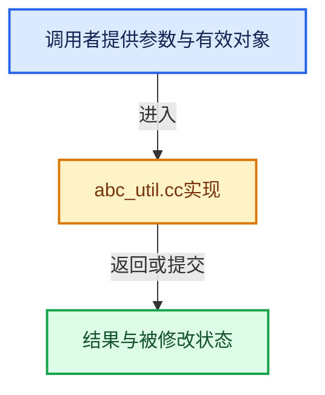

# 实现依赖专题：source/blender/io/alembic/intern/abc_util.cc

[实现依赖导航](../../../../README.md) · [符号索引](../../../../../00-课程指南/02-源码与提交索引/符号依赖与实现索引.md)

本专题从正文实际调用进入，集中保存共享实现。函数有稳定锚点，可从调用处直接跳到对应完整函数；递归与互相调用通过回链组织。

## 本文件的实现关系





## 完整成员与函数实现

<a id="f-cd9ad83a000b4b68"></a>

### `blender::io::alembic::has_property`

实现位置：[source/blender/io/alembic/intern/abc_util.cc](../../../../../../../../../source/blender/io/alembic/intern/abc_util.cc) · L77—L84。

接口参数：

- `const Alembic::Abc::ICompoundProperty &prop`
- `const std::string &name`

**教学注释版**

<!-- annotated:daa7e9cbe9f8a8 -->

```cpp
bool has_property(const Alembic::Abc::ICompoundProperty &prop, const std::string &name)
{
  if (!prop.valid()) {
    return false;
  }

  return prop.getPropertyHeader(name) != nullptr;
}
```

<details>
<summary>核对原始源码：source/blender/io/alembic/intern/abc_util.cc · L77—L84</summary>

<!-- original:daa7e9cbe9f8a8:source/blender/io/alembic/intern/abc_util.cc:77:84 -->

```cpp
bool has_property(const Alembic::Abc::ICompoundProperty &prop, const std::string &name)
{
  if (!prop.valid()) {
    return false;
  }

  return prop.getPropertyHeader(name) != nullptr;
}
```

</details>

**结果出口**

- `return false;`
- `return prop.getPropertyHeader(name) != nullptr;`

**继续追踪实现**

- `prop.valid` → [blender::io::alembic::AbcEmptyReader::valid · L34](abc_reader_transform.cc.md#f-def716ba47aa8d38)；[blender::io::alembic::AbcPointsReader::valid · L64](abc_reader_points.cc.md#f-a63a60abd9d03476)；[blender::io::alembic::AbcNurbsReader::valid · L48](abc_reader_nurbs.cc.md#f-8f37fa0da06368eb)；[blender::io::alembic::AbcMeshReader::valid · L690](abc_reader_mesh.cc.md#f-dd4fd62253b2751e)；[blender::io::alembic::AbcSubDReader::valid · L1110](abc_reader_mesh.cc.md#f-00028e83487abdfe)；[blender::io::alembic::AbcCurveReader::valid · L424](abc_reader_curves.cc.md#f-8747d68e018b0a07)；[blender::io::alembic::AbcCameraReader::valid · L46](abc_reader_camera.cc.md#f-9e83093bf7d0ba7b)；[blender::io::alembic::ArchiveReader::valid · L141](abc_reader_archive.cc.md#f-ddd763b3a0b67620)。同名重载需按实参类型选择。
- `prop.getPropertyHeader` → [调用协议](../../../../../00-课程指南/01-路线与规范/模板宏与动态分派协议.md)：由接收对象具体类型或运行时策略提供实现。调用位置L83。
