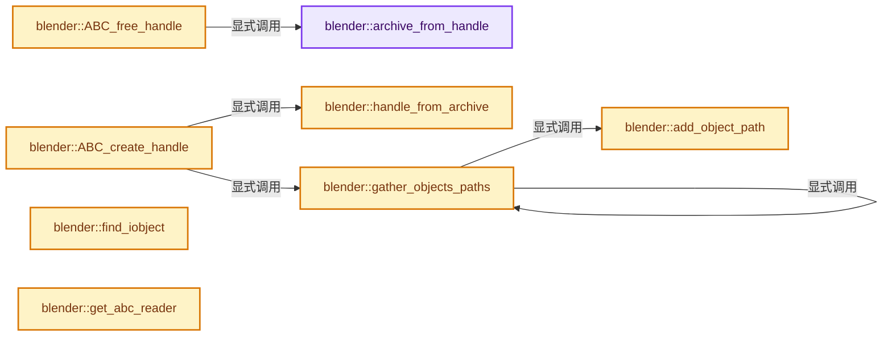
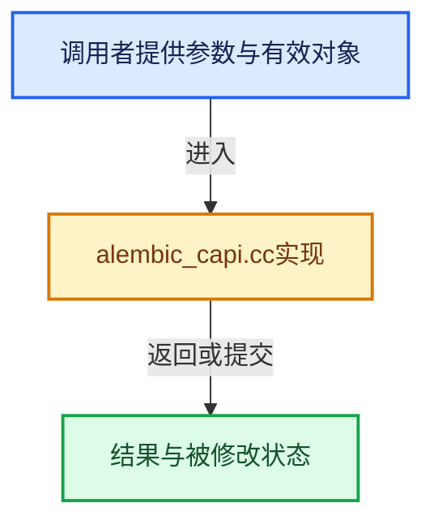

# 实现依赖专题：source/blender/io/alembic/intern/alembic_capi.cc

[实现依赖导航](../../../../README.md) · [符号索引](../../../../../00-课程指南/02-源码与提交索引/符号依赖与实现索引.md)

本专题从正文实际调用进入，集中保存共享实现。函数有稳定锚点，可从调用处直接跳到对应完整函数；递归与互相调用通过回链组织。

## 本文件的实现关系






## 完整成员与函数实现

<a id="f-9d30f183bd842b68"></a>

### `blender::archive_from_handle`

实现位置：[source/blender/io/alembic/intern/alembic_capi.cc](../../../../../../../../../source/blender/io/alembic/intern/alembic_capi.cc) · L106—L109。

接口参数：

- `CacheArchiveHandle *handle`

**教学注释版**

<!-- annotated:ab4d0fccd3f9bf -->

```cpp
BLI_INLINE AlembicArchiveData *archive_from_handle(CacheArchiveHandle *handle)
{
  return reinterpret_cast<AlembicArchiveData *>(handle);
}
```

<details>
<summary>核对原始源码：source/blender/io/alembic/intern/alembic_capi.cc · L106—L109</summary>

<!-- original:ab4d0fccd3f9bf:source/blender/io/alembic/intern/alembic_capi.cc:106:109 -->

```cpp
BLI_INLINE AlembicArchiveData *archive_from_handle(CacheArchiveHandle *handle)
{
  return reinterpret_cast<AlembicArchiveData *>(handle);
}
```

</details>

**结果出口**

- `return reinterpret_cast<AlembicArchiveData *>(handle);`

**继续追踪实现**

本实现没有需要继续展开的显式调用；检查返回表达式、对象转换和调用者前置条件。

<a id="f-bbccac81faf72de4"></a>

### `blender::handle_from_archive`

实现位置：[source/blender/io/alembic/intern/alembic_capi.cc](../../../../../../../../../source/blender/io/alembic/intern/alembic_capi.cc) · L111—L114。

接口参数：

- `AlembicArchiveData *archive`

**教学注释版**

<!-- annotated:0be0ce0ca5c8b7 -->

```cpp
BLI_INLINE CacheArchiveHandle *handle_from_archive(AlembicArchiveData *archive)
{
  return reinterpret_cast<CacheArchiveHandle *>(archive);
}
```

<details>
<summary>核对原始源码：source/blender/io/alembic/intern/alembic_capi.cc · L111—L114</summary>

<!-- original:0be0ce0ca5c8b7:source/blender/io/alembic/intern/alembic_capi.cc:111:114 -->

```cpp
BLI_INLINE CacheArchiveHandle *handle_from_archive(AlembicArchiveData *archive)
{
  return reinterpret_cast<CacheArchiveHandle *>(archive);
}
```

</details>

**结果出口**

- `return reinterpret_cast<CacheArchiveHandle *>(archive);`

**继续追踪实现**

本实现没有需要继续展开的显式调用；检查返回表达式、对象转换和调用者前置条件。

<a id="f-04d96a44280b6843"></a>

### `blender::add_object_path`

实现位置：[source/blender/io/alembic/intern/alembic_capi.cc](../../../../../../../../../source/blender/io/alembic/intern/alembic_capi.cc) · L119—L124。

接口参数：

- `ListBaseT<CacheObjectPath> *object_paths`
- `const IObject &object`

**教学注释版**

<!-- annotated:2fb5653d3cb1f3 -->

```cpp
static void add_object_path(ListBaseT<CacheObjectPath> *object_paths, const IObject &object)
{
  CacheObjectPath *abc_path = MEM_new<CacheObjectPath>("CacheObjectPath");
  STRNCPY(abc_path->path, object.getFullName().c_str());
  BLI_addtail(object_paths, abc_path);
}
```

<details>
<summary>核对原始源码：source/blender/io/alembic/intern/alembic_capi.cc · L119—L124</summary>

<!-- original:2fb5653d3cb1f3:source/blender/io/alembic/intern/alembic_capi.cc:119:124 -->

```cpp
static void add_object_path(ListBaseT<CacheObjectPath> *object_paths, const IObject &object)
{
  CacheObjectPath *abc_path = MEM_new<CacheObjectPath>("CacheObjectPath");
  STRNCPY(abc_path->path, object.getFullName().c_str());
  BLI_addtail(object_paths, abc_path);
}
```

</details>

**继续追踪实现**

- `MEM_new<CacheObjectPath>` → [MEM_new · L351](../../../../07-Intern运行时与平台/guardedalloc/MEM_guardedalloc.h.md#f-115f9b6784f89912)。
- `STRNCPY` → [blender::STRNCPY · L690](../../../../01-BLI基础库/BLI_string.hh.md#f-6b2d861724026be6)。
- `object.getFullName().c_str` → [调用协议](../../../../../00-课程指南/01-路线与规范/模板宏与动态分派协议.md)：接收对象类型依赖auto、返回值或模板实例；不按同名猜测目标。调用位置L122。
- `object.getFullName` → [调用协议](../../../../../00-课程指南/01-路线与规范/模板宏与动态分派协议.md)：由接收对象具体类型或运行时策略提供实现。调用位置L122。
- `BLI_addtail` → [blender::BLI_addtail · L118](../../../../01-BLI基础库/intern/listbase.cc.md#f-4fb027713fa3115b)。

<a id="f-ec21b2aa12dac9ee"></a>

### `blender::gather_objects_paths`

实现位置：[source/blender/io/alembic/intern/alembic_capi.cc](../../../../../../../../../source/blender/io/alembic/intern/alembic_capi.cc) · L130—L177。

接口参数：

- `const IObject &object`
- `ListBaseT<CacheObjectPath> *object_paths`

**教学注释版**

<!-- annotated:c584b681b43ca5 -->

```cpp
static bool gather_objects_paths(const IObject &object, ListBaseT<CacheObjectPath> *object_paths)
{
  if (!object.valid()) {
    return false;
  }

  size_t children_claiming_this_object = 0;
  size_t num_children = object.getNumChildren();

  for (size_t i = 0; i < num_children; i++) {
    bool child_claims_this_object = gather_objects_paths(object.getChild(i), object_paths);
    children_claiming_this_object += child_claims_this_object ? 1 : 0;
  }

  const MetaData &md = object.getMetaData();
  bool get_path = false;
  bool parent_is_part_of_this_object = false;

  if (!object.getParent()) {
    /* The root itself is not an object we should import. */
  }
  else if (IXform::matches(md)) {
    if (has_property(object.getProperties(), "locator")) {
      get_path = true;
    }
    else {
      get_path = children_claiming_this_object == 0;
    }

    /* Transforms are never "data" for their parent. */
    parent_is_part_of_this_object = false;
  }
  else {
    /* These types are "data" for their parent. */
    get_path = IPolyMesh::matches(md) || ISubD::matches(md) ||
#ifdef USE_NURBS
               INuPatch::matches(md) ||
#endif
               ICamera::matches(md) || IPoints::matches(md) || ICurves::matches(md);
    parent_is_part_of_this_object = get_path;
  }

  if (get_path) {
    add_object_path(object_paths, object);
  }

  return parent_is_part_of_this_object;
}
```

<details>
<summary>核对原始源码：source/blender/io/alembic/intern/alembic_capi.cc · L130—L177</summary>

<!-- original:c584b681b43ca5:source/blender/io/alembic/intern/alembic_capi.cc:130:177 -->

```cpp
static bool gather_objects_paths(const IObject &object, ListBaseT<CacheObjectPath> *object_paths)
{
  if (!object.valid()) {
    return false;
  }

  size_t children_claiming_this_object = 0;
  size_t num_children = object.getNumChildren();

  for (size_t i = 0; i < num_children; i++) {
    bool child_claims_this_object = gather_objects_paths(object.getChild(i), object_paths);
    children_claiming_this_object += child_claims_this_object ? 1 : 0;
  }

  const MetaData &md = object.getMetaData();
  bool get_path = false;
  bool parent_is_part_of_this_object = false;

  if (!object.getParent()) {
    /* The root itself is not an object we should import. */
  }
  else if (IXform::matches(md)) {
    if (has_property(object.getProperties(), "locator")) {
      get_path = true;
    }
    else {
      get_path = children_claiming_this_object == 0;
    }

    /* Transforms are never "data" for their parent. */
    parent_is_part_of_this_object = false;
  }
  else {
    /* These types are "data" for their parent. */
    get_path = IPolyMesh::matches(md) || ISubD::matches(md) ||
#ifdef USE_NURBS
               INuPatch::matches(md) ||
#endif
               ICamera::matches(md) || IPoints::matches(md) || ICurves::matches(md);
    parent_is_part_of_this_object = get_path;
  }

  if (get_path) {
    add_object_path(object_paths, object);
  }

  return parent_is_part_of_this_object;
}
```

</details>

**沿实际写入检查状态**

- `children_claiming_this_object += child_claims_this_object ? 1 : 0;`
- `get_path = true;`
- `get_path = children_claiming_this_object == 0;`
- `parent_is_part_of_this_object = false;`
- `get_path = IPolyMesh::matches(md) || ISubD::matches(md) ||`
- `parent_is_part_of_this_object = get_path;`

**结果出口**

- `return false;`
- `return parent_is_part_of_this_object;`

**继续追踪实现**

- `object.valid` → [调用协议](../../../../../00-课程指南/01-路线与规范/模板宏与动态分派协议.md)：由接收对象具体类型或运行时策略提供实现。调用位置L132。
- `object.getNumChildren` → [调用协议](../../../../../00-课程指南/01-路线与规范/模板宏与动态分派协议.md)：由接收对象具体类型或运行时策略提供实现。调用位置L137。
- `gather_objects_paths` → [blender::gather_objects_paths · L130](alembic_capi.cc.md#f-ec21b2aa12dac9ee)。
- `object.getChild` → [调用协议](../../../../../00-课程指南/01-路线与规范/模板宏与动态分派协议.md)：由接收对象具体类型或运行时策略提供实现。调用位置L140。
- `object.getMetaData` → [调用协议](../../../../../00-课程指南/01-路线与规范/模板宏与动态分派协议.md)：由接收对象具体类型或运行时策略提供实现。调用位置L144。
- `object.getParent` → [调用协议](../../../../../00-课程指南/01-路线与规范/模板宏与动态分派协议.md)：由接收对象具体类型或运行时策略提供实现。调用位置L148。
- `IXform::matches` → [调用协议](../../../../../00-课程指南/01-路线与规范/模板宏与动态分派协议.md)：函数指针、局部可调用对象或未展开的宏；必须结合调用者环境。调用位置L151。
- `has_property` → [blender::io::alembic::has_property · L77](abc_util.cc.md#f-cd9ad83a000b4b68)。
- `object.getProperties` → [调用协议](../../../../../00-课程指南/01-路线与规范/模板宏与动态分派协议.md)：由接收对象具体类型或运行时策略提供实现。调用位置L152。
- `IPolyMesh::matches` → [调用协议](../../../../../00-课程指南/01-路线与规范/模板宏与动态分派协议.md)：函数指针、局部可调用对象或未展开的宏；必须结合调用者环境。调用位置L164。
- `ISubD::matches` → [调用协议](../../../../../00-课程指南/01-路线与规范/模板宏与动态分派协议.md)：函数指针、局部可调用对象或未展开的宏；必须结合调用者环境。调用位置L164。
- `INuPatch::matches` → [调用协议](../../../../../00-课程指南/01-路线与规范/模板宏与动态分派协议.md)：函数指针、局部可调用对象或未展开的宏；必须结合调用者环境。调用位置L166。
- `ICamera::matches` → [调用协议](../../../../../00-课程指南/01-路线与规范/模板宏与动态分派协议.md)：函数指针、局部可调用对象或未展开的宏；必须结合调用者环境。调用位置L168。
- `IPoints::matches` → [调用协议](../../../../../00-课程指南/01-路线与规范/模板宏与动态分派协议.md)：函数指针、局部可调用对象或未展开的宏；必须结合调用者环境。调用位置L168。
- `ICurves::matches` → [调用协议](../../../../../00-课程指南/01-路线与规范/模板宏与动态分派协议.md)：函数指针、局部可调用对象或未展开的宏；必须结合调用者环境。调用位置L168。
- `add_object_path` → [blender::add_object_path · L119](alembic_capi.cc.md#f-04d96a44280b6843)。

<a id="f-489ddf17640b32ae"></a>

### `blender::ABC_create_handle`

实现位置：[source/blender/io/alembic/intern/alembic_capi.cc](../../../../../../../../../source/blender/io/alembic/intern/alembic_capi.cc) · L179—L213。

接口参数：

- `const Main *bmain`
- `const char *filepath`
- `const CacheFileLayer *layers`
- `ListBaseT<CacheObjectPath> *object_paths`

**教学注释版**

<!-- annotated:ab78ca914a4df2 -->

```cpp
CacheArchiveHandle *ABC_create_handle(const Main *bmain,
                                      const char *filepath,
                                      const CacheFileLayer *layers,
                                      ListBaseT<CacheObjectPath> *object_paths)
{
  std::vector<const char *> filepaths;
  filepaths.push_back(filepath);

  while (layers) {
    if ((layers->flag & CACHEFILE_LAYER_HIDDEN) == 0) {
      filepaths.push_back(layers->filepath);
    }
    layers = layers->next;
  }

  /* We need to reverse the order as overriding archives should come first. */
  std::reverse(filepaths.begin(), filepaths.end());

  ArchiveReader *archive = ArchiveReader::get(bmain, filepaths);

  if (!archive || !archive->valid()) {
    delete archive;
    return nullptr;
  }

  if (object_paths) {
    gather_objects_paths(archive->getTop(), object_paths);
  }

  AlembicArchiveData *archive_data = new AlembicArchiveData();
  archive_data->archive_reader = archive;
  archive_data->settings = new ImportSettings();

  return handle_from_archive(archive_data);
}
```

<details>
<summary>核对原始源码：source/blender/io/alembic/intern/alembic_capi.cc · L179—L213</summary>

<!-- original:ab78ca914a4df2:source/blender/io/alembic/intern/alembic_capi.cc:179:213 -->

```cpp
CacheArchiveHandle *ABC_create_handle(const Main *bmain,
                                      const char *filepath,
                                      const CacheFileLayer *layers,
                                      ListBaseT<CacheObjectPath> *object_paths)
{
  std::vector<const char *> filepaths;
  filepaths.push_back(filepath);

  while (layers) {
    if ((layers->flag & CACHEFILE_LAYER_HIDDEN) == 0) {
      filepaths.push_back(layers->filepath);
    }
    layers = layers->next;
  }

  /* We need to reverse the order as overriding archives should come first. */
  std::reverse(filepaths.begin(), filepaths.end());

  ArchiveReader *archive = ArchiveReader::get(bmain, filepaths);

  if (!archive || !archive->valid()) {
    delete archive;
    return nullptr;
  }

  if (object_paths) {
    gather_objects_paths(archive->getTop(), object_paths);
  }

  AlembicArchiveData *archive_data = new AlembicArchiveData();
  archive_data->archive_reader = archive;
  archive_data->settings = new ImportSettings();

  return handle_from_archive(archive_data);
}
```

</details>

**沿实际写入检查状态**

- `layers = layers->next;`
- `archive_data->archive_reader = archive;`
- `archive_data->settings = new ImportSettings();`

**结果出口**

- `return nullptr;`
- `return handle_from_archive(archive_data);`

**继续追踪实现**

- `filepaths.push_back` → [外部契约](https://eel.is/c++draft/)：这个边界按实际表达式及所属类型核对参数、返回值、寿命与失败行为。这里提供接口入口，不声称已解释该第三方版本的内部实现。
- `std::reverse` → [外部契约](https://eel.is/c++draft/)：这个边界按实际表达式及所属类型核对参数、返回值、寿命与失败行为。这里提供接口入口，不声称已解释该第三方版本的内部实现。
- `filepaths.begin` → [外部契约](https://eel.is/c++draft/)：这个边界按实际表达式及所属类型核对参数、返回值、寿命与失败行为。这里提供接口入口，不声称已解释该第三方版本的内部实现。
- `filepaths.end` → [外部契约](https://eel.is/c++draft/)：这个边界按实际表达式及所属类型核对参数、返回值、寿命与失败行为。这里提供接口入口，不声称已解释该第三方版本的内部实现。
- `ArchiveReader::get` → [blender::io::alembic::ArchiveReader::get · L74](abc_reader_archive.cc.md#f-db5f48970b0c7afe)。
- `archive->valid` → [blender::io::alembic::ArchiveReader::valid · L141](abc_reader_archive.cc.md#f-ddd763b3a0b67620)。
- `gather_objects_paths` → [blender::gather_objects_paths · L130](alembic_capi.cc.md#f-ec21b2aa12dac9ee)。
- `archive->getTop` → [blender::io::alembic::ArchiveReader::getTop · L146](abc_reader_archive.cc.md#f-a68504152555f570)。
- `handle_from_archive` → [blender::handle_from_archive · L111](alembic_capi.cc.md#f-bbccac81faf72de4)。

<a id="f-c536f388969f0280"></a>

### `blender::ABC_free_handle`

实现位置：[source/blender/io/alembic/intern/alembic_capi.cc](../../../../../../../../../source/blender/io/alembic/intern/alembic_capi.cc) · L215—L218。

接口参数：

- `CacheArchiveHandle *handle`

**教学注释版**

<!-- annotated:1dfbbc788e4c82 -->

```cpp
void ABC_free_handle(CacheArchiveHandle *handle)
{
  delete archive_from_handle(handle);
}
```

<details>
<summary>核对原始源码：source/blender/io/alembic/intern/alembic_capi.cc · L215—L218</summary>

<!-- original:1dfbbc788e4c82:source/blender/io/alembic/intern/alembic_capi.cc:215:218 -->

```cpp
void ABC_free_handle(CacheArchiveHandle *handle)
{
  delete archive_from_handle(handle);
}
```

</details>

**继续追踪实现**

- `archive_from_handle` → [blender::archive_from_handle · L106](alembic_capi.cc.md#f-9d30f183bd842b68)。

<a id="f-7c278a18f0693955"></a>

### `blender::find_iobject`

实现位置：[source/blender/io/alembic/intern/alembic_capi.cc](../../../../../../../../../source/blender/io/alembic/intern/alembic_capi.cc) · L225—L243。

接口参数：

- `const IObject &object`
- `IObject &ret`
- `const std::string &path`

**教学注释版**

<!-- annotated:6d89e24d87faa4 -->

```cpp
static void find_iobject(const IObject &object, IObject &ret, const std::string &path)
{
  if (!object.valid()) {
    return;
  }

  std::vector<std::string> tokens;
  split(path, '/', tokens);

  IObject tmp = object;

  std::vector<std::string>::iterator iter;
  for (iter = tokens.begin(); iter != tokens.end(); ++iter) {
    IObject child = tmp.getChild(*iter);
    tmp = child;
  }

  ret = tmp;
}
```

<details>
<summary>核对原始源码：source/blender/io/alembic/intern/alembic_capi.cc · L225—L243</summary>

<!-- original:6d89e24d87faa4:source/blender/io/alembic/intern/alembic_capi.cc:225:243 -->

```cpp
static void find_iobject(const IObject &object, IObject &ret, const std::string &path)
{
  if (!object.valid()) {
    return;
  }

  std::vector<std::string> tokens;
  split(path, '/', tokens);

  IObject tmp = object;

  std::vector<std::string>::iterator iter;
  for (iter = tokens.begin(); iter != tokens.end(); ++iter) {
    IObject child = tmp.getChild(*iter);
    tmp = child;
  }

  ret = tmp;
}
```

</details>

**沿实际写入检查状态**

- `tmp = child;`
- `ret = tmp;`

**继续追踪实现**

- `object.valid` → [调用协议](../../../../../00-课程指南/01-路线与规范/模板宏与动态分派协议.md)：由接收对象具体类型或运行时策略提供实现。调用位置L227。
- `split` → [调用协议](../../../../../00-课程指南/01-路线与规范/模板宏与动态分派协议.md)：函数指针、局部可调用对象或未展开的宏；必须结合调用者环境。调用位置L232。
- `tokens.begin` → [外部契约](https://eel.is/c++draft/)：这个边界按实际表达式及所属类型核对参数、返回值、寿命与失败行为。这里提供接口入口，不声称已解释该第三方版本的内部实现。
- `tokens.end` → [外部契约](https://eel.is/c++draft/)：这个边界按实际表达式及所属类型核对参数、返回值、寿命与失败行为。这里提供接口入口，不声称已解释该第三方版本的内部实现。
- `tmp.getChild` → [调用协议](../../../../../00-课程指南/01-路线与规范/模板宏与动态分派协议.md)：由接收对象具体类型或运行时策略提供实现。调用位置L238。

<a id="f-5c8bfe05c1de9ec1"></a>

### `blender::get_abc_reader`

实现位置：[source/blender/io/alembic/intern/alembic_capi.cc](../../../../../../../../../source/blender/io/alembic/intern/alembic_capi.cc) · L880—L897。

接口参数：

- `CacheReader *reader`
- `Object *ob`
- `const char **r_err_str`

**教学注释版**

<!-- annotated:946c795789f443 -->

```cpp
static AbcObjectReader *get_abc_reader(CacheReader *reader, Object *ob, const char **r_err_str)
{
  AbcObjectReader *abc_reader = reinterpret_cast<AbcObjectReader *>(reader);
  IObject iobject = abc_reader->iobject();

  if (!iobject.valid()) {
    *r_err_str = RPT_("Invalid object: verify object path");
    return nullptr;
  }

  const ObjectHeader &header = iobject.getHeader();
  if (!abc_reader->accepts_object_type(header, ob, r_err_str)) {
    /* r_err_str is set by acceptsObjectType() */
    return nullptr;
  }

  return abc_reader;
}
```

<details>
<summary>核对原始源码：source/blender/io/alembic/intern/alembic_capi.cc · L880—L897</summary>

<!-- original:946c795789f443:source/blender/io/alembic/intern/alembic_capi.cc:880:897 -->

```cpp
static AbcObjectReader *get_abc_reader(CacheReader *reader, Object *ob, const char **r_err_str)
{
  AbcObjectReader *abc_reader = reinterpret_cast<AbcObjectReader *>(reader);
  IObject iobject = abc_reader->iobject();

  if (!iobject.valid()) {
    *r_err_str = RPT_("Invalid object: verify object path");
    return nullptr;
  }

  const ObjectHeader &header = iobject.getHeader();
  if (!abc_reader->accepts_object_type(header, ob, r_err_str)) {
    /* r_err_str is set by acceptsObjectType() */
    return nullptr;
  }

  return abc_reader;
}
```

</details>

**结果出口**

- `return nullptr;`
- `return abc_reader;`

**继续追踪实现**

- `abc_reader->iobject` → [blender::io::alembic::AbcObjectReader::iobject · L107](abc_reader_object.cc.md#f-c4d7d7a714ce137e)。
- `iobject.valid` → [调用协议](../../../../../00-课程指南/01-路线与规范/模板宏与动态分派协议.md)：由接收对象具体类型或运行时策略提供实现。调用位置L885。
- `RPT_` → [RPT_ · L51](../../../blentranslation/BLT_translation.hh.md#m-c13f94a1a934)。宏定义由构建条件选择。
- `iobject.getHeader` → [调用协议](../../../../../00-课程指南/01-路线与规范/模板宏与动态分派协议.md)：由接收对象具体类型或运行时策略提供实现。调用位置L890。
- `abc_reader->accepts_object_type` → [调用协议](../../../../../00-课程指南/01-路线与规范/模板宏与动态分派协议.md)：由接收对象具体类型或运行时策略提供实现。调用位置L891。

<a id="f-4147a7f6d8f0a2af"></a>

### `blender::sample_selector_for_time`

实现位置：[source/blender/io/alembic/intern/alembic_capi.cc](../../../../../../../../../source/blender/io/alembic/intern/alembic_capi.cc) · L899—L904。

接口参数：

- `chrono_t time`

**教学注释版**

<!-- annotated:50199fd7ea2c45 -->

```cpp
static ISampleSelector sample_selector_for_time(chrono_t time)
{
  /* kFloorIndex is used to be compatible with non-interpolating
   * properties; they use the floor. */
  return ISampleSelector(time, ISampleSelector::kFloorIndex);
}
```

<details>
<summary>核对原始源码：source/blender/io/alembic/intern/alembic_capi.cc · L899—L904</summary>

<!-- original:50199fd7ea2c45:source/blender/io/alembic/intern/alembic_capi.cc:899:904 -->

```cpp
static ISampleSelector sample_selector_for_time(chrono_t time)
{
  /* kFloorIndex is used to be compatible with non-interpolating
   * properties; they use the floor. */
  return ISampleSelector(time, ISampleSelector::kFloorIndex);
}
```

</details>

**结果出口**

- `return ISampleSelector(time, ISampleSelector::kFloorIndex);`

**继续追踪实现**

- `ISampleSelector` → [调用协议](../../../../../00-课程指南/01-路线与规范/模板宏与动态分派协议.md)：函数指针、局部可调用对象或未展开的宏；必须结合调用者环境。调用位置L903。

<a id="f-85491e20ad319175"></a>

### `blender::ABC_read_geometry`

实现位置：[source/blender/io/alembic/intern/alembic_capi.cc](../../../../../../../../../source/blender/io/alembic/intern/alembic_capi.cc) · L906—L923。

接口参数：

- `CacheReader *reader`
- `Object *ob`
- `bke::GeometrySet &geometry_set`
- `const ABCReadParams *params`
- `const char **r_err_str`

**教学注释版**

<!-- annotated:247bcb7967029d -->

```cpp
void ABC_read_geometry(CacheReader *reader,
                       Object *ob,
                       bke::GeometrySet &geometry_set,
                       const ABCReadParams *params,
                       const char **r_err_str)
{
  AbcObjectReader *abc_reader = get_abc_reader(reader, ob, r_err_str);
  if (abc_reader == nullptr) {
    return;
  }

  ISampleSelector sample_sel = sample_selector_for_time(params->time);
  AbcReadGeometryParams read_params;
  read_params.read_flag = params->read_flags;
  read_params.velocity_name = params->velocity_name ? params->velocity_name : "";
  read_params.velocity_scale = params->velocity_scale;
  abc_reader->read_geometry(geometry_set, sample_sel, read_params, r_err_str);
}
```

<details>
<summary>核对原始源码：source/blender/io/alembic/intern/alembic_capi.cc · L906—L923</summary>

<!-- original:247bcb7967029d:source/blender/io/alembic/intern/alembic_capi.cc:906:923 -->

```cpp
void ABC_read_geometry(CacheReader *reader,
                       Object *ob,
                       bke::GeometrySet &geometry_set,
                       const ABCReadParams *params,
                       const char **r_err_str)
{
  AbcObjectReader *abc_reader = get_abc_reader(reader, ob, r_err_str);
  if (abc_reader == nullptr) {
    return;
  }

  ISampleSelector sample_sel = sample_selector_for_time(params->time);
  AbcReadGeometryParams read_params;
  read_params.read_flag = params->read_flags;
  read_params.velocity_name = params->velocity_name ? params->velocity_name : "";
  read_params.velocity_scale = params->velocity_scale;
  abc_reader->read_geometry(geometry_set, sample_sel, read_params, r_err_str);
}
```

</details>

**沿实际写入检查状态**

- `read_params.read_flag = params->read_flags;`
- `read_params.velocity_name = params->velocity_name ? params->velocity_name : "";`
- `read_params.velocity_scale = params->velocity_scale;`

**继续追踪实现**

- `get_abc_reader` → [blender::get_abc_reader · L880](alembic_capi.cc.md#f-5c8bfe05c1de9ec1)。
- `sample_selector_for_time` → [blender::sample_selector_for_time · L899](alembic_capi.cc.md#f-4147a7f6d8f0a2af)。
- `abc_reader->read_geometry` → [blender::io::alembic::AbcObjectReader::read_geometry · L160](abc_reader_object.cc.md#f-c155c5a744c6d019)。

<a id="f-19ab3d009d455876"></a>

### `blender::ABC_mesh_topology_changed`

实现位置：[source/blender/io/alembic/intern/alembic_capi.cc](../../../../../../../../../source/blender/io/alembic/intern/alembic_capi.cc) · L925—L938。

接口参数：

- `CacheReader *reader`
- `Object *ob`
- `const Mesh *existing_mesh`
- `const double time`
- `const char **r_err_str`

**教学注释版**

<!-- annotated:af50955dcb31c8 -->

```cpp
bool ABC_mesh_topology_changed(CacheReader *reader,
                               Object *ob,
                               const Mesh *existing_mesh,
                               const double time,
                               const char **r_err_str)
{
  AbcObjectReader *abc_reader = get_abc_reader(reader, ob, r_err_str);
  if (abc_reader == nullptr) {
    return false;
  }

  ISampleSelector sample_sel = sample_selector_for_time(time);
  return abc_reader->topology_changed(existing_mesh, sample_sel);
}
```

<details>
<summary>核对原始源码：source/blender/io/alembic/intern/alembic_capi.cc · L925—L938</summary>

<!-- original:af50955dcb31c8:source/blender/io/alembic/intern/alembic_capi.cc:925:938 -->

```cpp
bool ABC_mesh_topology_changed(CacheReader *reader,
                               Object *ob,
                               const Mesh *existing_mesh,
                               const double time,
                               const char **r_err_str)
{
  AbcObjectReader *abc_reader = get_abc_reader(reader, ob, r_err_str);
  if (abc_reader == nullptr) {
    return false;
  }

  ISampleSelector sample_sel = sample_selector_for_time(time);
  return abc_reader->topology_changed(existing_mesh, sample_sel);
}
```

</details>

**结果出口**

- `return false;`
- `return abc_reader->topology_changed(existing_mesh, sample_sel);`

**继续追踪实现**

- `get_abc_reader` → [blender::get_abc_reader · L880](alembic_capi.cc.md#f-5c8bfe05c1de9ec1)。
- `sample_selector_for_time` → [blender::sample_selector_for_time · L899](alembic_capi.cc.md#f-4147a7f6d8f0a2af)。
- `abc_reader->topology_changed` → [blender::io::alembic::AbcObjectReader::topology_changed · L167](abc_reader_object.cc.md#f-70497921d3e21802)。

<a id="f-c09d00d31fd7bc58"></a>

### `blender::ABC_CacheReader_free`

实现位置：[source/blender/io/alembic/intern/alembic_capi.cc](../../../../../../../../../source/blender/io/alembic/intern/alembic_capi.cc) · L942—L950。

接口参数：

- `CacheReader *reader`

**教学注释版**

<!-- annotated:b0cf0e9d12652b -->

```cpp
void ABC_CacheReader_free(CacheReader *reader)
{
  AbcObjectReader *abc_reader = reinterpret_cast<AbcObjectReader *>(reader);
  abc_reader->decref();

  if (abc_reader->refcount() == 0) {
    delete abc_reader;
  }
}
```

<details>
<summary>核对原始源码：source/blender/io/alembic/intern/alembic_capi.cc · L942—L950</summary>

<!-- original:b0cf0e9d12652b:source/blender/io/alembic/intern/alembic_capi.cc:942:950 -->

```cpp
void ABC_CacheReader_free(CacheReader *reader)
{
  AbcObjectReader *abc_reader = reinterpret_cast<AbcObjectReader *>(reader);
  abc_reader->decref();

  if (abc_reader->refcount() == 0) {
    delete abc_reader;
  }
}
```

</details>

**继续追踪实现**

- `abc_reader->decref` → [blender::io::alembic::AbcObjectReader::decref · L418](abc_reader_object.cc.md#f-d7c5cbbce32de3cb)。
- `abc_reader->refcount` → [blender::io::alembic::AbcObjectReader::refcount · L408](abc_reader_object.cc.md#f-684c4788979f3c0c)。

<a id="f-f0d03d3199c08042"></a>

### `blender::CacheReader_open_alembic_object`

实现位置：[source/blender/io/alembic/intern/alembic_capi.cc](../../../../../../../../../source/blender/io/alembic/intern/alembic_capi.cc) · L952—L995。

接口参数：

- `CacheArchiveHandle *handle`
- `CacheReader *reader`
- `Object *object`
- `const char *object_path`
- `const bool is_sequence`

**教学注释版**

<!-- annotated:1153063f60d9fa -->

```cpp
CacheReader *CacheReader_open_alembic_object(CacheArchiveHandle *handle,
                                             CacheReader *reader,
                                             Object *object,
                                             const char *object_path,
                                             const bool is_sequence)
{
  if (object_path[0] == '\0') {
    return reader;
  }

  AlembicArchiveData *archive_data = archive_from_handle(handle);
  if (!archive_data) {
    return reader;
  }

  ArchiveReader *archive = archive_data->archive_reader;
  if (!archive || !archive->valid()) {
    return reader;
  }

  IObject iobject;
  find_iobject(archive->getTop(), iobject, object_path);

  if (reader) {
    ABC_CacheReader_free(reader);
  }

  archive_data->settings->is_sequence = is_sequence;
  archive_data->settings->blender_archive_version_prior_44 =
      archive->is_blender_archive_version_prior_44();

  const AbcReaderConstructorArgs args = create_reader_constructor_args(iobject,
                                                                       *archive_data->settings);

  AbcObjectReader *abc_reader = create_reader(args);
  if (abc_reader == nullptr) {
    /* This object is not supported */
    return nullptr;
  }
  abc_reader->object(object);
  abc_reader->incref();

  return reinterpret_cast<CacheReader *>(abc_reader);
}
```

<details>
<summary>核对原始源码：source/blender/io/alembic/intern/alembic_capi.cc · L952—L995</summary>

<!-- original:1153063f60d9fa:source/blender/io/alembic/intern/alembic_capi.cc:952:995 -->

```cpp
CacheReader *CacheReader_open_alembic_object(CacheArchiveHandle *handle,
                                             CacheReader *reader,
                                             Object *object,
                                             const char *object_path,
                                             const bool is_sequence)
{
  if (object_path[0] == '\0') {
    return reader;
  }

  AlembicArchiveData *archive_data = archive_from_handle(handle);
  if (!archive_data) {
    return reader;
  }

  ArchiveReader *archive = archive_data->archive_reader;
  if (!archive || !archive->valid()) {
    return reader;
  }

  IObject iobject;
  find_iobject(archive->getTop(), iobject, object_path);

  if (reader) {
    ABC_CacheReader_free(reader);
  }

  archive_data->settings->is_sequence = is_sequence;
  archive_data->settings->blender_archive_version_prior_44 =
      archive->is_blender_archive_version_prior_44();

  const AbcReaderConstructorArgs args = create_reader_constructor_args(iobject,
                                                                       *archive_data->settings);

  AbcObjectReader *abc_reader = create_reader(args);
  if (abc_reader == nullptr) {
    /* This object is not supported */
    return nullptr;
  }
  abc_reader->object(object);
  abc_reader->incref();

  return reinterpret_cast<CacheReader *>(abc_reader);
}
```

</details>

**沿实际写入检查状态**

- `archive_data->settings->is_sequence = is_sequence;`
- `archive_data->settings->blender_archive_version_prior_44 =`

**结果出口**

- `return reader;`
- `return nullptr;`
- `return reinterpret_cast<CacheReader *>(abc_reader);`

**继续追踪实现**

- `archive_from_handle` → [blender::archive_from_handle · L106](alembic_capi.cc.md#f-9d30f183bd842b68)。
- `archive->valid` → [blender::io::alembic::ArchiveReader::valid · L141](abc_reader_archive.cc.md#f-ddd763b3a0b67620)。
- `find_iobject` → [blender::find_iobject · L225](alembic_capi.cc.md#f-7c278a18f0693955)。
- `archive->getTop` → [blender::io::alembic::ArchiveReader::getTop · L146](abc_reader_archive.cc.md#f-a68504152555f570)。
- `ABC_CacheReader_free` → [blender::ABC_CacheReader_free · L942](alembic_capi.cc.md#f-c09d00d31fd7bc58)。
- `archive->is_blender_archive_version_prior_44` → [blender::io::alembic::ArchiveReader::is_blender_archive_version_prior_44 · L151](abc_reader_archive.cc.md#f-5ff98800fe13f146)。
- `create_reader_constructor_args` → [blender::io::alembic::create_reader_constructor_args · L49](abc_reader_object.cc.md#f-2b39cd0e493023d7)。
- `create_reader` → [调用协议](../../../../../00-课程指南/01-路线与规范/模板宏与动态分派协议.md)：函数指针、局部可调用对象或未展开的宏；必须结合调用者环境。调用位置L986。
- `abc_reader->object` → [blender::io::alembic::AbcObjectReader::object · L112](abc_reader_object.cc.md#f-f6e8ca0ffc33fc5d)；[blender::io::alembic::AbcObjectReader::object · L117](abc_reader_object.cc.md#f-cefc55154fd29bcf)。同名重载需按实参类型选择。
- `abc_reader->incref` → [blender::io::alembic::AbcObjectReader::incref · L413](abc_reader_object.cc.md#f-47bc3e229ff0b03e)。
