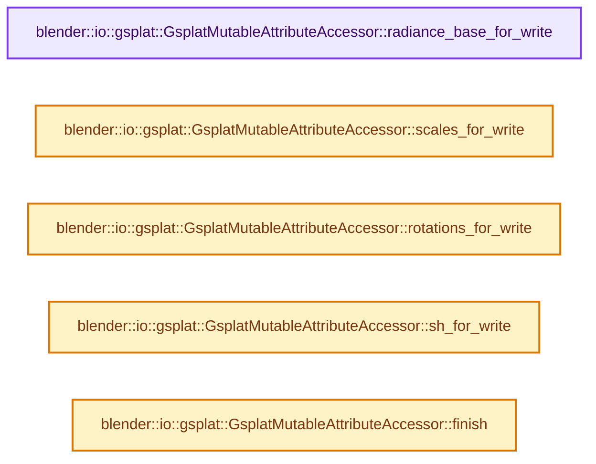
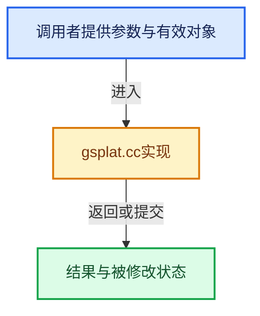

# 实现依赖专题：source/blender/io/common/intern/gsplat.cc

[实现依赖导航](../../../../README.md) · [符号索引](../../../../../00-课程指南/02-源码与提交索引/符号依赖与实现索引.md)

本专题从正文实际调用进入，集中保存共享实现。函数有稳定锚点，可从调用处直接跳到对应完整函数；递归与互相调用通过回链组织。

## 本文件的实现关系






## 完整成员与函数实现

<a id="f-105b84cad7cbd878"></a>

### `blender::io::gsplat::GsplatMutableAttributeAccessor::radiance_base_for_write`

实现位置：[source/blender/io/common/intern/gsplat.cc](../../../../../../../../../source/blender/io/common/intern/gsplat.cc) · L38—L41。

**教学注释版**

<!-- annotated:c4a20c224e12f9 -->

```cpp
MutableSpan<float4> GsplatMutableAttributeAccessor::radiance_base_for_write()
{
  return radiance_base_attr_.span;
}
```

<details>
<summary>核对原始源码：source/blender/io/common/intern/gsplat.cc · L38—L41</summary>

<!-- original:c4a20c224e12f9:source/blender/io/common/intern/gsplat.cc:38:41 -->

```cpp
MutableSpan<float4> GsplatMutableAttributeAccessor::radiance_base_for_write()
{
  return radiance_base_attr_.span;
}
```

</details>

**结果出口**

- `return radiance_base_attr_.span;`

**继续追踪实现**

本实现没有需要继续展开的显式调用；检查返回表达式、对象转换和调用者前置条件。

<a id="f-b0ebacc27508addd"></a>

### `blender::io::gsplat::GsplatMutableAttributeAccessor::scales_for_write`

实现位置：[source/blender/io/common/intern/gsplat.cc](../../../../../../../../../source/blender/io/common/intern/gsplat.cc) · L43—L46。

**教学注释版**

<!-- annotated:12209871319c59 -->

```cpp
MutableSpan<float3> GsplatMutableAttributeAccessor::scales_for_write()
{
  return scales_attr_.span;
}
```

<details>
<summary>核对原始源码：source/blender/io/common/intern/gsplat.cc · L43—L46</summary>

<!-- original:12209871319c59:source/blender/io/common/intern/gsplat.cc:43:46 -->

```cpp
MutableSpan<float3> GsplatMutableAttributeAccessor::scales_for_write()
{
  return scales_attr_.span;
}
```

</details>

**结果出口**

- `return scales_attr_.span;`

**继续追踪实现**

本实现没有需要继续展开的显式调用；检查返回表达式、对象转换和调用者前置条件。

<a id="f-91bbe964dafd28e4"></a>

### `blender::io::gsplat::GsplatMutableAttributeAccessor::rotations_for_write`

实现位置：[source/blender/io/common/intern/gsplat.cc](../../../../../../../../../source/blender/io/common/intern/gsplat.cc) · L48—L51。

**教学注释版**

<!-- annotated:18200897c7b141 -->

```cpp
MutableSpan<math::Quaternion> GsplatMutableAttributeAccessor::rotations_for_write()
{
  return rotations_attr_.span;
}
```

<details>
<summary>核对原始源码：source/blender/io/common/intern/gsplat.cc · L48—L51</summary>

<!-- original:18200897c7b141:source/blender/io/common/intern/gsplat.cc:48:51 -->

```cpp
MutableSpan<math::Quaternion> GsplatMutableAttributeAccessor::rotations_for_write()
{
  return rotations_attr_.span;
}
```

</details>

**结果出口**

- `return rotations_attr_.span;`

**继续追踪实现**

本实现没有需要继续展开的显式调用；检查返回表达式、对象转换和调用者前置条件。

<a id="f-9e04ca68bdc13ef3"></a>

### `blender::io::gsplat::GsplatMutableAttributeAccessor::sh_for_write`

实现位置：[source/blender/io/common/intern/gsplat.cc](../../../../../../../../../source/blender/io/common/intern/gsplat.cc) · L53—L56。

**教学注释版**

<!-- annotated:14205b15ae42c4 -->

```cpp
Span<MutableSpan<float3>> GsplatMutableAttributeAccessor::sh_for_write()
{
  return sh_spans_for_write_;
}
```

<details>
<summary>核对原始源码：source/blender/io/common/intern/gsplat.cc · L53—L56</summary>

<!-- original:14205b15ae42c4:source/blender/io/common/intern/gsplat.cc:53:56 -->

```cpp
Span<MutableSpan<float3>> GsplatMutableAttributeAccessor::sh_for_write()
{
  return sh_spans_for_write_;
}
```

</details>

**结果出口**

- `return sh_spans_for_write_;`

**继续追踪实现**

本实现没有需要继续展开的显式调用；检查返回表达式、对象转换和调用者前置条件。

<a id="f-f132d58bc945dfd6"></a>

### `blender::io::gsplat::GsplatMutableAttributeAccessor::finish`

实现位置：[source/blender/io/common/intern/gsplat.cc](../../../../../../../../../source/blender/io/common/intern/gsplat.cc) · L58—L66。

**教学注释版**

<!-- annotated:1bfad33839e3f8 -->

```cpp
void GsplatMutableAttributeAccessor::finish()
{
  radiance_base_attr_.finish();
  scales_attr_.finish();
  rotations_attr_.finish();
  for (bke::SpanAttributeWriter<float3> &sh_attr : sh_attrs_) {
    sh_attr.finish();
  }
}
```

<details>
<summary>核对原始源码：source/blender/io/common/intern/gsplat.cc · L58—L66</summary>

<!-- original:1bfad33839e3f8:source/blender/io/common/intern/gsplat.cc:58:66 -->

```cpp
void GsplatMutableAttributeAccessor::finish()
{
  radiance_base_attr_.finish();
  scales_attr_.finish();
  rotations_attr_.finish();
  for (bke::SpanAttributeWriter<float3> &sh_attr : sh_attrs_) {
    sh_attr.finish();
  }
}
```

</details>

**继续追踪实现**

- `radiance_base_attr_.finish` → [调用协议](../../../../../00-课程指南/01-路线与规范/模板宏与动态分派协议.md)：接收对象类型依赖auto、返回值或模板实例；不按同名猜测目标。调用位置L60。
- `scales_attr_.finish` → [调用协议](../../../../../00-课程指南/01-路线与规范/模板宏与动态分派协议.md)：接收对象类型依赖auto、返回值或模板实例；不按同名猜测目标。调用位置L61。
- `rotations_attr_.finish` → [调用协议](../../../../../00-课程指南/01-路线与规范/模板宏与动态分派协议.md)：接收对象类型依赖auto、返回值或模板实例；不按同名猜测目标。调用位置L62。
- `sh_attr.finish` → [调用协议](../../../../../00-课程指南/01-路线与规范/模板宏与动态分派协议.md)：接收对象类型依赖auto、返回值或模板实例；不按同名猜测目标。调用位置L64。
