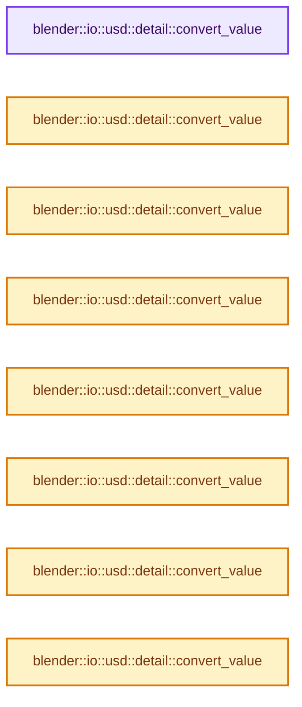

# 实现依赖专题：source/blender/io/usd/intern/usd_attribute_utils.hh

[实现依赖导航](../../../../README.md) · [符号索引](../../../../../00-课程指南/02-源码与提交索引/符号依赖与实现索引.md)

本专题从正文实际调用进入，集中保存共享实现。函数有稳定锚点，可从调用处直接跳到对应完整函数；递归与互相调用通过回链组织。

## 本文件的实现关系




## 完整成员与函数实现

<a id="f-ab16881f49dff56b"></a>

### `blender::io::usd::detail::convert_value`

实现位置：[source/blender/io/usd/intern/usd_attribute_utils.hh](../../../../../../../../../source/blender/io/usd/intern/usd_attribute_utils.hh) · L59—L64。

接口参数：

- `const From value`

**教学注释版**

<!-- annotated:5818e21f3328a7 -->

```cpp
template<typename From, typename To>
  requires(IsSmall<From>)
inline To convert_value(const From value)
{
  return value;
}
```

<details>
<summary>核对原始源码：source/blender/io/usd/intern/usd_attribute_utils.hh · L59—L64</summary>

<!-- original:5818e21f3328a7:source/blender/io/usd/intern/usd_attribute_utils.hh:59:64 -->

```cpp
template<typename From, typename To>
  requires(IsSmall<From>)
inline To convert_value(const From value)
{
  return value;
}
```

</details>

**结果出口**

- `return value;`

**继续追踪实现**

本实现没有需要继续展开的显式调用；检查返回表达式、对象转换和调用者前置条件。

<a id="f-460e7fc25c81eff6"></a>

### `blender::io::usd::detail::convert_value`

实现位置：[source/blender/io/usd/intern/usd_attribute_utils.hh](../../../../../../../../../source/blender/io/usd/intern/usd_attribute_utils.hh) · L65—L70。

接口参数：

- `const From &value`

**教学注释版**

<!-- annotated:9f793d5068bdf0 -->

```cpp
template<typename From, typename To>
  requires(!IsSmall<From>)
inline To convert_value(const From &value)
{
  return value;
}
```

<details>
<summary>核对原始源码：source/blender/io/usd/intern/usd_attribute_utils.hh · L65—L70</summary>

<!-- original:9f793d5068bdf0:source/blender/io/usd/intern/usd_attribute_utils.hh:65:70 -->

```cpp
template<typename From, typename To>
  requires(!IsSmall<From>)
inline To convert_value(const From &value)
{
  return value;
}
```

</details>

**结果出口**

- `return value;`

**继续追踪实现**

本实现没有需要继续展开的显式调用；检查返回表达式、对象转换和调用者前置条件。

<a id="f-b91887b786855538"></a>

### `blender::io::usd::detail::convert_value`

实现位置：[source/blender/io/usd/intern/usd_attribute_utils.hh](../../../../../../../../../source/blender/io/usd/intern/usd_attribute_utils.hh) · L72—L75。

接口参数：

- `const float2 value`

**教学注释版**

<!-- annotated:0d89bf6db7f983 -->

```cpp
template<> inline pxr::GfVec2f convert_value(const float2 value)
{
  return pxr::GfVec2f(value[0], value[1]);
}
```

<details>
<summary>核对原始源码：source/blender/io/usd/intern/usd_attribute_utils.hh · L72—L75</summary>

<!-- original:0d89bf6db7f983:source/blender/io/usd/intern/usd_attribute_utils.hh:72:75 -->

```cpp
template<> inline pxr::GfVec2f convert_value(const float2 value)
{
  return pxr::GfVec2f(value[0], value[1]);
}
```

</details>

**结果出口**

- `return pxr::GfVec2f(value[0], value[1]);`

**继续追踪实现**

- `pxr::GfVec2f` → [外部契约](https://eel.is/c++draft/)：这个边界按实际表达式及所属类型核对参数、返回值、寿命与失败行为。这里提供接口入口，不声称已解释该第三方版本的内部实现。

<a id="f-fcb9a95bfc98e89d"></a>

### `blender::io::usd::detail::convert_value`

实现位置：[source/blender/io/usd/intern/usd_attribute_utils.hh](../../../../../../../../../source/blender/io/usd/intern/usd_attribute_utils.hh) · L76—L79。

接口参数：

- `const float3 value`

**教学注释版**

<!-- annotated:fdd47605260784 -->

```cpp
template<> inline pxr::GfVec3f convert_value(const float3 value)
{
  return pxr::GfVec3f(value[0], value[1], value[2]);
}
```

<details>
<summary>核对原始源码：source/blender/io/usd/intern/usd_attribute_utils.hh · L76—L79</summary>

<!-- original:fdd47605260784:source/blender/io/usd/intern/usd_attribute_utils.hh:76:79 -->

```cpp
template<> inline pxr::GfVec3f convert_value(const float3 value)
{
  return pxr::GfVec3f(value[0], value[1], value[2]);
}
```

</details>

**结果出口**

- `return pxr::GfVec3f(value[0], value[1], value[2]);`

**继续追踪实现**

- `pxr::GfVec3f` → [外部契约](https://eel.is/c++draft/)：这个边界按实际表达式及所属类型核对参数、返回值、寿命与失败行为。这里提供接口入口，不声称已解释该第三方版本的内部实现。

<a id="f-ae77134f83a11b9a"></a>

### `blender::io::usd::detail::convert_value`

实现位置：[source/blender/io/usd/intern/usd_attribute_utils.hh](../../../../../../../../../source/blender/io/usd/intern/usd_attribute_utils.hh) · L80—L83。

接口参数：

- `const ColorGeometry4f value`

**教学注释版**

<!-- annotated:95a226324b62ff -->

```cpp
template<> inline pxr::GfVec3f convert_value(const ColorGeometry4f value)
{
  return pxr::GfVec3f(value.r, value.g, value.b);
}
```

<details>
<summary>核对原始源码：source/blender/io/usd/intern/usd_attribute_utils.hh · L80—L83</summary>

<!-- original:95a226324b62ff:source/blender/io/usd/intern/usd_attribute_utils.hh:80:83 -->

```cpp
template<> inline pxr::GfVec3f convert_value(const ColorGeometry4f value)
{
  return pxr::GfVec3f(value.r, value.g, value.b);
}
```

</details>

**结果出口**

- `return pxr::GfVec3f(value.r, value.g, value.b);`

**继续追踪实现**

- `pxr::GfVec3f` → [外部契约](https://eel.is/c++draft/)：这个边界按实际表达式及所属类型核对参数、返回值、寿命与失败行为。这里提供接口入口，不声称已解释该第三方版本的内部实现。

<a id="f-6a55ddcee8415350"></a>

### `blender::io::usd::detail::convert_value`

实现位置：[source/blender/io/usd/intern/usd_attribute_utils.hh](../../../../../../../../../source/blender/io/usd/intern/usd_attribute_utils.hh) · L84—L87。

接口参数：

- `const ColorGeometry4f value`

**教学注释版**

<!-- annotated:1e8ab423e3f571 -->

```cpp
template<> inline pxr::GfVec4f convert_value(const ColorGeometry4f value)
{
  return pxr::GfVec4f(value.r, value.g, value.b, value.a);
}
```

<details>
<summary>核对原始源码：source/blender/io/usd/intern/usd_attribute_utils.hh · L84—L87</summary>

<!-- original:1e8ab423e3f571:source/blender/io/usd/intern/usd_attribute_utils.hh:84:87 -->

```cpp
template<> inline pxr::GfVec4f convert_value(const ColorGeometry4f value)
{
  return pxr::GfVec4f(value.r, value.g, value.b, value.a);
}
```

</details>

**结果出口**

- `return pxr::GfVec4f(value.r, value.g, value.b, value.a);`

**继续追踪实现**

- `pxr::GfVec4f` → [外部契约](https://eel.is/c++draft/)：这个边界按实际表达式及所属类型核对参数、返回值、寿命与失败行为。这里提供接口入口，不声称已解释该第三方版本的内部实现。

<a id="f-de9393a0e89f0378"></a>

### `blender::io::usd::detail::convert_value`

实现位置：[source/blender/io/usd/intern/usd_attribute_utils.hh](../../../../../../../../../source/blender/io/usd/intern/usd_attribute_utils.hh) · L88—L92。

接口参数：

- `const ColorGeometry4b value`

**教学注释版**

<!-- annotated:0135aea69aef03 -->

```cpp
template<> inline pxr::GfVec3f convert_value(const ColorGeometry4b value)
{
  ColorGeometry4f color4f = color::decode(value);
  return pxr::GfVec3f(color4f.r, color4f.g, color4f.b);
}
```

<details>
<summary>核对原始源码：source/blender/io/usd/intern/usd_attribute_utils.hh · L88—L92</summary>

<!-- original:0135aea69aef03:source/blender/io/usd/intern/usd_attribute_utils.hh:88:92 -->

```cpp
template<> inline pxr::GfVec3f convert_value(const ColorGeometry4b value)
{
  ColorGeometry4f color4f = color::decode(value);
  return pxr::GfVec3f(color4f.r, color4f.g, color4f.b);
}
```

</details>

**结果出口**

- `return pxr::GfVec3f(color4f.r, color4f.g, color4f.b);`

**继续追踪实现**

- `color::decode` → [blender::color::decode · L76](../../../../01-BLI基础库/BLI_color.hh.md#f-fd48169535f754fd)。
- `pxr::GfVec3f` → [外部契约](https://eel.is/c++draft/)：这个边界按实际表达式及所属类型核对参数、返回值、寿命与失败行为。这里提供接口入口，不声称已解释该第三方版本的内部实现。

<a id="f-6a2a1f44b0548cdd"></a>

### `blender::io::usd::detail::convert_value`

实现位置：[source/blender/io/usd/intern/usd_attribute_utils.hh](../../../../../../../../../source/blender/io/usd/intern/usd_attribute_utils.hh) · L93—L97。

接口参数：

- `const ColorGeometry4b value`

**教学注释版**

<!-- annotated:54a3c66853515a -->

```cpp
template<> inline pxr::GfVec4f convert_value(const ColorGeometry4b value)
{
  ColorGeometry4f color4f = color::decode(value);
  return pxr::GfVec4f(color4f.r, color4f.g, color4f.b, color4f.a);
}
```

<details>
<summary>核对原始源码：source/blender/io/usd/intern/usd_attribute_utils.hh · L93—L97</summary>

<!-- original:54a3c66853515a:source/blender/io/usd/intern/usd_attribute_utils.hh:93:97 -->

```cpp
template<> inline pxr::GfVec4f convert_value(const ColorGeometry4b value)
{
  ColorGeometry4f color4f = color::decode(value);
  return pxr::GfVec4f(color4f.r, color4f.g, color4f.b, color4f.a);
}
```

</details>

**结果出口**

- `return pxr::GfVec4f(color4f.r, color4f.g, color4f.b, color4f.a);`

**继续追踪实现**

- `color::decode` → [blender::color::decode · L76](../../../../01-BLI基础库/BLI_color.hh.md#f-fd48169535f754fd)。
- `pxr::GfVec4f` → [外部契约](https://eel.is/c++draft/)：这个边界按实际表达式及所属类型核对参数、返回值、寿命与失败行为。这里提供接口入口，不声称已解释该第三方版本的内部实现。

<a id="f-81b73242e4ebd904"></a>

### `blender::io::usd::detail::convert_value`

实现位置：[source/blender/io/usd/intern/usd_attribute_utils.hh](../../../../../../../../../source/blender/io/usd/intern/usd_attribute_utils.hh) · L98—L101。

接口参数：

- `const math::Quaternion value`

**教学注释版**

<!-- annotated:4ae2d888f77091 -->

```cpp
template<> inline pxr::GfQuatf convert_value(const math::Quaternion value)
{
  return pxr::GfQuatf(value.w, value.x, value.y, value.z);
}
```

<details>
<summary>核对原始源码：source/blender/io/usd/intern/usd_attribute_utils.hh · L98—L101</summary>

<!-- original:4ae2d888f77091:source/blender/io/usd/intern/usd_attribute_utils.hh:98:101 -->

```cpp
template<> inline pxr::GfQuatf convert_value(const math::Quaternion value)
{
  return pxr::GfQuatf(value.w, value.x, value.y, value.z);
}
```

</details>

**结果出口**

- `return pxr::GfQuatf(value.w, value.x, value.y, value.z);`

**继续追踪实现**

- `pxr::GfQuatf` → [外部契约](https://eel.is/c++draft/)：这个边界按实际表达式及所属类型核对参数、返回值、寿命与失败行为。这里提供接口入口，不声称已解释该第三方版本的内部实现。

<a id="f-2358e9969e4684f7"></a>

### `blender::io::usd::detail::convert_value`

实现位置：[source/blender/io/usd/intern/usd_attribute_utils.hh](../../../../../../../../../source/blender/io/usd/intern/usd_attribute_utils.hh) · L102—L112。

接口参数：

- `const float4x4 &value`

**教学注释版**

<!-- annotated:f528e45dd6761f -->

```cpp
template<> inline pxr::GfMatrix4d convert_value(const float4x4 &value)
{
  pxr::GfMatrix4d result;
  for (int i = 0; i < 4; ++i) {
    for (int j = 0; j < 4; ++j) {
      /* USD is row-major, Blender is column-major. */
      result[j][i] = value[i][j];
    }
  }
  return result;
}
```

<details>
<summary>核对原始源码：source/blender/io/usd/intern/usd_attribute_utils.hh · L102—L112</summary>

<!-- original:f528e45dd6761f:source/blender/io/usd/intern/usd_attribute_utils.hh:102:112 -->

```cpp
template<> inline pxr::GfMatrix4d convert_value(const float4x4 &value)
{
  pxr::GfMatrix4d result;
  for (int i = 0; i < 4; ++i) {
    for (int j = 0; j < 4; ++j) {
      /* USD is row-major, Blender is column-major. */
      result[j][i] = value[i][j];
    }
  }
  return result;
}
```

</details>

**沿实际写入检查状态**

- `result[j][i] = value[i][j];`

**结果出口**

- `return result;`

**继续追踪实现**

本实现没有需要继续展开的显式调用；检查返回表达式、对象转换和调用者前置条件。

<a id="f-37efb5f0b23dd57b"></a>

### `blender::io::usd::detail::convert_value`

实现位置：[source/blender/io/usd/intern/usd_attribute_utils.hh](../../../../../../../../../source/blender/io/usd/intern/usd_attribute_utils.hh) · L114—L117。

接口参数：

- `const pxr::GfVec2f value`

**教学注释版**

<!-- annotated:e346903b1a06dd -->

```cpp
template<> inline float2 convert_value(const pxr::GfVec2f value)
{
  return float2(value[0], value[1]);
}
```

<details>
<summary>核对原始源码：source/blender/io/usd/intern/usd_attribute_utils.hh · L114—L117</summary>

<!-- original:e346903b1a06dd:source/blender/io/usd/intern/usd_attribute_utils.hh:114:117 -->

```cpp
template<> inline float2 convert_value(const pxr::GfVec2f value)
{
  return float2(value[0], value[1]);
}
```

</details>

**结果出口**

- `return float2(value[0], value[1]);`

**继续追踪实现**

- `float2` → [float2::float2 · L45](../../../../07-Intern运行时与平台/sky/source/sky_math.h.md#f-04c2783f21f996aa)；[float2::float2 · L47](../../../../07-Intern运行时与平台/sky/source/sky_math.h.md#f-dba79c4c10e5ea46)；[float2::float2 · L49](../../../../07-Intern运行时与平台/sky/source/sky_math.h.md#f-920ca90efa37bf0b)；[float2::float2 · L51](../../../../07-Intern运行时与平台/sky/source/sky_math.h.md#f-4b3fbf848d719a63)；[float2::float2 · L53](../../../../07-Intern运行时与平台/sky/source/sky_math.h.md#f-9b2acd8475cc2843)；[float2::float2 · L55](../../../../07-Intern运行时与平台/sky/source/sky_math.h.md#f-1e9233a9a231be51)。同名重载需按实参类型选择。

<a id="f-8cae13c04f701974"></a>

### `blender::io::usd::detail::convert_value`

实现位置：[source/blender/io/usd/intern/usd_attribute_utils.hh](../../../../../../../../../source/blender/io/usd/intern/usd_attribute_utils.hh) · L118—L121。

接口参数：

- `const pxr::GfVec3f value`

**教学注释版**

<!-- annotated:0869f8f35816e2 -->

```cpp
template<> inline float3 convert_value(const pxr::GfVec3f value)
{
  return float3(value[0], value[1], value[2]);
}
```

<details>
<summary>核对原始源码：source/blender/io/usd/intern/usd_attribute_utils.hh · L118—L121</summary>

<!-- original:0869f8f35816e2:source/blender/io/usd/intern/usd_attribute_utils.hh:118:121 -->

```cpp
template<> inline float3 convert_value(const pxr::GfVec3f value)
{
  return float3(value[0], value[1], value[2]);
}
```

</details>

**结果出口**

- `return float3(value[0], value[1], value[2]);`

**继续追踪实现**

- `float3` → [float3 · L641](../../../compositor/algorithms/intern/smaa.cc.md#m-0ea8254cfdb4)。宏定义由构建条件选择。

<a id="f-9618726e1dc6f9a7"></a>

### `blender::io::usd::detail::convert_value`

实现位置：[source/blender/io/usd/intern/usd_attribute_utils.hh](../../../../../../../../../source/blender/io/usd/intern/usd_attribute_utils.hh) · L122—L125。

接口参数：

- `const pxr::GfVec3f value`

**教学注释版**

<!-- annotated:5d9a5a50e5414a -->

```cpp
template<> inline ColorGeometry4f convert_value(const pxr::GfVec3f value)
{
  return ColorGeometry4f(value[0], value[1], value[2], 1.0f);
}
```

<details>
<summary>核对原始源码：source/blender/io/usd/intern/usd_attribute_utils.hh · L122—L125</summary>

<!-- original:5d9a5a50e5414a:source/blender/io/usd/intern/usd_attribute_utils.hh:122:125 -->

```cpp
template<> inline ColorGeometry4f convert_value(const pxr::GfVec3f value)
{
  return ColorGeometry4f(value[0], value[1], value[2], 1.0f);
}
```

</details>

**结果出口**

- `return ColorGeometry4f(value[0], value[1], value[2], 1.0f);`

**继续追踪实现**

- `ColorGeometry4f` → [调用协议](../../../../../00-课程指南/01-路线与规范/模板宏与动态分派协议.md)：函数指针、局部可调用对象或未展开的宏；必须结合调用者环境。调用位置L124。

<a id="f-a8aa5a3be26353ef"></a>

### `blender::io::usd::detail::convert_value`

实现位置：[source/blender/io/usd/intern/usd_attribute_utils.hh](../../../../../../../../../source/blender/io/usd/intern/usd_attribute_utils.hh) · L126—L129。

接口参数：

- `const pxr::GfVec4f value`

**教学注释版**

<!-- annotated:10c733a8819813 -->

```cpp
template<> inline ColorGeometry4f convert_value(const pxr::GfVec4f value)
{
  return ColorGeometry4f(value[0], value[1], value[2], value[3]);
}
```

<details>
<summary>核对原始源码：source/blender/io/usd/intern/usd_attribute_utils.hh · L126—L129</summary>

<!-- original:10c733a8819813:source/blender/io/usd/intern/usd_attribute_utils.hh:126:129 -->

```cpp
template<> inline ColorGeometry4f convert_value(const pxr::GfVec4f value)
{
  return ColorGeometry4f(value[0], value[1], value[2], value[3]);
}
```

</details>

**结果出口**

- `return ColorGeometry4f(value[0], value[1], value[2], value[3]);`

**继续追踪实现**

- `ColorGeometry4f` → [调用协议](../../../../../00-课程指南/01-路线与规范/模板宏与动态分派协议.md)：函数指针、局部可调用对象或未展开的宏；必须结合调用者环境。调用位置L128。

<a id="f-f07079c991e8d06d"></a>

### `blender::io::usd::detail::convert_value`

实现位置：[source/blender/io/usd/intern/usd_attribute_utils.hh](../../../../../../../../../source/blender/io/usd/intern/usd_attribute_utils.hh) · L130—L134。

接口参数：

- `const pxr::GfQuatf value`

**教学注释版**

<!-- annotated:fd4dfbd8762b7f -->

```cpp
template<> inline math::Quaternion convert_value(const pxr::GfQuatf value)
{
  const pxr::GfVec3f &img = value.GetImaginary();
  return math::Quaternion(value.GetReal(), img[0], img[1], img[2]);
}
```

<details>
<summary>核对原始源码：source/blender/io/usd/intern/usd_attribute_utils.hh · L130—L134</summary>

<!-- original:fd4dfbd8762b7f:source/blender/io/usd/intern/usd_attribute_utils.hh:130:134 -->

```cpp
template<> inline math::Quaternion convert_value(const pxr::GfQuatf value)
{
  const pxr::GfVec3f &img = value.GetImaginary();
  return math::Quaternion(value.GetReal(), img[0], img[1], img[2]);
}
```

</details>

**结果出口**

- `return math::Quaternion(value.GetReal(), img[0], img[1], img[2]);`

**继续追踪实现**

- `value.GetImaginary` → [调用协议](../../../../../00-课程指南/01-路线与规范/模板宏与动态分派协议.md)：由接收对象具体类型或运行时策略提供实现。调用位置L132。
- `math::Quaternion` → [Quaternion · L9](../../../../07-Intern运行时与平台/cycles/util/types_quaternion.h.md#f-ce6dc5cf05b52aa4)。
- `value.GetReal` → [调用协议](../../../../../00-课程指南/01-路线与规范/模板宏与动态分派协议.md)：由接收对象具体类型或运行时策略提供实现。调用位置L133。

<a id="f-d2b0ee2b42cca6a3"></a>

### `blender::io::usd::detail::convert_value`

实现位置：[source/blender/io/usd/intern/usd_attribute_utils.hh](../../../../../../../../../source/blender/io/usd/intern/usd_attribute_utils.hh) · L135—L145。

接口参数：

- `const pxr::GfMatrix4d &value`

**教学注释版**

<!-- annotated:3f1e9ebcd3f3a3 -->

```cpp
template<> inline float4x4 convert_value(const pxr::GfMatrix4d &value)
{
  float4x4 result;
  for (int i = 0; i < 4; ++i) {
    for (int j = 0; j < 4; ++j) {
      /* USD is row-major, Blender is column-major. */
      result[j][i] = float(value[i][j]);
    }
  }
  return result;
}
```

<details>
<summary>核对原始源码：source/blender/io/usd/intern/usd_attribute_utils.hh · L135—L145</summary>

<!-- original:3f1e9ebcd3f3a3:source/blender/io/usd/intern/usd_attribute_utils.hh:135:145 -->

```cpp
template<> inline float4x4 convert_value(const pxr::GfMatrix4d &value)
{
  float4x4 result;
  for (int i = 0; i < 4; ++i) {
    for (int j = 0; j < 4; ++j) {
      /* USD is row-major, Blender is column-major. */
      result[j][i] = float(value[i][j]);
    }
  }
  return result;
}
```

</details>

**沿实际写入检查状态**

- `result[j][i] = float(value[i][j]);`

**结果出口**

- `return result;`

**继续追踪实现**

本实现没有需要继续展开的显式调用；检查返回表达式、对象转换和调用者前置条件。

<a id="f-d1928204ec3b665a"></a>

### `blender::io::usd::get_primvar_array`

实现位置：[source/blender/io/usd/intern/usd_attribute_utils.hh](../../../../../../../../../source/blender/io/usd/intern/usd_attribute_utils.hh) · L234—L247。

接口参数：

- `const pxr::UsdGeomPrimvar &primvar`
- `const pxr::UsdTimeCode time`

**教学注释版**

<!-- annotated:d7a9010d570441 -->

```cpp
template<typename T>
pxr::VtArray<T> get_primvar_array(const pxr::UsdGeomPrimvar &primvar, const pxr::UsdTimeCode time)
{
  pxr::VtValue primvar_val;
  if (!primvar.ComputeFlattened(&primvar_val, time)) {
    return {};
  }

  if (!primvar_val.CanCast<pxr::VtArray<T>>()) {
    return {};
  }

  return primvar_val.Cast<pxr::VtArray<T>>().template UncheckedGet<pxr::VtArray<T>>();
}
```

<details>
<summary>核对原始源码：source/blender/io/usd/intern/usd_attribute_utils.hh · L234—L247</summary>

<!-- original:d7a9010d570441:source/blender/io/usd/intern/usd_attribute_utils.hh:234:247 -->

```cpp
template<typename T>
pxr::VtArray<T> get_primvar_array(const pxr::UsdGeomPrimvar &primvar, const pxr::UsdTimeCode time)
{
  pxr::VtValue primvar_val;
  if (!primvar.ComputeFlattened(&primvar_val, time)) {
    return {};
  }

  if (!primvar_val.CanCast<pxr::VtArray<T>>()) {
    return {};
  }

  return primvar_val.Cast<pxr::VtArray<T>>().template UncheckedGet<pxr::VtArray<T>>();
}
```

</details>

**结果出口**

- `return {};`
- `return primvar_val.Cast<pxr::VtArray<T>>().template UncheckedGet<pxr::VtArray<T>>();`

**继续追踪实现**

- `primvar.ComputeFlattened` → [调用协议](../../../../../00-课程指南/01-路线与规范/模板宏与动态分派协议.md)：由接收对象具体类型或运行时策略提供实现。调用位置L238。
- `primvar_val.CanCast<pxr::VtArray<T>>` → [调用协议](../../../../../00-课程指南/01-路线与规范/模板宏与动态分派协议.md)：由接收对象具体类型或运行时策略提供实现。调用位置L242。
- `primvar_val.Cast<pxr::VtArray<T>>().template UncheckedGet<pxr::VtArray<T>>` → [调用协议](../../../../../00-课程指南/01-路线与规范/模板宏与动态分派协议.md)：接收对象类型依赖auto、返回值或模板实例；不按同名猜测目标。调用位置L246。
- `primvar_val.Cast<pxr::VtArray<T>>` → [调用协议](../../../../../00-课程指南/01-路线与规范/模板宏与动态分派协议.md)：由接收对象具体类型或运行时策略提供实现。调用位置L246。

<a id="f-1a08adb49f879d3a"></a>

### `blender::io::usd::set_single_value`

实现位置：[source/blender/io/usd/intern/usd_attribute_utils.hh](../../../../../../../../../source/blender/io/usd/intern/usd_attribute_utils.hh) · L249—L261。

接口参数：

- `bke::MutableAttributeAccessor attributes`
- `const StringRef attr_name`
- `const bke::AttrDomain domain`
- `const bke::AttrType data_type`
- `const bke::AttributeInit &value`

**教学注释版**

<!-- annotated:abe3f2595d4afe -->

```cpp
inline void set_single_value(bke::MutableAttributeAccessor attributes,
                             const StringRef attr_name,
                             const bke::AttrDomain domain,
                             const bke::AttrType data_type,
                             const bke::AttributeInit &value)
{
  if (!attributes.contains(attr_name)) {
    attributes.add(attr_name, domain, data_type, value);
  }
  else {
    attributes.assign_data(attr_name, value);
  }
}
```

<details>
<summary>核对原始源码：source/blender/io/usd/intern/usd_attribute_utils.hh · L249—L261</summary>

<!-- original:abe3f2595d4afe:source/blender/io/usd/intern/usd_attribute_utils.hh:249:261 -->

```cpp
inline void set_single_value(bke::MutableAttributeAccessor attributes,
                             const StringRef attr_name,
                             const bke::AttrDomain domain,
                             const bke::AttrType data_type,
                             const bke::AttributeInit &value)
{
  if (!attributes.contains(attr_name)) {
    attributes.add(attr_name, domain, data_type, value);
  }
  else {
    attributes.assign_data(attr_name, value);
  }
}
```

</details>

**继续追踪实现**

- `attributes.contains` → [调用协议](../../../../../00-课程指南/01-路线与规范/模板宏与动态分派协议.md)：由接收对象具体类型或运行时策略提供实现。调用位置L255。
- `attributes.add` → [blender::bke::MutableAttributeAccessor::add · L769](../../../../../05-几何存储与拓扑映射/08-AttributeAccessor接口.md#f-5fa7f06d7e22891a)；[blender::bke::MutableAttributeAccessor::add · L785](../../../../../05-几何存储与拓扑映射/08-AttributeAccessor接口.md#f-42998ceb23ada8cc)。同名重载需按实参类型选择。
- `attributes.assign_data` → [blender::bke::MutableAttributeAccessor::assign_data · L816](../../../../../05-几何存储与拓扑映射/08-AttributeAccessor接口.md#f-a3b636639737383c)。

<a id="f-4726484510e802ca"></a>

### `blender::io::usd::copy_primvar_to_blender_buffer`

实现位置：[source/blender/io/usd/intern/usd_attribute_utils.hh](../../../../../../../../../source/blender/io/usd/intern/usd_attribute_utils.hh) · L263—L344。

接口参数：

- `const pxr::UsdGeomPrimvar &primvar`
- `const pxr::UsdTimeCode time`
- `const bke::AttrType data_type`
- `const bke::AttrDomain domain`
- `const OffsetIndices<int> faces`
- `bke::MutableAttributeAccessor attributes`

**教学注释版**

<!-- annotated:7de255a6475fa0 -->

```cpp
template<typename USDT, typename BlenderT>
void copy_primvar_to_blender_buffer(const pxr::UsdGeomPrimvar &primvar,
                                    const pxr::UsdTimeCode time,
                                    const bke::AttrType data_type,
                                    const bke::AttrDomain domain,
                                    const OffsetIndices<int> faces,
                                    bke::MutableAttributeAccessor attributes)
{
  const pxr::VtArray<USDT> usd_data = get_primvar_array<USDT>(primvar, time);
  if (usd_data.empty()) {
    return;
  }

  constexpr bool is_same = std::is_same_v<USDT, BlenderT>;
  constexpr bool is_compatible = detail::is_layout_compatible<USDT, BlenderT>::value;
  constexpr bool is_color = std::is_same_v<BlenderT, ColorGeometry4f>;

  const pxr::TfToken pv_interp = primvar.GetInterpolation();
  const pxr::TfToken pv_name = pxr::UsdGeomPrimvar::StripPrimvarsName(primvar.GetPrimvarName());
  const StringRef attr_name = pv_name.GetText();

  /* Map constant interpolation to single-value attributes. */
  if (pv_interp == pxr::UsdGeomTokens->constant) {
    BlenderT value = detail::convert_value<USDT, BlenderT>(usd_data[0]);
    if constexpr (is_color) {
      colorspace_attr_to_scene_linear(primvar.GetAttr(), value);
    }
    set_single_value(attributes, attr_name, domain, data_type, bke::AttributeInitValue(value));
    return;
  }

  bke::SpanAttributeWriter<BlenderT> attribute_writer =
      attributes.lookup_or_add_for_write_span<BlenderT>(pv_name.GetText(), domain);
  MutableSpan<BlenderT> attribute = attribute_writer.span;

  if (pv_interp == pxr::UsdGeomTokens->faceVarying) {
    // [讲解] faces.is_empty：读取连续区间或分组的边界信息。
    if (!faces.is_empty()) {
      /* Reverse the index order. */
      for (const int i : faces.index_range()) {
        const IndexRange face = faces[i];
        for (int j : face.index_range()) {
          // [讲解] face.last：读取范围两端的有效索引或值。
          const int rev_index = face.last(j);
          // [讲解] face.start：读取连续区间或分组的边界信息。
          attribute[face.start() + j] = validate::index_in_range(rev_index, usd_data.size()) ?
                                            detail::convert_value<USDT, BlenderT>(
                                                usd_data[rev_index]) :
                                            BlenderT();
        }
      }
    }
    else {
      if constexpr (is_same || is_compatible) {
        const Span<USDT> src(usd_data.data(), usd_data.size());
        // [讲解] attribute.copy_from：修改已有目标元素，不改变底层容器长度。
        attribute.copy_from(src.template cast<BlenderT>());
      }
      else {
        // [讲解] attribute.index_range：查询视图长度或生成对应有效索引区间。
        for (const int64_t i : attribute.index_range()) {
          attribute[i] = detail::convert_value<USDT, BlenderT>(usd_data[i]);
        }
      }
    }
  }
  else {
    /* Assume direct one-to-one mapping. */
    // [讲解] attribute.size：查询视图长度或生成对应有效索引区间。
    if (usd_data.size() == attribute.size()) {
      if constexpr (is_same || is_compatible) {
        const Span<USDT> src(usd_data.data(), usd_data.size());
        // [讲解] src.template cast<BlenderT>：按类型与布局约束重新解释视图。
        attribute.copy_from(src.template cast<BlenderT>());
      }
      else {
        for (const int64_t i : attribute.index_range()) {
          attribute[i] = detail::convert_value<USDT, BlenderT>(usd_data[i]);
        }
      }
    }
  }

  if constexpr (is_color) {
    colorspace_attr_to_scene_linear(primvar.GetAttr(), attribute);
  }

  attribute_writer.finish();
}
```

<details>
<summary>核对原始源码：source/blender/io/usd/intern/usd_attribute_utils.hh · L263—L344</summary>

<!-- original:7de255a6475fa0:source/blender/io/usd/intern/usd_attribute_utils.hh:263:344 -->

```cpp
template<typename USDT, typename BlenderT>
void copy_primvar_to_blender_buffer(const pxr::UsdGeomPrimvar &primvar,
                                    const pxr::UsdTimeCode time,
                                    const bke::AttrType data_type,
                                    const bke::AttrDomain domain,
                                    const OffsetIndices<int> faces,
                                    bke::MutableAttributeAccessor attributes)
{
  const pxr::VtArray<USDT> usd_data = get_primvar_array<USDT>(primvar, time);
  if (usd_data.empty()) {
    return;
  }

  constexpr bool is_same = std::is_same_v<USDT, BlenderT>;
  constexpr bool is_compatible = detail::is_layout_compatible<USDT, BlenderT>::value;
  constexpr bool is_color = std::is_same_v<BlenderT, ColorGeometry4f>;

  const pxr::TfToken pv_interp = primvar.GetInterpolation();
  const pxr::TfToken pv_name = pxr::UsdGeomPrimvar::StripPrimvarsName(primvar.GetPrimvarName());
  const StringRef attr_name = pv_name.GetText();

  /* Map constant interpolation to single-value attributes. */
  if (pv_interp == pxr::UsdGeomTokens->constant) {
    BlenderT value = detail::convert_value<USDT, BlenderT>(usd_data[0]);
    if constexpr (is_color) {
      colorspace_attr_to_scene_linear(primvar.GetAttr(), value);
    }
    set_single_value(attributes, attr_name, domain, data_type, bke::AttributeInitValue(value));
    return;
  }

  bke::SpanAttributeWriter<BlenderT> attribute_writer =
      attributes.lookup_or_add_for_write_span<BlenderT>(pv_name.GetText(), domain);
  MutableSpan<BlenderT> attribute = attribute_writer.span;

  if (pv_interp == pxr::UsdGeomTokens->faceVarying) {
    if (!faces.is_empty()) {
      /* Reverse the index order. */
      for (const int i : faces.index_range()) {
        const IndexRange face = faces[i];
        for (int j : face.index_range()) {
          const int rev_index = face.last(j);
          attribute[face.start() + j] = validate::index_in_range(rev_index, usd_data.size()) ?
                                            detail::convert_value<USDT, BlenderT>(
                                                usd_data[rev_index]) :
                                            BlenderT();
        }
      }
    }
    else {
      if constexpr (is_same || is_compatible) {
        const Span<USDT> src(usd_data.data(), usd_data.size());
        attribute.copy_from(src.template cast<BlenderT>());
      }
      else {
        for (const int64_t i : attribute.index_range()) {
          attribute[i] = detail::convert_value<USDT, BlenderT>(usd_data[i]);
        }
      }
    }
  }
  else {
    /* Assume direct one-to-one mapping. */
    if (usd_data.size() == attribute.size()) {
      if constexpr (is_same || is_compatible) {
        const Span<USDT> src(usd_data.data(), usd_data.size());
        attribute.copy_from(src.template cast<BlenderT>());
      }
      else {
        for (const int64_t i : attribute.index_range()) {
          attribute[i] = detail::convert_value<USDT, BlenderT>(usd_data[i]);
        }
      }
    }
  }

  if constexpr (is_color) {
    colorspace_attr_to_scene_linear(primvar.GetAttr(), attribute);
  }

  attribute_writer.finish();
}
```

</details>

**沿实际写入检查状态**

- `attribute[i] = detail::convert_value<USDT, BlenderT>(usd_data[i]);`

**继续追踪实现**

- `get_primvar_array<USDT>` → [blender::io::usd::get_primvar_array · L234](usd_attribute_utils.hh.md#f-d1928204ec3b665a)。
- `usd_data.empty` → [调用协议](../../../../../00-课程指南/01-路线与规范/模板宏与动态分派协议.md)：由接收对象具体类型或运行时策略提供实现。调用位置L272。
- `primvar.GetInterpolation` → [调用协议](../../../../../00-课程指南/01-路线与规范/模板宏与动态分派协议.md)：由接收对象具体类型或运行时策略提供实现。调用位置L280。
- `pxr::UsdGeomPrimvar::StripPrimvarsName` → [外部契约](https://eel.is/c++draft/)：这个边界按实际表达式及所属类型核对参数、返回值、寿命与失败行为。这里提供接口入口，不声称已解释该第三方版本的内部实现。
- `primvar.GetPrimvarName` → [调用协议](../../../../../00-课程指南/01-路线与规范/模板宏与动态分派协议.md)：由接收对象具体类型或运行时策略提供实现。调用位置L281。
- `pv_name.GetText` → [调用协议](../../../../../00-课程指南/01-路线与规范/模板宏与动态分派协议.md)：由接收对象具体类型或运行时策略提供实现。调用位置L282。
- `detail::convert_value<USDT, BlenderT>` → [blender::io::usd::detail::convert_value · L59](usd_attribute_utils.hh.md#f-ab16881f49dff56b)；[blender::io::usd::detail::convert_value · L65](usd_attribute_utils.hh.md#f-460e7fc25c81eff6)；[blender::io::usd::detail::convert_value · L72](usd_attribute_utils.hh.md#f-b91887b786855538)；[blender::io::usd::detail::convert_value · L76](usd_attribute_utils.hh.md#f-fcb9a95bfc98e89d)；[blender::io::usd::detail::convert_value · L80](usd_attribute_utils.hh.md#f-ae77134f83a11b9a)；[blender::io::usd::detail::convert_value · L84](usd_attribute_utils.hh.md#f-6a55ddcee8415350)；[blender::io::usd::detail::convert_value · L88](usd_attribute_utils.hh.md#f-de9393a0e89f0378)；[blender::io::usd::detail::convert_value · L93](usd_attribute_utils.hh.md#f-6a2a1f44b0548cdd)；[blender::io::usd::detail::convert_value · L98](usd_attribute_utils.hh.md#f-81b73242e4ebd904)；[blender::io::usd::detail::convert_value · L102](usd_attribute_utils.hh.md#f-2358e9969e4684f7)；[blender::io::usd::detail::convert_value · L114](usd_attribute_utils.hh.md#f-37efb5f0b23dd57b)；[blender::io::usd::detail::convert_value · L118](usd_attribute_utils.hh.md#f-8cae13c04f701974)；[blender::io::usd::detail::convert_value · L122](usd_attribute_utils.hh.md#f-9618726e1dc6f9a7)；[blender::io::usd::detail::convert_value · L126](usd_attribute_utils.hh.md#f-a8aa5a3be26353ef)；[blender::io::usd::detail::convert_value · L130](usd_attribute_utils.hh.md#f-f07079c991e8d06d)；[blender::io::usd::detail::convert_value · L135](usd_attribute_utils.hh.md#f-d2b0ee2b42cca6a3)。同名重载需按实参类型选择。
- `colorspace_attr_to_scene_linear` → [blender::io::usd::colorspace_attr_to_scene_linear · L63](usd_colorspace_utils.cc.md#f-37989fdfd9773362)；[blender::io::usd::colorspace_attr_to_scene_linear · L71](usd_colorspace_utils.cc.md#f-5f55340718e8235b)；[blender::io::usd::colorspace_attr_to_scene_linear · L79](usd_colorspace_utils.cc.md#f-4b1876e0c48d5f52)。同名重载需按实参类型选择。
- `primvar.GetAttr` → [调用协议](../../../../../00-课程指南/01-路线与规范/模板宏与动态分派协议.md)：由接收对象具体类型或运行时策略提供实现。调用位置L288。
- `set_single_value` → [blender::io::usd::set_single_value · L249](usd_attribute_utils.hh.md#f-1a08adb49f879d3a)。
- `bke::AttributeInitValue` → [blender::bke::AttributeInitValue::AttributeInitValue · L100](../../../../../05-几何存储与拓扑映射/08-AttributeAccessor接口.md#f-cd502d5742ad6d0f)；[blender::bke::AttributeInitValue::AttributeInitValue · L104](../../../../../05-几何存储与拓扑映射/08-AttributeAccessor接口.md#f-54b1dad08bff7914)。同名重载需按实参类型选择。
- `attributes.lookup_or_add_for_write_span<BlenderT>` → [blender::bke::MutableAttributeAccessor::lookup_or_add_for_write_span · L533](../../../../02-BKE几何与数据/intern/attribute_access.cc.md#f-c533eff1b9a4973e)；[blender::bke::MutableAttributeAccessor::lookup_or_add_for_write_span · L861](../../../../../05-几何存储与拓扑映射/08-AttributeAccessor接口.md#f-aa4c0d5a61437381)。同名重载需按实参类型选择。
- `faces.is_empty` → [blender::offset_indices::OffsetIndices::is_empty · L72](../../../../../05-几何存储与拓扑映射/02-OffsetIndices完整接口.md#f-e348e19b62d50b3e)。
- `faces.index_range` → [blender::offset_indices::OffsetIndices::index_range · L77](../../../../../05-几何存储与拓扑映射/02-OffsetIndices完整接口.md#f-19b5ca1456de007d)。
- `face.index_range` → [blender::IndexRange::index_range · L161](../../../../../01-基础容器与现代CPP/04-IndexRange连续整数区间.md#f-fd83072b4b81bce5)。
- `face.last` → [blender::IndexRange::last · L214](../../../../../01-基础容器与现代CPP/04-IndexRange连续整数区间.md#f-66896c6351a40de1)；[blender::gpu::shader::parser::IndexRange::last · L62](../../../gpu/shader_tool/utils.hh.md#f-373501206569c3b3)。同名重载需按实参类型选择。
- `face.start` → [blender::IndexRange::start · L243](../../../../../01-基础容器与现代CPP/04-IndexRange连续整数区间.md#f-99d2195bd9cfd1f0)。
- `validate::index_in_range` → [blender::io::validate::index_in_range · L25](../../common/IO_validate.hh.md#f-9177e7130a929332)。
- `usd_data.size` → [调用协议](../../../../../00-课程指南/01-路线与规范/模板宏与动态分派协议.md)：由接收对象具体类型或运行时策略提供实现。调用位置L305。
- `BlenderT` → [调用协议](../../../../../00-课程指南/01-路线与规范/模板宏与动态分派协议.md)：函数指针、局部可调用对象或未展开的宏；必须结合调用者环境。调用位置L308。
- `usd_data.data` → [调用协议](../../../../../00-课程指南/01-路线与规范/模板宏与动态分派协议.md)：由接收对象具体类型或运行时策略提供实现。调用位置L314。
- `attribute.copy_from` → [blender::MutableSpan::copy_from · L745](../../../../../01-基础容器与现代CPP/06-MutableSpan可写视图.md#f-e4f099b1497adddb)。
- `src.template cast<BlenderT>` → [blender::Span::cast · L422](../../../../../01-基础容器与现代CPP/05-Span只读连续视图.md#f-e082d823028af8f6)。
- `attribute.index_range` → [blender::MutableSpan::index_range · L676](../../../../../01-基础容器与现代CPP/06-MutableSpan可写视图.md#f-f9a9d59a69ca64b5)。
- `attribute.size` → [blender::MutableSpan::size · L499](../../../../../01-基础容器与现代CPP/06-MutableSpan可写视图.md#f-1de6a66839c304a8)；[blender::gpu::shader::parser::MutableSpan::size · L87](../../../gpu/shader_tool/utils.hh.md#f-5e684af6ee7990e9)。同名重载需按实参类型选择。
- `attribute_writer.finish` → [blender::bke::SpanAttributeWriter::finish · L279](../../../../../05-几何存储与拓扑映射/08-AttributeAccessor接口.md#f-585970a3b1bd4da4)。
