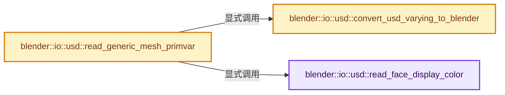

# 实现依赖专题：source/blender/io/usd/intern/usd_mesh_utils.cc

[实现依赖导航](../../../../README.md) · [符号索引](../../../../../00-课程指南/02-源码与提交索引/符号依赖与实现索引.md)

本专题从正文实际调用进入，集中保存共享实现。函数有稳定锚点，可从调用处直接跳到对应完整函数；递归与互相调用通过回链组织。

## 本文件的实现关系




## 完整成员与函数实现

<a id="f-323d32fee231b499"></a>

### `blender::io::usd::read_face_display_color`

实现位置：[source/blender/io/usd/intern/usd_mesh_utils.cc](../../../../../../../../../source/blender/io/usd/intern/usd_mesh_utils.cc) · L21—L71。

接口参数：

- `Mesh *mesh`
- `const pxr::UsdGeomPrimvar &primvar`
- `const pxr::TfToken &pv_name`
- `const pxr::UsdTimeCode time`

**教学注释版**

<!-- annotated:64d718709e2c86 -->

```cpp
template<typename USDT>
static void read_face_display_color(Mesh *mesh,
                                    const pxr::UsdGeomPrimvar &primvar,
                                    const pxr::TfToken &pv_name,
                                    const pxr::UsdTimeCode time)
{
  const pxr::VtArray<USDT> usd_colors = get_primvar_array<USDT>(primvar, time);
  if (usd_colors.empty()) {
    return;
  }

  bke::MutableAttributeAccessor attributes = mesh->attributes_for_write();
  const bke::AttrDomain color_domain = bke::AttrDomain::Corner;

  const StringRef attr_name(pv_name.GetString());

  if (primvar.GetInterpolation() == pxr::UsdGeomTokens->constant) {
    ColorGeometry4f value = detail::convert_value<USDT, ColorGeometry4f>(usd_colors[0]);
    colorspace_attr_to_scene_linear(primvar.GetAttr(), value);
    set_single_value(attributes,
                     attr_name,
                     color_domain,
                     bke::AttrType::ColorFloat,
                     bke::AttributeInitValue(value));
    return;
  }

  bke::SpanAttributeWriter<ColorGeometry4f> color_data =
      attributes.lookup_or_add_for_write_only_span<ColorGeometry4f>(attr_name, color_domain);
  if (!color_data) {
    CLOG_WARN(&LOG, "Primvar '%s' could not be added to Blender", primvar.GetBaseName().GetText());
    return;
  }

  const OffsetIndices faces = mesh->faces();
  for (const int i : faces.index_range()) {
    if (i >= usd_colors.size()) {
      break;
    }

    /* Take the per-face USD color and place it on each face-corner. */
    const IndexRange face = faces[i];
    for (const int j : face.index_range()) {
      // [讲解] face.start：读取连续区间或分组的边界信息。
      const int corner = face.start() + j;
      color_data.span[corner] = detail::convert_value<USDT, ColorGeometry4f>(usd_colors[i]);
    }
  }

  colorspace_attr_to_scene_linear(primvar.GetAttr(), color_data.span);
  color_data.finish();
}
```

<details>
<summary>核对原始源码：source/blender/io/usd/intern/usd_mesh_utils.cc · L21—L71</summary>

<!-- original:64d718709e2c86:source/blender/io/usd/intern/usd_mesh_utils.cc:21:71 -->

```cpp
template<typename USDT>
static void read_face_display_color(Mesh *mesh,
                                    const pxr::UsdGeomPrimvar &primvar,
                                    const pxr::TfToken &pv_name,
                                    const pxr::UsdTimeCode time)
{
  const pxr::VtArray<USDT> usd_colors = get_primvar_array<USDT>(primvar, time);
  if (usd_colors.empty()) {
    return;
  }

  bke::MutableAttributeAccessor attributes = mesh->attributes_for_write();
  const bke::AttrDomain color_domain = bke::AttrDomain::Corner;

  const StringRef attr_name(pv_name.GetString());

  if (primvar.GetInterpolation() == pxr::UsdGeomTokens->constant) {
    ColorGeometry4f value = detail::convert_value<USDT, ColorGeometry4f>(usd_colors[0]);
    colorspace_attr_to_scene_linear(primvar.GetAttr(), value);
    set_single_value(attributes,
                     attr_name,
                     color_domain,
                     bke::AttrType::ColorFloat,
                     bke::AttributeInitValue(value));
    return;
  }

  bke::SpanAttributeWriter<ColorGeometry4f> color_data =
      attributes.lookup_or_add_for_write_only_span<ColorGeometry4f>(attr_name, color_domain);
  if (!color_data) {
    CLOG_WARN(&LOG, "Primvar '%s' could not be added to Blender", primvar.GetBaseName().GetText());
    return;
  }

  const OffsetIndices faces = mesh->faces();
  for (const int i : faces.index_range()) {
    if (i >= usd_colors.size()) {
      break;
    }

    /* Take the per-face USD color and place it on each face-corner. */
    const IndexRange face = faces[i];
    for (const int j : face.index_range()) {
      const int corner = face.start() + j;
      color_data.span[corner] = detail::convert_value<USDT, ColorGeometry4f>(usd_colors[i]);
    }
  }

  colorspace_attr_to_scene_linear(primvar.GetAttr(), color_data.span);
  color_data.finish();
}
```

</details>

**沿实际写入检查状态**

- `color_data.span[corner] = detail::convert_value<USDT, ColorGeometry4f>(usd_colors[i]);`

**继续追踪实现**

- `get_primvar_array<USDT>` → [blender::io::usd::get_primvar_array · L234](usd_attribute_utils.hh.md#f-d1928204ec3b665a)。
- `usd_colors.empty` → [调用协议](../../../../../00-课程指南/01-路线与规范/模板宏与动态分派协议.md)：由接收对象具体类型或运行时策略提供实现。调用位置L28。
- `mesh->attributes_for_write` → [Mesh::attributes_for_write · L1303](../../../../../05-几何存储与拓扑映射/03-MPoly迁移与兼容.md#f-ca7af2f1a15f0bc4)。
- `pv_name.GetString` → [GHOST_ImeWin32::GetString · L343](../../../../07-Intern运行时与平台/ghost/intern/GHOST_ImeWin32.cc.md#f-6c9addf130e5dea1)。
- `primvar.GetInterpolation` → [调用协议](../../../../../00-课程指南/01-路线与规范/模板宏与动态分派协议.md)：由接收对象具体类型或运行时策略提供实现。调用位置L37。
- `detail::convert_value<USDT, ColorGeometry4f>` → [blender::io::usd::detail::convert_value · L59](usd_attribute_utils.hh.md#f-ab16881f49dff56b)；[blender::io::usd::detail::convert_value · L65](usd_attribute_utils.hh.md#f-460e7fc25c81eff6)；[blender::io::usd::detail::convert_value · L72](usd_attribute_utils.hh.md#f-b91887b786855538)；[blender::io::usd::detail::convert_value · L76](usd_attribute_utils.hh.md#f-fcb9a95bfc98e89d)；[blender::io::usd::detail::convert_value · L80](usd_attribute_utils.hh.md#f-ae77134f83a11b9a)；[blender::io::usd::detail::convert_value · L84](usd_attribute_utils.hh.md#f-6a55ddcee8415350)；[blender::io::usd::detail::convert_value · L88](usd_attribute_utils.hh.md#f-de9393a0e89f0378)；[blender::io::usd::detail::convert_value · L93](usd_attribute_utils.hh.md#f-6a2a1f44b0548cdd)；[blender::io::usd::detail::convert_value · L98](usd_attribute_utils.hh.md#f-81b73242e4ebd904)；[blender::io::usd::detail::convert_value · L102](usd_attribute_utils.hh.md#f-2358e9969e4684f7)；[blender::io::usd::detail::convert_value · L114](usd_attribute_utils.hh.md#f-37efb5f0b23dd57b)；[blender::io::usd::detail::convert_value · L118](usd_attribute_utils.hh.md#f-8cae13c04f701974)；[blender::io::usd::detail::convert_value · L122](usd_attribute_utils.hh.md#f-9618726e1dc6f9a7)；[blender::io::usd::detail::convert_value · L126](usd_attribute_utils.hh.md#f-a8aa5a3be26353ef)；[blender::io::usd::detail::convert_value · L130](usd_attribute_utils.hh.md#f-f07079c991e8d06d)；[blender::io::usd::detail::convert_value · L135](usd_attribute_utils.hh.md#f-d2b0ee2b42cca6a3)。同名重载需按实参类型选择。
- `colorspace_attr_to_scene_linear` → [blender::io::usd::colorspace_attr_to_scene_linear · L63](usd_colorspace_utils.cc.md#f-37989fdfd9773362)；[blender::io::usd::colorspace_attr_to_scene_linear · L71](usd_colorspace_utils.cc.md#f-5f55340718e8235b)；[blender::io::usd::colorspace_attr_to_scene_linear · L79](usd_colorspace_utils.cc.md#f-4b1876e0c48d5f52)。同名重载需按实参类型选择。
- `primvar.GetAttr` → [调用协议](../../../../../00-课程指南/01-路线与规范/模板宏与动态分派协议.md)：由接收对象具体类型或运行时策略提供实现。调用位置L39。
- `set_single_value` → [blender::io::usd::set_single_value · L249](usd_attribute_utils.hh.md#f-1a08adb49f879d3a)。
- `bke::AttributeInitValue` → [blender::bke::AttributeInitValue::AttributeInitValue · L100](../../../../../05-几何存储与拓扑映射/08-AttributeAccessor接口.md#f-cd502d5742ad6d0f)；[blender::bke::AttributeInitValue::AttributeInitValue · L104](../../../../../05-几何存储与拓扑映射/08-AttributeAccessor接口.md#f-54b1dad08bff7914)。同名重载需按实参类型选择。
- `attributes.lookup_or_add_for_write_only_span<ColorGeometry4f>` → [blender::bke::MutableAttributeAccessor::lookup_or_add_for_write_only_span · L546](../../../../02-BKE几何与数据/intern/attribute_access.cc.md#f-97af899f7983a038)；[blender::bke::MutableAttributeAccessor::lookup_or_add_for_write_only_span · L891](../../../../../05-几何存储与拓扑映射/08-AttributeAccessor接口.md#f-ee8d09f75408ac4f)。同名重载需按实参类型选择。
- `CLOG_WARN` → [CLOG_WARN · L189](../../../../07-Intern运行时与平台/clog/CLG_log.h.md#m-9da21a06cdbe)。宏定义由构建条件选择。
- `primvar.GetBaseName().GetText` → [调用协议](../../../../../00-课程指南/01-路线与规范/模板宏与动态分派协议.md)：接收对象类型依赖auto、返回值或模板实例；不按同名猜测目标。调用位置L51。
- `primvar.GetBaseName` → [调用协议](../../../../../00-课程指南/01-路线与规范/模板宏与动态分派协议.md)：由接收对象具体类型或运行时策略提供实现。调用位置L51。
- `mesh->faces` → [Mesh::faces · L1217](../../../../../05-几何存储与拓扑映射/03-MPoly迁移与兼容.md#f-ea444760154e17b2)。
- `faces.index_range` → [blender::offset_indices::OffsetIndices::index_range · L77](../../../../../05-几何存储与拓扑映射/02-OffsetIndices完整接口.md#f-19b5ca1456de007d)。
- `usd_colors.size` → [调用协议](../../../../../00-课程指南/01-路线与规范/模板宏与动态分派协议.md)：由接收对象具体类型或运行时策略提供实现。调用位置L57。
- `face.index_range` → [blender::IndexRange::index_range · L161](../../../../../01-基础容器与现代CPP/04-IndexRange连续整数区间.md#f-fd83072b4b81bce5)。
- `face.start` → [blender::IndexRange::start · L243](../../../../../01-基础容器与现代CPP/04-IndexRange连续整数区间.md#f-99d2195bd9cfd1f0)。
- `color_data.finish` → [blender::bke::SpanAttributeWriter::finish · L279](../../../../../05-几何存储与拓扑映射/08-AttributeAccessor接口.md#f-585970a3b1bd4da4)。

<a id="f-cf3b7eb33097ea06"></a>

### `blender::io::usd::convert_usd_varying_to_blender`

实现位置：[source/blender/io/usd/intern/usd_mesh_utils.cc](../../../../../../../../../source/blender/io/usd/intern/usd_mesh_utils.cc) · L73—L96。

接口参数：

- `const pxr::TfToken usd_domain`

**教学注释版**

<!-- annotated:71c1a564f970c6 -->

```cpp
static std::optional<bke::AttrDomain> convert_usd_varying_to_blender(const pxr::TfToken usd_domain)
{
  static const Map<pxr::TfToken, bke::AttrDomain> domain_map = []() {
    Map<pxr::TfToken, bke::AttrDomain> map;
    // [讲解] map.add_new：按哈希与相等关系加入键或键值。
    map.add_new(pxr::UsdGeomTokens->faceVarying, bke::AttrDomain::Corner);
    map.add_new(pxr::UsdGeomTokens->vertex, bke::AttrDomain::Point);
    map.add_new(pxr::UsdGeomTokens->varying, bke::AttrDomain::Point);
    map.add_new(pxr::UsdGeomTokens->face, bke::AttrDomain::Face);
    /* Since there's no "domain" concept in USD, promote prim-level "constant" primvars to the
     * Point domain in Blender. */
    map.add_new(pxr::UsdGeomTokens->constant, bke::AttrDomain::Point);
    map.add_new(pxr::UsdGeomTokens->uniform, bke::AttrDomain::Face);
    /* Notice: Edge types are not supported! */
    return map;
  }();

  // [讲解] domain_map.lookup_ptr：按键查找对应项。
  const bke::AttrDomain *value = domain_map.lookup_ptr(usd_domain);

  if (value == nullptr) {
    return std::nullopt;
  }

  return *value;
}
```

<details>
<summary>核对原始源码：source/blender/io/usd/intern/usd_mesh_utils.cc · L73—L96</summary>

<!-- original:71c1a564f970c6:source/blender/io/usd/intern/usd_mesh_utils.cc:73:96 -->

```cpp
static std::optional<bke::AttrDomain> convert_usd_varying_to_blender(const pxr::TfToken usd_domain)
{
  static const Map<pxr::TfToken, bke::AttrDomain> domain_map = []() {
    Map<pxr::TfToken, bke::AttrDomain> map;
    map.add_new(pxr::UsdGeomTokens->faceVarying, bke::AttrDomain::Corner);
    map.add_new(pxr::UsdGeomTokens->vertex, bke::AttrDomain::Point);
    map.add_new(pxr::UsdGeomTokens->varying, bke::AttrDomain::Point);
    map.add_new(pxr::UsdGeomTokens->face, bke::AttrDomain::Face);
    /* Since there's no "domain" concept in USD, promote prim-level "constant" primvars to the
     * Point domain in Blender. */
    map.add_new(pxr::UsdGeomTokens->constant, bke::AttrDomain::Point);
    map.add_new(pxr::UsdGeomTokens->uniform, bke::AttrDomain::Face);
    /* Notice: Edge types are not supported! */
    return map;
  }();

  const bke::AttrDomain *value = domain_map.lookup_ptr(usd_domain);

  if (value == nullptr) {
    return std::nullopt;
  }

  return *value;
}
```

</details>

**结果出口**

- `return map;`
- `return std::nullopt;`
- `return *value;`

**继续追踪实现**

- `[]() { Map<pxr::TfToken, bke::AttrDomain> map; map.add_new(pxr::UsdGeomTokens->faceVarying, bke::AttrDomain::Corner); map.add_new(pxr::UsdGeomTokens->vertex, bke::AttrDomain::Point …（完整表达式见本函数源码）` → [调用协议](../../../../../00-课程指南/01-路线与规范/模板宏与动态分派协议.md)：函数指针、局部可调用对象或未展开的宏；必须结合调用者环境。调用位置L75。
- `map.add_new` → [blender::Map::add_new · L265](../../../../../02-哈希表与关联数据结构/02-Map总体布局.md#f-521ff0865e8229d0)；[blender::Map::add_new · L269](../../../../../02-哈希表与关联数据结构/02-Map总体布局.md#f-d89cee0e3d2848a0)；[blender::Map::add_new · L273](../../../../../02-哈希表与关联数据结构/02-Map总体布局.md#f-c13142c32e703ebd)；[blender::Map::add_new · L277](../../../../../02-哈希表与关联数据结构/04-Map查找与键访问.md#f-da1e537f229db040)。同名重载需按实参类型选择。
- `domain_map.lookup_ptr` → [blender::Map::lookup_ptr · L508](../../../../../02-哈希表与关联数据结构/04-Map查找与键访问.md#f-90844510a761dcb2)；[blender::Map::lookup_ptr · L512](../../../../../02-哈希表与关联数据结构/04-Map查找与键访问.md#f-ce017485b88f4b2c)。同名重载需按实参类型选择。

<a id="f-b1d596651372f0eb"></a>

### `blender::io::usd::read_generic_mesh_primvar`

实现位置：[source/blender/io/usd/intern/usd_mesh_utils.cc](../../../../../../../../../source/blender/io/usd/intern/usd_mesh_utils.cc) · L98—L146。

接口参数：

- `Mesh *mesh`
- `const pxr::UsdGeomPrimvar &primvar`
- `const pxr::UsdTimeCode time`
- `const bool is_left_handed`

**教学注释版**

<!-- annotated:1349e1b3419e0e -->

```cpp
void read_generic_mesh_primvar(Mesh *mesh,
                               const pxr::UsdGeomPrimvar &primvar,
                               const pxr::UsdTimeCode time,
                               const bool is_left_handed)
{
  const pxr::SdfValueTypeName pv_type = primvar.GetTypeName();
  const pxr::TfToken pv_interp = primvar.GetInterpolation();
  const pxr::TfToken pv_name = pxr::UsdGeomPrimvar::StripPrimvarsName(primvar.GetPrimvarName());

  const std::optional<bke::AttrDomain> domain = convert_usd_varying_to_blender(pv_interp);
  const std::optional<bke::AttrType> type = convert_usd_type_to_blender(pv_type);

  if (!domain.has_value() || !type.has_value()) {
    CLOG_WARN(&LOG,
              "Primvar '%s' (interpolation %s, type %s) cannot be converted to Blender",
              pv_name.GetText(),
              pv_interp.GetText(),
              pv_type.GetAsToken().GetText());
    return;
  }

  /* Blender does not currently support displaying Face colors with the Viewport Shading
   * "Attribute" color type. Make a special case for "displayColor" primvars and put them on
   * the Corner domain instead. */
  if (pv_name == usdtokens::displayColor &&
      ELEM(pv_interp, pxr::UsdGeomTokens->uniform, pxr::UsdGeomTokens->constant))
  {
    if (ELEM(pv_type,
             pxr::SdfValueTypeNames->Color3fArray,
             pxr::SdfValueTypeNames->Color3hArray,
             pxr::SdfValueTypeNames->Color3dArray))
    {
      read_face_display_color<pxr::GfVec3f>(mesh, primvar, pv_name, time);
    }
    else {
      read_face_display_color<pxr::GfVec4f>(mesh, primvar, pv_name, time);
    }

    return;
  }

  OffsetIndices<int> faces;
  if (is_left_handed) {
    faces = mesh->faces();
  }

  bke::MutableAttributeAccessor attributes = mesh->attributes_for_write();
  copy_primvar_to_blender_attribute(primvar, time, *type, *domain, faces, attributes);
}
```

<details>
<summary>核对原始源码：source/blender/io/usd/intern/usd_mesh_utils.cc · L98—L146</summary>

<!-- original:1349e1b3419e0e:source/blender/io/usd/intern/usd_mesh_utils.cc:98:146 -->

```cpp
void read_generic_mesh_primvar(Mesh *mesh,
                               const pxr::UsdGeomPrimvar &primvar,
                               const pxr::UsdTimeCode time,
                               const bool is_left_handed)
{
  const pxr::SdfValueTypeName pv_type = primvar.GetTypeName();
  const pxr::TfToken pv_interp = primvar.GetInterpolation();
  const pxr::TfToken pv_name = pxr::UsdGeomPrimvar::StripPrimvarsName(primvar.GetPrimvarName());

  const std::optional<bke::AttrDomain> domain = convert_usd_varying_to_blender(pv_interp);
  const std::optional<bke::AttrType> type = convert_usd_type_to_blender(pv_type);

  if (!domain.has_value() || !type.has_value()) {
    CLOG_WARN(&LOG,
              "Primvar '%s' (interpolation %s, type %s) cannot be converted to Blender",
              pv_name.GetText(),
              pv_interp.GetText(),
              pv_type.GetAsToken().GetText());
    return;
  }

  /* Blender does not currently support displaying Face colors with the Viewport Shading
   * "Attribute" color type. Make a special case for "displayColor" primvars and put them on
   * the Corner domain instead. */
  if (pv_name == usdtokens::displayColor &&
      ELEM(pv_interp, pxr::UsdGeomTokens->uniform, pxr::UsdGeomTokens->constant))
  {
    if (ELEM(pv_type,
             pxr::SdfValueTypeNames->Color3fArray,
             pxr::SdfValueTypeNames->Color3hArray,
             pxr::SdfValueTypeNames->Color3dArray))
    {
      read_face_display_color<pxr::GfVec3f>(mesh, primvar, pv_name, time);
    }
    else {
      read_face_display_color<pxr::GfVec4f>(mesh, primvar, pv_name, time);
    }

    return;
  }

  OffsetIndices<int> faces;
  if (is_left_handed) {
    faces = mesh->faces();
  }

  bke::MutableAttributeAccessor attributes = mesh->attributes_for_write();
  copy_primvar_to_blender_attribute(primvar, time, *type, *domain, faces, attributes);
}
```

</details>

**沿实际写入检查状态**

- `faces = mesh->faces();`

**继续追踪实现**

- `primvar.GetTypeName` → [调用协议](../../../../../00-课程指南/01-路线与规范/模板宏与动态分派协议.md)：由接收对象具体类型或运行时策略提供实现。调用位置L103。
- `primvar.GetInterpolation` → [调用协议](../../../../../00-课程指南/01-路线与规范/模板宏与动态分派协议.md)：由接收对象具体类型或运行时策略提供实现。调用位置L104。
- `pxr::UsdGeomPrimvar::StripPrimvarsName` → [外部契约](https://eel.is/c++draft/)：这个边界按实际表达式及所属类型核对参数、返回值、寿命与失败行为。这里提供接口入口，不声称已解释该第三方版本的内部实现。
- `primvar.GetPrimvarName` → [调用协议](../../../../../00-课程指南/01-路线与规范/模板宏与动态分派协议.md)：由接收对象具体类型或运行时策略提供实现。调用位置L105。
- `convert_usd_varying_to_blender` → [blender::io::usd::convert_usd_varying_to_blender · L73](usd_mesh_utils.cc.md#f-cf3b7eb33097ea06)。
- `convert_usd_type_to_blender` → [blender::io::usd::convert_usd_type_to_blender · L51](usd_attribute_utils.cc.md#f-efdda91a1db0b399)。
- `domain.has_value` → [外部契约](https://eel.is/c++draft/)：这个边界按实际表达式及所属类型核对参数、返回值、寿命与失败行为。这里提供接口入口，不声称已解释该第三方版本的内部实现。
- `type.has_value` → [外部契约](https://eel.is/c++draft/)：这个边界按实际表达式及所属类型核对参数、返回值、寿命与失败行为。这里提供接口入口，不声称已解释该第三方版本的内部实现。
- `CLOG_WARN` → [CLOG_WARN · L189](../../../../07-Intern运行时与平台/clog/CLG_log.h.md#m-9da21a06cdbe)。宏定义由构建条件选择。
- `pv_name.GetText` → [调用协议](../../../../../00-课程指南/01-路线与规范/模板宏与动态分派协议.md)：由接收对象具体类型或运行时策略提供实现。调用位置L113。
- `pv_interp.GetText` → [调用协议](../../../../../00-课程指南/01-路线与规范/模板宏与动态分派协议.md)：由接收对象具体类型或运行时策略提供实现。调用位置L114。
- `pv_type.GetAsToken().GetText` → [调用协议](../../../../../00-课程指南/01-路线与规范/模板宏与动态分派协议.md)：接收对象类型依赖auto、返回值或模板实例；不按同名猜测目标。调用位置L115。
- `pv_type.GetAsToken` → [调用协议](../../../../../00-课程指南/01-路线与规范/模板宏与动态分派协议.md)：由接收对象具体类型或运行时策略提供实现。调用位置L115。
- `ELEM` → [ELEM · L88](../../../../07-Intern运行时与平台/ghost/intern/GHOST_utildefines.hh.md#m-d28724a15928)；[ELEM · L135](../../../../01-BLI基础库/BLI_utildefines.hh.md#m-d6572de7cae0)。宏定义由构建条件选择。
- `read_face_display_color<pxr::GfVec3f>` → [blender::io::usd::read_face_display_color · L21](usd_mesh_utils.cc.md#f-323d32fee231b499)。
- `read_face_display_color<pxr::GfVec4f>` → [blender::io::usd::read_face_display_color · L21](usd_mesh_utils.cc.md#f-323d32fee231b499)。
- `mesh->faces` → [Mesh::faces · L1217](../../../../../05-几何存储与拓扑映射/03-MPoly迁移与兼容.md#f-ea444760154e17b2)。
- `mesh->attributes_for_write` → [Mesh::attributes_for_write · L1303](../../../../../05-几何存储与拓扑映射/03-MPoly迁移与兼容.md#f-ca7af2f1a15f0bc4)。
- `copy_primvar_to_blender_attribute` → [blender::io::usd::copy_primvar_to_blender_attribute · L98](usd_attribute_utils.cc.md#f-17c12e082c15637d)。
