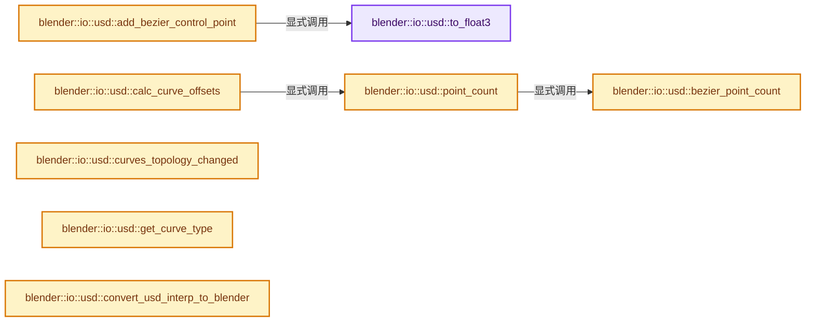

# 实现依赖专题：source/blender/io/usd/intern/usd_reader_curve.cc

[实现依赖导航](../../../../README.md) · [符号索引](../../../../../00-课程指南/02-源码与提交索引/符号依赖与实现索引.md)

本专题从正文实际调用进入，集中保存共享实现。函数有稳定锚点，可从调用处直接跳到对应完整函数；递归与互相调用通过回链组织。

## 本文件的实现关系




## 完整成员与函数实现

<a id="f-d7bf406d1ddd9c65"></a>

### `blender::io::usd::to_float3`

实现位置：[source/blender/io/usd/intern/usd_reader_curve.cc](../../../../../../../../../source/blender/io/usd/intern/usd_reader_curve.cc) · L29—L32。

接口参数：

- `pxr::GfVec3f vec3f`

**教学注释版**

<!-- annotated:2157aa14f3647e -->

```cpp
static inline float3 to_float3(pxr::GfVec3f vec3f)
{
  return float3(vec3f.data());
}
```

<details>
<summary>核对原始源码：source/blender/io/usd/intern/usd_reader_curve.cc · L29—L32</summary>

<!-- original:2157aa14f3647e:source/blender/io/usd/intern/usd_reader_curve.cc:29:32 -->

```cpp
static inline float3 to_float3(pxr::GfVec3f vec3f)
{
  return float3(vec3f.data());
}
```

</details>

**结果出口**

- `return float3(vec3f.data());`

**继续追踪实现**

- `float3` → [float3 · L641](../../../compositor/algorithms/intern/smaa.cc.md#m-0ea8254cfdb4)。宏定义由构建条件选择。
- `vec3f.data` → [调用协议](../../../../../00-课程指南/01-路线与规范/模板宏与动态分派协议.md)：由接收对象具体类型或运行时策略提供实现。调用位置L31。

<a id="f-d0f7f0478fa758ce"></a>

### `blender::io::usd::bezier_point_count`

实现位置：[source/blender/io/usd/intern/usd_reader_curve.cc](../../../../../../../../../source/blender/io/usd/intern/usd_reader_curve.cc) · L34—L37。

接口参数：

- `int usd_count`
- `bool is_cyclic`

**教学注释版**

<!-- annotated:1938d451e1eeac -->

```cpp
static inline int bezier_point_count(int usd_count, bool is_cyclic)
{
  return is_cyclic ? (usd_count / 3) : ((usd_count / 3) + 1);
}
```

<details>
<summary>核对原始源码：source/blender/io/usd/intern/usd_reader_curve.cc · L34—L37</summary>

<!-- original:1938d451e1eeac:source/blender/io/usd/intern/usd_reader_curve.cc:34:37 -->

```cpp
static inline int bezier_point_count(int usd_count, bool is_cyclic)
{
  return is_cyclic ? (usd_count / 3) : ((usd_count / 3) + 1);
}
```

</details>

**结果出口**

- `return is_cyclic ? (usd_count / 3) : ((usd_count / 3) + 1);`

**继续追踪实现**

本实现没有需要继续展开的显式调用；检查返回表达式、对象转换和调用者前置条件。

<a id="f-cfea0d56ccec5890"></a>

### `blender::io::usd::point_count`

实现位置：[source/blender/io/usd/intern/usd_reader_curve.cc](../../../../../../../../../source/blender/io/usd/intern/usd_reader_curve.cc) · L39—L45。

接口参数：

- `int usdCount`
- `CurveType curve_type`
- `bool is_cyclic`

**教学注释版**

<!-- annotated:e51bfb6cbccb25 -->

```cpp
static int point_count(int usdCount, CurveType curve_type, bool is_cyclic)
{
  if (curve_type == CURVE_TYPE_BEZIER) {
    return bezier_point_count(usdCount, is_cyclic);
  }
  return usdCount;
}
```

<details>
<summary>核对原始源码：source/blender/io/usd/intern/usd_reader_curve.cc · L39—L45</summary>

<!-- original:e51bfb6cbccb25:source/blender/io/usd/intern/usd_reader_curve.cc:39:45 -->

```cpp
static int point_count(int usdCount, CurveType curve_type, bool is_cyclic)
{
  if (curve_type == CURVE_TYPE_BEZIER) {
    return bezier_point_count(usdCount, is_cyclic);
  }
  return usdCount;
}
```

</details>

**结果出口**

- `return bezier_point_count(usdCount, is_cyclic);`
- `return usdCount;`

**继续追踪实现**

- `bezier_point_count` → [blender::io::usd::bezier_point_count · L34](usd_reader_curve.cc.md#f-d0f7f0478fa758ce)。

<a id="f-159e3896798a72cd"></a>

### `blender::io::usd::calc_curve_offsets`

实现位置：[source/blender/io/usd/intern/usd_reader_curve.cc](../../../../../../../../../source/blender/io/usd/intern/usd_reader_curve.cc) · L47—L59。

接口参数：

- `const pxr::VtIntArray &usdCounts`
- `const CurveType curve_type`
- `bool is_cyclic`

**教学注释版**

<!-- annotated:1cfcd55e45aa8f -->

```cpp
static Array<int> calc_curve_offsets(const pxr::VtIntArray &usdCounts,
                                     const CurveType curve_type,
                                     bool is_cyclic)
{
  Array<int> offsets(usdCounts.size() + 1);
  threading::parallel_for(IndexRange(usdCounts.size()), 4096, [&](const IndexRange range) {
    for (const int i : range) {
      offsets[i] = point_count(usdCounts[i], curve_type, is_cyclic);
    }
  });
  offset_indices::accumulate_counts_to_offsets(offsets);
  return offsets;
}
```

<details>
<summary>核对原始源码：source/blender/io/usd/intern/usd_reader_curve.cc · L47—L59</summary>

<!-- original:1cfcd55e45aa8f:source/blender/io/usd/intern/usd_reader_curve.cc:47:59 -->

```cpp
static Array<int> calc_curve_offsets(const pxr::VtIntArray &usdCounts,
                                     const CurveType curve_type,
                                     bool is_cyclic)
{
  Array<int> offsets(usdCounts.size() + 1);
  threading::parallel_for(IndexRange(usdCounts.size()), 4096, [&](const IndexRange range) {
    for (const int i : range) {
      offsets[i] = point_count(usdCounts[i], curve_type, is_cyclic);
    }
  });
  offset_indices::accumulate_counts_to_offsets(offsets);
  return offsets;
}
```

</details>

**沿实际写入检查状态**

- `offsets[i] = point_count(usdCounts[i], curve_type, is_cyclic);`

**结果出口**

- `return offsets;`

**继续追踪实现**

- `usdCounts.size` → [调用协议](../../../../../00-课程指南/01-路线与规范/模板宏与动态分派协议.md)：由接收对象具体类型或运行时策略提供实现。调用位置L51。
- `threading::parallel_for` → [blender::threading::parallel_for · L68](../../../../../11-Depsgraph与并行任务系统/07-任务池与TBB接入.md#f-838294754c24426c)。
- `IndexRange` → [blender::IndexRange](../../../../01-BLI基础库/BLI_index_range.hh.md#t-caa3466d6776)；[blender::gpu::shader::parser::IndexRange](../../../gpu/shader_tool/utils.hh.md#t-82d2bd4ea71c)；[blender::IndexRange](../../../makesdna/DNA_node_types.h.md#t-0448cc889d39)。
- `point_count` → [blender::io::usd::point_count · L39](usd_reader_curve.cc.md#f-cfea0d56ccec5890)。
- `offset_indices::accumulate_counts_to_offsets` → [blender::offset_indices::accumulate_counts_to_offsets · L24](../../../../../05-几何存储与拓扑映射/05-邻接关系与前缀和.md#f-cfa9fbd186afcdd5)。

<a id="f-364f2c0837438149"></a>

### `blender::io::usd::add_bezier_control_point`

实现位置：[source/blender/io/usd/intern/usd_reader_curve.cc](../../../../../../../../../source/blender/io/usd/intern/usd_reader_curve.cc) · L61—L83。

接口参数：

- `int cp`
- `int offset`
- `MutableSpan<float3> positions`
- `MutableSpan<float3> handles_left`
- `MutableSpan<float3> handles_right`
- `const Span<pxr::GfVec3f> usdPoints`

**教学注释版**

<!-- annotated:9c25b578c7450e -->

```cpp
static void add_bezier_control_point(int cp,
                                     int offset,
                                     MutableSpan<float3> positions,
                                     MutableSpan<float3> handles_left,
                                     MutableSpan<float3> handles_right,
                                     const Span<pxr::GfVec3f> usdPoints)
{
  if (offset == 0) {
    positions[cp] = to_float3(usdPoints[offset]);
    handles_right[cp] = to_float3(usdPoints[offset + 1]);
    handles_left[cp] = 2.0f * positions[cp] - handles_right[cp];
  }
  // [讲解] usdPoints.size：查询视图长度或生成对应有效索引区间。
  else if (offset >= usdPoints.size() - 1) {
    // [讲解] usdPoints.last：按视图边界访问元素。
    positions[cp] = to_float3(usdPoints.last());
    handles_left[cp] = to_float3(usdPoints.last(1));
    handles_right[cp] = 2.0f * positions[cp] - handles_left[cp];
  }
  else {
    positions[cp] = to_float3(usdPoints[offset]);
    handles_left[cp] = to_float3(usdPoints[offset - 1]);
    handles_right[cp] = to_float3(usdPoints[offset + 1]);
  }
}
```

<details>
<summary>核对原始源码：source/blender/io/usd/intern/usd_reader_curve.cc · L61—L83</summary>

<!-- original:9c25b578c7450e:source/blender/io/usd/intern/usd_reader_curve.cc:61:83 -->

```cpp
static void add_bezier_control_point(int cp,
                                     int offset,
                                     MutableSpan<float3> positions,
                                     MutableSpan<float3> handles_left,
                                     MutableSpan<float3> handles_right,
                                     const Span<pxr::GfVec3f> usdPoints)
{
  if (offset == 0) {
    positions[cp] = to_float3(usdPoints[offset]);
    handles_right[cp] = to_float3(usdPoints[offset + 1]);
    handles_left[cp] = 2.0f * positions[cp] - handles_right[cp];
  }
  else if (offset >= usdPoints.size() - 1) {
    positions[cp] = to_float3(usdPoints.last());
    handles_left[cp] = to_float3(usdPoints.last(1));
    handles_right[cp] = 2.0f * positions[cp] - handles_left[cp];
  }
  else {
    positions[cp] = to_float3(usdPoints[offset]);
    handles_left[cp] = to_float3(usdPoints[offset - 1]);
    handles_right[cp] = to_float3(usdPoints[offset + 1]);
  }
}
```

</details>

**沿实际写入检查状态**

- `positions[cp] = to_float3(usdPoints[offset]);`
- `handles_right[cp] = to_float3(usdPoints[offset + 1]);`
- `handles_left[cp] = 2.0f * positions[cp] - handles_right[cp];`
- `positions[cp] = to_float3(usdPoints.last());`
- `handles_left[cp] = to_float3(usdPoints.last(1));`
- `handles_right[cp] = 2.0f * positions[cp] - handles_left[cp];`
- `handles_left[cp] = to_float3(usdPoints[offset - 1]);`

**继续追踪实现**

- `to_float3` → [blender::io::usd::to_float3 · L29](usd_reader_curve.cc.md#f-d7bf406d1ddd9c65)。
- `usdPoints.size` → [blender::Span::size · L256](../../../../../01-基础容器与现代CPP/05-Span只读连续视图.md#f-5f80fa006089c998)。
- `usdPoints.last` → [blender::Span::last · L329](../../../../../01-基础容器与现代CPP/05-Span只读连续视图.md#f-a92146c285596891)。

<a id="f-39c33704fd48dbca"></a>

### `blender::io::usd::curves_topology_changed`

实现位置：[source/blender/io/usd/intern/usd_reader_curve.cc](../../../../../../../../../source/blender/io/usd/intern/usd_reader_curve.cc) · L86—L93。

接口参数：

- `const bke::CurvesGeometry &curves`
- `const Span<int> usd_offsets`

**教学注释版**

<!-- annotated:aeceab11646f80 -->

```cpp
static bool curves_topology_changed(const bke::CurvesGeometry &curves, const Span<int> usd_offsets)
{
  if (curves.offsets() != usd_offsets) {
    return true;
  }

  return false;
}
```

<details>
<summary>核对原始源码：source/blender/io/usd/intern/usd_reader_curve.cc · L86—L93</summary>

<!-- original:aeceab11646f80:source/blender/io/usd/intern/usd_reader_curve.cc:86:93 -->

```cpp
static bool curves_topology_changed(const bke::CurvesGeometry &curves, const Span<int> usd_offsets)
{
  if (curves.offsets() != usd_offsets) {
    return true;
  }

  return false;
}
```

</details>

**结果出口**

- `return true;`
- `return false;`

**继续追踪实现**

- `curves.offsets` → [blender::bke::CurvesGeometry::offsets · L345](../../../../02-BKE几何与数据/intern/curves_geometry.cc.md#f-933ebcc46965545e)。

<a id="f-92096743ca7ccc10"></a>

### `blender::io::usd::get_curve_type`

实现位置：[source/blender/io/usd/intern/usd_reader_curve.cc](../../../../../../../../../source/blender/io/usd/intern/usd_reader_curve.cc) · L95—L110。

接口参数：

- `pxr::TfToken type`
- `pxr::TfToken basis`

**教学注释版**

<!-- annotated:3164e7d81715bc -->

```cpp
static CurveType get_curve_type(pxr::TfToken type, pxr::TfToken basis)
{
  if (type == pxr::UsdGeomTokens->cubic) {
    if (basis == pxr::UsdGeomTokens->bezier) {
      return CURVE_TYPE_BEZIER;
    }
    if (basis == pxr::UsdGeomTokens->bspline) {
      return CURVE_TYPE_NURBS;
    }
    if (basis == pxr::UsdGeomTokens->catmullRom) {
      return CURVE_TYPE_CATMULL_ROM;
    }
  }

  return CURVE_TYPE_POLY;
}
```

<details>
<summary>核对原始源码：source/blender/io/usd/intern/usd_reader_curve.cc · L95—L110</summary>

<!-- original:3164e7d81715bc:source/blender/io/usd/intern/usd_reader_curve.cc:95:110 -->

```cpp
static CurveType get_curve_type(pxr::TfToken type, pxr::TfToken basis)
{
  if (type == pxr::UsdGeomTokens->cubic) {
    if (basis == pxr::UsdGeomTokens->bezier) {
      return CURVE_TYPE_BEZIER;
    }
    if (basis == pxr::UsdGeomTokens->bspline) {
      return CURVE_TYPE_NURBS;
    }
    if (basis == pxr::UsdGeomTokens->catmullRom) {
      return CURVE_TYPE_CATMULL_ROM;
    }
  }

  return CURVE_TYPE_POLY;
}
```

</details>

**结果出口**

- `return CURVE_TYPE_BEZIER;`
- `return CURVE_TYPE_NURBS;`
- `return CURVE_TYPE_CATMULL_ROM;`
- `return CURVE_TYPE_POLY;`

**继续追踪实现**

本实现没有需要继续展开的显式调用；检查返回表达式、对象转换和调用者前置条件。

<a id="f-4f7aaf9d4342730a"></a>

### `blender::io::usd::convert_usd_interp_to_blender`

实现位置：[source/blender/io/usd/intern/usd_reader_curve.cc](../../../../../../../../../source/blender/io/usd/intern/usd_reader_curve.cc) · L112—L130。

接口参数：

- `const pxr::TfToken usd_domain`

**教学注释版**

<!-- annotated:f57cde64019fb4 -->

```cpp
static std::optional<bke::AttrDomain> convert_usd_interp_to_blender(const pxr::TfToken usd_domain)
{
  static const Map<pxr::TfToken, bke::AttrDomain> domain_map = []() {
    Map<pxr::TfToken, bke::AttrDomain> map;
    // [讲解] map.add_new：按哈希与相等关系加入键或键值。
    map.add_new(pxr::UsdGeomTokens->vertex, bke::AttrDomain::Point);
    map.add_new(pxr::UsdGeomTokens->varying, bke::AttrDomain::Point);
    map.add_new(pxr::UsdGeomTokens->constant, bke::AttrDomain::Curve);
    map.add_new(pxr::UsdGeomTokens->uniform, bke::AttrDomain::Curve);
    return map;
  }();

  // [讲解] domain_map.lookup_ptr：按键查找对应项。
  const bke::AttrDomain *value = domain_map.lookup_ptr(usd_domain);

  if (value == nullptr) {
    return std::nullopt;
  }

  return *value;
}
```

<details>
<summary>核对原始源码：source/blender/io/usd/intern/usd_reader_curve.cc · L112—L130</summary>

<!-- original:f57cde64019fb4:source/blender/io/usd/intern/usd_reader_curve.cc:112:130 -->

```cpp
static std::optional<bke::AttrDomain> convert_usd_interp_to_blender(const pxr::TfToken usd_domain)
{
  static const Map<pxr::TfToken, bke::AttrDomain> domain_map = []() {
    Map<pxr::TfToken, bke::AttrDomain> map;
    map.add_new(pxr::UsdGeomTokens->vertex, bke::AttrDomain::Point);
    map.add_new(pxr::UsdGeomTokens->varying, bke::AttrDomain::Point);
    map.add_new(pxr::UsdGeomTokens->constant, bke::AttrDomain::Curve);
    map.add_new(pxr::UsdGeomTokens->uniform, bke::AttrDomain::Curve);
    return map;
  }();

  const bke::AttrDomain *value = domain_map.lookup_ptr(usd_domain);

  if (value == nullptr) {
    return std::nullopt;
  }

  return *value;
}
```

</details>

**结果出口**

- `return map;`
- `return std::nullopt;`
- `return *value;`

**继续追踪实现**

- `[]() { Map<pxr::TfToken, bke::AttrDomain> map; map.add_new(pxr::UsdGeomTokens->vertex, bke::AttrDomain::Point); map.add_new(pxr::UsdGeomTokens->varying, bke::AttrDomain::Point); ma …（完整表达式见本函数源码）` → [调用协议](../../../../../00-课程指南/01-路线与规范/模板宏与动态分派协议.md)：函数指针、局部可调用对象或未展开的宏；必须结合调用者环境。调用位置L114。
- `map.add_new` → [blender::Map::add_new · L265](../../../../../02-哈希表与关联数据结构/02-Map总体布局.md#f-521ff0865e8229d0)；[blender::Map::add_new · L269](../../../../../02-哈希表与关联数据结构/02-Map总体布局.md#f-d89cee0e3d2848a0)；[blender::Map::add_new · L273](../../../../../02-哈希表与关联数据结构/02-Map总体布局.md#f-c13142c32e703ebd)；[blender::Map::add_new · L277](../../../../../02-哈希表与关联数据结构/04-Map查找与键访问.md#f-da1e537f229db040)。同名重载需按实参类型选择。
- `domain_map.lookup_ptr` → [blender::Map::lookup_ptr · L508](../../../../../02-哈希表与关联数据结构/04-Map查找与键访问.md#f-90844510a761dcb2)；[blender::Map::lookup_ptr · L512](../../../../../02-哈希表与关联数据结构/04-Map查找与键访问.md#f-ce017485b88f4b2c)。同名重载需按实参类型选择。

<a id="f-297d68c9701edb20"></a>

### `blender::io::usd::USDCurvesReader::read_velocities`

实现位置：[source/blender/io/usd/intern/usd_reader_curve.cc](../../../../../../../../../source/blender/io/usd/intern/usd_reader_curve.cc) · L152—L168。

接口参数：

- `bke::CurvesGeometry &curves`
- `const pxr::UsdGeomCurves &usd_curves`
- `const pxr::UsdTimeCode time`

**教学注释版**

<!-- annotated:3c8729b7d94777 -->

```cpp
void USDCurvesReader::read_velocities(bke::CurvesGeometry &curves,
                                      const pxr::UsdGeomCurves &usd_curves,
                                      const pxr::UsdTimeCode time) const
{
  pxr::VtVec3fArray velocities;
  usd_curves.GetVelocitiesAttr().Get(&velocities, time);

  if (!velocities.empty()) {
    bke::MutableAttributeAccessor attributes = curves.attributes_for_write();
    bke::SpanAttributeWriter<float3> velocity =
        attributes.lookup_or_add_for_write_only_span<float3>("velocity", bke::AttrDomain::Point);

    Span<pxr::GfVec3f> usd_data(velocities.cdata(), velocities.size());
    // [讲解] usd_data.cast<float3>：按类型与布局约束重新解释视图。
    velocity.span.copy_from(usd_data.cast<float3>());
    velocity.finish();
  }
}
```

<details>
<summary>核对原始源码：source/blender/io/usd/intern/usd_reader_curve.cc · L152—L168</summary>

<!-- original:3c8729b7d94777:source/blender/io/usd/intern/usd_reader_curve.cc:152:168 -->

```cpp
void USDCurvesReader::read_velocities(bke::CurvesGeometry &curves,
                                      const pxr::UsdGeomCurves &usd_curves,
                                      const pxr::UsdTimeCode time) const
{
  pxr::VtVec3fArray velocities;
  usd_curves.GetVelocitiesAttr().Get(&velocities, time);

  if (!velocities.empty()) {
    bke::MutableAttributeAccessor attributes = curves.attributes_for_write();
    bke::SpanAttributeWriter<float3> velocity =
        attributes.lookup_or_add_for_write_only_span<float3>("velocity", bke::AttrDomain::Point);

    Span<pxr::GfVec3f> usd_data(velocities.cdata(), velocities.size());
    velocity.span.copy_from(usd_data.cast<float3>());
    velocity.finish();
  }
}
```

</details>

**继续追踪实现**

- `usd_curves.GetVelocitiesAttr().Get` → [调用协议](../../../../../00-课程指南/01-路线与规范/模板宏与动态分派协议.md)：接收对象类型依赖auto、返回值或模板实例；不按同名猜测目标。调用位置L157。
- `usd_curves.GetVelocitiesAttr` → [调用协议](../../../../../00-课程指南/01-路线与规范/模板宏与动态分派协议.md)：由接收对象具体类型或运行时策略提供实现。调用位置L157。
- `velocities.empty` → [调用协议](../../../../../00-课程指南/01-路线与规范/模板宏与动态分派协议.md)：由接收对象具体类型或运行时策略提供实现。调用位置L159。
- `curves.attributes_for_write` → [blender::bke::CurvesGeometry::attributes_for_write · L1913](../../../../02-BKE几何与数据/intern/curves_geometry.cc.md#f-4930091b34fa9663)。
- `attributes.lookup_or_add_for_write_only_span<float3>` → [blender::bke::MutableAttributeAccessor::lookup_or_add_for_write_only_span · L546](../../../../02-BKE几何与数据/intern/attribute_access.cc.md#f-97af899f7983a038)；[blender::bke::MutableAttributeAccessor::lookup_or_add_for_write_only_span · L891](../../../../../05-几何存储与拓扑映射/08-AttributeAccessor接口.md#f-ee8d09f75408ac4f)。同名重载需按实参类型选择。
- `velocities.cdata` → [调用协议](../../../../../00-课程指南/01-路线与规范/模板宏与动态分派协议.md)：由接收对象具体类型或运行时策略提供实现。调用位置L164。
- `velocities.size` → [调用协议](../../../../../00-课程指南/01-路线与规范/模板宏与动态分派协议.md)：由接收对象具体类型或运行时策略提供实现。调用位置L164。
- `velocity.span.copy_from` → [调用协议](../../../../../00-课程指南/01-路线与规范/模板宏与动态分派协议.md)：接收对象类型依赖auto、返回值或模板实例；不按同名猜测目标。调用位置L165。
- `usd_data.cast<float3>` → [blender::Span::cast · L422](../../../../../01-基础容器与现代CPP/05-Span只读连续视图.md#f-e082d823028af8f6)。
- `velocity.finish` → [blender::bke::SpanAttributeWriter::finish · L279](../../../../../05-几何存储与拓扑映射/08-AttributeAccessor接口.md#f-585970a3b1bd4da4)。

<a id="f-959dac2540216d59"></a>

### `blender::io::usd::USDCurvesReader::read_custom_data`

实现位置：[source/blender/io/usd/intern/usd_reader_curve.cc](../../../../../../../../../source/blender/io/usd/intern/usd_reader_curve.cc) · L170—L200。

接口参数：

- `bke::CurvesGeometry &curves`
- `const pxr::UsdTimeCode time`

**教学注释版**

<!-- annotated:2288fc1b125fd7 -->

```cpp
void USDCurvesReader::read_custom_data(bke::CurvesGeometry &curves,
                                       const pxr::UsdTimeCode time) const
{
  pxr::UsdGeomPrimvarsAPI pv_api(prim_);

  std::vector<pxr::UsdGeomPrimvar> primvars = pv_api.GetPrimvarsWithValues();
  for (const pxr::UsdGeomPrimvar &pv : primvars) {
    const pxr::SdfValueTypeName pv_type = pv.GetTypeName();
    if (!pv_type.IsArray()) {
      continue; /* Skip non-array primvar attributes. */
    }

    const pxr::TfToken pv_interp = pv.GetInterpolation();
    const std::optional<bke::AttrDomain> domain = convert_usd_interp_to_blender(pv_interp);
    const std::optional<bke::AttrType> type = convert_usd_type_to_blender(pv_type);

    if (!domain.has_value() || !type.has_value()) {
      const pxr::TfToken pv_name = pxr::UsdGeomPrimvar::StripPrimvarsName(pv.GetPrimvarName());
      BKE_reportf(reports(),
                  RPT_WARNING,
                  "Primvar '%s' (interpolation %s, type %s) cannot be converted to Blender",
                  pv_name.GetText(),
                  pv_interp.GetText(),
                  pv_type.GetAsToken().GetText());
      continue;
    }

    bke::MutableAttributeAccessor attributes = curves.attributes_for_write();
    copy_primvar_to_blender_attribute(pv, time, *type, *domain, {}, attributes);
  }
}
```

<details>
<summary>核对原始源码：source/blender/io/usd/intern/usd_reader_curve.cc · L170—L200</summary>

<!-- original:2288fc1b125fd7:source/blender/io/usd/intern/usd_reader_curve.cc:170:200 -->

```cpp
void USDCurvesReader::read_custom_data(bke::CurvesGeometry &curves,
                                       const pxr::UsdTimeCode time) const
{
  pxr::UsdGeomPrimvarsAPI pv_api(prim_);

  std::vector<pxr::UsdGeomPrimvar> primvars = pv_api.GetPrimvarsWithValues();
  for (const pxr::UsdGeomPrimvar &pv : primvars) {
    const pxr::SdfValueTypeName pv_type = pv.GetTypeName();
    if (!pv_type.IsArray()) {
      continue; /* Skip non-array primvar attributes. */
    }

    const pxr::TfToken pv_interp = pv.GetInterpolation();
    const std::optional<bke::AttrDomain> domain = convert_usd_interp_to_blender(pv_interp);
    const std::optional<bke::AttrType> type = convert_usd_type_to_blender(pv_type);

    if (!domain.has_value() || !type.has_value()) {
      const pxr::TfToken pv_name = pxr::UsdGeomPrimvar::StripPrimvarsName(pv.GetPrimvarName());
      BKE_reportf(reports(),
                  RPT_WARNING,
                  "Primvar '%s' (interpolation %s, type %s) cannot be converted to Blender",
                  pv_name.GetText(),
                  pv_interp.GetText(),
                  pv_type.GetAsToken().GetText());
      continue;
    }

    bke::MutableAttributeAccessor attributes = curves.attributes_for_write();
    copy_primvar_to_blender_attribute(pv, time, *type, *domain, {}, attributes);
  }
}
```

</details>

**继续追踪实现**

- `pv_api.GetPrimvarsWithValues` → [调用协议](../../../../../00-课程指南/01-路线与规范/模板宏与动态分派协议.md)：由接收对象具体类型或运行时策略提供实现。调用位置L175。
- `pv.GetTypeName` → [调用协议](../../../../../00-课程指南/01-路线与规范/模板宏与动态分派协议.md)：接收对象类型依赖auto、返回值或模板实例；不按同名猜测目标。调用位置L177。
- `pv_type.IsArray` → [调用协议](../../../../../00-课程指南/01-路线与规范/模板宏与动态分派协议.md)：由接收对象具体类型或运行时策略提供实现。调用位置L178。
- `pv.GetInterpolation` → [调用协议](../../../../../00-课程指南/01-路线与规范/模板宏与动态分派协议.md)：接收对象类型依赖auto、返回值或模板实例；不按同名猜测目标。调用位置L182。
- `convert_usd_interp_to_blender` → [blender::io::usd::convert_usd_interp_to_blender · L112](usd_reader_curve.cc.md#f-4f7aaf9d4342730a)。
- `convert_usd_type_to_blender` → [blender::io::usd::convert_usd_type_to_blender · L51](usd_attribute_utils.cc.md#f-efdda91a1db0b399)。
- `domain.has_value` → [外部契约](https://eel.is/c++draft/)：这个边界按实际表达式及所属类型核对参数、返回值、寿命与失败行为。这里提供接口入口，不声称已解释该第三方版本的内部实现。
- `type.has_value` → [外部契约](https://eel.is/c++draft/)：这个边界按实际表达式及所属类型核对参数、返回值、寿命与失败行为。这里提供接口入口，不声称已解释该第三方版本的内部实现。
- `pxr::UsdGeomPrimvar::StripPrimvarsName` → [外部契约](https://eel.is/c++draft/)：这个边界按实际表达式及所属类型核对参数、返回值、寿命与失败行为。这里提供接口入口，不声称已解释该第三方版本的内部实现。
- `pv.GetPrimvarName` → [调用协议](../../../../../00-课程指南/01-路线与规范/模板宏与动态分派协议.md)：接收对象类型依赖auto、返回值或模板实例；不按同名猜测目标。调用位置L187。
- `BKE_reportf` → [blender::BKE_reportf · L191](../../../../02-BKE几何与数据/intern/report.cc.md#f-e776fc632ffb42b3)。
- `reports` → [blender::io::usd::USDAbstractWriter::reports · L244](usd_writer_abstract.cc.md#f-70d51d55eac50d03)；[blender::io::usd::USDStageReader::reports · L232](usd_reader_stage.cc.md#f-c1d34a50af380168)；[blender::io::usd::USDPrimReader::reports · L23](usd_reader_prim.cc.md#f-f5157cbeedd7b038)；[blender::io::usd::USDMaterialReader::reports · L442](usd_reader_material.cc.md#f-cfcea6896ee1da6e)。同名重载需按实参类型选择。
- `pv_name.GetText` → [调用协议](../../../../../00-课程指南/01-路线与规范/模板宏与动态分派协议.md)：由接收对象具体类型或运行时策略提供实现。调用位置L191。
- `pv_interp.GetText` → [调用协议](../../../../../00-课程指南/01-路线与规范/模板宏与动态分派协议.md)：由接收对象具体类型或运行时策略提供实现。调用位置L192。
- `pv_type.GetAsToken().GetText` → [调用协议](../../../../../00-课程指南/01-路线与规范/模板宏与动态分派协议.md)：接收对象类型依赖auto、返回值或模板实例；不按同名猜测目标。调用位置L193。
- `pv_type.GetAsToken` → [调用协议](../../../../../00-课程指南/01-路线与规范/模板宏与动态分派协议.md)：由接收对象具体类型或运行时策略提供实现。调用位置L193。
- `curves.attributes_for_write` → [blender::bke::CurvesGeometry::attributes_for_write · L1913](../../../../02-BKE几何与数据/intern/curves_geometry.cc.md#f-4930091b34fa9663)。
- `copy_primvar_to_blender_attribute` → [blender::io::usd::copy_primvar_to_blender_attribute · L98](usd_attribute_utils.cc.md#f-17c12e082c15637d)。

<a id="f-5f21622bd0144a89"></a>

### `blender::io::usd::USDCurvesReader::read_geometry`

实现位置：[source/blender/io/usd/intern/usd_reader_curve.cc](../../../../../../../../../source/blender/io/usd/intern/usd_reader_curve.cc) · L202—L212。

接口参数：

- `bke::GeometrySet &geometry_set`
- `const USDMeshReadParams params`
- `const char **`

**教学注释版**

<!-- annotated:22275214f71b68 -->

```cpp
void USDCurvesReader::read_geometry(bke::GeometrySet &geometry_set,
                                    const USDMeshReadParams params,
                                    const char ** /*r_err_str*/)
{
  if (!geometry_set.has_curves()) {
    return;
  }

  Curves *curves = geometry_set.get_curves_for_write();
  read_curve_sample(curves, params.motion_sample_time);
}
```

<details>
<summary>核对原始源码：source/blender/io/usd/intern/usd_reader_curve.cc · L202—L212</summary>

<!-- original:22275214f71b68:source/blender/io/usd/intern/usd_reader_curve.cc:202:212 -->

```cpp
void USDCurvesReader::read_geometry(bke::GeometrySet &geometry_set,
                                    const USDMeshReadParams params,
                                    const char ** /*r_err_str*/)
{
  if (!geometry_set.has_curves()) {
    return;
  }

  Curves *curves = geometry_set.get_curves_for_write();
  read_curve_sample(curves, params.motion_sample_time);
}
```

</details>

**继续追踪实现**

- `geometry_set.has_curves` → [blender::bke::GeometrySet::has_curves · L394](../../../../../06-隐式共享与缓存系统/05-GeometrySet读写与复制.md#f-56204772a0e108bd)。
- `geometry_set.get_curves_for_write` → [blender::bke::GeometrySet::get_curves_for_write · L580](../../../../../06-隐式共享与缓存系统/05-GeometrySet读写与复制.md#f-95199063db32b8f7)。
- `read_curve_sample` → [blender::io::usd::USDBasisCurvesReader::read_curve_sample · L233](usd_reader_curve.cc.md#f-a2316ef01723b3af)。

<a id="f-a2316ef01723b3af"></a>

### `blender::io::usd::USDBasisCurvesReader::read_curve_sample`

实现位置：[source/blender/io/usd/intern/usd_reader_curve.cc](../../../../../../../../../source/blender/io/usd/intern/usd_reader_curve.cc) · L233—L411。

接口参数：

- `Curves *curves_id`
- `const pxr::UsdTimeCode time`

**教学注释版**

<!-- annotated:644fc05aef311c -->

```cpp
void USDBasisCurvesReader::read_curve_sample(Curves *curves_id, const pxr::UsdTimeCode time)
{
  pxr::VtIntArray usd_counts;
  pxr::VtVec3fArray usd_points;
  pxr::VtFloatArray usd_widths;
  pxr::TfToken basis;
  pxr::TfToken type;
  pxr::TfToken wrap;

  curve_prim_.GetCurveVertexCountsAttr().Get(&usd_counts, time);
  curve_prim_.GetPointsAttr().Get(&usd_points, time);
  curve_prim_.GetWidthsAttr().Get(&usd_widths, time);
  curve_prim_.GetBasisAttr().Get(&basis, time);
  curve_prim_.GetTypeAttr().Get(&type, time);
  curve_prim_.GetWrapAttr().Get(&wrap, time);

  const CurveType curve_type = get_curve_type(type, basis);
  const bool is_cyclic = wrap == pxr::UsdGeomTokens->periodic;
  const int curves_num = usd_counts.size();
  const Array<int> new_offsets = calc_curve_offsets(usd_counts, curve_type, is_cyclic);

  // Check validity of curve counts
  const int min_points = (curve_type == CURVE_TYPE_BEZIER) ? 3 : 1;
  const bool all_valid = std::all_of(usd_counts.cbegin(),
                                     usd_counts.cend(),
                                     [min_points](int count) { return count >= min_points; });

  bke::CurvesGeometry &curves = curves_id->geometry.wrap();
  if (all_valid && curves_topology_changed(curves, new_offsets)) {
    curves.resize(new_offsets.last(), curves_num);
  }

  // Early out if there are no curves to load.
  if (curves.is_empty()) {
    return;
  }

  curves.offsets_for_write().copy_from(new_offsets);
  curves.fill_curve_types(curve_type);

  if (is_cyclic) {
    curves.attributes_for_write().add<bool>(
        "cyclic", bke::AttrDomain::Curve, bke::AttributeInitValue(true));
  }

  if (curve_type == CURVE_TYPE_NURBS) {
    const int8_t curve_order = type == pxr::UsdGeomTokens->cubic ? 4 : 2;
    curves.attributes_for_write().add<int8_t>(
        "nurbs_order", bke::AttrDomain::Curve, bke::AttributeInitValue(curve_order));
  }

  MutableSpan<float3> positions = curves.positions_for_write();
  Span<pxr::GfVec3f> points = Span(usd_points.cdata(), usd_points.size());
  Span<int> counts = Span(usd_counts.cdata(), usd_counts.size());

  /* If there's no points defined, fill positions with default values and exit. */
  // [讲解] points.is_empty：查询视图长度或生成对应有效索引区间。
  if (points.is_empty()) {
    // [讲解] positions.fill：修改已有目标元素，不改变底层容器长度。
    positions.fill(float3(0.0f, 0.0f, 0.0f));
    return;
  }

  /* Bezier curves require care in filing out their left/right handles. */
  if (type == pxr::UsdGeomTokens->cubic && basis == pxr::UsdGeomTokens->bezier) {
    curves.handle_types_left_for_write().fill(BEZIER_HANDLE_ALIGN);
    curves.handle_types_right_for_write().fill(BEZIER_HANDLE_ALIGN);

    MutableSpan<float3> handles_right = curves.handle_positions_right_for_write();
    MutableSpan<float3> handles_left = curves.handle_positions_left_for_write();

    int usd_point_offset = 0;
    int point_offset = 0;
    for (const int i : curves.curves_range()) {
      const int usd_point_count = counts[i];
      const int point_count = bezier_point_count(usd_point_count, is_cyclic);

      int cp_offset = 0;
      for (const int cp : IndexRange(point_count)) {
        add_bezier_control_point(cp,
                                 cp_offset,
                                 // [讲解] positions.slice：建立原连续范围的子视图。
                                 positions.slice(point_offset, point_count),
                                 handles_left.slice(point_offset, point_count),
                                 handles_right.slice(point_offset, point_count),
                                 // [讲解] points.slice_safe：建立原连续范围的子视图。
                                 points.slice_safe(usd_point_offset, usd_point_count));
        cp_offset += 3;
      }

      point_offset += point_count;
      usd_point_offset += usd_point_count;
    }
  }
  else {
    static_assert(sizeof(pxr::GfVec3f) == sizeof(float3));
    // [讲解] positions.size：查询视图长度或生成对应有效索引区间。
    if (positions.size() != points.size()) {
      positions.fill(float3(0.0f, 0.0f, 0.0f));
    }
    // [讲解] std::min：按比较关系选取较小值；截断范围时还需先满足非负和可表示范围，min本身不会证明边界安全。
    const int copy_size = std::min(positions.size(), points.size());
    positions.slice(0, copy_size).copy_from(points.slice(0, copy_size).cast<float3>());
  }

  if (!usd_widths.empty()) {
    Span<float> widths = Span(usd_widths.cdata(), usd_widths.size());

    pxr::TfToken widths_interp = curve_prim_.GetWidthsInterpolation();
    if (widths_interp == pxr::UsdGeomTokens->constant || widths.size() == 1) {
      set_single_value(curves.attributes_for_write(),
                       "radius",
                       bke::AttrDomain::Point,
                       bke::AttrType::Float,
                       bke::AttributeInitValue(widths[0] / 2.0f));
    }
    else {
      MutableSpan<float> radii = curves.radius_for_write();

      const bool is_bezier_vertex_interp = (type == pxr::UsdGeomTokens->cubic &&
                                            basis == pxr::UsdGeomTokens->bezier &&
                                            widths_interp == pxr::UsdGeomTokens->vertex);
      const bool is_bspline_varying_interp = (type == pxr::UsdGeomTokens->cubic &&
                                              basis == pxr::UsdGeomTokens->bspline &&
                                              widths_interp == pxr::UsdGeomTokens->varying);
      const bool is_catmull_varying_interp = (type == pxr::UsdGeomTokens->cubic &&
                                              basis == pxr::UsdGeomTokens->catmullRom &&
                                              widths_interp == pxr::UsdGeomTokens->varying);
      if (is_bezier_vertex_interp) {
        /* Blender does not support bezier 'vertex' interpolation.
         * Assign the widths as-if it were 'varying' only. */
        int usd_point_offset = 0;
        int point_offset = 0;
        for (const int i : curves.curves_range()) {
          const int usd_point_count = counts[i];
          const int point_count = bezier_point_count(usd_point_count, is_cyclic);

          int cp_offset = 0;
          for (const int cp : IndexRange(point_count)) {
            const int usd_index = std::min(usd_point_offset + cp_offset, int(widths.size()) - 1);
            radii[point_offset + cp] = widths[usd_index] / 2.0f;
            cp_offset += 3;
          }

          point_offset += point_count;
          usd_point_offset += usd_point_count;
        }
      }
      else if (!is_cyclic && (is_bspline_varying_interp || is_catmull_varying_interp)) {
        /* Blender does not support general cubic 'varying' interpolation. Duplicate the first/last
         * radius values as a best-effort solution. */
        int radii_offset = 0;
        int width_offset = 0;
        for (const int i : curves.curves_range()) {
          const int radii_count = counts[i];
          // [讲解] std::max：按比较关系选取较大值。本讲解中的增长公式同时满足最低请求和几何增长；若保存返回引用，还需注意实参寿命。
          const int width_count = std::max(2, counts[i] - 2);

          Span<float> usd_curve_widths = widths.slice_safe(width_offset, width_count);
          MutableSpan<float> curve_radii = radii.slice_safe(radii_offset, radii_count);
          if (usd_curve_widths.size() != width_count || curve_radii.size() != radii_count) {
            /* Generally unsafe to continue loading data. */
            break;
          }

          // [讲解] curve_radii.first：按视图边界访问元素。
          curve_radii.first() = usd_curve_widths.first() / 2.0f;
          // [讲解] curve_radii.last：按视图边界访问元素。
          curve_radii.last() = usd_curve_widths.last() / 2.0f;
          // [讲解] usd_curve_widths.index_range：查询视图长度或生成对应有效索引区间。
          for (const int i : usd_curve_widths.index_range()) {
            curve_radii[i + 1] = usd_curve_widths[i] / 2.0f;
          }

          radii_offset += radii_count;
          width_offset += width_count;
        }
      }
      else {
        for (const int i_point : IndexRange(std::min(radii.size(), widths.size()))) {
          radii[i_point] = widths[i_point] / 2.0f;
        }
      }
    }
  }

  this->read_velocities(curves, curve_prim_, time);
  this->read_custom_data(curves, time);
}
```

<details>
<summary>核对原始源码：source/blender/io/usd/intern/usd_reader_curve.cc · L233—L411</summary>

<!-- original:644fc05aef311c:source/blender/io/usd/intern/usd_reader_curve.cc:233:411 -->

```cpp
void USDBasisCurvesReader::read_curve_sample(Curves *curves_id, const pxr::UsdTimeCode time)
{
  pxr::VtIntArray usd_counts;
  pxr::VtVec3fArray usd_points;
  pxr::VtFloatArray usd_widths;
  pxr::TfToken basis;
  pxr::TfToken type;
  pxr::TfToken wrap;

  curve_prim_.GetCurveVertexCountsAttr().Get(&usd_counts, time);
  curve_prim_.GetPointsAttr().Get(&usd_points, time);
  curve_prim_.GetWidthsAttr().Get(&usd_widths, time);
  curve_prim_.GetBasisAttr().Get(&basis, time);
  curve_prim_.GetTypeAttr().Get(&type, time);
  curve_prim_.GetWrapAttr().Get(&wrap, time);

  const CurveType curve_type = get_curve_type(type, basis);
  const bool is_cyclic = wrap == pxr::UsdGeomTokens->periodic;
  const int curves_num = usd_counts.size();
  const Array<int> new_offsets = calc_curve_offsets(usd_counts, curve_type, is_cyclic);

  // Check validity of curve counts
  const int min_points = (curve_type == CURVE_TYPE_BEZIER) ? 3 : 1;
  const bool all_valid = std::all_of(usd_counts.cbegin(),
                                     usd_counts.cend(),
                                     [min_points](int count) { return count >= min_points; });

  bke::CurvesGeometry &curves = curves_id->geometry.wrap();
  if (all_valid && curves_topology_changed(curves, new_offsets)) {
    curves.resize(new_offsets.last(), curves_num);
  }

  // Early out if there are no curves to load.
  if (curves.is_empty()) {
    return;
  }

  curves.offsets_for_write().copy_from(new_offsets);
  curves.fill_curve_types(curve_type);

  if (is_cyclic) {
    curves.attributes_for_write().add<bool>(
        "cyclic", bke::AttrDomain::Curve, bke::AttributeInitValue(true));
  }

  if (curve_type == CURVE_TYPE_NURBS) {
    const int8_t curve_order = type == pxr::UsdGeomTokens->cubic ? 4 : 2;
    curves.attributes_for_write().add<int8_t>(
        "nurbs_order", bke::AttrDomain::Curve, bke::AttributeInitValue(curve_order));
  }

  MutableSpan<float3> positions = curves.positions_for_write();
  Span<pxr::GfVec3f> points = Span(usd_points.cdata(), usd_points.size());
  Span<int> counts = Span(usd_counts.cdata(), usd_counts.size());

  /* If there's no points defined, fill positions with default values and exit. */
  if (points.is_empty()) {
    positions.fill(float3(0.0f, 0.0f, 0.0f));
    return;
  }

  /* Bezier curves require care in filing out their left/right handles. */
  if (type == pxr::UsdGeomTokens->cubic && basis == pxr::UsdGeomTokens->bezier) {
    curves.handle_types_left_for_write().fill(BEZIER_HANDLE_ALIGN);
    curves.handle_types_right_for_write().fill(BEZIER_HANDLE_ALIGN);

    MutableSpan<float3> handles_right = curves.handle_positions_right_for_write();
    MutableSpan<float3> handles_left = curves.handle_positions_left_for_write();

    int usd_point_offset = 0;
    int point_offset = 0;
    for (const int i : curves.curves_range()) {
      const int usd_point_count = counts[i];
      const int point_count = bezier_point_count(usd_point_count, is_cyclic);

      int cp_offset = 0;
      for (const int cp : IndexRange(point_count)) {
        add_bezier_control_point(cp,
                                 cp_offset,
                                 positions.slice(point_offset, point_count),
                                 handles_left.slice(point_offset, point_count),
                                 handles_right.slice(point_offset, point_count),
                                 points.slice_safe(usd_point_offset, usd_point_count));
        cp_offset += 3;
      }

      point_offset += point_count;
      usd_point_offset += usd_point_count;
    }
  }
  else {
    static_assert(sizeof(pxr::GfVec3f) == sizeof(float3));
    if (positions.size() != points.size()) {
      positions.fill(float3(0.0f, 0.0f, 0.0f));
    }
    const int copy_size = std::min(positions.size(), points.size());
    positions.slice(0, copy_size).copy_from(points.slice(0, copy_size).cast<float3>());
  }

  if (!usd_widths.empty()) {
    Span<float> widths = Span(usd_widths.cdata(), usd_widths.size());

    pxr::TfToken widths_interp = curve_prim_.GetWidthsInterpolation();
    if (widths_interp == pxr::UsdGeomTokens->constant || widths.size() == 1) {
      set_single_value(curves.attributes_for_write(),
                       "radius",
                       bke::AttrDomain::Point,
                       bke::AttrType::Float,
                       bke::AttributeInitValue(widths[0] / 2.0f));
    }
    else {
      MutableSpan<float> radii = curves.radius_for_write();

      const bool is_bezier_vertex_interp = (type == pxr::UsdGeomTokens->cubic &&
                                            basis == pxr::UsdGeomTokens->bezier &&
                                            widths_interp == pxr::UsdGeomTokens->vertex);
      const bool is_bspline_varying_interp = (type == pxr::UsdGeomTokens->cubic &&
                                              basis == pxr::UsdGeomTokens->bspline &&
                                              widths_interp == pxr::UsdGeomTokens->varying);
      const bool is_catmull_varying_interp = (type == pxr::UsdGeomTokens->cubic &&
                                              basis == pxr::UsdGeomTokens->catmullRom &&
                                              widths_interp == pxr::UsdGeomTokens->varying);
      if (is_bezier_vertex_interp) {
        /* Blender does not support bezier 'vertex' interpolation.
         * Assign the widths as-if it were 'varying' only. */
        int usd_point_offset = 0;
        int point_offset = 0;
        for (const int i : curves.curves_range()) {
          const int usd_point_count = counts[i];
          const int point_count = bezier_point_count(usd_point_count, is_cyclic);

          int cp_offset = 0;
          for (const int cp : IndexRange(point_count)) {
            const int usd_index = std::min(usd_point_offset + cp_offset, int(widths.size()) - 1);
            radii[point_offset + cp] = widths[usd_index] / 2.0f;
            cp_offset += 3;
          }

          point_offset += point_count;
          usd_point_offset += usd_point_count;
        }
      }
      else if (!is_cyclic && (is_bspline_varying_interp || is_catmull_varying_interp)) {
        /* Blender does not support general cubic 'varying' interpolation. Duplicate the first/last
         * radius values as a best-effort solution. */
        int radii_offset = 0;
        int width_offset = 0;
        for (const int i : curves.curves_range()) {
          const int radii_count = counts[i];
          const int width_count = std::max(2, counts[i] - 2);

          Span<float> usd_curve_widths = widths.slice_safe(width_offset, width_count);
          MutableSpan<float> curve_radii = radii.slice_safe(radii_offset, radii_count);
          if (usd_curve_widths.size() != width_count || curve_radii.size() != radii_count) {
            /* Generally unsafe to continue loading data. */
            break;
          }

          curve_radii.first() = usd_curve_widths.first() / 2.0f;
          curve_radii.last() = usd_curve_widths.last() / 2.0f;
          for (const int i : usd_curve_widths.index_range()) {
            curve_radii[i + 1] = usd_curve_widths[i] / 2.0f;
          }

          radii_offset += radii_count;
          width_offset += width_count;
        }
      }
      else {
        for (const int i_point : IndexRange(std::min(radii.size(), widths.size()))) {
          radii[i_point] = widths[i_point] / 2.0f;
        }
      }
    }
  }

  this->read_velocities(curves, curve_prim_, time);
  this->read_custom_data(curves, time);
}
```

</details>

**沿实际写入检查状态**

- `cp_offset += 3;`
- `point_offset += point_count;`
- `usd_point_offset += usd_point_count;`
- `radii_offset += radii_count;`
- `width_offset += width_count;`
- `radii[i_point] = widths[i_point] / 2.0f;`

**继续追踪实现**

- `curve_prim_.GetCurveVertexCountsAttr().Get` → [调用协议](../../../../../00-课程指南/01-路线与规范/模板宏与动态分派协议.md)：接收对象类型依赖auto、返回值或模板实例；不按同名猜测目标。调用位置L242。
- `curve_prim_.GetCurveVertexCountsAttr` → [调用协议](../../../../../00-课程指南/01-路线与规范/模板宏与动态分派协议.md)：接收对象类型依赖auto、返回值或模板实例；不按同名猜测目标。调用位置L242。
- `curve_prim_.GetPointsAttr().Get` → [调用协议](../../../../../00-课程指南/01-路线与规范/模板宏与动态分派协议.md)：接收对象类型依赖auto、返回值或模板实例；不按同名猜测目标。调用位置L243。
- `curve_prim_.GetPointsAttr` → [调用协议](../../../../../00-课程指南/01-路线与规范/模板宏与动态分派协议.md)：接收对象类型依赖auto、返回值或模板实例；不按同名猜测目标。调用位置L243。
- `curve_prim_.GetWidthsAttr().Get` → [调用协议](../../../../../00-课程指南/01-路线与规范/模板宏与动态分派协议.md)：接收对象类型依赖auto、返回值或模板实例；不按同名猜测目标。调用位置L244。
- `curve_prim_.GetWidthsAttr` → [调用协议](../../../../../00-课程指南/01-路线与规范/模板宏与动态分派协议.md)：接收对象类型依赖auto、返回值或模板实例；不按同名猜测目标。调用位置L244。
- `curve_prim_.GetBasisAttr().Get` → [调用协议](../../../../../00-课程指南/01-路线与规范/模板宏与动态分派协议.md)：接收对象类型依赖auto、返回值或模板实例；不按同名猜测目标。调用位置L245。
- `curve_prim_.GetBasisAttr` → [调用协议](../../../../../00-课程指南/01-路线与规范/模板宏与动态分派协议.md)：接收对象类型依赖auto、返回值或模板实例；不按同名猜测目标。调用位置L245。
- `curve_prim_.GetTypeAttr().Get` → [调用协议](../../../../../00-课程指南/01-路线与规范/模板宏与动态分派协议.md)：接收对象类型依赖auto、返回值或模板实例；不按同名猜测目标。调用位置L246。
- `curve_prim_.GetTypeAttr` → [调用协议](../../../../../00-课程指南/01-路线与规范/模板宏与动态分派协议.md)：接收对象类型依赖auto、返回值或模板实例；不按同名猜测目标。调用位置L246。
- `curve_prim_.GetWrapAttr().Get` → [调用协议](../../../../../00-课程指南/01-路线与规范/模板宏与动态分派协议.md)：接收对象类型依赖auto、返回值或模板实例；不按同名猜测目标。调用位置L247。
- `curve_prim_.GetWrapAttr` → [调用协议](../../../../../00-课程指南/01-路线与规范/模板宏与动态分派协议.md)：接收对象类型依赖auto、返回值或模板实例；不按同名猜测目标。调用位置L247。
- `get_curve_type` → [blender::io::usd::get_curve_type · L95](usd_reader_curve.cc.md#f-92096743ca7ccc10)。
- `usd_counts.size` → [调用协议](../../../../../00-课程指南/01-路线与规范/模板宏与动态分派协议.md)：由接收对象具体类型或运行时策略提供实现。调用位置L251。
- `calc_curve_offsets` → [blender::io::usd::calc_curve_offsets · L47](usd_reader_curve.cc.md#f-159e3896798a72cd)。
- `std::all_of` → [外部契约](https://eel.is/c++draft/)：这个边界按实际表达式及所属类型核对参数、返回值、寿命与失败行为。这里提供接口入口，不声称已解释该第三方版本的内部实现。
- `usd_counts.cbegin` → [调用协议](../../../../../00-课程指南/01-路线与规范/模板宏与动态分派协议.md)：由接收对象具体类型或运行时策略提供实现。调用位置L256。
- `usd_counts.cend` → [调用协议](../../../../../00-课程指南/01-路线与规范/模板宏与动态分派协议.md)：由接收对象具体类型或运行时策略提供实现。调用位置L257。
- `curves_id->geometry.wrap` → [调用协议](../../../../../00-课程指南/01-路线与规范/模板宏与动态分派协议.md)：接收对象类型依赖auto、返回值或模板实例；不按同名猜测目标。调用位置L260。
- `curves_topology_changed` → [blender::io::usd::curves_topology_changed · L86](usd_reader_curve.cc.md#f-39c33704fd48dbca)。
- `curves.resize` → [blender::bke::CurvesGeometry::resize · L1223](../../../../02-BKE几何与数据/intern/curves_geometry.cc.md#f-3075a8d29a1332c0)。
- `new_offsets.last` → [blender::Array::last · L307](../../../../../01-基础容器与现代CPP/08-Array复制移动与销毁.md#f-022e4eec5e52edfe)；[blender::Array::last · L313](../../../../../01-基础容器与现代CPP/08-Array复制移动与销毁.md#f-5026b1478e15b195)。同名重载需按实参类型选择。
- `curves.is_empty` → [blender::bke::CurvesGeometry::is_empty · L1013](../../../../../05-几何存储与拓扑映射/04-CurvesGeometry存储.md#f-4c323ef62c4b64ab)。
- `curves.offsets_for_write().copy_from` → [调用协议](../../../../../00-课程指南/01-路线与规范/模板宏与动态分派协议.md)：接收对象类型依赖auto、返回值或模板实例；不按同名猜测目标。调用位置L270。
- `curves.offsets_for_write` → [blender::bke::CurvesGeometry::offsets_for_write · L352](../../../../02-BKE几何与数据/intern/curves_geometry.cc.md#f-9ea1e4f36b216dd0)。
- `curves.fill_curve_types` → [blender::bke::CurvesGeometry::fill_curve_types · L244](../../../../02-BKE几何与数据/intern/curves_geometry.cc.md#f-30f4cd01705c67bb)；[blender::bke::CurvesGeometry::fill_curve_types · L267](../../../../02-BKE几何与数据/intern/curves_geometry.cc.md#f-1683aedab3fa0c10)。同名重载需按实参类型选择。
- `curves.attributes_for_write().add<bool>` → [调用协议](../../../../../00-课程指南/01-路线与规范/模板宏与动态分派协议.md)：接收对象类型依赖auto、返回值或模板实例；不按同名猜测目标。调用位置L274。
- `curves.attributes_for_write` → [blender::bke::CurvesGeometry::attributes_for_write · L1913](../../../../02-BKE几何与数据/intern/curves_geometry.cc.md#f-4930091b34fa9663)。
- `bke::AttributeInitValue` → [blender::bke::AttributeInitValue::AttributeInitValue · L100](../../../../../05-几何存储与拓扑映射/08-AttributeAccessor接口.md#f-cd502d5742ad6d0f)；[blender::bke::AttributeInitValue::AttributeInitValue · L104](../../../../../05-几何存储与拓扑映射/08-AttributeAccessor接口.md#f-54b1dad08bff7914)。同名重载需按实参类型选择。
- `curves.attributes_for_write().add<int8_t>` → [调用协议](../../../../../00-课程指南/01-路线与规范/模板宏与动态分派协议.md)：接收对象类型依赖auto、返回值或模板实例；不按同名猜测目标。调用位置L280。
- `curves.positions_for_write` → [blender::bke::CurvesGeometry::positions_for_write · L328](../../../../02-BKE几何与数据/intern/curves_geometry.cc.md#f-30e013e651e830c3)。
- `Span` → [blender::Span](../../../../01-BLI基础库/BLI_span.hh.md#t-8765a8e0c1d5)；[blender::Span](../../../../01-BLI基础库/BLI_index_range.hh.md#t-86091874a1c0)；[blender::Span](../../../makesdna/DNA_pointcloud_types.h.md#t-112aa6ed842c)；[blender::Span](../../../makesdna/DNA_node_types.h.md#t-49ec6fbb9b69)；[blender::Span](../../../makesdna/DNA_mesh_types.h.md#t-184fd48fb638)；[blender::Span](../../../makesdna/DNA_anim_types.h.md#t-d841071994c2)；[blender::Span](../../../makesrna/RNA_path_fwd.hh.md#t-4dbb08969e41)。
- `usd_points.cdata` → [调用协议](../../../../../00-课程指南/01-路线与规范/模板宏与动态分派协议.md)：由接收对象具体类型或运行时策略提供实现。调用位置L285。
- `usd_points.size` → [调用协议](../../../../../00-课程指南/01-路线与规范/模板宏与动态分派协议.md)：由接收对象具体类型或运行时策略提供实现。调用位置L285。
- `usd_counts.cdata` → [调用协议](../../../../../00-课程指南/01-路线与规范/模板宏与动态分派协议.md)：由接收对象具体类型或运行时策略提供实现。调用位置L286。
- `points.is_empty` → [blender::Span::is_empty · L264](../../../../../01-基础容器与现代CPP/05-Span只读连续视图.md#f-8cc1d7ba8feb50e6)。
- `positions.fill` → [blender::MutableSpan::fill · L523](../../../../../01-基础容器与现代CPP/06-MutableSpan可写视图.md#f-8daedd52c727ec26)。
- `float3` → [float3 · L641](../../../compositor/algorithms/intern/smaa.cc.md#m-0ea8254cfdb4)。宏定义由构建条件选择。
- `curves.handle_types_left_for_write().fill` → [调用协议](../../../../../00-课程指南/01-路线与规范/模板宏与动态分派协议.md)：接收对象类型依赖auto、返回值或模板实例；不按同名猜测目标。调用位置L296。
- `curves.handle_types_left_for_write` → [blender::bke::CurvesGeometry::handle_types_left_for_write · L414](../../../../02-BKE几何与数据/intern/curves_geometry.cc.md#f-5e3c653e29ab9122)。
- `curves.handle_types_right_for_write().fill` → [调用协议](../../../../../00-课程指南/01-路线与规范/模板宏与动态分派协议.md)：接收对象类型依赖auto、返回值或模板实例；不按同名猜测目标。调用位置L297。
- `curves.handle_types_right_for_write` → [blender::bke::CurvesGeometry::handle_types_right_for_write · L431](../../../../02-BKE几何与数据/intern/curves_geometry.cc.md#f-c587ab7b7778d52c)。
- `curves.handle_positions_right_for_write` → [blender::bke::CurvesGeometry::handle_positions_right_for_write · L462](../../../../02-BKE几何与数据/intern/curves_geometry.cc.md#f-4e6c5f5a56ef86ec)。
- `curves.handle_positions_left_for_write` → [blender::bke::CurvesGeometry::handle_positions_left_for_write · L447](../../../../02-BKE几何与数据/intern/curves_geometry.cc.md#f-4d7ff017617d8d81)。
- `curves.curves_range` → [blender::bke::CurvesGeometry::curves_range · L1023](../../../../../05-几何存储与拓扑映射/04-CurvesGeometry存储.md#f-9aedfb1afc5ebcfb)。
- `bezier_point_count` → [blender::io::usd::bezier_point_count · L34](usd_reader_curve.cc.md#f-d0f7f0478fa758ce)。
- `IndexRange` → [blender::IndexRange](../../../../01-BLI基础库/BLI_index_range.hh.md#t-caa3466d6776)；[blender::gpu::shader::parser::IndexRange](../../../gpu/shader_tool/utils.hh.md#t-82d2bd4ea71c)；[blender::IndexRange](../../../makesdna/DNA_node_types.h.md#t-0448cc889d39)。
- `add_bezier_control_point` → [blender::io::usd::add_bezier_control_point · L61](usd_reader_curve.cc.md#f-364f2c0837438149)。
- `positions.slice` → [blender::MutableSpan::slice · L579](../../../../../01-基础容器与现代CPP/06-MutableSpan可写视图.md#f-6808b4aefbf58808)；[blender::MutableSpan::slice · L587](../../../../../01-基础容器与现代CPP/06-MutableSpan可写视图.md#f-c05b010821861e4f)。同名重载需按实参类型选择。
- `handles_left.slice` → [blender::MutableSpan::slice · L579](../../../../../01-基础容器与现代CPP/06-MutableSpan可写视图.md#f-6808b4aefbf58808)；[blender::MutableSpan::slice · L587](../../../../../01-基础容器与现代CPP/06-MutableSpan可写视图.md#f-c05b010821861e4f)。同名重载需按实参类型选择。
- `handles_right.slice` → [blender::MutableSpan::slice · L579](../../../../../01-基础容器与现代CPP/06-MutableSpan可写视图.md#f-6808b4aefbf58808)；[blender::MutableSpan::slice · L587](../../../../../01-基础容器与现代CPP/06-MutableSpan可写视图.md#f-c05b010821861e4f)。同名重载需按实参类型选择。
- `points.slice_safe` → [blender::Span::slice_safe · L158](../../../../../01-基础容器与现代CPP/05-Span只读连续视图.md#f-5ffbda70864e9d0b)；[blender::Span::slice_safe · L166](../../../../../01-基础容器与现代CPP/05-Span只读连续视图.md#f-8438e78e505b5ff4)。同名重载需按实参类型选择。
- `positions.size` → [blender::MutableSpan::size · L499](../../../../../01-基础容器与现代CPP/06-MutableSpan可写视图.md#f-1de6a66839c304a8)；[blender::gpu::shader::parser::MutableSpan::size · L87](../../../gpu/shader_tool/utils.hh.md#f-5e684af6ee7990e9)。同名重载需按实参类型选择。
- `points.size` → [blender::Span::size · L256](../../../../../01-基础容器与现代CPP/05-Span只读连续视图.md#f-5f80fa006089c998)。
- `std::min` → [外部契约](https://eel.is/c++draft/alg.min.max)：按比较关系选取较小值；截断范围时还需先满足非负和可表示范围，min本身不会证明边界安全。
- `positions.slice(0, copy_size).copy_from` → [调用协议](../../../../../00-课程指南/01-路线与规范/模板宏与动态分派协议.md)：接收对象类型依赖auto、返回值或模板实例；不按同名猜测目标。调用位置L329。
- `points.slice(0, copy_size).cast<float3>` → [调用协议](../../../../../00-课程指南/01-路线与规范/模板宏与动态分派协议.md)：接收对象类型依赖auto、返回值或模板实例；不按同名猜测目标。调用位置L329。
- `points.slice` → [blender::Span::slice · L141](../../../../../01-基础容器与现代CPP/05-Span只读连续视图.md#f-380a0e8fdcbd53cc)；[blender::Span::slice · L149](../../../../../01-基础容器与现代CPP/05-Span只读连续视图.md#f-9b9c15e78dd54eec)。同名重载需按实参类型选择。
- `usd_widths.empty` → [调用协议](../../../../../00-课程指南/01-路线与规范/模板宏与动态分派协议.md)：由接收对象具体类型或运行时策略提供实现。调用位置L332。
- `usd_widths.cdata` → [调用协议](../../../../../00-课程指南/01-路线与规范/模板宏与动态分派协议.md)：由接收对象具体类型或运行时策略提供实现。调用位置L333。
- `usd_widths.size` → [调用协议](../../../../../00-课程指南/01-路线与规范/模板宏与动态分派协议.md)：由接收对象具体类型或运行时策略提供实现。调用位置L333。
- `curve_prim_.GetWidthsInterpolation` → [调用协议](../../../../../00-课程指南/01-路线与规范/模板宏与动态分派协议.md)：接收对象类型依赖auto、返回值或模板实例；不按同名猜测目标。调用位置L335。
- `widths.size` → [blender::Span::size · L256](../../../../../01-基础容器与现代CPP/05-Span只读连续视图.md#f-5f80fa006089c998)。
- `set_single_value` → [blender::io::usd::set_single_value · L249](usd_attribute_utils.hh.md#f-1a08adb49f879d3a)。
- `curves.radius_for_write` → [blender::bke::CurvesGeometry::radius_for_write · L339](../../../../02-BKE几何与数据/intern/curves_geometry.cc.md#f-2db30b798fa3e184)。
- `std::max` → [外部契约](https://eel.is/c++draft/alg.min.max)：按比较关系选取较大值。本讲解中的增长公式同时满足最低请求和几何增长；若保存返回引用，还需注意实参寿命。
- `widths.slice_safe` → [blender::Span::slice_safe · L158](../../../../../01-基础容器与现代CPP/05-Span只读连续视图.md#f-5ffbda70864e9d0b)；[blender::Span::slice_safe · L166](../../../../../01-基础容器与现代CPP/05-Span只读连续视图.md#f-8438e78e505b5ff4)。同名重载需按实参类型选择。
- `radii.slice_safe` → [blender::MutableSpan::slice_safe · L596](../../../../../01-基础容器与现代CPP/06-MutableSpan可写视图.md#f-c09a735aa425b0c9)；[blender::MutableSpan::slice_safe · L604](../../../../../01-基础容器与现代CPP/06-MutableSpan可写视图.md#f-a9e8d564e75d5b49)。同名重载需按实参类型选择。
- `usd_curve_widths.size` → [blender::Span::size · L256](../../../../../01-基础容器与现代CPP/05-Span只读连续视图.md#f-5f80fa006089c998)。
- `curve_radii.size` → [blender::MutableSpan::size · L499](../../../../../01-基础容器与现代CPP/06-MutableSpan可写视图.md#f-1de6a66839c304a8)；[blender::gpu::shader::parser::MutableSpan::size · L87](../../../gpu/shader_tool/utils.hh.md#f-5e684af6ee7990e9)。同名重载需按实参类型选择。
- `curve_radii.first` → [blender::MutableSpan::first · L685](../../../../../01-基础容器与现代CPP/06-MutableSpan可写视图.md#f-3126bab9f43cee1c)。
- `usd_curve_widths.first` → [blender::Span::first · L319](../../../../../01-基础容器与现代CPP/05-Span只读连续视图.md#f-d8c9bcc3e9757248)。
- `curve_radii.last` → [blender::MutableSpan::last · L695](../../../../../01-基础容器与现代CPP/06-MutableSpan可写视图.md#f-73191eeabe29aab7)。
- `usd_curve_widths.last` → [blender::Span::last · L329](../../../../../01-基础容器与现代CPP/05-Span只读连续视图.md#f-a92146c285596891)。
- `usd_curve_widths.index_range` → [blender::Span::index_range · L405](../../../../../01-基础容器与现代CPP/05-Span只读连续视图.md#f-caaa9b06e13e53e0)。
- `radii.size` → [blender::MutableSpan::size · L499](../../../../../01-基础容器与现代CPP/06-MutableSpan可写视图.md#f-1de6a66839c304a8)；[blender::gpu::shader::parser::MutableSpan::size · L87](../../../gpu/shader_tool/utils.hh.md#f-5e684af6ee7990e9)。同名重载需按实参类型选择。
- `this->read_velocities` → [blender::io::usd::USDCurvesReader::read_velocities · L152](usd_reader_curve.cc.md#f-297d68c9701edb20)。
- `this->read_custom_data` → [blender::io::usd::USDCurvesReader::read_custom_data · L170](usd_reader_curve.cc.md#f-959dac2540216d59)。
