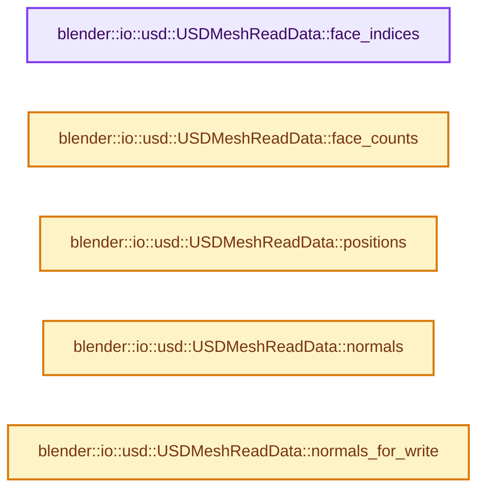

# 实现依赖专题：source/blender/io/usd/intern/usd_reader_mesh.hh

[实现依赖导航](../../../../README.md) · [符号索引](../../../../../00-课程指南/02-源码与提交索引/符号依赖与实现索引.md)

本专题从正文实际调用进入，集中保存共享实现。函数有稳定锚点，可从调用处直接跳到对应完整函数；递归与互相调用通过回链组织。

## 本文件的实现关系




## 完整成员与函数实现

<a id="f-9c22a3b76dd2ab9e"></a>

### `blender::io::usd::USDMeshReadData::face_indices`

实现位置：[source/blender/io/usd/intern/usd_reader_mesh.hh](../../../../../../../../../source/blender/io/usd/intern/usd_reader_mesh.hh) · L30—L33。

**教学注释版**

<!-- annotated:93a46860eda3ca -->

```cpp
  Span<int> face_indices() const
  {
    return Span(face_indices_.cdata(), face_indices_.size());
  }
```

<details>
<summary>核对原始源码：source/blender/io/usd/intern/usd_reader_mesh.hh · L30—L33</summary>

<!-- original:93a46860eda3ca:source/blender/io/usd/intern/usd_reader_mesh.hh:30:33 -->

```cpp
  Span<int> face_indices() const
  {
    return Span(face_indices_.cdata(), face_indices_.size());
  }
```

</details>

**结果出口**

- `return Span(face_indices_.cdata(), face_indices_.size());`

**继续追踪实现**

- `Span` → [blender::Span](../../../../01-BLI基础库/BLI_span.hh.md#t-8765a8e0c1d5)；[blender::Span](../../../../01-BLI基础库/BLI_index_range.hh.md#t-86091874a1c0)；[blender::Span](../../../makesdna/DNA_pointcloud_types.h.md#t-112aa6ed842c)；[blender::Span](../../../makesdna/DNA_node_types.h.md#t-49ec6fbb9b69)；[blender::Span](../../../makesdna/DNA_mesh_types.h.md#t-184fd48fb638)；[blender::Span](../../../makesdna/DNA_anim_types.h.md#t-d841071994c2)；[blender::Span](../../../makesrna/RNA_path_fwd.hh.md#t-4dbb08969e41)。
- `face_indices_.cdata` → [调用协议](../../../../../00-课程指南/01-路线与规范/模板宏与动态分派协议.md)：由接收对象具体类型或运行时策略提供实现。调用位置L32。
- `face_indices_.size` → [调用协议](../../../../../00-课程指南/01-路线与规范/模板宏与动态分派协议.md)：由接收对象具体类型或运行时策略提供实现。调用位置L32。

<a id="f-84adf9a1b06676be"></a>

### `blender::io::usd::USDMeshReadData::face_counts`

实现位置：[source/blender/io/usd/intern/usd_reader_mesh.hh](../../../../../../../../../source/blender/io/usd/intern/usd_reader_mesh.hh) · L34—L37。

**教学注释版**

<!-- annotated:640c3e8f2deb9b -->

```cpp
  Span<int> face_counts() const
  {
    return Span(face_counts_.cdata(), face_counts_.size());
  }
```

<details>
<summary>核对原始源码：source/blender/io/usd/intern/usd_reader_mesh.hh · L34—L37</summary>

<!-- original:640c3e8f2deb9b:source/blender/io/usd/intern/usd_reader_mesh.hh:34:37 -->

```cpp
  Span<int> face_counts() const
  {
    return Span(face_counts_.cdata(), face_counts_.size());
  }
```

</details>

**结果出口**

- `return Span(face_counts_.cdata(), face_counts_.size());`

**继续追踪实现**

- `Span` → [blender::Span](../../../../01-BLI基础库/BLI_span.hh.md#t-8765a8e0c1d5)；[blender::Span](../../../../01-BLI基础库/BLI_index_range.hh.md#t-86091874a1c0)；[blender::Span](../../../makesdna/DNA_pointcloud_types.h.md#t-112aa6ed842c)；[blender::Span](../../../makesdna/DNA_node_types.h.md#t-49ec6fbb9b69)；[blender::Span](../../../makesdna/DNA_mesh_types.h.md#t-184fd48fb638)；[blender::Span](../../../makesdna/DNA_anim_types.h.md#t-d841071994c2)；[blender::Span](../../../makesrna/RNA_path_fwd.hh.md#t-4dbb08969e41)。
- `face_counts_.cdata` → [调用协议](../../../../../00-课程指南/01-路线与规范/模板宏与动态分派协议.md)：由接收对象具体类型或运行时策略提供实现。调用位置L36。
- `face_counts_.size` → [调用协议](../../../../../00-课程指南/01-路线与规范/模板宏与动态分派协议.md)：由接收对象具体类型或运行时策略提供实现。调用位置L36。

<a id="f-0b3dae5a2bac2d4b"></a>

### `blender::io::usd::USDMeshReadData::positions`

实现位置：[source/blender/io/usd/intern/usd_reader_mesh.hh](../../../../../../../../../source/blender/io/usd/intern/usd_reader_mesh.hh) · L38—L41。

**教学注释版**

<!-- annotated:dea37b3838fc99 -->

```cpp
  Span<float3> positions() const
  {
    return Span(positions_.cdata(), positions_.size()).cast<float3>();
  }
```

<details>
<summary>核对原始源码：source/blender/io/usd/intern/usd_reader_mesh.hh · L38—L41</summary>

<!-- original:dea37b3838fc99:source/blender/io/usd/intern/usd_reader_mesh.hh:38:41 -->

```cpp
  Span<float3> positions() const
  {
    return Span(positions_.cdata(), positions_.size()).cast<float3>();
  }
```

</details>

**结果出口**

- `return Span(positions_.cdata(), positions_.size()).cast<float3>();`

**继续追踪实现**

- `Span(positions_.cdata(), positions_.size()).cast<float3>` → [调用协议](../../../../../00-课程指南/01-路线与规范/模板宏与动态分派协议.md)：接收对象类型依赖auto、返回值或模板实例；不按同名猜测目标。调用位置L40。
- `Span` → [blender::Span](../../../../01-BLI基础库/BLI_span.hh.md#t-8765a8e0c1d5)；[blender::Span](../../../../01-BLI基础库/BLI_index_range.hh.md#t-86091874a1c0)；[blender::Span](../../../makesdna/DNA_pointcloud_types.h.md#t-112aa6ed842c)；[blender::Span](../../../makesdna/DNA_node_types.h.md#t-49ec6fbb9b69)；[blender::Span](../../../makesdna/DNA_mesh_types.h.md#t-184fd48fb638)；[blender::Span](../../../makesdna/DNA_anim_types.h.md#t-d841071994c2)；[blender::Span](../../../makesrna/RNA_path_fwd.hh.md#t-4dbb08969e41)。
- `positions_.cdata` → [调用协议](../../../../../00-课程指南/01-路线与规范/模板宏与动态分派协议.md)：由接收对象具体类型或运行时策略提供实现。调用位置L40。
- `positions_.size` → [调用协议](../../../../../00-课程指南/01-路线与规范/模板宏与动态分派协议.md)：由接收对象具体类型或运行时策略提供实现。调用位置L40。

<a id="f-bfc2116efce96a80"></a>

### `blender::io::usd::USDMeshReadData::normals`

实现位置：[source/blender/io/usd/intern/usd_reader_mesh.hh](../../../../../../../../../source/blender/io/usd/intern/usd_reader_mesh.hh) · L42—L45。

**教学注释版**

<!-- annotated:a780bfb8ecfb69 -->

```cpp
  Span<float3> normals() const
  {
    return Span(normals_.cdata(), normals_.size()).cast<float3>();
  }
```

<details>
<summary>核对原始源码：source/blender/io/usd/intern/usd_reader_mesh.hh · L42—L45</summary>

<!-- original:a780bfb8ecfb69:source/blender/io/usd/intern/usd_reader_mesh.hh:42:45 -->

```cpp
  Span<float3> normals() const
  {
    return Span(normals_.cdata(), normals_.size()).cast<float3>();
  }
```

</details>

**结果出口**

- `return Span(normals_.cdata(), normals_.size()).cast<float3>();`

**继续追踪实现**

- `Span(normals_.cdata(), normals_.size()).cast<float3>` → [调用协议](../../../../../00-课程指南/01-路线与规范/模板宏与动态分派协议.md)：接收对象类型依赖auto、返回值或模板实例；不按同名猜测目标。调用位置L44。
- `Span` → [blender::Span](../../../../01-BLI基础库/BLI_span.hh.md#t-8765a8e0c1d5)；[blender::Span](../../../../01-BLI基础库/BLI_index_range.hh.md#t-86091874a1c0)；[blender::Span](../../../makesdna/DNA_pointcloud_types.h.md#t-112aa6ed842c)；[blender::Span](../../../makesdna/DNA_node_types.h.md#t-49ec6fbb9b69)；[blender::Span](../../../makesdna/DNA_mesh_types.h.md#t-184fd48fb638)；[blender::Span](../../../makesdna/DNA_anim_types.h.md#t-d841071994c2)；[blender::Span](../../../makesrna/RNA_path_fwd.hh.md#t-4dbb08969e41)。
- `normals_.cdata` → [调用协议](../../../../../00-课程指南/01-路线与规范/模板宏与动态分派协议.md)：由接收对象具体类型或运行时策略提供实现。调用位置L44。
- `normals_.size` → [调用协议](../../../../../00-课程指南/01-路线与规范/模板宏与动态分派协议.md)：由接收对象具体类型或运行时策略提供实现。调用位置L44。

<a id="f-a177ed9eea325d7a"></a>

### `blender::io::usd::USDMeshReadData::normals_for_write`

实现位置：[source/blender/io/usd/intern/usd_reader_mesh.hh](../../../../../../../../../source/blender/io/usd/intern/usd_reader_mesh.hh) · L46—L49。

**教学注释版**

<!-- annotated:ef274ef96eac01 -->

```cpp
  MutableSpan<float3> normals_for_write()
  {
    return MutableSpan(normals_.data(), normals_.size()).cast<float3>();
  }
```

<details>
<summary>核对原始源码：source/blender/io/usd/intern/usd_reader_mesh.hh · L46—L49</summary>

<!-- original:ef274ef96eac01:source/blender/io/usd/intern/usd_reader_mesh.hh:46:49 -->

```cpp
  MutableSpan<float3> normals_for_write()
  {
    return MutableSpan(normals_.data(), normals_.size()).cast<float3>();
  }
```

</details>

**结果出口**

- `return MutableSpan(normals_.data(), normals_.size()).cast<float3>();`

**继续追踪实现**

- `MutableSpan(normals_.data(), normals_.size()).cast<float3>` → [调用协议](../../../../../00-课程指南/01-路线与规范/模板宏与动态分派协议.md)：接收对象类型依赖auto、返回值或模板实例；不按同名猜测目标。调用位置L48。
- `MutableSpan` → [blender::MutableSpan::MutableSpan · L462](../../../../../01-基础容器与现代CPP/06-MutableSpan可写视图.md#f-0f07034aaffc3384)；[blender::MutableSpan::MutableSpan · L464](../../../../../01-基础容器与现代CPP/06-MutableSpan可写视图.md#f-39977234ad0ce192)；[blender::MutableSpan::MutableSpan · L466](../../../../../01-基础容器与现代CPP/06-MutableSpan可写视图.md#f-ee249b5042dd38aa)；[blender::MutableSpan::MutableSpan · L468](../../../../../01-基础容器与现代CPP/06-MutableSpan可写视图.md#f-479c5f85921e531f)；[blender::MutableSpan::MutableSpan · L477](../../../../../01-基础容器与现代CPP/06-MutableSpan可写视图.md#f-afcce5325e6f19e0)。同名重载需按实参类型选择。
- `normals_.data` → [调用协议](../../../../../00-课程指南/01-路线与规范/模板宏与动态分派协议.md)：由接收对象具体类型或运行时策略提供实现。调用位置L48。
- `normals_.size` → [调用协议](../../../../../00-课程指南/01-路线与规范/模板宏与动态分派协议.md)：由接收对象具体类型或运行时策略提供实现。调用位置L48。
