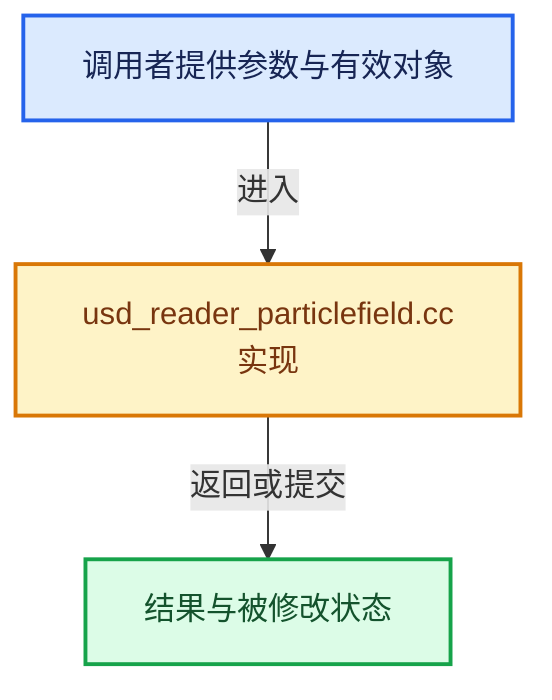

# 实现依赖专题：source/blender/io/usd/intern/usd_reader_particlefield.cc

[实现依赖导航](../../../../README.md) · [符号索引](../../../../../00-课程指南/02-源码与提交索引/符号依赖与实现索引.md)

本专题从正文实际调用进入，集中保存共享实现。函数有稳定锚点，可从调用处直接跳到对应完整函数；递归与互相调用通过回链组织。

## 本文件的实现关系

```mermaid
flowchart LR
  F0["blender::io::usd::UsdWrappedData::size"]:::abstraction
  F1["blender::io::usd::USDParticleFieldReader::read_geometry"]:::compute
  F0 -->|"显式调用"| F0
  F1 -->|"显式调用"| F0
  classDef input fill:#DBEAFE,stroke:#2563EB,color:#172554,stroke-width:2px;
  classDef data fill:#CFFAFE,stroke:#0891B2,color:#164E63,stroke-width:2px;
  classDef abstraction fill:#EDE9FE,stroke:#7C3AED,color:#3B0764,stroke-width:2px;
  classDef compute fill:#FEF3C7,stroke:#D97706,color:#78350F,stroke-width:2px;
  classDef result fill:#DCFCE7,stroke:#16A34A,color:#14532D,stroke-width:2px;
  classDef error fill:#FEE2E2,stroke:#DC2626,color:#7F1D1D,stroke-width:2px;
```






## 完整成员与函数实现

<a id="f-df570dacfd36adfc"></a>

### `blender::io::usd::UsdWrappedData::size`

实现位置：[source/blender/io/usd/intern/usd_reader_particlefield.cc](../../../../../../../../../source/blender/io/usd/intern/usd_reader_particlefield.cc) · L51—L54。

**教学注释版**

<!-- annotated:37de54eaa8424e -->

```cpp
  size_t size()
  {
    return uses_float ? usd_float.size() : usd_half.size();
  }
```

<details>
<summary>核对原始源码：source/blender/io/usd/intern/usd_reader_particlefield.cc · L51—L54</summary>

<!-- original:37de54eaa8424e:source/blender/io/usd/intern/usd_reader_particlefield.cc:51:54 -->

```cpp
  size_t size()
  {
    return uses_float ? usd_float.size() : usd_half.size();
  }
```

</details>

**结果出口**

- `return uses_float ? usd_float.size() : usd_half.size();`

**继续追踪实现**

- `usd_float.size` → [blender::io::usd::UsdWrappedData::size · L51](usd_reader_particlefield.cc.md#f-df570dacfd36adfc)。
- `usd_half.size` → [blender::io::usd::UsdWrappedData::size · L51](usd_reader_particlefield.cc.md#f-df570dacfd36adfc)。

<a id="f-6e81e3c67c1f4c78"></a>

### `blender::io::usd::USDParticleFieldReader::read_geometry`

实现位置：[source/blender/io/usd/intern/usd_reader_particlefield.cc](../../../../../../../../../source/blender/io/usd/intern/usd_reader_particlefield.cc) · L144—L237。

接口参数：

- `bke::GeometrySet &geometry_set`
- `USDMeshReadParams params`
- `const char **`

**教学注释版**

<!-- annotated:8ff54265d51a22 -->

```cpp
void USDParticleFieldReader::read_geometry(bke::GeometrySet &geometry_set,
                                           USDMeshReadParams params,
                                           const char ** /*r_err_str*/)
{
  UsdWrappedVec3 usd_positions(
      [&](pxr::UsdAttribute *attr) { return gsplat_prim_.UsesFloatPositions(attr); },
      params.motion_sample_time);

  UsdWrappedVec3 usd_scales(
      [&](pxr::UsdAttribute *attr) { return gsplat_prim_.UsesFloatScales(attr); },
      params.motion_sample_time);

  UsdWrappedFloat usd_opacities(
      [&](pxr::UsdAttribute *attr) { return gsplat_prim_.UsesFloatOpacities(attr); },
      params.motion_sample_time);

  UsdWrappedQuat usd_orientations(
      [&](pxr::UsdAttribute *attr) { return gsplat_prim_.UsesFloatOrientations(attr); },
      params.motion_sample_time);

  UsdWrappedVec3 usd_coeffs(
      [&](pxr::UsdAttribute *attr) { return gsplat_prim_.UsesFloatRadianceCoefficients(attr); },
      params.motion_sample_time);

  int usd_degree = 0;
  gsplat_prim_.GetRadianceSphericalHarmonicsDegreeAttr().Get(&usd_degree,
                                                             params.motion_sample_time);

  if (!validate::size_fits_in_int(usd_positions.size())) {
    CLOG_WARN(&LOG,
              "ParticleField '%s' has an unsupported number of points.",
              this->prim_path().GetAsString().c_str());
    return;
  }

  if (usd_degree < 0 || usd_degree > 4) {
    CLOG_WARN(&LOG,
              "ParticleField '%s' has an unsupported spherical harmonics degree.",
              this->prim_path().GetAsString().c_str());
    return;
  }

  if (usd_scales.size() != usd_positions.size() || usd_opacities.size() != usd_positions.size() ||
      usd_orientations.size() != usd_positions.size())
  {
    CLOG_WARN(&LOG,
              "ParticleField '%s' has incorrect data sizes.",
              this->prim_path().GetAsString().c_str());
    return;
  }

  const int usd_coeff_element_size = (usd_degree + 1) * (usd_degree + 1);
  if (usd_coeffs.size() != usd_positions.size() * usd_coeff_element_size) {
    CLOG_WARN(&LOG,
              "ParticleField '%s' has an incorrect amount of spherical harmonics data.",
              this->prim_path().GetAsString().c_str());
    return;
  }

  PointCloud *point_cloud = geometry_set.get_pointcloud_for_write();
  if (point_cloud->totpoint != usd_positions.size()) {
    point_cloud = BKE_pointcloud_new_nomain(PointCloudType::GSplat, usd_positions.size());
  }

  MutableSpan<float3> positions = point_cloud->positions_for_write();
  // [讲解] positions.size：查询视图长度或生成对应有效索引区间。
  for (int64_t i = 0; i < positions.size(); i++) {
    positions[i] = usd_positions[i];
  }

  gsplat::GsplatMutableAttributeAccessor accessor(*point_cloud, usd_degree);
  MutableSpan<float4> radiance = accessor.radiance_base_for_write();
  MutableSpan<float3> scale = accessor.scales_for_write();
  MutableSpan<math::Quaternion> rotation = accessor.rotations_for_write();
  Span<MutableSpan<float3>> sh_attrs = accessor.sh_for_write();

  const int num_sh_dimensions = usd_coeff_element_size - 1;
  // [讲解] positions.index_range：查询视图长度或生成对应有效索引区间。
  threading::parallel_for(positions.index_range(), 16384, [&](IndexRange range) {
    for (const int64_t i : range) {
      const int64_t sh_offset = (i * usd_coeff_element_size);

      radiance[i] = float4(usd_coeffs[sh_offset], usd_opacities[i]);
      scale[i] = usd_scales[i];
      rotation[i] = math::normalize(usd_orientations[i]);

      for (int dimension = 0; dimension < num_sh_dimensions; dimension++) {
        sh_attrs[dimension][i] = usd_coeffs[sh_offset + dimension + 1];
      }
    }
  });

  accessor.finish();

  geometry_set.replace_pointcloud(point_cloud);
}
```

<details>
<summary>核对原始源码：source/blender/io/usd/intern/usd_reader_particlefield.cc · L144—L237</summary>

<!-- original:8ff54265d51a22:source/blender/io/usd/intern/usd_reader_particlefield.cc:144:237 -->

```cpp
void USDParticleFieldReader::read_geometry(bke::GeometrySet &geometry_set,
                                           USDMeshReadParams params,
                                           const char ** /*r_err_str*/)
{
  UsdWrappedVec3 usd_positions(
      [&](pxr::UsdAttribute *attr) { return gsplat_prim_.UsesFloatPositions(attr); },
      params.motion_sample_time);

  UsdWrappedVec3 usd_scales(
      [&](pxr::UsdAttribute *attr) { return gsplat_prim_.UsesFloatScales(attr); },
      params.motion_sample_time);

  UsdWrappedFloat usd_opacities(
      [&](pxr::UsdAttribute *attr) { return gsplat_prim_.UsesFloatOpacities(attr); },
      params.motion_sample_time);

  UsdWrappedQuat usd_orientations(
      [&](pxr::UsdAttribute *attr) { return gsplat_prim_.UsesFloatOrientations(attr); },
      params.motion_sample_time);

  UsdWrappedVec3 usd_coeffs(
      [&](pxr::UsdAttribute *attr) { return gsplat_prim_.UsesFloatRadianceCoefficients(attr); },
      params.motion_sample_time);

  int usd_degree = 0;
  gsplat_prim_.GetRadianceSphericalHarmonicsDegreeAttr().Get(&usd_degree,
                                                             params.motion_sample_time);

  if (!validate::size_fits_in_int(usd_positions.size())) {
    CLOG_WARN(&LOG,
              "ParticleField '%s' has an unsupported number of points.",
              this->prim_path().GetAsString().c_str());
    return;
  }

  if (usd_degree < 0 || usd_degree > 4) {
    CLOG_WARN(&LOG,
              "ParticleField '%s' has an unsupported spherical harmonics degree.",
              this->prim_path().GetAsString().c_str());
    return;
  }

  if (usd_scales.size() != usd_positions.size() || usd_opacities.size() != usd_positions.size() ||
      usd_orientations.size() != usd_positions.size())
  {
    CLOG_WARN(&LOG,
              "ParticleField '%s' has incorrect data sizes.",
              this->prim_path().GetAsString().c_str());
    return;
  }

  const int usd_coeff_element_size = (usd_degree + 1) * (usd_degree + 1);
  if (usd_coeffs.size() != usd_positions.size() * usd_coeff_element_size) {
    CLOG_WARN(&LOG,
              "ParticleField '%s' has an incorrect amount of spherical harmonics data.",
              this->prim_path().GetAsString().c_str());
    return;
  }

  PointCloud *point_cloud = geometry_set.get_pointcloud_for_write();
  if (point_cloud->totpoint != usd_positions.size()) {
    point_cloud = BKE_pointcloud_new_nomain(PointCloudType::GSplat, usd_positions.size());
  }

  MutableSpan<float3> positions = point_cloud->positions_for_write();
  for (int64_t i = 0; i < positions.size(); i++) {
    positions[i] = usd_positions[i];
  }

  gsplat::GsplatMutableAttributeAccessor accessor(*point_cloud, usd_degree);
  MutableSpan<float4> radiance = accessor.radiance_base_for_write();
  MutableSpan<float3> scale = accessor.scales_for_write();
  MutableSpan<math::Quaternion> rotation = accessor.rotations_for_write();
  Span<MutableSpan<float3>> sh_attrs = accessor.sh_for_write();

  const int num_sh_dimensions = usd_coeff_element_size - 1;
  threading::parallel_for(positions.index_range(), 16384, [&](IndexRange range) {
    for (const int64_t i : range) {
      const int64_t sh_offset = (i * usd_coeff_element_size);

      radiance[i] = float4(usd_coeffs[sh_offset], usd_opacities[i]);
      scale[i] = usd_scales[i];
      rotation[i] = math::normalize(usd_orientations[i]);

      for (int dimension = 0; dimension < num_sh_dimensions; dimension++) {
        sh_attrs[dimension][i] = usd_coeffs[sh_offset + dimension + 1];
      }
    }
  });

  accessor.finish();

  geometry_set.replace_pointcloud(point_cloud);
}
```

</details>

**沿实际写入检查状态**

- `point_cloud = BKE_pointcloud_new_nomain(PointCloudType::GSplat, usd_positions.size());`
- `positions[i] = usd_positions[i];`
- `radiance[i] = float4(usd_coeffs[sh_offset], usd_opacities[i]);`
- `scale[i] = usd_scales[i];`
- `rotation[i] = math::normalize(usd_orientations[i]);`
- `sh_attrs[dimension][i] = usd_coeffs[sh_offset + dimension + 1];`

**继续追踪实现**

- `gsplat_prim_.UsesFloatPositions` → [调用协议](../../../../../00-课程指南/01-路线与规范/模板宏与动态分派协议.md)：接收对象类型依赖auto、返回值或模板实例；不按同名猜测目标。调用位置L149。
- `gsplat_prim_.UsesFloatScales` → [调用协议](../../../../../00-课程指南/01-路线与规范/模板宏与动态分派协议.md)：接收对象类型依赖auto、返回值或模板实例；不按同名猜测目标。调用位置L153。
- `gsplat_prim_.UsesFloatOpacities` → [调用协议](../../../../../00-课程指南/01-路线与规范/模板宏与动态分派协议.md)：接收对象类型依赖auto、返回值或模板实例；不按同名猜测目标。调用位置L157。
- `gsplat_prim_.UsesFloatOrientations` → [调用协议](../../../../../00-课程指南/01-路线与规范/模板宏与动态分派协议.md)：接收对象类型依赖auto、返回值或模板实例；不按同名猜测目标。调用位置L161。
- `gsplat_prim_.UsesFloatRadianceCoefficients` → [调用协议](../../../../../00-课程指南/01-路线与规范/模板宏与动态分派协议.md)：接收对象类型依赖auto、返回值或模板实例；不按同名猜测目标。调用位置L165。
- `gsplat_prim_.GetRadianceSphericalHarmonicsDegreeAttr().Get` → [调用协议](../../../../../00-课程指南/01-路线与规范/模板宏与动态分派协议.md)：接收对象类型依赖auto、返回值或模板实例；不按同名猜测目标。调用位置L169。
- `gsplat_prim_.GetRadianceSphericalHarmonicsDegreeAttr` → [调用协议](../../../../../00-课程指南/01-路线与规范/模板宏与动态分派协议.md)：接收对象类型依赖auto、返回值或模板实例；不按同名猜测目标。调用位置L169。
- `validate::size_fits_in_int` → [blender::io::validate::size_fits_in_int · L19](../../common/IO_validate.hh.md#f-e1bd738c7e807b20)。
- `usd_positions.size` → [blender::io::usd::UsdWrappedData::size · L51](usd_reader_particlefield.cc.md#f-df570dacfd36adfc)。
- `CLOG_WARN` → [CLOG_WARN · L189](../../../../07-Intern运行时与平台/clog/CLG_log.h.md#m-9da21a06cdbe)。宏定义由构建条件选择。
- `this->prim_path().GetAsString().c_str` → [调用协议](../../../../../00-课程指南/01-路线与规范/模板宏与动态分派协议.md)：接收对象类型依赖auto、返回值或模板实例；不按同名猜测目标。调用位置L175。
- `this->prim_path().GetAsString` → [调用协议](../../../../../00-课程指南/01-路线与规范/模板宏与动态分派协议.md)：接收对象类型依赖auto、返回值或模板实例；不按同名猜测目标。调用位置L175。
- `this->prim_path` → [blender::io::usd::USDPrimReader::prim_path · L131](usd_reader_prim.hh.md#f-dec72036547b12b4)。
- `usd_scales.size` → [blender::io::usd::UsdWrappedData::size · L51](usd_reader_particlefield.cc.md#f-df570dacfd36adfc)。
- `usd_opacities.size` → [blender::io::usd::UsdWrappedData::size · L51](usd_reader_particlefield.cc.md#f-df570dacfd36adfc)。
- `usd_orientations.size` → [blender::io::usd::UsdWrappedData::size · L51](usd_reader_particlefield.cc.md#f-df570dacfd36adfc)。
- `usd_coeffs.size` → [blender::io::usd::UsdWrappedData::size · L51](usd_reader_particlefield.cc.md#f-df570dacfd36adfc)。
- `geometry_set.get_pointcloud_for_write` → [blender::bke::GeometrySet::get_pointcloud_for_write · L568](../../../../../06-隐式共享与缓存系统/05-GeometrySet读写与复制.md#f-eae41fb2ed3be0d5)。
- `BKE_pointcloud_new_nomain` → [blender::BKE_pointcloud_new_nomain · L228](../../../../02-BKE几何与数据/intern/pointcloud.cc.md#f-8ee0d698049c08aa)。
- `point_cloud->positions_for_write` → [blender::PointCloud::positions_for_write · L204](../../../../02-BKE几何与数据/intern/pointcloud.cc.md#f-638cb4413ae404ef)。
- `positions.size` → [blender::MutableSpan::size · L499](../../../../../01-基础容器与现代CPP/06-MutableSpan可写视图.md#f-1de6a66839c304a8)；[blender::gpu::shader::parser::MutableSpan::size · L87](../../../gpu/shader_tool/utils.hh.md#f-5e684af6ee7990e9)。同名重载需按实参类型选择。
- `accessor.radiance_base_for_write` → [blender::io::gsplat::GsplatMutableAttributeAccessor::radiance_base_for_write · L38](../../common/intern/gsplat.cc.md#f-105b84cad7cbd878)。
- `accessor.scales_for_write` → [blender::io::gsplat::GsplatMutableAttributeAccessor::scales_for_write · L43](../../common/intern/gsplat.cc.md#f-b0ebacc27508addd)。
- `accessor.rotations_for_write` → [blender::io::gsplat::GsplatMutableAttributeAccessor::rotations_for_write · L48](../../common/intern/gsplat.cc.md#f-91bbe964dafd28e4)。
- `accessor.sh_for_write` → [blender::io::gsplat::GsplatMutableAttributeAccessor::sh_for_write · L53](../../common/intern/gsplat.cc.md#f-9e04ca68bdc13ef3)。
- `threading::parallel_for` → [blender::threading::parallel_for · L68](../../../../../11-Depsgraph与并行任务系统/07-任务池与TBB接入.md#f-838294754c24426c)。
- `positions.index_range` → [blender::MutableSpan::index_range · L676](../../../../../01-基础容器与现代CPP/06-MutableSpan可写视图.md#f-f9a9d59a69ca64b5)。
- `float4` → [float4 · L56](../../../../07-Intern运行时与平台/cycles/kernel/svm/radial_tiling_shared.h.md#m-f0908e385c5b)；[float4 · L60](../../../../01-BLI基础库/intern/radial_tiling_shared.hh.md#m-7962dcdc288b)；[float4 · L56](../../../../07-Intern运行时与平台/cycles/kernel/osl/shaders/node_radial_tiling_shared.h.md#m-adb8e9e87775)；[float4 · L642](../../../compositor/algorithms/intern/smaa.cc.md#m-9362daaa821c)。宏定义由构建条件选择。
- `math::normalize` → [blender::math::normalize · L542](../../../../01-BLI基础库/BLI_math_vector.hh.md#f-5bea914457e11f7f)；[blender::math::normalize · L258](../../../../01-BLI基础库/BLI_math_quaternion.hh.md#f-5bf6b351333e4054)；[blender::math::normalize · L450](../../../../01-BLI基础库/BLI_math_quaternion.hh.md#f-b852cee8f0cc9b6a)；[blender::math::normalize · L745](../../../../01-BLI基础库/BLI_math_matrix.hh.md#f-2235cb6f5ec7ff18)；[blender::math::normalize · L783](../../../../01-BLI基础库/BLI_math_matrix.hh.md#f-0386bc4ee9ac7425)。同名重载需按实参类型选择。
- `accessor.finish` → [blender::io::gsplat::GsplatMutableAttributeAccessor::finish · L58](../../common/intern/gsplat.cc.md#f-f132d58bc945dfd6)。
- `geometry_set.replace_pointcloud` → [blender::bke::GeometrySet::replace_pointcloud · L519](../../../../../06-隐式共享与缓存系统/05-GeometrySet读写与复制.md#f-02414356dff40c94)。
