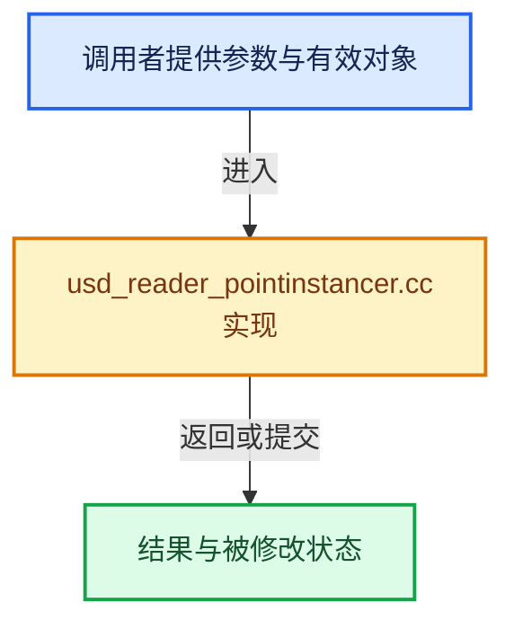

# 实现依赖专题：source/blender/io/usd/intern/usd_reader_pointinstancer.cc

[实现依赖导航](../../../../README.md) · [符号索引](../../../../../00-课程指南/02-源码与提交索引/符号依赖与实现索引.md)

本专题从正文实际调用进入，集中保存共享实现。函数有稳定锚点，可从调用处直接跳到对应完整函数；递归与互相调用通过回链组织。

## 本文件的实现关系





## 完整成员与函数实现

<a id="f-d9e643c4f8504a40"></a>

### `blender::io::usd::USDPointInstancerReader::read_geometry`

实现位置：[source/blender/io/usd/intern/usd_reader_pointinstancer.cc](../../../../../../../../../source/blender/io/usd/intern/usd_reader_pointinstancer.cc) · L49—L156。

接口参数：

- `bke::GeometrySet &geometry_set`
- `USDMeshReadParams params`
- `const char **`

**教学注释版**

<!-- annotated:f7337c00ac8d28 -->

```cpp
void USDPointInstancerReader::read_geometry(bke::GeometrySet &geometry_set,
                                            USDMeshReadParams params,
                                            const char ** /*r_err_str*/)
{
  pxr::VtArray<pxr::GfVec3f> usd_positions;
  pxr::VtArray<pxr::GfVec3f> usd_scales;
  pxr::VtArray<pxr::GfQuath> usd_orientations;
  pxr::VtInt64Array usd_ids;
  pxr::VtArray<int> usd_proto_indices;
  std::vector<bool> usd_mask = point_instancer_prim_.ComputeMaskAtTime(params.motion_sample_time);

  point_instancer_prim_.GetPositionsAttr().Get(&usd_positions, params.motion_sample_time);
  point_instancer_prim_.GetScalesAttr().Get(&usd_scales, params.motion_sample_time);
  point_instancer_prim_.GetOrientationsAttr().Get(&usd_orientations, params.motion_sample_time);
  point_instancer_prim_.GetIdsAttr().Get(&usd_ids, params.motion_sample_time);
  point_instancer_prim_.GetProtoIndicesAttr().Get(&usd_proto_indices, params.motion_sample_time);

  PointCloud *pointcloud = geometry_set.get_pointcloud_for_write();
  if (pointcloud->totpoint != usd_positions.size()) {
    /* Size changed so we must reallocate. */
    pointcloud = BKE_pointcloud_new_nomain(PointCloudType::Points, usd_positions.size());
  }

  MutableSpan<float3> point_positions = pointcloud->positions_for_write();
  // [讲解] point_positions.copy_from：修改已有目标元素，不改变底层容器长度。
  point_positions.copy_from(Span(usd_positions.cdata(), usd_positions.size()).cast<float3>());

  bke::MutableAttributeAccessor attributes = pointcloud->attributes_for_write();

  bke::SpanAttributeWriter<float3> scales_attribute =
      attributes.lookup_or_add_for_write_only_span<float3>("scale", bke::AttrDomain::Point);

  /* Here and below, handle the case where instancing attributes are empty or
   * not of the expected size. */
  if (usd_scales.size() < usd_positions.size()) {
    scales_attribute.span.fill(float3(1.0f));
  }

  Span<pxr::GfVec3f> scales = Span(usd_scales.cdata(), usd_scales.size());
  // [讲解] std::min：按比较关系选取较小值；截断范围时还需先满足非负和可表示范围，min本身不会证明边界安全。
  for (const int i : IndexRange(std::min(usd_scales.size(), usd_positions.size()))) {
    scales_attribute.span[i] = float3(scales[i][0], scales[i][1], scales[i][2]);
  }

  scales_attribute.finish();

  bke::SpanAttributeWriter<math::Quaternion> orientations_attribute =
      attributes.lookup_or_add_for_write_only_span<math::Quaternion>("orientation",
                                                                     bke::AttrDomain::Point);

  if (usd_orientations.size() < usd_positions.size()) {
    orientations_attribute.span.fill(math::Quaternion::identity());
  }

  Span<pxr::GfQuath> orientations = Span(usd_orientations.cdata(), usd_orientations.size());
  for (const int i : IndexRange(std::min(usd_orientations.size(), usd_positions.size()))) {
    orientations_attribute.span[i] = math::Quaternion(orientations[i].GetReal(),
                                                      orientations[i].GetImaginary()[0],
                                                      orientations[i].GetImaginary()[1],
                                                      orientations[i].GetImaginary()[2]);
  }

  orientations_attribute.finish();

  if (!usd_ids.empty()) {
    bke::SpanAttributeWriter<int> ids_attribute =
        attributes.lookup_or_add_for_write_only_span<int>("id", bke::AttrDomain::Point);

    const Span<int64_t> usd_data(usd_ids.cdata(), usd_ids.size());
    // [讲解] usd_data.size：查询视图长度或生成对应有效索引区间。
    if (usd_data.size() < ids_attribute.span.size()) {
      ids_attribute.span.fill(0);
    }

    for (const int i : IndexRange(std::min(usd_data.size(), ids_attribute.span.size()))) {
      /* Blender only supports int ID attributes so we have to narrow the value. */
      ids_attribute.span[i] = int(usd_data[i]);
    }

    ids_attribute.finish();
  }

  bke::SpanAttributeWriter<int> proto_indices_attribute =
      attributes.lookup_or_add_for_write_only_span<int>("proto_index", bke::AttrDomain::Point);

  if (usd_proto_indices.size() < usd_positions.size()) {
    proto_indices_attribute.span.fill(0);
  }

  Span<int> proto_indices = Span(usd_proto_indices.cdata(), usd_proto_indices.size());
  for (const int i : IndexRange(std::min(usd_proto_indices.size(), usd_positions.size()))) {
    proto_indices_attribute.span[i] = proto_indices[i];
  }

  proto_indices_attribute.finish();

  bke::SpanAttributeWriter<bool> mask_attribute =
      attributes.lookup_or_add_for_write_only_span<bool>("mask", bke::AttrDomain::Point);

  if (usd_mask.size() < usd_positions.size()) {
    mask_attribute.span.fill(true);
  }

  for (const int i : IndexRange(std::min(usd_mask.size(), usd_positions.size()))) {
    mask_attribute.span[i] = usd_mask[i];
  }

  mask_attribute.finish();

  geometry_set.replace_pointcloud(pointcloud);
}
```

<details>
<summary>核对原始源码：source/blender/io/usd/intern/usd_reader_pointinstancer.cc · L49—L156</summary>

<!-- original:f7337c00ac8d28:source/blender/io/usd/intern/usd_reader_pointinstancer.cc:49:156 -->

```cpp
void USDPointInstancerReader::read_geometry(bke::GeometrySet &geometry_set,
                                            USDMeshReadParams params,
                                            const char ** /*r_err_str*/)
{
  pxr::VtArray<pxr::GfVec3f> usd_positions;
  pxr::VtArray<pxr::GfVec3f> usd_scales;
  pxr::VtArray<pxr::GfQuath> usd_orientations;
  pxr::VtInt64Array usd_ids;
  pxr::VtArray<int> usd_proto_indices;
  std::vector<bool> usd_mask = point_instancer_prim_.ComputeMaskAtTime(params.motion_sample_time);

  point_instancer_prim_.GetPositionsAttr().Get(&usd_positions, params.motion_sample_time);
  point_instancer_prim_.GetScalesAttr().Get(&usd_scales, params.motion_sample_time);
  point_instancer_prim_.GetOrientationsAttr().Get(&usd_orientations, params.motion_sample_time);
  point_instancer_prim_.GetIdsAttr().Get(&usd_ids, params.motion_sample_time);
  point_instancer_prim_.GetProtoIndicesAttr().Get(&usd_proto_indices, params.motion_sample_time);

  PointCloud *pointcloud = geometry_set.get_pointcloud_for_write();
  if (pointcloud->totpoint != usd_positions.size()) {
    /* Size changed so we must reallocate. */
    pointcloud = BKE_pointcloud_new_nomain(PointCloudType::Points, usd_positions.size());
  }

  MutableSpan<float3> point_positions = pointcloud->positions_for_write();
  point_positions.copy_from(Span(usd_positions.cdata(), usd_positions.size()).cast<float3>());

  bke::MutableAttributeAccessor attributes = pointcloud->attributes_for_write();

  bke::SpanAttributeWriter<float3> scales_attribute =
      attributes.lookup_or_add_for_write_only_span<float3>("scale", bke::AttrDomain::Point);

  /* Here and below, handle the case where instancing attributes are empty or
   * not of the expected size. */
  if (usd_scales.size() < usd_positions.size()) {
    scales_attribute.span.fill(float3(1.0f));
  }

  Span<pxr::GfVec3f> scales = Span(usd_scales.cdata(), usd_scales.size());
  for (const int i : IndexRange(std::min(usd_scales.size(), usd_positions.size()))) {
    scales_attribute.span[i] = float3(scales[i][0], scales[i][1], scales[i][2]);
  }

  scales_attribute.finish();

  bke::SpanAttributeWriter<math::Quaternion> orientations_attribute =
      attributes.lookup_or_add_for_write_only_span<math::Quaternion>("orientation",
                                                                     bke::AttrDomain::Point);

  if (usd_orientations.size() < usd_positions.size()) {
    orientations_attribute.span.fill(math::Quaternion::identity());
  }

  Span<pxr::GfQuath> orientations = Span(usd_orientations.cdata(), usd_orientations.size());
  for (const int i : IndexRange(std::min(usd_orientations.size(), usd_positions.size()))) {
    orientations_attribute.span[i] = math::Quaternion(orientations[i].GetReal(),
                                                      orientations[i].GetImaginary()[0],
                                                      orientations[i].GetImaginary()[1],
                                                      orientations[i].GetImaginary()[2]);
  }

  orientations_attribute.finish();

  if (!usd_ids.empty()) {
    bke::SpanAttributeWriter<int> ids_attribute =
        attributes.lookup_or_add_for_write_only_span<int>("id", bke::AttrDomain::Point);

    const Span<int64_t> usd_data(usd_ids.cdata(), usd_ids.size());
    if (usd_data.size() < ids_attribute.span.size()) {
      ids_attribute.span.fill(0);
    }

    for (const int i : IndexRange(std::min(usd_data.size(), ids_attribute.span.size()))) {
      /* Blender only supports int ID attributes so we have to narrow the value. */
      ids_attribute.span[i] = int(usd_data[i]);
    }

    ids_attribute.finish();
  }

  bke::SpanAttributeWriter<int> proto_indices_attribute =
      attributes.lookup_or_add_for_write_only_span<int>("proto_index", bke::AttrDomain::Point);

  if (usd_proto_indices.size() < usd_positions.size()) {
    proto_indices_attribute.span.fill(0);
  }

  Span<int> proto_indices = Span(usd_proto_indices.cdata(), usd_proto_indices.size());
  for (const int i : IndexRange(std::min(usd_proto_indices.size(), usd_positions.size()))) {
    proto_indices_attribute.span[i] = proto_indices[i];
  }

  proto_indices_attribute.finish();

  bke::SpanAttributeWriter<bool> mask_attribute =
      attributes.lookup_or_add_for_write_only_span<bool>("mask", bke::AttrDomain::Point);

  if (usd_mask.size() < usd_positions.size()) {
    mask_attribute.span.fill(true);
  }

  for (const int i : IndexRange(std::min(usd_mask.size(), usd_positions.size()))) {
    mask_attribute.span[i] = usd_mask[i];
  }

  mask_attribute.finish();

  geometry_set.replace_pointcloud(pointcloud);
}
```

</details>

**沿实际写入检查状态**

- `pointcloud = BKE_pointcloud_new_nomain(PointCloudType::Points, usd_positions.size());`
- `scales_attribute.span[i] = float3(scales[i][0], scales[i][1], scales[i][2]);`
- `orientations_attribute.span[i] = math::Quaternion(orientations[i].GetReal(),`
- `ids_attribute.span[i] = int(usd_data[i]);`
- `proto_indices_attribute.span[i] = proto_indices[i];`
- `mask_attribute.span[i] = usd_mask[i];`

**继续追踪实现**

- `point_instancer_prim_.ComputeMaskAtTime` → [调用协议](../../../../../00-课程指南/01-路线与规范/模板宏与动态分派协议.md)：接收对象类型依赖auto、返回值或模板实例；不按同名猜测目标。调用位置L58。
- `point_instancer_prim_.GetPositionsAttr().Get` → [调用协议](../../../../../00-课程指南/01-路线与规范/模板宏与动态分派协议.md)：接收对象类型依赖auto、返回值或模板实例；不按同名猜测目标。调用位置L60。
- `point_instancer_prim_.GetPositionsAttr` → [调用协议](../../../../../00-课程指南/01-路线与规范/模板宏与动态分派协议.md)：接收对象类型依赖auto、返回值或模板实例；不按同名猜测目标。调用位置L60。
- `point_instancer_prim_.GetScalesAttr().Get` → [调用协议](../../../../../00-课程指南/01-路线与规范/模板宏与动态分派协议.md)：接收对象类型依赖auto、返回值或模板实例；不按同名猜测目标。调用位置L61。
- `point_instancer_prim_.GetScalesAttr` → [调用协议](../../../../../00-课程指南/01-路线与规范/模板宏与动态分派协议.md)：接收对象类型依赖auto、返回值或模板实例；不按同名猜测目标。调用位置L61。
- `point_instancer_prim_.GetOrientationsAttr().Get` → [调用协议](../../../../../00-课程指南/01-路线与规范/模板宏与动态分派协议.md)：接收对象类型依赖auto、返回值或模板实例；不按同名猜测目标。调用位置L62。
- `point_instancer_prim_.GetOrientationsAttr` → [调用协议](../../../../../00-课程指南/01-路线与规范/模板宏与动态分派协议.md)：接收对象类型依赖auto、返回值或模板实例；不按同名猜测目标。调用位置L62。
- `point_instancer_prim_.GetIdsAttr().Get` → [调用协议](../../../../../00-课程指南/01-路线与规范/模板宏与动态分派协议.md)：接收对象类型依赖auto、返回值或模板实例；不按同名猜测目标。调用位置L63。
- `point_instancer_prim_.GetIdsAttr` → [调用协议](../../../../../00-课程指南/01-路线与规范/模板宏与动态分派协议.md)：接收对象类型依赖auto、返回值或模板实例；不按同名猜测目标。调用位置L63。
- `point_instancer_prim_.GetProtoIndicesAttr().Get` → [调用协议](../../../../../00-课程指南/01-路线与规范/模板宏与动态分派协议.md)：接收对象类型依赖auto、返回值或模板实例；不按同名猜测目标。调用位置L64。
- `point_instancer_prim_.GetProtoIndicesAttr` → [调用协议](../../../../../00-课程指南/01-路线与规范/模板宏与动态分派协议.md)：接收对象类型依赖auto、返回值或模板实例；不按同名猜测目标。调用位置L64。
- `geometry_set.get_pointcloud_for_write` → [blender::bke::GeometrySet::get_pointcloud_for_write · L568](../../../../../06-隐式共享与缓存系统/05-GeometrySet读写与复制.md#f-eae41fb2ed3be0d5)。
- `usd_positions.size` → [调用协议](../../../../../00-课程指南/01-路线与规范/模板宏与动态分派协议.md)：由接收对象具体类型或运行时策略提供实现。调用位置L67。
- `BKE_pointcloud_new_nomain` → [blender::BKE_pointcloud_new_nomain · L228](../../../../02-BKE几何与数据/intern/pointcloud.cc.md#f-8ee0d698049c08aa)。
- `pointcloud->positions_for_write` → [blender::PointCloud::positions_for_write · L204](../../../../02-BKE几何与数据/intern/pointcloud.cc.md#f-638cb4413ae404ef)。
- `point_positions.copy_from` → [blender::MutableSpan::copy_from · L745](../../../../../01-基础容器与现代CPP/06-MutableSpan可写视图.md#f-e4f099b1497adddb)。
- `Span(usd_positions.cdata(), usd_positions.size()).cast<float3>` → [调用协议](../../../../../00-课程指南/01-路线与规范/模板宏与动态分派协议.md)：接收对象类型依赖auto、返回值或模板实例；不按同名猜测目标。调用位置L73。
- `Span` → [blender::Span](../../../../01-BLI基础库/BLI_span.hh.md#t-8765a8e0c1d5)；[blender::Span](../../../../01-BLI基础库/BLI_index_range.hh.md#t-86091874a1c0)；[blender::Span](../../../makesdna/DNA_pointcloud_types.h.md#t-112aa6ed842c)；[blender::Span](../../../makesdna/DNA_node_types.h.md#t-49ec6fbb9b69)；[blender::Span](../../../makesdna/DNA_mesh_types.h.md#t-184fd48fb638)；[blender::Span](../../../makesdna/DNA_anim_types.h.md#t-d841071994c2)；[blender::Span](../../../makesrna/RNA_path_fwd.hh.md#t-4dbb08969e41)。
- `usd_positions.cdata` → [调用协议](../../../../../00-课程指南/01-路线与规范/模板宏与动态分派协议.md)：由接收对象具体类型或运行时策略提供实现。调用位置L73。
- `pointcloud->attributes_for_write` → [blender::PointCloud::attributes_for_write · L312](../../../../02-BKE几何与数据/intern/pointcloud.cc.md#f-308c3c12507fb7fb)。
- `attributes.lookup_or_add_for_write_only_span<float3>` → [blender::bke::MutableAttributeAccessor::lookup_or_add_for_write_only_span · L546](../../../../02-BKE几何与数据/intern/attribute_access.cc.md#f-97af899f7983a038)；[blender::bke::MutableAttributeAccessor::lookup_or_add_for_write_only_span · L891](../../../../../05-几何存储与拓扑映射/08-AttributeAccessor接口.md#f-ee8d09f75408ac4f)。同名重载需按实参类型选择。
- `usd_scales.size` → [调用协议](../../../../../00-课程指南/01-路线与规范/模板宏与动态分派协议.md)：由接收对象具体类型或运行时策略提供实现。调用位置L82。
- `scales_attribute.span.fill` → [调用协议](../../../../../00-课程指南/01-路线与规范/模板宏与动态分派协议.md)：接收对象类型依赖auto、返回值或模板实例；不按同名猜测目标。调用位置L83。
- `float3` → [float3 · L641](../../../compositor/algorithms/intern/smaa.cc.md#m-0ea8254cfdb4)。宏定义由构建条件选择。
- `usd_scales.cdata` → [调用协议](../../../../../00-课程指南/01-路线与规范/模板宏与动态分派协议.md)：由接收对象具体类型或运行时策略提供实现。调用位置L86。
- `IndexRange` → [blender::IndexRange](../../../../01-BLI基础库/BLI_index_range.hh.md#t-caa3466d6776)；[blender::gpu::shader::parser::IndexRange](../../../gpu/shader_tool/utils.hh.md#t-82d2bd4ea71c)；[blender::IndexRange](../../../makesdna/DNA_node_types.h.md#t-0448cc889d39)。
- `std::min` → [外部契约](https://eel.is/c++draft/alg.min.max)：按比较关系选取较小值；截断范围时还需先满足非负和可表示范围，min本身不会证明边界安全。
- `scales_attribute.finish` → [blender::bke::SpanAttributeWriter::finish · L279](../../../../../05-几何存储与拓扑映射/08-AttributeAccessor接口.md#f-585970a3b1bd4da4)。
- `attributes.lookup_or_add_for_write_only_span<math::Quaternion>` → [blender::bke::MutableAttributeAccessor::lookup_or_add_for_write_only_span · L546](../../../../02-BKE几何与数据/intern/attribute_access.cc.md#f-97af899f7983a038)；[blender::bke::MutableAttributeAccessor::lookup_or_add_for_write_only_span · L891](../../../../../05-几何存储与拓扑映射/08-AttributeAccessor接口.md#f-ee8d09f75408ac4f)。同名重载需按实参类型选择。
- `usd_orientations.size` → [调用协议](../../../../../00-课程指南/01-路线与规范/模板宏与动态分派协议.md)：由接收对象具体类型或运行时策略提供实现。调用位置L97。
- `orientations_attribute.span.fill` → [调用协议](../../../../../00-课程指南/01-路线与规范/模板宏与动态分派协议.md)：接收对象类型依赖auto、返回值或模板实例；不按同名猜测目标。调用位置L98。
- `math::Quaternion::identity` → [调用协议](../../../../../00-课程指南/01-路线与规范/模板宏与动态分派协议.md)：函数指针、局部可调用对象或未展开的宏；必须结合调用者环境。调用位置L98。
- `usd_orientations.cdata` → [调用协议](../../../../../00-课程指南/01-路线与规范/模板宏与动态分派协议.md)：由接收对象具体类型或运行时策略提供实现。调用位置L101。
- `math::Quaternion` → [Quaternion · L9](../../../../07-Intern运行时与平台/cycles/util/types_quaternion.h.md#f-ce6dc5cf05b52aa4)。
- `orientations[i].GetReal` → [调用协议](../../../../../00-课程指南/01-路线与规范/模板宏与动态分派协议.md)：接收对象类型依赖auto、返回值或模板实例；不按同名猜测目标。调用位置L103。
- `orientations[i].GetImaginary` → [调用协议](../../../../../00-课程指南/01-路线与规范/模板宏与动态分派协议.md)：接收对象类型依赖auto、返回值或模板实例；不按同名猜测目标。调用位置L104。
- `orientations_attribute.finish` → [blender::bke::SpanAttributeWriter::finish · L279](../../../../../05-几何存储与拓扑映射/08-AttributeAccessor接口.md#f-585970a3b1bd4da4)。
- `usd_ids.empty` → [调用协议](../../../../../00-课程指南/01-路线与规范/模板宏与动态分派协议.md)：由接收对象具体类型或运行时策略提供实现。调用位置L111。
- `attributes.lookup_or_add_for_write_only_span<int>` → [blender::bke::MutableAttributeAccessor::lookup_or_add_for_write_only_span · L546](../../../../02-BKE几何与数据/intern/attribute_access.cc.md#f-97af899f7983a038)；[blender::bke::MutableAttributeAccessor::lookup_or_add_for_write_only_span · L891](../../../../../05-几何存储与拓扑映射/08-AttributeAccessor接口.md#f-ee8d09f75408ac4f)。同名重载需按实参类型选择。
- `usd_ids.cdata` → [调用协议](../../../../../00-课程指南/01-路线与规范/模板宏与动态分派协议.md)：由接收对象具体类型或运行时策略提供实现。调用位置L115。
- `usd_ids.size` → [调用协议](../../../../../00-课程指南/01-路线与规范/模板宏与动态分派协议.md)：由接收对象具体类型或运行时策略提供实现。调用位置L115。
- `usd_data.size` → [blender::Span::size · L256](../../../../../01-基础容器与现代CPP/05-Span只读连续视图.md#f-5f80fa006089c998)。
- `ids_attribute.span.size` → [调用协议](../../../../../00-课程指南/01-路线与规范/模板宏与动态分派协议.md)：接收对象类型依赖auto、返回值或模板实例；不按同名猜测目标。调用位置L116。
- `ids_attribute.span.fill` → [调用协议](../../../../../00-课程指南/01-路线与规范/模板宏与动态分派协议.md)：接收对象类型依赖auto、返回值或模板实例；不按同名猜测目标。调用位置L117。
- `ids_attribute.finish` → [blender::bke::SpanAttributeWriter::finish · L279](../../../../../05-几何存储与拓扑映射/08-AttributeAccessor接口.md#f-585970a3b1bd4da4)。
- `usd_proto_indices.size` → [调用协议](../../../../../00-课程指南/01-路线与规范/模板宏与动态分派协议.md)：由接收对象具体类型或运行时策略提供实现。调用位置L131。
- `proto_indices_attribute.span.fill` → [调用协议](../../../../../00-课程指南/01-路线与规范/模板宏与动态分派协议.md)：接收对象类型依赖auto、返回值或模板实例；不按同名猜测目标。调用位置L132。
- `usd_proto_indices.cdata` → [调用协议](../../../../../00-课程指南/01-路线与规范/模板宏与动态分派协议.md)：由接收对象具体类型或运行时策略提供实现。调用位置L135。
- `proto_indices_attribute.finish` → [blender::bke::SpanAttributeWriter::finish · L279](../../../../../05-几何存储与拓扑映射/08-AttributeAccessor接口.md#f-585970a3b1bd4da4)。
- `attributes.lookup_or_add_for_write_only_span<bool>` → [blender::bke::MutableAttributeAccessor::lookup_or_add_for_write_only_span · L546](../../../../02-BKE几何与数据/intern/attribute_access.cc.md#f-97af899f7983a038)；[blender::bke::MutableAttributeAccessor::lookup_or_add_for_write_only_span · L891](../../../../../05-几何存储与拓扑映射/08-AttributeAccessor接口.md#f-ee8d09f75408ac4f)。同名重载需按实参类型选择。
- `usd_mask.size` → [外部契约](https://eel.is/c++draft/)：这个边界按实际表达式及所属类型核对参数、返回值、寿命与失败行为。这里提供接口入口，不声称已解释该第三方版本的内部实现。
- `mask_attribute.span.fill` → [调用协议](../../../../../00-课程指南/01-路线与规范/模板宏与动态分派协议.md)：接收对象类型依赖auto、返回值或模板实例；不按同名猜测目标。调用位置L146。
- `mask_attribute.finish` → [blender::bke::SpanAttributeWriter::finish · L279](../../../../../05-几何存储与拓扑映射/08-AttributeAccessor接口.md#f-585970a3b1bd4da4)。
- `geometry_set.replace_pointcloud` → [blender::bke::GeometrySet::replace_pointcloud · L519](../../../../../06-隐式共享与缓存系统/05-GeometrySet读写与复制.md#f-02414356dff40c94)。
