# 实现依赖专题：source/blender/io/usd/intern/usd_reader_shape.cc

[实现依赖导航](../../../../README.md) · [符号索引](../../../../../00-课程指南/02-源码与提交索引/符号依赖与实现索引.md)

本专题从正文实际调用进入，集中保存共享实现。函数有稳定锚点，可从调用处直接跳到对应完整函数；递归与互相调用通过回链组织。

## 本文件的实现关系

```mermaid
flowchart LR
  F0["blender::io::usd::USDShapeReader::read_values"]:::abstraction
  F1["blender::io::usd::USDShapeReader::read_mesh_values"]:::compute
  F2["blender::io::usd::USDShapeReader::read_mesh"]:::compute
  F3["blender::io::usd::USDShapeReader::read_geometry"]:::compute
  F4["blender::io::usd::USDShapeReader::apply_primvars_to_mesh"]:::compute
  F5["blender::io::usd::USDShapeReader::mesh_from_prim"]:::compute
  F1 -->|"显式调用"| F0
  F2 -->|"显式调用"| F1
  F2 -->|"显式调用"| F5
  F3 -->|"显式调用"| F2
  F5 -->|"显式调用"| F4
  classDef input fill:#DBEAFE,stroke:#2563EB,color:#172554,stroke-width:2px;
  classDef data fill:#CFFAFE,stroke:#0891B2,color:#164E63,stroke-width:2px;
  classDef abstraction fill:#EDE9FE,stroke:#7C3AED,color:#3B0764,stroke-width:2px;
  classDef compute fill:#FEF3C7,stroke:#D97706,color:#78350F,stroke-width:2px;
  classDef result fill:#DCFCE7,stroke:#16A34A,color:#14532D,stroke-width:2px;
  classDef error fill:#FEE2E2,stroke:#DC2626,color:#7F1D1D,stroke-width:2px;
```




## 完整成员与函数实现

<a id="f-c59c46b1241e1c36"></a>

### `blender::io::usd::USDShapeReader::read_values`

实现位置：[source/blender/io/usd/intern/usd_reader_shape.cc](../../../../../../../../../source/blender/io/usd/intern/usd_reader_shape.cc) · L67—L87。

接口参数：

- `const pxr::UsdTimeCode time`
- `pxr::VtVec3fArray &positions`
- `pxr::VtIntArray &face_indices`
- `pxr::VtIntArray &face_counts`

**教学注释版**

<!-- annotated:4861ccab9ab934 -->

```cpp
template<typename Adapter>
void USDShapeReader::read_values(const pxr::UsdTimeCode time,
                                 pxr::VtVec3fArray &positions,
                                 pxr::VtIntArray &face_indices,
                                 pxr::VtIntArray &face_counts) const
{
  Adapter adapter;
  pxr::VtValue points_val = adapter.GetPoints(prim_, time);

  if (points_val.IsHolding<pxr::VtVec3fArray>()) {
    positions = points_val.UncheckedGet<pxr::VtVec3fArray>();
  }

  pxr::VtValue topology_val = adapter.GetTopology(prim_, pxr::SdfPath(), time);

  if (topology_val.IsHolding<pxr::HdMeshTopology>()) {
    const pxr::HdMeshTopology &topology = topology_val.UncheckedGet<pxr::HdMeshTopology>();
    face_counts = topology.GetFaceVertexCounts();
    face_indices = topology.GetFaceVertexIndices();
  }
}
```

<details>
<summary>核对原始源码：source/blender/io/usd/intern/usd_reader_shape.cc · L67—L87</summary>

<!-- original:4861ccab9ab934:source/blender/io/usd/intern/usd_reader_shape.cc:67:87 -->

```cpp
template<typename Adapter>
void USDShapeReader::read_values(const pxr::UsdTimeCode time,
                                 pxr::VtVec3fArray &positions,
                                 pxr::VtIntArray &face_indices,
                                 pxr::VtIntArray &face_counts) const
{
  Adapter adapter;
  pxr::VtValue points_val = adapter.GetPoints(prim_, time);

  if (points_val.IsHolding<pxr::VtVec3fArray>()) {
    positions = points_val.UncheckedGet<pxr::VtVec3fArray>();
  }

  pxr::VtValue topology_val = adapter.GetTopology(prim_, pxr::SdfPath(), time);

  if (topology_val.IsHolding<pxr::HdMeshTopology>()) {
    const pxr::HdMeshTopology &topology = topology_val.UncheckedGet<pxr::HdMeshTopology>();
    face_counts = topology.GetFaceVertexCounts();
    face_indices = topology.GetFaceVertexIndices();
  }
}
```

</details>

**沿实际写入检查状态**

- `positions = points_val.UncheckedGet<pxr::VtVec3fArray>();`
- `face_counts = topology.GetFaceVertexCounts();`
- `face_indices = topology.GetFaceVertexIndices();`

**继续追踪实现**

- `adapter.GetPoints` → [调用协议](../../../../../00-课程指南/01-路线与规范/模板宏与动态分派协议.md)：由接收对象具体类型或运行时策略提供实现。调用位置L74。
- `points_val.IsHolding<pxr::VtVec3fArray>` → [调用协议](../../../../../00-课程指南/01-路线与规范/模板宏与动态分派协议.md)：由接收对象具体类型或运行时策略提供实现。调用位置L76。
- `points_val.UncheckedGet<pxr::VtVec3fArray>` → [调用协议](../../../../../00-课程指南/01-路线与规范/模板宏与动态分派协议.md)：由接收对象具体类型或运行时策略提供实现。调用位置L77。
- `adapter.GetTopology` → [调用协议](../../../../../00-课程指南/01-路线与规范/模板宏与动态分派协议.md)：由接收对象具体类型或运行时策略提供实现。调用位置L80。
- `pxr::SdfPath` → [外部契约](https://eel.is/c++draft/)：这个边界按实际表达式及所属类型核对参数、返回值、寿命与失败行为。这里提供接口入口，不声称已解释该第三方版本的内部实现。
- `topology_val.IsHolding<pxr::HdMeshTopology>` → [调用协议](../../../../../00-课程指南/01-路线与规范/模板宏与动态分派协议.md)：由接收对象具体类型或运行时策略提供实现。调用位置L82。
- `topology_val.UncheckedGet<pxr::HdMeshTopology>` → [调用协议](../../../../../00-课程指南/01-路线与规范/模板宏与动态分派协议.md)：由接收对象具体类型或运行时策略提供实现。调用位置L83。
- `topology.GetFaceVertexCounts` → [调用协议](../../../../../00-课程指南/01-路线与规范/模板宏与动态分派协议.md)：由接收对象具体类型或运行时策略提供实现。调用位置L84。
- `topology.GetFaceVertexIndices` → [调用协议](../../../../../00-课程指南/01-路线与规范/模板宏与动态分派协议.md)：由接收对象具体类型或运行时策略提供实现。调用位置L85。

<a id="f-e3462269eedd3525"></a>

### `blender::io::usd::USDShapeReader::read_mesh_values`

实现位置：[source/blender/io/usd/intern/usd_reader_shape.cc](../../../../../../../../../source/blender/io/usd/intern/usd_reader_shape.cc) · L89—L130。

接口参数：

- `pxr::UsdTimeCode time`
- `pxr::VtVec3fArray &positions`
- `pxr::VtIntArray &face_indices`
- `pxr::VtIntArray &face_counts`

**教学注释版**

<!-- annotated:bcb266d62f0f94 -->

```cpp
bool USDShapeReader::read_mesh_values(pxr::UsdTimeCode time,
                                      pxr::VtVec3fArray &positions,
                                      pxr::VtIntArray &face_indices,
                                      pxr::VtIntArray &face_counts) const
{
  if (prim_.IsA<pxr::UsdGeomCapsule>() || prim_.IsA<pxr::UsdGeomCapsule_1>()) {
    read_values<pxr::UsdImagingCapsuleAdapter>(time, positions, face_indices, face_counts);
    return true;
  }

  if (prim_.IsA<pxr::UsdGeomCylinder>() || prim_.IsA<pxr::UsdGeomCylinder_1>()) {
    read_values<pxr::UsdImagingCylinderAdapter>(time, positions, face_indices, face_counts);
    return true;
  }

  if (prim_.IsA<pxr::UsdGeomCone>()) {
    read_values<pxr::UsdImagingConeAdapter>(time, positions, face_indices, face_counts);
    return true;
  }

  if (prim_.IsA<pxr::UsdGeomCube>()) {
    read_values<pxr::UsdImagingCubeAdapter>(time, positions, face_indices, face_counts);
    return true;
  }

  if (prim_.IsA<pxr::UsdGeomSphere>()) {
    read_values<pxr::UsdImagingSphereAdapter>(time, positions, face_indices, face_counts);
    return true;
  }

  if (prim_.IsA<pxr::UsdGeomPlane>()) {
    read_values<pxr::UsdImagingPlaneAdapter>(time, positions, face_indices, face_counts);
    return true;
  }

  BKE_reportf(reports(),
              RPT_ERROR,
              "Unhandled Gprim type: %s (%s)",
              prim_.GetTypeName().GetText(),
              prim_.GetPath().GetText());
  return false;
}
```

<details>
<summary>核对原始源码：source/blender/io/usd/intern/usd_reader_shape.cc · L89—L130</summary>

<!-- original:bcb266d62f0f94:source/blender/io/usd/intern/usd_reader_shape.cc:89:130 -->

```cpp
bool USDShapeReader::read_mesh_values(pxr::UsdTimeCode time,
                                      pxr::VtVec3fArray &positions,
                                      pxr::VtIntArray &face_indices,
                                      pxr::VtIntArray &face_counts) const
{
  if (prim_.IsA<pxr::UsdGeomCapsule>() || prim_.IsA<pxr::UsdGeomCapsule_1>()) {
    read_values<pxr::UsdImagingCapsuleAdapter>(time, positions, face_indices, face_counts);
    return true;
  }

  if (prim_.IsA<pxr::UsdGeomCylinder>() || prim_.IsA<pxr::UsdGeomCylinder_1>()) {
    read_values<pxr::UsdImagingCylinderAdapter>(time, positions, face_indices, face_counts);
    return true;
  }

  if (prim_.IsA<pxr::UsdGeomCone>()) {
    read_values<pxr::UsdImagingConeAdapter>(time, positions, face_indices, face_counts);
    return true;
  }

  if (prim_.IsA<pxr::UsdGeomCube>()) {
    read_values<pxr::UsdImagingCubeAdapter>(time, positions, face_indices, face_counts);
    return true;
  }

  if (prim_.IsA<pxr::UsdGeomSphere>()) {
    read_values<pxr::UsdImagingSphereAdapter>(time, positions, face_indices, face_counts);
    return true;
  }

  if (prim_.IsA<pxr::UsdGeomPlane>()) {
    read_values<pxr::UsdImagingPlaneAdapter>(time, positions, face_indices, face_counts);
    return true;
  }

  BKE_reportf(reports(),
              RPT_ERROR,
              "Unhandled Gprim type: %s (%s)",
              prim_.GetTypeName().GetText(),
              prim_.GetPath().GetText());
  return false;
}
```

</details>

**结果出口**

- `return true;`
- `return false;`

**继续追踪实现**

- `prim_.IsA<pxr::UsdGeomCapsule>` → [调用协议](../../../../../00-课程指南/01-路线与规范/模板宏与动态分派协议.md)：接收对象类型依赖auto、返回值或模板实例；不按同名猜测目标。调用位置L94。
- `prim_.IsA<pxr::UsdGeomCapsule_1>` → [调用协议](../../../../../00-课程指南/01-路线与规范/模板宏与动态分派协议.md)：接收对象类型依赖auto、返回值或模板实例；不按同名猜测目标。调用位置L94。
- `read_values<pxr::UsdImagingCapsuleAdapter>` → [blender::io::usd::USDShapeReader::read_values · L67](usd_reader_shape.cc.md#f-c59c46b1241e1c36)。
- `prim_.IsA<pxr::UsdGeomCylinder>` → [调用协议](../../../../../00-课程指南/01-路线与规范/模板宏与动态分派协议.md)：接收对象类型依赖auto、返回值或模板实例；不按同名猜测目标。调用位置L99。
- `prim_.IsA<pxr::UsdGeomCylinder_1>` → [调用协议](../../../../../00-课程指南/01-路线与规范/模板宏与动态分派协议.md)：接收对象类型依赖auto、返回值或模板实例；不按同名猜测目标。调用位置L99。
- `read_values<pxr::UsdImagingCylinderAdapter>` → [blender::io::usd::USDShapeReader::read_values · L67](usd_reader_shape.cc.md#f-c59c46b1241e1c36)。
- `prim_.IsA<pxr::UsdGeomCone>` → [调用协议](../../../../../00-课程指南/01-路线与规范/模板宏与动态分派协议.md)：接收对象类型依赖auto、返回值或模板实例；不按同名猜测目标。调用位置L104。
- `read_values<pxr::UsdImagingConeAdapter>` → [blender::io::usd::USDShapeReader::read_values · L67](usd_reader_shape.cc.md#f-c59c46b1241e1c36)。
- `prim_.IsA<pxr::UsdGeomCube>` → [调用协议](../../../../../00-课程指南/01-路线与规范/模板宏与动态分派协议.md)：接收对象类型依赖auto、返回值或模板实例；不按同名猜测目标。调用位置L109。
- `read_values<pxr::UsdImagingCubeAdapter>` → [blender::io::usd::USDShapeReader::read_values · L67](usd_reader_shape.cc.md#f-c59c46b1241e1c36)。
- `prim_.IsA<pxr::UsdGeomSphere>` → [调用协议](../../../../../00-课程指南/01-路线与规范/模板宏与动态分派协议.md)：接收对象类型依赖auto、返回值或模板实例；不按同名猜测目标。调用位置L114。
- `read_values<pxr::UsdImagingSphereAdapter>` → [blender::io::usd::USDShapeReader::read_values · L67](usd_reader_shape.cc.md#f-c59c46b1241e1c36)。
- `prim_.IsA<pxr::UsdGeomPlane>` → [调用协议](../../../../../00-课程指南/01-路线与规范/模板宏与动态分派协议.md)：接收对象类型依赖auto、返回值或模板实例；不按同名猜测目标。调用位置L119。
- `read_values<pxr::UsdImagingPlaneAdapter>` → [blender::io::usd::USDShapeReader::read_values · L67](usd_reader_shape.cc.md#f-c59c46b1241e1c36)。
- `BKE_reportf` → [blender::BKE_reportf · L191](../../../../02-BKE几何与数据/intern/report.cc.md#f-e776fc632ffb42b3)。
- `reports` → [blender::io::usd::USDAbstractWriter::reports · L244](usd_writer_abstract.cc.md#f-70d51d55eac50d03)；[blender::io::usd::USDStageReader::reports · L232](usd_reader_stage.cc.md#f-c1d34a50af380168)；[blender::io::usd::USDPrimReader::reports · L23](usd_reader_prim.cc.md#f-f5157cbeedd7b038)；[blender::io::usd::USDMaterialReader::reports · L442](usd_reader_material.cc.md#f-cfcea6896ee1da6e)。同名重载需按实参类型选择。
- `prim_.GetTypeName().GetText` → [调用协议](../../../../../00-课程指南/01-路线与规范/模板宏与动态分派协议.md)：接收对象类型依赖auto、返回值或模板实例；不按同名猜测目标。调用位置L127。
- `prim_.GetTypeName` → [调用协议](../../../../../00-课程指南/01-路线与规范/模板宏与动态分派协议.md)：接收对象类型依赖auto、返回值或模板实例；不按同名猜测目标。调用位置L127。
- `prim_.GetPath().GetText` → [调用协议](../../../../../00-课程指南/01-路线与规范/模板宏与动态分派协议.md)：接收对象类型依赖auto、返回值或模板实例；不按同名猜测目标。调用位置L128。
- `prim_.GetPath` → [调用协议](../../../../../00-课程指南/01-路线与规范/模板宏与动态分派协议.md)：接收对象类型依赖auto、返回值或模板实例；不按同名猜测目标。调用位置L128。

<a id="f-f9bb2aab919ea710"></a>

### `blender::io::usd::USDShapeReader::read_mesh`

实现位置：[source/blender/io/usd/intern/usd_reader_shape.cc](../../../../../../../../../source/blender/io/usd/intern/usd_reader_shape.cc) · L132—L154。

接口参数：

- `Mesh *existing_mesh`
- `const USDMeshReadParams params`
- `const char **`

**教学注释版**

<!-- annotated:7d49cbcdcef2ae -->

```cpp
Mesh *USDShapeReader::read_mesh(Mesh *existing_mesh,
                                const USDMeshReadParams params,
                                const char ** /*r_err_str*/)
{
  if (!prim_) {
    return existing_mesh;
  }

  pxr::VtVec3fArray usd_positions;
  pxr::VtIntArray usd_face_indices;
  pxr::VtIntArray usd_face_counts;
  if (!read_mesh_values(
          params.motion_sample_time, usd_positions, usd_face_indices, usd_face_counts))
  {
    return existing_mesh;
  }

  /* Build or update the existing mesh. */
  Mesh *active_mesh = mesh_from_prim(
      existing_mesh, params, usd_positions, usd_face_indices, usd_face_counts);

  return active_mesh;
}
```

<details>
<summary>核对原始源码：source/blender/io/usd/intern/usd_reader_shape.cc · L132—L154</summary>

<!-- original:7d49cbcdcef2ae:source/blender/io/usd/intern/usd_reader_shape.cc:132:154 -->

```cpp
Mesh *USDShapeReader::read_mesh(Mesh *existing_mesh,
                                const USDMeshReadParams params,
                                const char ** /*r_err_str*/)
{
  if (!prim_) {
    return existing_mesh;
  }

  pxr::VtVec3fArray usd_positions;
  pxr::VtIntArray usd_face_indices;
  pxr::VtIntArray usd_face_counts;
  if (!read_mesh_values(
          params.motion_sample_time, usd_positions, usd_face_indices, usd_face_counts))
  {
    return existing_mesh;
  }

  /* Build or update the existing mesh. */
  Mesh *active_mesh = mesh_from_prim(
      existing_mesh, params, usd_positions, usd_face_indices, usd_face_counts);

  return active_mesh;
}
```

</details>

**结果出口**

- `return existing_mesh;`
- `return active_mesh;`

**继续追踪实现**

- `read_mesh_values` → [blender::io::usd::USDShapeReader::read_mesh_values · L89](usd_reader_shape.cc.md#f-e3462269eedd3525)。
- `mesh_from_prim` → [blender::io::usd::USDShapeReader::mesh_from_prim · L217](usd_reader_shape.cc.md#f-a41a511b56c19019)。

<a id="f-c666bc7695bd0436"></a>

### `blender::io::usd::USDShapeReader::read_geometry`

实现位置：[source/blender/io/usd/intern/usd_reader_shape.cc](../../../../../../../../../source/blender/io/usd/intern/usd_reader_shape.cc) · L156—L166。

接口参数：

- `bke::GeometrySet &geometry_set`
- `USDMeshReadParams params`
- `const char **r_err_str`

**教学注释版**

<!-- annotated:a8d0f1e33169e7 -->

```cpp
void USDShapeReader::read_geometry(bke::GeometrySet &geometry_set,
                                   USDMeshReadParams params,
                                   const char **r_err_str)
{
  Mesh *existing_mesh = geometry_set.get_mesh_for_write();
  Mesh *new_mesh = read_mesh(existing_mesh, params, r_err_str);

  if (new_mesh != existing_mesh) {
    geometry_set.replace_mesh(new_mesh);
  }
}
```

<details>
<summary>核对原始源码：source/blender/io/usd/intern/usd_reader_shape.cc · L156—L166</summary>

<!-- original:a8d0f1e33169e7:source/blender/io/usd/intern/usd_reader_shape.cc:156:166 -->

```cpp
void USDShapeReader::read_geometry(bke::GeometrySet &geometry_set,
                                   USDMeshReadParams params,
                                   const char **r_err_str)
{
  Mesh *existing_mesh = geometry_set.get_mesh_for_write();
  Mesh *new_mesh = read_mesh(existing_mesh, params, r_err_str);

  if (new_mesh != existing_mesh) {
    geometry_set.replace_mesh(new_mesh);
  }
}
```

</details>

**继续追踪实现**

- `geometry_set.get_mesh_for_write` → [blender::bke::GeometrySet::get_mesh_for_write · L562](../../../../../06-隐式共享与缓存系统/05-GeometrySet读写与复制.md#f-0988a6845ad4e207)。
- `read_mesh` → [blender::io::usd::USDShapeReader::read_mesh · L132](usd_reader_shape.cc.md#f-f9bb2aab919ea710)。
- `geometry_set.replace_mesh` → [blender::bke::GeometrySet::replace_mesh · L477](../../../../../06-隐式共享与缓存系统/05-GeometrySet读写与复制.md#f-bf82c30bb38f2007)。

<a id="f-fd6d5578bd4553e7"></a>

### `blender::io::usd::USDShapeReader::apply_primvars_to_mesh`

实现位置：[source/blender/io/usd/intern/usd_reader_shape.cc](../../../../../../../../../source/blender/io/usd/intern/usd_reader_shape.cc) · L168—L215。

接口参数：

- `Mesh *mesh`
- `const pxr::UsdTimeCode time`

**教学注释版**

<!-- annotated:e84068900ce3b6 -->

```cpp
void USDShapeReader::apply_primvars_to_mesh(Mesh *mesh, const pxr::UsdTimeCode time) const
{
  /* TODO: also handle the displayOpacity primvar. */
  if (!mesh || !prim_) {
    return;
  }

  pxr::UsdGeomPrimvarsAPI pv_api = pxr::UsdGeomPrimvarsAPI(prim_);
  std::vector<pxr::UsdGeomPrimvar> primvars = pv_api.GetPrimvarsWithValues();

  pxr::TfToken active_color_name;

  for (const pxr::UsdGeomPrimvar &pv : primvars) {
    const pxr::SdfValueTypeName pv_type = pv.GetTypeName();
    if (!pv_type.IsArray()) {
      continue; /* Skip non-array primvar attributes. */
    }

    const pxr::TfToken name = pxr::UsdGeomPrimvar::StripPrimvarsName(pv.GetPrimvarName());

    /* Skip reading primvars that have been read before and are not time varying. */
    if (primvar_time_varying_map_.contains(name) && !primvar_time_varying_map_.lookup(name)) {
      continue;
    }

    const std::optional<bke::AttrType> type = convert_usd_type_to_blender(pv_type);
    if (type == bke::AttrType::ColorFloat) {
      /* Set the active color name to 'displayColor', if a color primvar
       * with this name exists.  Otherwise, use the name of the first
       * color primvar we find for the active color. */
      if (active_color_name.IsEmpty() || name == usdtokens::displayColor) {
        active_color_name = name;
      }
    }

    read_generic_mesh_primvar(mesh, pv, time, false);

    /* Record whether the primvar attribute might be time varying. */
    if (!primvar_time_varying_map_.contains(name)) {
      primvar_time_varying_map_.add(name, pv.ValueMightBeTimeVarying());
    }
  }

  if (!active_color_name.IsEmpty()) {
    BKE_id_attributes_default_color_set(&mesh->id, active_color_name.GetText());
    BKE_id_attributes_active_color_set(&mesh->id, active_color_name.GetText());
  }
}
```

<details>
<summary>核对原始源码：source/blender/io/usd/intern/usd_reader_shape.cc · L168—L215</summary>

<!-- original:e84068900ce3b6:source/blender/io/usd/intern/usd_reader_shape.cc:168:215 -->

```cpp
void USDShapeReader::apply_primvars_to_mesh(Mesh *mesh, const pxr::UsdTimeCode time) const
{
  /* TODO: also handle the displayOpacity primvar. */
  if (!mesh || !prim_) {
    return;
  }

  pxr::UsdGeomPrimvarsAPI pv_api = pxr::UsdGeomPrimvarsAPI(prim_);
  std::vector<pxr::UsdGeomPrimvar> primvars = pv_api.GetPrimvarsWithValues();

  pxr::TfToken active_color_name;

  for (const pxr::UsdGeomPrimvar &pv : primvars) {
    const pxr::SdfValueTypeName pv_type = pv.GetTypeName();
    if (!pv_type.IsArray()) {
      continue; /* Skip non-array primvar attributes. */
    }

    const pxr::TfToken name = pxr::UsdGeomPrimvar::StripPrimvarsName(pv.GetPrimvarName());

    /* Skip reading primvars that have been read before and are not time varying. */
    if (primvar_time_varying_map_.contains(name) && !primvar_time_varying_map_.lookup(name)) {
      continue;
    }

    const std::optional<bke::AttrType> type = convert_usd_type_to_blender(pv_type);
    if (type == bke::AttrType::ColorFloat) {
      /* Set the active color name to 'displayColor', if a color primvar
       * with this name exists.  Otherwise, use the name of the first
       * color primvar we find for the active color. */
      if (active_color_name.IsEmpty() || name == usdtokens::displayColor) {
        active_color_name = name;
      }
    }

    read_generic_mesh_primvar(mesh, pv, time, false);

    /* Record whether the primvar attribute might be time varying. */
    if (!primvar_time_varying_map_.contains(name)) {
      primvar_time_varying_map_.add(name, pv.ValueMightBeTimeVarying());
    }
  }

  if (!active_color_name.IsEmpty()) {
    BKE_id_attributes_default_color_set(&mesh->id, active_color_name.GetText());
    BKE_id_attributes_active_color_set(&mesh->id, active_color_name.GetText());
  }
}
```

</details>

**沿实际写入检查状态**

- `active_color_name = name;`

**继续追踪实现**

- `pxr::UsdGeomPrimvarsAPI` → [外部契约](https://eel.is/c++draft/)：这个边界按实际表达式及所属类型核对参数、返回值、寿命与失败行为。这里提供接口入口，不声称已解释该第三方版本的内部实现。
- `pv_api.GetPrimvarsWithValues` → [调用协议](../../../../../00-课程指南/01-路线与规范/模板宏与动态分派协议.md)：由接收对象具体类型或运行时策略提供实现。调用位置L176。
- `pv.GetTypeName` → [调用协议](../../../../../00-课程指南/01-路线与规范/模板宏与动态分派协议.md)：接收对象类型依赖auto、返回值或模板实例；不按同名猜测目标。调用位置L181。
- `pv_type.IsArray` → [调用协议](../../../../../00-课程指南/01-路线与规范/模板宏与动态分派协议.md)：由接收对象具体类型或运行时策略提供实现。调用位置L182。
- `pxr::UsdGeomPrimvar::StripPrimvarsName` → [外部契约](https://eel.is/c++draft/)：这个边界按实际表达式及所属类型核对参数、返回值、寿命与失败行为。这里提供接口入口，不声称已解释该第三方版本的内部实现。
- `pv.GetPrimvarName` → [调用协议](../../../../../00-课程指南/01-路线与规范/模板宏与动态分派协议.md)：接收对象类型依赖auto、返回值或模板实例；不按同名猜测目标。调用位置L186。
- `primvar_time_varying_map_.contains` → [调用协议](../../../../../00-课程指南/01-路线与规范/模板宏与动态分派协议.md)：接收对象类型依赖auto、返回值或模板实例；不按同名猜测目标。调用位置L189。
- `primvar_time_varying_map_.lookup` → [调用协议](../../../../../00-课程指南/01-路线与规范/模板宏与动态分派协议.md)：接收对象类型依赖auto、返回值或模板实例；不按同名猜测目标。调用位置L189。
- `convert_usd_type_to_blender` → [blender::io::usd::convert_usd_type_to_blender · L51](usd_attribute_utils.cc.md#f-efdda91a1db0b399)。
- `active_color_name.IsEmpty` → [调用协议](../../../../../00-课程指南/01-路线与规范/模板宏与动态分派协议.md)：由接收对象具体类型或运行时策略提供实现。调用位置L198。
- `read_generic_mesh_primvar` → [blender::io::usd::read_generic_mesh_primvar · L98](usd_mesh_utils.cc.md#f-b1d596651372f0eb)。
- `primvar_time_varying_map_.add` → [调用协议](../../../../../00-课程指南/01-路线与规范/模板宏与动态分派协议.md)：接收对象类型依赖auto、返回值或模板实例；不按同名猜测目标。调用位置L207。
- `pv.ValueMightBeTimeVarying` → [调用协议](../../../../../00-课程指南/01-路线与规范/模板宏与动态分派协议.md)：接收对象类型依赖auto、返回值或模板实例；不按同名猜测目标。调用位置L207。
- `BKE_id_attributes_default_color_set` → [blender::BKE_id_attributes_default_color_set · L979](../../../../02-BKE几何与数据/intern/attribute.cc.md#f-99ea706f48f96326)。
- `active_color_name.GetText` → [调用协议](../../../../../00-课程指南/01-路线与规范/模板宏与动态分派协议.md)：由接收对象具体类型或运行时策略提供实现。调用位置L212。
- `BKE_id_attributes_active_color_set` → [blender::BKE_id_attributes_active_color_set · L950](../../../../02-BKE几何与数据/intern/attribute.cc.md#f-bbcdbe451f12ced6)。

<a id="f-a41a511b56c19019"></a>

### `blender::io::usd::USDShapeReader::mesh_from_prim`

实现位置：[source/blender/io/usd/intern/usd_reader_shape.cc](../../../../../../../../../source/blender/io/usd/intern/usd_reader_shape.cc) · L217—L265。

接口参数：

- `Mesh *existing_mesh`
- `const USDMeshReadParams params`
- `pxr::VtVec3fArray &usd_positions`
- `pxr::VtIntArray &usd_face_indices`
- `pxr::VtIntArray &usd_face_counts`

**教学注释版**

<!-- annotated:29fb1b044b7c2f -->

```cpp
Mesh *USDShapeReader::mesh_from_prim(Mesh *existing_mesh,
                                     const USDMeshReadParams params,
                                     pxr::VtVec3fArray &usd_positions,
                                     pxr::VtIntArray &usd_face_indices,
                                     pxr::VtIntArray &usd_face_counts) const
{
  Span<int> face_indices = Span(usd_face_indices.cdata(), usd_face_indices.size());
  Span<int> face_counts = Span(usd_face_counts.cdata(), usd_face_counts.size());
  Span<float3> positions = Span(usd_positions.cdata(), usd_positions.size()).cast<float3>();

  // [讲解] face_counts.size：查询视图长度或生成对应有效索引区间。
  const bool poly_counts_match = existing_mesh ? face_counts.size() == existing_mesh->faces_num :
                                                 false;
  const bool position_counts_match = existing_mesh ? positions.size() == existing_mesh->verts_num :
                                                     false;

  Mesh *active_mesh = nullptr;
  if (!position_counts_match || !poly_counts_match) {
    active_mesh = BKE_mesh_new_nomain_from_template(
        existing_mesh, positions.size(), 0, face_counts.size(), face_indices.size());
  }
  else {
    active_mesh = existing_mesh;
  }

  MutableSpan<float3> vert_positions = active_mesh->vert_positions_for_write();
  // [讲解] vert_positions.copy_from：修改已有目标元素，不改变底层容器长度。
  vert_positions.copy_from(positions);

  MutableSpan<int> face_offsets = active_mesh->face_offsets_for_write();
  for (const int i : IndexRange(active_mesh->faces_num)) {
    face_offsets[i] = face_counts[i];
  }
  offset_indices::accumulate_counts_to_offsets(face_offsets);

  MutableSpan<int> corner_verts = active_mesh->corner_verts_for_write();
  // [讲解] corner_verts.index_range：查询视图长度或生成对应有效索引区间。
  for (const int i : corner_verts.index_range()) {
    corner_verts[i] = face_indices[i];
  }

  bke::mesh_calc_edges(*active_mesh, false, false);

  /* Don't smooth-shade cubes; we're not worrying about sharpness for Gprims. */
  bke::mesh_smooth_set(*active_mesh, !prim_.IsA<pxr::UsdGeomCube>());

  if (params.read_flags & MOD_MESHSEQ_READ_COLOR) {
    apply_primvars_to_mesh(active_mesh, params.motion_sample_time);
  }

  return active_mesh;
}
```

<details>
<summary>核对原始源码：source/blender/io/usd/intern/usd_reader_shape.cc · L217—L265</summary>

<!-- original:29fb1b044b7c2f:source/blender/io/usd/intern/usd_reader_shape.cc:217:265 -->

```cpp
Mesh *USDShapeReader::mesh_from_prim(Mesh *existing_mesh,
                                     const USDMeshReadParams params,
                                     pxr::VtVec3fArray &usd_positions,
                                     pxr::VtIntArray &usd_face_indices,
                                     pxr::VtIntArray &usd_face_counts) const
{
  Span<int> face_indices = Span(usd_face_indices.cdata(), usd_face_indices.size());
  Span<int> face_counts = Span(usd_face_counts.cdata(), usd_face_counts.size());
  Span<float3> positions = Span(usd_positions.cdata(), usd_positions.size()).cast<float3>();

  const bool poly_counts_match = existing_mesh ? face_counts.size() == existing_mesh->faces_num :
                                                 false;
  const bool position_counts_match = existing_mesh ? positions.size() == existing_mesh->verts_num :
                                                     false;

  Mesh *active_mesh = nullptr;
  if (!position_counts_match || !poly_counts_match) {
    active_mesh = BKE_mesh_new_nomain_from_template(
        existing_mesh, positions.size(), 0, face_counts.size(), face_indices.size());
  }
  else {
    active_mesh = existing_mesh;
  }

  MutableSpan<float3> vert_positions = active_mesh->vert_positions_for_write();
  vert_positions.copy_from(positions);

  MutableSpan<int> face_offsets = active_mesh->face_offsets_for_write();
  for (const int i : IndexRange(active_mesh->faces_num)) {
    face_offsets[i] = face_counts[i];
  }
  offset_indices::accumulate_counts_to_offsets(face_offsets);

  MutableSpan<int> corner_verts = active_mesh->corner_verts_for_write();
  for (const int i : corner_verts.index_range()) {
    corner_verts[i] = face_indices[i];
  }

  bke::mesh_calc_edges(*active_mesh, false, false);

  /* Don't smooth-shade cubes; we're not worrying about sharpness for Gprims. */
  bke::mesh_smooth_set(*active_mesh, !prim_.IsA<pxr::UsdGeomCube>());

  if (params.read_flags & MOD_MESHSEQ_READ_COLOR) {
    apply_primvars_to_mesh(active_mesh, params.motion_sample_time);
  }

  return active_mesh;
}
```

</details>

**沿实际写入检查状态**

- `active_mesh = BKE_mesh_new_nomain_from_template(`
- `active_mesh = existing_mesh;`
- `face_offsets[i] = face_counts[i];`
- `corner_verts[i] = face_indices[i];`

**结果出口**

- `return active_mesh;`

**继续追踪实现**

- `Span` → [blender::Span](../../../../01-BLI基础库/BLI_span.hh.md#t-8765a8e0c1d5)；[blender::Span](../../../../01-BLI基础库/BLI_index_range.hh.md#t-86091874a1c0)；[blender::Span](../../../makesdna/DNA_pointcloud_types.h.md#t-112aa6ed842c)；[blender::Span](../../../makesdna/DNA_node_types.h.md#t-49ec6fbb9b69)；[blender::Span](../../../makesdna/DNA_mesh_types.h.md#t-184fd48fb638)；[blender::Span](../../../makesdna/DNA_anim_types.h.md#t-d841071994c2)；[blender::Span](../../../makesrna/RNA_path_fwd.hh.md#t-4dbb08969e41)。
- `usd_face_indices.cdata` → [调用协议](../../../../../00-课程指南/01-路线与规范/模板宏与动态分派协议.md)：由接收对象具体类型或运行时策略提供实现。调用位置L223。
- `usd_face_indices.size` → [调用协议](../../../../../00-课程指南/01-路线与规范/模板宏与动态分派协议.md)：由接收对象具体类型或运行时策略提供实现。调用位置L223。
- `usd_face_counts.cdata` → [调用协议](../../../../../00-课程指南/01-路线与规范/模板宏与动态分派协议.md)：由接收对象具体类型或运行时策略提供实现。调用位置L224。
- `usd_face_counts.size` → [调用协议](../../../../../00-课程指南/01-路线与规范/模板宏与动态分派协议.md)：由接收对象具体类型或运行时策略提供实现。调用位置L224。
- `Span(usd_positions.cdata(), usd_positions.size()).cast<float3>` → [调用协议](../../../../../00-课程指南/01-路线与规范/模板宏与动态分派协议.md)：接收对象类型依赖auto、返回值或模板实例；不按同名猜测目标。调用位置L225。
- `usd_positions.cdata` → [调用协议](../../../../../00-课程指南/01-路线与规范/模板宏与动态分派协议.md)：由接收对象具体类型或运行时策略提供实现。调用位置L225。
- `usd_positions.size` → [调用协议](../../../../../00-课程指南/01-路线与规范/模板宏与动态分派协议.md)：由接收对象具体类型或运行时策略提供实现。调用位置L225。
- `face_counts.size` → [blender::Span::size · L256](../../../../../01-基础容器与现代CPP/05-Span只读连续视图.md#f-5f80fa006089c998)。
- `positions.size` → [blender::Span::size · L256](../../../../../01-基础容器与现代CPP/05-Span只读连续视图.md#f-5f80fa006089c998)。
- `BKE_mesh_new_nomain_from_template` → [BKE_mesh_new_nomain_from_template · L1567](../../../../../05-几何存储与拓扑映射/03-MPoly迁移与兼容.md#f-ec9d18994432323b)。
- `face_indices.size` → [blender::Span::size · L256](../../../../../01-基础容器与现代CPP/05-Span只读连续视图.md#f-5f80fa006089c998)。
- `active_mesh->vert_positions_for_write` → [Mesh::vert_positions_for_write · L1199](../../../../../05-几何存储与拓扑映射/03-MPoly迁移与兼容.md#f-ae8d77205112d843)。
- `vert_positions.copy_from` → [blender::MutableSpan::copy_from · L745](../../../../../01-基础容器与现代CPP/06-MutableSpan可写视图.md#f-e4f099b1497adddb)。
- `active_mesh->face_offsets_for_write` → [Mesh::face_offsets_for_write · L1228](../../../../../05-几何存储与拓扑映射/03-MPoly迁移与兼容.md#f-483f42747ab436a2)。
- `IndexRange` → [blender::IndexRange](../../../../01-BLI基础库/BLI_index_range.hh.md#t-caa3466d6776)；[blender::gpu::shader::parser::IndexRange](../../../gpu/shader_tool/utils.hh.md#t-82d2bd4ea71c)；[blender::IndexRange](../../../makesdna/DNA_node_types.h.md#t-0448cc889d39)。
- `offset_indices::accumulate_counts_to_offsets` → [blender::offset_indices::accumulate_counts_to_offsets · L24](../../../../../05-几何存储与拓扑映射/05-邻接关系与前缀和.md#f-cfa9fbd186afcdd5)。
- `active_mesh->corner_verts_for_write` → [Mesh::corner_verts_for_write · L1246](../../../../../05-几何存储与拓扑映射/03-MPoly迁移与兼容.md#f-6dfaf316a81ba215)。
- `corner_verts.index_range` → [blender::MutableSpan::index_range · L676](../../../../../01-基础容器与现代CPP/06-MutableSpan可写视图.md#f-f9a9d59a69ca64b5)。
- `bke::mesh_calc_edges` → [blender::bke::mesh_calc_edges · L234](../../../../02-BKE几何与数据/intern/mesh_calc_edges.cc.md#f-8dc1463382ec6743)；[blender::bke::mesh_calc_edges · L578](../../../../02-BKE几何与数据/intern/mesh_calc_edges.cc.md#f-1312012cc732ca47)。同名重载需按实参类型选择。
- `bke::mesh_smooth_set` → [bke::mesh_smooth_set · L1900](../../../../../05-几何存储与拓扑映射/03-MPoly迁移与兼容.md#f-61497df030106e04)。
- `prim_.IsA<pxr::UsdGeomCube>` → [调用协议](../../../../../00-课程指南/01-路线与规范/模板宏与动态分派协议.md)：接收对象类型依赖auto、返回值或模板实例；不按同名猜测目标。调用位置L258。
- `apply_primvars_to_mesh` → [blender::io::usd::USDShapeReader::apply_primvars_to_mesh · L168](usd_reader_shape.cc.md#f-fd6d5578bd4553e7)。
