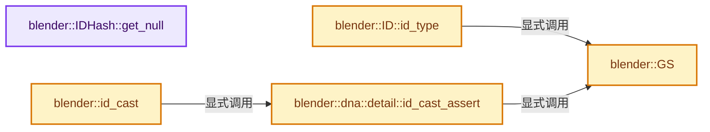
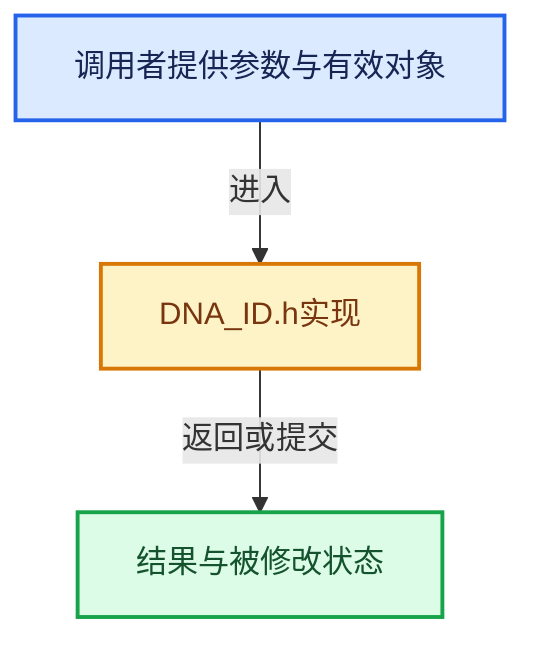

# 实现依赖专题：source/blender/makesdna/DNA_ID.h

[实现依赖导航](../../README.md) · [符号索引](../../../00-课程指南/02-源码与提交索引/符号依赖与实现索引.md)

本专题从正文实际调用进入，集中保存共享实现。函数有稳定锚点，可从调用处直接跳到对应完整函数；递归与互相调用通过回链组织。

## 本文件的实现关系






## 相关类型布局与成员入口

<a id="t-40c4ccaf2a99"></a>

### `blender::eID_Tag`

原始声明：[source/blender/makesdna/DNA_ID.h](../../../../../../../source/blender/makesdna/DNA_ID.h) · L827—L1030。

以下保留类的数据声明与编译条件，成员函数实现通过后面的精确链接阅读。

<!-- annotated:2fd4589e1d3561 -->

```cpp
enum eID_Tag : int {
  /**
   * Long-life tags giving important info about general ID management.
   *
   * These tags are typically not changed often, if ever, during an ID's life.
   */

  /**
   * ID is from current .blend file.
   *
   * RESET_NEVER
   */
  ID_TAG_LOCAL = 0,
  /**
   * ID is from a library, but is used (linked) directly by current .blend file.
   *
   * RESET_NEVER
   */
  ID_TAG_EXTERN = 1 << 0,
  /**
   * ID is from a library, and is only used (linked) indirectly through other libraries.
   *
   * RESET_NEVER
   */
  ID_TAG_INDIRECT = 1 << 1,

  /**
   * ID is considered as runtime, and should not be saved when writing .blend file, nor influence
   * (in)direct status of linked data.
   *
   * Only meaningful for IDs belonging to regular Main database, all other cases are implicitly
   * considered runtime-only.
   *
   * RESET_NEVER
   */
  ID_TAG_RUNTIME = 1 << 2,

  /**
   * ID is a place-holder, an 'empty shell' (because the real one could not be linked from its
   * library e.g.).
   *
   * RESET_NEVER
   */
  ID_TAG_MISSING = 1 << 3,

  /**
   * ID has an extra virtual user (aka 'ensured real', as set by e.g. some editors, not to be
   * confused with the `ID_FLAG_FAKEUSER` flag).
   *
   * RESET_NEVER
   *
   * \note This tag does not necessarily mean the actual user count of the ID is increased, this is
   * defined by #ID_TAG_EXTRAUSER_SET.
   */
  ID_TAG_EXTRAUSER = 1 << 4,
  /**
   * ID actually has increased user-count for the extra virtual user.
   *
   * RESET_NEVER
   */
  ID_TAG_EXTRAUSER_SET = 1 << 5,

  /**
   * ID is up-to-date regarding its reference (only for library overrides).
   *
   * RESET_NEVER
   */
  ID_TAG_LIBOVERRIDE_REFOK = 1 << 6,
  /**
   * ID needs an auto-diffing execution, if enabled (only for library overrides).
   *
   * RESET_NEVER
   */
  ID_TAG_LIBOVERRIDE_AUTOREFRESH = 1 << 7,
  /**
   * ID is a library override that needs re-sync to its linked reference.
   *
   * \note Also used by readfile code when creating a missing ID placeholder if it is detected as
   * being a linked liboverride ID.
   *
   * RESET_NEVER
   */
  ID_TAG_LIBOVERRIDE_NEED_RESYNC = 1 << 8,

  /**
   * Short-life tags used during specific processes, like blend-file reading.
   */

  /**
   * ID is newly duplicated/copied (see #ID_NEW_SET macro above).
   *
   * RESET_AFTER_USE
   *
   * \note Also used internally in `readfile.cc` to mark data-blocks needing do_versions.
   */
  ID_TAG_NEW = 1 << 12,
  /**
   * ID is already existing. Set before linking, to distinguish between existing data-blocks and
   * newly linked ones.
   *
   * RESET_AFTER_USE
   */
  ID_TAG_PRE_EXISTING = 1 << 13,

  /**
   * ID is being re-used from the old Main (instead of read from memfile), during memfile undo
   * processing, because it was detected as unchanged.
   *
   * \note Also means that such ID does not need to be lib-linked during undo readfile process.
   *
   * RESET_AFTER_USE
   */
  ID_TAG_UNDO_OLD_ID_REUSED_UNCHANGED = 1 << 17,
  /**
   * ID is being re-used from the old Main (instead of read from memfile), during memfile undo
   * processing, because it is a 'NO_UNDO' type of ID.
   *
   * \note Also means that such ID does not need to be lib-linked during undo readfile process. It
   * does need to be relinked in a different way however, doing a `session_uid`-based lookup into
   * the newly read main database.
   *
   * RESET_AFTER_USE
   */
  ID_TAG_UNDO_OLD_ID_REUSED_NOUNDO = 1 << 18,
  /**
   * ID has be re-read in-place, the ID address is the same as in the old main, but the content is
   * different.
   *
   * RESET_AFTER_USE
   */
  ID_TAG_UNDO_OLD_ID_REREAD_IN_PLACE = 1 << 19,

  /* ------------------------------------------------------------------------------------------- */
  /**
   * Tags for special kind of IDs, not living in regular BMain data-base.
   *
   * IDs with such tags have typically a short life.
   */

  /**
   * ID is part of a temporary #Main which is expected to be freed in a short time-frame.
   *
   * RESET_NEVER
   *
   * Don't allow assigning this to non-temporary members (since it's likely to cause errors).
   * When set #ID.session_uid isn't initialized, since the data isn't part of the session.
   */
  ID_TAG_TEMP_MAIN = 1 << 20,
  /** General ID management info, for freeing or copying behavior e.g. */
  /**
   * ID is not listed/stored in any #Main database.
   *
   * RESET_NEVER
   */
  ID_TAG_NO_MAIN = 1 << 21,
  /**
   * ID is fully outside of any ID management area, and should be considered as a purely
   * independent data.
   *
   * RESET_NEVER
   *
   * \note Only used by node-trees currently.
   */
  ID_TAG_LOCALIZED = 1 << 22,
  /**
   * ID is an evaluated/localized version.
   *
   * RESET_NEVER
   *
   * \warning This should not be cleared on existing data.
   * If support for this is needed, see #88026 as this flag controls memory ownership
   * of physics *shared* pointers.
   */
  ID_TAG_COPIED_ON_EVAL = 1 << 23,

  /**
   * ID management status tags related to non-standard BMain IDs.
   */

  /**
   * Datablock does not refcount usages of other IDs.
   *
   * RESET_NEVER
   */
  ID_TAG_NO_USER_REFCOUNT = 1 << 25,
  /**
   * ID was not allocated by standard system (BKE_libblock_alloc), do not free its memory
   * (usual type-specific freeing is called though).
   *
   * RESET_NEVER
   */
  ID_TAG_NOT_ALLOCATED = 1 << 26,

  /* ------------------------------------------------------------------------------------------- */

  /**
   * Free to use tag, often used in BKE code to mark IDs to be processed.
   *
   * RESET_BEFORE_USE
   *
   * \todo Make it a RESET_AFTER_USE too.
   */
  ID_TAG_DOIT = int(1u << 31),
};
```

<details>
<summary>核对原始源码：source/blender/makesdna/DNA_ID.h · L827—L1030</summary>

<!-- original:2fd4589e1d3561:source/blender/makesdna/DNA_ID.h:827:1030 -->

```cpp
enum eID_Tag : int {
  /**
   * Long-life tags giving important info about general ID management.
   *
   * These tags are typically not changed often, if ever, during an ID's life.
   */

  /**
   * ID is from current .blend file.
   *
   * RESET_NEVER
   */
  ID_TAG_LOCAL = 0,
  /**
   * ID is from a library, but is used (linked) directly by current .blend file.
   *
   * RESET_NEVER
   */
  ID_TAG_EXTERN = 1 << 0,
  /**
   * ID is from a library, and is only used (linked) indirectly through other libraries.
   *
   * RESET_NEVER
   */
  ID_TAG_INDIRECT = 1 << 1,

  /**
   * ID is considered as runtime, and should not be saved when writing .blend file, nor influence
   * (in)direct status of linked data.
   *
   * Only meaningful for IDs belonging to regular Main database, all other cases are implicitly
   * considered runtime-only.
   *
   * RESET_NEVER
   */
  ID_TAG_RUNTIME = 1 << 2,

  /**
   * ID is a place-holder, an 'empty shell' (because the real one could not be linked from its
   * library e.g.).
   *
   * RESET_NEVER
   */
  ID_TAG_MISSING = 1 << 3,

  /**
   * ID has an extra virtual user (aka 'ensured real', as set by e.g. some editors, not to be
   * confused with the `ID_FLAG_FAKEUSER` flag).
   *
   * RESET_NEVER
   *
   * \note This tag does not necessarily mean the actual user count of the ID is increased, this is
   * defined by #ID_TAG_EXTRAUSER_SET.
   */
  ID_TAG_EXTRAUSER = 1 << 4,
  /**
   * ID actually has increased user-count for the extra virtual user.
   *
   * RESET_NEVER
   */
  ID_TAG_EXTRAUSER_SET = 1 << 5,

  /**
   * ID is up-to-date regarding its reference (only for library overrides).
   *
   * RESET_NEVER
   */
  ID_TAG_LIBOVERRIDE_REFOK = 1 << 6,
  /**
   * ID needs an auto-diffing execution, if enabled (only for library overrides).
   *
   * RESET_NEVER
   */
  ID_TAG_LIBOVERRIDE_AUTOREFRESH = 1 << 7,
  /**
   * ID is a library override that needs re-sync to its linked reference.
   *
   * \note Also used by readfile code when creating a missing ID placeholder if it is detected as
   * being a linked liboverride ID.
   *
   * RESET_NEVER
   */
  ID_TAG_LIBOVERRIDE_NEED_RESYNC = 1 << 8,

  /**
   * Short-life tags used during specific processes, like blend-file reading.
   */

  /**
   * ID is newly duplicated/copied (see #ID_NEW_SET macro above).
   *
   * RESET_AFTER_USE
   *
   * \note Also used internally in `readfile.cc` to mark data-blocks needing do_versions.
   */
  ID_TAG_NEW = 1 << 12,
  /**
   * ID is already existing. Set before linking, to distinguish between existing data-blocks and
   * newly linked ones.
   *
   * RESET_AFTER_USE
   */
  ID_TAG_PRE_EXISTING = 1 << 13,

  /**
   * ID is being re-used from the old Main (instead of read from memfile), during memfile undo
   * processing, because it was detected as unchanged.
   *
   * \note Also means that such ID does not need to be lib-linked during undo readfile process.
   *
   * RESET_AFTER_USE
   */
  ID_TAG_UNDO_OLD_ID_REUSED_UNCHANGED = 1 << 17,
  /**
   * ID is being re-used from the old Main (instead of read from memfile), during memfile undo
   * processing, because it is a 'NO_UNDO' type of ID.
   *
   * \note Also means that such ID does not need to be lib-linked during undo readfile process. It
   * does need to be relinked in a different way however, doing a `session_uid`-based lookup into
   * the newly read main database.
   *
   * RESET_AFTER_USE
   */
  ID_TAG_UNDO_OLD_ID_REUSED_NOUNDO = 1 << 18,
  /**
   * ID has be re-read in-place, the ID address is the same as in the old main, but the content is
   * different.
   *
   * RESET_AFTER_USE
   */
  ID_TAG_UNDO_OLD_ID_REREAD_IN_PLACE = 1 << 19,

  /* ------------------------------------------------------------------------------------------- */
  /**
   * Tags for special kind of IDs, not living in regular BMain data-base.
   *
   * IDs with such tags have typically a short life.
   */

  /**
   * ID is part of a temporary #Main which is expected to be freed in a short time-frame.
   *
   * RESET_NEVER
   *
   * Don't allow assigning this to non-temporary members (since it's likely to cause errors).
   * When set #ID.session_uid isn't initialized, since the data isn't part of the session.
   */
  ID_TAG_TEMP_MAIN = 1 << 20,
  /** General ID management info, for freeing or copying behavior e.g. */
  /**
   * ID is not listed/stored in any #Main database.
   *
   * RESET_NEVER
   */
  ID_TAG_NO_MAIN = 1 << 21,
  /**
   * ID is fully outside of any ID management area, and should be considered as a purely
   * independent data.
   *
   * RESET_NEVER
   *
   * \note Only used by node-trees currently.
   */
  ID_TAG_LOCALIZED = 1 << 22,
  /**
   * ID is an evaluated/localized version.
   *
   * RESET_NEVER
   *
   * \warning This should not be cleared on existing data.
   * If support for this is needed, see #88026 as this flag controls memory ownership
   * of physics *shared* pointers.
   */
  ID_TAG_COPIED_ON_EVAL = 1 << 23,

  /**
   * ID management status tags related to non-standard BMain IDs.
   */

  /**
   * Datablock does not refcount usages of other IDs.
   *
   * RESET_NEVER
   */
  ID_TAG_NO_USER_REFCOUNT = 1 << 25,
  /**
   * ID was not allocated by standard system (BKE_libblock_alloc), do not free its memory
   * (usual type-specific freeing is called though).
   *
   * RESET_NEVER
   */
  ID_TAG_NOT_ALLOCATED = 1 << 26,

  /* ------------------------------------------------------------------------------------------- */

  /**
   * Free to use tag, often used in BKE code to mark IDs to be processed.
   *
   * RESET_BEFORE_USE
   *
   * \todo Make it a RESET_AFTER_USE too.
   */
  ID_TAG_DOIT = int(1u << 31),
};
```

</details>


<a id="t-04b4f82320a9"></a>

### `blender::IDRecalcFlag`

原始声明：[source/blender/makesdna/DNA_ID.h](../../../../../../../source/blender/makesdna/DNA_ID.h) · L1049—L1196。

以下保留类的数据声明与编译条件，成员函数实现通过后面的精确链接阅读。

<!-- annotated:c4bf1e2f534755 -->

```cpp
enum IDRecalcFlag {
  /***************************************************************************
   * Individual update tags, this is what ID gets tagged for update with. */

  /* ** Object transformation changed. ** */
  ID_RECALC_TRANSFORM = (1 << 0),

  /* ** Geometry changed. **
   *
   * When object of armature type gets tagged with this flag, its pose is
   * re-evaluated.
   *
   * When object of other type is tagged with this flag it makes the modifier
   * stack to be re-evaluated.
   *
   * When object data type (mesh, curve, ...) gets tagged with this flag it
   * makes all objects which shares this data-block to be updated.
   *
   * Note that the evaluation depends on the object-mode.
   * So edit-mesh data for example only reevaluate with the updated edit-mesh.
   * When geometry in the original ID has been modified #ID_RECALC_GEOMETRY_ALL_MODES
   * must be used instead.
   *
   * When a collection gets tagged with this flag, all objects depending on the geometry and
   * transforms on any of the objects in the collection are updated. */
  ID_RECALC_GEOMETRY = (1 << 1),

  /* ** Animation or time changed and animation is to be re-evaluated. ** */
  ID_RECALC_ANIMATION = (1 << 2),

  /* ** Particle system changed. ** */
  /* Only do path-cache etc. */
  ID_RECALC_PSYS_REDO = (1 << 3),
  /* Reset everything including point-cache. */
  ID_RECALC_PSYS_RESET = (1 << 4),
  /* Only child settings changed. */
  ID_RECALC_PSYS_CHILD = (1 << 5),
  /* Physics type changed. */
  ID_RECALC_PSYS_PHYS = (1 << 6),

  /* ** Material and shading ** */

  /* For materials and node trees this means that topology of the shader tree
   * changed, and the shader is to be recompiled.
   * For objects it means that the draw batch cache is to be redone. */
  ID_RECALC_SHADING = (1 << 7),
  /* TODO(sergey): Consider adding an explicit ID_RECALC_SHADING_PARAMETERS
   * which can be used for cases when only socket value changed, to speed up
   * redraw update in that case. */

  /* Selection of the ID itself or its components (for example, vertices) did
   * change, and all the drawing data is to be updated. */
  ID_RECALC_SELECT = (1 << 9),
  /* Flags on the base did change, and is to be copied onto all the copies of
   * corresponding objects. */
  ID_RECALC_BASE_FLAGS = (1 << 10),
  ID_RECALC_POINT_CACHE = (1 << 11),
  /* Only inform editors about the change. Is used to force update of editors
   * when data-block which is not a part of dependency graph did change.
   *
   * For example, brush texture did change and the preview is to be
   * re-rendered. */
  ID_RECALC_EDITORS = (1 << 12),

  /* ** Update evaluated copy component. **
   *
   * This is most generic tag which should only be used when nothing else matches.
   * It is not to explicitly mixed in with other recalculation flags.
   */
  ID_RECALC_SYNC_TO_EVAL = (1 << 13),

  /* Strips in the sequencer changed.
   * Use this tag with a scene ID which owns the strips. */
  ID_RECALC_SEQUENCER_STRIPS = (1 << 14),

  /* Runs on frame-change (used for seeking audio too). */
  ID_RECALC_FRAME_CHANGE = (1 << 15),

  ID_RECALC_AUDIO_FPS = (1 << 16),
  ID_RECALC_AUDIO_VOLUME = (1 << 17),
  ID_RECALC_AUDIO_MUTE = (1 << 18),
  ID_RECALC_AUDIO_LISTENER = (1 << 19),

  ID_RECALC_AUDIO = (1 << 20),

  /* NOTE: This triggers copy-on-eval for types that require it.
   * Exceptions to this can be added using #ID_TYPE_SUPPORTS_PARAMS_WITHOUT_COW,
   * this has the advantage that large arrays stored in the idea data don't
   * have to be copied on every update. */
  ID_RECALC_PARAMETERS = (1 << 21),

  /* Input has changed and data-block is to be reload from disk.
   * Applies to movie clips to inform that copy-on-written version is to be refreshed for the new
   * input file or for color space changes. */
  ID_RECALC_SOURCE = (1 << 23),

  /* Virtual recalc tag/marker required for undo in some cases, where actual data does not change
   * and hence do not require an update, but conceptually we are dealing with something new.
   *
   * Current known case: linked IDs made local without requiring any copy. While their users do not
   * require any update, they have actually been 'virtually' remapped from the linked ID to the
   * local one.
   */
  ID_RECALC_TAG_FOR_UNDO = (1 << 24),

  /* The node tree has changed in a way that affects its output nodes. */
  ID_RECALC_NTREE_OUTPUT = (1 << 25),

  /* Hierarchy of collection and object within collection changed. */
  ID_RECALC_HIERARCHY = (1 << 26),

  /* The scene has changed in a way that affects the compositor. */
  ID_RECALC_COMPOSITOR = (1 << 27),

  /* Provisioned flags.
   *
   * Not for actual use. The idea of them is to have all bits of the `IDRecalcFlag` defined to a
   * known value, silencing sanitizer warnings when checking bits of the ID_RECALC_ALL. */
  ID_RECALC_PROVISION_28 = (1 << 28),
  ID_RECALC_PROVISION_29 = (1 << 29),
  ID_RECALC_PROVISION_30 = (1 << 30),
  ID_RECALC_PROVISION_31 = (1u << 31),

  /***************************************************************************
   * Pseudonyms, to have more semantic meaning in the actual code without
   * using too much low-level and implementation specific tags. */

  /* Update animation data-block itself, without doing full re-evaluation of
   * all dependent objects. */
  ID_RECALC_ANIMATION_NO_FLUSH = ID_RECALC_SYNC_TO_EVAL,

  /* Ensure geometry of object and edit modes are both up-to-date in the evaluated data-block.
   * Example usage is when mesh validation modifies the non-edit-mode data,
   * which we want to be copied over to the evaluated data-block. */
  ID_RECALC_GEOMETRY_ALL_MODES = ID_RECALC_GEOMETRY | ID_RECALC_SYNC_TO_EVAL,

  /***************************************************************************
   * Aggregate flags, use only for checks on runtime.
   * Do NOT use those for tagging. */

  /* Identifies that SOMETHING has been changed in this ID. */
  ID_RECALC_ALL = (0xffffffff),

  /* Identifies that something in particle system did change. */
  ID_RECALC_PSYS_ALL = (ID_RECALC_PSYS_REDO | ID_RECALC_PSYS_RESET | ID_RECALC_PSYS_CHILD |
                        ID_RECALC_PSYS_PHYS),

};
```

<details>
<summary>核对原始源码：source/blender/makesdna/DNA_ID.h · L1049—L1196</summary>

<!-- original:c4bf1e2f534755:source/blender/makesdna/DNA_ID.h:1049:1196 -->

```cpp
enum IDRecalcFlag {
  /***************************************************************************
   * Individual update tags, this is what ID gets tagged for update with. */

  /* ** Object transformation changed. ** */
  ID_RECALC_TRANSFORM = (1 << 0),

  /* ** Geometry changed. **
   *
   * When object of armature type gets tagged with this flag, its pose is
   * re-evaluated.
   *
   * When object of other type is tagged with this flag it makes the modifier
   * stack to be re-evaluated.
   *
   * When object data type (mesh, curve, ...) gets tagged with this flag it
   * makes all objects which shares this data-block to be updated.
   *
   * Note that the evaluation depends on the object-mode.
   * So edit-mesh data for example only reevaluate with the updated edit-mesh.
   * When geometry in the original ID has been modified #ID_RECALC_GEOMETRY_ALL_MODES
   * must be used instead.
   *
   * When a collection gets tagged with this flag, all objects depending on the geometry and
   * transforms on any of the objects in the collection are updated. */
  ID_RECALC_GEOMETRY = (1 << 1),

  /* ** Animation or time changed and animation is to be re-evaluated. ** */
  ID_RECALC_ANIMATION = (1 << 2),

  /* ** Particle system changed. ** */
  /* Only do path-cache etc. */
  ID_RECALC_PSYS_REDO = (1 << 3),
  /* Reset everything including point-cache. */
  ID_RECALC_PSYS_RESET = (1 << 4),
  /* Only child settings changed. */
  ID_RECALC_PSYS_CHILD = (1 << 5),
  /* Physics type changed. */
  ID_RECALC_PSYS_PHYS = (1 << 6),

  /* ** Material and shading ** */

  /* For materials and node trees this means that topology of the shader tree
   * changed, and the shader is to be recompiled.
   * For objects it means that the draw batch cache is to be redone. */
  ID_RECALC_SHADING = (1 << 7),
  /* TODO(sergey): Consider adding an explicit ID_RECALC_SHADING_PARAMETERS
   * which can be used for cases when only socket value changed, to speed up
   * redraw update in that case. */

  /* Selection of the ID itself or its components (for example, vertices) did
   * change, and all the drawing data is to be updated. */
  ID_RECALC_SELECT = (1 << 9),
  /* Flags on the base did change, and is to be copied onto all the copies of
   * corresponding objects. */
  ID_RECALC_BASE_FLAGS = (1 << 10),
  ID_RECALC_POINT_CACHE = (1 << 11),
  /* Only inform editors about the change. Is used to force update of editors
   * when data-block which is not a part of dependency graph did change.
   *
   * For example, brush texture did change and the preview is to be
   * re-rendered. */
  ID_RECALC_EDITORS = (1 << 12),

  /* ** Update evaluated copy component. **
   *
   * This is most generic tag which should only be used when nothing else matches.
   * It is not to explicitly mixed in with other recalculation flags.
   */
  ID_RECALC_SYNC_TO_EVAL = (1 << 13),

  /* Strips in the sequencer changed.
   * Use this tag with a scene ID which owns the strips. */
  ID_RECALC_SEQUENCER_STRIPS = (1 << 14),

  /* Runs on frame-change (used for seeking audio too). */
  ID_RECALC_FRAME_CHANGE = (1 << 15),

  ID_RECALC_AUDIO_FPS = (1 << 16),
  ID_RECALC_AUDIO_VOLUME = (1 << 17),
  ID_RECALC_AUDIO_MUTE = (1 << 18),
  ID_RECALC_AUDIO_LISTENER = (1 << 19),

  ID_RECALC_AUDIO = (1 << 20),

  /* NOTE: This triggers copy-on-eval for types that require it.
   * Exceptions to this can be added using #ID_TYPE_SUPPORTS_PARAMS_WITHOUT_COW,
   * this has the advantage that large arrays stored in the idea data don't
   * have to be copied on every update. */
  ID_RECALC_PARAMETERS = (1 << 21),

  /* Input has changed and data-block is to be reload from disk.
   * Applies to movie clips to inform that copy-on-written version is to be refreshed for the new
   * input file or for color space changes. */
  ID_RECALC_SOURCE = (1 << 23),

  /* Virtual recalc tag/marker required for undo in some cases, where actual data does not change
   * and hence do not require an update, but conceptually we are dealing with something new.
   *
   * Current known case: linked IDs made local without requiring any copy. While their users do not
   * require any update, they have actually been 'virtually' remapped from the linked ID to the
   * local one.
   */
  ID_RECALC_TAG_FOR_UNDO = (1 << 24),

  /* The node tree has changed in a way that affects its output nodes. */
  ID_RECALC_NTREE_OUTPUT = (1 << 25),

  /* Hierarchy of collection and object within collection changed. */
  ID_RECALC_HIERARCHY = (1 << 26),

  /* The scene has changed in a way that affects the compositor. */
  ID_RECALC_COMPOSITOR = (1 << 27),

  /* Provisioned flags.
   *
   * Not for actual use. The idea of them is to have all bits of the `IDRecalcFlag` defined to a
   * known value, silencing sanitizer warnings when checking bits of the ID_RECALC_ALL. */
  ID_RECALC_PROVISION_28 = (1 << 28),
  ID_RECALC_PROVISION_29 = (1 << 29),
  ID_RECALC_PROVISION_30 = (1 << 30),
  ID_RECALC_PROVISION_31 = (1u << 31),

  /***************************************************************************
   * Pseudonyms, to have more semantic meaning in the actual code without
   * using too much low-level and implementation specific tags. */

  /* Update animation data-block itself, without doing full re-evaluation of
   * all dependent objects. */
  ID_RECALC_ANIMATION_NO_FLUSH = ID_RECALC_SYNC_TO_EVAL,

  /* Ensure geometry of object and edit modes are both up-to-date in the evaluated data-block.
   * Example usage is when mesh validation modifies the non-edit-mode data,
   * which we want to be copied over to the evaluated data-block. */
  ID_RECALC_GEOMETRY_ALL_MODES = ID_RECALC_GEOMETRY | ID_RECALC_SYNC_TO_EVAL,

  /***************************************************************************
   * Aggregate flags, use only for checks on runtime.
   * Do NOT use those for tagging. */

  /* Identifies that SOMETHING has been changed in this ID. */
  ID_RECALC_ALL = (0xffffffff),

  /* Identifies that something in particle system did change. */
  ID_RECALC_PSYS_ALL = (ID_RECALC_PSYS_REDO | ID_RECALC_PSYS_RESET | ID_RECALC_PSYS_CHILD |
                        ID_RECALC_PSYS_PHYS),

};
```

</details>


<a id="m-eab64737860c"></a>

## 宏 `ID_FAKE_USERS`

<!-- annotated:d4b036d712d08c -->

```cpp
#define ID_FAKE_USERS(id) ((id_cast<const ID *>(id)->flag & ID_FLAG_FAKEUSER) ? 1 : 0)
/**
```

<details>
<summary>核对原始源码：source/blender/makesdna/DNA_ID.h · L658—L659</summary>

<!-- original:d4b036d712d08c:source/blender/makesdna/DNA_ID.h:658:659 -->

```cpp
#define ID_FAKE_USERS(id) ((id_cast<const ID *>(id)->flag & ID_FLAG_FAKEUSER) ? 1 : 0)
/**
```

</details>

宏在预处理阶段展开，参数替换、重复求值和条件编译应直接从该定义检查。与普通函数不同，宏不会自动提供参数类型检查；构建配置选择哪个定义需结合外围条件。

<a id="m-269119997db1"></a>

## 宏 `ID_REAL_USERS`

<!-- annotated:f1255901f71293 -->

```cpp
#define ID_REAL_USERS(id) (id_cast<const ID *>(id)->us - ID_FAKE_USERS(id))
/**
```

<details>
<summary>核对原始源码：source/blender/makesdna/DNA_ID.h · L679—L680</summary>

<!-- original:f1255901f71293:source/blender/makesdna/DNA_ID.h:679:680 -->

```cpp
#define ID_REAL_USERS(id) (id_cast<const ID *>(id)->us - ID_FAKE_USERS(id))
/**
```

</details>

宏在预处理阶段展开，参数替换、重复求值和条件编译应直接从该定义检查。与普通函数不同，宏不会自动提供参数类型检查；构建配置选择哪个定义需结合外围条件。

<a id="m-6904dc725417"></a>

## 宏 `ID_REFCOUNTING_USERS`

<!-- annotated:926988182fde3e -->

```cpp
#define ID_REFCOUNTING_USERS(id) (ID_REAL_USERS(id) - ID_EXTRA_REAL_USERS(id))

```

<details>
<summary>核对原始源码：source/blender/makesdna/DNA_ID.h · L684—L685</summary>

<!-- original:926988182fde3e:source/blender/makesdna/DNA_ID.h:684:685 -->

```cpp
#define ID_REFCOUNTING_USERS(id) (ID_REAL_USERS(id) - ID_EXTRA_REAL_USERS(id))

```

</details>

宏在预处理阶段展开，参数替换、重复求值和条件编译应直接从该定义检查。与普通函数不同，宏不会自动提供参数类型检查；构建配置选择哪个定义需结合外围条件。

<a id="m-1237eb993bd2"></a>

## 宏 `ID_CHECK_UNDO`

<!-- annotated:a0b2f9c1d7b70c -->

```cpp
#define ID_CHECK_UNDO(id) (!ELEM(GS((id)->name), ID_SCR, ID_WM, ID_WS, ID_BR))

```

<details>
<summary>核对原始源码：source/blender/makesdna/DNA_ID.h · L686—L687</summary>

<!-- original:a0b2f9c1d7b70c:source/blender/makesdna/DNA_ID.h:686:687 -->

```cpp
#define ID_CHECK_UNDO(id) (!ELEM(GS((id)->name), ID_SCR, ID_WM, ID_WS, ID_BR))

```

</details>

宏在预处理阶段展开，参数替换、重复求值和条件编译应直接从该定义检查。与普通函数不同，宏不会自动提供参数类型检查；构建配置选择哪个定义需结合外围条件。

<a id="m-c69d4e48d3fd"></a>

## 宏 `ID_BLEND_PATH`

<!-- annotated:60f91cacdae710 -->

```cpp
#define ID_BLEND_PATH(_bmain, _id) \
  ((_id)->lib ? BKE_main_blendfile_path_from_library(*(_id)->lib) : \
                BKE_main_blendfile_path((_bmain)))
#define ID_BLEND_PATH_FROM_GLOBAL(_id) \
```

<details>
<summary>核对原始源码：source/blender/makesdna/DNA_ID.h · L688—L691</summary>

<!-- original:60f91cacdae710:source/blender/makesdna/DNA_ID.h:688:691 -->

```cpp
#define ID_BLEND_PATH(_bmain, _id) \
  ((_id)->lib ? BKE_main_blendfile_path_from_library(*(_id)->lib) : \
                BKE_main_blendfile_path((_bmain)))
#define ID_BLEND_PATH_FROM_GLOBAL(_id) \
```

</details>

宏在预处理阶段展开，参数替换、重复求值和条件编译应直接从该定义检查。与普通函数不同，宏不会自动提供参数类型检查；构建配置选择哪个定义需结合外围条件。

<a id="m-2b76f08bf41b"></a>

## 宏 `ID_BLEND_PATH_FROM_GLOBAL`

<!-- annotated:0ec33f704578e0 -->

```cpp
#define ID_BLEND_PATH_FROM_GLOBAL(_id) \
  ((_id)->lib ? BKE_main_blendfile_path_from_library(*(_id)->lib) : \
                BKE_main_blendfile_path_from_global())

```

<details>
<summary>核对原始源码：source/blender/makesdna/DNA_ID.h · L691—L694</summary>

<!-- original:0ec33f704578e0:source/blender/makesdna/DNA_ID.h:691:694 -->

```cpp
#define ID_BLEND_PATH_FROM_GLOBAL(_id) \
  ((_id)->lib ? BKE_main_blendfile_path_from_library(*(_id)->lib) : \
                BKE_main_blendfile_path_from_global())

```

</details>

宏在预处理阶段展开，参数替换、重复求值和条件编译应直接从该定义检查。与普通函数不同，宏不会自动提供参数类型检查；构建配置选择哪个定义需结合外围条件。

<a id="m-ab9a2a270fb3"></a>

## 宏 `ID_MISSING`

<!-- annotated:022740b0616d11 -->

```cpp
#define ID_MISSING(_id) ((id_cast<const ID *>(_id)->tag & ID_TAG_MISSING) != 0)

```

<details>
<summary>核对原始源码：source/blender/makesdna/DNA_ID.h · L695—L696</summary>

<!-- original:022740b0616d11:source/blender/makesdna/DNA_ID.h:695:696 -->

```cpp
#define ID_MISSING(_id) ((id_cast<const ID *>(_id)->tag & ID_TAG_MISSING) != 0)

```

</details>

宏在预处理阶段展开，参数替换、重复求值和条件编译应直接从该定义检查。与普通函数不同，宏不会自动提供参数类型检查；构建配置选择哪个定义需结合外围条件。

<a id="m-7e1e1e9b20e6"></a>

## 宏 `ID_IS_LINKED`

<!-- annotated:1efc53d47c4150 -->

```cpp
#define ID_IS_LINKED(_id) (id_cast<const ID *>(_id)->lib != NULL)
/**
```

<details>
<summary>核对原始源码：source/blender/makesdna/DNA_ID.h · L697—L698</summary>

<!-- original:1efc53d47c4150:source/blender/makesdna/DNA_ID.h:697:698 -->

```cpp
#define ID_IS_LINKED(_id) (id_cast<const ID *>(_id)->lib != NULL)
/**
```

</details>

宏在预处理阶段展开，参数替换、重复求值和条件编译应直接从该定义检查。与普通函数不同，宏不会自动提供参数类型检查；构建配置选择哪个定义需结合外围条件。

<a id="m-48f895e65dc3"></a>

## 宏 `ID_IS_PACKED`

<!-- annotated:8e5de6d5153146 -->

```cpp
#define ID_IS_PACKED(_id) (ID_IS_LINKED(_id) && ((_id)->flag & ID_FLAG_LINKED_AND_PACKED))

```

<details>
<summary>核对原始源码：source/blender/makesdna/DNA_ID.h · L703—L704</summary>

<!-- original:8e5de6d5153146:source/blender/makesdna/DNA_ID.h:703:704 -->

```cpp
#define ID_IS_PACKED(_id) (ID_IS_LINKED(_id) && ((_id)->flag & ID_FLAG_LINKED_AND_PACKED))

```

</details>

宏在预处理阶段展开，参数替换、重复求值和条件编译应直接从该定义检查。与普通函数不同，宏不会自动提供参数类型检查；构建配置选择哪个定义需结合外围条件。

<a id="m-57579f93767f"></a>

## 宏 `ID_IS_EDITABLE`

<!-- annotated:a3c4f9ea350c59 -->

```cpp
#define ID_IS_EDITABLE(_id) \
  ((id_cast<const ID *>(_id)->lib == NULL) || \
   ((id_cast<const ID *>(_id)->lib->runtime->tag & LIBRARY_ASSET_EDITABLE) && \
    ID_TYPE_SUPPORTS_ASSET_EDITABLE(id_cast<const ID *>(_id)->id_type())))

```

<details>
<summary>核对原始源码：source/blender/makesdna/DNA_ID.h · L708—L712</summary>

<!-- original:a3c4f9ea350c59:source/blender/makesdna/DNA_ID.h:708:712 -->

```cpp
#define ID_IS_EDITABLE(_id) \
  ((id_cast<const ID *>(_id)->lib == NULL) || \
   ((id_cast<const ID *>(_id)->lib->runtime->tag & LIBRARY_ASSET_EDITABLE) && \
    ID_TYPE_SUPPORTS_ASSET_EDITABLE(id_cast<const ID *>(_id)->id_type())))

```

</details>

宏在预处理阶段展开，参数替换、重复求值和条件编译应直接从该定义检查。与普通函数不同，宏不会自动提供参数类型检查；构建配置选择哪个定义需结合外围条件。

<a id="m-e25fd07eccd8"></a>

## 宏 `ID_IS_OVERRIDABLE_LIBRARY_HIERARCHY`

<!-- annotated:b4b5e9b52e8138 -->

```cpp
#define ID_IS_OVERRIDABLE_LIBRARY_HIERARCHY(_id) \
  (ID_IS_LINKED(_id) && !ID_MISSING(_id) && \
   (id_cast<const ID *>(_id)->flag & ID_FLAG_EMBEDDED_DATA) == 0 && \
   (BKE_idtype_get_info_from_id(id_cast<const ID *>(_id))->flags & IDTYPE_FLAGS_NO_LIBLINKING) == \
       0 && \
   !ELEM((id_cast<const ID *>(_id))->id_type(), ID_SCE))
#define ID_IS_OVERRIDABLE_LIBRARY(_id) \
```

<details>
<summary>核对原始源码：source/blender/makesdna/DNA_ID.h · L715—L721</summary>

<!-- original:b4b5e9b52e8138:source/blender/makesdna/DNA_ID.h:715:721 -->

```cpp
#define ID_IS_OVERRIDABLE_LIBRARY_HIERARCHY(_id) \
  (ID_IS_LINKED(_id) && !ID_MISSING(_id) && \
   (id_cast<const ID *>(_id)->flag & ID_FLAG_EMBEDDED_DATA) == 0 && \
   (BKE_idtype_get_info_from_id(id_cast<const ID *>(_id))->flags & IDTYPE_FLAGS_NO_LIBLINKING) == \
       0 && \
   !ELEM((id_cast<const ID *>(_id))->id_type(), ID_SCE))
#define ID_IS_OVERRIDABLE_LIBRARY(_id) \
```

</details>

宏在预处理阶段展开，参数替换、重复求值和条件编译应直接从该定义检查。与普通函数不同，宏不会自动提供参数类型检查；构建配置选择哪个定义需结合外围条件。

<a id="m-c4870a0c3949"></a>

## 宏 `ID_IS_OVERRIDABLE_LIBRARY`

<!-- annotated:194df297c844a5 -->

```cpp
#define ID_IS_OVERRIDABLE_LIBRARY(_id) \
  (ID_IS_OVERRIDABLE_LIBRARY_HIERARCHY((_id)) && \
   (id_cast<const ID *>(_id)->tag & ID_TAG_EXTERN) != 0)

```

<details>
<summary>核对原始源码：source/blender/makesdna/DNA_ID.h · L721—L724</summary>

<!-- original:194df297c844a5:source/blender/makesdna/DNA_ID.h:721:724 -->

```cpp
#define ID_IS_OVERRIDABLE_LIBRARY(_id) \
  (ID_IS_OVERRIDABLE_LIBRARY_HIERARCHY((_id)) && \
   (id_cast<const ID *>(_id)->tag & ID_TAG_EXTERN) != 0)

```

</details>

宏在预处理阶段展开，参数替换、重复求值和条件编译应直接从该定义检查。与普通函数不同，宏不会自动提供参数类型检查；构建配置选择哪个定义需结合外围条件。

<a id="m-aad2bb9f5d75"></a>

## 宏 `ID_IS_OVERRIDE_LIBRARY_REAL`

<!-- annotated:c10a985e349a4a -->

```cpp
#define ID_IS_OVERRIDE_LIBRARY_REAL(_id) \
  (id_cast<const ID *>(_id)->override_library != NULL && \
   id_cast<const ID *>(_id)->override_library->reference != NULL)

```

<details>
<summary>核对原始源码：source/blender/makesdna/DNA_ID.h · L729—L732</summary>

<!-- original:c10a985e349a4a:source/blender/makesdna/DNA_ID.h:729:732 -->

```cpp
#define ID_IS_OVERRIDE_LIBRARY_REAL(_id) \
  (id_cast<const ID *>(_id)->override_library != NULL && \
   id_cast<const ID *>(_id)->override_library->reference != NULL)

```

</details>

宏在预处理阶段展开，参数替换、重复求值和条件编译应直接从该定义检查。与普通函数不同，宏不会自动提供参数类型检查；构建配置选择哪个定义需结合外围条件。

<a id="m-e9ed24b06b4b"></a>

## 宏 `ID_IS_OVERRIDE_LIBRARY_VIRTUAL`

<!-- annotated:30df8458b59dcf -->

```cpp
#define ID_IS_OVERRIDE_LIBRARY_VIRTUAL(_id) \
  ((id_cast<const ID *>(_id)->flag & ID_FLAG_EMBEDDED_DATA_LIB_OVERRIDE) != 0)

```

<details>
<summary>核对原始源码：source/blender/makesdna/DNA_ID.h · L733—L735</summary>

<!-- original:30df8458b59dcf:source/blender/makesdna/DNA_ID.h:733:735 -->

```cpp
#define ID_IS_OVERRIDE_LIBRARY_VIRTUAL(_id) \
  ((id_cast<const ID *>(_id)->flag & ID_FLAG_EMBEDDED_DATA_LIB_OVERRIDE) != 0)

```

</details>

宏在预处理阶段展开，参数替换、重复求值和条件编译应直接从该定义检查。与普通函数不同，宏不会自动提供参数类型检查；构建配置选择哪个定义需结合外围条件。

<a id="m-c84b86cfb14f"></a>

## 宏 `ID_IS_OVERRIDE_LIBRARY`

<!-- annotated:fbbff07c470067 -->

```cpp
#define ID_IS_OVERRIDE_LIBRARY(_id) \
  (ID_IS_OVERRIDE_LIBRARY_REAL(_id) || ID_IS_OVERRIDE_LIBRARY_VIRTUAL(_id))

```

<details>
<summary>核对原始源码：source/blender/makesdna/DNA_ID.h · L736—L738</summary>

<!-- original:fbbff07c470067:source/blender/makesdna/DNA_ID.h:736:738 -->

```cpp
#define ID_IS_OVERRIDE_LIBRARY(_id) \
  (ID_IS_OVERRIDE_LIBRARY_REAL(_id) || ID_IS_OVERRIDE_LIBRARY_VIRTUAL(_id))

```

</details>

宏在预处理阶段展开，参数替换、重复求值和条件编译应直接从该定义检查。与普通函数不同，宏不会自动提供参数类型检查；构建配置选择哪个定义需结合外围条件。

<a id="m-ce4ea395bbec"></a>

## 宏 `ID_TYPE_USE_COPY_ON_EVAL`

<!-- annotated:bc4c31f7bc8c8e -->

```cpp
#define ID_TYPE_USE_COPY_ON_EVAL(_id_type) \
  (!ELEM(_id_type, ID_LI, ID_SCR, ID_VF, ID_BR, ID_WM, ID_PAL, ID_PC, ID_WS, ID_IM))

```

<details>
<summary>核对原始源码：source/blender/makesdna/DNA_ID.h · L746—L748</summary>

<!-- original:bc4c31f7bc8c8e:source/blender/makesdna/DNA_ID.h:746:748 -->

```cpp
#define ID_TYPE_USE_COPY_ON_EVAL(_id_type) \
  (!ELEM(_id_type, ID_LI, ID_SCR, ID_VF, ID_BR, ID_WM, ID_PAL, ID_PC, ID_WS, ID_IM))

```

</details>

宏在预处理阶段展开，参数替换、重复求值和条件编译应直接从该定义检查。与普通函数不同，宏不会自动提供参数类型检查；构建配置选择哪个定义需结合外围条件。

<a id="m-5aeaecb7bea6"></a>

## 宏 `ID_TYPE_SUPPORTS_PARAMS_WITHOUT_COW`

<!-- annotated:2bd64bc641f03a -->

```cpp
#define ID_TYPE_SUPPORTS_PARAMS_WITHOUT_COW(id_type) ELEM(id_type, ID_ME)

```

<details>
<summary>核对原始源码：source/blender/makesdna/DNA_ID.h · L751—L752</summary>

<!-- original:2bd64bc641f03a:source/blender/makesdna/DNA_ID.h:751:752 -->

```cpp
#define ID_TYPE_SUPPORTS_PARAMS_WITHOUT_COW(id_type) ELEM(id_type, ID_ME)

```

</details>

宏在预处理阶段展开，参数替换、重复求值和条件编译应直接从该定义检查。与普通函数不同，宏不会自动提供参数类型检查；构建配置选择哪个定义需结合外围条件。

<a id="m-4d88a4d64f85"></a>

## 宏 `ID_TYPE_IS_DEPRECATED`

<!-- annotated:5bdb5759a65e6b -->

```cpp
#define ID_TYPE_IS_DEPRECATED(id_type) false

```

<details>
<summary>核对原始源码：source/blender/makesdna/DNA_ID.h · L755—L756</summary>

<!-- original:5bdb5759a65e6b:source/blender/makesdna/DNA_ID.h:755:756 -->

```cpp
#define ID_TYPE_IS_DEPRECATED(id_type) false

```

</details>

宏在预处理阶段展开，参数替换、重复求值和条件编译应直接从该定义检查。与普通函数不同，宏不会自动提供参数类型检查；构建配置选择哪个定义需结合外围条件。

<a id="m-92129f729bcf"></a>

## 宏 `ID_NEW_SET`

<!-- annotated:ac5bfd348beab1 -->

```cpp
#define ID_NEW_SET(_id, _idn) \
  (((id_cast<ID *>)(_id))->newid = (id_cast<ID *>)(_idn), \
   ((id_cast<ID *>)(_id))->newid->tag |= ID_TAG_NEW, \
   ((id_cast<ID *>)(_id))->newid)
#define ID_NEW_REMAP(a) \
```

<details>
<summary>核对原始源码：source/blender/makesdna/DNA_ID.h · L757—L761</summary>

<!-- original:ac5bfd348beab1:source/blender/makesdna/DNA_ID.h:757:761 -->

```cpp
#define ID_NEW_SET(_id, _idn) \
  (((id_cast<ID *>)(_id))->newid = (id_cast<ID *>)(_idn), \
   ((id_cast<ID *>)(_id))->newid->tag |= ID_TAG_NEW, \
   ((id_cast<ID *>)(_id))->newid)
#define ID_NEW_REMAP(a) \
```

</details>

宏在预处理阶段展开，参数替换、重复求值和条件编译应直接从该定义检查。与普通函数不同，宏不会自动提供参数类型检查；构建配置选择哪个定义需结合外围条件。

## 完整成员与函数实现

<a id="f-ea644626c4fd615d"></a>

### `blender::IDHash::get_null`

实现位置：[source/blender/makesdna/DNA_ID.h](../../../../../../../source/blender/makesdna/DNA_ID.h) · L387—L390。

**教学注释版**

<!-- annotated:6e70c8e1bbe90a -->

```cpp
  static constexpr IDHash get_null()
  {
    return {};
  }
```

<details>
<summary>核对原始源码：source/blender/makesdna/DNA_ID.h · L387—L390</summary>

<!-- original:6e70c8e1bbe90a:source/blender/makesdna/DNA_ID.h:387:390 -->

```cpp
  static constexpr IDHash get_null()
  {
    return {};
  }
```

</details>

**结果出口**

- `return {};`

**继续追踪实现**

本实现没有需要继续展开的显式调用；检查返回表达式、对象转换和调用者前置条件。

<a id="f-c3ff509f79f21b05"></a>

### `blender::GS`

实现位置：[source/blender/makesdna/DNA_ID.h](../../../../../../../source/blender/makesdna/DNA_ID.h) · L410—L413。

接口参数：

- `const char *name`

**教学注释版**

<!-- annotated:57a794a8b4c2d0 -->

```cpp
inline ID_Type GS(const char *name)
{
  return ID_Type(*reinterpret_cast<const short *>(name));
}
```

<details>
<summary>核对原始源码：source/blender/makesdna/DNA_ID.h · L410—L413</summary>

<!-- original:57a794a8b4c2d0:source/blender/makesdna/DNA_ID.h:410:413 -->

```cpp
inline ID_Type GS(const char *name)
{
  return ID_Type(*reinterpret_cast<const short *>(name));
}
```

</details>

**结果出口**

- `return ID_Type(*reinterpret_cast<const short *>(name));`

**继续追踪实现**

- `ID_Type` → [blender::ID_Type](../windowmanager/WM_api.hh.md#t-a58f1911df5c)；[blender::ID_Type](DNA_ID_enums.h.md#t-4fa202c1cee5)。

<a id="f-ee8fe63f3948aa47"></a>

### `blender::ID::id_type`

实现位置：[source/blender/makesdna/DNA_ID.h](../../../../../../../source/blender/makesdna/DNA_ID.h) · L544—L547。

**教学注释版**

<!-- annotated:f6388beacac654 -->

```cpp
  ID_Type id_type() const
  {
    return GS(this->name);
  }
```

<details>
<summary>核对原始源码：source/blender/makesdna/DNA_ID.h · L544—L547</summary>

<!-- original:f6388beacac654:source/blender/makesdna/DNA_ID.h:544:547 -->

```cpp
  ID_Type id_type() const
  {
    return GS(this->name);
  }
```

</details>

**结果出口**

- `return GS(this->name);`

**继续追踪实现**

- `GS` → [blender::GS · L410](DNA_ID.h.md#f-c3ff509f79f21b05)。

<a id="f-305a48386622e146"></a>

### `blender::dna::detail::id_cast_assert`

实现位置：[source/blender/makesdna/DNA_ID.h](../../../../../../../source/blender/makesdna/DNA_ID.h) · L1390—L1406。

接口参数：

- `[[maybe_unused]] SrcRuntime *src`

**教学注释版**

<!-- annotated:3eda5d21fd2f68 -->

```cpp
template<typename Dst, typename Src, typename SrcRuntime>
constexpr void id_cast_assert([[maybe_unused]] SrcRuntime *src)
{
  static_assert(dna::is_ID_v<Src>);
  static_assert(dna::is_ID_v<Dst>);
  if constexpr (std::is_same_v<Src, ID> && !std::is_same_v<Dst, ID>) {
    /* Runtime check for when converting from #ID to subtype like #Object. */
    BLI_assert(src == nullptr || GS(src->name) == Dst::id_type);
  }
  else if constexpr (!std::is_same_v<Src, ID> && std::is_same_v<Dst, ID>) {
    /* Converting from subtype like #Object to #ID is always allowed. */
  }
  else {
    /* Converting between the same types is always allowed. */
    static_assert(std::is_same_v<Src, Dst>);
  }
}
```

<details>
<summary>核对原始源码：source/blender/makesdna/DNA_ID.h · L1390—L1406</summary>

<!-- original:3eda5d21fd2f68:source/blender/makesdna/DNA_ID.h:1390:1406 -->

```cpp
template<typename Dst, typename Src, typename SrcRuntime>
constexpr void id_cast_assert([[maybe_unused]] SrcRuntime *src)
{
  static_assert(dna::is_ID_v<Src>);
  static_assert(dna::is_ID_v<Dst>);
  if constexpr (std::is_same_v<Src, ID> && !std::is_same_v<Dst, ID>) {
    /* Runtime check for when converting from #ID to subtype like #Object. */
    BLI_assert(src == nullptr || GS(src->name) == Dst::id_type);
  }
  else if constexpr (!std::is_same_v<Src, ID> && std::is_same_v<Dst, ID>) {
    /* Converting from subtype like #Object to #ID is always allowed. */
  }
  else {
    /* Converting between the same types is always allowed. */
    static_assert(std::is_same_v<Src, Dst>);
  }
}
```

</details>

**继续追踪实现**

- `BLI_assert` → [BLI_assert · L48](../../01-BLI基础库/BLI_assert.hh.md#m-57a88495704d)；[BLI_assert · L63](../../01-BLI基础库/BLI_assert.hh.md#m-d07050020cb5)。宏定义由构建条件选择。
- `GS` → [blender::GS · L410](DNA_ID.h.md#f-c3ff509f79f21b05)。

<a id="f-6c8ac6412850ac5a"></a>

### `blender::id_cast`

实现位置：[source/blender/makesdna/DNA_ID.h](../../../../../../../source/blender/makesdna/DNA_ID.h) · L1417—L1432。

接口参数：

- `Src &&id`

**教学注释版**

<!-- annotated:613aaa25cc4a84 -->

```cpp
template<typename Dst, typename Src> inline Dst id_cast(Src &&id)
{
  using DstDecay = std::decay_t<Dst>;
  using SrcDecay = std::decay_t<Src>;
  static_assert(std::is_pointer_v<SrcDecay> == std::is_pointer_v<DstDecay>);
  if constexpr (std::is_pointer_v<SrcDecay>) {
    dna::detail::id_cast_assert<std::decay_t<std::remove_pointer_t<DstDecay>>,
                                std::decay_t<std::remove_pointer_t<SrcDecay>>>(id);
  }
  else {
    static_assert(std::is_lvalue_reference_v<Src> && std::is_lvalue_reference_v<Dst>);
    dna::detail::id_cast_assert<DstDecay, SrcDecay>(&id);
  }
  /* This also makes sure that we don't cast away constness. */
  return reinterpret_cast<Dst>(id);
}
```

<details>
<summary>核对原始源码：source/blender/makesdna/DNA_ID.h · L1417—L1432</summary>

<!-- original:613aaa25cc4a84:source/blender/makesdna/DNA_ID.h:1417:1432 -->

```cpp
template<typename Dst, typename Src> inline Dst id_cast(Src &&id)
{
  using DstDecay = std::decay_t<Dst>;
  using SrcDecay = std::decay_t<Src>;
  static_assert(std::is_pointer_v<SrcDecay> == std::is_pointer_v<DstDecay>);
  if constexpr (std::is_pointer_v<SrcDecay>) {
    dna::detail::id_cast_assert<std::decay_t<std::remove_pointer_t<DstDecay>>,
                                std::decay_t<std::remove_pointer_t<SrcDecay>>>(id);
  }
  else {
    static_assert(std::is_lvalue_reference_v<Src> && std::is_lvalue_reference_v<Dst>);
    dna::detail::id_cast_assert<DstDecay, SrcDecay>(&id);
  }
  /* This also makes sure that we don't cast away constness. */
  return reinterpret_cast<Dst>(id);
}
```

</details>

**结果出口**

- `return reinterpret_cast<Dst>(id);`

**继续追踪实现**

- `dna::detail::id_cast_assert<std::decay_t<std::remove_pointer_t<DstDecay>>, std::decay_t<std::remove_pointer_t<SrcDecay>>>` → [调用协议](../../../00-课程指南/01-路线与规范/模板宏与动态分派协议.md)：函数指针、局部可调用对象或未展开的宏；必须结合调用者环境。调用位置L1423。
- `dna::detail::id_cast_assert<DstDecay, SrcDecay>` → [blender::dna::detail::id_cast_assert · L1390](DNA_ID.h.md#f-305a48386622e146)。
