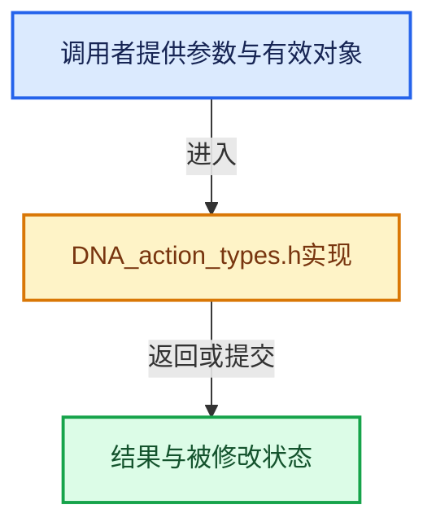

# 实现依赖专题：source/blender/makesdna/DNA_action_types.h

[实现依赖导航](../../README.md) · [符号索引](../../../00-课程指南/02-源码与提交索引/符号依赖与实现索引.md)

本专题从正文实际调用进入，集中保存共享实现。函数有稳定锚点，可从调用处直接跳到对应完整函数；递归与互相调用通过回链组织。

## 本文件的实现关系





## 相关类型布局与成员入口

<a id="t-eb56e5a05751"></a>

### `blender::ePchan_Flag`

原始声明：[source/blender/makesdna/DNA_action_types.h](../../../../../../../source/blender/makesdna/DNA_action_types.h) · L169—L223。

以下保留类的数据声明与编译条件，成员函数实现通过后面的精确链接阅读。

<!-- annotated:ca5e64e79a6d17 -->

```cpp
enum ePchan_Flag : short {
  /* (1 << 0) to (1 << 3) used to be flags to determine if a type of channel
   * should be modified by pose sliding.
   * This has been moved to the `SlideSubject` struct in Blender 5.2. */

  /* old IK/cache stuff
   * - used to be here from (1 << 3) to (1 << 8)
   *   but has been repurposed since 2.77.2
   *   as they haven't been used in over 10 years
   */

  /**
   * When set and bPoseChan.custom_tx is not a nullptr,
   * the gizmo will be drawn at the location and
   * orientation of the custom_tx instead of this bone.
   */
  POSE_TRANSFORM_AT_CUSTOM_TX = (1 << 4),
  /**
   * When set, transformations will modify the bone as if it was a child of the
   * #bPoseChan.custom_tx. The flag only has an effect when #POSE_TRANSFORM_AT_CUSTOM_TX and
   * `custom_tx` are set. This can be useful for rigs where the deformation is coming from
   * shape-keys in addition to the armature.
   */
  POSE_TRANSFORM_AROUND_CUSTOM_TX = (1 << 5),
  /**
   * Marks the pose bone as selected. Do not set directly, use
   * animrig::bone_select and animrig::bone_deselect instead.
   */
  POSE_SELECTED = (1 << 6),
  /**
   * Even though root and tip selection is not used in pose mode, we still have to store that
   * state in order to retain selection when switching back and forth between pose and edit mode.
   */
  POSE_SELECTED_ROOT = (1 << 7),
  POSE_SELECTED_TIP = (1 << 8),
  /**
   * selection state should only be against `POSE_SELECTED`. Do not set directly, use
   * animrig::bone_select and animrig::bone_deselect instead.
   */
  POSE_SELECTED_ALL = (POSE_SELECTED | POSE_SELECTED_ROOT | POSE_SELECTED_TIP),

  /* IK/Pose solving */
  POSE_CHAIN = (1 << 9),
  POSE_DONE = (1 << 10),
  /* POSE_KEY = (1 << 11) */     /* UNUSED */
  /* POSE_STRIDE = (1 << 12), */ /* UNUSED */
  /* standard IK solving */
  POSE_IKTREE = (1 << 13),
#if 0
  /* has Spline IK */
  POSE_HAS_IKS = (1 << 14),
#endif
  /* spline IK solving */
  POSE_IKSPLINE = static_cast<short>(1 << 15),
};
```

<details>
<summary>核对原始源码：source/blender/makesdna/DNA_action_types.h · L169—L223</summary>

<!-- original:ca5e64e79a6d17:source/blender/makesdna/DNA_action_types.h:169:223 -->

```cpp
enum ePchan_Flag : short {
  /* (1 << 0) to (1 << 3) used to be flags to determine if a type of channel
   * should be modified by pose sliding.
   * This has been moved to the `SlideSubject` struct in Blender 5.2. */

  /* old IK/cache stuff
   * - used to be here from (1 << 3) to (1 << 8)
   *   but has been repurposed since 2.77.2
   *   as they haven't been used in over 10 years
   */

  /**
   * When set and bPoseChan.custom_tx is not a nullptr,
   * the gizmo will be drawn at the location and
   * orientation of the custom_tx instead of this bone.
   */
  POSE_TRANSFORM_AT_CUSTOM_TX = (1 << 4),
  /**
   * When set, transformations will modify the bone as if it was a child of the
   * #bPoseChan.custom_tx. The flag only has an effect when #POSE_TRANSFORM_AT_CUSTOM_TX and
   * `custom_tx` are set. This can be useful for rigs where the deformation is coming from
   * shape-keys in addition to the armature.
   */
  POSE_TRANSFORM_AROUND_CUSTOM_TX = (1 << 5),
  /**
   * Marks the pose bone as selected. Do not set directly, use
   * animrig::bone_select and animrig::bone_deselect instead.
   */
  POSE_SELECTED = (1 << 6),
  /**
   * Even though root and tip selection is not used in pose mode, we still have to store that
   * state in order to retain selection when switching back and forth between pose and edit mode.
   */
  POSE_SELECTED_ROOT = (1 << 7),
  POSE_SELECTED_TIP = (1 << 8),
  /**
   * selection state should only be against `POSE_SELECTED`. Do not set directly, use
   * animrig::bone_select and animrig::bone_deselect instead.
   */
  POSE_SELECTED_ALL = (POSE_SELECTED | POSE_SELECTED_ROOT | POSE_SELECTED_TIP),

  /* IK/Pose solving */
  POSE_CHAIN = (1 << 9),
  POSE_DONE = (1 << 10),
  /* POSE_KEY = (1 << 11) */     /* UNUSED */
  /* POSE_STRIDE = (1 << 12), */ /* UNUSED */
  /* standard IK solving */
  POSE_IKTREE = (1 << 13),
#if 0
  /* has Spline IK */
  POSE_HAS_IKS = (1 << 14),
#endif
  /* spline IK solving */
  POSE_IKSPLINE = static_cast<short>(1 << 15),
};
```

</details>


<a id="m-3f27347ce2da"></a>

## 宏 `PCHAN_CUSTOM_BONE_LENGTH`

<!-- annotated:86e21747ceca48 -->

```cpp
#define PCHAN_CUSTOM_BONE_LENGTH(pchanbone) \
  (((pchanbone).pchan->drawflag & PCHAN_DRAW_NO_CUSTOM_BONE_SIZE) ? 1.0f : \
                                                                    (pchanbone).bone->length)

```

<details>
<summary>核对原始源码：source/blender/makesdna/DNA_action_types.h · L265—L268</summary>

<!-- original:86e21747ceca48:source/blender/makesdna/DNA_action_types.h:265:268 -->

```cpp
#define PCHAN_CUSTOM_BONE_LENGTH(pchanbone) \
  (((pchanbone).pchan->drawflag & PCHAN_DRAW_NO_CUSTOM_BONE_SIZE) ? 1.0f : \
                                                                    (pchanbone).bone->length)

```

</details>

宏在预处理阶段展开，参数替换、重复求值和条件编译应直接从该定义检查。与普通函数不同，宏不会自动提供参数类型检查；构建配置选择哪个定义需结合外围条件。

## 完整成员与函数实现
