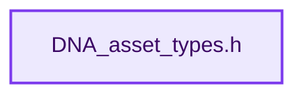

# 实现依赖专题：source/blender/makesdna/DNA_asset_types.h

[实现依赖导航](../../README.md) · [符号索引](../../../00-课程指南/02-源码与提交索引/符号依赖与实现索引.md)

本专题从正文实际调用进入，集中保存共享实现。函数有稳定锚点，可从调用处直接跳到对应完整函数；递归与互相调用通过回链组织。

## 本文件的实现关系




## 相关类型布局与成员入口

<a id="t-7571bb5757c1"></a>

### `blender::eAssetLibraryType`

原始声明：[source/blender/makesdna/DNA_asset_types.h](../../../../../../../source/blender/makesdna/DNA_asset_types.h) · L26—L42。

以下保留类的数据声明与编译条件，成员函数实现通过后面的精确链接阅读。

<!-- annotated:319af527eabfc3 -->

```cpp
enum eAssetLibraryType : short {
  /** Display assets from the current session (current "Main"). */
  ASSET_LIBRARY_LOCAL = 1,
  ASSET_LIBRARY_ALL = 2,
  /** Display assets bundled with Blender by default. */
  ASSET_LIBRARY_ESSENTIALS = 3,
  /** Additions to the essentials library that are stored online - displayed in the UI as part of
   * the normal essentials library. */
  ASSET_LIBRARY_ONLINE_ESSENTIALS = 4,

  /** Display assets from custom asset libraries, as defined in the preferences
   * (#bUserAssetLibrary). The name will be taken from #FileSelectParams.asset_library_ref.idname
   * then.
   * In RNA, we add the index of the custom library to this to identify it by index. So keep
   * this last! */
  ASSET_LIBRARY_CUSTOM = 100,
};
```

<details>
<summary>核对原始源码：source/blender/makesdna/DNA_asset_types.h · L26—L42</summary>

<!-- original:319af527eabfc3:source/blender/makesdna/DNA_asset_types.h:26:42 -->

```cpp
enum eAssetLibraryType : short {
  /** Display assets from the current session (current "Main"). */
  ASSET_LIBRARY_LOCAL = 1,
  ASSET_LIBRARY_ALL = 2,
  /** Display assets bundled with Blender by default. */
  ASSET_LIBRARY_ESSENTIALS = 3,
  /** Additions to the essentials library that are stored online - displayed in the UI as part of
   * the normal essentials library. */
  ASSET_LIBRARY_ONLINE_ESSENTIALS = 4,

  /** Display assets from custom asset libraries, as defined in the preferences
   * (#bUserAssetLibrary). The name will be taken from #FileSelectParams.asset_library_ref.idname
   * then.
   * In RNA, we add the index of the custom library to this to identify it by index. So keep
   * this last! */
  ASSET_LIBRARY_CUSTOM = 100,
};
```

</details>


<a id="t-fa9b43bee74d"></a>

### `blender::AssetLibraryReference`

原始声明：[source/blender/makesdna/DNA_asset_types.h](../../../../../../../source/blender/makesdna/DNA_asset_types.h) · L176—L185。

成员布局：

- `eAssetLibraryType type`
- `char _pad1`
- `int custom_library_index`

以下保留类的数据声明与编译条件，成员函数实现通过后面的精确链接阅读。

<!-- annotated:15a9aa115b04d9 -->

```cpp
struct AssetLibraryReference {
  eAssetLibraryType type = ASSET_LIBRARY_LOCAL;
  char _pad1[2] = {};
  /**
   * If showing a custom asset library (#ASSET_LIBRARY_CUSTOM), this is the index of the
   * #bUserAssetLibrary within #UserDef.asset_libraries.
   * Should be ignored otherwise (but better set to -1 then, for sanity and debugging).
   */
  int custom_library_index = -1;
};
```

<details>
<summary>核对原始源码：source/blender/makesdna/DNA_asset_types.h · L176—L185</summary>

<!-- original:15a9aa115b04d9:source/blender/makesdna/DNA_asset_types.h:176:185 -->

```cpp
struct AssetLibraryReference {
  eAssetLibraryType type = ASSET_LIBRARY_LOCAL;
  char _pad1[2] = {};
  /**
   * If showing a custom asset library (#ASSET_LIBRARY_CUSTOM), this is the index of the
   * #bUserAssetLibrary within #UserDef.asset_libraries.
   * Should be ignored otherwise (but better set to -1 then, for sanity and debugging).
   */
  int custom_library_index = -1;
};
```

</details>


## 完整成员与函数实现
