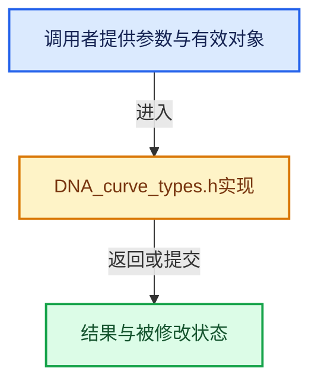

# 实现依赖专题：source/blender/makesdna/DNA_curve_types.h

[实现依赖导航](../../README.md) · [符号索引](../../../00-课程指南/02-源码与提交索引/符号依赖与实现索引.md)

本专题从正文实际调用进入，集中保存共享实现。函数有稳定锚点，可从调用处直接跳到对应完整函数；递归与互相调用通过回链组织。

## 本文件的实现关系





## 相关类型布局与成员入口

<a id="t-f9ebdb5e9abb"></a>

### `blender::Key`

原始声明：[source/blender/makesdna/DNA_curve_types.h](../../../../../../../source/blender/makesdna/DNA_curve_types.h) · L28—L28。

以下保留类的数据声明与编译条件，成员函数实现通过后面的精确链接阅读。

<!-- annotated:37c18f83d140e8 -->

```cpp
struct Key;
```

<details>
<summary>核对原始源码：source/blender/makesdna/DNA_curve_types.h · L28—L28</summary>

<!-- original:37c18f83d140e8:source/blender/makesdna/DNA_curve_types.h:28:28 -->

```cpp
struct Key;
```

</details>


<a id="t-e0bde3ada318"></a>

### `blender::Curve::Key`

原始声明：[source/blender/makesdna/DNA_curve_types.h](../../../../../../../source/blender/makesdna/DNA_curve_types.h) · L231—L231。

以下保留类的数据声明与编译条件，成员函数实现通过后面的精确链接阅读。

<!-- annotated:652186be82c9f8 -->

```cpp
  struct Key *key = nullptr;
```

<details>
<summary>核对原始源码：source/blender/makesdna/DNA_curve_types.h · L231—L231</summary>

<!-- original:652186be82c9f8:source/blender/makesdna/DNA_curve_types.h:231:231 -->

```cpp
  struct Key *key = nullptr;
```

</details>


<a id="m-bbbfde5b4afa"></a>

## 宏 `BEZKEYTYPE_LVALUE`

<!-- annotated:b728f048eeb9f4 -->

```cpp
#define BEZKEYTYPE_LVALUE(bezt) ((bezt)->hide)

```

<details>
<summary>核对原始源码：source/blender/makesdna/DNA_curve_types.h · L124—L125</summary>

<!-- original:b728f048eeb9f4:source/blender/makesdna/DNA_curve_types.h:124:125 -->

```cpp
#define BEZKEYTYPE_LVALUE(bezt) ((bezt)->hide)

```

</details>

宏在预处理阶段展开，参数替换、重复求值和条件编译应直接从该定义检查。与普通函数不同，宏不会自动提供参数类型检查；构建配置选择哪个定义需结合外围条件。

<a id="m-28f6639b851f"></a>

## 宏 `BEZT_ISSEL_ANY`

<!-- annotated:03656ea5ae1a1f -->

```cpp
#define BEZT_ISSEL_ANY(bezt) \
  (((bezt)->f2 & SELECT) || ((bezt)->f1 & SELECT) || ((bezt)->f3 & SELECT))
#define BEZT_ISSEL_ALL(bezt) \
```

<details>
<summary>核对原始源码：source/blender/makesdna/DNA_curve_types.h · L352—L354</summary>

<!-- original:03656ea5ae1a1f:source/blender/makesdna/DNA_curve_types.h:352:354 -->

```cpp
#define BEZT_ISSEL_ANY(bezt) \
  (((bezt)->f2 & SELECT) || ((bezt)->f1 & SELECT) || ((bezt)->f3 & SELECT))
#define BEZT_ISSEL_ALL(bezt) \
```

</details>

宏在预处理阶段展开，参数替换、重复求值和条件编译应直接从该定义检查。与普通函数不同，宏不会自动提供参数类型检查；构建配置选择哪个定义需结合外围条件。

<a id="m-49d7b808c90b"></a>

## 宏 `BEZT_IS_AUTOH`

<!-- annotated:985e9dd4aeea51 -->

```cpp
#define BEZT_IS_AUTOH(bezt) \
  (ELEM((bezt)->h1, HD_AUTO, HD_AUTO_ANIM) && ELEM((bezt)->h2, HD_AUTO, HD_AUTO_ANIM))

```

<details>
<summary>核对原始源码：source/blender/makesdna/DNA_curve_types.h · L427—L429</summary>

<!-- original:985e9dd4aeea51:source/blender/makesdna/DNA_curve_types.h:427:429 -->

```cpp
#define BEZT_IS_AUTOH(bezt) \
  (ELEM((bezt)->h1, HD_AUTO, HD_AUTO_ANIM) && ELEM((bezt)->h2, HD_AUTO, HD_AUTO_ANIM))

```

</details>

宏在预处理阶段展开，参数替换、重复求值和条件编译应直接从该定义检查。与普通函数不同，宏不会自动提供参数类型检查；构建配置选择哪个定义需结合外围条件。

## 完整成员与函数实现
