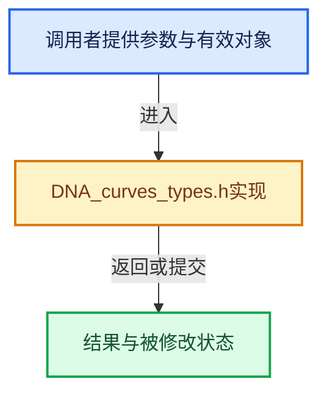

# 实现依赖专题：source/blender/makesdna/DNA_curves_types.h

[实现依赖导航](../../README.md) · [符号索引](../../../00-课程指南/02-源码与提交索引/符号依赖与实现索引.md)

本专题从正文实际调用进入，集中保存共享实现。函数有稳定锚点，可从调用处直接跳到对应完整函数；递归与互相调用通过回链组织。

## 本文件的实现关系





## 相关类型布局与成员入口

<a id="t-a0ae3b1d3ae4"></a>

### `blender::CurveType`

原始声明：[source/blender/makesdna/DNA_curves_types.h](../../../../../../../source/blender/makesdna/DNA_curves_types.h) · L29—L58。

以下保留类的数据声明与编译条件，成员函数实现通过后面的精确链接阅读。

<!-- annotated:aaca24a456a204 -->

```cpp
enum CurveType : int8_t {
  /**
   * Catmull Rom curves provide automatic smoothness, like Bezier curves with automatic handle
   * positions. This is the default type for the hair system because of the simplicity of
   * interaction and data storage.
   */
  CURVE_TYPE_CATMULL_ROM = 0,
  /**
   * Poly curves (often called "polylines") have no interpolation at all. They evaluate to the same
   * set of points as the original control points. They are a good choice for high-resolution
   * data-sets or when constrained by performance.
   */
  CURVE_TYPE_POLY = 1,
  /**
   * Bezier curves provide a common intuitive control system made up of handles and control points.
   * Handles are stored separately from positions, and do not store extra generic attribute values.
   * Bezier curves also give the flexibility to set handle types (see #HandleType) that influence
   * the number of evaluated points in each segment.
   */
  CURVE_TYPE_BEZIER = 2,
  /**
   * NURBS curves offer the most flexibility at the cost of increased complexity. Given the choice
   * of different knot modes (see #KnotsMode) and different orders (see "nurbs_order" attribute),
   * any of the other types can theoretically be created with a NURBS curve.
   *
   * Note that Blender currently does not support custom knot vectors, though that should be
   * supported in the long term.
   */
  CURVE_TYPE_NURBS = 3,
};
```

<details>
<summary>核对原始源码：source/blender/makesdna/DNA_curves_types.h · L29—L58</summary>

<!-- original:aaca24a456a204:source/blender/makesdna/DNA_curves_types.h:29:58 -->

```cpp
enum CurveType : int8_t {
  /**
   * Catmull Rom curves provide automatic smoothness, like Bezier curves with automatic handle
   * positions. This is the default type for the hair system because of the simplicity of
   * interaction and data storage.
   */
  CURVE_TYPE_CATMULL_ROM = 0,
  /**
   * Poly curves (often called "polylines") have no interpolation at all. They evaluate to the same
   * set of points as the original control points. They are a good choice for high-resolution
   * data-sets or when constrained by performance.
   */
  CURVE_TYPE_POLY = 1,
  /**
   * Bezier curves provide a common intuitive control system made up of handles and control points.
   * Handles are stored separately from positions, and do not store extra generic attribute values.
   * Bezier curves also give the flexibility to set handle types (see #HandleType) that influence
   * the number of evaluated points in each segment.
   */
  CURVE_TYPE_BEZIER = 2,
  /**
   * NURBS curves offer the most flexibility at the cost of increased complexity. Given the choice
   * of different knot modes (see #KnotsMode) and different orders (see "nurbs_order" attribute),
   * any of the other types can theoretically be created with a NURBS curve.
   *
   * Note that Blender currently does not support custom knot vectors, though that should be
   * supported in the long term.
   */
  CURVE_TYPE_NURBS = 3,
};
```

</details>


<a id="t-daf7799cb5ba"></a>

### `blender::HandleType`

原始声明：[source/blender/makesdna/DNA_curves_types.h](../../../../../../../source/blender/makesdna/DNA_curves_types.h) · L62—L71。

以下保留类的数据声明与编译条件，成员函数实现通过后面的精确链接阅读。

<!-- annotated:4108d9da5dd6e0 -->

```cpp
enum HandleType : int8_t {
  /** The handle can be moved anywhere, and doesn't influence the point's other handle. */
  BEZIER_HANDLE_FREE = 0,
  /** The location is automatically calculated to be smooth. */
  BEZIER_HANDLE_AUTO = 1,
  /** The location is calculated to point to the next/previous control point. */
  BEZIER_HANDLE_VECTOR = 2,
  /** The location is constrained to point in the opposite direction as the other handle. */
  BEZIER_HANDLE_ALIGN = 3,
};
```

<details>
<summary>核对原始源码：source/blender/makesdna/DNA_curves_types.h · L62—L71</summary>

<!-- original:4108d9da5dd6e0:source/blender/makesdna/DNA_curves_types.h:62:71 -->

```cpp
enum HandleType : int8_t {
  /** The handle can be moved anywhere, and doesn't influence the point's other handle. */
  BEZIER_HANDLE_FREE = 0,
  /** The location is automatically calculated to be smooth. */
  BEZIER_HANDLE_AUTO = 1,
  /** The location is calculated to point to the next/previous control point. */
  BEZIER_HANDLE_VECTOR = 2,
  /** The location is constrained to point in the opposite direction as the other handle. */
  BEZIER_HANDLE_ALIGN = 3,
};
```

</details>


<a id="t-4172d17fc5f5"></a>

### `blender::KnotsMode`

原始声明：[source/blender/makesdna/DNA_curves_types.h](../../../../../../../source/blender/makesdna/DNA_curves_types.h) · L75—L81。

以下保留类的数据声明与编译条件，成员函数实现通过后面的精确链接阅读。

<!-- annotated:a4f9a257470eae -->

```cpp
enum KnotsMode : int8_t {
  NURBS_KNOT_MODE_NORMAL = 0,
  NURBS_KNOT_MODE_ENDPOINT = 1,
  NURBS_KNOT_MODE_BEZIER = 2,
  NURBS_KNOT_MODE_ENDPOINT_BEZIER = 3,
  NURBS_KNOT_MODE_CUSTOM = 4,
};
```

<details>
<summary>核对原始源码：source/blender/makesdna/DNA_curves_types.h · L75—L81</summary>

<!-- original:a4f9a257470eae:source/blender/makesdna/DNA_curves_types.h:75:81 -->

```cpp
enum KnotsMode : int8_t {
  NURBS_KNOT_MODE_NORMAL = 0,
  NURBS_KNOT_MODE_ENDPOINT = 1,
  NURBS_KNOT_MODE_BEZIER = 2,
  NURBS_KNOT_MODE_ENDPOINT_BEZIER = 3,
  NURBS_KNOT_MODE_CUSTOM = 4,
};
```

</details>


<a id="t-7f8d6f6c3372"></a>

### `blender::NormalMode`

原始声明：[source/blender/makesdna/DNA_curves_types.h](../../../../../../../source/blender/makesdna/DNA_curves_types.h) · L84—L94。

以下保留类的数据声明与编译条件，成员函数实现通过后面的精确链接阅读。

<!-- annotated:682004e5d7dc2f -->

```cpp
enum NormalMode : int8_t {
  /** Calculate normals with the smallest twist around the curve tangent across the whole curve. */
  NORMAL_MODE_MINIMUM_TWIST = 0,
  /**
   * Calculate normals perpendicular to the Z axis and the curve tangent. If a series of points
   * is vertical, the X axis is used.
   */
  NORMAL_MODE_Z_UP = 1,
  /** Interpolate the stored "custom_normal" attribute for the final normals. */
  NORMAL_MODE_FREE = 2,
};
```

<details>
<summary>核对原始源码：source/blender/makesdna/DNA_curves_types.h · L84—L94</summary>

<!-- original:682004e5d7dc2f:source/blender/makesdna/DNA_curves_types.h:84:94 -->

```cpp
enum NormalMode : int8_t {
  /** Calculate normals with the smallest twist around the curve tangent across the whole curve. */
  NORMAL_MODE_MINIMUM_TWIST = 0,
  /**
   * Calculate normals perpendicular to the Z axis and the curve tangent. If a series of points
   * is vertical, the X axis is used.
   */
  NORMAL_MODE_Z_UP = 1,
  /** Interpolate the stored "custom_normal" attribute for the final normals. */
  NORMAL_MODE_FREE = 2,
};
```

</details>


<a id="t-7a3bf703b763"></a>

### `blender::eCurves_Flag`

原始声明：[source/blender/makesdna/DNA_curves_types.h](../../../../../../../source/blender/makesdna/DNA_curves_types.h) · L97—L100。

以下保留类的数据声明与编译条件，成员函数实现通过后面的精确链接阅读。

<!-- annotated:f7ce8cfe7ac41c -->

```cpp
enum eCurves_Flag : int {
  HA_DS_EXPAND = (1 << 0),
  CV_SCULPT_COLLISION_ENABLED = (1 << 1),
};
```

<details>
<summary>核对原始源码：source/blender/makesdna/DNA_curves_types.h · L97—L100</summary>

<!-- original:f7ce8cfe7ac41c:source/blender/makesdna/DNA_curves_types.h:97:100 -->

```cpp
enum eCurves_Flag : int {
  HA_DS_EXPAND = (1 << 0),
  CV_SCULPT_COLLISION_ENABLED = (1 << 1),
};
```

</details>


## 完整成员与函数实现
