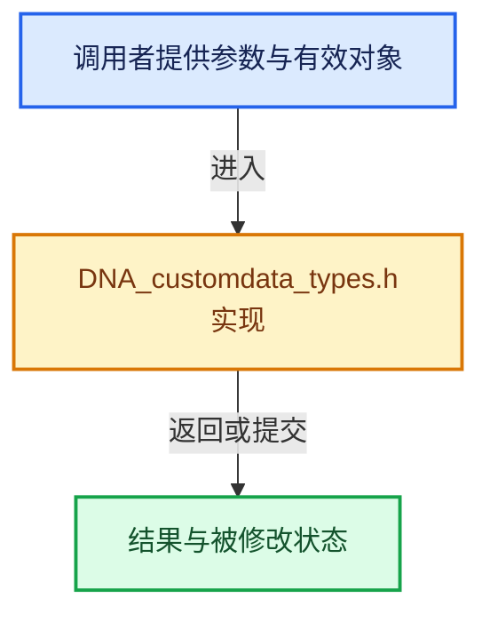

# 实现依赖专题：source/blender/makesdna/DNA_customdata_types.h

[实现依赖导航](../../README.md) · [符号索引](../../../00-课程指南/02-源码与提交索引/符号依赖与实现索引.md)

本专题从正文实际调用进入，集中保存共享实现。函数有稳定锚点，可从调用处直接跳到对应完整函数；递归与互相调用通过回链组织。

## 本文件的实现关系





## 相关类型布局与成员入口

<a id="t-dfbf4a4ce0e1"></a>

### `blender::eCustomDataType`

原始声明：[source/blender/makesdna/DNA_customdata_types.h](../../../../../../../source/blender/makesdna/DNA_customdata_types.h) · L21—L116。

以下保留类的数据声明与编译条件，成员函数实现通过后面的精确链接阅读。

<!-- annotated:9503f6d02d7e10 -->

```cpp
enum eCustomDataType : int {
  /**
   * Used by GPU attributes in the cases when we don't know which layer
   * we are addressing in advance.
   */
  CD_AUTO_FROM_NAME = -1,

#ifdef DNA_DEPRECATED_ALLOW
  CD_MVERT = 0,
  CD_MSTICKY = 1,
#endif
  CD_MDEFORMVERT = 2, /* Array of #MDeformVert. */
#ifdef DNA_DEPRECATED_ALLOW
  CD_MEDGE = 3,
#endif
  CD_MFACE = 4,
  CD_MTFACE = 5,
  CD_MCOL = 6,
  CD_ORIGINDEX = 7,
  /**
   * Used as temporary storage for some areas that support interpolating custom normals.
   * Using a separate type from generic 3D vectors is a simple way of keeping values normalized.
   */
  CD_NORMAL = 8,
#ifdef DNA_DEPRECATED_ALLOW
  CD_FACEMAP = 9,
#endif
  CD_PROP_FLOAT = 10,
  CD_PROP_INT32 = 11,
  CD_PROP_STRING = 12,
  CD_ORIGSPACE = 13, /* for modifier stack face location mapping */
  CD_ORCO = 14,      /* undeformed vertex coordinates, normalized to 0..1 range */
#ifdef DNA_DEPRECATED_ALLOW
  CD_MTEXPOLY = 15,
  CD_MLOOPUV = 16,
#endif
  CD_PROP_BYTE_COLOR = 17,
  /**
   * Previously used for runtime corner tangent storage in mesh #CustomData. Currently only used
   * as an identifier to choose tangents in a few places.
   */
  CD_TANGENT = 18,
  CD_MDISPS = 19,
  CD_PROP_FLOAT4X4 = 20,
  /* CD_ID_MCOL = 21, */
  CD_PROP_INT16_2D = 22,
  CD_CLOTH_ORCO = 23,
  CD_PROP_FLOAT4 = 24,

#ifdef DNA_DEPRECATED_ALLOW
  CD_MPOLY = 25,
  CD_MLOOP = 26,
#endif
  CD_SHAPE_KEYINDEX = 27,
  CD_SHAPEKEY = 28,
#ifdef DNA_DEPRECATED_ALLOW
  CD_BWEIGHT = 29,
  CD_CREASE = 30,
#endif
  CD_ORIGSPACE_MLOOP = 31,
  /* CD_PREVIEW_MLOOPCOL = 32, */ /* UNUSED */
  CD_BM_ELEM_PYPTR = 33,

#ifdef DNA_DEPRECATED_ALLOW
  CD_PAINT_MASK = 34,
#endif
  CD_GRID_PAINT_MASK = 35,
#ifdef DNA_DEPRECATED_ALLOW
  CD_MVERT_SKIN = 36,
  CD_FREESTYLE_EDGE = 37,
  CD_FREESTYLE_FACE = 38,
#endif
  CD_MLOOPTANGENT = 39,
  CD_TESSLOOPNORMAL = 40,
#ifdef DNA_DEPRECATED_ALLOW
  CD_CUSTOMLOOPNORMAL = 41,
  CD_SCULPT_FACE_SETS = 42,
#endif

  /* CD_LOCATION = 43, */ /* UNUSED */
  /* CD_RADIUS = 44, */   /* UNUSED */
  CD_PROP_INT8 = 45,
  /* Two 32-bit signed integers. */
  CD_PROP_INT32_2D = 46,

  CD_PROP_COLOR = 47,
  CD_PROP_FLOAT3 = 48,
  CD_PROP_FLOAT2 = 49,
  CD_PROP_BOOL = 50,

  /* CD_HAIRLENGTH = 51, */ /* UNUSED */

  CD_PROP_QUATERNION = 52,

  CD_NUMTYPES = 53,
};
```

<details>
<summary>核对原始源码：source/blender/makesdna/DNA_customdata_types.h · L21—L116</summary>

<!-- original:9503f6d02d7e10:source/blender/makesdna/DNA_customdata_types.h:21:116 -->

```cpp
enum eCustomDataType : int {
  /**
   * Used by GPU attributes in the cases when we don't know which layer
   * we are addressing in advance.
   */
  CD_AUTO_FROM_NAME = -1,

#ifdef DNA_DEPRECATED_ALLOW
  CD_MVERT = 0,
  CD_MSTICKY = 1,
#endif
  CD_MDEFORMVERT = 2, /* Array of #MDeformVert. */
#ifdef DNA_DEPRECATED_ALLOW
  CD_MEDGE = 3,
#endif
  CD_MFACE = 4,
  CD_MTFACE = 5,
  CD_MCOL = 6,
  CD_ORIGINDEX = 7,
  /**
   * Used as temporary storage for some areas that support interpolating custom normals.
   * Using a separate type from generic 3D vectors is a simple way of keeping values normalized.
   */
  CD_NORMAL = 8,
#ifdef DNA_DEPRECATED_ALLOW
  CD_FACEMAP = 9,
#endif
  CD_PROP_FLOAT = 10,
  CD_PROP_INT32 = 11,
  CD_PROP_STRING = 12,
  CD_ORIGSPACE = 13, /* for modifier stack face location mapping */
  CD_ORCO = 14,      /* undeformed vertex coordinates, normalized to 0..1 range */
#ifdef DNA_DEPRECATED_ALLOW
  CD_MTEXPOLY = 15,
  CD_MLOOPUV = 16,
#endif
  CD_PROP_BYTE_COLOR = 17,
  /**
   * Previously used for runtime corner tangent storage in mesh #CustomData. Currently only used
   * as an identifier to choose tangents in a few places.
   */
  CD_TANGENT = 18,
  CD_MDISPS = 19,
  CD_PROP_FLOAT4X4 = 20,
  /* CD_ID_MCOL = 21, */
  CD_PROP_INT16_2D = 22,
  CD_CLOTH_ORCO = 23,
  CD_PROP_FLOAT4 = 24,

#ifdef DNA_DEPRECATED_ALLOW
  CD_MPOLY = 25,
  CD_MLOOP = 26,
#endif
  CD_SHAPE_KEYINDEX = 27,
  CD_SHAPEKEY = 28,
#ifdef DNA_DEPRECATED_ALLOW
  CD_BWEIGHT = 29,
  CD_CREASE = 30,
#endif
  CD_ORIGSPACE_MLOOP = 31,
  /* CD_PREVIEW_MLOOPCOL = 32, */ /* UNUSED */
  CD_BM_ELEM_PYPTR = 33,

#ifdef DNA_DEPRECATED_ALLOW
  CD_PAINT_MASK = 34,
#endif
  CD_GRID_PAINT_MASK = 35,
#ifdef DNA_DEPRECATED_ALLOW
  CD_MVERT_SKIN = 36,
  CD_FREESTYLE_EDGE = 37,
  CD_FREESTYLE_FACE = 38,
#endif
  CD_MLOOPTANGENT = 39,
  CD_TESSLOOPNORMAL = 40,
#ifdef DNA_DEPRECATED_ALLOW
  CD_CUSTOMLOOPNORMAL = 41,
  CD_SCULPT_FACE_SETS = 42,
#endif

  /* CD_LOCATION = 43, */ /* UNUSED */
  /* CD_RADIUS = 44, */   /* UNUSED */
  CD_PROP_INT8 = 45,
  /* Two 32-bit signed integers. */
  CD_PROP_INT32_2D = 46,

  CD_PROP_COLOR = 47,
  CD_PROP_FLOAT3 = 48,
  CD_PROP_FLOAT2 = 49,
  CD_PROP_BOOL = 50,

  /* CD_HAIRLENGTH = 51, */ /* UNUSED */

  CD_PROP_QUATERNION = 52,

  CD_NUMTYPES = 53,
};
```

</details>


## 完整成员与函数实现
