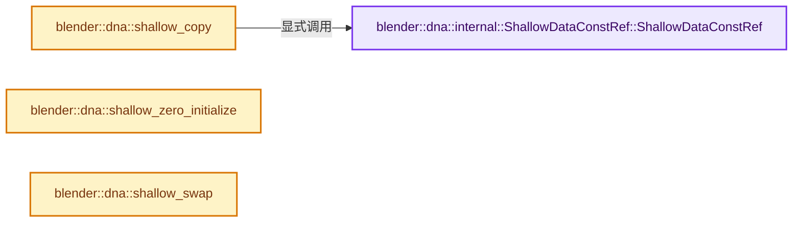
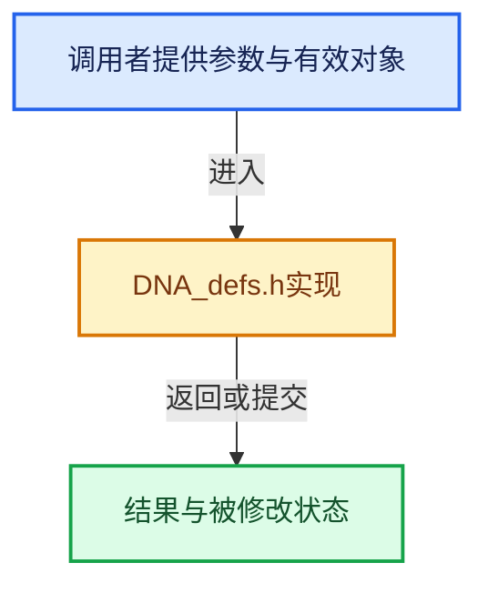

# 实现依赖专题：source/blender/makesdna/DNA_defs.h

[实现依赖导航](../../README.md) · [符号索引](../../../00-课程指南/02-源码与提交索引/符号依赖与实现索引.md)

本专题从正文实际调用进入，集中保存共享实现。函数有稳定锚点，可从调用处直接跳到对应完整函数；递归与互相调用通过回链组织。

## 本文件的实现关系






## 相关类型布局与成员入口

<a id="t-112c8b43bb52"></a>

### `blender::dna::internal::ShallowZeroInitializeTag`

原始声明：[source/blender/makesdna/DNA_defs.h](../../../../../../../source/blender/makesdna/DNA_defs.h) · L100—L100。

以下保留类的数据声明与编译条件，成员函数实现通过后面的精确链接阅读。

<!-- annotated:aa0f0d6c351f40 -->

```cpp
class ShallowZeroInitializeTag {};
```

<details>
<summary>核对原始源码：source/blender/makesdna/DNA_defs.h · L100—L100</summary>

<!-- original:aa0f0d6c351f40:source/blender/makesdna/DNA_defs.h:100:100 -->

```cpp
class ShallowZeroInitializeTag {};
```

</details>


## 完整成员与函数实现

<a id="f-acef4447c7ecd192"></a>

### `blender::dna::internal::ShallowDataConstRef::ShallowDataConstRef`

实现位置：[source/blender/makesdna/DNA_defs.h](../../../../../../../source/blender/makesdna/DNA_defs.h) · L89—L89。

接口参数：

- `const T &ref`

**教学注释版**

<!-- annotated:240493999b3896 -->

```cpp
  constexpr explicit ShallowDataConstRef(const T &ref) : ref_(ref) {}
```

<details>
<summary>核对原始源码：source/blender/makesdna/DNA_defs.h · L89—L89</summary>

<!-- original:240493999b3896:source/blender/makesdna/DNA_defs.h:89:89 -->

```cpp
  constexpr explicit ShallowDataConstRef(const T &ref) : ref_(ref) {}
```

</details>

**继续追踪实现**

本实现没有需要继续展开的显式调用；检查返回表达式、对象转换和调用者前置条件。

<a id="f-84b6eda95a1c994c"></a>

### `blender::dna::shallow_copy`

实现位置：[source/blender/makesdna/DNA_defs.h](../../../../../../../source/blender/makesdna/DNA_defs.h) · L146—L150。

接口参数：

- `const T &other`

**教学注释版**

<!-- annotated:02b7049624dbed -->

```cpp
template<typename T>
[[nodiscard]] inline internal::ShallowDataConstRef<T> shallow_copy(const T &other)
{
  return internal::ShallowDataConstRef(other);
}
```

<details>
<summary>核对原始源码：source/blender/makesdna/DNA_defs.h · L146—L150</summary>

<!-- original:02b7049624dbed:source/blender/makesdna/DNA_defs.h:146:150 -->

```cpp
template<typename T>
[[nodiscard]] inline internal::ShallowDataConstRef<T> shallow_copy(const T &other)
{
  return internal::ShallowDataConstRef(other);
}
```

</details>

**结果出口**

- `return internal::ShallowDataConstRef(other);`

**继续追踪实现**

- `internal::ShallowDataConstRef` → [blender::dna::internal::ShallowDataConstRef::ShallowDataConstRef · L89](DNA_defs.h.md#f-acef4447c7ecd192)。

<a id="f-1855e6cb8e8cfb60"></a>

### `blender::dna::shallow_zero_initialize`

实现位置：[source/blender/makesdna/DNA_defs.h](../../../../../../../source/blender/makesdna/DNA_defs.h) · L159—L162。

**教学注释版**

<!-- annotated:caa74d13194902 -->

```cpp
[[nodiscard]] inline internal::ShallowZeroInitializeTag shallow_zero_initialize()
{
  return internal::ShallowZeroInitializeTag();
}
```

<details>
<summary>核对原始源码：source/blender/makesdna/DNA_defs.h · L159—L162</summary>

<!-- original:caa74d13194902:source/blender/makesdna/DNA_defs.h:159:162 -->

```cpp
[[nodiscard]] inline internal::ShallowZeroInitializeTag shallow_zero_initialize()
{
  return internal::ShallowZeroInitializeTag();
}
```

</details>

**结果出口**

- `return internal::ShallowZeroInitializeTag();`

**继续追踪实现**

- `internal::ShallowZeroInitializeTag` → [blender::dna::internal::ShallowZeroInitializeTag](DNA_defs.h.md#t-112c8b43bb52)。

<a id="f-4b29c88a79f2a6a7"></a>

### `blender::dna::shallow_swap`

实现位置：[source/blender/makesdna/DNA_defs.h](../../../../../../../source/blender/makesdna/DNA_defs.h) · L164—L167。

接口参数：

- `T &a`
- `T &b`

**教学注释版**

<!-- annotated:bd71671b725a85 -->

```cpp
template<typename T> inline void shallow_swap(T &a, T &b)
{
  _DNA_internal_swap(&a, &b, sizeof(T));
}
```

<details>
<summary>核对原始源码：source/blender/makesdna/DNA_defs.h · L164—L167</summary>

<!-- original:bd71671b725a85:source/blender/makesdna/DNA_defs.h:164:167 -->

```cpp
template<typename T> inline void shallow_swap(T &a, T &b)
{
  _DNA_internal_swap(&a, &b, sizeof(T));
}
```

</details>

**继续追踪实现**

- `_DNA_internal_swap` → [_DNA_internal_swap · L276](intern/dna_utils.cc.md#f-1411eddf78e71fc9)。
