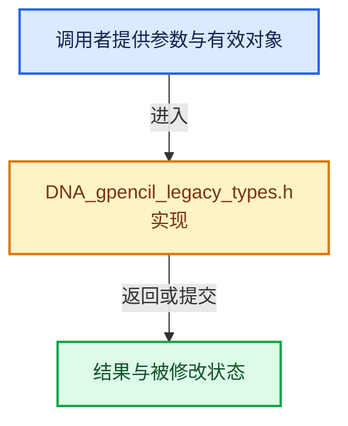

# 实现依赖专题：source/blender/makesdna/DNA_gpencil_legacy_types.h

[实现依赖导航](../../README.md) · [符号索引](../../../00-课程指南/02-源码与提交索引/符号依赖与实现索引.md)

本专题从正文实际调用进入，集中保存共享实现。函数有稳定锚点，可从调用处直接跳到对应完整函数；递归与互相调用通过回链组织。

## 本文件的实现关系





## 相关类型布局与成员入口

<a id="t-5cb1759b376b"></a>

### `blender::eGPDstroke_Caps`

原始声明：[source/blender/makesdna/DNA_gpencil_legacy_types.h](../../../../../../../source/blender/makesdna/DNA_gpencil_legacy_types.h) · L104—L111。

以下保留类的数据声明与编译条件，成员函数实现通过后面的精确链接阅读。

<!-- annotated:d466f8bcd87595 -->

```cpp
enum eGPDstroke_Caps : short {
  /* type of extreme */
  GP_STROKE_CAP_ROUND = 0,
  GP_STROKE_CAP_FLAT = 1,

  /* Keep last. */
  GP_STROKE_CAP_MAX,
};
```

<details>
<summary>核对原始源码：source/blender/makesdna/DNA_gpencil_legacy_types.h · L104—L111</summary>

<!-- original:d466f8bcd87595:source/blender/makesdna/DNA_gpencil_legacy_types.h:104:111 -->

```cpp
enum eGPDstroke_Caps : short {
  /* type of extreme */
  GP_STROKE_CAP_ROUND = 0,
  GP_STROKE_CAP_FLAT = 1,

  /* Keep last. */
  GP_STROKE_CAP_MAX,
};
```

</details>


<a id="t-528533752ea9"></a>

### `blender::eGPDlayer_Flag`

原始声明：[source/blender/makesdna/DNA_gpencil_legacy_types.h](../../../../../../../source/blender/makesdna/DNA_gpencil_legacy_types.h) · L143—L172。

以下保留类的数据声明与编译条件，成员函数实现通过后面的精确链接阅读。

<!-- annotated:903f9f2701d5c5 -->

```cpp
enum eGPDlayer_Flag : short {
  /* don't display layer */
  GP_LAYER_HIDE = (1 << 0),
  /* protected from further editing */
  GP_LAYER_LOCKED = (1 << 1),
  /* layer is 'active' layer being edited */
  GP_LAYER_ACTIVE = (1 << 2),
  /* draw points of stroke for debugging purposes */
  GP_LAYER_DRAWDEBUG = (1 << 3),
  /* Flag used to display in Paint mode only layers with keyframe */
  GP_LAYER_SOLO_MODE = (1 << 4),
  /* for editing in Action Editor */
  GP_LAYER_SELECT = (1 << 5),
  /* current frame for layer can't be changed */
  GP_LAYER_FRAMELOCK = (1 << 6),
  /* Don't render X-ray (which is default). */
  GP_LAYER_NO_XRAY = (1 << 7),
  /* "volumetric" strokes */
  GP_LAYER_VOLUMETRIC = (1 << 10),
  /* Use Scene lights */
  GP_LAYER_USE_LIGHTS = (1 << 11),
  /* Unlock color */
  GP_LAYER_UNLOCK_COLOR = (1 << 12),
  /* Mask Layer */
  GP_LAYER_USE_MASK = (1 << 13), /* TODO: DEPRECATED */
  /* Ruler Layer */
  GP_LAYER_IS_RULER = (1 << 14),
  /* Disable masks in view-layer render */
  GP_LAYER_DISABLE_MASKS_IN_VIEWLAYER = static_cast<short>(1 << 15),
};
```

<details>
<summary>核对原始源码：source/blender/makesdna/DNA_gpencil_legacy_types.h · L143—L172</summary>

<!-- original:903f9f2701d5c5:source/blender/makesdna/DNA_gpencil_legacy_types.h:143:172 -->

```cpp
enum eGPDlayer_Flag : short {
  /* don't display layer */
  GP_LAYER_HIDE = (1 << 0),
  /* protected from further editing */
  GP_LAYER_LOCKED = (1 << 1),
  /* layer is 'active' layer being edited */
  GP_LAYER_ACTIVE = (1 << 2),
  /* draw points of stroke for debugging purposes */
  GP_LAYER_DRAWDEBUG = (1 << 3),
  /* Flag used to display in Paint mode only layers with keyframe */
  GP_LAYER_SOLO_MODE = (1 << 4),
  /* for editing in Action Editor */
  GP_LAYER_SELECT = (1 << 5),
  /* current frame for layer can't be changed */
  GP_LAYER_FRAMELOCK = (1 << 6),
  /* Don't render X-ray (which is default). */
  GP_LAYER_NO_XRAY = (1 << 7),
  /* "volumetric" strokes */
  GP_LAYER_VOLUMETRIC = (1 << 10),
  /* Use Scene lights */
  GP_LAYER_USE_LIGHTS = (1 << 11),
  /* Unlock color */
  GP_LAYER_UNLOCK_COLOR = (1 << 12),
  /* Mask Layer */
  GP_LAYER_USE_MASK = (1 << 13), /* TODO: DEPRECATED */
  /* Ruler Layer */
  GP_LAYER_IS_RULER = (1 << 14),
  /* Disable masks in view-layer render */
  GP_LAYER_DISABLE_MASKS_IN_VIEWLAYER = static_cast<short>(1 << 15),
};
```

</details>


## 完整成员与函数实现
